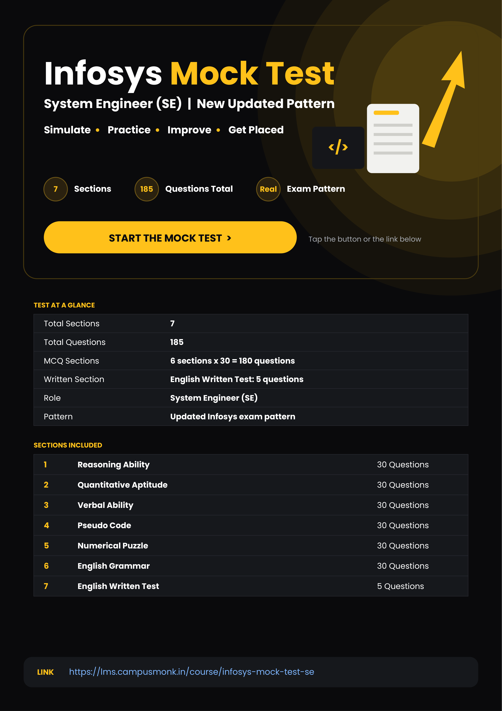
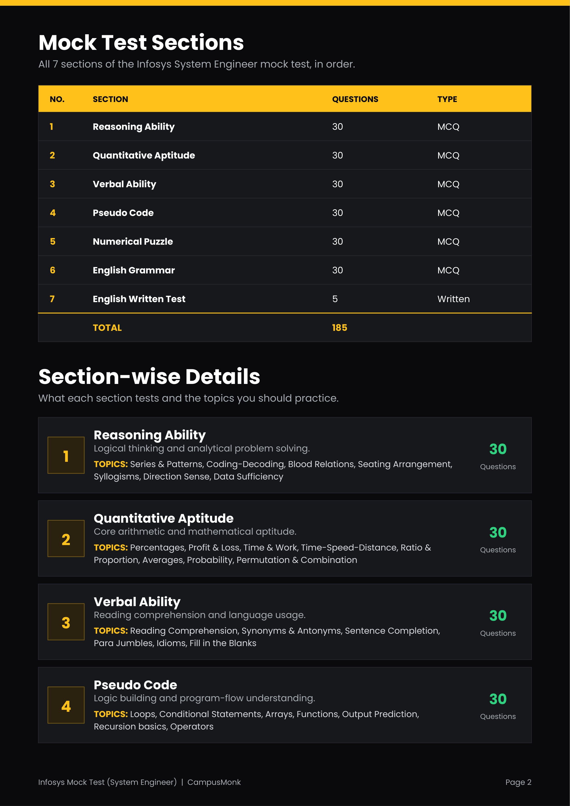
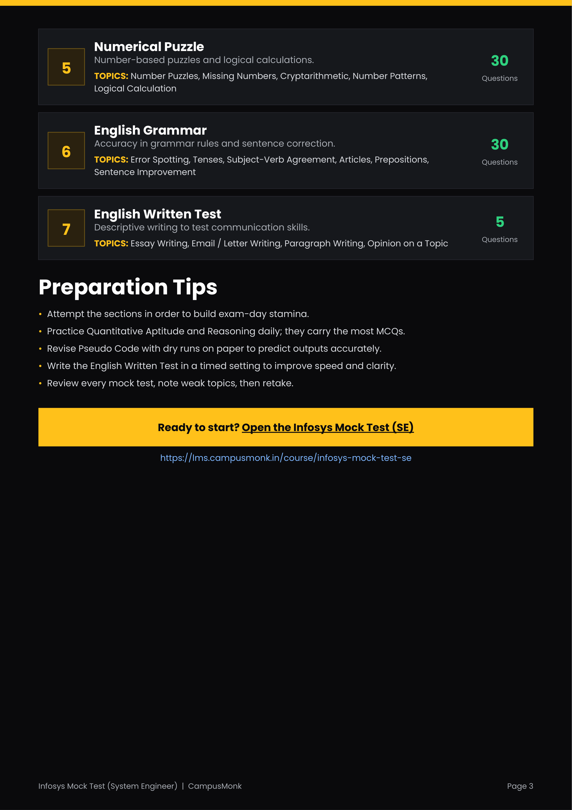

# Infosys System Engineer (SE) Mock Test — Master Blueprint & Portal Guide

> **Document Source**: `Infosys_Mock_Test_System_Engineer (1).pdf`
> **Publisher**: CampusMonk LMS (`https://lms.campusmonk.in/course/infosys-mock-test-se`)
> **Total Sections**: 7 | **Total Questions**: 185 | **Exam Pattern**: New Updated Infosys SE Pattern

## 1. Test Architecture & Structure at a Glance

| Section No. | Section Name | Questions | Question Type | Core Focus Areas |
|:---:|:---|:---:|:---:|:---|
| **1** | Reasoning Ability | 30 | MCQ | Series & Patterns, Coding-Decoding, Blood Relations, Seating Arrangement, Syllogisms, Direction Sense, Data Sufficiency |
| **2** | Quantitative Aptitude | 30 | MCQ | Percentages, Profit & Loss, Time & Work, Time-Speed-Distance, Ratio & Proportion, Averages, Probability, Permutation & Combination |
| **3** | Verbal Ability | 30 | MCQ | Reading Comprehension, Synonyms & Antonyms, Sentence Completion, Para Jumbles, Idioms, Fill in the Blanks |
| **4** | Pseudo Code | 30 | MCQ | Loops, Conditional Statements, Arrays, Functions, Output Prediction, Recursion basics, Operators |
| **5** | Numerical Puzzle | 30 | MCQ | Number Puzzles, Missing Numbers, Cryptarithmetic, Number Patterns, Logical Calculation |
| **6** | English Grammar | 30 | MCQ | Error Spotting, Tenses, Subject-Verb Agreement, Articles, Prepositions, Sentence Improvement |
| **7** | English Written Test | 5 | Written Descriptive | Essay Writing, Email / Letter Writing, Paragraph Writing, Opinion on a Topic |
| **TOTAL** | **Full Simulation** | **185** | **6 MCQ + 1 Written** | **Complete System Engineer Assessment** |

## 2. Blueprint Pages Visual Plates

The 3 original specification pages from the source PDF have been rendered at 300 DPI master quality:

- **Page 1: Overview & Portal Link**: `images/infosys_se_mock_test_blueprint_page_01.png`
- **Page 2: Sections 1–4 Details**: `images/infosys_se_mock_test_blueprint_page_02.png`
- **Page 3: Sections 5–7 Details & Tips**: `images/infosys_se_mock_test_blueprint_page_03.png`

## 3. Section-by-Section Forensic Breakdown

### Section 1: Reasoning Ability (30 Questions, MCQ)
- **Core Competency**: Logical thinking, analytical problem solving, structural deduction.
- **Key Topics**: Number series, alphabet analogies, coding-decoding, blood relations, linear/circular seating arrangement, categorical syllogisms, compass direction sense, statement sufficiency.

### Section 2: Quantitative Aptitude (30 Questions, MCQ)
- **Core Competency**: Arithmetic speed, algebraic manipulation, numerical precision.
- **Key Topics**: Percentage change, profit/loss margins, work-rate equations, relative speed & trains, mixtures and alligations, weighted averages, independent probability, counting principles (P&C).

### Section 3: Verbal Ability (30 Questions, MCQ)
- **Core Competency**: Reading comprehension, contextual vocabulary, syntax coherence.
- **Key Topics**: Passage analysis, contextual synonyms/antonyms, single/double fill-in-the-blanks, para jumbles, idioms and phrases.

### Section 4: Pseudo Code (30 Questions, MCQ)
- **Core Competency**: Logic building, program flow trace, dry-run accuracy.
- **Key Topics**: While/For loop limits, nested conditionals, array indexing, call-by-value vs call-by-reference, recursive call stacks, bitwise operations (AND, OR, XOR, shifts), operator precedence.

### Section 5: Numerical Puzzle (30 Questions, MCQ)
- **Core Competency**: Non-linear pattern recognition, matrix mathematics, cryptarithmetic.
- **Key Topics**: 3x3 and 4x4 magic squares, missing matrix terms, alpha-numeric cipher puzzles (e.g. SEND+MORE=MONEY), cyclic numerical operations.

### Section 6: English Grammar (30 Questions, MCQ)
- **Core Competency**: Standard grammatical correctness, sentence structure repair.
- **Key Topics**: Four-part error spotting, past/present/perfect tense coherence, subject-verb concord, definite/indefinite articles, dependent prepositions, clause modifier correction.

### Section 7: English Written Test (5 Questions, Written Descriptive)
- **Core Competency**: Professional written communication, argument structure, vocabulary precision.
- **Key Topics**: Full-length analytical essays (300–400 words), professional correspondence, argumentative paragraphs on contemporary socio-technical topics.

## 4. Exam-Day Guidelines & Execution Strategy

1. **Stamina & Pacing**: Attempt sections sequentially to simulate the full multi-hour cognitive demand of the official Infosys SE test.
2. **High-Weight Sections**: Quantitative Aptitude and Reasoning Ability carry the highest question count (60 MCQs combined) and require rapid mental math.
3. **Pseudo Code Dry Runs**: Never guess outputs. Allocate scratch space to trace variable state tables line by line.
4. **Written Test Timed Setting**: Practice writing within 25–30 minutes, maintaining clear paragraph transitions and zero spelling/grammatical flaws.
5. **Continuous Error Log**: Re-attempt incorrect questions using the step-by-step solutions provided in this compendium.
