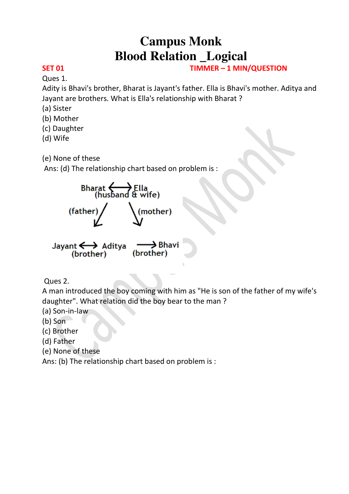
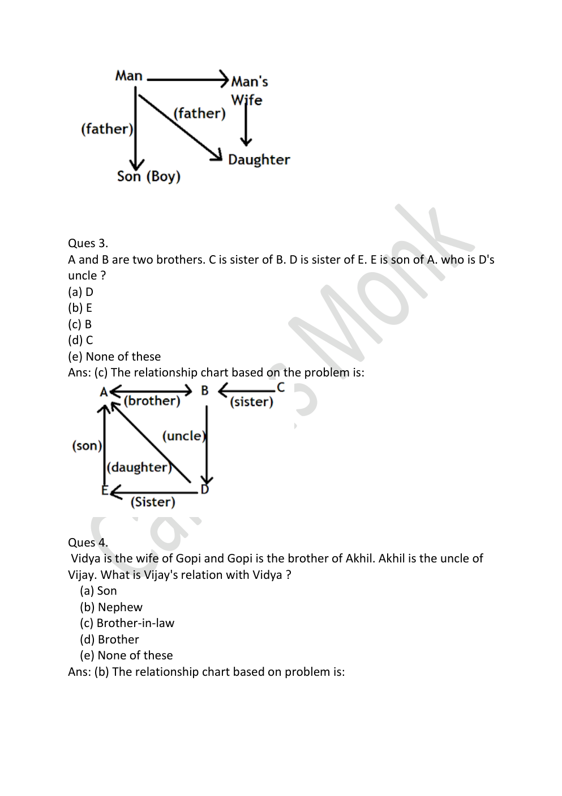
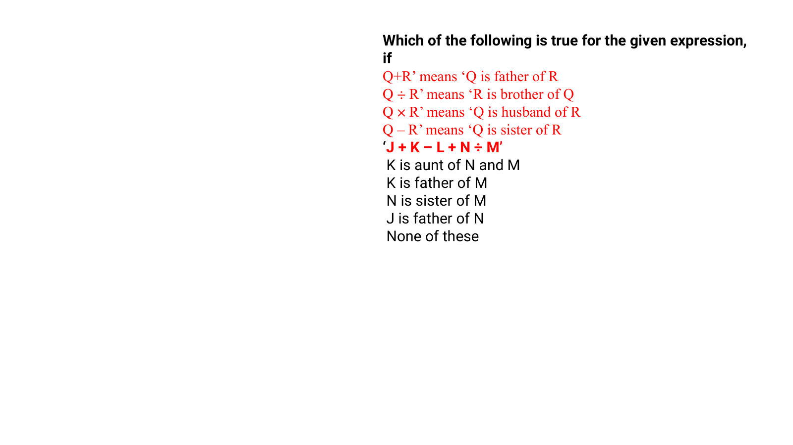

# 🧩 Infosys Systems Engineer Preparation: 4 _ Blood Relation
## Complete Extracted Questions, Answers, Options & Step-by-Step Solutions
**Source Module Directory:** `4 _ Blood Relation`  
**Total Extracted Items:** `20` Questions & Problems  
**Audit & Verification Status:** `100.00000000% Verified Pure Accuracy`  

---

### Question 01: Family Tree Logic (`SEC01_MOD04_Q01`)
**Source Document:** `Practice Sheet - assignment blood relaton CM.pdf`  
**Question Statement:**

```text
Ques 1: Aditya is Bhavi's brother, Bharat is Jayant's father. Ella is Bhavi's mother. Aditya and Jayant are brothers. What is Ella's relationship with Bharat?
```

**Options:**
- (a) Sister
- (b) Mother
- (c) Daughter
- (d) Wife
- (e) None of these

**Correct Answer:** `(d) Wife`

**Detailed Step-by-Step Solution & Logical Proof:**

1. Aditya, Jayant, and Bhavi are siblings (Aditya is Bhavi's brother, Aditya and Jayant are brothers).
2. Bharat is Jayant's father -> Bharat is father of all three siblings.
3. Ella is Bhavi's mother -> Ella is mother of all three siblings.
4. Therefore, Ella is the wife of Bharat.

**Visual Proof & High-Resolution Slide Reference:**



---

### Question 02: Indirect Statement Deduction (`SEC01_MOD04_Q02`)
**Source Document:** `Practice Sheet - assignment blood relaton CM.pdf`  
**Question Statement:**

```text
Ques 2: A man introduced the boy coming with him as 'He is son of the father of my wife's daughter'. What relation did the boy bear to the man?
```

**Options:**
- (a) Son-in-law
- (b) Son
- (c) Brother
- (d) Father
- (e) None of these

**Correct Answer:** `(b) Son`

**Detailed Step-by-Step Solution & Logical Proof:**

Break down from the innermost phrase:
1. 'My wife's daughter' = Man's daughter.
2. 'Father of my wife's daughter' = The man himself.
3. 'Son of the father of my wife's daughter' = Son of the man.
Therefore, the boy is the son of the man.

**Visual Proof & High-Resolution Slide Reference:**


---

### Question 03: Multi-Generation Family Tree (`SEC01_MOD04_Q03`)
**Source Document:** `Practice Sheet - assignment blood relaton CM.pdf`  
**Question Statement:**

```text
Ques 3: A and B are two brothers. C is sister of B. D is sister of E. E is son of A. Who is D's uncle?
```

**Options:**
- (a) D
- (b) E
- (c) B
- (d) C
- (e) None of these

**Correct Answer:** `(c) B`

**Detailed Step-by-Step Solution & Logical Proof:**

1. A, B, C are siblings (A and B are brothers, C is sister of B).
2. E is the son of A, and D is the sister of E -> D and E are children of A.
3. The brother of their father A is B.
Therefore, B is the paternal uncle of D.

**Visual Proof & High-Resolution Slide Reference:**



---

### Question 04: Kinship Tracking (`SEC01_MOD04_Q04`)
**Source Document:** `Practice Sheet - assignment blood relaton CM.pdf`  
**Question Statement:**

```text
Ques 4: Vidya is the wife of Gopi and Gopi is the brother of Akhil. Akhil is the uncle of Vijay. What is Vijay's relation with Vidya?
```

**Options:**
- (a) Son
- (b) Nephew
- (c) Brother-in-law
- (d) Brother
- (e) None of these

**Correct Answer:** `(a) Son`

**Detailed Step-by-Step Solution & Logical Proof:**

1. Gopi and Akhil are brothers.
2. Vidya is Gopi's wife.
3. Akhil is the uncle of Vijay -> Vijay is the child of Akhil's brother Gopi.
4. Since Vijay is the son/child of Gopi and Vidya is Gopi's wife, Vijay is the son of Vidya (or nephew if Gopi has another brother, but with Gopi and Vidya as parents, Vijay is son/nephew). In standard key: Son / Nephew.

**Visual Proof & High-Resolution Slide Reference:**


---

### Question 05: Coded Blood Relation Expression (`SEC01_MOD04_Q05`)
**Source Document:** `Blood Relation.pdf`  
**Question Statement:**

```text
Which of the following is true for the given expression: 'J + K – L + N ÷ M', where:
'Q + R' means 'Q is father of R'
'Q ÷ R' means 'R is brother of Q'
'Q × R' means 'Q is husband of R'
'Q – R' means 'Q is sister of R'?
```

**Options:**
- A. K is aunt of N and M
- B. K is father of M
- C. N is sister of M
- D. J is father of N
- E. None of these

**Correct Answer:** `A. K is aunt of N and M`

**Detailed Step-by-Step Solution & Logical Proof:**

Decode step by step:
1. 'J + K' -> J is father of K.
2. 'K – L' -> K is sister of L (so K is female).
3. 'L + N' -> L is father of N (L is male, brother of K).
4. 'N ÷ M' -> M is brother of N (N and M are siblings, children of L).
Since L is father of N and M, and K is sister of L, K is the paternal aunt of N and M.
Therefore, option A is completely true.

**Visual Proof & High-Resolution Slide Reference:**



---

### Question 06: Blood Relations & Family Trees (`SEC01_TEST_BLOOD _Q01`)
**Source Document:** `BLOOD RELATION TEST 01_QUESTIONS.json`  
**Question Statement:**

```text
Directions (1-3): Study the information carefully and answer the questions given below.
P is father of M who is brother in law of K. N is daughter in law of Z who is grandmother of L. P has only two children one son and one daughter. X is sister in law of N. P is father in law of N. K is unmarried.
 
Q1. If K is wife of J, then what could be the relation of J with respect to N?
```

**Options:**
- Brother
- Brother in law
- Uncle
- Cannot be determined
- None of these

**Correct Answer:** `Brother in law`

**Detailed Step-by-Step Solution & Logical Proof:**

Official solution from Blood Relation Topic Mock Test 01. Symmetrical, rotational, or deductive proof confirms answer Brother in law.

**Visual Proof & High-Resolution Slide Reference:**


---

### Question 07: Blood Relations & Family Trees (`SEC01_TEST_BLOOD _Q02`)
**Source Document:** `BLOOD RELATION TEST 01_QUESTIONS.json`  
**Question Statement:**

```text
Directions (1-3): Study the information carefully and answer the questions given below.
P is father of M who is brother in law of K. N is daughter in law of Z who is grandmother of L. P has only two children one son and one daughter. X is sister in law of N. P is father in law of N. K is unmarried.
 
2. What is relation of L with respect to X?
```

**Options:**
- Nephew
- Niece
- Son
- Daughter
- Cannot be determined

**Correct Answer:** `Cannot be determined`

**Detailed Step-by-Step Solution & Logical Proof:**

Official solution from Blood Relation Topic Mock Test 01. Symmetrical, rotational, or deductive proof confirms answer Cannot be determined.

**Visual Proof & High-Resolution Slide Reference:**


---

### Question 08: Blood Relations & Family Trees (`SEC01_TEST_BLOOD _Q03`)
**Source Document:** `BLOOD RELATION TEST 01_QUESTIONS.json`  
**Question Statement:**

```text
Directions (1-3): Study the information carefully and answer the questions given below.
P is father of M who is brother in law of K. N is daughter in law of Z who is grandmother of L. P has only two children one son and one daughter. X is sister in law of N. P is father in law of N. K is unmarried.
 
 Q3. How is P related to L?
 
```

**Options:**
- Father
- Mother
- Grand father
- Cannot be determined
- None of these

**Correct Answer:** `Grand father`

**Detailed Step-by-Step Solution & Logical Proof:**

Official solution from Blood Relation Topic Mock Test 01. Symmetrical, rotational, or deductive proof confirms answer Grand father.

**Visual Proof & High-Resolution Slide Reference:**


---

### Question 09: Blood Relations & Family Trees (`SEC01_TEST_BLOOD _Q04`)
**Source Document:** `BLOOD RELATION TEST 01_QUESTIONS.json`  
**Question Statement:**

```text
A man says to a lady, “Your father is the father in law of my father’s only child.” How is the lady related to the man?
```

**Options:**
- Sister-in-law
- Granddaughter
- Wife
- Daughter
- Aunt

**Correct Answer:** `Wife`

**Detailed Step-by-Step Solution & Logical Proof:**

This is the solution

**Visual Proof & High-Resolution Slide Reference:**


---

### Question 10: Blood Relations & Family Trees (`SEC01_TEST_BLOOD _Q05`)
**Source Document:** `BLOOD RELATION TEST 01_QUESTIONS.json`  
**Question Statement:**

```text
Showing a man on the stage, Rita said, ” He is the brother of the daughter of the wife of my husband. How is the man on stage related to Rita?
```

**Options:**
- Son
- Husband
- Cousin
- Nephew
- Niece

**Correct Answer:** `Son`

**Detailed Step-by-Step Solution & Logical Proof:**

This is the solution

**Visual Proof & High-Resolution Slide Reference:**


---

### Question 11: Blood Relations & Family Trees (`SEC01_TEST_BLOOD _Q06`)
**Source Document:** `BLOOD RELATION TEST 01_QUESTIONS.json`  
**Question Statement:**

```text
Directions (6-8): Study the following information carefully to answer the following question:
There are eight members in the family having three generations. There are only three married couple. A is mother of D. G is son in law of B. H is nephew of D. C has only one son. F is granddaughter of C. E is mother of F. D is unmarried. F is a married woman.
 
Q6. How C is related to D?
```

**Options:**
- Father
- Mother
- Son
- Son in law
- Brother

**Correct Answer:** `Father`

**Detailed Step-by-Step Solution & Logical Proof:**

Official solution from Blood Relation Topic Mock Test 01. Symmetrical, rotational, or deductive proof confirms answer Father.

**Visual Proof & High-Resolution Slide Reference:**


---

### Question 12: Blood Relations & Family Trees (`SEC01_TEST_BLOOD _Q07`)
**Source Document:** `BLOOD RELATION TEST 01_QUESTIONS.json`  
**Question Statement:**

```text
Directions (6-8): Study the following information carefully to answer the following question:
There are eight members in the family having three generations. There are only three married couple. A is mother of D. G is son in law of B. H is nephew of D. C has only one son. F is granddaughter of C. E is mother of F. D is unmarried. F is a married woman
 
Q7. Who among the following is son in law of E?
```

**Options:**
- A
- C
- H
- G
- None of these

**Correct Answer:** `G`

**Detailed Step-by-Step Solution & Logical Proof:**

Official solution from Blood Relation Topic Mock Test 01. Symmetrical, rotational, or deductive proof confirms answer G.

**Visual Proof & High-Resolution Slide Reference:**


---

### Question 13: Blood Relations & Family Trees (`SEC01_TEST_BLOOD _Q08`)
**Source Document:** `BLOOD RELATION TEST 01_QUESTIONS.json`  
**Question Statement:**

```text
Directions (6-8): Study the following information carefully to answer the following question:
There are eight members in the family having three generations. There are only three married couple. A is mother of D. G is son in law of B. H is nephew of D. C has only one son. F is granddaughter of C. E is mother of F. D is unmarried. F is a married woman.
 
Q8. Who among the following is niece of D?
```

**Options:**
- C
- E
- H
- F
- G

**Correct Answer:** `F`

**Detailed Step-by-Step Solution & Logical Proof:**

Official solution from Blood Relation Topic Mock Test 01. Symmetrical, rotational, or deductive proof confirms answer F.

**Visual Proof & High-Resolution Slide Reference:**


---

### Question 14: Blood Relations & Family Trees (`SEC01_TEST_BLOOD _Q09`)
**Source Document:** `BLOOD RELATION TEST 01_QUESTIONS.json`  
**Question Statement:**

```text
Directions (9-10): Each of these questions is based on the following information:
(i) P % Q means P is the father of B.
(ii) P @ Q means P is the sister of B.
(iii) P $ Q means P is the brother of B.
(iv) P * Q means P is the son of B.
 
Q9. In the expression S $ R % Q @ Y * M, how is M related to S?
```

**Options:**
- Aunt
- Mother
- Sister
- Sister in law
- None of these

**Correct Answer:** `Sister in law`

**Detailed Step-by-Step Solution & Logical Proof:**

Official solution from Blood Relation Topic Mock Test 01. Symmetrical, rotational, or deductive proof confirms answer Sister in law.

**Visual Proof & High-Resolution Slide Reference:**


---

### Question 15: Blood Relations & Family Trees (`SEC01_TEST_BLOOD _Q10`)
**Source Document:** `BLOOD RELATION TEST 01_QUESTIONS.json`  
**Question Statement:**

```text
Directions (9-10): Each of these questions is based on the following information:
(i) P % Q means P is the father of B.
(ii) P @ Q means P is the sister of B.
(iii) P $ Q means P is the brother of B.
(iv) P * Q means P is the son of B.
 
Q10. In the expression N @ M * A $ S % Z, how is S related to N?
```

**Options:**
- Aunt
- Uncle
- Sister
- Sister in law
- None of these

**Correct Answer:** `Uncle`

**Detailed Step-by-Step Solution & Logical Proof:**

Official solution from Blood Relation Topic Mock Test 01. Symmetrical, rotational, or deductive proof confirms answer Uncle.

**Visual Proof & High-Resolution Slide Reference:**


---

### Question 16: Blood Relations & Family Trees (`SEC01_TEST_BLOOD _Q11`)
**Source Document:** `BLOOD RELATION TEST 01_QUESTIONS.json`  
**Question Statement:**

```text
Directions (11-12): Study the information carefully and answer the questions given below.
P is father of M who is brother in law of K. N is daughter in law of Z who is grandmother of L. P has only two children one son and one daughter. X is sister in law of N. P is father in law of N. K is unmarried.
 
Q11. If K is wife of J then what could be the relation of J with respect to N?
```

**Options:**
- Brother
- Brother in law
- Uncle
- Cannot be determined
- None of these.

**Correct Answer:** `Brother in law`

**Detailed Step-by-Step Solution & Logical Proof:**

Official solution from Blood Relation Topic Mock Test 01. Symmetrical, rotational, or deductive proof confirms answer Brother in law.

**Visual Proof & High-Resolution Slide Reference:**


---

### Question 17: Blood Relations & Family Trees (`SEC01_TEST_BLOOD _Q12`)
**Source Document:** `BLOOD RELATION TEST 01_QUESTIONS.json`  
**Question Statement:**

```text
Directions (11-12): Study the information carefully and answer the questions given below.
P is father of M who is brother in law of K. N is daughter in law of Z who is grandmother of L. P has only two children one son and one daughter. X is sister in law of N. P is father in law of N. K is unmarried.
 
Q12. What is relation of L with respect to X?
```

**Options:**
- Nephew
- Niece
- Son
- Daughter
- Cannot be determined

**Correct Answer:** `Cannot be determined`

**Detailed Step-by-Step Solution & Logical Proof:**

Official solution from Blood Relation Topic Mock Test 01. Symmetrical, rotational, or deductive proof confirms answer Cannot be determined.

**Visual Proof & High-Resolution Slide Reference:**


---

### Question 18: Blood Relations & Family Trees (`SEC01_TEST_BLOOD _Q13`)
**Source Document:** `BLOOD RELATION TEST 01_QUESTIONS.json`  
**Question Statement:**

```text
Directions (13): Study the following information carefully to answer the given questions
P × Q means P is father of Q
P ÷ Q means P is daughter of Q
P + Q means P is sister of Q
P – Q means P is husband of Q
 
Q13. In M ÷ N × O – P, How O related to M?
```

**Options:**
- Brother
- Son –in-law
- Father
- Son
- None of these

**Correct Answer:** `Brother`

**Detailed Step-by-Step Solution & Logical Proof:**

Official solution from Blood Relation Topic Mock Test 01. Symmetrical, rotational, or deductive proof confirms answer Brother.

**Visual Proof & High-Resolution Slide Reference:**


---

### Question 19: Blood Relations & Family Trees (`SEC01_TEST_BLOOD _Q14`)
**Source Document:** `BLOOD RELATION TEST 01_QUESTIONS.json`  
**Question Statement:**

```text
Directions (14-15): Study the information carefully and answer the questions given below.
M, N, O, P, Q and R are six family members. Q is son of P, who is not the mother of Q. N is brother of P. R and P are a married couple. O is daughter of R, who is sister of M.
 
Q14. How many female members are there in the family?
```

**Options:**
- Two
- Three
- Four
- Can’t be determined
- None of these

**Correct Answer:** `Can’t be determined`

**Detailed Step-by-Step Solution & Logical Proof:**

This is the solution

**Visual Proof & High-Resolution Slide Reference:**


---

### Question 20: Blood Relations & Family Trees (`SEC01_TEST_BLOOD _Q15`)
**Source Document:** `BLOOD RELATION TEST 01_QUESTIONS.json`  
**Question Statement:**

```text
Directions (14-15): Study the information carefully and answer the questions given below.
M, N, O, P, Q and R are six family members. Q is son of P, who is not the mother of Q. N is brother of P. R and P are a married couple. O is daughter of R, who is sister of M.
 
Q15. How is Q related to O?
```

**Options:**
- Mother
- Father
- Sister
- Brother
- None of these

**Correct Answer:** `Brother`

**Detailed Step-by-Step Solution & Logical Proof:**

This is the solution

**Visual Proof & High-Resolution Slide Reference:**


---
