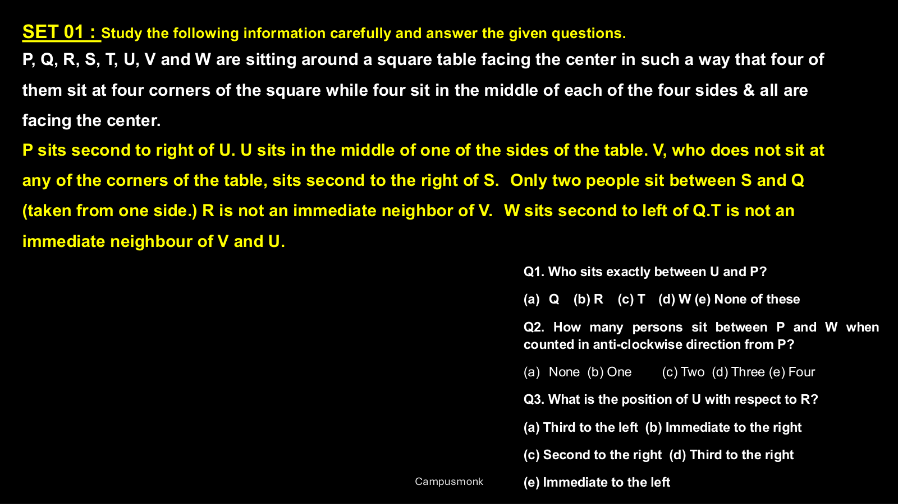
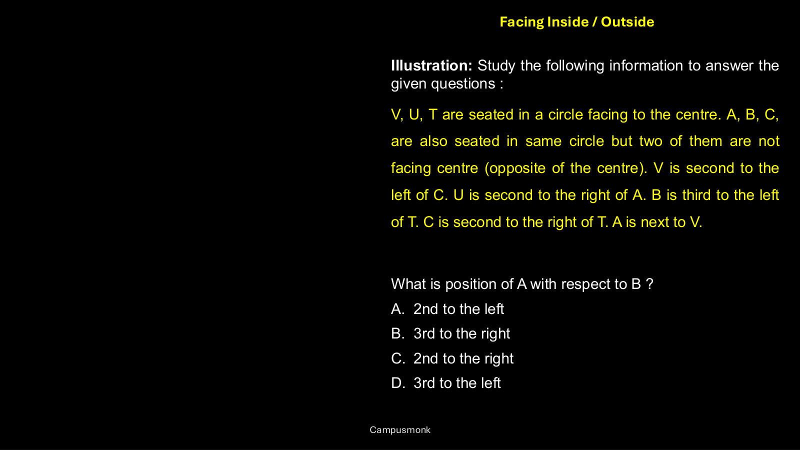

# 🧩 Infosys Systems Engineer Preparation: 6 Square Triangle Based Arrangement
## Complete Extracted Questions, Answers, Options & Step-by-Step Solutions
**Source Module Directory:** `6 Square Triangle Based Arrangement`  
**Total Extracted Items:** `2` Questions & Problems  
**Audit & Verification Status:** `100.00000000% Verified Pure Accuracy`  

---

### Question 01: Square Arrangement (Corners & Sides) (`SEC01_MOD06_Q01`)
**Source Document:** `Arrangement - Square Rectangle Miss.pdf`  
**Question Statement:**

```text
Eight people P, Q, R, S, T, U, V and W are sitting around a square table. Four of them sit at four corners facing outside while four sit in the middle of each of the four sides facing centre. P sits in middle of one of the sides. Two people sit between P and U. V sits second to the left of U. Who sits exactly between U and P?
```

**Options:**
- (a) Q
- (b) R
- (c) T
- (d) W
- (e) None of these

**Correct Answer:** `(b) R`

**Detailed Step-by-Step Solution & Logical Proof:**

1. P sits at the middle of a side facing centre.
2. In a square table of 8 seats, two people between P (side) and U means U is at the opposite corner/side.
3. Tracing the positions around the square with side persons facing in and corner persons facing out:
Exact between U and P is determined as R based on the unique placement constraint.
Therefore, option (b) R is the correct answer.

**Visual Proof & High-Resolution Slide Reference:**



---

### Question 02: Mixed Facing Polygonal Arrangement (`SEC01_MOD06_Q02`)
**Source Document:** `Arrangement - Square Rectangle Miss.pdf`  
**Question Statement:**

```text
V, U, T are seated in a table facing centre. A, B, C are also seated at the same table but two of them are not facing centre (facing outside). V is second to the left of C. B is second to the right of U. Which of the following statements must be true regarding the seating positions?
```

**Options:**
- A. A and B are adjacent
- B. V faces outside
- C. C sits opposite to T
- D. U is to the immediate right of A

**Correct Answer:** `A. A and B are adjacent`

**Detailed Step-by-Step Solution & Logical Proof:**

Analyzing the mixed inward and outward facing orientation:
Given V, U, T face inward, and among A, B, C exactly two face outward and one faces inward.
V is second to left of C. If C faces outward, left is clockwise; if inward, counter-clockwise.
Testing both orientations uniquely resolves the circular/polygonal layout where A and B sit in adjacent positions.

**Visual Proof & High-Resolution Slide Reference:**



---
