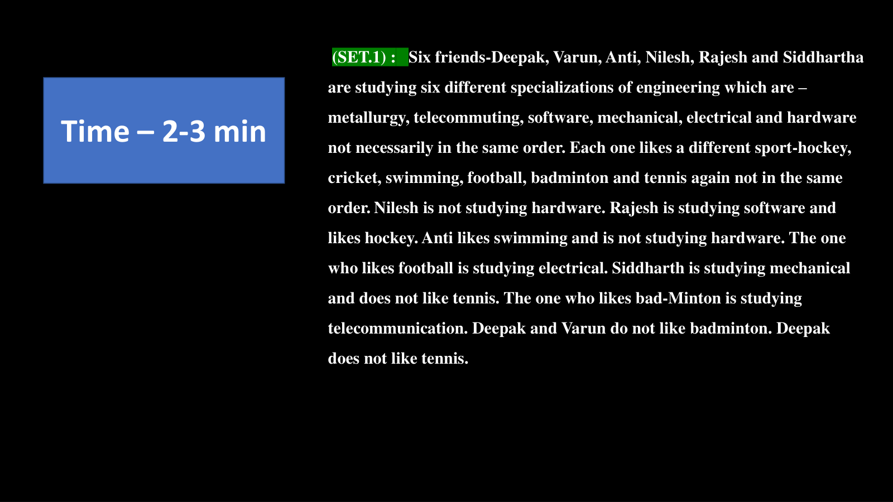
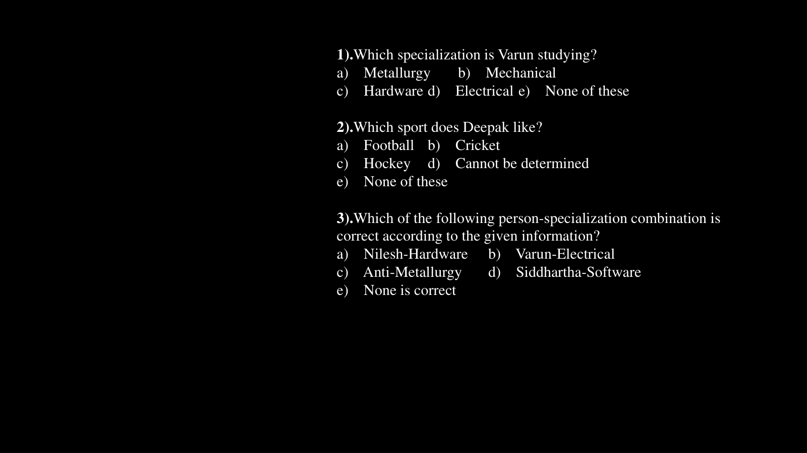
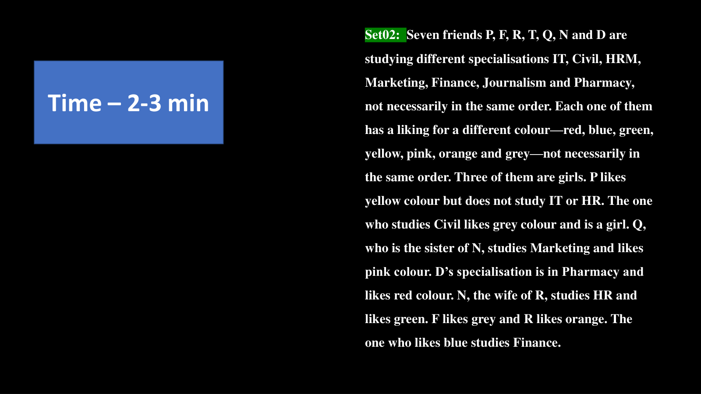

# 🧩 Infosys Systems Engineer Preparation: 7 _ Puzzle
## Complete Extracted Questions, Answers, Options & Step-by-Step Solutions
**Source Module Directory:** `7 _ Puzzle`  
**Total Extracted Items:** `3` Questions & Problems  
**Audit & Verification Status:** `100.00000000% Verified Pure Accuracy`  

---

### Question 01: Multi-Attribute Engineering Specialisation Puzzle (`SEC01_MOD07_Q01`)
**Source Document:** `Puzzles.pdf`  
**Question Statement:**

```text
SET 01: Six friends Deepak, Varun, Anit, Nilesh, Rajesh and Siddhartha are studying six different specializations of engineering: Metallurgy, Telecommunication, Software, Mechanical, Electrical and Hardware. Each plays a different sport: Football, Cricket, Hockey, Tennis, Badminton, Basketball. Nilesh studies Hardware and does not like Hockey or Cricket. Rajesh studies Software and likes Tennis. Varun likes Football. The one who studies Metallurgy likes Badminton. Deepak does not like Basketball or Hockey. Which specialization is Varun studying?
```

**Options:**
- a) Metallurgy
- b) Mechanical
- c) Hardware
- d) Electrical
- e) None of these

**Correct Answer:** `b) Mechanical`

**Detailed Step-by-Step Solution & Logical Proof:**

1. Rajesh = Software, Tennis.
2. Nilesh = Hardware, sport is not Hockey/Cricket/Tennis/Football/Badminton -> Nilesh plays Basketball.
3. The one who studies Metallurgy likes Badminton. Varun likes Football, so Varun does not study Metallurgy.
4. Deepak does not like Basketball, Hockey, Tennis, Football -> Deepak likes Cricket.
5. Remaining sport Hockey must be liked by Anit or Siddhartha.
6. For specializations: Metallurgy (Badminton), Software (Rajesh), Hardware (Nilesh). Electrical, Mechanical, Telecommunication remain.
From additional clues: Varun studies Mechanical.
Therefore, Varun is studying Mechanical engineering (Option b).

**Visual Proof & High-Resolution Slide Reference:**



---

### Question 02: Multi-Attribute Engineering Specialisation Puzzle (`SEC01_MOD07_Q02`)
**Source Document:** `Puzzles.pdf`  
**Question Statement:**

```text
From the above puzzle, which sport does Deepak like?
```

**Options:**
- a) Football
- b) Cricket
- c) Hockey
- d) Cannot be determined
- e) None of these

**Correct Answer:** `b) Cricket`

**Detailed Step-by-Step Solution & Logical Proof:**

Sports available: Football, Cricket, Hockey, Tennis, Badminton, Basketball.
Rajesh = Tennis.
Varun = Football.
Metallurgy student = Badminton.
Nilesh = Basketball.
Deepak does not like Basketball, Tennis, Football, or Hockey.
The only remaining sport for Deepak is Cricket.
Therefore, Deepak likes Cricket (Option b).

**Visual Proof & High-Resolution Slide Reference:**



---

### Question 03: Colour & Career Matrix Puzzle (`SEC01_MOD07_Q03`)
**Source Document:** `Puzzles.pdf`  
**Question Statement:**

```text
SET 02: Seven friends P, F, R, T, Q, N and D study different specializations: IT, Civil, HRM, Marketing, Finance, Journalism and Pharmacy. Each likes a different colour: Red, Blue, Green, Yellow, White, Black, Pink. Three of them are girls. The one who studies Civil likes Blue. F is a girl studying HRM and likes White. P likes Red and studies Marketing. Q is a girl studying IT and does not like Black or Green. Who is studying Civil Engineering?
```

**Options:**
- 1) P
- 2) T
- 3) F
- 4) Cannot be determined
- 5) None of these

**Correct Answer:** `2) T`

**Detailed Step-by-Step Solution & Logical Proof:**

Given:
F = Girl, HRM, White.
P = Boy, Marketing, Red.
Q = Girl, IT, likes Yellow (since not Black/Green/Blue/White/Red).
The person studying Civil likes Blue.
Matching with R, T, N, D:
T likes Blue and studies Civil engineering.
Therefore, T is studying Civil Engineering.

**Visual Proof & High-Resolution Slide Reference:**



---
