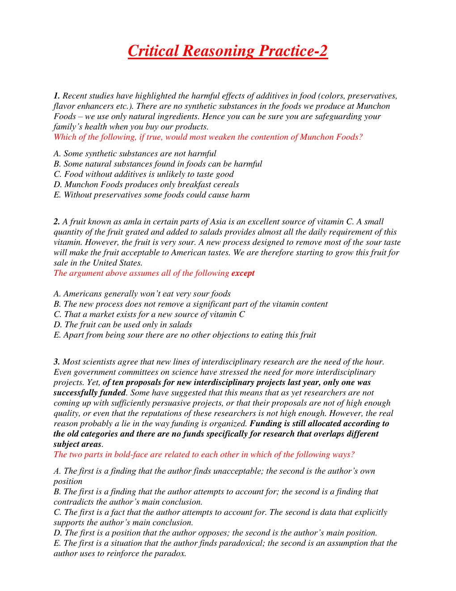
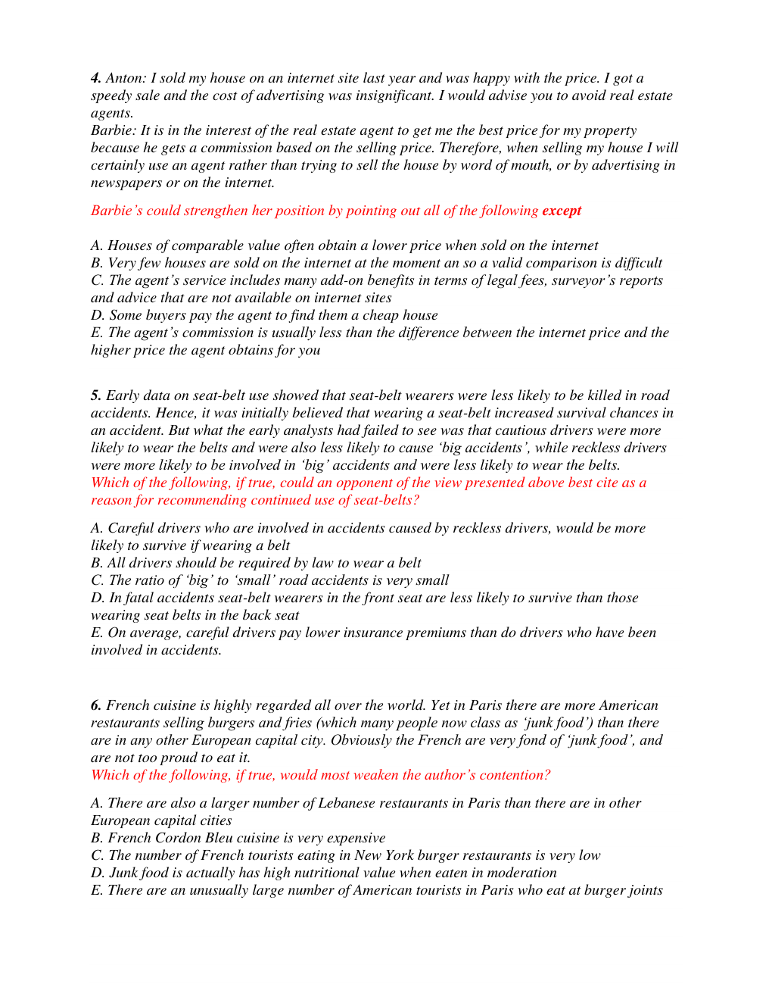
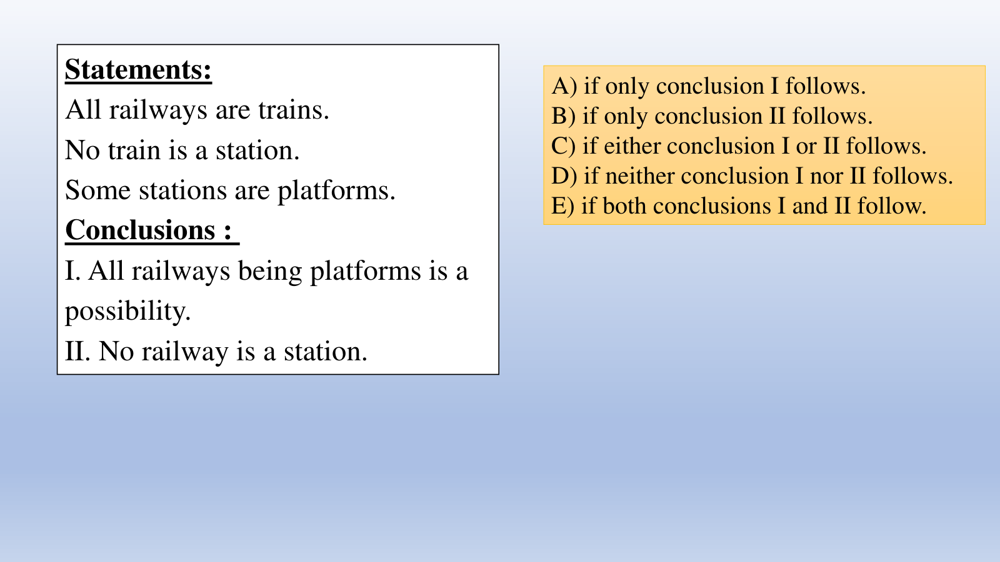
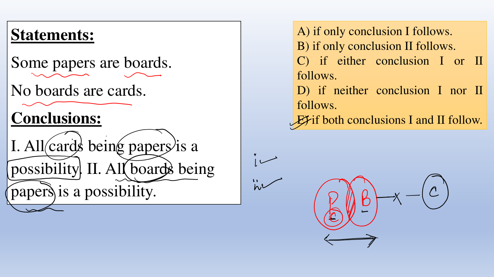
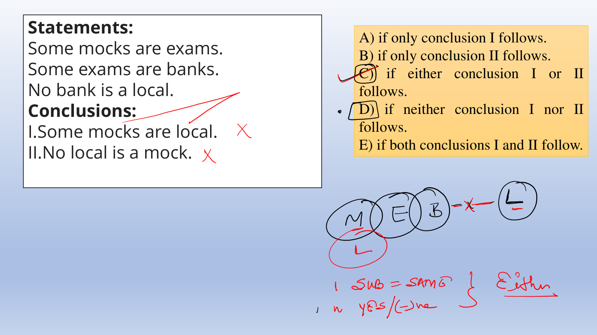
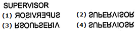

# 🧩 Infosys Systems Engineer Preparation: 8 _ Critical Reasoning & Syllogism
## Complete Extracted Questions, Answers, Options & Step-by-Step Solutions
**Source Module Directory:** `8 _ Critical Reasoning & Syllogism`  
**Total Extracted Items:** `50` Questions & Problems  
**Audit & Verification Status:** `100.00000000% Verified Pure Accuracy`  

---

### Question 01: Critical Reasoning: Flaw in Argument (`SEC01_MOD08_Q01`)
**Source Document:** `Critical Reasoning Practice Sheet.pdf`  
**Question Statement:**

```text
1. Recent studies have highlighted the harmful effects of additives in food (colors, preservatives, flavor enhancers etc.). There are no synthetic substances in the foods we produce at Munchon Foods – we use only natural ingredients, so our foods are not harmful to health.
Which of the following, if true, most seriously weakens the argument?
```

**Options:**
- A. Some synthetic food additives have not been proven to be harmful to health.
- B. Many natural substances are as harmful to health as any synthetic additive.
- C. Some people are allergic to synthetic food colorings but not natural ones.
- D. Not all of the additives used by Munchon Foods improve flavor.
- E. Consumer surveys show that shoppers prefer natural foods over synthetic foods.

**Correct Answer:** `B. Many natural substances are as harmful to health as any synthetic additive.`

**Detailed Step-by-Step Solution & Logical Proof:**

The argument assumes a false equivalence: 'all synthetic additives are harmful, we use only natural ingredients, therefore our foods are not harmful'.
To weaken this claim, we must demonstrate that natural ingredients can also be harmful to health.
Option B directly attacks this assumption by showing that many natural substances are just as harmful as synthetic additives.
Therefore, Option B most seriously weakens the argument.

**Visual Proof & High-Resolution Slide Reference:**



---

### Question 02: Critical Reasoning: Dialogue Analysis (`SEC01_MOD08_Q02`)
**Source Document:** `Critical Reasoning Practice Sheet.pdf`  
**Question Statement:**

```text
4. Anton: 'I sold my house on an internet site last year and was happy with the price. I got a speedy sale and the cost of advertising was insignificant. I would advise you to avoid real estate agents.'
Barbie: 'It is in the interest of the real estate agent to obtain the best price for your house because their commission depends on the selling price. In contrast, internet sites take a fixed listing fee, so they do not care about the selling price.'
Barbie counters Anton's advice by:
```

**Options:**
- A. Pointing out that Anton's experience may be an isolated exception.
- B. Challenging Anton's assertion that internet advertising costs are insignificant.
- C. Demonstrating that selling on an internet site requires much more work.
- D. Arguing that real estate agents have an incentive structure aligned with the seller's goal.
- E. Proving that houses sold on internet sites take longer to sell.

**Correct Answer:** `D. Arguing that real estate agents have an incentive structure aligned with the seller's goal.`

**Detailed Step-by-Step Solution & Logical Proof:**

Barbie points out that the real estate agent's commission is directly tied to the final selling price (percentage of sale price), aligning their financial incentives with obtaining the maximum price for the seller.
This directly addresses the economic motivation of agents versus flat-fee internet listing platforms.
Therefore, Option D accurately describes Barbie's counter-argument.

**Visual Proof & High-Resolution Slide Reference:**



---

### Question 03: Syllogisms with Possibility (`SEC01_MOD08_Q03`)
**Source Document:** `Syllogism Questions 2.pdf`  
**Question Statement:**

```text
Statements:
All railways are trains.
No train is a station.
Some stations are platforms.

Conclusions:
I. All railways being platforms is a possibility.
II. No railway is a station.
```

**Options:**
- A) If only conclusion I follows.
- B) If only conclusion II follows.
- C) If either conclusion I or II follows.
- D) If neither conclusion I nor II follows.
- E) If both conclusions I and II follow.

**Correct Answer:** `E) If both conclusions I and II follow.`

**Detailed Step-by-Step Solution & Logical Proof:**

Venn Analysis:
1. 'All railways are trains' (R ⊆ T).
2. 'No train is a station' (T ∩ S = ∅). Since R ⊆ T, R ∩ S = ∅ must also hold true. Thus 'No railway is a station' is unconditionally TRUE (Conclusion II follows).
3. 'Some stations are platforms' (S ∩ P ≠ ∅). Platforms can extend outside stations and encompass all of trains/railways without violating T ∩ S = ∅. Thus 'All railways being platforms is a possibility' is a valid possibility (Conclusion I follows).
Since both Conclusion I and Conclusion II follow, the answer is E.

**Visual Proof & High-Resolution Slide Reference:**



---

### Question 04: Syllogisms with Possibility (`SEC01_MOD08_Q04`)
**Source Document:** `Syllogism Questions 2.pdf`  
**Question Statement:**

```text
Statements:
Some papers are boards.
No boards are cards.

Conclusions:
I. All cards being papers is a possibility.
II. All boards being papers is a possibility.
```

**Options:**
- A) If only conclusion I follows.
- B) If only conclusion II follows.
- C) If either conclusion I or II follows.
- D) If neither conclusion I nor II follows.
- E) If both conclusions I and II follow.

**Correct Answer:** `E) If both conclusions I and II follow.`

**Detailed Step-by-Step Solution & Logical Proof:**

Venn Analysis:
1. 'Some papers are boards' (P ∩ B ≠ ∅).
2. 'No boards are cards' (B ∩ C = ∅).
Check Conclusion I: Can all cards (C) be inside papers (P)? Yes, C can be placed entirely inside the non-board region of P (P \ B) without overlapping B. Thus Conclusion I is a valid possibility.
Check Conclusion II: Can all boards (B) be inside papers (P)? Yes, 'Some P are B' allows the possibility that B is entirely a subset of P (B ⊆ P). Thus Conclusion II is also a valid possibility.
Since both conclusions follow as possibilities, the answer is E.

**Visual Proof & High-Resolution Slide Reference:**



---

### Question 05: Syllogisms Complementary Pairs (`SEC01_MOD08_Q05`)
**Source Document:** `Syllogism Questions 2.pdf`  
**Question Statement:**

```text
Statements:
Some mocks are exams.
Some exams are banks.
No bank is a local.

Conclusions:
I. Some mocks are local.
II. No local is a mock.
```

**Options:**
- A) If only conclusion I follows.
- B) If only conclusion II follows.
- C) If either conclusion I or II follows.
- D) If neither conclusion I nor II follows.
- E) If both conclusions I and II follow.

**Correct Answer:** `C) If either conclusion I or II follows.`

**Detailed Step-by-Step Solution & Logical Proof:**

Analyze the subject and predicate:
Conclusion I: 'Some mocks are local' (Particular Affirmative - I-type).
Conclusion II: 'No local is a mock' (Universal Negative - E-type).
Both statements share the same subject and predicate ('mocks' and 'local').
Neither conclusion is definitely true from the premises (mocks and local have no direct link).
However, between any two sets A and B, either they have some common elements (Some A are B) or they have zero common elements (No A is B).
This forms a standard contradictory complementary pair (I + E).
Therefore, either conclusion I or conclusion II must follow (Option C).

**Visual Proof & High-Resolution Slide Reference:**



---

### Question 06: Syllogistic Logic (`SEC01_TEST_SYLLOG_Q01`)
**Source Document:** `syllogisms 01_QUESTIONS.json`  
**Question Statement:**

```text
Directions (1-5): In each of the questions below are given some statements followed by some conclusions. You have to take the given statements to be true even if they seem to be at variance from commonly known facts. Read the entire conclusion and then decide which of the given conclusions logically follows from the given statements disregarding commonly known facts.
 
Q1. Statements:
 
No Garden are Flower.
All Garden are Plant
Some tree are plant
Conclusions:
 
I. Some tree are not flower.
II. All tree can be Garden.
III. All Plant being flower is a possibility.
```

**Options:**
- Only I follows
- Only II follows
- Only III follows
- All follow
- None of these

**Correct Answer:** `Only II follows`

**Detailed Step-by-Step Solution & Logical Proof:**

Official solution from Syllogisms Topic Test 01. Symmetrical, rotational, or deductive proof confirms answer Only II follows.

**Visual Proof & High-Resolution Slide Reference:**


---

### Question 07: Syllogistic Logic (`SEC01_TEST_SYLLOG_Q02`)
**Source Document:** `syllogisms 01_QUESTIONS.json`  
**Question Statement:**

```text
Statements:
 
All milk is water.
Some milk is Tea.
No Coffee is Tea.
 
Conclusions:
I. Some milk is Coffee.
II. No milk is Coffee
III. All milk being coffee is a possibility.
```

**Options:**
- None follows
- only II follows
- only III and either I or II follow
- only I follows
- only either I or II follow

**Correct Answer:** `only either I or II follow`

**Detailed Step-by-Step Solution & Logical Proof:**

Official solution from Syllogisms Topic Test 01. Symmetrical, rotational, or deductive proof confirms answer only either I or II follow.

**Visual Proof & High-Resolution Slide Reference:**


---

### Question 08: Syllogistic Logic (`SEC01_TEST_SYLLOG_Q03`)
**Source Document:** `syllogisms 01_QUESTIONS.json`  
**Question Statement:**

```text
.Statements:
 
Some School are College.
Some College are Lecture.
All Class is College.
 
Conclusions:
I. Some Lecture is not Class.
II. Some School is Class.
III. Some College is not School
```

**Options:**
- Only I follows
- Only II follows
- Only III follows
- None follows
- None of these

**Correct Answer:** `None follows`

**Detailed Step-by-Step Solution & Logical Proof:**

Official solution from Syllogisms Topic Test 01. Symmetrical, rotational, or deductive proof confirms answer None follows.

**Visual Proof & High-Resolution Slide Reference:**


---

### Question 09: Syllogistic Logic (`SEC01_TEST_SYLLOG_Q04`)
**Source Document:** `syllogisms 01_QUESTIONS.json`  
**Question Statement:**

```text
Statements:
 
Some comedy is actor
All good is movie.
No actor is good.
 
Conclusions:
I. Some comedy are not good.
II. Some movie is comedy
III. All good is comedy is a possibility
```

**Options:**
- Only I and II follow
- Only II follows
- Only I follows
- Only I and III follow
- None of these

**Correct Answer:** `Only I and III follow`

**Detailed Step-by-Step Solution & Logical Proof:**

Official solution from Syllogisms Topic Test 01. Symmetrical, rotational, or deductive proof confirms answer Only I and III follow.

**Visual Proof & High-Resolution Slide Reference:**


---

### Question 10: Syllogistic Logic (`SEC01_TEST_SYLLOG_Q05`)
**Source Document:** `syllogisms 01_QUESTIONS.json`  
**Question Statement:**

```text
 Statements:
 
Some book are paper
Some paper are pen
No Pen is book
 
Conclusions:
I. All paper is book
II. All pen is paper is a possibility
III. All book is paper is a possibility
```

**Options:**
- Only I follows
- Only II follows
- Only II and III follows
- All follow
- None of these

**Correct Answer:** `Only II and III follows`

**Detailed Step-by-Step Solution & Logical Proof:**

Official solution from Syllogisms Topic Test 01. Symmetrical, rotational, or deductive proof confirms answer Only II and III follows.

**Visual Proof & High-Resolution Slide Reference:**


---

### Question 11: Syllogistic Logic (`SEC01_TEST_SYLLOG_Q06`)
**Source Document:** `syllogisms 01_QUESTIONS.json`  
**Question Statement:**

```text
Directions (6-10): In each question below are given some statements followed by some conclusions. You have to take the given statements to be true even if they seem to be at variance with commonly known facts. Read all the conclusions and then decide which of the given conclusions logically follows the given statements disregarding commonly known facts.
 
Statements:
 
Some night are cloud.
All night are sky.
All day are sky.
 
Conclusions:
I. Some night are not day.
II. All day being cloud is a possibility.
 
```

**Options:**
- If only conclusion I follow.
- If only conclusion II follows.
- If either conclusion I or II follows
- If neither conclusion I nor II follows
- If both conclusions I and II follow.

**Correct Answer:** `If only conclusion II follows.`

**Detailed Step-by-Step Solution & Logical Proof:**

Official solution from Syllogisms Topic Test 01. Symmetrical, rotational, or deductive proof confirms answer If only conclusion II follows..

**Visual Proof & High-Resolution Slide Reference:**


---

### Question 12: Syllogistic Logic (`SEC01_TEST_SYLLOG_Q07`)
**Source Document:** `syllogisms 01_QUESTIONS.json`  
**Question Statement:**

```text
Statements:
 
All solution are liquid.
No liquid is a mixture.
All mixture are matter.
 
Conclusions:
I. All solution being matter is a possibility.
II. No solution is a mixture.
```

**Options:**
- If only conclusion I follow.
- If only conclusion II follows
- If either conclusion I or II follows
- If neither conclusion I nor II follows.
- If both conclusions I and II follow

**Correct Answer:** `If both conclusions I and II follow`

**Detailed Step-by-Step Solution & Logical Proof:**

Official solution from Syllogisms Topic Test 01. Symmetrical, rotational, or deductive proof confirms answer If both conclusions I and II follow.

**Visual Proof & High-Resolution Slide Reference:**


---

### Question 13: Syllogistic Logic (`SEC01_TEST_SYLLOG_Q08`)
**Source Document:** `syllogisms 01_QUESTIONS.json`  
**Question Statement:**

```text
Statements:
 
Some pink are white.
All yellow are pink.
No yellow is a blue.
 
Conclusion:
I. Some white, if they are yellow, are also pink.
II. All blue being pink is a possibility.
```

**Options:**
- If only conclusion I follow
- If only conclusion II follows
- If either conclusion I or II follows
- If neither conclusion I nor II follows
- If both conclusions I and II follow

**Correct Answer:** `If both conclusions I and II follow`

**Detailed Step-by-Step Solution & Logical Proof:**

Official solution from Syllogisms Topic Test 01. Symmetrical, rotational, or deductive proof confirms answer If both conclusions I and II follow.

**Visual Proof & High-Resolution Slide Reference:**


---

### Question 14: Syllogistic Logic (`SEC01_TEST_SYLLOG_Q09`)
**Source Document:** `syllogisms 01_QUESTIONS.json`  
**Question Statement:**

```text
Statements:
 
Some horror are fear.
All horror are daring.
No fear is brave.
 
Conclusions:
I. Some horror being brave is a possibility.
II. No horror is brave.
```

**Options:**
- If only conclusion I follow
- If only conclusion II follows
- If either conclusion I or II follows.
- If neither conclusion I nor II follows.
- If both conclusions I and II follow

**Correct Answer:** `If only conclusion I follow`

**Detailed Step-by-Step Solution & Logical Proof:**

Official solution from Syllogisms Topic Test 01. Symmetrical, rotational, or deductive proof confirms answer If only conclusion I follow.

**Visual Proof & High-Resolution Slide Reference:**


---

### Question 15: Syllogistic Logic (`SEC01_TEST_SYLLOG_Q10`)
**Source Document:** `syllogisms 01_QUESTIONS.json`  
**Question Statement:**

```text
Statements:
 
No mango is papaya.
All papaya are apple.
No apple is orange.
 
Conclusions:
I. All orange being papaya is a possibility.
II. Some mango are not orange.
```

**Options:**
- If only conclusion I follow.
- If only conclusion II follows.
- If either conclusion I or II follows
- If neither conclusion I nor II follows
- If both conclusions I and II follow

**Correct Answer:** `If neither conclusion I nor II follows`

**Detailed Step-by-Step Solution & Logical Proof:**

Official solution from Syllogisms Topic Test 01. Symmetrical, rotational, or deductive proof confirms answer If neither conclusion I nor II follows.

**Visual Proof & High-Resolution Slide Reference:**


---

### Question 16: Syllogistic Logic (`SEC01_TEST_SYLLOG_Q11`)
**Source Document:** `syllogisms 01_QUESTIONS.json`  
**Question Statement:**

```text
Directions (11-15): In each of the questions below are given some statements followed by some Conclusions. You have to take the given statements to be true even if they seem to be at variance from commonly known facts. Read all the Conclusions and then decide which of the given Conclusions logically follows from the given statements disregarding commonly known facts.
 
Q11. Statements:
 
All Fashion are Tradition.
Some Tradition are Values.
Some Indian are Values.
 
Conclusions:
I. All tradition is values is a possibility
II. Some values are fashion
III. All Indian are tradition is a possibility.
```

**Options:**
- Only I follows
- Only II follows
- Only I and III follow
- Only III follows
- None follows

**Correct Answer:** `Only I and III follow`

**Detailed Step-by-Step Solution & Logical Proof:**

Official solution from Syllogisms Topic Test 01. Symmetrical, rotational, or deductive proof confirms answer Only I and III follow.

**Visual Proof & High-Resolution Slide Reference:**


---

### Question 17: Syllogistic Logic (`SEC01_TEST_SYLLOG_Q12`)
**Source Document:** `syllogisms 01_QUESTIONS.json`  
**Question Statement:**

```text
. Statements:
 
Some Asia are Europe.
All Europe are Africa.
No Europe is America.
 
Conclusions:
I. Some America are Asia.
II. Some Africa are Asia.
III. Some America is Africa is a possibility.
```

**Options:**
- All follow
- Only II and III follow
- Only I and III follow
- Only I and II follow
- None of these

**Correct Answer:** `Only II and III follow`

**Detailed Step-by-Step Solution & Logical Proof:**

Official solution from Syllogisms Topic Test 01. Symmetrical, rotational, or deductive proof confirms answer Only II and III follow.

**Visual Proof & High-Resolution Slide Reference:**



---

### Question 18: Syllogistic Logic (`SEC01_TEST_SYLLOG_Q13`)
**Source Document:** `syllogisms 01_QUESTIONS.json`  
**Question Statement:**

```text
. Statements:
 
All Manager are Clerk.
All Clerk are Assistant.
No Executive are Clerk.
 
Conclusions
I. Some Clerk are Executive.
II. Some Assistant are Manager.
III. Some Assistant are Executive
```

**Options:**
- Only I follows
- Only II follows
- Only III follows
- Only II and III follow
- None of these

**Correct Answer:** `Only II follows`

**Detailed Step-by-Step Solution & Logical Proof:**

Official solution from Syllogisms Topic Test 01. Symmetrical, rotational, or deductive proof confirms answer Only II follows.

**Visual Proof & High-Resolution Slide Reference:**


---

### Question 19: Syllogistic Logic (`SEC01_TEST_SYLLOG_Q14`)
**Source Document:** `syllogisms 01_QUESTIONS.json`  
**Question Statement:**

```text
Statements:
 
Some Sale are Discount.
All Discount are Price.
No Cost is Price.
 
Conclusions:
I. All sale is Discount is a possibility.
II. Some discount are cost.
III. All price are sale is a possibility.
```

**Options:**
- Only I follows
- Only II follows
- Only III follows
- Only I and II follow
- None of these

**Correct Answer:** `None of these`

**Detailed Step-by-Step Solution & Logical Proof:**

Official solution from Syllogisms Topic Test 01. Symmetrical, rotational, or deductive proof confirms answer None of these.

**Visual Proof & High-Resolution Slide Reference:**


---

### Question 20: Syllogistic Logic (`SEC01_TEST_SYLLOG_Q15`)
**Source Document:** `syllogisms 01_QUESTIONS.json`  
**Question Statement:**

```text
. Statements:
 
Some black are grey.
All grey are red.
All olive are Red.
 
Conclusions:
I. All red is olive is a possibility.
II. Some black are red.
III. All red are grey.
```

**Options:**
- Only I and III follow
- Only II follows
- Only I
- Only III follows
- None of these

**Correct Answer:** `None of these`

**Detailed Step-by-Step Solution & Logical Proof:**

Official solution from Syllogisms Topic Test 01. Symmetrical, rotational, or deductive proof confirms answer None of these.

**Visual Proof & High-Resolution Slide Reference:**


---

### Question 21: Syllogistic Logic (`SEC01_TEST_SYLLOG_Q01`)
**Source Document:** `Syllogisms 03_QUESTIONS.json`  
**Question Statement:**

```text
Give answer 1) If only Conclusion I follows Give answer 2) If only Conclusion II follows Give answer 3) If either Conclusion I or II follows Give answer 4) If neither Conclusion I nor II follows
 
Give answer 5) If both Conclusions I and II follows 
 
1. Statements: Some papers are boards. No boards are cards. 
 
Conclusions: I. All cards being papers is a possibility. II. All boards being papers is a possibility.
```

**Options:**
- If only Conclusion I follows
- If only Conclusion II follows
- If either Conclusion I or II follows
- If neither Conclusion I nor II follows
- If both Conclusions I and II follows

**Correct Answer:** `If both Conclusions I and II follows`

**Detailed Step-by-Step Solution & Logical Proof:**

This is the solution

**Visual Proof & High-Resolution Slide Reference:**


---

### Question 22: Syllogistic Logic (`SEC01_TEST_SYLLOG_Q02`)
**Source Document:** `Syllogisms 03_QUESTIONS.json`  
**Question Statement:**

```text
Statements: All circles are squares. Some squares are rectangles.
 
Conclusions: I. All rectangles being squares is a possibility. II. Can all circles be rectangles?
```

**Options:**
- Only 1
- only 2
- either follow
- neither follow
- Both Follow

**Correct Answer:** `Both Follow`

**Detailed Step-by-Step Solution & Logical Proof:**

This is the solution

**Visual Proof & High-Resolution Slide Reference:**


---

### Question 23: Syllogistic Logic (`SEC01_TEST_SYLLOG_Q03`)
**Source Document:** `Syllogisms 03_QUESTIONS.json`  
**Question Statement:**

```text
Some birds are goats.  Some goats are horses. Some horses are lions.  Some lions are tigers.
 
Conclusions: I. Some tigers are goats. II. No tiger is goat. III. Some lions are birds. IV. No lion is bird.
```

**Options:**
- 1) Only either I or II follow
- Only either III or IV follow
- Only either I or II, and either  III or IV follow
- Only I and III follow
- None of these

**Correct Answer:** `Only either I or II, and either  III or IV follow`

**Detailed Step-by-Step Solution & Logical Proof:**

This is the solution

**Visual Proof & High-Resolution Slide Reference:**


---

### Question 24: Syllogistic Logic (`SEC01_TEST_SYLLOG_Q04`)
**Source Document:** `Syllogisms 03_QUESTIONS.json`  
**Question Statement:**

```text
Statements : All machines are bad. Some bad are globe.
All globe are round.
Conclusions :I. Some machines are round.
 
II. No machine is round.
```

**Options:**
- Only 1
- only 2
- either
- Neither Follow
- Both Follow

**Correct Answer:** `either`

**Detailed Step-by-Step Solution & Logical Proof:**

This is the solution

**Visual Proof & High-Resolution Slide Reference:**


---

### Question 25: Syllogistic Logic (`SEC01_TEST_SYLLOG_Q05`)
**Source Document:** `Syllogisms 03_QUESTIONS.json`  
**Question Statement:**

```text
Statements:All railways are trains. No train is a station. Some stations are platforms. Conclusions : I. All railways being platforms is a possibility. II. No railway is a station.
```

**Options:**
- Only 1
- Only 2
- Either follow
- Neither Follow
- Both Follow

**Correct Answer:** `Both Follow`

**Detailed Step-by-Step Solution & Logical Proof:**

This is the solution

**Visual Proof & High-Resolution Slide Reference:**


---

### Question 26: Syllogistic Logic (`SEC01_TEST_SYLLOG_Q06`)
**Source Document:** `Syllogisms 03_QUESTIONS.json`  
**Question Statement:**

```text
All erasers are sharpeners. All sharpeners are pencils. Some pencils are pens. Conclusions : I. some sharpeners are pens. II. No sharpener is a pen.
```

**Options:**
- Only 1 follow
- Only 2 follow
- Either
- Neither
- Both Follow

**Correct Answer:** `Either`

**Detailed Step-by-Step Solution & Logical Proof:**

This is the solution

**Visual Proof & High-Resolution Slide Reference:**


---

### Question 27: Syllogistic Logic (`SEC01_TEST_SYLLOG_Q07`)
**Source Document:** `Syllogisms 03_QUESTIONS.json`  
**Question Statement:**

```text
Statements: No carom is a corner. Some corridors are caroms. All classes are corners.Conclusions: I. All corridors being corners is a possibility. II. All caroms being classes is a possibility.
```

**Options:**
- Only 1 folllow
- Only 2 folllow
- Either follow
- Neither follow
- Both Follow

**Correct Answer:** `Neither follow`

**Detailed Step-by-Step Solution & Logical Proof:**

This is the solution

**Visual Proof & High-Resolution Slide Reference:**


---

### Question 28: Syllogistic Logic (`SEC01_TEST_SYLLOG_Q08`)
**Source Document:** `Syllogisms 03_QUESTIONS.json`  
**Question Statement:**

```text
Statements:No carom is a corner.Some corridors are caroms.All classes are corners.Conclusions:Conclusions: I. Some corners are not corridors. II. No class is a carom.
```

**Options:**
- Only 1
- Only 2
- either
- neither
- Both follow

**Correct Answer:** `Only 2`

**Detailed Step-by-Step Solution & Logical Proof:**

This is the solution

**Visual Proof & High-Resolution Slide Reference:**


---

### Question 29: Syllogistic Logic (`SEC01_TEST_SYLLOG_Q09`)
**Source Document:** `Syllogisms 03_QUESTIONS.json`  
**Question Statement:**

```text
All machines are crowns. All crowns are tablets. Some tablets are bottles.
 
 Conclusions: I. Some bottles are crowns. II. Some tablets are machines. III. Some bottles are machines.
```

**Options:**
- Only I  follows
- Only II follows
- Only III follows
- Only II and III follows
- None of these

**Correct Answer:** `Only II follows`

**Detailed Step-by-Step Solution & Logical Proof:**

This is the solution

**Visual Proof & High-Resolution Slide Reference:**


---

### Question 30: Syllogistic Logic (`SEC01_TEST_SYLLOG_Q10`)
**Source Document:** `Syllogisms 03_QUESTIONS.json`  
**Question Statement:**

```text
.Statements: All orchids are flowers. Some orchids are beautiful. Conclusions: :I. Some flowers are beautiful. II. All beautiful are flowers.
```

**Options:**
- Only 1 follow
- Only 2 follow
- Either
- Neither
- Both Follow

**Correct Answer:** `Only 1 follow`

**Detailed Step-by-Step Solution & Logical Proof:**

This is the solution

**Visual Proof & High-Resolution Slide Reference:**


---

### Question 31: Syllogistic Logic (`SEC01_TEST_SYLLOG_Q11`)
**Source Document:** `Syllogisms 03_QUESTIONS.json`  
**Question Statement:**

```text
. Statements: All energies are forces. No force is torque. All torques are powers.
 
Conclusions: I. All energies being power is a possibility. II. All powers being force is a possibility.
```

**Options:**
- Only 1st follow
- Only 2st follow
- Either
- Neither
- Both Follow

**Correct Answer:** `Only 1st follow`

**Detailed Step-by-Step Solution & Logical Proof:**

This is the solution

**Visual Proof & High-Resolution Slide Reference:**


---

### Question 32: Syllogistic Logic (`SEC01_TEST_SYLLOG_Q12`)
**Source Document:** `Syllogisms 03_QUESTIONS.json`  
**Question Statement:**

```text
All papers are bottles. All bottles are cups. Some cups are jugs. Some jugs are plates.
 
Conclusions: I. Some plates are cups. II. Some plates are bottles. III. Some cups are papers. IV. Some bottles are papers
```

**Options:**
- Only 1st follow
- Only 2st follow
- Either
- Neither
- Both Follow

**Correct Answer:** `Only 1st follow`

**Detailed Step-by-Step Solution & Logical Proof:**

This is the solution

**Visual Proof & High-Resolution Slide Reference:**


---

### Question 33: Syllogistic Logic (`SEC01_TEST_SYLLOG_Q13`)
**Source Document:** `Syllogisms 03_QUESTIONS.json`  
**Question Statement:**

```text
All new are modern.Some modern are old.All old are gold.Conclusions:I.Some new are old is a possibility.II.No modern is gold
```

**Options:**
- Only 1st follow
- Only 2st follow
- Either follow
- Neither Follow
- Both Follow

**Correct Answer:** `Only 1st follow`

**Detailed Step-by-Step Solution & Logical Proof:**

This is the solution

**Visual Proof & High-Resolution Slide Reference:**


---

### Question 34: Syllogistic Logic (`SEC01_TEST_SYLLOG_Q14`)
**Source Document:** `Syllogisms 03_QUESTIONS.json`  
**Question Statement:**

```text
Some rivers are hills. No hill is taxi. All taxis are buses.
 
Conclusions: I. Some buses are rivers. II. Some taxis are rivers. III. No bus is river.
```

**Options:**
- None follows
- Only I follows
- Only III follows
- Only II follows
- Only either I or III follows.

**Correct Answer:** `Only either I or III follows.`

**Detailed Step-by-Step Solution & Logical Proof:**

This is the solution

**Visual Proof & High-Resolution Slide Reference:**


---

### Question 35: Syllogistic Logic (`SEC01_TEST_SYLLOG_Q15`)
**Source Document:** `Syllogisms 03_QUESTIONS.json`  
**Question Statement:**

```text
. Statements: All roads are cars. No car is tree. Some trees are jungles. All jungles are rivers. 
 
Conclusions: I. Some rivers are roads. II. Some jungles are roads. III. Some cars are roads. IV. No jungle is road.
```

**Options:**
- None follows
- Only either II or IV follows
- Only either II or IV and III follow
- Only III and IV follow
- Only either II or IV and I and III follow

**Correct Answer:** `Only either II or IV and III follow`

**Detailed Step-by-Step Solution & Logical Proof:**

This is the solution

**Visual Proof & High-Resolution Slide Reference:**


---

### Question 36: Syllogistic Logic (`SEC01_TEST_SYLLOG_Q01`)
**Source Document:** `syllogisms Test 02_QUESTIONS.json`  
**Question Statement:**

```text
Directions (1-5): In each of the questions below. Some statements are given followed by conclusions/group of conclusions numbered I and II. You have to assume all the statements to be true even if they seem to be at variance from the commonly known facts and then decide which of the given two conclusions logically follows from the information given in the statements.
 
Q1. Statement:
 
Some jam are zip.
Some zip are jaw.
No jam is jaw
 
Conclusion:
I. Some zip are not jaw.
 II. All jaw is zip is a possibility
```

**Options:**
- If only conclusion I follows
- If only conclusion II follows
- If either I or II follows
- If neither I nor II follows
- If both I and II follow

**Correct Answer:** `If both I and II follow`

**Detailed Step-by-Step Solution & Logical Proof:**

Official solution from Syllogisms Topic Test 02. Symmetrical, rotational, or deductive proof confirms answer If both I and II follow.

**Visual Proof & High-Resolution Slide Reference:**


---

### Question 37: Syllogistic Logic (`SEC01_TEST_SYLLOG_Q02`)
**Source Document:** `syllogisms Test 02_QUESTIONS.json`  
**Question Statement:**

```text
 Statement:
 
Only a few cup is fox
All jug are fox
Some jug are pot.
 
Conclusion:
I. Some pot are cup.
II. All jug are cup is a possibility.
```

**Options:**
- If only conclusion I follows
- If only conclusion II follows
- If either I or II follows
- If neither I nor II follows
- If both I and II follow

**Correct Answer:** `If only conclusion II follows`

**Detailed Step-by-Step Solution & Logical Proof:**

Official solution from Syllogisms Topic Test 02. Symmetrical, rotational, or deductive proof confirms answer If only conclusion II follows.

**Visual Proof & High-Resolution Slide Reference:**


---

### Question 38: Syllogistic Logic (`SEC01_TEST_SYLLOG_Q03`)
**Source Document:** `syllogisms Test 02_QUESTIONS.json`  
**Question Statement:**

```text
 Statement:
 
Some Gym are map.
All Gym are Mic.
No Gum are Mic.
 
Conclusion:
I. No Gym are Gum.
II. No Gum is map.
```

**Options:**
- If only conclusion I follows
- If only conclusion II follows
- If either I or II follows
- If neither I nor II follows
- If both I and II follow

**Correct Answer:** `If only conclusion I follows`

**Detailed Step-by-Step Solution & Logical Proof:**

Official solution from Syllogisms Topic Test 02. Symmetrical, rotational, or deductive proof confirms answer If only conclusion I follows.

**Visual Proof & High-Resolution Slide Reference:**


---

### Question 39: Syllogistic Logic (`SEC01_TEST_SYLLOG_Q04`)
**Source Document:** `syllogisms Test 02_QUESTIONS.json`  
**Question Statement:**

```text
 Statement:
 
Some mop are pig.
No pig is cub.
No cub is Pub.
 
Conclusion:
I. Some mop are pub is a possibility.
II. No Pub is pig
```

**Options:**
- If only conclusion I follows
- If only conclusion II follows
- If either I or II follows
- If neither I nor II follows
- If both I and II follow

**Correct Answer:** `If only conclusion I follows`

**Detailed Step-by-Step Solution & Logical Proof:**

Official solution from Syllogisms Topic Test 02. Symmetrical, rotational, or deductive proof confirms answer If only conclusion I follows.

**Visual Proof & High-Resolution Slide Reference:**


---

### Question 40: Syllogistic Logic (`SEC01_TEST_SYLLOG_Q05`)
**Source Document:** `syllogisms Test 02_QUESTIONS.json`  
**Question Statement:**

```text
 Statement:
 
Only Spy is Bag.
Some Bud are Spy.
No Tea is spy.
 
Conclusion:
 
I. All tea are Bud.
II. Some Bud is bag is a possibility
```

**Options:**
- If only conclusion I follows
- If only conclusion II follows
- If either I or II follows
- If neither I nor II follows
- If both I and II follow

**Correct Answer:** `If neither I nor II follows`

**Detailed Step-by-Step Solution & Logical Proof:**

Official solution from Syllogisms Topic Test 02. Symmetrical, rotational, or deductive proof confirms answer If neither I nor II follows.

**Visual Proof & High-Resolution Slide Reference:**


---

### Question 41: Syllogistic Logic (`SEC01_TEST_SYLLOG_Q06`)
**Source Document:** `syllogisms Test 02_QUESTIONS.json`  
**Question Statement:**

```text
Directions (6-10): In each of the questions below are given three/four statements followed by three Conclusions numbered I, II and III. You have to take the given statements to be true even if they seem to be at variance from commonly known facts. Read all the Conclusions and then decide which of the given Conclusions logically follows from the given statements disregarding commonly known facts.
 
Q6. Statements:
Some Cat are not Dog.
All Dog are Ant.
No Ant is Bear.
 
Conclusions:
I. All Ant are Cat is a possibility.
II. Some Cat are not Bear.
 
III. Some Ant are Dog is a possibility.
```

**Options:**
- Only I follows
- Only II follows
- Either I or II follows
- Only III follows
- None follows

**Correct Answer:** `Only I follows`

**Detailed Step-by-Step Solution & Logical Proof:**

Official solution from Syllogisms Topic Test 02. Symmetrical, rotational, or deductive proof confirms answer Only I follows.

**Visual Proof & High-Resolution Slide Reference:**


---

### Question 42: Syllogistic Logic (`SEC01_TEST_SYLLOG_Q07`)
**Source Document:** `syllogisms Test 02_QUESTIONS.json`  
**Question Statement:**

```text
.Statements:
 
No Eagle is Fish.
Some Fish are Gill.
Some Gill are not Yeast.
Only Yeast is Kite.
 
Conclusions:
I. Some Gill are Eagle is a possibility.
II. Some Fish is Yeast
III. Some Kite is Eagle is a possibility.
```

**Options:**
- Only I follows
- Only II and III follow
- Only I and III follow
- None follows
- None of these

**Correct Answer:** `Only I follows`

**Detailed Step-by-Step Solution & Logical Proof:**

Official solution from Syllogisms Topic Test 02. Symmetrical, rotational, or deductive proof confirms answer Only I follows.

**Visual Proof & High-Resolution Slide Reference:**


---

### Question 43: Syllogistic Logic (`SEC01_TEST_SYLLOG_Q08`)
**Source Document:** `syllogisms Test 02_QUESTIONS.json`  
**Question Statement:**

```text
.Statements:
 
All Apple are Box.
All Box are Cart.
No Apple is Enamel.
Some Box are Enamel.
 
Conclusions:
 
I. Some Box are not Enamel.
II. Some Enamel is Cart.
III. Some Cart are definitely Box.
```

**Options:**
- Only I and III follow
- Only II follows
- Only III follows
- All I, II and III follow
- None of these

**Correct Answer:** `All I, II and III follow`

**Detailed Step-by-Step Solution & Logical Proof:**

Official solution from Syllogisms Topic Test 02. Symmetrical, rotational, or deductive proof confirms answer All I, II and III follow.

**Visual Proof & High-Resolution Slide Reference:**


---

### Question 44: Syllogistic Logic (`SEC01_TEST_SYLLOG_Q09`)
**Source Document:** `syllogisms Test 02_QUESTIONS.json`  
**Question Statement:**

```text
.Statements:
 
No Almond is Rice.
Some Dust are Almond.
Some Dust are not Flax.
 
Conclusions:
I. Some Dust are not Rice.
II. Some Flux is rice is possibility
III. No Almond is Flux
```

**Options:**
- Only I follows
- Only II follows
- Only I and either II or III follow
- Only I and II follow
- None of these

**Correct Answer:** `Only I and II follow`

**Detailed Step-by-Step Solution & Logical Proof:**

Official solution from Syllogisms Topic Test 02. Symmetrical, rotational, or deductive proof confirms answer Only I and II follow.

**Visual Proof & High-Resolution Slide Reference:**


---

### Question 45: Syllogistic Logic (`SEC01_TEST_SYLLOG_Q10`)
**Source Document:** `syllogisms Test 02_QUESTIONS.json`  
**Question Statement:**

```text
 Statements:
 
Some Queen are Jack
All Night are Moon.
Some Jack are Night.
Some King are Moon
 
Conclusions:
I. Some Queen are King
II. No King are Queen.
III. Some Moon are Jack is a possibility.
```

**Options:**
- Only I and III follow
- Only II follows
- Only either I or II follow
- Only III follows
- None of these

**Correct Answer:** `Only either I or II follow`

**Detailed Step-by-Step Solution & Logical Proof:**

Official solution from Syllogisms Topic Test 02. Symmetrical, rotational, or deductive proof confirms answer Only either I or II follow.

**Visual Proof & High-Resolution Slide Reference:**


---

### Question 46: Syllogistic Logic (`SEC01_TEST_SYLLOG_Q11`)
**Source Document:** `syllogisms Test 02_QUESTIONS.json`  
**Question Statement:**

```text
Directions (11-15): In each of the questions below is given three statements followed by two conclusions numbered I and II. You have to take the given statements to be true even if they seem to be at variance with commonly known facts. Read all the conclusions and then decide which of the given conclusions logically follows from the given statements disregarding commonly known facts.
 
Q11. Statements:
 
No day is night.
All night is bright.
All bright are star.
 
Conclusions:
I. All day being bright is a possibility.
II. Some star is not day.
```

**Options:**
- None follows
- Only I follows
- Only II follows
- Either I or II follow
- Both I and II follow

**Correct Answer:** `Both I and II follow`

**Detailed Step-by-Step Solution & Logical Proof:**

Official solution from Syllogisms Topic Test 02. Symmetrical, rotational, or deductive proof confirms answer Both I and II follow.

**Visual Proof & High-Resolution Slide Reference:**


---

### Question 47: Syllogistic Logic (`SEC01_TEST_SYLLOG_Q12`)
**Source Document:** `syllogisms Test 02_QUESTIONS.json`  
**Question Statement:**

```text
.Statements:
 
Some steel is cup.
All steel is metal.
Some metal is iron.
 
Conclusions:
 
I. All cup is iron.
II. Some iron is not cup.
```

**Options:**
- None follows
- Only I follows
- Only II follows
- Either I or II follow
- Both I and II follow

**Correct Answer:** `None follows`

**Detailed Step-by-Step Solution & Logical Proof:**

Official solution from Syllogisms Topic Test 02. Symmetrical, rotational, or deductive proof confirms answer None follows.

**Visual Proof & High-Resolution Slide Reference:**


---

### Question 48: Syllogistic Logic (`SEC01_TEST_SYLLOG_Q13`)
**Source Document:** `syllogisms Test 02_QUESTIONS.json`  
**Question Statement:**

```text
Statements:
 
Some gold is iron.
Only a few iron is silver.
No silver is black.
 
Conclusions:
I. Some gold is black.
II. All Black is Iron is a possibility
```

**Options:**
- None follows
- Only I follows
- Only I follows
- Either I or II follow
- Both I and II follow

**Correct Answer:** `Only I follows`

**Detailed Step-by-Step Solution & Logical Proof:**

Official solution from Syllogisms Topic Test 02. Symmetrical, rotational, or deductive proof confirms answer Only I follows.

**Visual Proof & High-Resolution Slide Reference:**


---

### Question 49: Syllogistic Logic (`SEC01_TEST_SYLLOG_Q14`)
**Source Document:** `syllogisms Test 02_QUESTIONS.json`  
**Question Statement:**

```text
 Statements:
 
Some red is green.
All blue is pink.
No green is blue.
 
Conclusions:
I. Some Red is Pink is a possibility
II. No Blue is Red.
```

**Options:**
- None follows
- Only I follows
- Only II follows
- Either I or II follow
- Both I and II follow

**Correct Answer:** `Only I follows`

**Detailed Step-by-Step Solution & Logical Proof:**

Official solution from Syllogisms Topic Test 02. Symmetrical, rotational, or deductive proof confirms answer Only I follows.

**Visual Proof & High-Resolution Slide Reference:**


---

### Question 50: Syllogistic Logic (`SEC01_TEST_SYLLOG_Q15`)
**Source Document:** `syllogisms Test 02_QUESTIONS.json`  
**Question Statement:**

```text
Statements:
 
Some bird is animal.
No animal is wild
Some wild is lion.
 
Conclusions:
I. Some bird is lion.
II. No lion is bird.
```

**Options:**
- None follows
- Only I follows
- Only II follows
- Either I or II follow
- Both I and II follow

**Correct Answer:** `Either I or II follow`

**Detailed Step-by-Step Solution & Logical Proof:**

This is the solution

**Visual Proof & High-Resolution Slide Reference:**


---
