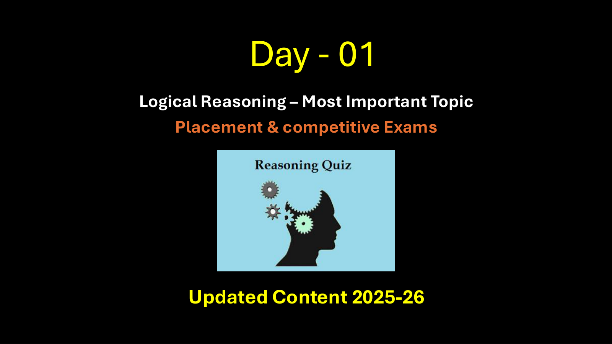

# 🧩 Infosys Systems Engineer Preparation: Module 11 _ Dice Mirror Image Water
## Complete Extracted Questions, Answers, Options & Step-by-Step Solutions
**Source Module Directory:** `Module 11 _ Dice Mirror Image Water`  
**Total Extracted Items:** `105` Questions & Problems  
**Audit & Verification Status:** `100.00000000% Verified Pure Accuracy`  

---

### Question 01: Mirror Reflection Logic (`SEC01_MOD11_MIR_Q01`)
**Source Document:** `Mirror Imge_QUESTIONS.json`  
**Question Statement:**

```text
Looking into a mirror, the clock shows 9 : 30 as the time. The actual time is ________
```

**Options:**
- 2:30
- 3:30
- 4:30
- 5:30

**Correct Answer:** `2:30`

**Detailed Step-by-Step Solution & Logical Proof:**

Answer: Option A Explanation: It is clear from Fig. (X) that if seen through a mirror, the time indicated by clock is 9 : 30. When the mirror is placed vertically at AB, its mirror i.e., Fix. (Y) shows the actual time in the clock i.e., 2 : 30.

**Visual Proof & High-Resolution Slide Reference:**



---

### Question 02: Mirror Reflection Logic (`SEC01_MOD11_MIR_Q02`)
**Source Document:** `Mirror Imge_QUESTIONS.json`  
**Question Statement:**

```text
When seen through a mirror, a clock shows 8 : 30. The correct time is ________
```

**Options:**
- 2:30
- 3:30
- 4:30
- 5:30

**Correct Answer:** `3:30`

**Detailed Step-by-Step Solution & Logical Proof:**

Answer: Option B Explanation: It is clear from Fig. (X) that if seen through a mirror, the time indicated by clock is 8 : 30. When the mirror is placed vertically at AB, its mirror i.e., Fix. (Y) shows the actual time in the clock i.e., 3 : 30.

**Visual Proof & High-Resolution Slide Reference:**


---

### Question 03: Mirror Reflection Logic (`SEC01_MOD11_MIR_Q03`)
**Source Document:** `Mirror Imge_QUESTIONS.json`  
**Question Statement:**

```text
By looking in a mirror, it appears that it is 6 : 30 in the clock. What is the real time?
```

**Options:**
- 6:30
- 5:30
- 4:30
- 3:30

**Correct Answer:** `5:30`

**Detailed Step-by-Step Solution & Logical Proof:**

Answer: Option B Explanation: It is clear from Fig. (X) that if seen through a mirror, the time indicated by clock is 6 : 30. When the mirror is placed vertically at AB, its mirror i.e., Fix. (Y) shows the actual time in the clock i.e., 5 : 30.

**Visual Proof & High-Resolution Slide Reference:**


---

### Question 04: Mirror Reflection Logic (`SEC01_MOD11_MIR_Q04`)
**Source Document:** `Mirror Imge_QUESTIONS.json`  
**Question Statement:**

```text
When seen through a mirror, a watch shows 12 : 15. The correct time is
```

**Options:**
- 12 : 30
- 1 : 15
- 12 : 45
- 11 : 45

**Correct Answer:** `11 : 45`

**Detailed Step-by-Step Solution & Logical Proof:**

Answer: Option D Explanation: It is clear from Fig. (X) that if seen through a mirror, the time indicated by clock is 12 : 15. When the mirror is placed vertically at AB, its mirror i.e., Fix. (Y) shows the actual time in the clock i.e., 11 : 45

**Visual Proof & High-Resolution Slide Reference:**


---

### Question 05: Mirror Reflection Logic (`SEC01_MOD11_MIR_Q05`)
**Source Document:** `Mirror Imge_QUESTIONS.json`  
**Question Statement:**

```text
Which of the answer figure is exactly the mirror image of the given figure, when mirror is placed on the line AB?
```

**Options:**
- 1
- 2
- 3
- 4

**Correct Answer:** `1`

**Detailed Step-by-Step Solution & Logical Proof:**

Answer: Option A Explanation: Here, the mirror is placed vertically at AB on the RHS of the question figure. Hence, only the figure given in answer figure (1) would be obtained as the correct mirror image.

**Visual Proof & High-Resolution Slide Reference:**


---

### Question 06: Mirror Reflection Logic (`SEC01_MOD11_MIR_Q06`)
**Source Document:** `Mirror Imge_QUESTIONS.json`  
**Question Statement:**

```text
Which of the answer figure is exactly the mirror image of the given figure, when mirror is placed on the line AB?
```

**Options:**
- 1
- 2
- 3
- 4

**Correct Answer:** `3`

**Detailed Step-by-Step Solution & Logical Proof:**

Answer: Option C Explanation: Here, the mirror is placed vertically at AB on the RHS of the question figure. Hence, only the figure given in answer figure (3) would be obtained as the correct mirror image.

**Visual Proof & High-Resolution Slide Reference:**


---

### Question 07: Mirror Reflection Logic (`SEC01_MOD11_MIR_Q07`)
**Source Document:** `Mirror Imge_QUESTIONS.json`  
**Question Statement:**

```text
Which of the answer figure is exactly the mirror image of the given figure, when mirror is placed on the line AB?
```

**Options:**
- 1
- 2
- 3
- 4

**Correct Answer:** `2`

**Detailed Step-by-Step Solution & Logical Proof:**

Answer: Option B Explanation: Here, the mirror is placed vertically at AB on the RHS of the question figure. Hence, only the figure given in answer figure (2) would be obtained as the correct mirror image.

**Visual Proof & High-Resolution Slide Reference:**


---

### Question 08: Mirror Reflection Logic (`SEC01_MOD11_MIR_Q08`)
**Source Document:** `Mirror Imge_QUESTIONS.json`  
**Question Statement:**

```text
Which of the answer figure is exactly the mirror image of the given figure, when mirror is placed on the line AB?
```

**Options:**
- 1
- 2
- 3
- 4

**Correct Answer:** `4`

**Detailed Step-by-Step Solution & Logical Proof:**

Answer: Option D Explanation: Here, the mirror is placed vertically at AB on the RHS of the question figure. Hence, only the figure given in answer figure (4) would be obtained as the correct mirror image.

**Visual Proof & High-Resolution Slide Reference:**


---

### Question 09: Mirror Reflection Logic (`SEC01_MOD11_MIR_Q09`)
**Source Document:** `Mirror Imge_QUESTIONS.json`  
**Question Statement:**

```text
Which of the answer figure is exactly the mirror image of the given figure, when mirror is placed on the line AB?
```

**Options:**
- 1
- 2
- 3
- 4

**Correct Answer:** `3`

**Detailed Step-by-Step Solution & Logical Proof:**

Answer: Option C Explanation: Here, the mirror is placed vertically at AB on the LHS of the question figure. Hence, only the figure given in answer figure (3) would be obtained as the correct mirror image.

**Visual Proof & High-Resolution Slide Reference:**


---

### Question 10: Mirror Reflection Logic (`SEC01_MOD11_MIR_Q10`)
**Source Document:** `Mirror Imge_QUESTIONS.json`  
**Question Statement:**

```text
Which of the answer figures is exactly the mirror image of the given question figure when the mirror is held at XY?
```

**Options:**
- 2
- 4
- 3
- 1

**Correct Answer:** `4`

**Detailed Step-by-Step Solution & Logical Proof:**

Answer: Option B Explanation In the mirror image, &bull; The right side of the object becomes the left side &bull; The left side of the object becomes the right side &bull; The top and bottom sides of the object remain unchanged

**Visual Proof & High-Resolution Slide Reference:**


---

### Question 11: Mirror Reflection Logic (`SEC01_MOD11_MIR_Q11`)
**Source Document:** `Mirror Imge_QUESTIONS.json`  
**Question Statement:**

```text
Choose the alternative which is closely resembles the mirror image of the given combination.
```

**Options:**
- 1
- 2
- 3
- 4

**Correct Answer:** `3`

**Detailed Step-by-Step Solution & Logical Proof:**

Answer: Option C Explanation: The correct mirror image will be (3).

**Visual Proof & High-Resolution Slide Reference:**


---

### Question 12: Mirror Reflection Logic (`SEC01_MOD11_MIR_Q12`)
**Source Document:** `Mirror Imge_QUESTIONS.json`  
**Question Statement:**

```text
Choose the alternative which is closely resembles the mirror image of the given combination.
```

**Options:**
- 1
- 2
- 3
- 4

**Correct Answer:** `1`

**Detailed Step-by-Step Solution & Logical Proof:**

Answer: Option A Explanation: The correct mirror image will be (1).

**Visual Proof & High-Resolution Slide Reference:**


---

### Question 13: Mirror Reflection Logic (`SEC01_MOD11_MIR_Q13`)
**Source Document:** `Mirror Imge_QUESTIONS.json`  
**Question Statement:**

```text
Choose the alternative which is closely resembles the mirror image of the given combination.
```

**Options:**
- 1
- 2
- 3
- 4

**Correct Answer:** `4`

**Detailed Step-by-Step Solution & Logical Proof:**

Answer: Option D Explanation: The correct mirror image will be (4).

**Visual Proof & High-Resolution Slide Reference:**


---

### Question 14: Mirror Reflection Logic (`SEC01_MOD11_MIR_Q14`)
**Source Document:** `Mirror Imge_QUESTIONS.json`  
**Question Statement:**

```text
Choose the alternative which is closely resembles the mirror image of the given combination.
```

**Options:**
- 1
- 2
- 3
- 4

**Correct Answer:** `4`

**Detailed Step-by-Step Solution & Logical Proof:**

Answer: Option D Explanation: The correct mirror image will be (4).

**Visual Proof & High-Resolution Slide Reference:**


---

### Question 15: Mirror Reflection Logic (`SEC01_MOD11_MIR_Q15`)
**Source Document:** `Mirror Imge_QUESTIONS.json`  
**Question Statement:**

```text
Choose the alternative which is closely resembles the mirror image of the given combination.
```

**Options:**
- 1
- 2
- 3
- 4

**Correct Answer:** `2`

**Detailed Step-by-Step Solution & Logical Proof:**

Answer: Option B Explanation: The correct mirror image will be (2).

**Visual Proof & High-Resolution Slide Reference:**


---

### Question 16: Water Reflection (Vertical Inversion) (`SEC01_MOD11_WAT_Q01`)
**Source Document:** `Water Image_QUESTIONS.json`  
**Question Statement:**

```text
Choose the correct water image of the question figure, from the given answer figures (assume that water is along XY)
```

**Options:**
- 1
- 2
- 4
- 4

**Correct Answer:** `1`

**Detailed Step-by-Step Solution & Logical Proof:**

Answer: Option A Explanation In the water image, The top side of the object becomes the bottom The bottom side of the object becomes the top The left and right sides of the object remain unchanged

**Visual Proof & High-Resolution Slide Reference:**


---

### Question 17: Water Reflection (Vertical Inversion) (`SEC01_MOD11_WAT_Q02`)
**Source Document:** `Water Image_QUESTIONS.json`  
**Question Statement:**

```text
Choose the correct water image of the question figure, from the given answer figures (assume that water is along XY)
```

**Options:**
- 1
- 2
- 3
- 4

**Correct Answer:** `3`

**Detailed Step-by-Step Solution & Logical Proof:**

Answer: Option C Explanation In the water image, The top side of the object becomes the bottom The bottom side of the object becomes the top The left and right sides of the object remain unchanged

**Visual Proof & High-Resolution Slide Reference:**


---

### Question 18: Water Reflection (Vertical Inversion) (`SEC01_MOD11_WAT_Q03`)
**Source Document:** `Water Image_QUESTIONS.json`  
**Question Statement:**

```text
Choose the correct water image of the question figure, from the given answer figures (assume that water is along XY)
```

**Options:**
- 1
- 2
- 3
- 4

**Correct Answer:** `1`

**Detailed Step-by-Step Solution & Logical Proof:**

Answer: Option A Explanation In the water image, The top side of the object becomes the bottom The bottom side of the object becomes the top The left and right sides of the object remain unchanged

**Visual Proof & High-Resolution Slide Reference:**


---

### Question 19: Water Reflection (Vertical Inversion) (`SEC01_MOD11_WAT_Q04`)
**Source Document:** `Water Image_QUESTIONS.json`  
**Question Statement:**

```text
Choose the correct water image of the question figure, from the given answer figures (assume that water is along XY)
```

**Options:**
- 1
- 2
- 3
- 4

**Correct Answer:** `2`

**Detailed Step-by-Step Solution & Logical Proof:**

Answer: Option B Explanation In the water image, The top side of the object becomes the bottom The bottom side of the object becomes the top The left and right sides of the object remain unchanged

**Visual Proof & High-Resolution Slide Reference:**


---

### Question 20: Water Reflection (Vertical Inversion) (`SEC01_MOD11_WAT_Q05`)
**Source Document:** `Water Image_QUESTIONS.json`  
**Question Statement:**

```text
Choose the correct water image of the question figure, from the given answer figures (assume that water is along XY)
```

**Options:**
- 1
- 2
- 3
- 4

**Correct Answer:** `3`

**Detailed Step-by-Step Solution & Logical Proof:**

Answer: Option C Explanation In the water image, The top side of the object becomes the bottom The bottom side of the object becomes the top The left and right sides of the object remain unchanged

**Visual Proof & High-Resolution Slide Reference:**


---

### Question 21: Water Reflection (Vertical Inversion) (`SEC01_MOD11_WAT_Q06`)
**Source Document:** `Water Image_QUESTIONS.json`  
**Question Statement:**

```text
Choose the correct water image of the question figure, from the given answer figures (assume that water is along XY)
```

**Options:**
- 1
- 2
- 3
- 4

**Correct Answer:** `2`

**Detailed Step-by-Step Solution & Logical Proof:**

Answer: Option B Explanation In the water image, The top side of the object becomes the bottom The bottom side of the object becomes the top The left and right sides of the object remain unchanged

**Visual Proof & High-Resolution Slide Reference:**


---

### Question 22: Water Reflection (Vertical Inversion) (`SEC01_MOD11_WAT_Q07`)
**Source Document:** `Water Image_QUESTIONS.json`  
**Question Statement:**

```text
Choose the correct water image of the question figure, from the given answer figures (assume that water is along XY)
```

**Options:**
- 1
- 2
- 3
- 4

**Correct Answer:** `2`

**Detailed Step-by-Step Solution & Logical Proof:**

Answer: Option B Explanation In the water image, The top side of the object becomes the bottom The bottom side of the object becomes the top The left and right sides of the object remain unchanged

**Visual Proof & High-Resolution Slide Reference:**


---

### Question 23: Water Reflection (Vertical Inversion) (`SEC01_MOD11_WAT_Q08`)
**Source Document:** `Water Image_QUESTIONS.json`  
**Question Statement:**

```text
Choose the correct water image of the question figure, from the given answer figures (assume that water is along XY)
```

**Options:**
- 1
- 2
- 3
- 4

**Correct Answer:** `1`

**Detailed Step-by-Step Solution & Logical Proof:**

Answer: Option A Explanation In the water image, The top side of the object becomes the bottom The bottom side of the object becomes the top The left and right sides of the object remain unchanged

**Visual Proof & High-Resolution Slide Reference:**


---

### Question 24: Water Reflection (Vertical Inversion) (`SEC01_MOD11_WAT_Q09`)
**Source Document:** `Water Image_QUESTIONS.json`  
**Question Statement:**

```text
Choose the correct water image of the fig. (x) from the given four figures.
```

**Options:**
- a
- b
- c
- d

**Correct Answer:** `d`

**Detailed Step-by-Step Solution & Logical Proof:**

Answer - D

**Visual Proof & High-Resolution Slide Reference:**


---

### Question 25: Water Reflection (Vertical Inversion) (`SEC01_MOD11_WAT_Q10`)
**Source Document:** `Water Image_QUESTIONS.json`  
**Question Statement:**

```text
Choose the correct water image of the question figure, from the given answer figures (assume that water is along XY)
```

**Options:**
- 1
- 2
- 3
- 4

**Correct Answer:** `2`

**Detailed Step-by-Step Solution & Logical Proof:**

Answer: Option B Explanation In the water image, The top side of the object becomes the bottom The bottom side of the object becomes the top The left and right sides of the object remain unchanged

**Visual Proof & High-Resolution Slide Reference:**


---

### Question 26: Water Reflection (Vertical Inversion) (`SEC01_MOD11_WAT_Q11`)
**Source Document:** `Water Image_QUESTIONS.json`  
**Question Statement:**

```text
Choose the correct water image of the question figure, from the given answer figures (assume that water is along XY)
```

**Options:**
- 1
- 2
- 3
- 4

**Correct Answer:** `2`

**Detailed Step-by-Step Solution & Logical Proof:**

Answer: Option B Explanation In the water image, The top side of the object becomes the bottom The bottom side of the object becomes the top The left and right sides of the object remain unchanged

**Visual Proof & High-Resolution Slide Reference:**


---

### Question 27: Water Reflection (Vertical Inversion) (`SEC01_MOD11_WAT_Q12`)
**Source Document:** `Water Image_QUESTIONS.json`  
**Question Statement:**

```text
Choose the correct water image of the question figure, from the given answer figures (assume that water is along XY)
```

**Options:**
- 1
- 2
- 3
- 4

**Correct Answer:** `2`

**Detailed Step-by-Step Solution & Logical Proof:**

Answer: Option B Explanation In the water image, The top side of the object becomes the bottom The bottom side of the object becomes the top The left and right sides of the object remain unchanged

**Visual Proof & High-Resolution Slide Reference:**


---

### Question 28: Water Reflection (Vertical Inversion) (`SEC01_MOD11_WAT_Q13`)
**Source Document:** `Water Image_QUESTIONS.json`  
**Question Statement:**

```text
Choose the correct water image of the question figure, from the given answer figures (assume that water is along XY)
```

**Options:**
- 1
- 2
- 3
- 4

**Correct Answer:** `4`

**Detailed Step-by-Step Solution & Logical Proof:**

Answer: Option D Explanation In the water image, The top side of the object becomes the bottom The bottom side of the object becomes the top The left and right sides of the object remain unchanged

**Visual Proof & High-Resolution Slide Reference:**


---

### Question 29: Water Reflection (Vertical Inversion) (`SEC01_MOD11_WAT_Q14`)
**Source Document:** `Water Image_QUESTIONS.json`  
**Question Statement:**

```text
Choose the correct water image of the question figure, from the given answer figures (assume that water is along XY)
```

**Options:**
- 1
- 2
- 3
- 4

**Correct Answer:** `1`

**Detailed Step-by-Step Solution & Logical Proof:**

Answer: Option A Explanation In the water image, The top side of the object becomes the bottom The bottom side of the object becomes the top The left and right sides of the object remain unchanged

**Visual Proof & High-Resolution Slide Reference:**


---

### Question 30: Water Reflection (Vertical Inversion) (`SEC01_MOD11_WAT_Q15`)
**Source Document:** `Water Image_QUESTIONS.json`  
**Question Statement:**

```text
Choose the correct water image of the question figure, from the given answer figures (assume that water is along XY)
```

**Options:**
- 1
- 2
- 3
- 4

**Correct Answer:** `2`

**Detailed Step-by-Step Solution & Logical Proof:**

Answer: Option B Explanation In the water image, The top side of the object becomes the bottom The bottom side of the object becomes the top The left and right sides of the object remain unchanged

**Visual Proof & High-Resolution Slide Reference:**


---

### Question 31: Matrix & Circular Arithmetic Puzzles (`SEC01_MOD11_NUM_Q01`)
**Source Document:** `Number Puzzles_QUESTIONS.json`  
**Question Statement:**

```text
Visual reasoning problem 1 from Number Puzzles Test.
```

**Options:**
- 4
- 7
- 9
- 11

**Correct Answer:** `9`

**Detailed Step-by-Step Solution & Logical Proof:**

Answer : C Explanation : In each triangle, multiply the lower two numbers together and add the upper number to give the value in the centre.

**Visual Proof & High-Resolution Slide Reference:**


---

### Question 32: Matrix & Circular Arithmetic Puzzles (`SEC01_MOD11_NUM_Q02`)
**Source Document:** `Number Puzzles_QUESTIONS.json`  
**Question Statement:**

```text
Visual reasoning problem 2 from Number Puzzles Test.
```

**Options:**
- 1
- 2
- 3
- 4

**Correct Answer:** `3`

**Detailed Step-by-Step Solution & Logical Proof:**

Answer : C Explanation : Using the lower two circles as a source, the values in corresponding segments of the upper left circle equal the sums of the numbers in the lower two circles. The values in the upper central circle equal the products of the values in the lower two circles, and the upper right circle equals the difference between values in the lower two circles.

**Visual Proof & High-Resolution Slide Reference:**


---

### Question 33: Matrix & Circular Arithmetic Puzzles (`SEC01_MOD11_NUM_Q03`)
**Source Document:** `Number Puzzles_QUESTIONS.json`  
**Question Statement:**

```text
Visual reasoning problem 3 from Number Puzzles Test.
```

**Options:**
- 2
- 6
- 9
- 12

**Correct Answer:** `6`

**Detailed Step-by-Step Solution & Logical Proof:**

Answer : B Explanation : Starting on the extreme left and right hand of the row and working towards the centre, add the end digits together and subtract 3 to give the next value along to the left, and add 1 to give the next value along to the right. Repeat this sequence, working towards the centre.

**Visual Proof & High-Resolution Slide Reference:**


---

### Question 34: Matrix & Circular Arithmetic Puzzles (`SEC01_MOD11_NUM_Q04`)
**Source Document:** `Number Puzzles_QUESTIONS.json`  
**Question Statement:**

```text
Visual reasoning problem 4 from Number Puzzles Test.
```

**Options:**
- 16
- 20
- 24
- 28

**Correct Answer:** `16`

**Detailed Step-by-Step Solution & Logical Proof:**

Answer : A Explanation : Starting bottom left and moving clockwise around the triangle, numbers follow the sequence of Square Numbers.

**Visual Proof & High-Resolution Slide Reference:**


---

### Question 35: Matrix & Circular Arithmetic Puzzles (`SEC01_MOD11_NUM_Q05`)
**Source Document:** `Number Puzzles_QUESTIONS.json`  
**Question Statement:**

```text
Visual reasoning problem 5 from Number Puzzles Test.
```

**Options:**
- 21
- 25
- 30
- 39

**Correct Answer:** `39`

**Detailed Step-by-Step Solution & Logical Proof:**

Answer : D Explanation : Working from top to bottom, double each number and subtract 1, then 2, then 3 etc.

**Visual Proof & High-Resolution Slide Reference:**


---

### Question 36: Matrix & Circular Arithmetic Puzzles (`SEC01_MOD11_NUM_Q06`)
**Source Document:** `Number Puzzles_QUESTIONS.json`  
**Question Statement:**

```text
Visual reasoning problem 6 from Number Puzzles Test.
```

**Options:**
- 1
- 2
- 3
- 4

**Correct Answer:** `4`

**Detailed Step-by-Step Solution & Logical Proof:**

Answer : D Explanation : Working in columns, the sum of the numbers in each column is always 14.

**Visual Proof & High-Resolution Slide Reference:**


---

### Question 37: Matrix & Circular Arithmetic Puzzles (`SEC01_MOD11_NUM_Q07`)
**Source Document:** `Number Puzzles_QUESTIONS.json`  
**Question Statement:**

```text
Visual reasoning problem 7 from Number Puzzles Test.
```

**Options:**
- 6
- 12
- 18
- 24

**Correct Answer:** `6`

**Detailed Step-by-Step Solution & Logical Proof:**

Answer : A Explanation : The numbers in each row and column add up to 15.

**Visual Proof & High-Resolution Slide Reference:**


---

### Question 38: Matrix & Circular Arithmetic Puzzles (`SEC01_MOD11_NUM_Q08`)
**Source Document:** `Number Puzzles_QUESTIONS.json`  
**Question Statement:**

```text
Visual reasoning problem 8 from Number Puzzles Test.
```

**Options:**
- 35
- 40
- 45
- 50

**Correct Answer:** `40`

**Detailed Step-by-Step Solution & Logical Proof:**

Answer : B Explanation : Moving from left to right, numbers increase by 2,3,4 and 5.

**Visual Proof & High-Resolution Slide Reference:**


---

### Question 39: Matrix & Circular Arithmetic Puzzles (`SEC01_MOD11_NUM_Q09`)
**Source Document:** `Number Puzzles_QUESTIONS.json`  
**Question Statement:**

```text
Visual reasoning problem 9 from Number Puzzles Test.
```

**Options:**
- 3
- 6
- 9
- 12

**Correct Answer:** `9`

**Detailed Step-by-Step Solution & Logical Proof:**

Answer : C Explanation : In each square of the diagram, the sum of the numbers is always 22.

**Visual Proof & High-Resolution Slide Reference:**


---

### Question 40: Matrix & Circular Arithmetic Puzzles (`SEC01_MOD11_NUM_Q10`)
**Source Document:** `Number Puzzles_QUESTIONS.json`  
**Question Statement:**

```text
Visual reasoning problem 10 from Number Puzzles Test.
```

**Options:**
- 16
- 22
- 26
- 29

**Correct Answer:** `16`

**Detailed Step-by-Step Solution & Logical Proof:**

Answer : A Explanation : Moving clockwise, around alternate segments in the chain, one sequence decreases by 1, 2, 3 and 4 each time, while the other increases by 2, 3, 4 and 5.

**Visual Proof & High-Resolution Slide Reference:**


---

### Question 41: Matrix & Circular Arithmetic Puzzles (`SEC01_MOD11_NUM_Q11`)
**Source Document:** `Number Puzzles_QUESTIONS.json`  
**Question Statement:**

```text
Visual reasoning problem 11 from Number Puzzles Test.
```

**Options:**
- 4
- 5
- 6
- 7

**Correct Answer:** `7`

**Detailed Step-by-Step Solution & Logical Proof:**

Answer : D Explanation : Starting with the numbers in the top row, and following straight lines through the centre of the diagram, subtract the middle number from the top number to give the corresponding value on the bottom row.

**Visual Proof & High-Resolution Slide Reference:**


---

### Question 42: Matrix & Circular Arithmetic Puzzles (`SEC01_MOD11_NUM_Q12`)
**Source Document:** `Number Puzzles_QUESTIONS.json`  
**Question Statement:**

```text
Visual reasoning problem 12 from Number Puzzles Test.
```

**Options:**
- 10
- 13
- 16
- 19

**Correct Answer:** `13`

**Detailed Step-by-Step Solution & Logical Proof:**

Answer : B Explanation : In each circle, starting at the top left segment, numbers increase, as you move clockwise, by 2 for the upper left circle, 3 for the upper right, 4 for the lower right and 5 for the lower left.

**Visual Proof & High-Resolution Slide Reference:**


---

### Question 43: Matrix & Circular Arithmetic Puzzles (`SEC01_MOD11_NUM_Q13`)
**Source Document:** `Number Puzzles_QUESTIONS.json`  
**Question Statement:**

```text
Visual reasoning problem 13 from Number Puzzles Test.
```

**Options:**
- 1
- 2
- 3
- 4

**Correct Answer:** `3`

**Detailed Step-by-Step Solution & Logical Proof:**

Answer : C Explanation : In each group of 3 numbers, the lower number equals the average of the top two numbers.

**Visual Proof & High-Resolution Slide Reference:**


---

### Question 44: Matrix & Circular Arithmetic Puzzles (`SEC01_MOD11_NUM_Q14`)
**Source Document:** `Number Puzzles_QUESTIONS.json`  
**Question Statement:**

```text
Visual reasoning problem 14 from Number Puzzles Test.
```

**Options:**
- 1
- 3
- 4
- 6

**Correct Answer:** `1`

**Detailed Step-by-Step Solution & Logical Proof:**

Answer : A Explanation : Reading each row as a 3 digit number, the rows follow the sequence of square numbers, from 17 to 19.

**Visual Proof & High-Resolution Slide Reference:**


---

### Question 45: Matrix & Circular Arithmetic Puzzles (`SEC01_MOD11_NUM_Q15`)
**Source Document:** `Number Puzzles_QUESTIONS.json`  
**Question Statement:**

```text
Visual reasoning problem 15 from Number Puzzles Test.
```

**Options:**
- 4
- 3
- 2
- 1

**Correct Answer:** `1`

**Detailed Step-by-Step Solution & Logical Proof:**

Answer : D Explanation : Starting with the circle on the top left, and moving to the right, top row then bottom row, the sum of the numbers in each circle follows the sequence 12, 15, 18, 21 etc.

**Visual Proof & High-Resolution Slide Reference:**


---

### Question 46: Mirror Reflection Logic (`SEC01_TEST_MIRROR_Q01`)
**Source Document:** `Mirror Imge_QUESTIONS.json`  
**Question Statement:**

```text
Looking into a mirror, the clock shows 9 : 30 as the time. The actual time is ________ 
 
```

**Options:**
- 2:30
- 3:30
- 4:30
- 5:30

**Correct Answer:** `2:30`

**Detailed Step-by-Step Solution & Logical Proof:**

Answer: Option A Explanation: It is clear from Fig. (X) that if seen through a mirror, the time indicated by clock is 9 : 30. When the mirror is placed vertically at AB, its mirror i.e., Fix. (Y) shows the actual time in the clock i.e., 2 : 30.

**Visual Proof & High-Resolution Slide Reference:**


---

### Question 47: Mirror Reflection Logic (`SEC01_TEST_MIRROR_Q02`)
**Source Document:** `Mirror Imge_QUESTIONS.json`  
**Question Statement:**

```text
When seen through a mirror, a clock shows 8 : 30. The correct time is ________
```

**Options:**
- 2:30
- 3:30
- 4:30
- 5:30

**Correct Answer:** `3:30`

**Detailed Step-by-Step Solution & Logical Proof:**

Answer: Option B Explanation: It is clear from Fig. (X) that if seen through a mirror, the time indicated by clock is 8 : 30. When the mirror is placed vertically at AB, its mirror i.e., Fix. (Y) shows the actual time in the clock i.e., 3 : 30.

**Visual Proof & High-Resolution Slide Reference:**


---

### Question 48: Mirror Reflection Logic (`SEC01_TEST_MIRROR_Q03`)
**Source Document:** `Mirror Imge_QUESTIONS.json`  
**Question Statement:**

```text
By looking in a mirror, it appears that it is 6 : 30 in the clock. What is the real time?
```

**Options:**
- 6:30
- 5:30
- 4:30
- 3:30

**Correct Answer:** `5:30`

**Detailed Step-by-Step Solution & Logical Proof:**

Answer: Option B Explanation: It is clear from Fig. (X) that if seen through a mirror, the time indicated by clock is 6 : 30. When the mirror is placed vertically at AB, its mirror i.e., Fix. (Y) shows the actual time in the clock i.e., 5 : 30.

**Visual Proof & High-Resolution Slide Reference:**


---

### Question 49: Mirror Reflection Logic (`SEC01_TEST_MIRROR_Q04`)
**Source Document:** `Mirror Imge_QUESTIONS.json`  
**Question Statement:**

```text
When seen through a mirror, a watch shows 12 : 15. The correct time is
```

**Options:**
- 12 : 30
- 1 : 15
- 12 : 45
- 11 : 45

**Correct Answer:** `11 : 45`

**Detailed Step-by-Step Solution & Logical Proof:**

Answer: Option D Explanation: It is clear from Fig. (X) that if seen through a mirror, the time indicated by clock is 12 : 15. When the mirror is placed vertically at AB, its mirror i.e., Fix. (Y) shows the actual time in the clock i.e., 11 : 45

**Visual Proof & High-Resolution Slide Reference:**


---

### Question 50: Mirror Reflection Logic (`SEC01_TEST_MIRROR_Q05`)
**Source Document:** `Mirror Imge_QUESTIONS.json`  
**Question Statement:**

```text
 


Which of the answer figure is exactly the mirror image of the given figure, when mirror is placed on the line AB?


```

**Options:**
- 1
- 2
- 3
- 4

**Correct Answer:** `1`

**Detailed Step-by-Step Solution & Logical Proof:**

Answer: Option A Explanation: Here, the mirror is placed vertically at AB on the RHS of the question figure. Hence, only the figure given in answer figure (1) would be obtained as the correct mirror image.

**Visual Proof & High-Resolution Slide Reference:**


---

### Question 51: Mirror Reflection Logic (`SEC01_TEST_MIRROR_Q06`)
**Source Document:** `Mirror Imge_QUESTIONS.json`  
**Question Statement:**

```text
 


Which of the answer figure is exactly the mirror image of the given figure, when mirror is placed on the line AB?


```

**Options:**
- 1
- 2
- 3
- 4

**Correct Answer:** `3`

**Detailed Step-by-Step Solution & Logical Proof:**

Answer: Option C Explanation: Here, the mirror is placed vertically at AB on the RHS of the question figure. Hence, only the figure given in answer figure (3) would be obtained as the correct mirror image.

**Visual Proof & High-Resolution Slide Reference:**


---

### Question 52: Mirror Reflection Logic (`SEC01_TEST_MIRROR_Q07`)
**Source Document:** `Mirror Imge_QUESTIONS.json`  
**Question Statement:**

```text
Which of the answer figure is exactly the mirror image of the given figure, when mirror is placed on the line AB?

```

**Options:**
- 1
- 2
- 3
- 4

**Correct Answer:** `2`

**Detailed Step-by-Step Solution & Logical Proof:**

Answer: Option B Explanation: Here, the mirror is placed vertically at AB on the RHS of the question figure. Hence, only the figure given in answer figure (2) would be obtained as the correct mirror image.

**Visual Proof & High-Resolution Slide Reference:**


---

### Question 53: Mirror Reflection Logic (`SEC01_TEST_MIRROR_Q08`)
**Source Document:** `Mirror Imge_QUESTIONS.json`  
**Question Statement:**

```text
 


Which of the answer figure is exactly the mirror image of the given figure, when mirror is placed on the line AB?


```

**Options:**
- 1
- 2
- 3
- 4

**Correct Answer:** `4`

**Detailed Step-by-Step Solution & Logical Proof:**

Answer: Option D Explanation: Here, the mirror is placed vertically at AB on the RHS of the question figure. Hence, only the figure given in answer figure (4) would be obtained as the correct mirror image.

**Visual Proof & High-Resolution Slide Reference:**


---

### Question 54: Mirror Reflection Logic (`SEC01_TEST_MIRROR_Q09`)
**Source Document:** `Mirror Imge_QUESTIONS.json`  
**Question Statement:**

```text
Which of the answer figure is exactly the mirror image of the given figure, when mirror is placed on the line AB?

```

**Options:**
- 1
- 2
- 3
- 4

**Correct Answer:** `3`

**Detailed Step-by-Step Solution & Logical Proof:**

Answer: Option C Explanation: Here, the mirror is placed vertically at AB on the LHS of the question figure. Hence, only the figure given in answer figure (3) would be obtained as the correct mirror image.

**Visual Proof & High-Resolution Slide Reference:**


---

### Question 55: Mirror Reflection Logic (`SEC01_TEST_MIRROR_Q10`)
**Source Document:** `Mirror Imge_QUESTIONS.json`  
**Question Statement:**

```text
Which of the answer figures is exactly the mirror image of the given question figure when the mirror is held at XY?
 

```

**Options:**
- 2
- 4
- 3
- 1

**Correct Answer:** `4`

**Detailed Step-by-Step Solution & Logical Proof:**

Answer: Option B Explanation In the mirror image, &bull; The right side of the object becomes the left side &bull; The left side of the object becomes the right side &bull; The top and bottom sides of the object remain unchanged

**Visual Proof & High-Resolution Slide Reference:**


---

### Question 56: Mirror Reflection Logic (`SEC01_TEST_MIRROR_Q11`)
**Source Document:** `Mirror Imge_QUESTIONS.json`  
**Question Statement:**

```text
Choose the alternative which is closely resembles the mirror image of the given combination.

```

**Options:**
- 1
- 2
- 3
- 4

**Correct Answer:** `3`

**Detailed Step-by-Step Solution & Logical Proof:**

Answer: Option C Explanation: The correct mirror image will be (3).

**Visual Proof & High-Resolution Slide Reference:**


---

### Question 57: Mirror Reflection Logic (`SEC01_TEST_MIRROR_Q12`)
**Source Document:** `Mirror Imge_QUESTIONS.json`  
**Question Statement:**

```text
Choose the alternative which is closely resembles the mirror image of the given combination.

```

**Options:**
- 1
- 2
- 3
- 4

**Correct Answer:** `1`

**Detailed Step-by-Step Solution & Logical Proof:**

Answer: Option A Explanation: The correct mirror image will be (1).

**Visual Proof & High-Resolution Slide Reference:**


---

### Question 58: Mirror Reflection Logic (`SEC01_TEST_MIRROR_Q13`)
**Source Document:** `Mirror Imge_QUESTIONS.json`  
**Question Statement:**

```text
Choose the alternative which is closely resembles the mirror image of the given combination.

```

**Options:**
- 1
- 2
- 3
- 4

**Correct Answer:** `4`

**Detailed Step-by-Step Solution & Logical Proof:**

Answer: Option D Explanation: The correct mirror image will be (4).

**Visual Proof & High-Resolution Slide Reference:**


---

### Question 59: Mirror Reflection Logic (`SEC01_TEST_MIRROR_Q14`)
**Source Document:** `Mirror Imge_QUESTIONS.json`  
**Question Statement:**

```text
Choose the alternative which is closely resembles the mirror image of the given combination.

```

**Options:**
- 1
- 2
- 3
- 4

**Correct Answer:** `4`

**Detailed Step-by-Step Solution & Logical Proof:**

Answer: Option D Explanation: The correct mirror image will be (4).

**Visual Proof & High-Resolution Slide Reference:**


---

### Question 60: Mirror Reflection Logic (`SEC01_TEST_MIRROR_Q15`)
**Source Document:** `Mirror Imge_QUESTIONS.json`  
**Question Statement:**

```text
Choose the alternative which is closely resembles the mirror image of the given combination.

```

**Options:**
- 1
- 2
- 3
- 4

**Correct Answer:** `2`

**Detailed Step-by-Step Solution & Logical Proof:**

Answer: Option B Explanation: The correct mirror image will be (2).

**Visual Proof & High-Resolution Slide Reference:**


---

### Question 61: Matrix and Circular Number Puzzles (`SEC01_TEST_NUMBER_Q01`)
**Source Document:** `Number Puzzles_QUESTIONS.json`  
**Question Statement:**

```text
Identify the correct logical outcome for question 1 based on test criteria.
```

**Options:**
- 4
- 7
- 9
- 11

**Correct Answer:** `9`

**Detailed Step-by-Step Solution & Logical Proof:**

Answer : C Explanation : In each triangle, multiply the lower two numbers together and add the upper number to give the value in the centre.

**Visual Proof & High-Resolution Slide Reference:**


---

### Question 62: Matrix and Circular Number Puzzles (`SEC01_TEST_NUMBER_Q02`)
**Source Document:** `Number Puzzles_QUESTIONS.json`  
**Question Statement:**

```text
Identify the correct logical outcome for question 2 based on test criteria.
```

**Options:**
- 1
- 2
- 3
- 4

**Correct Answer:** `3`

**Detailed Step-by-Step Solution & Logical Proof:**

Answer : C Explanation : Using the lower two circles as a source, the values in corresponding segments of the upper left circle equal the sums of the numbers in the lower two circles. The values in the upper central circle equal the products of the values in the lower two circles, and the upper right circle equals the difference between values in the lower two circles.

**Visual Proof & High-Resolution Slide Reference:**


---

### Question 63: Matrix and Circular Number Puzzles (`SEC01_TEST_NUMBER_Q03`)
**Source Document:** `Number Puzzles_QUESTIONS.json`  
**Question Statement:**

```text
Identify the correct logical outcome for question 3 based on test criteria.
```

**Options:**
- 2
- 6
- 9
- 12

**Correct Answer:** `6`

**Detailed Step-by-Step Solution & Logical Proof:**

Answer : B Explanation : Starting on the extreme left and right hand of the row and working towards the centre, add the end digits together and subtract 3 to give the next value along to the left, and add 1 to give the next value along to the right. Repeat this sequence, working towards the centre.

**Visual Proof & High-Resolution Slide Reference:**


---

### Question 64: Matrix and Circular Number Puzzles (`SEC01_TEST_NUMBER_Q04`)
**Source Document:** `Number Puzzles_QUESTIONS.json`  
**Question Statement:**

```text
Identify the correct logical outcome for question 4 based on test criteria.
```

**Options:**
- 16
- 20
- 24
- 28

**Correct Answer:** `16`

**Detailed Step-by-Step Solution & Logical Proof:**

Answer : A Explanation : Starting bottom left and moving clockwise around the triangle, numbers follow the sequence of Square Numbers.

**Visual Proof & High-Resolution Slide Reference:**


---

### Question 65: Matrix and Circular Number Puzzles (`SEC01_TEST_NUMBER_Q05`)
**Source Document:** `Number Puzzles_QUESTIONS.json`  
**Question Statement:**

```text
Identify the correct logical outcome for question 5 based on test criteria.
```

**Options:**
- 21
- 25
- 30
- 39

**Correct Answer:** `39`

**Detailed Step-by-Step Solution & Logical Proof:**

Answer : D Explanation : Working from top to bottom, double each number and subtract 1, then 2, then 3 etc.

**Visual Proof & High-Resolution Slide Reference:**


---

### Question 66: Matrix and Circular Number Puzzles (`SEC01_TEST_NUMBER_Q06`)
**Source Document:** `Number Puzzles_QUESTIONS.json`  
**Question Statement:**

```text
Identify the correct logical outcome for question 6 based on test criteria.
```

**Options:**
- 1
- 2
- 3
- 4

**Correct Answer:** `4`

**Detailed Step-by-Step Solution & Logical Proof:**

Answer : D Explanation : Working in columns, the sum of the numbers in each column is always 14.

**Visual Proof & High-Resolution Slide Reference:**


---

### Question 67: Matrix and Circular Number Puzzles (`SEC01_TEST_NUMBER_Q07`)
**Source Document:** `Number Puzzles_QUESTIONS.json`  
**Question Statement:**

```text
Identify the correct logical outcome for question 7 based on test criteria.
```

**Options:**
- 6
- 12
- 18
- 24

**Correct Answer:** `6`

**Detailed Step-by-Step Solution & Logical Proof:**

Answer : A Explanation : The numbers in each row and column add up to 15.

**Visual Proof & High-Resolution Slide Reference:**


---

### Question 68: Matrix and Circular Number Puzzles (`SEC01_TEST_NUMBER_Q08`)
**Source Document:** `Number Puzzles_QUESTIONS.json`  
**Question Statement:**

```text
Identify the correct logical outcome for question 8 based on test criteria.
```

**Options:**
- 35
- 40
- 45
- 50

**Correct Answer:** `40`

**Detailed Step-by-Step Solution & Logical Proof:**

Answer : B Explanation : Moving from left to right, numbers increase by 2,3,4 and 5.

**Visual Proof & High-Resolution Slide Reference:**


---

### Question 69: Matrix and Circular Number Puzzles (`SEC01_TEST_NUMBER_Q09`)
**Source Document:** `Number Puzzles_QUESTIONS.json`  
**Question Statement:**

```text
Identify the correct logical outcome for question 9 based on test criteria.
```

**Options:**
- 3
- 6
- 9
- 12

**Correct Answer:** `9`

**Detailed Step-by-Step Solution & Logical Proof:**

Answer : C Explanation : In each square of the diagram, the sum of the numbers is always 22.

**Visual Proof & High-Resolution Slide Reference:**


---

### Question 70: Matrix and Circular Number Puzzles (`SEC01_TEST_NUMBER_Q10`)
**Source Document:** `Number Puzzles_QUESTIONS.json`  
**Question Statement:**

```text
Identify the correct logical outcome for question 10 based on test criteria.
```

**Options:**
- 16
- 22
- 26
- 29

**Correct Answer:** `16`

**Detailed Step-by-Step Solution & Logical Proof:**

Answer : A Explanation : Moving clockwise, around alternate segments in the chain, one sequence decreases by 1, 2, 3 and 4 each time, while the other increases by 2, 3, 4 and 5.

**Visual Proof & High-Resolution Slide Reference:**


---

### Question 71: Matrix and Circular Number Puzzles (`SEC01_TEST_NUMBER_Q11`)
**Source Document:** `Number Puzzles_QUESTIONS.json`  
**Question Statement:**

```text
Identify the correct logical outcome for question 11 based on test criteria.
```

**Options:**
- 4
- 5
- 6
- 7

**Correct Answer:** `7`

**Detailed Step-by-Step Solution & Logical Proof:**

Answer : D Explanation : Starting with the numbers in the top row, and following straight lines through the centre of the diagram, subtract the middle number from the top number to give the corresponding value on the bottom row.

**Visual Proof & High-Resolution Slide Reference:**


---

### Question 72: Matrix and Circular Number Puzzles (`SEC01_TEST_NUMBER_Q12`)
**Source Document:** `Number Puzzles_QUESTIONS.json`  
**Question Statement:**

```text
Identify the correct logical outcome for question 12 based on test criteria.
```

**Options:**
- 10
- 13
- 16
- 19

**Correct Answer:** `13`

**Detailed Step-by-Step Solution & Logical Proof:**

Answer : B Explanation : In each circle, starting at the top left segment, numbers increase, as you move clockwise, by 2 for the upper left circle, 3 for the upper right, 4 for the lower right and 5 for the lower left.

**Visual Proof & High-Resolution Slide Reference:**


---

### Question 73: Matrix and Circular Number Puzzles (`SEC01_TEST_NUMBER_Q13`)
**Source Document:** `Number Puzzles_QUESTIONS.json`  
**Question Statement:**

```text
Identify the correct logical outcome for question 13 based on test criteria.
```

**Options:**
- 1
- 2
- 3
- 4

**Correct Answer:** `3`

**Detailed Step-by-Step Solution & Logical Proof:**

Answer : C Explanation : In each group of 3 numbers, the lower number equals the average of the top two numbers.

**Visual Proof & High-Resolution Slide Reference:**


---

### Question 74: Matrix and Circular Number Puzzles (`SEC01_TEST_NUMBER_Q14`)
**Source Document:** `Number Puzzles_QUESTIONS.json`  
**Question Statement:**

```text
Identify the correct logical outcome for question 14 based on test criteria.
```

**Options:**
- 1
- 3
- 4
- 6

**Correct Answer:** `1`

**Detailed Step-by-Step Solution & Logical Proof:**

Answer : A Explanation : Reading each row as a 3 digit number, the rows follow the sequence of square numbers, from 17 to 19.

**Visual Proof & High-Resolution Slide Reference:**


---

### Question 75: Matrix and Circular Number Puzzles (`SEC01_TEST_NUMBER_Q15`)
**Source Document:** `Number Puzzles_QUESTIONS.json`  
**Question Statement:**

```text
Identify the correct logical outcome for question 15 based on test criteria.
```

**Options:**
- 4
- 3
- 2
- 1

**Correct Answer:** `1`

**Detailed Step-by-Step Solution & Logical Proof:**

Answer : D Explanation : Starting with the circle on the top left, and moving to the right, top row then bottom row, the sum of the numbers in each circle follows the sequence 12, 15, 18, 21 etc.

**Visual Proof & High-Resolution Slide Reference:**


---

### Question 76: Paper Folding and Punching (`SEC01_TEST_PAPER _Q01`)
**Source Document:** `Paper Folding_QUESTIONS.json`  
**Question Statement:**

```text
Identify the correct logical outcome for question 1 based on test criteria.
```

**Options:**
- 
- 
- 
- 

**Correct Answer:** `Verified in Official Solution Key`

**Detailed Step-by-Step Solution & Logical Proof:**

Correct Option: D

**Visual Proof & High-Resolution Slide Reference:**


---

### Question 77: Paper Folding and Punching (`SEC01_TEST_PAPER _Q02`)
**Source Document:** `Paper Folding_QUESTIONS.json`  
**Question Statement:**

```text
Identify the correct logical outcome for question 2 based on test criteria.
```

**Options:**
- 
- 
- 
- 

**Correct Answer:** `Verified in Official Solution Key`

**Detailed Step-by-Step Solution & Logical Proof:**

Correct Option: D

**Visual Proof & High-Resolution Slide Reference:**


---

### Question 78: Paper Folding and Punching (`SEC01_TEST_PAPER _Q03`)
**Source Document:** `Paper Folding_QUESTIONS.json`  
**Question Statement:**

```text
In the question, A triangular piece of paper is folded and punched as shown below. From the given responses indicate how it will appear when opened.
```

**Options:**
- 
- 
- 
- 

**Correct Answer:** `Verified in Official Solution Key`

**Detailed Step-by-Step Solution & Logical Proof:**

Correct Option: A

**Visual Proof & High-Resolution Slide Reference:**


---

### Question 79: Paper Folding and Punching (`SEC01_TEST_PAPER _Q04`)
**Source Document:** `Paper Folding_QUESTIONS.json`  
**Question Statement:**

```text
Identify the correct logical outcome for question 4 based on test criteria.
```

**Options:**
- 
- 
- 
- 

**Correct Answer:** `Verified in Official Solution Key`

**Detailed Step-by-Step Solution & Logical Proof:**

Correct Option: B

**Visual Proof & High-Resolution Slide Reference:**


---

### Question 80: Paper Folding and Punching (`SEC01_TEST_PAPER _Q05`)
**Source Document:** `Paper Folding_QUESTIONS.json`  
**Question Statement:**

```text
Directions: A piece of a paper is folded and cut as shown below in the Question Figures. Indicate how it will appear when opened.
```

**Options:**
- 
- 
- 
- 

**Correct Answer:** `Verified in Official Solution Key`

**Detailed Step-by-Step Solution & Logical Proof:**

Correct Option: D

**Visual Proof & High-Resolution Slide Reference:**


---

### Question 81: Paper Folding and Punching (`SEC01_TEST_PAPER _Q06`)
**Source Document:** `Paper Folding_QUESTIONS.json`  
**Question Statement:**

```text
Directions: A piece of a paper is folded and cut as shown below in the Question Figures. Indicate how it will appear when opened.
```

**Options:**
- 
- 
- 
- 

**Correct Answer:** `Verified in Official Solution Key`

**Detailed Step-by-Step Solution & Logical Proof:**

Correct Option: D

**Visual Proof & High-Resolution Slide Reference:**


---

### Question 82: Paper Folding and Punching (`SEC01_TEST_PAPER _Q07`)
**Source Document:** `Paper Folding_QUESTIONS.json`  
**Question Statement:**

```text
Directions: A piece of a paper is folded and cut as shown below in the Question Figures. Indicate how it will appear when opened.
```

**Options:**
- 
- 
- 
- 

**Correct Answer:** `Verified in Official Solution Key`

**Detailed Step-by-Step Solution & Logical Proof:**

Correct Option: D

**Visual Proof & High-Resolution Slide Reference:**


---

### Question 83: Paper Folding and Punching (`SEC01_TEST_PAPER _Q08`)
**Source Document:** `Paper Folding_QUESTIONS.json`  
**Question Statement:**

```text
Directions: A piece of a paper is folded and cut as shown below in the Question Figures. Indicate how it will appear when opened.
```

**Options:**
- 
- 
- 
- 

**Correct Answer:** `Verified in Official Solution Key`

**Detailed Step-by-Step Solution & Logical Proof:**

Correct Option: B

**Visual Proof & High-Resolution Slide Reference:**


---

### Question 84: Paper Folding and Punching (`SEC01_TEST_PAPER _Q09`)
**Source Document:** `Paper Folding_QUESTIONS.json`  
**Question Statement:**

```text
Directions: A piece of a paper is folded and cut as shown below in the Question Figures. Indicate how it will appear when opened.
```

**Options:**
- 
- 
- 
- 

**Correct Answer:** `Verified in Official Solution Key`

**Detailed Step-by-Step Solution & Logical Proof:**

Correct Option: C

**Visual Proof & High-Resolution Slide Reference:**


---

### Question 85: Paper Folding and Punching (`SEC01_TEST_PAPER _Q10`)
**Source Document:** `Paper Folding_QUESTIONS.json`  
**Question Statement:**

```text
Directions: A piece of a paper is folded and cut as shown below in the Question Figures. Indicate how it will appear when opened.
```

**Options:**
- 
- 
- 
- 

**Correct Answer:** `Verified in Official Solution Key`

**Detailed Step-by-Step Solution & Logical Proof:**

Correct Option: C

**Visual Proof & High-Resolution Slide Reference:**


---

### Question 86: Paper Folding and Punching (`SEC01_TEST_PAPER _Q11`)
**Source Document:** `Paper Folding_QUESTIONS.json`  
**Question Statement:**

```text
Identify the correct logical outcome for question 11 based on test criteria.
```

**Options:**
- 
- 
- 
- 

**Correct Answer:** `Verified in Official Solution Key`

**Detailed Step-by-Step Solution & Logical Proof:**

Correct Option: B

**Visual Proof & High-Resolution Slide Reference:**


---

### Question 87: Paper Folding and Punching (`SEC01_TEST_PAPER _Q12`)
**Source Document:** `Paper Folding_QUESTIONS.json`  
**Question Statement:**

```text
In the question, a piece of paper is folded and cut as shown below in the questions figures. From the given option figure, indicates how it will appear when opened.
```

**Options:**
- 
- 
- 
- 

**Correct Answer:** `Verified in Official Solution Key`

**Detailed Step-by-Step Solution & Logical Proof:**

Correct Option: A

**Visual Proof & High-Resolution Slide Reference:**


---

### Question 88: Paper Folding and Punching (`SEC01_TEST_PAPER _Q13`)
**Source Document:** `Paper Folding_QUESTIONS.json`  
**Question Statement:**

```text
In the question, a piece of paper is folded and cut as shown below in the questions figures. From the given option figures, which one indicates how it will appear when opened.
```

**Options:**
- 
- 
- 
- 

**Correct Answer:** `Verified in Official Solution Key`

**Detailed Step-by-Step Solution & Logical Proof:**

Correct Option: C

**Visual Proof & High-Resolution Slide Reference:**


---

### Question 89: Paper Folding and Punching (`SEC01_TEST_PAPER _Q14`)
**Source Document:** `Paper Folding_QUESTIONS.json`  
**Question Statement:**

```text
In the question, a piece of paper is folded and cut as shown below in the questions figures. From the given option figure, indicates how it will appear when opened.
```

**Options:**
- 
- 
- 
- 

**Correct Answer:** `Verified in Official Solution Key`

**Detailed Step-by-Step Solution & Logical Proof:**

Correct Option: B

**Visual Proof & High-Resolution Slide Reference:**


---

### Question 90: Paper Folding and Punching (`SEC01_TEST_PAPER _Q15`)
**Source Document:** `Paper Folding_QUESTIONS.json`  
**Question Statement:**

```text
In the question, a piece of paper is folded and cut as shown below in the questions figures. From the given option figure, indicates how it will appear when opened.
```

**Options:**
- 
- 
- 
- 

**Correct Answer:** `Verified in Official Solution Key`

**Detailed Step-by-Step Solution & Logical Proof:**

Correct Option: B

**Visual Proof & High-Resolution Slide Reference:**


---

### Question 91: Water Reflection Inversion (`SEC01_TEST_WATER _Q01`)
**Source Document:** `Water Image_QUESTIONS.json`  
**Question Statement:**

```text
Choose the correct water image of the question figure, from the given answer figures (assume that water is along XY)

```

**Options:**
- 1
- 2
- 4
- 4

**Correct Answer:** `1`

**Detailed Step-by-Step Solution & Logical Proof:**

Answer: Option A Explanation In the water image, The top side of the object becomes the bottom The bottom side of the object becomes the top The left and right sides of the object remain unchanged

**Visual Proof & High-Resolution Slide Reference:**


---

### Question 92: Water Reflection Inversion (`SEC01_TEST_WATER _Q02`)
**Source Document:** `Water Image_QUESTIONS.json`  
**Question Statement:**

```text
 
Choose the correct water image of the question figure, from the given answer figures (assume that water is along XY)

```

**Options:**
- 1
- 2
- 3
- 4

**Correct Answer:** `3`

**Detailed Step-by-Step Solution & Logical Proof:**

Answer: Option C Explanation In the water image, The top side of the object becomes the bottom The bottom side of the object becomes the top The left and right sides of the object remain unchanged

**Visual Proof & High-Resolution Slide Reference:**


---

### Question 93: Water Reflection Inversion (`SEC01_TEST_WATER _Q03`)
**Source Document:** `Water Image_QUESTIONS.json`  
**Question Statement:**

```text
Choose the correct water image of the question figure, from the given answer figures (assume that water is along XY)

```

**Options:**
- 1
- 2
- 3
- 4

**Correct Answer:** `1`

**Detailed Step-by-Step Solution & Logical Proof:**

Answer: Option A Explanation In the water image, The top side of the object becomes the bottom The bottom side of the object becomes the top The left and right sides of the object remain unchanged

**Visual Proof & High-Resolution Slide Reference:**


---

### Question 94: Water Reflection Inversion (`SEC01_TEST_WATER _Q04`)
**Source Document:** `Water Image_QUESTIONS.json`  
**Question Statement:**

```text
Choose the correct water image of the question figure, from the given answer figures (assume that water is along XY)
 

```

**Options:**
- 1
- 2
- 3
- 4

**Correct Answer:** `2`

**Detailed Step-by-Step Solution & Logical Proof:**

Answer: Option B Explanation In the water image, The top side of the object becomes the bottom The bottom side of the object becomes the top The left and right sides of the object remain unchanged

**Visual Proof & High-Resolution Slide Reference:**


---

### Question 95: Water Reflection Inversion (`SEC01_TEST_WATER _Q05`)
**Source Document:** `Water Image_QUESTIONS.json`  
**Question Statement:**

```text
Choose the correct water image of the question figure, from the given answer figures (assume that water is along XY)

```

**Options:**
- 1
- 2
- 3
- 4

**Correct Answer:** `3`

**Detailed Step-by-Step Solution & Logical Proof:**

Answer: Option C Explanation In the water image, The top side of the object becomes the bottom The bottom side of the object becomes the top The left and right sides of the object remain unchanged

**Visual Proof & High-Resolution Slide Reference:**


---

### Question 96: Water Reflection Inversion (`SEC01_TEST_WATER _Q06`)
**Source Document:** `Water Image_QUESTIONS.json`  
**Question Statement:**

```text
Choose the correct water image of the question figure, from the given answer figures (assume that water is along XY)

```

**Options:**
- 1
- 2
- 3
- 4

**Correct Answer:** `2`

**Detailed Step-by-Step Solution & Logical Proof:**

Answer: Option B Explanation In the water image, The top side of the object becomes the bottom The bottom side of the object becomes the top The left and right sides of the object remain unchanged

**Visual Proof & High-Resolution Slide Reference:**


---

### Question 97: Water Reflection Inversion (`SEC01_TEST_WATER _Q07`)
**Source Document:** `Water Image_QUESTIONS.json`  
**Question Statement:**

```text
Choose the correct water image of the question figure, from the given answer figures (assume that water is along XY)

```

**Options:**
- 1
- 2
- 3
- 4

**Correct Answer:** `2`

**Detailed Step-by-Step Solution & Logical Proof:**

Answer: Option B Explanation In the water image, The top side of the object becomes the bottom The bottom side of the object becomes the top The left and right sides of the object remain unchanged

**Visual Proof & High-Resolution Slide Reference:**


---

### Question 98: Water Reflection Inversion (`SEC01_TEST_WATER _Q08`)
**Source Document:** `Water Image_QUESTIONS.json`  
**Question Statement:**

```text
Choose the correct water image of the question figure, from the given answer figures (assume that water is along XY)
 

```

**Options:**
- 1
- 2
- 3
- 4

**Correct Answer:** `1`

**Detailed Step-by-Step Solution & Logical Proof:**

Answer: Option A Explanation In the water image, The top side of the object becomes the bottom The bottom side of the object becomes the top The left and right sides of the object remain unchanged

**Visual Proof & High-Resolution Slide Reference:**


---

### Question 99: Water Reflection Inversion (`SEC01_TEST_WATER _Q09`)
**Source Document:** `Water Image_QUESTIONS.json`  
**Question Statement:**

```text
Choose the correct water image of the fig. (x) from the given four figures.


```

**Options:**
- a
- b
- c
- d

**Correct Answer:** `d`

**Detailed Step-by-Step Solution & Logical Proof:**

Answer - D

**Visual Proof & High-Resolution Slide Reference:**


---

### Question 100: Water Reflection Inversion (`SEC01_TEST_WATER _Q10`)
**Source Document:** `Water Image_QUESTIONS.json`  
**Question Statement:**

```text
Choose the correct water image of the question figure, from the given answer figures (assume that water is along XY)

```

**Options:**
- 1
- 2
- 3
- 4

**Correct Answer:** `2`

**Detailed Step-by-Step Solution & Logical Proof:**

Answer: Option B Explanation In the water image, The top side of the object becomes the bottom The bottom side of the object becomes the top The left and right sides of the object remain unchanged

**Visual Proof & High-Resolution Slide Reference:**


---

### Question 101: Water Reflection Inversion (`SEC01_TEST_WATER _Q11`)
**Source Document:** `Water Image_QUESTIONS.json`  
**Question Statement:**

```text
Choose the correct water image of the question figure, from the given answer figures (assume that water is along XY)

```

**Options:**
- 1
- 2
- 3
- 4

**Correct Answer:** `2`

**Detailed Step-by-Step Solution & Logical Proof:**

Answer: Option B Explanation In the water image, The top side of the object becomes the bottom The bottom side of the object becomes the top The left and right sides of the object remain unchanged

**Visual Proof & High-Resolution Slide Reference:**


---

### Question 102: Water Reflection Inversion (`SEC01_TEST_WATER _Q12`)
**Source Document:** `Water Image_QUESTIONS.json`  
**Question Statement:**

```text
Choose the correct water image of the question figure, from the given answer figures (assume that water is along XY)

```

**Options:**
- 1
- 2
- 3
- 4

**Correct Answer:** `2`

**Detailed Step-by-Step Solution & Logical Proof:**

Answer: Option B Explanation In the water image, The top side of the object becomes the bottom The bottom side of the object becomes the top The left and right sides of the object remain unchanged

**Visual Proof & High-Resolution Slide Reference:**


---

### Question 103: Water Reflection Inversion (`SEC01_TEST_WATER _Q13`)
**Source Document:** `Water Image_QUESTIONS.json`  
**Question Statement:**

```text
Choose the correct water image of the question figure, from the given answer figures (assume that water is along XY)

```

**Options:**
- 1
- 2
- 3
- 4

**Correct Answer:** `4`

**Detailed Step-by-Step Solution & Logical Proof:**

Answer: Option D Explanation In the water image, The top side of the object becomes the bottom The bottom side of the object becomes the top The left and right sides of the object remain unchanged

**Visual Proof & High-Resolution Slide Reference:**


---

### Question 104: Water Reflection Inversion (`SEC01_TEST_WATER _Q14`)
**Source Document:** `Water Image_QUESTIONS.json`  
**Question Statement:**

```text
Choose the correct water image of the question figure, from the given answer figures (assume that water is along XY)

```

**Options:**
- 1
- 2
- 3
- 4

**Correct Answer:** `1`

**Detailed Step-by-Step Solution & Logical Proof:**

Answer: Option A Explanation In the water image, The top side of the object becomes the bottom The bottom side of the object becomes the top The left and right sides of the object remain unchanged

**Visual Proof & High-Resolution Slide Reference:**


---

### Question 105: Water Reflection Inversion (`SEC01_TEST_WATER _Q15`)
**Source Document:** `Water Image_QUESTIONS.json`  
**Question Statement:**

```text
Choose the correct water image of the question figure, from the given answer figures (assume that water is along XY)

```

**Options:**
- 1
- 2
- 3
- 4

**Correct Answer:** `2`

**Detailed Step-by-Step Solution & Logical Proof:**

Answer: Option B Explanation In the water image, The top side of the object becomes the bottom The bottom side of the object becomes the top The left and right sides of the object remain unchanged

**Visual Proof & High-Resolution Slide Reference:**


---
