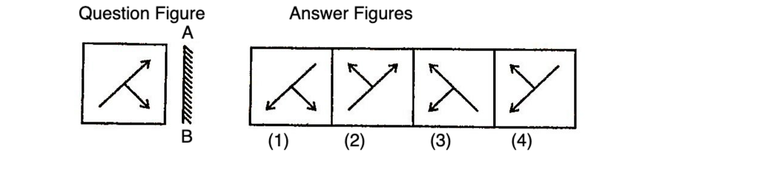
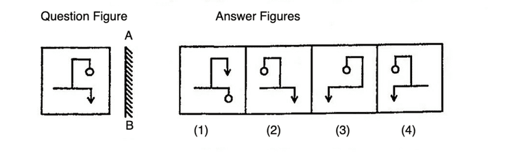
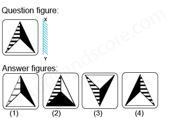
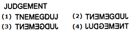
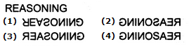

# 📝 Mirror Imge

- **Engine:** Classplus CMS
- **Folder:** `2. Infosys System Eng Prep- Apti + Pseudo / Section I : Logical Reasoning & Puzzle / Module 11 :  Dice Mirror Image Water`
- **Total Questions:** 15
- **Total Marks:** 0
- **Duration:** 0 Minutes
- **Test ID:** `6102aec2f0c848a1e9b21993`

---

## 🔹 Section: Quantitative Aptitude

### Q1. (+0 / -0)

Looking into a mirror, the clock shows 9 : 30 as the time. The actual time is ________ 
 

**Options:**
- **[None]** 2:30 ✅ **[CORRECT]**
- **[None]** 3:30
- **[None]** 4:30
- **[None]** 5:30

💡 **Detailed Solution:**
Answer: Option A Explanation: It is clear from Fig. (X) that if seen through a mirror, the time indicated by clock is 9 : 30. When the mirror is placed vertically at AB, its mirror i.e., Fix. (Y) shows the actual time in the clock i.e., 2 : 30.

---

### Q2. (+0 / -0)

When seen through a mirror, a clock shows 8 : 30. The correct time is ________

**Options:**
- **[None]** 2:30
- **[None]** 3:30 ✅ **[CORRECT]**
- **[None]** 4:30
- **[None]** 5:30

💡 **Detailed Solution:**
Answer: Option B Explanation: It is clear from Fig. (X) that if seen through a mirror, the time indicated by clock is 8 : 30. When the mirror is placed vertically at AB, its mirror i.e., Fix. (Y) shows the actual time in the clock i.e., 3 : 30.

---

### Q3. (+0 / -0)

By looking in a mirror, it appears that it is 6 : 30 in the clock. What is the real time?

**Options:**
- **[None]** 6:30
- **[None]** 5:30 ✅ **[CORRECT]**
- **[None]** 4:30
- **[None]** 3:30

💡 **Detailed Solution:**
Answer: Option B Explanation: It is clear from Fig. (X) that if seen through a mirror, the time indicated by clock is 6 : 30. When the mirror is placed vertically at AB, its mirror i.e., Fix. (Y) shows the actual time in the clock i.e., 5 : 30.

---

### Q4. (+0 / -0)

When seen through a mirror, a watch shows 12 : 15. The correct time is

**Options:**
- **[None]** 12 : 30
- **[None]** 1 : 15
- **[None]** 12 : 45
- **[None]** 11 : 45 ✅ **[CORRECT]**

💡 **Detailed Solution:**
Answer: Option D Explanation: It is clear from Fig. (X) that if seen through a mirror, the time indicated by clock is 12 : 15. When the mirror is placed vertically at AB, its mirror i.e., Fix. (Y) shows the actual time in the clock i.e., 11 : 45

---

### Q5. (+0 / -0)

 

Which of the answer figure is exactly the mirror image of the given figure, when mirror is placed on the line AB?

**Options:**
- **[None]** 1 ✅ **[CORRECT]**
- **[None]** 2
- **[None]** 3
- **[None]** 4

💡 **Detailed Solution:**
Answer: Option A Explanation: Here, the mirror is placed vertically at AB on the RHS of the question figure. Hence, only the figure given in answer figure (1) would be obtained as the correct mirror image.

---

### Q6. (+0 / -0)

 

Which of the answer figure is exactly the mirror image of the given figure, when mirror is placed on the line AB?

**Options:**
- **[None]** 1
- **[None]** 2
- **[None]** 3 ✅ **[CORRECT]**
- **[None]** 4

💡 **Detailed Solution:**
Answer: Option C Explanation: Here, the mirror is placed vertically at AB on the RHS of the question figure. Hence, only the figure given in answer figure (3) would be obtained as the correct mirror image.

---

### Q7. (+0 / -0)

Which of the answer figure is exactly the mirror image of the given figure, when mirror is placed on the line AB?

**Options:**
- **[None]** 1
- **[None]** 2 ✅ **[CORRECT]**
- **[None]** 3
- **[None]** 4

💡 **Detailed Solution:**
Answer: Option B Explanation: Here, the mirror is placed vertically at AB on the RHS of the question figure. Hence, only the figure given in answer figure (2) would be obtained as the correct mirror image.

---

### Q8. (+0 / -0)

 

Which of the answer figure is exactly the mirror image of the given figure, when mirror is placed on the line AB?

**Options:**
- **[None]** 1
- **[None]** 2
- **[None]** 3
- **[None]** 4 ✅ **[CORRECT]**

💡 **Detailed Solution:**
Answer: Option D Explanation: Here, the mirror is placed vertically at AB on the RHS of the question figure. Hence, only the figure given in answer figure (4) would be obtained as the correct mirror image.

---

### Q9. (+0 / -0)

Which of the answer figure is exactly the mirror image of the given figure, when mirror is placed on the line AB?

**Options:**
- **[None]** 1
- **[None]** 2
- **[None]** 3 ✅ **[CORRECT]**
- **[None]** 4

💡 **Detailed Solution:**
Answer: Option C Explanation: Here, the mirror is placed vertically at AB on the LHS of the question figure. Hence, only the figure given in answer figure (3) would be obtained as the correct mirror image.

---

### Q10. (+0 / -0)

Which of the answer figures is exactly the mirror image of the given question figure when the mirror is held at XY?
 

**Options:**
- **[None]** 2
- **[None]** 4 ✅ **[CORRECT]**
- **[None]** 3
- **[None]** 1

💡 **Detailed Solution:**
Answer: Option B Explanation In the mirror image, &bull; The right side of the object becomes the left side &bull; The left side of the object becomes the right side &bull; The top and bottom sides of the object remain unchanged

---

### Q11. (+0 / -0)

Choose the alternative which is closely resembles the mirror image of the given combination.

**Options:**
- **[None]** 1
- **[None]** 2
- **[None]** 3 ✅ **[CORRECT]**
- **[None]** 4

💡 **Detailed Solution:**
Answer: Option C Explanation: The correct mirror image will be (3).

---

### Q12. (+0 / -0)

Choose the alternative which is closely resembles the mirror image of the given combination.

**Options:**
- **[None]** 1 ✅ **[CORRECT]**
- **[None]** 2
- **[None]** 3
- **[None]** 4

💡 **Detailed Solution:**
Answer: Option A Explanation: The correct mirror image will be (1).

---

### Q13. (+0 / -0)

Choose the alternative which is closely resembles the mirror image of the given combination.

**Options:**
- **[None]** 1
- **[None]** 2
- **[None]** 3
- **[None]** 4 ✅ **[CORRECT]**

💡 **Detailed Solution:**
Answer: Option D Explanation: The correct mirror image will be (4).

---

### Q14. (+0 / -0)

Choose the alternative which is closely resembles the mirror image of the given combination.

**Options:**
- **[None]** 1
- **[None]** 2
- **[None]** 3
- **[None]** 4 ✅ **[CORRECT]**

💡 **Detailed Solution:**
Answer: Option D Explanation: The correct mirror image will be (4).

---

### Q15. (+0 / -0)

Choose the alternative which is closely resembles the mirror image of the given combination.

**Options:**
- **[None]** 1
- **[None]** 2 ✅ **[CORRECT]**
- **[None]** 3
- **[None]** 4

💡 **Detailed Solution:**
Answer: Option B Explanation: The correct mirror image will be (2).

---

