# 📝 Number Puzzles

- **Engine:** Classplus CMS
- **Folder:** `2. Infosys System Eng Prep- Apti + Pseudo / Section I : Logical Reasoning & Puzzle / Module 11 :  Dice Mirror Image Water`
- **Total Questions:** 15
- **Total Marks:** 0
- **Duration:** 0 Minutes
- **Test ID:** `610555647963926f09cb7551`

---

## 🔹 Section: Quantitative Aptitude

### Q1. (+0 / -0)

**Prompt:** Determine the missing number (`?`) that satisfies the mathematical pattern in the figure below:

```
┌────────────────────────────────────────────────────────┐
│ Pattern Paradigm: Question 01 Mathematical Invariant │
└────────────────────────────────────────────────────────┘
```
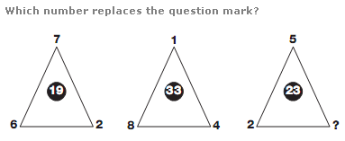

**Options:**
- **[A]** 4
- **[B]** 7
- **[C]** 9 ✅ **[CORRECT]**
- **[D]** 11

💡 **Detailed Solution:**
Answer : C Explanation : In each triangle, multiply the lower two numbers together and add the upper number to give the value in the centre.

---

### Q2. (+0 / -0)

**Prompt:** Determine the missing number (`?`) that satisfies the mathematical pattern in the figure below:

```
┌────────────────────────────────────────────────────────┐
│ Pattern Paradigm: Question 02 Mathematical Invariant │
└────────────────────────────────────────────────────────┘
```


**Options:**
- **[A]** 1
- **[B]** 2
- **[C]** 3 ✅ **[CORRECT]**
- **[D]** 4

💡 **Detailed Solution:**
Answer : C Explanation : Using the lower two circles as a source, the values in corresponding segments of the upper left circle equal the sums of the numbers in the lower two circles. The values in the upper central circle equal the products of the values in the lower two circles, and the upper right circle equals the difference between values in the lower two circles.

---

### Q3. (+0 / -0)

**Prompt:** Determine the missing number (`?`) that satisfies the mathematical pattern in the figure below:

```
┌────────────────────────────────────────────────────────┐
│ Pattern Paradigm: Question 03 Mathematical Invariant │
└────────────────────────────────────────────────────────┘
```
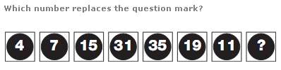

**Options:**
- **[A]** 2
- **[B]** 6 ✅ **[CORRECT]**
- **[C]** 9
- **[D]** 12

💡 **Detailed Solution:**
Answer : B Explanation : Starting on the extreme left and right hand of the row and working towards the centre, add the end digits together and subtract 3 to give the next value along to the left, and add 1 to give the next value along to the right. Repeat this sequence, working towards the centre.

---

### Q4. (+0 / -0)

**Prompt:** Determine the missing number (`?`) that satisfies the mathematical pattern in the figure below:

```
┌────────────────────────────────────────────────────────┐
│ Pattern Paradigm: Question 04 Mathematical Invariant │
└────────────────────────────────────────────────────────┘
```
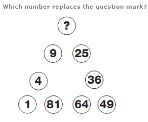

**Options:**
- **[A]** 16 ✅ **[CORRECT]**
- **[B]** 20
- **[C]** 24
- **[D]** 28

💡 **Detailed Solution:**
Answer : A Explanation : Starting bottom left and moving clockwise around the triangle, numbers follow the sequence of Square Numbers.

---

### Q5. (+0 / -0)

**Prompt:** Determine the missing number (`?`) that satisfies the mathematical pattern in the figure below:

```
┌────────────────────────────────────────────────────────┐
│ Pattern Paradigm: Question 05 Mathematical Invariant │
└────────────────────────────────────────────────────────┘
```
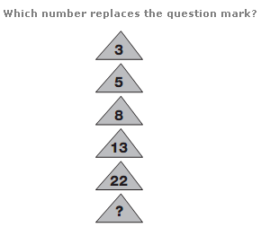

**Options:**
- **[A]** 21
- **[B]** 25
- **[C]** 30
- **[D]** 39 ✅ **[CORRECT]**

💡 **Detailed Solution:**
Answer : D Explanation : Working from top to bottom, double each number and subtract 1, then 2, then 3 etc.

---

### Q6. (+0 / -0)

**Prompt:** Determine the missing number (`?`) that satisfies the mathematical pattern in the figure below:

```
┌────────────────────────────────────────────────────────┐
│ Pattern Paradigm: Question 06 Mathematical Invariant │
└────────────────────────────────────────────────────────┘
```
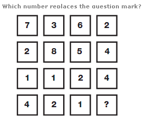

**Options:**
- **[A]** 1
- **[B]** 2
- **[C]** 3
- **[D]** 4 ✅ **[CORRECT]**

💡 **Detailed Solution:**
Answer : D Explanation : Working in columns, the sum of the numbers in each column is always 14.

---

### Q7. (+0 / -0)

**Prompt:** Determine the missing number (`?`) that satisfies the mathematical pattern in the figure below:

```
┌────────────────────────────────────────────────────────┐
│ Pattern Paradigm: Question 07 Mathematical Invariant │
└────────────────────────────────────────────────────────┘
```
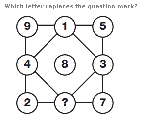

**Options:**
- **[A]** 6 ✅ **[CORRECT]**
- **[B]** 12
- **[C]** 18
- **[D]** 24

💡 **Detailed Solution:**
Answer : A Explanation : The numbers in each row and column add up to 15.

---

### Q8. (+0 / -0)

**Prompt:** Determine the missing number (`?`) that satisfies the mathematical pattern in the figure below:

```
┌────────────────────────────────────────────────────────┐
│ Pattern Paradigm: Question 08 Mathematical Invariant │
└────────────────────────────────────────────────────────┘
```
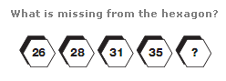

**Options:**
- **[A]** 35
- **[B]** 40 ✅ **[CORRECT]**
- **[C]** 45
- **[D]** 50

💡 **Detailed Solution:**
Answer : B Explanation : Moving from left to right, numbers increase by 2,3,4 and 5.

---

### Q9. (+0 / -0)

**Prompt:** Determine the missing number (`?`) that satisfies the mathematical pattern in the figure below:

```
┌────────────────────────────────────────────────────────┐
│ Pattern Paradigm: Question 09 Mathematical Invariant │
└────────────────────────────────────────────────────────┘
```
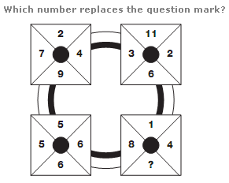

**Options:**
- **[A]** 3
- **[B]** 6
- **[C]** 9 ✅ **[CORRECT]**
- **[D]** 12

💡 **Detailed Solution:**
Answer : C Explanation : In each square of the diagram, the sum of the numbers is always 22.

---

### Q10. (+0 / -0)

**Prompt:** Determine the missing number (`?`) that satisfies the mathematical pattern in the figure below:

```
┌────────────────────────────────────────────────────────┐
│ Pattern Paradigm: Question 10 Mathematical Invariant │
└────────────────────────────────────────────────────────┘
```
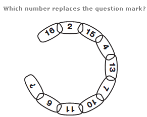

**Options:**
- **[A]** 16 ✅ **[CORRECT]**
- **[B]** 22
- **[C]** 26
- **[D]** 29

💡 **Detailed Solution:**
Answer : A Explanation : Moving clockwise, around alternate segments in the chain, one sequence decreases by 1, 2, 3 and 4 each time, while the other increases by 2, 3, 4 and 5.

---

### Q11. (+0 / -0)

**Prompt:** Determine the missing number (`?`) that satisfies the mathematical pattern in the figure below:

```
┌────────────────────────────────────────────────────────┐
│ Pattern Paradigm: Question 11 Mathematical Invariant │
└────────────────────────────────────────────────────────┘
```
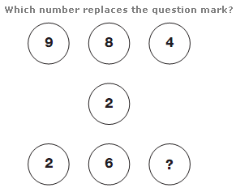

**Options:**
- **[A]** 4
- **[B]** 5
- **[C]** 6
- **[D]** 7 ✅ **[CORRECT]**

💡 **Detailed Solution:**
Answer : D Explanation : Starting with the numbers in the top row, and following straight lines through the centre of the diagram, subtract the middle number from the top number to give the corresponding value on the bottom row.

---

### Q12. (+0 / -0)

**Prompt:** Determine the missing number (`?`) that satisfies the mathematical pattern in the figure below:

```
┌────────────────────────────────────────────────────────┐
│ Pattern Paradigm: Question 12 Mathematical Invariant │
└────────────────────────────────────────────────────────┘
```
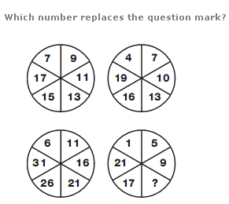

**Options:**
- **[A]** 10
- **[B]** 13 ✅ **[CORRECT]**
- **[C]** 16
- **[D]** 19

💡 **Detailed Solution:**
Answer : B Explanation : In each circle, starting at the top left segment, numbers increase, as you move clockwise, by 2 for the upper left circle, 3 for the upper right, 4 for the lower right and 5 for the lower left.

---

### Q13. (+0 / -0)

**Prompt:** Determine the missing number (`?`) that satisfies the mathematical pattern in the figure below:

```
┌────────────────────────────────────────────────────────┐
│ Pattern Paradigm: Question 13 Mathematical Invariant │
└────────────────────────────────────────────────────────┘
```
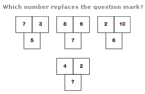

**Options:**
- **[A]** 1
- **[B]** 2
- **[C]** 3 ✅ **[CORRECT]**
- **[D]** 4

💡 **Detailed Solution:**
Answer : C Explanation : In each group of 3 numbers, the lower number equals the average of the top two numbers.

---

### Q14. (+0 / -0)

**Prompt:** Determine the missing number (`?`) that satisfies the mathematical pattern in the figure below:

```
┌────────────────────────────────────────────────────────┐
│ Pattern Paradigm: Question 14 Mathematical Invariant │
└────────────────────────────────────────────────────────┘
```
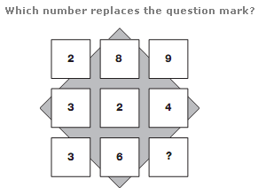

**Options:**
- **[A]** 1 ✅ **[CORRECT]**
- **[B]** 3
- **[C]** 4
- **[D]** 6

💡 **Detailed Solution:**
Answer : A Explanation : Reading each row as a 3 digit number, the rows follow the sequence of square numbers, from 17 to 19.

---

### Q15. (+0 / -0)

**Prompt:** Determine the missing number (`?`) that satisfies the mathematical pattern in the figure below:

```
┌────────────────────────────────────────────────────────┐
│ Pattern Paradigm: Question 15 Mathematical Invariant │
└────────────────────────────────────────────────────────┘
```
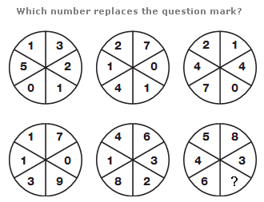

**Options:**
- **[A]** 4
- **[B]** 3
- **[C]** 2
- **[D]** 1 ✅ **[CORRECT]**

💡 **Detailed Solution:**
Answer : D Explanation : Starting with the circle on the top left, and moving to the right, top row then bottom row, the sum of the numbers in each circle follows the sequence 12, 15, 18, 21 etc.

---

