# 📝 Water Image

- **Engine:** Classplus CMS
- **Folder:** `2. Infosys System Eng Prep- Apti + Pseudo / Section I : Logical Reasoning & Puzzle / Module 11 :  Dice Mirror Image Water`
- **Total Questions:** 15
- **Total Marks:** 0
- **Duration:** 0 Minutes
- **Test ID:** `6101632992692942ca583208`

---

## 🔹 Section: Quantitative Aptitude

### Q1. (+0 / -0)

Choose the correct water image of the question figure, from the given answer figures (assume that water is along XY)

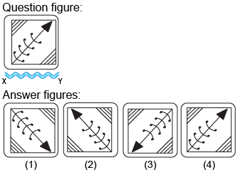

**Options:**
- **[None]** 1 ✅ **[CORRECT]**
- **[None]** 2
- **[None]** 4
- **[None]** 4

💡 **Detailed Solution:**
Answer: Option A Explanation In the water image, The top side of the object becomes the bottom The bottom side of the object becomes the top The left and right sides of the object remain unchanged

---

### Q2. (+0 / -0)

 
Choose the correct water image of the question figure, from the given answer figures (assume that water is along XY)

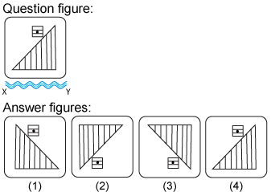

**Options:**
- **[None]** 1
- **[None]** 2
- **[None]** 3 ✅ **[CORRECT]**
- **[None]** 4

💡 **Detailed Solution:**
Answer: Option C Explanation In the water image, The top side of the object becomes the bottom The bottom side of the object becomes the top The left and right sides of the object remain unchanged

---

### Q3. (+0 / -0)

Choose the correct water image of the question figure, from the given answer figures (assume that water is along XY)

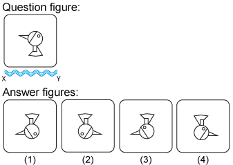

**Options:**
- **[None]** 1 ✅ **[CORRECT]**
- **[None]** 2
- **[None]** 3
- **[None]** 4

💡 **Detailed Solution:**
Answer: Option A Explanation In the water image, The top side of the object becomes the bottom The bottom side of the object becomes the top The left and right sides of the object remain unchanged

---

### Q4. (+0 / -0)

Choose the correct water image of the question figure, from the given answer figures (assume that water is along XY)
 

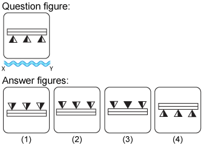

**Options:**
- **[None]** 1
- **[None]** 2 ✅ **[CORRECT]**
- **[None]**  3
- **[None]** 4

💡 **Detailed Solution:**
Answer: Option B Explanation In the water image, The top side of the object becomes the bottom The bottom side of the object becomes the top The left and right sides of the object remain unchanged

---

### Q5. (+0 / -0)

Choose the correct water image of the question figure, from the given answer figures (assume that water is along XY)

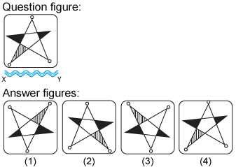

**Options:**
- **[None]** 1
- **[None]** 2
- **[None]** 3 ✅ **[CORRECT]**
- **[None]** 4

💡 **Detailed Solution:**
Answer: Option C Explanation In the water image, The top side of the object becomes the bottom The bottom side of the object becomes the top The left and right sides of the object remain unchanged

---

### Q6. (+0 / -0)

Choose the correct water image of the question figure, from the given answer figures (assume that water is along XY)

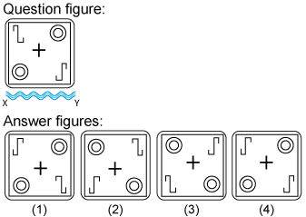

**Options:**
- **[None]** 1
- **[None]** 2 ✅ **[CORRECT]**
- **[None]** 3
- **[None]** 4

💡 **Detailed Solution:**
Answer: Option B Explanation In the water image, The top side of the object becomes the bottom The bottom side of the object becomes the top The left and right sides of the object remain unchanged

---

### Q7. (+0 / -0)

Choose the correct water image of the question figure, from the given answer figures (assume that water is along XY)

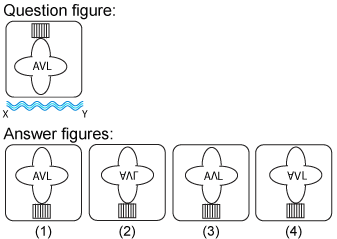

**Options:**
- **[None]** 1
- **[None]** 2 ✅ **[CORRECT]**
- **[None]** 3
- **[None]** 4

💡 **Detailed Solution:**
Answer: Option B Explanation In the water image, The top side of the object becomes the bottom The bottom side of the object becomes the top The left and right sides of the object remain unchanged

---

### Q8. (+0 / -0)

Choose the correct water image of the question figure, from the given answer figures (assume that water is along XY)
 

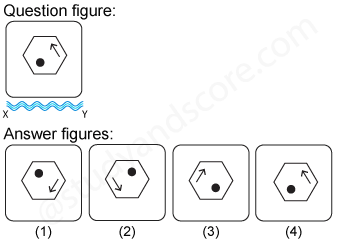

**Options:**
- **[None]** 1 ✅ **[CORRECT]**
- **[None]**  2
- **[None]** 3
- **[None]** 4

💡 **Detailed Solution:**
Answer: Option A Explanation In the water image, The top side of the object becomes the bottom The bottom side of the object becomes the top The left and right sides of the object remain unchanged

---

### Q9. (+0 / -0)

Choose the correct water image of the fig. (x) from the given four figures.

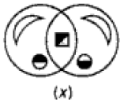

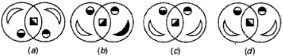

**Options:**
- **[None]** a
- **[None]** b
- **[None]** c
- **[None]** d ✅ **[CORRECT]**

💡 **Detailed Solution:**
Answer - D

---

### Q10. (+0 / -0)

Choose the correct water image of the question figure, from the given answer figures (assume that water is along XY)

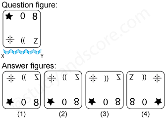

**Options:**
- **[None]** 1
- **[None]** 2 ✅ **[CORRECT]**
- **[None]** 3
- **[None]** 4

💡 **Detailed Solution:**
Answer: Option B Explanation In the water image, The top side of the object becomes the bottom The bottom side of the object becomes the top The left and right sides of the object remain unchanged

---

### Q11. (+0 / -0)

Choose the correct water image of the question figure, from the given answer figures (assume that water is along XY)

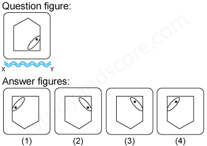

**Options:**
- **[None]** 1
- **[None]** 2 ✅ **[CORRECT]**
- **[None]** 3
- **[None]** 4

💡 **Detailed Solution:**
Answer: Option B Explanation In the water image, The top side of the object becomes the bottom The bottom side of the object becomes the top The left and right sides of the object remain unchanged

---

### Q12. (+0 / -0)

Choose the correct water image of the question figure, from the given answer figures (assume that water is along XY)

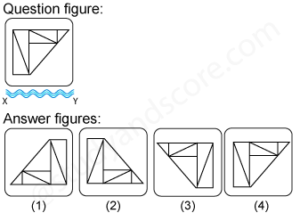

**Options:**
- **[None]** 1
- **[None]** 2 ✅ **[CORRECT]**
- **[None]** 3
- **[None]** 4

💡 **Detailed Solution:**
Answer: Option B Explanation In the water image, The top side of the object becomes the bottom The bottom side of the object becomes the top The left and right sides of the object remain unchanged

---

### Q13. (+0 / -0)

Choose the correct water image of the question figure, from the given answer figures (assume that water is along XY)

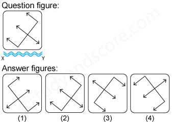

**Options:**
- **[None]** 1
- **[None]** 2
- **[None]** 3
- **[None]** 4 ✅ **[CORRECT]**

💡 **Detailed Solution:**
Answer: Option D Explanation In the water image, The top side of the object becomes the bottom The bottom side of the object becomes the top The left and right sides of the object remain unchanged

---

### Q14. (+0 / -0)

Choose the correct water image of the question figure, from the given answer figures (assume that water is along XY)

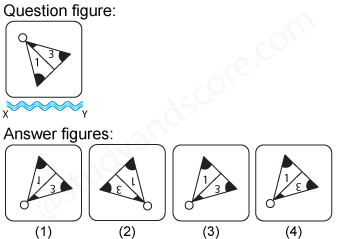

**Options:**
- **[None]** 1 ✅ **[CORRECT]**
- **[None]** 2
- **[None]** 3
- **[None]** 4

💡 **Detailed Solution:**
Answer: Option A Explanation In the water image, The top side of the object becomes the bottom The bottom side of the object becomes the top The left and right sides of the object remain unchanged

---

### Q15. (+0 / -0)

Choose the correct water image of the question figure, from the given answer figures (assume that water is along XY)

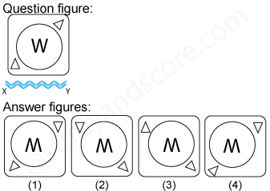

**Options:**
- **[None]** 1
- **[None]** 2 ✅ **[CORRECT]**
- **[None]** 3
- **[None]** 4

💡 **Detailed Solution:**
Answer: Option B Explanation In the water image, The top side of the object becomes the bottom The bottom side of the object becomes the top The left and right sides of the object remain unchanged

---

