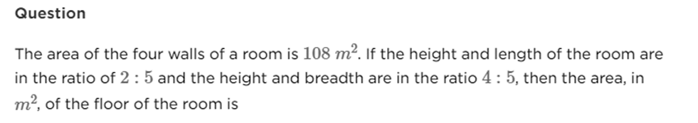

# 📝 Mensuration Pre-Test

- **Engine:** Testbook SDK
- **Folder:** `2. Infosys System Eng Prep- Apti + Pseudo / Section II : Technical Ability ( Numerical ) / 2. Numerical ability/Quantitative Aptitude / 16 : Mensuration`
- **Total Questions:** 10
- **Total Marks:** 40
- **Duration:** 15.0 Minutes
- **Test ID:** `64fc70fcd1b6792144a6550f`

---

## 🔹 Section: Mensuration Class Test

### Q1. (+4 / -0)

The length, width, and height ratio of a cuboid is 7:5:4 and its entire surface area is 2656 square cm. Find its width ?

**Options:**
- **[1]** undefined

---

### Q2. (+4 / -0)

Find the total surface area (in cm 2 ) of a right circular cylinder of diameter 7 cm and height 6 cm.

**Options:**
- **[1]** undefined

---

### Q3. (+4 / -0)

The length and breadth ratio of an auditorium is 3: 2. If the roof area is 216 square meters and the area of the four walls is 480 square meters, then what will be the height of the auditorium?

**Options:**
- **[1]** undefined

---

### Q4. (+4 / -0)

**Prompt:** The area of the four walls of a room is $108\text{ m}^2$. If the height and length of the room are in the ratio of $2 : 5$ and the height and breadth are in the ratio $4 : 5$, then the area, in $\text{m}^2$, of the floor of the room is:

**Options:**
- **[1]** 40
- **[2]** 45 ✅ **[CORRECT]**
- **[3]** 50
- **[4]** 54

💡 **Detailed Solution & Mathematical Derivation:**
1. **Four Walls Area Formula:**
   $$\text{Area of 4 walls} = 2h(l + b) = 108\text{ m}^2$$
2. **Dimension Ratios in terms of Height ($h$):**
   - $h : l = 2 : 5 \implies l = \frac{5}{2}h$
   - $h : b = 4 : 5 \implies b = \frac{5}{4}h$
3. **Substitute into Area Formula:**
   $$2h\left(\frac{5}{2}h + \frac{5}{4}h\right) = 108$$
   $$2h\left(\frac{10 + 5}{4}h\right) = 108$$
   $$2h\left(\frac{15}{4}h\right) = 108 \implies \frac{15}{2}h^2 = 108$$
   $$h^2 = \frac{108 \times 2}{15} = \frac{216}{15} = 14.4$$
4. **Area of the Floor ($l \times b$):**
   $$\text{Area of floor} = l \times b = \left(\frac{5}{2}h\right) \times \left(\frac{5}{4}h\right) = \frac{25}{8}h^2$$
   $$\text{Area of floor} = \frac{25}{8} \times 14.4 = 25 \times 1.8 = 45\text{ m}^2$$
5. **Conclusion:** Option `[2]` (`45`) is the verified mathematical answer.

---

### Q5. (+4 / -0)

Three spherical balls of radius 2 cm, 4 cm and 6 cm are melted to form a new spherical ball. In this process there is a loss of 25% of the material. What is the radius (in cm) of the new ball?

**Options:**
- **[1]** undefined

---

### Q6. (+4 / -0)

A cylindrical rod of radius 30 cm and length 40 cm is melted and made into spherical balls of radius 1 cm. The number of spherical balls is.

**Options:**
- **[1]** undefined

---

### Q7. (+4 / -0)

Find the curved surface area (in cm 2 ) of a hemisphere of diameter 28 cm.

**Options:**
- **[1]** undefined

---

### Q8. (+4 / -0)

A solid cone of height 24 cm and radius of its base 8 cm is melted to form a solid cylinder of radius 6 cm and height 6 cm. In the whole process what percent of material is wasted?

**Options:**
- **[1]** 48.5
- **[2]** 37.5
- **[3]** 57.8 ✅ **[CORRECT]**
- **[4]** 64

---

### Q9. (+4 / -0)

The sum of the length, width and height of a cuboid x cm and the length of its diagonal is y cm, then its total surface area will be-

**Options:**
- **[1]** x 2 - y 2 ✅ **[CORRECT]**
- **[2]** x 2 + y 2
- **[3]** &#120783; &#120784; 1/2 (x 2 - y 2 )
- **[4]** (x-y) 2

---

### Q10. (+4 / -0)

A sphere of diameter 5cm is dropped into a cylindrical vessel partly filled with water. The diameter of the base of the vessel is 10cm . If the sphere is completely submerged, by how much will the level of water rise?

**Options:**
- **[1]** 3/5 cm
- **[2]** 5/3 cm
- **[3]** 1 cm
- **[4]** 5/6 cm ✅ **[CORRECT]**

---

