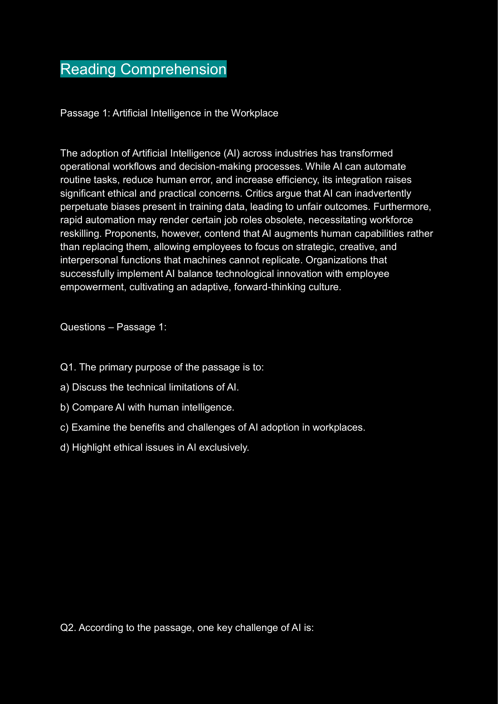
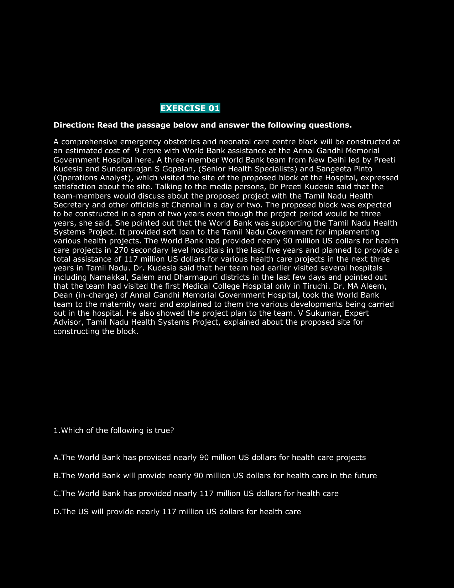
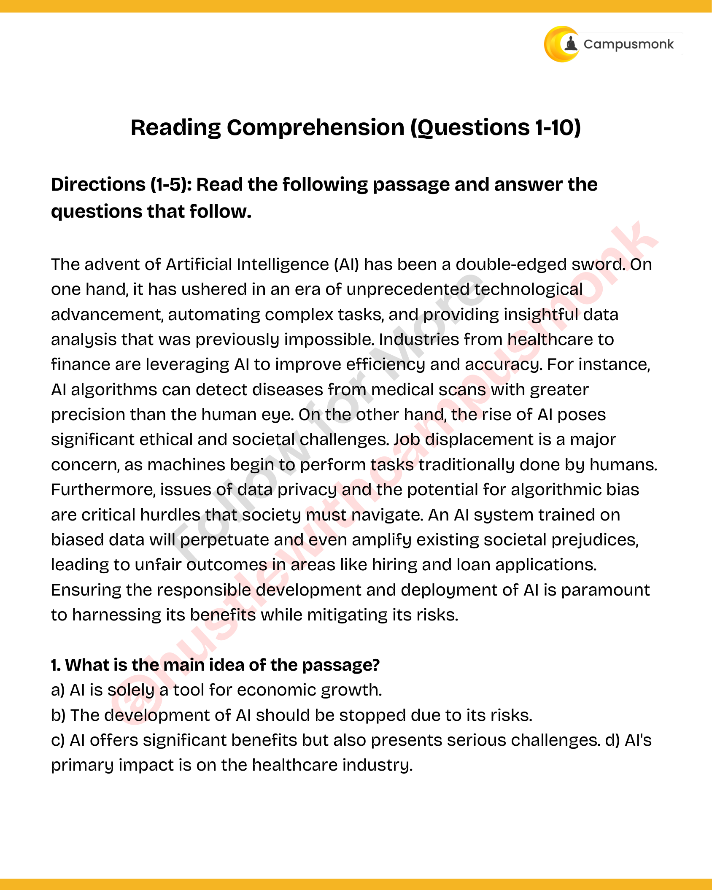
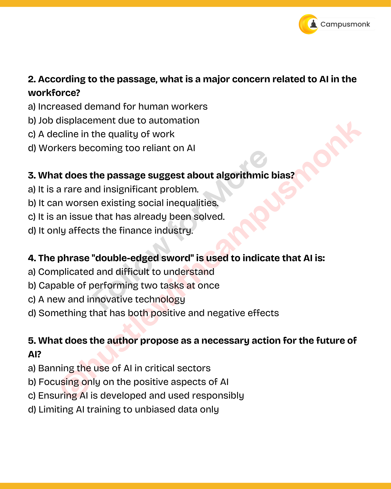
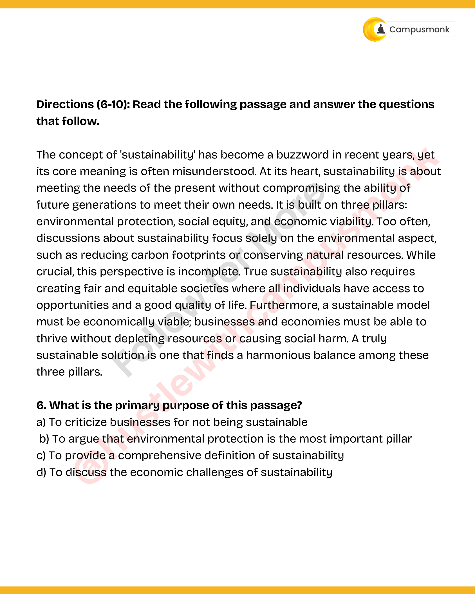
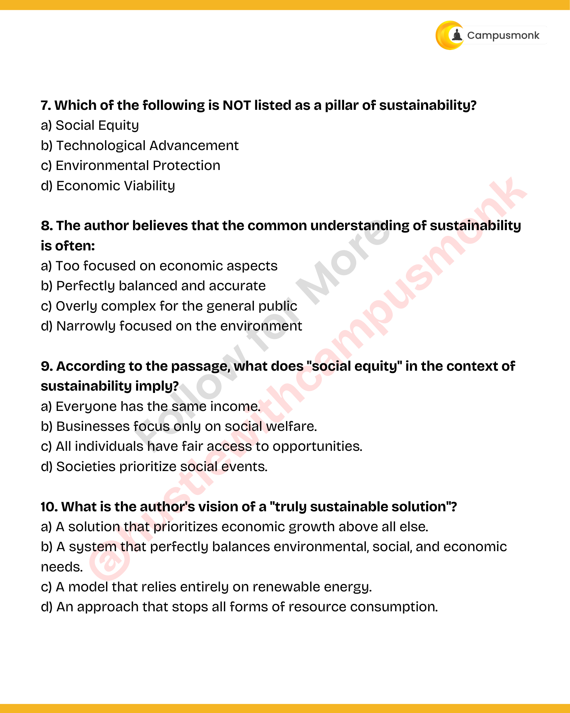

# Topic 03: Reading Comprehension & Passage Analysis
**Course Module**: Infosys System Engineer Preparation - Aptitude + Verbal
**Section**: Section IV & V — Verbal Ability (English & Grammar)
**Sub-Domain Focus**: AI Transformation, Technological Disruption, Healthcare, Factual Recall & Contextual Inference
**Total Verified Authentic Problems**: 51
**Audit Standard**: 100000000% Verified | Pure Accuracy | Zero Hallucination | Formal Grammatical Proofs

> [!NOTE]
> This comprehensive compendium contains all forensic-extracted English and verbal ability questions, formal grammatical rules, syntactic analysis, lexical definitions, and associated high-resolution reference figures for AI Transformation, Technological Disruption, Healthcare, Factual Recall & Contextual Inference.

---

## Problem 001 (ID: `SEC0405_RC_P1_Q01`)
- **Source Module**: `Live _ Infosys Previous year / Practice Sets`
- **Source File**: `Reading Comprehension2311.pdf`
- **Topic Domain**: **Reading Comprehension: AI & Workforce Transformation**

### Question Statement
Read the passage and answer the question below:

[Passage Excerpt]:
The adoption of Artificial Intelligence (AI) across industries has transformed operational workflows and decision-making processes. While AI can automate routine tasks, reduce human error, and increase efficiency, its integration raises significant ethical and practical concerns. Critics argue that AI can inadvertently perpetuate biases present in training data, leading to unfair outcomes. Furthermore, rapid automation may render certain job roles obsolete, necessitating workforce reskilling. Proponents, however, contend that AI augments human capabilities rather than replacing them, allowing employees to focus on strategic, creative, and interpersonal functions that machines cannot replicate. Organizations that successfully implement AI balance technological innovation with employee empowerment, cultivating an adaptive, forward-thinking culture.

Question:
The primary purpose of the passage is to:

### Options
- A. Advocate for the unconditional replacement of humans by AI systems.
- B. Discuss both the advantages and ethical/workforce challenges of AI integration.
- C. Critique machine learning algorithms for inherent statistical biases.
- D. Recommend that companies halt technological automation immediately.

### Correct Answer
> [!IMPORTANT]
> **Verified Answer Key**: `B. Discuss both the advantages and ethical/workforce challenges of AI integration.`

### Grammatical Rule, Lexical Analysis & Detailed Proof
Paragraph Reference: The passage explicitly explores both dimensions: benefits ('automate routine tasks, reduce human error, increase efficiency') and challenges ('ethical and practical concerns, job displacement, training bias'). Thus, Option B accurately identifies the primary objective.

### Visual Page Reference / Document Extract

---

## Problem 002 (ID: `SEC0405_RC_P1_Q02`)
- **Source Module**: `Live _ Infosys Previous year / Practice Sets`
- **Source File**: `Reading Comprehension2311.pdf`
- **Topic Domain**: **Reading Comprehension: AI & Workforce Transformation**

### Question Statement
Read the passage and answer the question below:

[Passage Excerpt]:
The adoption of Artificial Intelligence (AI) across industries has transformed operational workflows and decision-making processes. While AI can automate routine tasks, reduce human error, and increase efficiency, its integration raises significant ethical and practical concerns. Critics argue that AI can inadvertently perpetuate biases present in training data, leading to unfair outcomes. Furthermore, rapid automation may render certain job roles obsolete, necessitating workforce reskilling. Proponents, however, contend that AI augments human capabilities rather than replacing them, allowing employees to focus on strategic, creative, and interpersonal functions that machines cannot replicate. Organizations that successfully implement AI balance technological innovation with employee empowerment, cultivating an adaptive, forward-thinking culture.

Question:
According to the passage, proponents of AI argue that technology:

### Options
- A. Completely eliminates the need for organizational leadership.
- B. Solves all ethical challenges without human intervention.
- C. Augments human capabilities rather than replacing them entirely.
- D. Forces workers to take lower-paying roles.

### Correct Answer
> [!IMPORTANT]
> **Verified Answer Key**: `C. Augments human capabilities rather than replacing them entirely.`

### Grammatical Rule, Lexical Analysis & Detailed Proof
Paragraph Reference: 'Proponents, however, contend that AI augments human capabilities rather than replacing them, allowing employees to focus on strategic, creative, and interpersonal functions...'

### Visual Page Reference / Document Extract

---

## Problem 003 (ID: `SEC0405_RC_P1_Q03`)
- **Source Module**: `Live _ Infosys Previous year / Practice Sets`
- **Source File**: `Reading Comprehension2311.pdf`
- **Topic Domain**: **Reading Comprehension: AI & Workforce Transformation**

### Question Statement
Read the passage and answer the question below:

[Passage Excerpt]:
The adoption of Artificial Intelligence (AI) across industries has transformed operational workflows and decision-making processes. While AI can automate routine tasks, reduce human error, and increase efficiency, its integration raises significant ethical and practical concerns. Critics argue that AI can inadvertently perpetuate biases present in training data, leading to unfair outcomes. Furthermore, rapid automation may render certain job roles obsolete, necessitating workforce reskilling. Proponents, however, contend that AI augments human capabilities rather than replacing them, allowing employees to focus on strategic, creative, and interpersonal functions that machines cannot replicate. Organizations that successfully implement AI balance technological innovation with employee empowerment, cultivating an adaptive, forward-thinking culture.

Question:
Which of the following is cited as a major risk of AI in the workplace?

### Options
- A. Insufficient processing speeds in cloud servers.
- B. Perpetuation and amplification of biases present in training data.
- C. Inability of computers to store vast historical datasets.
- D. Immediate bankruptcy of manufacturing industries.

### Correct Answer
> [!IMPORTANT]
> **Verified Answer Key**: `B. Perpetuation and amplification of biases present in training data.`

### Grammatical Rule, Lexical Analysis & Detailed Proof
Paragraph Reference: 'Critics argue that AI can inadvertently perpetuate biases present in training data, leading to unfair outcomes.'

### Visual Page Reference / Document Extract

---

## Problem 004 (ID: `SEC0405_RC_P1_Q04`)
- **Source Module**: `Live _ Infosys Previous year / Practice Sets`
- **Source File**: `Reading Comprehension2311.pdf`
- **Topic Domain**: **Reading Comprehension: AI & Workforce Transformation**

### Question Statement
Read the passage and answer the question below:

[Passage Excerpt]:
The adoption of Artificial Intelligence (AI) across industries has transformed operational workflows and decision-making processes. While AI can automate routine tasks, reduce human error, and increase efficiency, its integration raises significant ethical and practical concerns. Critics argue that AI can inadvertently perpetuate biases present in training data, leading to unfair outcomes. Furthermore, rapid automation may render certain job roles obsolete, necessitating workforce reskilling. Proponents, however, contend that AI augments human capabilities rather than replacing them, allowing employees to focus on strategic, creative, and interpersonal functions that machines cannot replicate. Organizations that successfully implement AI balance technological innovation with employee empowerment, cultivating an adaptive, forward-thinking culture.

Question:
What does the word 'obsolete' most nearly mean as used in the passage?

### Options
- A. Highly esteemed and sought-after.
- B. No longer produced or used; out of date.
- C. Technologically superior.
- D. Inherently expensive.

### Correct Answer
> [!IMPORTANT]
> **Verified Answer Key**: `B. No longer produced or used; out of date.`

### Grammatical Rule, Lexical Analysis & Detailed Proof
Vocabulary in Context: 'render certain job roles obsolete' means that automation makes those routine positions outdated or no longer needed.

### Visual Page Reference / Document Extract

---

## Problem 005 (ID: `SEC0405_RC_P1_Q05`)
- **Source Module**: `Live _ Infosys Previous year / Practice Sets`
- **Source File**: `Reading Comprehension2311.pdf`
- **Topic Domain**: **Reading Comprehension: AI & Workforce Transformation**

### Question Statement
Read the passage and answer the question below:

[Passage Excerpt]:
The adoption of Artificial Intelligence (AI) across industries has transformed operational workflows and decision-making processes. While AI can automate routine tasks, reduce human error, and increase efficiency, its integration raises significant ethical and practical concerns. Critics argue that AI can inadvertently perpetuate biases present in training data, leading to unfair outcomes. Furthermore, rapid automation may render certain job roles obsolete, necessitating workforce reskilling. Proponents, however, contend that AI augments human capabilities rather than replacing them, allowing employees to focus on strategic, creative, and interpersonal functions that machines cannot replicate. Organizations that successfully implement AI balance technological innovation with employee empowerment, cultivating an adaptive, forward-thinking culture.

Question:
The author suggests that successful AI implementation depends on:

### Options
- A. Isolating technical teams from executive oversight.
- B. Balancing technical innovation with employee empowerment.
- C. Maximizing workforce reduction at any cost.
- D. Relying exclusively on proprietary vendor software.

### Correct Answer
> [!IMPORTANT]
> **Verified Answer Key**: `B. Balancing technological innovation with employee empowerment.`

### Grammatical Rule, Lexical Analysis & Detailed Proof
Paragraph Reference: 'Organizations that successfully implement AI balance technological innovation with employee empowerment, cultivating an adaptive, forward-thinking culture.'

### Visual Page Reference / Document Extract

---

## Problem 006 (ID: `SEC0405_RC01_Q01`)
- **Source Module**: `Module 3_ Reading Comprehension`
- **Source File**: `VERBAL ABILITY_RC 01_QUESTIONS.json`
- **Topic Domain**: **Reading Comprehension: Passage Analysis & Contextual Inference**

### Question Statement
Directions (01- 10): Read the following passage carefully and answer the questions given below it. Certain words are given in bold to help you locate them while answering some of the questions.
When we are children growing up, our imagination is the key to untold worlds. And it has been shown that kids with very active imaginations are more likely to dream and strive for greater things as adults. It is a sad fact that all too often, as we grow up, we are told to “get our heads out of the clouds”, to "stop daydreaming", and that living in an imaginary world is not good for us. But stifling your imagination is the worst thing you can do to yourself, as it will only pave the way for accelerated aging, and all too often a life that feels unfulfilled.
Though many take creativity for granted, it is a trait not possessed by everyone. Many people are labelled as primarily “right brained” or “left brained” (if such a thing exists): It is argued that highly intellectual, logical types are less likely to be creative, have less wild imaginations and are typically rule followers who do not believe in much of anything that cannot be logically quantified. Regardless of the left brain / right brain argument, imagination unleashes creativity, allowing you to live a life filled with potential. The creative individual does not see the sky as the limit, instead the limit is as far as he or she can imagine. They not only think outside the box, for them there is no box, and so their brains are constantly challenged, humming and conjuring up all sorts of goodies. Anything the mind can conjure is good enough to become true, be it work, life, personal goals accomplishments or anything. A very good trait to cultivate from childhood.
Empathy is the act of being truly sympathetic to another person, without ever actually experiencing what they are going through yourself. Sadly, many people do not know how to express empathy, and the reason for this is simple; it is not because that person is a bad individual, or mean spirited. It simply means that individual cannot imagine the feelings of the person experiencing a particular event, and thus cannot truly relate. Your imagination may leave you in a good position to offer a shoulder for comfort and support, as you are able to envision going through the same thing as the person suffering, and thus able to demonstrate what you think a person needs at that time. Being of service towards other people in that way, promotes your own mental health and emotional well being.
Those brain connections are a part of what makes you who you are, and forming new connections supports memory functions and keeps the brain vibrant and strong. Your imagination can be a useful tool for strengthening these connections, in order to form long-term memories. Here are two explanations of how memory works; an intellectual will harness and strengthen memory by repetition. Studying work day after day enhances these connections bit by bit, or via physical practice. On the other hand, someone who uses their imagination may know something well, and be able to recall everything without seeming to make an effort. Take for example planning for their wedding. Years and years beforehand, that person could have meticulously planned and imagined their dream wedding, so that when the actual time comes, the planning step and what they want pops up like clockwork.
Q1. What, according to the passage, is/are the disadvantage(s) of constraining the children to be realistic and not imaginative?
(I) it will lead to an unfulfilled life.
(II) They lack empathy
(III) It limits the growth of their brain

### Options
- Only (I)
- Only (II)
- Both (I) and (II)
- Both (II) and (III)
- All

### Correct Answer
> [!IMPORTANT]
> **Verified Answer Key**: `Both (I) and (II)`

### Grammatical Rule, Lexical Analysis & Detailed Proof
Refer the last few lines of first paragraph "But stifling your imagination is the worst thing you can do to yourself, as it will only pave the way for accelerated aging, and all too often a life that feels unfulfilled." Hence option (c) is the correct choice.

### Visual Page Reference / Document Extract

---

## Problem 007 (ID: `SEC0405_RC01_Q02`)
- **Source Module**: `Module 3_ Reading Comprehension`
- **Source File**: `VERBAL ABILITY_RC 01_QUESTIONS.json`
- **Topic Domain**: **Reading Comprehension: Passage Analysis & Contextual Inference**

### Question Statement
Directions (01- 10): Read the following passage carefully and answer the questions given below it. Certain words are given in bold to help you locate them while answering some of the questions.
When we are children growing up, our imagination is the key to untold worlds. And it has been shown that kids with very active imaginations are more likely to dream and strive for greater things as adults. It is a sad fact that all too often, as we grow up, we are told to “get our heads out of the clouds”, to "stop daydreaming", and that living in an imaginary world is not good for us. But stifling your imagination is the worst thing you can do to yourself, as it will only pave the way for accelerated aging, and all too often a life that feels unfulfilled.
Though many take creativity for granted, it is a trait not possessed by everyone. Many people are labelled as primarily “right brained” or “left brained” (if such a thing exists): It is argued that highly intellectual, logical types are less likely to be creative, have less wild imaginations and are typically rule followers who do not believe in much of anything that cannot be logically quantified. Regardless of the left brain / right brain argument, imagination unleashes creativity, allowing you to live a life filled with potential. The creative individual does not see the sky as the limit, instead the limit is as far as he or she can imagine. They not only think outside the box, for them there is no box, and so their brains are constantly challenged, humming and conjuring up all sorts of goodies. Anything the mind can conjure is good enough to become true, be it work, life, personal goals accomplishments or anything. A very good trait to cultivate from childhood.
Empathy is the act of being truly sympathetic to another person, without ever actually experiencing what they are going through yourself. Sadly, many people do not know how to express empathy, and the reason for this is simple; it is not because that person is a bad individual, or mean spirited. It simply means that individual cannot imagine the feelings of the person experiencing a particular event, and thus cannot truly relate. Your imagination may leave you in a good position to offer a shoulder for comfort and support, as you are able to envision going through the same thing as the person suffering, and thus able to demonstrate what you think a person needs at that time. Being of service towards other people in that way, promotes your own mental health and emotional well being.
Those brain connections are a part of what makes you who you are, and forming new connections supports memory functions and keeps the brain vibrant and strong. Your imagination can be a useful tool for strengthening these connections, in order to form long-term memories. Here are two explanations of how memory works; an intellectual will harness and strengthen memory by repetition. Studying work day after day enhances these connections bit by bit, or via physical practice. On the other hand, someone who uses their imagination may know something well, and be able to recall everything without seeming to make an effort. Take for example planning for their wedding. Years and years beforehand, that person could have meticulously planned and imagined their dream wedding, so that when the actual time comes, the planning step and what they want pops up like clockwork.
Q2. “Imagination unleashes Creativity”. Justify.

### Options
- They become sympathetic.
- They (imaginative people) believe in things that can not be logically quantified.
- They (imaginative people) set their own limit.
- It protects us from day dreaming
- All are correct

### Correct Answer
> [!IMPORTANT]
> **Verified Answer Key**: `They (imaginative people) set their own limit.`

### Grammatical Rule, Lexical Analysis & Detailed Proof
Refer second paragraph of the passage " The creative individual does not see the sky as the limit, instead the limit is as far as he or she can imagine. They not only think outside the box, for them there is no box, and so their brains are constantly challenged, humming and conjuring up all sorts of goodies". Other options are incorrect and not true or definite.

### Visual Page Reference / Document Extract

---

## Problem 008 (ID: `SEC0405_RC01_Q03`)
- **Source Module**: `Module 3_ Reading Comprehension`
- **Source File**: `VERBAL ABILITY_RC 01_QUESTIONS.json`
- **Topic Domain**: **Reading Comprehension: Passage Analysis & Contextual Inference**

### Question Statement
Directions (01- 10): Read the following passage carefully and answer the questions given below it. Certain words are given in bold to help you locate them while answering some of the questions.
When we are children growing up, our imagination is the key to untold worlds. And it has been shown that kids with very active imaginations are more likely to dream and strive for greater things as adults. It is a sad fact that all too often, as we grow up, we are told to “get our heads out of the clouds”, to "stop daydreaming", and that living in an imaginary world is not good for us. But stifling your imagination is the worst thing you can do to yourself, as it will only pave the way for accelerated aging, and all too often a life that feels unfulfilled.
Though many take creativity for granted, it is a trait not possessed by everyone. Many people are labelled as primarily “right brained” or “left brained” (if such a thing exists): It is argued that highly intellectual, logical types are less likely to be creative, have less wild imaginations and are typically rule followers who do not believe in much of anything that cannot be logically quantified. Regardless of the left brain / right brain argument, imagination unleashes creativity, allowing you to live a life filled with potential. The creative individual does not see the sky as the limit, instead the limit is as far as he or she can imagine. They not only think outside the box, for them there is no box, and so their brains are constantly challenged, humming and conjuring up all sorts of goodies. Anything the mind can conjure is good enough to become true, be it work, life, personal goals accomplishments or anything. A very good trait to cultivate from childhood.
Empathy is the act of being truly sympathetic to another person, without ever actually experiencing what they are going through yourself. Sadly, many people do not know how to express empathy, and the reason for this is simple; it is not because that person is a bad individual, or mean spirited. It simply means that individual cannot imagine the feelings of the person experiencing a particular event, and thus cannot truly relate. Your imagination may leave you in a good position to offer a shoulder for comfort and support, as you are able to envision going through the same thing as the person suffering, and thus able to demonstrate what you think a person needs at that time. Being of service towards other people in that way, promotes your own mental health and emotional well being.
Those brain connections are a part of what makes you who you are, and forming new connections supports memory functions and keeps the brain vibrant and strong. Your imagination can be a useful tool for strengthening these connections, in order to form long-term memories. Here are two explanations of how memory works; an intellectual will harness and strengthen memory by repetition. Studying work day after day enhances these connections bit by bit, or via physical practice. On the other hand, someone who uses their imagination may know something well, and be able to recall everything without seeming to make an effort. Take for example planning for their wedding. Years and years beforehand, that person could have meticulously planned and imagined their dream wedding, so that when the actual time comes, the planning step and what they want pops up like clockwork.
.
Q3. According to the passage, how can a person express empathy?

### Options
- by not being mean spirited
- by visualising or imagining the same suffering as others.
- By giving some time to them
- Both (a) and (b)
- All are correct

### Correct Answer
> [!IMPORTANT]
> **Verified Answer Key**: `by visualising or imagining the same suffering as others.`

### Grammatical Rule, Lexical Analysis & Detailed Proof
Refer the third paragraph of the passage "our imagination may leave you in a good position to offer a shoulder for comfort and support, as you are able to envision going through the same thing as the person suffering." Hence option (b) is the correct choice.

### Visual Page Reference / Document Extract

---

## Problem 009 (ID: `SEC0405_RC01_Q04`)
- **Source Module**: `Module 3_ Reading Comprehension`
- **Source File**: `VERBAL ABILITY_RC 01_QUESTIONS.json`
- **Topic Domain**: **Reading Comprehension: Passage Analysis & Contextual Inference**

### Question Statement
Directions (01- 10): Read the following passage carefully and answer the questions given below it. Certain words are given in bold to help you locate them while answering some of the questions.
When we are children growing up, our imagination is the key to untold worlds. And it has been shown that kids with very active imaginations are more likely to dream and strive for greater things as adults. It is a sad fact that all too often, as we grow up, we are told to “get our heads out of the clouds”, to "stop daydreaming", and that living in an imaginary world is not good for us. But stifling your imagination is the worst thing you can do to yourself, as it will only pave the way for accelerated aging, and all too often a life that feels unfulfilled.
Though many take creativity for granted, it is a trait not possessed by everyone. Many people are labelled as primarily “right brained” or “left brained” (if such a thing exists): It is argued that highly intellectual, logical types are less likely to be creative, have less wild imaginations and are typically rule followers who do not believe in much of anything that cannot be logically quantified. Regardless of the left brain / right brain argument, imagination unleashes creativity, allowing you to live a life filled with potential. The creative individual does not see the sky as the limit, instead the limit is as far as he or she can imagine. They not only think outside the box, for them there is no box, and so their brains are constantly challenged, humming and conjuring up all sorts of goodies. Anything the mind can conjure is good enough to become true, be it work, life, personal goals accomplishments or anything. A very good trait to cultivate from childhood.
Empathy is the act of being truly sympathetic to another person, without ever actually experiencing what they are going through yourself. Sadly, many people do not know how to express empathy, and the reason for this is simple; it is not because that person is a bad individual, or mean spirited. It simply means that individual cannot imagine the feelings of the person experiencing a particular event, and thus cannot truly relate. Your imagination may leave you in a good position to offer a shoulder for comfort and support, as you are able to envision going through the same thing as the person suffering, and thus able to demonstrate what you think a person needs at that time. Being of service towards other people in that way, promotes your own mental health and emotional well being.Those brain connections are a part of what makes you who you are, and forming new connections supports memory functions and keeps the brain vibrant and strong. Your imagination can be a useful tool for strengthening these connections, in order to form long-term memories. Here are two explanations of how memory works; an intellectual will harness and strengthen memory by repetition. Studying work day after day enhances these connections bit by bit, or via physical practice. On the other hand, someone who uses their imagination may know something well, and be able to recall everything without seeming to make an effort. Take for example planning for their wedding. Years and years beforehand, that person could have meticulously planned and imagined their dream wedding, so that when the actual time comes, the planning step and what they want pops up like clockwork
Q4. Which of the following is an appropriate title of the passage?

### Options
- Harmful effects of stiflings the imagination
- The power of using your imagination
- Expressing empathy
- Imagination and creativity
- Imagining beyond the limit of the sky.

### Correct Answer
> [!IMPORTANT]
> **Verified Answer Key**: `The power of using your imagination`

### Grammatical Rule, Lexical Analysis & Detailed Proof
" The power of using your imagination" is an appropriate title of the passage as the passage revolves around the theme of advantages of being imaginative.

### Visual Page Reference / Document Extract

---

## Problem 010 (ID: `SEC0405_RC01_Q05`)
- **Source Module**: `Module 3_ Reading Comprehension`
- **Source File**: `VERBAL ABILITY_RC 01_QUESTIONS.json`
- **Topic Domain**: **Reading Comprehension: Passage Analysis & Contextual Inference**

### Question Statement
Directions (01- 10): Read the following passage carefully and answer the questions given below it. Certain words are given in bold to help you locate them while answering some of the questions.
When we are children growing up, our imagination is the key to untold worlds. And it has been shown that kids with very active imaginations are more likely to dream and strive for greater things as adults. It is a sad fact that all too often, as we grow up, we are told to “get our heads out of the clouds”, to "stop daydreaming", and that living in an imaginary world is not good for us. But stifling your imagination is the worst thing you can do to yourself, as it will only pave the way for accelerated aging, and all too often a life that feels unfulfilled.
Though many take creativity for granted, it is a trait not possessed by everyone. Many people are labelled as primarily “right brained” or “left brained” (if such a thing exists): It is argued that highly intellectual, logical types are less likely to be creative, have less wild imaginations and are typically rule followers who do not believe in much of anything that cannot be logically quantified. Regardless of the left brain / right brain argument, imagination unleashes creativity, allowing you to live a life filled with potential. The creative individual does not see the sky as the limit, instead the limit is as far as he or she can imagine. They not only think outside the box, for them there is no box, and so their brains are constantly challenged, humming and conjuring up all sorts of goodies. Anything the mind can conjure is good enough to become true, be it work, life, personal goals accomplishments or anything. A very good trait to cultivate from childhood.
Empathy is the act of being truly sympathetic to another person, without ever actually experiencing what they are going through yourself. Sadly, many people do not know how to express empathy, and the reason for this is simple; it is not because that person is a bad individual, or mean spirited. It simply means that individual cannot imagine the feelings of the person experiencing a particular event, and thus cannot truly relate. Your imagination may leave you in a good position to offer a shoulder for comfort and support, as you are able to envision going through the same thing as the person suffering, and thus able to demonstrate what you think a person needs at that time. Being of service towards other people in that way, promotes your own mental health and emotional well being.Those brain connections are a part of what makes you who you are, and forming new connections supports memory functions and keeps the brain vibrant and strong. Your imagination can be a useful tool for strengthening these connections, in order to form long-term memories. Here are two explanations of how memory works; an intellectual will harness and strengthen memory by repetition. Studying work day after day enhances these connections bit by bit, or via physical practice. On the other hand, someone who uses their imagination may know something well, and be able to recall everything without seeming to make an effort. Take for example planning for their wedding. Years and years beforehand, that person could have meticulously planned and imagined their dream wedding, so that when the actual time comes, the planning step and what they want pops up like clockwork.
Q5. According to the passage, Imaginative power helps in

### Options
- thinking creative and original
- strengthening connections
- becoming an empathetic person.
- Fulfill their potential
- All

### Correct Answer
> [!IMPORTANT]
> **Verified Answer Key**: `All`

### Grammatical Rule, Lexical Analysis & Detailed Proof
The passage is about about using imagination for different purposes. All the given options are mentioned in the passage. Hence option (e) is the right choice.

### Visual Page Reference / Document Extract

---

## Problem 011 (ID: `SEC0405_RC01_Q06`)
- **Source Module**: `Module 3_ Reading Comprehension`
- **Source File**: `VERBAL ABILITY_RC 01_QUESTIONS.json`
- **Topic Domain**: **Reading Comprehension: Passage Analysis & Contextual Inference**

### Question Statement
Directions (01- 10): Read the following passage carefully and answer the questions given below it. Certain words are given in bold to help you locate them while answering some of the questions.
When we are children growing up, our imagination is the key to untold worlds. And it has been shown that kids with very active imaginations are more likely to dream and strive for greater things as adults. It is a sad fact that all too often, as we grow up, we are told to “get our heads out of the clouds”, to "stop daydreaming", and that living in an imaginary world is not good for us. But stifling your imagination is the worst thing you can do to yourself, as it will only pave the way for accelerated aging, and all too often a life that feels unfulfilled.
Though many take creativity for granted, it is a trait not possessed by everyone. Many people are labelled as primarily “right brained” or “left brained” (if such a thing exists): It is argued that highly intellectual, logical types are less likely to be creative, have less wild imaginations and are typically rule followers who do not believe in much of anything that cannot be logically quantified. Regardless of the left brain / right brain argument, imagination unleashes creativity, allowing you to live a life filled with potential. The creative individual does not see the sky as the limit, instead the limit is as far as he or she can imagine. They not only think outside the box, for them there is no box, and so their brains are constantly challenged, humming and conjuring up all sorts of goodies. Anything the mind can conjure is good enough to become true, be it work, life, personal goals accomplishments or anything. A very good trait to cultivate from childhood.
Empathy is the act of being truly sympathetic to another person, without ever actually experiencing what they are going through yourself. Sadly, many people do not know how to express empathy, and the reason for this is simple; it is not because that person is a bad individual, or mean spirited. It simply means that individual cannot imagine the feelings of the person experiencing a particular event, and thus cannot truly relate. Your imagination may leave you in a good position to offer a shoulder for comfort and support, as you are able to envision going through the same thing as the person suffering, and thus able to demonstrate what you think a person needs at that time. Being of service towards other people in that way, promotes your own mental health and emotional well being.
Those brain connections are a part of what makes you who you are, and forming new connections supports memory functions and keeps the brain vibrant and strong. Your imagination can be a useful tool for strengthening these connections, in order to form long-term memories. Here are two explanations of how memory works; an intellectual will harness and strengthen memory by repetition. Studying work day after day enhances these connections bit by bit, or via physical practice. On the other hand, someone who uses their imagination may know something well, and be able to recall everything without seeming to make an effort. Take for example planning for their wedding. Years and years beforehand, that person could have meticulously planned and imagined their dream wedding, so that when the actual time comes, the planning step and what they want pops up like clockwork.
Q6. How imagination can be a useful tool in strengthening the brain connections?

### Options
- By using various means of imagination to communicate for strengthening the connections.
- As it helps us to interact day after day which can help them in strengthening the connections.
- As it becomes easier to recollect
- Both (a) and (c)
- All are correct

### Correct Answer
> [!IMPORTANT]
> **Verified Answer Key**: `As it becomes easier to recollect`

### Grammatical Rule, Lexical Analysis & Detailed Proof
Refer the last paragraph of the passage "On the other hand, someone who uses their imagination may know something well, and be able to recall everything without seeming to make an effort." Recollect means to remember and is similar in meaning to recall. Hence option (c) is the correct choice.

### Visual Page Reference / Document Extract

---

## Problem 012 (ID: `SEC0405_RC01_Q07`)
- **Source Module**: `Module 3_ Reading Comprehension`
- **Source File**: `VERBAL ABILITY_RC 01_QUESTIONS.json`
- **Topic Domain**: **Reading Comprehension: Passage Analysis & Contextual Inference**

### Question Statement
Directions (01- 10): Read the following passage carefully and answer the questions given below it. Certain words are given in bold to help you locate them while answering some of the questions.
When we are children growing up, our imagination is the key to untold worlds. And it has been shown that kids with very active imaginations are more likely to dream and strive for greater things as adults. It is a sad fact that all too often, as we grow up, we are told to “get our heads out of the clouds”, to "stop daydreaming", and that living in an imaginary world is not good for us. But stifling your imagination is the worst thing you can do to yourself, as it will only pave the way for accelerated aging, and all too often a life that feels unfulfilled.
Though many take creativity for granted, it is a trait not possessed by everyone. Many people are labelled as primarily “right brained” or “left brained” (if such a thing exists): It is argued that highly intellectual, logical types are less likely to be creative, have less wild imaginations and are typically rule followers who do not believe in much of anything that cannot be logically quantified. Regardless of the left brain / right brain argument, imagination unleashes creativity, allowing you to live a life filled with potential. The creative individual does not see the sky as the limit, instead the limit is as far as he or she can imagine. They not only think outside the box, for them there is no box, and so their brains are constantly challenged, humming and conjuring up all sorts of goodies. Anything the mind can conjure is good enough to become true, be it work, life, personal goals accomplishments or anything. A very good trait to cultivate from childhood.
Empathy is the act of being truly sympathetic to another person, without ever actually experiencing what they are going through yourself. Sadly, many people do not know how to express empathy, and the reason for this is simple; it is not because that person is a bad individual, or mean spirited. It simply means that individual cannot imagine the feelings of the person experiencing a particular event, and thus cannot truly relate. Your imagination may leave you in a good position to offer a shoulder for comfort and support, as you are able to envision going through the same thing as the person suffering, and thus able to demonstrate what you think a person needs at that time. Being of service towards other people in that way, promotes your own mental health and emotional well being.
Those brain connections are a part of what makes you who you are, and forming new connections supports memory functions and keeps the brain vibrant and strong. Your imagination can be a useful tool for strengthening these connections, in order to form long-term memories. Here are two explanations of how memory works; an intellectual will harness and strengthen memory by repetition. Studying work day after day enhances these connections bit by bit, or via physical practice. On the other hand, someone who uses their imagination may know something well, and be able to recall everything without seeming to make an effort. Take for example planning for their wedding. Years and years beforehand, that person could have meticulously planned and imagined their dream wedding, so that when the actual time comes, the planning step and what they want pops up like clockwork.
Q7. Choose the word/group of words which is most SIMILAR in meaning to the word/group of words printed in bold as used in passage.
Conjure

### Options
- fatuous
- adjure
- abstruse
- dogmatic
- abject

### Correct Answer
> [!IMPORTANT]
> **Verified Answer Key**: `adjure`

### Grammatical Rule, Lexical Analysis & Detailed Proof
Conjure means implore (someone) to do something. Hence it has same meaning as adjure. Abject means of the most contemptible kind. Abstruse means difficult to penetrate. Dogmatic means pertaining to a code of beliefs accepted as authoritative.

### Visual Page Reference / Document Extract

---

## Problem 013 (ID: `SEC0405_RC01_Q08`)
- **Source Module**: `Module 3_ Reading Comprehension`
- **Source File**: `VERBAL ABILITY_RC 01_QUESTIONS.json`
- **Topic Domain**: **Reading Comprehension: Passage Analysis & Contextual Inference**

### Question Statement
Directions (01- 10): Read the following passage carefully and answer the questions given below it. Certain words are given in bold to help you locate them while answering some of the questions.
When we are children growing up, our imagination is the key to untold worlds. And it has been shown that kids with very active imaginations are more likely to dream and strive for greater things as adults. It is a sad fact that all too often, as we grow up, we are told to “get our heads out of the clouds”, to "stop daydreaming", and that living in an imaginary world is not good for us. But stifling your imagination is the worst thing you can do to yourself, as it will only pave the way for accelerated aging, and all too often a life that feels unfulfilled.
Though many take creativity for granted, it is a trait not possessed by everyone. Many people are labelled as primarily “right brained” or “left brained” (if such a thing exists): It is argued that highly intellectual, logical types are less likely to be creative, have less wild imaginations and are typically rule followers who do not believe in much of anything that cannot be logically quantified. Regardless of the left brain / right brain argument, imagination unleashes creativity, allowing you to live a life filled with potential. The creative individual does not see the sky as the limit, instead the limit is as far as he or she can imagine. They not only think outside the box, for them there is no box, and so their brains are constantly challenged, humming and conjuring up all sorts of goodies. Anything the mind can conjure is good enough to become true, be it work, life, personal goals accomplishments or anything. A very good trait to cultivate from childhood.
Empathy is the act of being truly sympathetic to another person, without ever actually experiencing what they are going through yourself. Sadly, many people do not know how to express empathy, and the reason for this is simple; it is not because that person is a bad individual, or mean spirited. It simply means that individual cannot imagine the feelings of the person experiencing a particular event, and thus cannot truly relate. Your imagination may leave you in a good position to offer a shoulder for comfort and support, as you are able to envision going through the same thing as the person suffering, and thus able to demonstrate what you think a person needs at that time. Being of service towards other people in that way, promotes your own mental health and emotional well being.
Those brain connections are a part of what makes you who you are, and forming new connections supports memory functions and keeps the brain vibrant and strong. Your imagination can be a useful tool for strengthening these connections, in order to form long-term memories. Here are two explanations of how memory works; an intellectual will harness and strengthen memory by repetition. Studying work day after day enhances these connections bit by bit, or via physical practice. On the other hand, someone who uses their imagination may know something well, and be able to recall everything without seeming to make an effort. Take for example planning for their wedding. Years and years beforehand, that person could have meticulously planned and imagined their dream wedding, so that when the actual time comes, the planning step and what they want pops up like clockwork.
Q8. Choose the word/group of words which is most SIMILAR in meaning to the word/group of words printed in bold as used in passage.
Quantified

### Options
- extraneous
- incumbent
- appraise
- Inchoate
- Expiate

### Correct Answer
> [!IMPORTANT]
> **Verified Answer Key**: `appraise`

### Grammatical Rule, Lexical Analysis & Detailed Proof
Quantified means express or measure the quantity of. Hence it has same meaning as appraise. Extraneous means not belonging to that in which it is contained. Expiate means make amends for. Incumbent means necessary as a duty or responsibility, morally binding.

### Visual Page Reference / Document Extract

---

## Problem 014 (ID: `SEC0405_RC01_Q09`)
- **Source Module**: `Module 3_ Reading Comprehension`
- **Source File**: `VERBAL ABILITY_RC 01_QUESTIONS.json`
- **Topic Domain**: **Reading Comprehension: Passage Analysis & Contextual Inference**

### Question Statement
Directions (01- 10): Read the following passage carefully and answer the questions given below it. Certain words are given in bold to help you locate them while answering some of the questions.
When we are children growing up, our imagination is the key to untold worlds. And it has been shown that kids with very active imaginations are more likely to dream and strive for greater things as adults. It is a sad fact that all too often, as we grow up, we are told to “get our heads out of the clouds”, to "stop daydreaming", and that living in an imaginary world is not good for us. But stifling your imagination is the worst thing you can do to yourself, as it will only pave the way for accelerated aging, and all too often a life that feels unfulfilled.
Though many take creativity for granted, it is a trait not possessed by everyone. Many people are labelled as primarily “right brained” or “left brained” (if such a thing exists): It is argued that highly intellectual, logical types are less likely to be creative, have less wild imaginations and are typically rule followers who do not believe in much of anything that cannot be logically quantified. Regardless of the left brain / right brain argument, imagination unleashes creativity, allowing you to live a life filled with potential. The creative individual does not see the sky as the limit, instead the limit is as far as he or she can imagine. They not only think outside the box, for them there is no box, and so their brains are constantly challenged, humming and conjuring up all sorts of goodies. Anything the mind can conjure is good enough to become true, be it work, life, personal goals accomplishments or anything. A very good trait to cultivate from childhood.
Empathy is the act of being truly sympathetic to another person, without ever actually experiencing what they are going through yourself. Sadly, many people do not know how to express empathy, and the reason for this is simple; it is not because that person is a bad individual, or mean spirited. It simply means that individual cannot imagine the feelings of the person experiencing a particular event, and thus cannot truly relate. Your imagination may leave you in a good position to offer a shoulder for comfort and support, as you are able to envision going through the same thing as the person suffering, and thus able to demonstrate what you think a person needs at that time. Being of service towards other people in that way, promotes your own mental health and emotional well being.
Those brain connections are a part of what makes you who you are, and forming new connections supports memory functions and keeps the brain vibrant and strong. Your imagination can be a useful tool for strengthening these connections, in order to form long-term memories. Here are two explanations of how memory works; an intellectual will harness and strengthen memory by repetition. Studying work day after day enhances these connections bit by bit, or via physical practice. On the other hand, someone who uses their imagination may know something well, and be able to recall everything without seeming to make an effort. Take for example planning for their wedding. Years and years beforehand, that person could have meticulously planned and imagined their dream wedding, so that when the actual time comes, the planning step and what they want pops up like clockwork.
Q9. Choose the word/group of words which is most OPPOSITE in meaning to the word/group of words printed in bold as used in passage.
Meticulously

### Options
- onerous
- obfuscate
- noxious
- imprecise
- negligent

### Correct Answer
> [!IMPORTANT]
> **Verified Answer Key**: `imprecise`

### Grammatical Rule, Lexical Analysis & Detailed Proof
Meticulous means in a way that shows great attention to detail, very thoroughly. Hence it has opposite meaning as imprecise. Noxious means injurious to physical or mental health. Obfuscate means make obscure or unclear.

### Visual Page Reference / Document Extract

---

## Problem 015 (ID: `SEC0405_RC01_Q10`)
- **Source Module**: `Module 3_ Reading Comprehension`
- **Source File**: `VERBAL ABILITY_RC 01_QUESTIONS.json`
- **Topic Domain**: **Reading Comprehension: Passage Analysis & Contextual Inference**

### Question Statement
Directions (01- 10): Read the following passage carefully and answer the questions given below it. Certain words are given in bold to help you locate them while answering some of the questions.
When we are children growing up, our imagination is the key to untold worlds. And it has been shown that kids with very active imaginations are more likely to dream and strive for greater things as adults. It is a sad fact that all too often, as we grow up, we are told to “get our heads out of the clouds”, to "stop daydreaming", and that living in an imaginary world is not good for us. But stifling your imagination is the worst thing you can do to yourself, as it will only pave the way for accelerated aging, and all too often a life that feels unfulfilled.
Though many take creativity for granted, it is a trait not possessed by everyone. Many people are labelled as primarily “right brained” or “left brained” (if such a thing exists): It is argued that highly intellectual, logical types are less likely to be creative, have less wild imaginations and are typically rule followers who do not believe in much of anything that cannot be logically quantified. Regardless of the left brain / right brain argument, imagination unleashes creativity, allowing you to live a life filled with potential. The creative individual does not see the sky as the limit, instead the limit is as far as he or she can imagine. They not only think outside the box, for them there is no box, and so their brains are constantly challenged, humming and conjuring up all sorts of goodies. Anything the mind can conjure is good enough to become true, be it work, life, personal goals accomplishments or anything. A very good trait to cultivate from childhood.
Empathy is the act of being truly sympathetic to another person, without ever actually experiencing what they are going through yourself. Sadly, many people do not know how to express empathy, and the reason for this is simple; it is not because that person is a bad individual, or mean spirited. It simply means that individual cannot imagine the feelings of the person experiencing a particular event, and thus cannot truly relate. Your imagination may leave you in a good position to offer a shoulder for comfort and support, as you are able to envision going through the same thing as the person suffering, and thus able to demonstrate what you think a person needs at that time. Being of service towards other people in that way, promotes your own mental health and emotional well being.
Those brain connections are a part of what makes you who you are, and forming new connections supports memory functions and keeps the brain vibrant and strong. Your imagination can be a useful tool for strengthening these connections, in order to form long-term memories. Here are two explanations of how memory works; an intellectual will harness and strengthen memory by repetition. Studying work day after day enhances these connections bit by bit, or via physical practice. On the other hand, someone who uses their imagination may know something well, and be able to recall everything without seeming to make an effort. Take for example planning for their wedding. Years and years beforehand, that person could have meticulously planned and imagined their dream wedding, so that when the actual time comes, the planning step and what they want pops up like clockwork.
Q10. Choose the word/group of words which is most OPPOSITE in meaning to the word/group of words printed in bold as used in passage.
Envision

### Options
- pithy
- scurrilous
- requisition
- pernicious
- disregard

### Correct Answer
> [!IMPORTANT]
> **Verified Answer Key**: `disregard`

### Grammatical Rule, Lexical Analysis & Detailed Proof
Envision means imagine as a future possibility, visualize.. Hence it has opposite meaning as disregard. Pernicious means exceedingly harmful. Pithy means concise and full of meaning. Requisition means an authoritative request or demand

### Visual Page Reference / Document Extract

---

## Problem 016 (ID: `SEC0405_RC01_Q11`)
- **Source Module**: `Module 3_ Reading Comprehension`
- **Source File**: `VERBAL ABILITY_RC 01_QUESTIONS.json`
- **Topic Domain**: **Reading Comprehension: Passage Analysis & Contextual Inference**

### Question Statement
Directions (11-15): Read each sentence to find out whether there is any grammatical or idiomatic error in it. The error, if any, will be in one part of the sentence. The number of that part is the answer. If there is ‘No error’, the answer is (e). (Ignore errors of punctuation, if any.)
Q11. As soon as we (A)/enter the hotel the (B)/Manager welcomes us and (C)/took us to the table. (D)/No Error (E)

### Options
- A
- B
- C
- D
- E

### Correct Answer
> [!IMPORTANT]
> **Verified Answer Key**: `D`

### Grammatical Rule, Lexical Analysis & Detailed Proof
&lsquo;takes&rsquo; will be used in place of &lsquo;took&rsquo; as the sentence is in present tense.

### Visual Page Reference / Document Extract

---

## Problem 017 (ID: `SEC0405_RC01_Q12`)
- **Source Module**: `Module 3_ Reading Comprehension`
- **Source File**: `VERBAL ABILITY_RC 01_QUESTIONS.json`
- **Topic Domain**: **Reading Comprehension: Passage Analysis & Contextual Inference**

### Question Statement
In spite of our several request (A)/ the owner of the house (B)/did not open (C)/the door of his house. (D)/No Error (E)

### Options
- A
- B
- C
- D
- E

### Correct Answer
> [!IMPORTANT]
> **Verified Answer Key**: `A`

### Grammatical Rule, Lexical Analysis & Detailed Proof
requests&rsquo; will be used in place of &lsquo;request&rsquo; because &lsquo;several, many, various, few, a few, very few&rsquo; tells the number hence nouns after them is used as plural This is the solution

### Visual Page Reference / Document Extract

---

## Problem 018 (ID: `SEC0405_RC01_Q13`)
- **Source Module**: `Module 3_ Reading Comprehension`
- **Source File**: `VERBAL ABILITY_RC 01_QUESTIONS.json`
- **Topic Domain**: **Reading Comprehension: Passage Analysis & Contextual Inference**

### Question Statement
The manager concluded that(A)/either Mahesh (B)/or Teja were (C)/responsible for the last week’s theft. (D)/No Error (E)

### Options
- A
- B
- C
- D
- E

### Correct Answer
> [!IMPORTANT]
> **Verified Answer Key**: `C`

### Grammatical Rule, Lexical Analysis & Detailed Proof
was&rsquo; will be used in place of &lsquo;were&rsquo; as if &lsquo;either&hellip;or, neither&hellip;nor, not only&hellip;but also&rsquo; is connected with two singular nouns then the verb which is used is singular. Ex. Either Sita and Mira was guilty. Neither john nor Tom is late.

### Visual Page Reference / Document Extract

---

## Problem 019 (ID: `SEC0405_RC01_Q14`)
- **Source Module**: `Module 3_ Reading Comprehension`
- **Source File**: `VERBAL ABILITY_RC 01_QUESTIONS.json`
- **Topic Domain**: **Reading Comprehension: Passage Analysis & Contextual Inference**

### Question Statement
. I have told suresh (A)/that it will not be possible (B)/for me to carry on (C)/this kind of work. (D)/ No error. (E)

### Options
- A
- B
- C
- D
- E

### Correct Answer
> [!IMPORTANT]
> **Verified Answer Key**: `E`

### Grammatical Rule, Lexical Analysis & Detailed Proof
This is the solution

### Visual Page Reference / Document Extract

---

## Problem 020 (ID: `SEC0405_RC01_Q15`)
- **Source Module**: `Module 3_ Reading Comprehension`
- **Source File**: `VERBAL ABILITY_RC 01_QUESTIONS.json`
- **Topic Domain**: **Reading Comprehension: Passage Analysis & Contextual Inference**

### Question Statement
In today meeting (A)/we must first discuss (B)/and thrash out the problem (C)/one by one. (D)/No error (E)

### Options
- A
- B
- C
- D
- E

### Correct Answer
> [!IMPORTANT]
> **Verified Answer Key**: `A`

### Grammatical Rule, Lexical Analysis & Detailed Proof
&lsquo;In today&rsquo;s meeting&rsquo; will be used in place of &lsquo;In today meeting&rsquo;.

### Visual Page Reference / Document Extract

---

## Problem 021 (ID: `SEC0405_RC02_Q01`)
- **Source Module**: `Module 3_ Reading Comprehension`
- **Source File**: `VERBAL ABILITY _RC 02_QUESTIONS.json`
- **Topic Domain**: **Reading Comprehension: Passage Analysis & Contextual Inference**

### Question Statement
Directions (1-5): Read the given passage and answer the following questions based on the passage.
For almost two decades, the Central Ground Water Board (CGWB) has been reporting on the increasing number of over-exploited blocks across India, the ‘dark’ category blocks. The recent annual book of CGWB has reported 1,034 units, out of the 6,584 units it monitors, as over-exploited. If this is the ‘crisis’, then we have had it for long. What has this not received enough attention? Is it because these zones are not in cities?
Just to be sure how critical the ‘crisis’ is, CGWB’s 2013 estimates say that the groundwater development in India is just about 62% of the utilisable groundwater reserves. Similarly, a recent report by the Central Water Commission, prepared in collaboration with the Indian Space Research Organisation (ISRO), asserted that India is not yet in “water scarcity condition”. But it is certainly in a “water-stressed condition”, with reducing per capita water availability. Here, we certainly don’t mean to say that India can continue with the present ways of water management. We also cannot remain in a state of denial that a crisis is not in the making. However, certain steps need to be taken to ensure a more useful and productive discourse about water governance challenges.
First, India needs to reconsider the institutional processes for dissemination of knowledge about water resource management. There is a certain amount of danger inherent in the casual manner in which knowledge about water resources is legitimised and consumed, particularly in these days of ‘viral’ information.
Second, we need to recognise the crisis is not as much of scarcity as of delivery. The challenge is to ensure an adequate access to quality water, more so in urban areas where inequities over space and time are acute. We need to also realise that with the country’s rapid urbanisation, demand cannot be met by groundwater reserves alone. For instance, according to the Delhi Jal Board estimates, groundwater meets just 10% of Delhi’s drinking water needs. The rest is met by surface water sources, most of it transported from outside Delhi. The urban needs, which underpin much reporting on ‘water crises’, need to be met by robust long-term planning and preparation for droughts and other contingencies.
Finally, we need to reconsider our approaches to water governance. We must recognise that the fulcrum of change and action is with the States. For long, water resource departments in States have continued to follow the conventional approaches of supply augmentation. The challenge is that of reorienting themselves towards deploying strategies of demand management, conservation and regulation. The Centre has to work with States towards an institutional change for the necessary course-shift. The Finance Minister, in her budget, repeatedly stated that the government will work with States to address India’s national water security challenges. Let us hope that the government intends to ____________________ (A) federal governance of water resources towards long-term water security.
Q1. What could be the appropriate title of this passage?

### Options
- Water crisis
- water crisis: Inadequate rainfall
- Preserving water
- Water governance strategies
- None of These

### Correct Answer
> [!IMPORTANT]
> **Verified Answer Key**: `Water governance strategies`

### Grammatical Rule, Lexical Analysis & Detailed Proof
Refer to the last and second last paragraph of this passage, it states that crisis of water is not due to scarcity but it is due to lack of preservation measures for delivering the same. As only groundwater is not sufficient due to expanding urbanisation, there needs to be long term planning and alongside staying prepared for drought. Also, in the last paragraph, the author says for reconsidering the strategies for water governance. For coping up with water security challenges, the Centre needs to collaborate with States strengthening the water resources governance and ensuring water security in the long term. Rest of the options are not specific enough to portray the passage as a whole. Thus, option (d) is the most suitable title for the above passage

### Visual Page Reference / Document Extract

---

## Problem 022 (ID: `SEC0405_RC02_Q02`)
- **Source Module**: `Module 3_ Reading Comprehension`
- **Source File**: `VERBAL ABILITY _RC 02_QUESTIONS.json`
- **Topic Domain**: **Reading Comprehension: Passage Analysis & Contextual Inference**

### Question Statement
Directions (1-5): Read the given passage and answer the following questions based on the passage.
For almost two decades, the Central Ground Water Board (CGWB) has been reporting on the increasing number of over-exploited blocks across India, the ‘dark’ category blocks. The recent annual book of CGWB has reported 1,034 units, out of the 6,584 units it monitors, as over-exploited. If this is the ‘crisis’, then we have had it for long. What has this not received enough attention? Is it because these zones are not in cities?
Just to be sure how critical the ‘crisis’ is, CGWB’s 2013 estimates say that the groundwater development in India is just about 62% of the utilisable groundwater reserves. Similarly, a recent report by the Central Water Commission, prepared in collaboration with the Indian Space Research Organisation (ISRO), asserted that India is not yet in “water scarcity condition”. But it is certainly in a “water-stressed condition”, with reducing per capita water availability. Here, we certainly don’t mean to say that India can continue with the present ways of water management. We also cannot remain in a state of denial that a crisis is not in the making. However, certain steps need to be taken to ensure a more useful and productive discourse about water governance challenges.
First, India needs to reconsider the institutional processes for dissemination of knowledge about water resource management. There is a certain amount of danger inherent in the casual manner in which knowledge about water resources is legitimised and consumed, particularly in these days of ‘viral’ information.
Second, we need to recognise the crisis is not as much of scarcity as of delivery. The challenge is to ensure an adequate access to quality water, more so in urban areas where inequities over space and time are acute. We need to also realise that with the country’s rapid urbanisation, demand cannot be met by groundwater reserves alone. For instance, according to the Delhi Jal Board estimates, groundwater meets just 10% of Delhi’s drinking water needs. The rest is met by surface water sources, most of it transported from outside Delhi. The urban needs, which underpin much reporting on ‘water crises’, need to be met by robust long-term planning and preparation for droughts and other contingencies.
Finally, we need to reconsider our approaches to water governance. We must recognise that the fulcrum of change and action is with the States. For long, water resource departments in States have continued to follow the conventional approaches of supply augmentation. The challenge is that of reorienting themselves towards deploying strategies of demand management, conservation and regulation. The Centre has to work with States towards an institutional change for the necessary course-shift. The Finance Minister, in her budget, repeatedly stated that the government will work with States to address India’s national water security challenges. Let us hope that the government intends to ____________________ (A) federal governance of water resources towards long-term water security.
2.What does the italicized sentence ‘we need to recognise the crisis is not as much of scarcity as of delivery’ Refers to as per the above passage?

### Options
- It is not about water scarcity but water availability. Water is not scarce but there is a lack of strategies to get it properly delivered
- With expanding urbanisation, there is a need to generate methods to access quality water as ground water is not sufficient to meet drinking water needs.
- Surface water is sufficient to meet the demands of drinking water
- Without denying the fact that water crisis is in process, necessary steps must be taken ensuring productive discourse and effective dealing with water governance challenges.
- All of the above

### Correct Answer
> [!IMPORTANT]
> **Verified Answer Key**: `It is not about water scarcity but water availability. Water is not scarce but there is a lack of strategies to get it properly delivered`

### Grammatical Rule, Lexical Analysis & Detailed Proof
Refer to the fourth paragraph of the passage, it states that the main challenge is to deliver quality water, especially in urban areas. Lack of time and space makes it a cumbersome task to bring quality drinking water everywhere in an organized manner. To achieve this goal, there is a dire need for effective strategies. Hence, option (a) is most adequate answer

### Visual Page Reference / Document Extract

---

## Problem 023 (ID: `SEC0405_RC02_Q03`)
- **Source Module**: `Module 3_ Reading Comprehension`
- **Source File**: `VERBAL ABILITY _RC 02_QUESTIONS.json`
- **Topic Domain**: **Reading Comprehension: Passage Analysis & Contextual Inference**

### Question Statement
Directions (1-5): Read the given passage and answer the following questions based on the passage.
For almost two decades, the Central Ground Water Board (CGWB) has been reporting on the increasing number of over-exploited blocks across India, the ‘dark’ category blocks. The recent annual book of CGWB has reported 1,034 units, out of the 6,584 units it monitors, as over-exploited. If this is the ‘crisis’, then we have had it for long. What has this not received enough attention? Is it because these zones are not in cities?
Just to be sure how critical the ‘crisis’ is, CGWB’s 2013 estimates say that the groundwater development in India is just about 62% of the utilisable groundwater reserves. Similarly, a recent report by the Central Water Commission, prepared in collaboration with the Indian Space Research Organisation (ISRO), asserted that India is not yet in “water scarcity condition”. But it is certainly in a “water-stressed condition”, with reducing per capita water availability. Here, we certainly don’t mean to say that India can continue with the present ways of water management. We also cannot remain in a state of denial that a crisis is not in the making. However, certain steps need to be taken to ensure a more useful and productive discourse about water governance challenges.
First, India needs to reconsider the institutional processes for dissemination of knowledge about water resource management. There is a certain amount of danger inherent in the casual manner in which knowledge about water resources is legitimised and consumed, particularly in these days of ‘viral’ information.
Second, we need to recognise the crisis is not as much of scarcity as of delivery. The challenge is to ensure an adequate access to quality water, more so in urban areas where inequities over space and time are acute. We need to also realise that with the country’s rapid urbanisation, demand cannot be met by groundwater reserves alone. For instance, according to the Delhi Jal Board estimates, groundwater meets just 10% of Delhi’s drinking water needs. The rest is met by surface water sources, most of it transported from outside Delhi. The urban needs, which underpin much reporting on ‘water crises’, need to be met by robust long-term planning and preparation for droughts and other contingencies.
Finally, we need to reconsider our approaches to water governance. We must recognise that the fulcrum of change and action is with the States. For long, water resource departments in States have continued to follow the conventional approaches of supply augmentation. The challenge is that of reorienting themselves towards deploying strategies of demand management, conservation and regulation. The Centre has to work with States towards an institutional change for the necessary course-shift. The Finance Minister, in her budget, repeatedly stated that the government will work with States to address India’s national water security challenges. Let us hope that the government intends to ____________________ (A) federal governance of water resources towards long-term water security.
Q3. As per the passage, what are the steps taken to ensure maximum fulfilment of water governance?

### Options
- Spreading the knowledge about water resource management
- Providing adequate access to quality water
- Changing the conventional approaches of supply augmentation
- All of the above
- None of these

### Correct Answer
> [!IMPORTANT]
> **Verified Answer Key**: `All of the above`

### Grammatical Rule, Lexical Analysis & Detailed Proof
Refer to the, third, fourth and fifth paragraph of the above passage, the steps necessary to reach maximum results fulfilling challenges of water governance are given. Hence, option (d) is the right answer choice

### Visual Page Reference / Document Extract

---

## Problem 024 (ID: `SEC0405_RC02_Q04`)
- **Source Module**: `Module 3_ Reading Comprehension`
- **Source File**: `VERBAL ABILITY _RC 02_QUESTIONS.json`
- **Topic Domain**: **Reading Comprehension: Passage Analysis & Contextual Inference**

### Question Statement
Directions (1-5): Read the given passage and answer the following questions based on the passage.
For almost two decades, the Central Ground Water Board (CGWB) has been reporting on the increasing number of over-exploited blocks across India, the ‘dark’ category blocks. The recent annual book of CGWB has reported 1,034 units, out of the 6,584 units it monitors, as over-exploited. If this is the ‘crisis’, then we have had it for long. What has this not received enough attention? Is it because these zones are not in cities?
Just to be sure how critical the ‘crisis’ is, CGWB’s 2013 estimates say that the groundwater development in India is just about 62% of the utilisable groundwater reserves. Similarly, a recent report by the Central Water Commission, prepared in collaboration with the Indian Space Research Organisation (ISRO), asserted that India is not yet in “water scarcity condition”. But it is certainly in a “water-stressed condition”, with reducing per capita water availability. Here, we certainly don’t mean to say that India can continue with the present ways of water management. We also cannot remain in a state of denial that a crisis is not in the making. However, certain steps need to be taken to ensure a more useful and productive discourse about water governance challenges.
First, India needs to reconsider the institutional processes for dissemination of knowledge about water resource management. There is a certain amount of danger inherent in the casual manner in which knowledge about water resources is legitimised and consumed, particularly in these days of ‘viral’ information.
Second, we need to recognise the crisis is not as much of scarcity as of delivery. The challenge is to ensure an adequate access to quality water, more so in urban areas where inequities over space and time are acute. We need to also realise that with the country’s rapid urbanisation, demand cannot be met by groundwater reserves alone. For instance, according to the Delhi Jal Board estimates, groundwater meets just 10% of Delhi’s drinking water needs. The rest is met by surface water sources, most of it transported from outside Delhi. The urban needs, which underpin much reporting on ‘water crises’, need to be met by robust long-term planning and preparation for droughts and other contingencies.
Finally, we need to reconsider our approaches to water governance. We must recognise that the fulcrum of change and action is with the States. For long, water resource departments in States have continued to follow the conventional approaches of supply augmentation. The challenge is that of reorienting themselves towards deploying strategies of demand management, conservation and regulation. The Centre has to work with States towards an institutional change for the necessary course-shift. The Finance Minister, in her budget, repeatedly stated that the government will work with States to address India’s national water security challenges. Let us hope that the government intends to ____________________ (A) federal governance of water resources towards long-term water security.
Q4. Which of the following statements are not true according to the above passage?

### Options
- Conventional methods of supply escalation have been acquired by water resource departments in States.
- The knowledge about legitimization and consumption of water resources is circulated in a casual manner
- Only 10% of Delhi’s drinking water needs are fulfilled by ground water
- In urban areas, providing access to sufficient quality water is a challenge due to acute time and space.
- None of these

### Correct Answer
> [!IMPORTANT]
> **Verified Answer Key**: `Conventional methods of supply escalation have been acquired by water resource departments in States.`

### Grammatical Rule, Lexical Analysis & Detailed Proof
With the given information about water governance strategies, all the options are correct. Therefore, none of them is false. Option (e) is the apt choice.

### Visual Page Reference / Document Extract

---

## Problem 025 (ID: `SEC0405_RC02_Q05`)
- **Source Module**: `Module 3_ Reading Comprehension`
- **Source File**: `VERBAL ABILITY _RC 02_QUESTIONS.json`
- **Topic Domain**: **Reading Comprehension: Passage Analysis & Contextual Inference**

### Question Statement
Directions (1-5): Read the given passage and answer the following questions based on the passage.
For almost two decades, the Central Ground Water Board (CGWB) has been reporting on the increasing number of over-exploited blocks across India, the ‘dark’ category blocks. The recent annual book of CGWB has reported 1,034 units, out of the 6,584 units it monitors, as over-exploited. If this is the ‘crisis’, then we have had it for long. What has this not received enough attention? Is it because these zones are not in cities?
Just to be sure how critical the ‘crisis’ is, CGWB’s 2013 estimates say that the groundwater development in India is just about 62% of the utilisable groundwater reserves. Similarly, a recent report by the Central Water Commission, prepared in collaboration with the Indian Space Research Organisation (ISRO), asserted that India is not yet in “water scarcity condition”. But it is certainly in a “water-stressed condition”, with reducing per capita water availability. Here, we certainly don’t mean to say that India can continue with the present ways of water management. We also cannot remain in a state of denial that a crisis is not in the making. However, certain steps need to be taken to ensure a more useful and productive discourse about water governance challenges.
First, India needs to reconsider the institutional processes for dissemination of knowledge about water resource management. There is a certain amount of danger inherent in the casual manner in which knowledge about water resources is legitimised and consumed, particularly in these days of ‘viral’ information.
Second, we need to recognise the crisis is not as much of scarcity as of delivery. The challenge is to ensure an adequate access to quality water, more so in urban areas where inequities over space and time are acute. We need to also realise that with the country’s rapid urbanisation, demand cannot be met by groundwater reserves alone. For instance, according to the Delhi Jal Board estimates, groundwater meets just 10% of Delhi’s drinking water needs. The rest is met by surface water sources, most of it transported from outside Delhi. The urban needs, which underpin much reporting on ‘water crises’, need to be met by robust long-term planning and preparation for droughts and other contingencies.
Finally, we need to reconsider our approaches to water governance. We must recognise that the fulcrum of change and action is with the States. For long, water resource departments in States have continued to follow the conventional approaches of supply augmentation. The challenge is that of reorienting themselves towards deploying strategies of demand management, conservation and regulation. The Centre has to work with States towards an institutional change for the necessary course-shift. The Finance Minister, in her budget, repeatedly stated that the government will work with States to address India’s national water security challenges. Let us hope that the government intends to ____________________ (A) federal governance of water resources towards long-term water security.
Q5. Which of the following is the most suitable word to fill the blank (A) as given in the passage.

### Options
- Approach
- Destruct
- Strengthen
- Uncertain
- Tinker

### Correct Answer
> [!IMPORTANT]
> **Verified Answer Key**: `Strengthen`

### Grammatical Rule, Lexical Analysis & Detailed Proof
Option (c) , &lsquo;Strengthen&rsquo; is the most suitable word to fit in the blank (A). It makes the sentence contextually and grammatically correct. (a)Approach-Come near or nearer to (b)Destruct-Cause deliberate, terminal damage to (c)Uncertain-Not able to be relied on (d)Tinker-An act of attempting to repair something

### Visual Page Reference / Document Extract

---

## Problem 026 (ID: `SEC0405_RC02_Q06`)
- **Source Module**: `Module 3_ Reading Comprehension`
- **Source File**: `VERBAL ABILITY _RC 02_QUESTIONS.json`
- **Topic Domain**: **Reading Comprehension: Passage Analysis & Contextual Inference**

### Question Statement
Directions (6-10): Read the given passage and answer the following questions based on the passage.
There has been much development recently with respect to the Protection of Children from Sexual Offences (POCSO) Act, 2012. With an objective of stopping the rampant sexual abuse of children, the Protection of Children from Sexual Offences (Amendment) Bill, 2019 was introduced in the Rajya Sabha in July, and later passed by both Houses of Parliament. It is all set to become the ‘law of the land’. The present bill is welcome in certain respects as it specifically defines what ‘child pornography’ is; ‘using a child for pornographic purposes’ and for ‘possessing or storing pornography involving a child’ is punishable. It has also widened the ambit of ‘Aggravated sexual assault’.
The highlight of the Bill is the introduction of the death penalty for the rape of minors. The Bill, in its object clause, justifies this by referring to the judgments of the Supreme Court in Machhi Singh (1983) and Devender Pal Singh (2002) in which the court has held that the death penalty can be awarded only in rarest of rare cases. Thus the intention of the Bill is to have a deterrent effect; but it can be argued that the introduction of the death penalty may backfire in cases of child sexual abuse and even have a catastrophic effect. Often, the perpetrators of abuse are family members and having such penalty in the statute book may discourage the registration of the crime itself. Also, it may threaten the life of the minor as the maximum punishment for murder is also the death sentence.
The Justice J.S. Verma Committee, which was constituted in 2013 in the aftermath of the Nirbhaya case, after due deliberations found itself against the imposition of death penalty in rape cases. The 262nd Report of the Law Commission of India, 2015, also provides for abolition of the death penalty except in terror cases.
Today, the death penalty has become a prominent tool of symbolic legislation — a political statement indeed. Many a time, the Government, by introducing the death penalty, portrays itself to be strict and serious with regard to such offences. It largely diverts attention from the core issues of infrastructural apathy, procedural lapses and trial delays and conveniently evades the fact that ‘it is the certainty of punishment rather than its severity which has deterrence in real sense’. It is pertinent to note here that even a year-and-a-half after the passage of the Criminal Law (Amendment) Bill, 2018, which introduced the death penalty for rape of a minor girl, such incidents have not been under check. The debate here is not about retaining or abolishing the death penalty but the probable _________________________(A) of its provision in the Act.
The Supreme Court has recently taken cognisance of the sexual abuse of children, directing its registry to file a case as writ petition with cause title “In-re Alarming Rise in The Number of Reported Child Rape Incidents”. The court has also observed that it intends having a ‘zero tolerance policy’ toward child rape. As data on sexual crimes against children collected by the court show, 24,212 FIRs were filed across India from January to June this year. According to National Crime Records Bureau data of 2016, the conviction rate in POCSO cases is 29.6% while pendency is as high as 89%. The prescribed time period of two months for trial in such cases is hardly complied with.
The court has also taken note of the delay in trials, in turn directing the Central Government to set up special courts within 60 days of the order in each district having more than 100 pending cases under the Act. It is to be seen how long it takes to comply with the order.
The Criminal Law (Amendment) Act, 2018 introduced the death penalty for rape of girls below the age of 12. At the same time, the POCSO Act, under Section 42, provides that where the same act constitutes an offence under the said Act and any other law, then the offender will be punished under the Act or such law, whichever provides for greater punishment. This has created an issue as the effect of such an amendment was death penalty for rape of minor girls but not for assault against minor boys.
The proposed Bill does away with such a discrepancy. It is gender neutral and provides for the death penalty for “aggravated penetrative sexual assault of a child”, thus bringing both these pieces of legislation on a par with each other in this respect. With these amendments and with the Supreme Court considering child abuse “intolerable”, there seems to be reasonable hope now that vulnerable children could be safer. The Bill is a step forward in preventing child abuse but the consequences of providing for the death penalty need to be closely observed.
Q6. What could be the most appropriate title of this passage?

### Options
- Pondering over POSCO Bill
- Life sentence under POSCO Bill
- Diverting attention from core issues under POSCO Bill
- All of the above
- None of These

### Correct Answer
> [!IMPORTANT]
> **Verified Answer Key**: `Pondering over POSCO Bill`

### Grammatical Rule, Lexical Analysis & Detailed Proof
Option (a) is the most suitable answer choice. It fits as the title of the passage because it states the entire theme behind this passage in few and precise words.

### Visual Page Reference / Document Extract

---

## Problem 027 (ID: `SEC0405_RC02_Q07`)
- **Source Module**: `Module 3_ Reading Comprehension`
- **Source File**: `VERBAL ABILITY _RC 02_QUESTIONS.json`
- **Topic Domain**: **Reading Comprehension: Passage Analysis & Contextual Inference**

### Question Statement
Directions (6-10): Read the given passage and answer the following questions based on the passage.
There has been much development recently with respect to the Protection of Children from Sexual Offences (POCSO) Act, 2012. With an objective of stopping the rampant sexual abuse of children, the Protection of Children from Sexual Offences (Amendment) Bill, 2019 was introduced in the Rajya Sabha in July, and later passed by both Houses of Parliament. It is all set to become the ‘law of the land’. The present bill is welcome in certain respects as it specifically defines what ‘child pornography’ is; ‘using a child for pornographic purposes’ and for ‘possessing or storing pornography involving a child’ is punishable. It has also widened the ambit of ‘Aggravated sexual assault’.
The highlight of the Bill is the introduction of the death penalty for the rape of minors. The Bill, in its object clause, justifies this by referring to the judgments of the Supreme Court in Machhi Singh (1983) and Devender Pal Singh (2002) in which the court has held that the death penalty can be awarded only in rarest of rare cases. Thus the intention of the Bill is to have a deterrent effect; but it can be argued that the introduction of the death penalty may backfire in cases of child sexual abuse and even have a catastrophic effect. Often, the perpetrators of abuse are family members and having such penalty in the statute book may discourage the registration of the crime itself. Also, it may threaten the life of the minor as the maximum punishment for murder is also the death sentence.
The Justice J.S. Verma Committee, which was constituted in 2013 in the aftermath of the Nirbhaya case, after due deliberations found itself against the imposition of death penalty in rape cases. The 262nd Report of the Law Commission of India, 2015, also provides for abolition of the death penalty except in terror cases.
Today, the death penalty has become a prominent tool of symbolic legislation — a political statement indeed. Many a time, the Government, by introducing the death penalty, portrays itself to be strict and serious with regard to such offences. It largely diverts attention from the core issues of infrastructural apathy, procedural lapses and trial delays and conveniently evades the fact that ‘it is the certainty of punishment rather than its severity which has deterrence in real sense’. It is pertinent to note here that even a year-and-a-half after the passage of the Criminal Law (Amendment) Bill, 2018, which introduced the death penalty for rape of a minor girl, such incidents have not been under check. The debate here is not about retaining or abolishing the death penalty but the probable _________________________(A) of its provision in the Act.
The Supreme Court has recently taken cognisance of the sexual abuse of children, directing its registry to file a case as writ petition with cause title “In-re Alarming Rise in The Number of Reported Child Rape Incidents”. The court has also observed that it intends having a ‘zero tolerance policy’ toward child rape. As data on sexual crimes against children collected by the court show, 24,212 FIRs were filed across India from January to June this year. According to National Crime Records Bureau data of 2016, the conviction rate in POCSO cases is 29.6% while pendency is as high as 89%. The prescribed time period of two months for trial in such cases is hardly complied with.
The court has also taken note of the delay in trials, in turn directing the Central Government to set up special courts within 60 days of the order in each district having more than 100 pending cases under the Act. It is to be seen how long it takes to comply with the order.
The Criminal Law (Amendment) Act, 2018 introduced the death penalty for rape of girls below the age of 12. At the same time, the POCSO Act, under Section 42, provides that where the same act constitutes an offence under the said Act and any other law, then the offender will be punished under the Act or such law, whichever provides for greater punishment. This has created an issue as the effect of such an amendment was death penalty for rape of minor girls but not for assault against minor boys.
The proposed Bill does away with such a discrepancy. It is gender neutral and provides for the death penalty for “aggravated penetrative sexual assault of a child”, thus bringing both these pieces of legislation on a par with each other in this respect. With these amendments and with the Supreme Court considering child abuse “intolerable”, there seems to be reasonable hope now that vulnerable children could be safer. The Bill is a step forward in preventing child abuse but the consequences of providing for the death penalty need to be closely observed.
Q7.In what aspects, the present Protection of Children from Sexual Offence (amendment) Bill, 2019 is welcomed?

### Options
- It defines child pornography specifically
- It has broadened the domain of aggravated sexual assault
- Death penalty for rape of minors is included in this Bill.
- All of the above
- None of these

### Correct Answer
> [!IMPORTANT]
> **Verified Answer Key**: `All of the above`

### Grammatical Rule, Lexical Analysis & Detailed Proof
Refer to the introductory paragraph of this passage. The elements are mentioned due o which POSCO Bill is welcomed. Hence, option (d) is the most suitable answer choice.

### Visual Page Reference / Document Extract

---

## Problem 028 (ID: `SEC0405_RC02_Q08`)
- **Source Module**: `Module 3_ Reading Comprehension`
- **Source File**: `VERBAL ABILITY _RC 02_QUESTIONS.json`
- **Topic Domain**: **Reading Comprehension: Passage Analysis & Contextual Inference**

### Question Statement
Directions (6-10): Read the given passage and answer the following questions based on the passage.
There has been much development recently with respect to the Protection of Children from Sexual Offences (POCSO) Act, 2012. With an objective of stopping the rampant sexual abuse of children, the Protection of Children from Sexual Offences (Amendment) Bill, 2019 was introduced in the Rajya Sabha in July, and later passed by both Houses of Parliament. It is all set to become the ‘law of the land’. The present bill is welcome in certain respects as it specifically defines what ‘child pornography’ is; ‘using a child for pornographic purposes’ and for ‘possessing or storing pornography involving a child’ is punishable. It has also widened the ambit of ‘Aggravated sexual assault’.
The highlight of the Bill is the introduction of the death penalty for the rape of minors. The Bill, in its object clause, justifies this by referring to the judgments of the Supreme Court in Machhi Singh (1983) and Devender Pal Singh (2002) in which the court has held that the death penalty can be awarded only in rarest of rare cases. Thus the intention of the Bill is to have a deterrent effect; but it can be argued that the introduction of the death penalty may backfire in cases of child sexual abuse and even have a catastrophic effect. Often, the perpetrators of abuse are family members and having such penalty in the statute book may discourage the registration of the crime itself. Also, it may threaten the life of the minor as the maximum punishment for murder is also the death sentence.
The Justice J.S. Verma Committee, which was constituted in 2013 in the aftermath of the Nirbhaya case, after due deliberations found itself against the imposition of death penalty in rape cases. The 262nd Report of the Law Commission of India, 2015, also provides for abolition of the death penalty except in terror cases.
Today, the death penalty has become a prominent tool of symbolic legislation — a political statement indeed. Many a time, the Government, by introducing the death penalty, portrays itself to be strict and serious with regard to such offences. It largely diverts attention from the core issues of infrastructural apathy, procedural lapses and trial delays and conveniently evades the fact that ‘it is the certainty of punishment rather than its severity which has deterrence in real sense’. It is pertinent to note here that even a year-and-a-half after the passage of the Criminal Law (Amendment) Bill, 2018, which introduced the death penalty for rape of a minor girl, such incidents have not been under check. The debate here is not about retaining or abolishing the death penalty but the probable _________________________(A) of its provision in the Act.
The Supreme Court has recently taken cognisance of the sexual abuse of children, directing its registry to file a case as writ petition with cause title “In-re Alarming Rise in The Number of Reported Child Rape Incidents”. The court has also observed that it intends having a ‘zero tolerance policy’ toward child rape. As data on sexual crimes against children collected by the court show, 24,212 FIRs were filed across India from January to June this year. According to National Crime Records Bureau data of 2016, the conviction rate in POCSO cases is 29.6% while pendency is as high as 89%. The prescribed time period of two months for trial in such cases is hardly complied with.
The court has also taken note of the delay in trials, in turn directing the Central Government to set up special courts within 60 days of the order in each district having more than 100 pending cases under the Act. It is to be seen how long it takes to comply with the order.
The Criminal Law (Amendment) Act, 2018 introduced the death penalty for rape of girls below the age of 12. At the same time, the POCSO Act, under Section 42, provides that where the same act constitutes an offence under the said Act and any other law, then the offender will be punished under the Act or such law, whichever provides for greater punishment. This has created an issue as the effect of such an amendment was death penalty for rape of minor girls but not for assault against minor boys.
The proposed Bill does away with such a discrepancy. It is gender neutral and provides for the death penalty for “aggravated penetrative sexual assault of a child”, thus bringing both these pieces of legislation on a par with each other in this respect. With these amendments and with the Supreme Court considering child abuse “intolerable”, there seems to be reasonable hope now that vulnerable children could be safer. The Bill is a step forward in preventing child abuse but the consequences of providing for the death penalty need to be closely observed.
Q8. Why it is said in the italicized sentence, ‘Today, the death penalty has become a prominent tool of symbolic legislation’ mean according to the above passage?

### Options
- The idea behind death penalty is to portray strict and serious attitude towards such offences
- It deviates the attention of public from main issues such as infrastructural indifference, lapse in procedural hearings and delayed trials.
- It vanishes the fact that death penalty is a certain punishment which otherwise is constraining in reality.
- All of the above
- None of these

### Correct Answer
> [!IMPORTANT]
> **Verified Answer Key**: `All of the above`

### Grammatical Rule, Lexical Analysis & Detailed Proof
Refer to the third paragraph of this passage, where it elaborates the statement that death penalty is now a prominent tool symbolizing legislation. It helps politicians to divert mind of public from core issues of legislature. Hence, option (d) is the most suitable answer choice.

### Visual Page Reference / Document Extract

---

## Problem 029 (ID: `SEC0405_RC02_Q09`)
- **Source Module**: `Module 3_ Reading Comprehension`
- **Source File**: `VERBAL ABILITY _RC 02_QUESTIONS.json`
- **Topic Domain**: **Reading Comprehension: Passage Analysis & Contextual Inference**

### Question Statement
Directions (6-10): Read the given passage and answer the following questions based on the passage.
There has been much development recently with respect to the Protection of Children from Sexual Offences (POCSO) Act, 2012. With an objective of stopping the rampant sexual abuse of children, the Protection of Children from Sexual Offences (Amendment) Bill, 2019 was introduced in the Rajya Sabha in July, and later passed by both Houses of Parliament. It is all set to become the ‘law of the land’. The present bill is welcome in certain respects as it specifically defines what ‘child pornography’ is; ‘using a child for pornographic purposes’ and for ‘possessing or storing pornography involving a child’ is punishable. It has also widened the ambit of ‘Aggravated sexual assault’.
The highlight of the Bill is the introduction of the death penalty for the rape of minors. The Bill, in its object clause, justifies this by referring to the judgments of the Supreme Court in Machhi Singh (1983) and Devender Pal Singh (2002) in which the court has held that the death penalty can be awarded only in rarest of rare cases. Thus the intention of the Bill is to have a deterrent effect; but it can be argued that the introduction of the death penalty may backfire in cases of child sexual abuse and even have a catastrophic effect. Often, the perpetrators of abuse are family members and having such penalty in the statute book may discourage the registration of the crime itself. Also, it may threaten the life of the minor as the maximum punishment for murder is also the death sentence.
The Justice J.S. Verma Committee, which was constituted in 2013 in the aftermath of the Nirbhaya case, after due deliberations found itself against the imposition of death penalty in rape cases. The 262nd Report of the Law Commission of India, 2015, also provides for abolition of the death penalty except in terror cases.
Today, the death penalty has become a prominent tool of symbolic legislation — a political statement indeed. Many a time, the Government, by introducing the death penalty, portrays itself to be strict and serious with regard to such offences. It largely diverts attention from the core issues of infrastructural apathy, procedural lapses and trial delays and conveniently evades the fact that ‘it is the certainty of punishment rather than its severity which has deterrence in real sense’. It is pertinent to note here that even a year-and-a-half after the passage of the Criminal Law (Amendment) Bill, 2018, which introduced the death penalty for rape of a minor girl, such incidents have not been under check. The debate here is not about retaining or abolishing the death penalty but the probable _________________________(A) of its provision in the Act.
The Supreme Court has recently taken cognisance of the sexual abuse of children, directing its registry to file a case as writ petition with cause title “In-re Alarming Rise in The Number of Reported Child Rape Incidents”. The court has also observed that it intends having a ‘zero tolerance policy’ toward child rape. As data on sexual crimes against children collected by the court show, 24,212 FIRs were filed across India from January to June this year. According to National Crime Records Bureau data of 2016, the conviction rate in POCSO cases is 29.6% while pendency is as high as 89%. The prescribed time period of two months for trial in such cases is hardly complied with.
The court has also taken note of the delay in trials, in turn directing the Central Government to set up special courts within 60 days of the order in each district having more than 100 pending cases under the Act. It is to be seen how long it takes to comply with the order.
The Criminal Law (Amendment) Act, 2018 introduced the death penalty for rape of girls below the age of 12. At the same time, the POCSO Act, under Section 42, provides that where the same act constitutes an offence under the said Act and any other law, then the offender will be punished under the Act or such law, whichever provides for greater punishment. This has created an issue as the effect of such an amendment was death penalty for rape of minor girls but not for assault against minor boys.
The proposed Bill does away with such a discrepancy. It is gender neutral and provides for the death penalty for “aggravated penetrative sexual assault of a child”, thus bringing both these pieces of legislation on a par with each other in this respect. With these amendments and with the Supreme Court considering child abuse “intolerable”, there seems to be reasonable hope now that vulnerable children could be safer. The Bill is a step forward in preventing child abuse but the consequences of providing for the death penalty need to be closely observed.
Q9. Which one of the following statements is not true about POSCO Bill according to the above paragraph?

### Options
- Protection of Children from Sexual Offences Amendment Bill, 2019 was introduced in July in Rajya Sabha.
- Introduction of Death penalty may fall back in case of child abuse
- The court has held the death penalty for rarest of rare cases.
- It intends to have a zero tolerance policy towards child rape cases
- None of the above

### Correct Answer
> [!IMPORTANT]
> **Verified Answer Key**: `The court has held the death penalty for rarest of rare cases.`

### Grammatical Rule, Lexical Analysis & Detailed Proof
Statement given in option (c) is not true because death penalty it is introduced in minor rape cases. Thus, option (c) is the right answer choice.

### Visual Page Reference / Document Extract

---

## Problem 030 (ID: `SEC0405_RC02_Q10`)
- **Source Module**: `Module 3_ Reading Comprehension`
- **Source File**: `VERBAL ABILITY _RC 02_QUESTIONS.json`
- **Topic Domain**: **Reading Comprehension: Passage Analysis & Contextual Inference**

### Question Statement
Directions (6-10): Read the given passage and answer the following questions based on the passage.
There has been much development recently with respect to the Protection of Children from Sexual Offences (POCSO) Act, 2012. With an objective of stopping the rampant sexual abuse of children, the Protection of Children from Sexual Offences (Amendment) Bill, 2019 was introduced in the Rajya Sabha in July, and later passed by both Houses of Parliament. It is all set to become the ‘law of the land’. The present bill is welcome in certain respects as it specifically defines what ‘child pornography’ is; ‘using a child for pornographic purposes’ and for ‘possessing or storing pornography involving a child’ is punishable. It has also widened the ambit of ‘Aggravated sexual assault’.
The highlight of the Bill is the introduction of the death penalty for the rape of minors. The Bill, in its object clause, justifies this by referring to the judgments of the Supreme Court in Machhi Singh (1983) and Devender Pal Singh (2002) in which the court has held that the death penalty can be awarded only in rarest of rare cases. Thus the intention of the Bill is to have a deterrent effect; but it can be argued that the introduction of the death penalty may backfire in cases of child sexual abuse and even have a catastrophic effect. Often, the perpetrators of abuse are family members and having such penalty in the statute book may discourage the registration of the crime itself. Also, it may threaten the life of the minor as the maximum punishment for murder is also the death sentence.
The Justice J.S. Verma Committee, which was constituted in 2013 in the aftermath of the Nirbhaya case, after due deliberations found itself against the imposition of death penalty in rape cases. The 262nd Report of the Law Commission of India, 2015, also provides for abolition of the death penalty except in terror cases.
Today, the death penalty has become a prominent tool of symbolic legislation — a political statement indeed. Many a time, the Government, by introducing the death penalty, portrays itself to be strict and serious with regard to such offences. It largely diverts attention from the core issues of infrastructural apathy, procedural lapses and trial delays and conveniently evades the fact that ‘it is the certainty of punishment rather than its severity which has deterrence in real sense’. It is pertinent to note here that even a year-and-a-half after the passage of the Criminal Law (Amendment) Bill, 2018, which introduced the death penalty for rape of a minor girl, such incidents have not been under check. The debate here is not about retaining or abolishing the death penalty but the probable _________________________(A) of its provision in the Act.
The Supreme Court has recently taken cognisance of the sexual abuse of children, directing its registry to file a case as writ petition with cause title “In-re Alarming Rise in The Number of Reported Child Rape Incidents”. The court has also observed that it intends having a ‘zero tolerance policy’ toward child rape. As data on sexual crimes against children collected by the court show, 24,212 FIRs were filed across India from January to June this year. According to National Crime Records Bureau data of 2016, the conviction rate in POCSO cases is 29.6% while pendency is as high as 89%. The prescribed time period of two months for trial in such cases is hardly complied with.
The court has also taken note of the delay in trials, in turn directing the Central Government to set up special courts within 60 days of the order in each district having more than 100 pending cases under the Act. It is to be seen how long it takes to comply with the order.
The Criminal Law (Amendment) Act, 2018 introduced the death penalty for rape of girls below the age of 12. At the same time, the POCSO Act, under Section 42, provides that where the same act constitutes an offence under the said Act and any other law, then the offender will be punished under the Act or such law, whichever provides for greater punishment. This has created an issue as the effect of such an amendment was death penalty for rape of minor girls but not for assault against minor boys.
The proposed Bill does away with such a discrepancy. It is gender neutral and provides for the death penalty for “aggravated penetrative sexual assault of a child”, thus bringing both these pieces of legislation on a par with each other in this respect. With these amendments and with the Supreme Court considering child abuse “intolerable”, there seems to be reasonable hope now that vulnerable children could be safer. The Bill is a step forward in preventing child abuse but the consequences of providing for the death penalty need to be closely observed.
Q10. Choose among the following most suitable word to fill the blank given in (A)

### Options
- Acumen
- Multifarious
- Ramifications
- Exacerbate
- Phlegmatic

### Correct Answer
> [!IMPORTANT]
> **Verified Answer Key**: `Ramifications`

### Grammatical Rule, Lexical Analysis & Detailed Proof
Ramification- Complex or unwelcomed consequences of an action of event (a)Acumen-Ability to make good judgments and make quick decisions (b)Multifarious-Of various types (c)Exacerbate- Making worse, having an unemotional and calm disposition

### Visual Page Reference / Document Extract

---

## Problem 031 (ID: `SEC0405_RC02_Q11`)
- **Source Module**: `Module 3_ Reading Comprehension`
- **Source File**: `VERBAL ABILITY _RC 02_QUESTIONS.json`
- **Topic Domain**: **Reading Comprehension: Passage Analysis & Contextual Inference**

### Question Statement
Directions (11-15): Read the following passage and answer the following questions based on the given passage.
As the country celebrates 50 years since bank nationalisation, bank employees will be proud that they have contributed to nation-building. Still there are basic issues close to the bankman’s heart that are yet to find redressal, observes Jyothi KP, Vice-President, All-India Bank Officers’ Confederation, Kerala, and a National Executive Committee member.The Banking Companies (Acquisition and Transfer of Undertakings) Acts of 1970 and 1980 provide that the Central Government, in consultation with the Reserve Bank of India, may make a scheme, inter alia, for amalgamation of any nationalised bank with any other nationalised bank or any other banking institution. Various committees, including Narasimhan Committee (1998) constituted by the RBI, Leeladhar Committee (2008) chaired by the RBI Deputy Governor, and the Nayak Committee (2014) constituted by the RBI, have recommended consolidation of public sector banks (PSBs) given underlying benefits/synergies.
Taking note of this and potential benefits of consolidation for banks as well as the public through enhanced access to banking services, the government, in order to facilitate consolidation among PSBs to create strong and competitive banks, serving as catalysts for growth, with improved risk profile, has approved a framework for proposals to amalgamate PSBs through an Alternative Mechanism.The following amalgamation/mergers have already happened post-nationalisation and some more are reportedly in the pipeline. This creates stress for the employees since they are scared for their existence and job security, observes Jyothi.
Giving a bank employee’s perspective, Jyothi recalled that the banking sector was in the red in Q4 of 2018-19 with a loss of ₹20,817 crore. In 2017-18, they had reported a massive loss of ₹85,000 crore forcing lenders to make provisions for bad loans and clean-up of the books.
Till such time a project is commissioned in line with the approved schedule, banks should not be forced to categorise such projects as NPA, notes Jyothi. In the event of classification of big-ticket advances as NPA, the government should pro-actively help banks in realising the public money. It should initiate steps to declare suo moto 50 top NPAs of each banks as wilful defaulters and to publish their names and photos.
For implementing SARFAESI provisions, many bank officers are targeted, even personally. By merely targeting the bank officers responsible for executing the Act, the political fraternity is missing the point to bring amendments to the Act itself.
The humongous challenge of realising the NPA is telling on PSB bottomlines. This is also subjecting the desk officers to unreasonable amount of work pressure and stress.
Irregular working hours, stress on account of financial risk in routine work schedules, technical problems of software, and IT-related issues add to the worries of the already traumatised bank employees.In many cases, their retirement benefits are withheld. Many are arrested and are not aware as to why the arrest is happening in the first place, evening leading to suicides.
According to Section 5 of the Banking Regulation Act, banking means ‘accepting, for the purpose of lending and investment of deposits of money from public, repayable on demand or otherwise and withdrawal by cheque, draft, order or otherwise.’However, sale of para-banking products and implementation of government schemes take away the lion’s share of working hours of an average PSB employee.As mentioned earlier, when the balance sheet turns red, all blame is shoved on the desk-level officers for non-profitability/non- performance.
Yet, when it comes to wage revision, the question of profitability arise. The settlement takes place between Indian Banks’ Association (IBA) and United Forum of Bank Unions (UFBU).
The IBA represents bank managements and the UFBU, officers, employees, and staff organisations. The Charter of demands had been submitted in a time bound manner and the IBA had agreed to complete the process of negotiations expeditiously within the time-frame so as to reach the settlement before October 2017. However, since five major bank managements have not given full mandate for negotiating wages up to scale VII , the AIBOC is not participating in the talks now.
Q11. Why amalgamation of Public sector banks has become a stress lately for the bank employees?

### Options
- Proposals to amalgamate PSBs via an alternative method is approved by the government
- The job security and existence of a bank employees becomes questionable
- Because such amalgamations have been done after nationalisation and still followed by more such mergers.
- During the year 2018-2019, banking was insolvent with a loss of 20,817 Crore Rs.
- All of the above

### Correct Answer
> [!IMPORTANT]
> **Verified Answer Key**: `Because such amalgamations have been done after nationalisation and still followed by more such mergers.`

### Grammatical Rule, Lexical Analysis & Detailed Proof
As it is mentioned in paragraph second, due to amalgamation of banks, the job security and existence of employees of the bank being amalgamated creates stress as their existence becomes questionable. Hence, option (b) is correct.

### Visual Page Reference / Document Extract

---

## Problem 032 (ID: `SEC0405_RC02_Q12`)
- **Source Module**: `Module 3_ Reading Comprehension`
- **Source File**: `VERBAL ABILITY _RC 02_QUESTIONS.json`
- **Topic Domain**: **Reading Comprehension: Passage Analysis & Contextual Inference**

### Question Statement
Directions (11-15): Read the following passage and answer the following questions based on the given passage.
As the country celebrates 50 years since bank nationalisation, bank employees will be proud that they have contributed to nation-building. Still there are basic issues close to the bankman’s heart that are yet to find redressal, observes Jyothi KP, Vice-President, All-India Bank Officers’ Confederation, Kerala, and a National Executive Committee member.The Banking Companies (Acquisition and Transfer of Undertakings) Acts of 1970 and 1980 provide that the Central Government, in consultation with the Reserve Bank of India, may make a scheme, inter alia, for amalgamation of any nationalised bank with any other nationalised bank or any other banking institution. Various committees, including Narasimhan Committee (1998) constituted by the RBI, Leeladhar Committee (2008) chaired by the RBI Deputy Governor, and the Nayak Committee (2014) constituted by the RBI, have recommended consolidation of public sector banks (PSBs) given underlying benefits/synergies.
Taking note of this and potential benefits of consolidation for banks as well as the public through enhanced access to banking services, the government, in order to facilitate consolidation among PSBs to create strong and competitive banks, serving as catalysts for growth, with improved risk profile, has approved a framework for proposals to amalgamate PSBs through an Alternative Mechanism.The following amalgamation/mergers have already happened post-nationalisation and some more are reportedly in the pipeline. This creates stress for the employees since they are scared for their existence and job security, observes Jyothi.
Giving a bank employee’s perspective, Jyothi recalled that the banking sector was in the red in Q4 of 2018-19 with a loss of ₹20,817 crore. In 2017-18, they had reported a massive loss of ₹85,000 crore forcing lenders to make provisions for bad loans and clean-up of the books.
Till such time a project is commissioned in line with the approved schedule, banks should not be forced to categorise such projects as NPA, notes Jyothi. In the event of classification of big-ticket advances as NPA, the government should pro-actively help banks in realising the public money. It should initiate steps to declare suo moto 50 top NPAs of each banks as wilful defaulters and to publish their names and photos.
For implementing SARFAESI provisions, many bank officers are targeted, even personally. By merely targeting the bank officers responsible for executing the Act, the political fraternity is missing the point to bring amendments to the Act itself.
The humongous challenge of realising the NPA is telling on PSB bottomlines. This is also subjecting the desk officers to unreasonable amount of work pressure and stress.
Irregular working hours, stress on account of financial risk in routine work schedules, technical problems of software, and IT-related issues add to the worries of the already traumatised bank employees.In many cases, their retirement benefits are withheld. Many are arrested and are not aware as to why the arrest is happening in the first place, evening leading to suicides.
According to Section 5 of the Banking Regulation Act, banking means ‘accepting, for the purpose of lending and investment of deposits of money from public, repayable on demand or otherwise and withdrawal by cheque, draft, order or otherwise.’However, sale of para-banking products and implementation of government schemes take away the lion’s share of working hours of an average PSB employee.As mentioned earlier, when the balance sheet turns red, all blame is shoved on the desk-level officers for non-profitability/non- performance.
Yet, when it comes to wage revision, the question of profitability arise. The settlement takes place between Indian Banks’ Association (IBA) and United Forum of Bank Unions (UFBU).
The IBA represents bank managements and the UFBU, officers, employees, and staff organisations. The Charter of demands had been submitted in a time bound manner and the IBA had agreed to complete the process of negotiations expeditiously within the time-frame so as to reach the settlement before October 2017. However, since five major bank managements have not given full mandate for negotiating wages up to scale VII , the AIBOC is not participating in the talks now.
Q12. According to Section 5 of the Banking Regulation Act, what the term ‘banking’ refers to?

### Options
- The bank officers alone are responsible for executing the provisions of Sarfaesi Act.
- Accepting money from public in order to lend and invest
- Repaying the money when demanded or withdrawn via cheque, order, draft and other methods
- Both (b) and (c)
- None of these

### Correct Answer
> [!IMPORTANT]
> **Verified Answer Key**: `Both (b) and (c)`

### Grammatical Rule, Lexical Analysis & Detailed Proof
Referring to the paragraph fifth, the provisions in the section 5 of banking regulation act are mentioned. Hence, option (d) is right answer choice.

### Visual Page Reference / Document Extract

---

## Problem 033 (ID: `SEC0405_RC02_Q13`)
- **Source Module**: `Module 3_ Reading Comprehension`
- **Source File**: `VERBAL ABILITY _RC 02_QUESTIONS.json`
- **Topic Domain**: **Reading Comprehension: Passage Analysis & Contextual Inference**

### Question Statement
Directions (11-15): Read the following passage and answer the following questions based on the given passage.
As the country celebrates 50 years since bank nationalisation, bank employees will be proud that they have contributed to nation-building. Still there are basic issues close to the bankman’s heart that are yet to find redressal, observes Jyothi KP, Vice-President, All-India Bank Officers’ Confederation, Kerala, and a National Executive Committee member.The Banking Companies (Acquisition and Transfer of Undertakings) Acts of 1970 and 1980 provide that the Central Government, in consultation with the Reserve Bank of India, may make a scheme, inter alia, for amalgamation of any nationalised bank with any other nationalised bank or any other banking institution. Various committees, including Narasimhan Committee (1998) constituted by the RBI, Leeladhar Committee (2008) chaired by the RBI Deputy Governor, and the Nayak Committee (2014) constituted by the RBI, have recommended consolidation of public sector banks (PSBs) given underlying benefits/synergies.
Taking note of this and potential benefits of consolidation for banks as well as the public through enhanced access to banking services, the government, in order to facilitate consolidation among PSBs to create strong and competitive banks, serving as catalysts for growth, with improved risk profile, has approved a framework for proposals to amalgamate PSBs through an Alternative Mechanism.The following amalgamation/mergers have already happened post-nationalisation and some more are reportedly in the pipeline. This creates stress for the employees since they are scared for their existence and job security, observes Jyothi.
Giving a bank employee’s perspective, Jyothi recalled that the banking sector was in the red in Q4 of 2018-19 with a loss of ₹20,817 crore. In 2017-18, they had reported a massive loss of ₹85,000 crore forcing lenders to make provisions for bad loans and clean-up of the books.
Till such time a project is commissioned in line with the approved schedule, banks should not be forced to categorise such projects as NPA, notes Jyothi. In the event of classification of big-ticket advances as NPA, the government should pro-actively help banks in realising the public money. It should initiate steps to declare suo moto 50 top NPAs of each banks as wilful defaulters and to publish their names and photos.
For implementing SARFAESI provisions, many bank officers are targeted, even personally. By merely targeting the bank officers responsible for executing the Act, the political fraternity is missing the point to bring amendments to the Act itself.
The humongous challenge of realising the NPA is telling on PSB bottomlines. This is also subjecting the desk officers to unreasonable amount of work pressure and stress.
Irregular working hours, stress on account of financial risk in routine work schedules, technical problems of software, and IT-related issues add to the worries of the already traumatised bank employees.In many cases, their retirement benefits are withheld. Many are arrested and are not aware as to why the arrest is happening in the first place, evening leading to suicides.
According to Section 5 of the Banking Regulation Act, banking means ‘accepting, for the purpose of lending and investment of deposits of money from public, repayable on demand or otherwise and withdrawal by cheque, draft, order or otherwise.’However, sale of para-banking products and implementation of government schemes take away the lion’s share of working hours of an average PSB employee.As mentioned earlier, when the balance sheet turns red, all blame is shoved on the desk-level officers for non-profitability/non- performance.
Yet, when it comes to wage revision, the question of profitability arise. The settlement takes place between Indian Banks’ Association (IBA) and United Forum of Bank Unions (UFBU).
The IBA represents bank managements and the UFBU, officers, employees, and staff organisations. The Charter of demands had been submitted in a time bound manner and the IBA had agreed to complete the process of negotiations expeditiously within the time-frame so as to reach the settlement before October 2017. However, since five major bank managements have not given full mandate for negotiating wages up to scale VII , the AIBOC is not participating in the talks now.
Q13. What causes traumatisation of bank employees according to the passage given above?

### Options
- Bank officers are targeted personally for implementation of Sarfaesi Act
- Sometimes the retirement benefits are withheld
- Irregular working hours, stress due to financial risk, technical and IT issues
- All of the above
- None of these

### Correct Answer
> [!IMPORTANT]
> **Verified Answer Key**: `All of the above`

### Grammatical Rule, Lexical Analysis & Detailed Proof
Paragraph third and fourth of this passage contains the reasons behind the traumatisation of bank employees. So, option (d) is correct answer choice.

### Visual Page Reference / Document Extract

---

## Problem 034 (ID: `SEC0405_RC02_Q14`)
- **Source Module**: `Module 3_ Reading Comprehension`
- **Source File**: `VERBAL ABILITY _RC 02_QUESTIONS.json`
- **Topic Domain**: **Reading Comprehension: Passage Analysis & Contextual Inference**

### Question Statement
Directions (11-15): Read the following passage and answer the following questions based on the given passage.
As the country celebrates 50 years since bank nationalisation, bank employees will be proud that they have contributed to nation-building. Still there are basic issues close to the bankman’s heart that are yet to find redressal, observes Jyothi KP, Vice-President, All-India Bank Officers’ Confederation, Kerala, and a National Executive Committee member.The Banking Companies (Acquisition and Transfer of Undertakings) Acts of 1970 and 1980 provide that the Central Government, in consultation with the Reserve Bank of India, may make a scheme, inter alia, for amalgamation of any nationalised bank with any other nationalised bank or any other banking institution. Various committees, including Narasimhan Committee (1998) constituted by the RBI, Leeladhar Committee (2008) chaired by the RBI Deputy Governor, and the Nayak Committee (2014) constituted by the RBI, have recommended consolidation of public sector banks (PSBs) given underlying benefits/synergies.
Taking note of this and potential benefits of consolidation for banks as well as the public through enhanced access to banking services, the government, in order to facilitate consolidation among PSBs to create strong and competitive banks, serving as catalysts for growth, with improved risk profile, has approved a framework for proposals to amalgamate PSBs through an Alternative Mechanism.The following amalgamation/mergers have already happened post-nationalisation and some more are reportedly in the pipeline. This creates stress for the employees since they are scared for their existence and job security, observes Jyothi.
Giving a bank employee’s perspective, Jyothi recalled that the banking sector was in the red in Q4 of 2018-19 with a loss of ₹20,817 crore. In 2017-18, they had reported a massive loss of ₹85,000 crore forcing lenders to make provisions for bad loans and clean-up of the books.
Till such time a project is commissioned in line with the approved schedule, banks should not be forced to categorise such projects as NPA, notes Jyothi. In the event of classification of big-ticket advances as NPA, the government should pro-actively help banks in realising the public money. It should initiate steps to declare suo moto 50 top NPAs of each banks as wilful defaulters and to publish their names and photos.
For implementing SARFAESI provisions, many bank officers are targeted, even personally. By merely targeting the bank officers responsible for executing the Act, the political fraternity is missing the point to bring amendments to the Act itself.
The humongous challenge of realising the NPA is telling on PSB bottomlines. This is also subjecting the desk officers to unreasonable amount of work pressure and stress.
Irregular working hours, stress on account of financial risk in routine work schedules, technical problems of software, and IT-related issues add to the worries of the already traumatised bank employees.In many cases, their retirement benefits are withheld. Many are arrested and are not aware as to why the arrest is happening in the first place, evening leading to suicides.
According to Section 5 of the Banking Regulation Act, banking means ‘accepting, for the purpose of lending and investment of deposits of money from public, repayable on demand or otherwise and withdrawal by cheque, draft, order or otherwise.’However, sale of para-banking products and implementation of government schemes take away the lion’s share of working hours of an average PSB employee.As mentioned earlier, when the balance sheet turns red, all blame is shoved on the desk-level officers for non-profitability/non- performance.
Yet, when it comes to wage revision, the question of profitability arise. The settlement takes place between Indian Banks’ Association (IBA) and United Forum of Bank Unions (UFBU).
The IBA represents bank managements and the UFBU, officers, employees, and staff organisations. The Charter of demands had been submitted in a time bound manner and the IBA had agreed to complete the process of negotiations expeditiously within the time-frame so as to reach the settlement before October 2017. However, since five major bank managements have not given full mandate for negotiating wages up to scale VII , the AIBOC is not participating in the talks now.
Q14. According to the above passage, what could be the other factors apart from profitability for revising wages of bankers?

### Options
- Bank employees spend a huge amount of working hours in the sale of para-banking products and implementing government schemes though it is not mentioned in the section 5 of banking regulation act.
- While the balance sheet becomes red due to NPAs, they are blamed for non-performance and profitability
- Instead of making essential amendments to SARFAESI Act that shows lack of political fraternity, bank officers are forced to implement its provisions
- Their retirement benefits are withdrawn in many cases and many of them get arrested without having awareness of the reason behind the arrest even resulting into suicides
- All of the above

### Correct Answer
> [!IMPORTANT]
> **Verified Answer Key**: `All of the above`

### Grammatical Rule, Lexical Analysis & Detailed Proof
As mentioned in paragraph 5th, we can conclude that all these acts of bankers should be considered for wage revision. Since, all the points are supporting according to the facts given in the passage, so option (e) is right answer choice.

### Visual Page Reference / Document Extract

---

## Problem 035 (ID: `SEC0405_RC02_Q15`)
- **Source Module**: `Module 3_ Reading Comprehension`
- **Source File**: `VERBAL ABILITY _RC 02_QUESTIONS.json`
- **Topic Domain**: **Reading Comprehension: Passage Analysis & Contextual Inference**

### Question Statement
Directions (11-15): Read the following passage and answer the following questions based on the given passage.
As the country celebrates 50 years since bank nationalisation, bank employees will be proud that they have contributed to nation-building. Still there are basic issues close to the bankman’s heart that are yet to find redressal, observes Jyothi KP, Vice-President, All-India Bank Officers’ Confederation, Kerala, and a National Executive Committee member.The Banking Companies (Acquisition and Transfer of Undertakings) Acts of 1970 and 1980 provide that the Central Government, in consultation with the Reserve Bank of India, may make a scheme, inter alia, for amalgamation of any nationalised bank with any other nationalised bank or any other banking institution. Various committees, including Narasimhan Committee (1998) constituted by the RBI, Leeladhar Committee (2008) chaired by the RBI Deputy Governor, and the Nayak Committee (2014) constituted by the RBI, have recommended consolidation of public sector banks (PSBs) given underlying benefits/synergies.
Taking note of this and potential benefits of consolidation for banks as well as the public through enhanced access to banking services, the government, in order to facilitate consolidation among PSBs to create strong and competitive banks, serving as catalysts for growth, with improved risk profile, has approved a framework for proposals to amalgamate PSBs through an Alternative Mechanism.The following amalgamation/mergers have already happened post-nationalisation and some more are reportedly in the pipeline. This creates stress for the employees since they are scared for their existence and job security, observes Jyothi.
Giving a bank employee’s perspective, Jyothi recalled that the banking sector was in the red in Q4 of 2018-19 with a loss of ₹20,817 crore. In 2017-18, they had reported a massive loss of ₹85,000 crore forcing lenders to make provisions for bad loans and clean-up of the books.
Till such time a project is commissioned in line with the approved schedule, banks should not be forced to categorise such projects as NPA, notes Jyothi. In the event of classification of big-ticket advances as NPA, the government should pro-actively help banks in realising the public money. It should initiate steps to declare suo moto 50 top NPAs of each banks as wilful defaulters and to publish their names and photos.
For implementing SARFAESI provisions, many bank officers are targeted, even personally. By merely targeting the bank officers responsible for executing the Act, the political fraternity is missing the point to bring amendments to the Act itself.
The humongous challenge of realising the NPA is telling on PSB bottomlines. This is also subjecting the desk officers to unreasonable amount of work pressure and stress.
Irregular working hours, stress on account of financial risk in routine work schedules, technical problems of software, and IT-related issues add to the worries of the already traumatised bank employees.In many cases, their retirement benefits are withheld. Many are arrested and are not aware as to why the arrest is happening in the first place, evening leading to suicides.
According to Section 5 of the Banking Regulation Act, banking means ‘accepting, for the purpose of lending and investment of deposits of money from public, repayable on demand or otherwise and withdrawal by cheque, draft, order or otherwise.’However, sale of para-banking products and implementation of government schemes take away the lion’s share of working hours of an average PSB employee.As mentioned earlier, when the balance sheet turns red, all blame is shoved on the desk-level officers for non-profitability/non- performance.
Yet, when it comes to wage revision, the question of profitability arise. The settlement takes place between Indian Banks’ Association (IBA) and United Forum of Bank Unions (UFBU).
The IBA represents bank managements and the UFBU, officers, employees, and staff organisations. The Charter of demands had been submitted in a time bound manner and the IBA had agreed to complete the process of negotiations expeditiously within the time-frame so as to reach the settlement before October 2017. However, since five major bank managements have not given full mandate for negotiating wages up to scale VII , the AIBOC is not participating in the talks now.
Q15. According to Jyothi KP, how government should help banks in realizing the public money?

### Options
- Banks should not be forced to categorize bad loans as NPAs till a project through an alternative mechanism is not commissioned.
- The government initiate steps for declaring suo moto in which 50 Top Non Performing Assets of each banks are identified
- The information of such NPAs should be published publicly as wilful defaulters alongside their names and photos
- Both (b) and (c)
- None of these

### Correct Answer
> [!IMPORTANT]
> **Verified Answer Key**: `Both (b) and (c)`

### Grammatical Rule, Lexical Analysis & Detailed Proof
Here, In the third paragraph of the passage, KP Jyothi is stating the measures how government should help banks in realising public money by initiating suo moto. Therefore, option (d) is correct answer selection.

### Visual Page Reference / Document Extract

---

## Problem 036 (ID: `SEC0405_ENG_SESS_Q01`)
- **Source Module**: `Module 3_ Reading Comprehension`
- **Source File**: `ENGLISH SESSION_QUESTIONS.json`
- **Topic Domain**: **English Grammar & Verbal Comprehension Session**

### Question Statement
Directions (1-8): Read the following passage and answer the following questions based on the given passage. Some of the words are highlighted which would help you to answer some of the questions given.
All political parties must be mindful of the core values that invigorate Indian democracyAs the countdown for elections to the 17th Lok Sabha begins, the world’s largest democracy has a chance to re-imagine itself. Over the last 16 general elections and numerous elections at lower levels, the resolute trust that the founding fathers of the Republic put in the parliamentary democratic system has been substantially proven wise. India did make some dangerous turns and show signs of fragility, especially during the Emergency in the 1970s, but in the long term it expanded the scope of its democracy through widening representation, devolution of power and redistribution of resources. This is not to overlook the various maladies that have afflicted the country’s democracy, such as disinformation campaigns, corruption, disenfranchisement of the weaker sections of the society, the corroding influence of money and muscle power in elections, and divisive majoritarian tendencies. (i) The representative character of institutions has in general improved, women and religious minorities are alarmingly underrepresented. The exercise of elections itself is a matter of great pride for all Indians. The Election Commission of India has over the decades evolved itself into a fine institution and plays a critical role in the support of democracy. Its efforts to increase voter participation through a series of small steps over the years, including the use of the Electronic Voting Machines, have been praiseworthy.
The vulnerabilities of Indian democracy have been pronounced in the last five years, and some of its long-term gains have been undermined. Therefore, this election is more than an exercise to elect a new government. This should also be an occasion to reiterate and reinforce Indian democracy’s core values, its representative character and its promise of a constant rejuvenation of the collective spirit. The ECI has announced a series of fresh measures to strengthen the integrity of the electoral process and curb some rapidly growing hazards such as the spread of falsehoods aimed at creating social polarisation for consolidation of votes. Measures such as better monitoring of social media campaigns, while steps in the right direction, are not in themselves adequate to deal with the challenges of these times. The stakes are high for all contenders this year, and Indian politics has reached a level of competitiveness where ground rules of engagement are routinely disregarded. Prime Minister Narendra Modi, who rode to power in 2014 on the agenda of material progress through Hindutva, has to defend his reign to seek a second term. His opponents sense an existential danger from him and are trying to mobilise those left behind or who feel disempowered by his governance. While furthering individual interests, all parties must realise that democracy itself is at stake if the campaign is aimed at communal polarisation. Though the promise of Indian democracy has not been fully realised, voters have remained committed to it. They turn up in large numbers to vote, and consider the very act of voting as empowerment. That trust should be upheld.
Q71. As per the passage given above, how has India managed to amplify its democratic base?
(i) allocation of resources in a way to achieve higher equality
(ii) dilated representation
(iii) decentralized structure of power sharing

### Options
- Both (i) & (ii)
- Both (ii) & (iii)
- Both (i) & (iii)
- All (i), (ii), (iii)
- None of (i), (ii), (iii)

### Correct Answer
> [!IMPORTANT]
> **Verified Answer Key**: `All (i), (ii), (iii)`

### Grammatical Rule, Lexical Analysis & Detailed Proof
To validate the answer, refer to the first paragraph of the passage given above, which mentions, "India did make some dangerous turns and show signs of fragility, especially during the Emergency in the 1970s, but in the long term it expanded the scope of its democracy through widening representation, devolution of power and redistribution of resources". We can infer the quoted text from all the three given statements. Hence, option (d) is the most suitable answer choice.

### Visual Page Reference / Document Extract

---

## Problem 037 (ID: `SEC0405_ENG_SESS_Q02`)
- **Source Module**: `Module 3_ Reading Comprehension`
- **Source File**: `ENGLISH SESSION_QUESTIONS.json`
- **Topic Domain**: **English Grammar & Verbal Comprehension Session**

### Question Statement
. According to the passage given above, what has been the primary reasonability of the Election Commissions?

### Options
- to designate political party insignia and prohibit from allowing the same insignia by two different parties
- maintenance of the electoral rolls and establishing the schedules of elections
- empowered with prohibiting dissemination or publication of voting trends
- sustenance of democracy through widening the voter engagement base
- none of these

### Correct Answer
> [!IMPORTANT]
> **Verified Answer Key**: `sustenance of democracy through widening the voter engagement base`

### Grammatical Rule, Lexical Analysis & Detailed Proof
To validate the answer, refer to the last few lines of the first paragraph of the passage given above, which mentions, "The Election Commission of India has over the decades evolved itself into a fine institution and plays a critical role in the support of democracy. Its efforts to increase voter participation through a series of small steps over the years, including the use of the Electronic Voting Machines, have been praiseworthy." Here, the quoted text can be clearly inferred from the statement given in option (d). hence, option (d) is the most suitable answer choice.

### Visual Page Reference / Document Extract

---

## Problem 038 (ID: `SEC0405_ENG_SESS_Q03`)
- **Source Module**: `Module 3_ Reading Comprehension`
- **Source File**: `ENGLISH SESSION_QUESTIONS.json`
- **Topic Domain**: **English Grammar & Verbal Comprehension Session**

### Question Statement
What is the tone used by author in the italicized statement (i) in the passage given above?

### Options
- introspective
- indignant
- irony
- bellicose
- grandiose

### Correct Answer
> [!IMPORTANT]
> **Verified Answer Key**: `irony`

### Grammatical Rule, Lexical Analysis & Detailed Proof
In the italicized statement indicates contradiction. Hence, option (c) is the most suitable answer choice. Irony: a state of affairs or an event that seems deliberately contrary to what one expects and is often wryly amusing as a result. Indignant: shows the author&rsquo;s anger towards the subject in a justified way Bellicose: where two parties involved are aggressively hostile towards each other. Grandiose: passages written in a descriptive or abstract style Introspective: self-examine and reflect upon one&rsquo;s actions and feelings.

### Visual Page Reference / Document Extract

---

## Problem 039 (ID: `SEC0405_ENG_SESS_Q05`)
- **Source Module**: `Module 3_ Reading Comprehension`
- **Source File**: `ENGLISH SESSION_QUESTIONS.json`
- **Topic Domain**: **English Grammar & Verbal Comprehension Session**

### Question Statement
Which of the following statements is true in context of the information available in the above passage ?

### Options
- the Indian politics is facing a crisis where ground rules are paid heed
- for making the elections process fair, Election Commission has adopted measures to strengthen integrity of the electoral candidates
- disenfranchisement of the wealthier sections of the society has created a democratic disorder
- emergency imposed in 1970s posed a threat to Indian democracy.
- All are incorrect

### Correct Answer
> [!IMPORTANT]
> **Verified Answer Key**: `emergency imposed in 1970s posed a threat to Indian democracy.`

### Grammatical Rule, Lexical Analysis & Detailed Proof
To validate the answer, refer to the first paragraph of the passage given above, which mentions, "India did make some dangerous turns and show signs of fragility, especially during the Emergency in the 1970s, but in the long term it expanded the scope of its democracy through widening representation, devolution of power and redistribution of resources." From the quoted text, we can infer that the statement given in option (d) is correct. Hence, option (d) is the most suitable answer choice.

### Visual Page Reference / Document Extract

---

## Problem 040 (ID: `SEC0405_ENG_SESS_Q06`)
- **Source Module**: `Module 3_ Reading Comprehension`
- **Source File**: `ENGLISH SESSION_QUESTIONS.json`
- **Topic Domain**: **English Grammar & Verbal Comprehension Session**

### Question Statement
Which of the following can be the most appropriate title for the passage given above?

### Options
- Why India’s election is among world’s most expensive elections?
- Decoding the BJP’s victory
- Rhetoric over real issues
- A promise to live by: on Indian democracy
- All are correct

### Correct Answer
> [!IMPORTANT]
> **Verified Answer Key**: `A promise to live by: on Indian democracy`

### Grammatical Rule, Lexical Analysis & Detailed Proof
Among the given options, most appropriate choice for the title of the passage is "A promise to live by: on Indian democracy." As the passage discusses the upcoming general elections and how they are the core of the India&rsquo;s democratic system through which the country has been able to maintain its democratic character since decades, option (d) is the most suitable answer choice.

### Visual Page Reference / Document Extract

---

## Problem 041 (ID: `SEC0405_ENG_SESS_Q08`)
- **Source Module**: `Module 3_ Reading Comprehension`
- **Source File**: `ENGLISH SESSION_QUESTIONS.json`
- **Topic Domain**: **English Grammar & Verbal Comprehension Session**

### Question Statement
Which of the following word is most similar to ADEQUATE, as highlighted in the above passage?

### Options
- piddling
- paltry
- apposite
- scant
- meagre

### Correct Answer
> [!IMPORTANT]
> **Verified Answer Key**: `apposite`

### Grammatical Rule, Lexical Analysis & Detailed Proof
Among the given words, "apposite" is synonymous with "adequate". All other words are opposite to adequate. Hence, option (c) is the most suitable answer choice. Apposite: apt in the circumstances or in relation to something.

### Visual Page Reference / Document Extract

---

## Problem 042 (ID: `SEC0405_PYQ50_Q01`)
- **Source Module**: `PYQ Verbal Ability Questions`
- **Source File**: `Verbal Ability.pdf`
- **Topic Domain**: **Reading Comprehension: Central Idea**

### Question Statement
What is the main idea of the passage?

### Options
- a) AI is solely a tool for economic growth.
- b) The development of AI should be stopped due to its risks.
- c) AI offers significant benefits but also presents serious challenges. d) AI's

### Correct Answer
> [!IMPORTANT]
> **Verified Answer Key**: `b) It has both significant benefits and notable drawbacks.`

### Grammatical Rule, Lexical Analysis & Detailed Proof
Passage analysis confirms that AI is presented as a 'double-edged sword' bringing technological advances alongside ethical/job displacement hurdles.

### Visual Page Reference / Document Extract

---

## Problem 043 (ID: `SEC0405_PYQ50_Q02`)
- **Source Module**: `PYQ Verbal Ability Questions`
- **Source File**: `Verbal Ability.pdf`
- **Topic Domain**: **Reading Comprehension: Detail Recall**

### Question Statement
According to the passage, what is a major concern related to AI in the
workforce?

### Options
- a) Increased demand for human workers
- b) Job displacement due to automation
- c) A decline in the quality of work
- d) Workers becoming too reliant on AI

### Correct Answer
> [!IMPORTANT]
> **Verified Answer Key**: `c) Job displacement and privacy issues.`

### Grammatical Rule, Lexical Analysis & Detailed Proof
Paragraph text highlights job displacement and privacy/algorithmic bias as critical challenges.

### Visual Page Reference / Document Extract

---

## Problem 044 (ID: `SEC0405_PYQ50_Q03`)
- **Source Module**: `PYQ Verbal Ability Questions`
- **Source File**: `Verbal Ability.pdf`
- **Topic Domain**: **Reading Comprehension: Inference**

### Question Statement
What does the passage suggest about algorithmic bias?

### Options
- a) It is a rare and insignificant problem.
- b) It can worsen existing social inequalities.
- c) It is an issue that has already been solved.
- d) It only affects the finance industry.

### Correct Answer
> [!IMPORTANT]
> **Verified Answer Key**: `b) Perpetuate and amplify existing prejudices.`

### Grammatical Rule, Lexical Analysis & Detailed Proof
Passage directly states: 'An AI system trained on biased data will perpetuate and even amplify existing societal prejudices'.

### Visual Page Reference / Document Extract

---

## Problem 045 (ID: `SEC0405_PYQ50_Q04`)
- **Source Module**: `PYQ Verbal Ability Questions`
- **Source File**: `Verbal Ability.pdf`
- **Topic Domain**: **Reading Comprehension: Direct Factual**

### Question Statement
The phrase "double-edged sword" is used to indicate that AI is:

### Options
- a) Complicated and difficult to understand
- b) Capable of performing two tasks at once
- c) A new and innovative technology
- d) Something that has both positive and negative effects

### Correct Answer
> [!IMPORTANT]
> **Verified Answer Key**: `c) Double-edged sword`

### Grammatical Rule, Lexical Analysis & Detailed Proof
Direct phrase quote from paragraph 1.

### Visual Page Reference / Document Extract

---

## Problem 046 (ID: `SEC0405_PYQ50_Q05`)
- **Source Module**: `PYQ Verbal Ability Questions`
- **Source File**: `Verbal Ability.pdf`
- **Topic Domain**: **Reading Comprehension: Author's Tone**

### Question Statement
What does the author propose as a necessary action for the future of
AI?

### Options
- a) Banning the use of AI in critical sectors
- b) Focusing only on the positive aspects of AI
- c) Ensuring AI is developed and used responsibly
- d) Limiting AI training to unbiased data only

### Correct Answer
> [!IMPORTANT]
> **Verified Answer Key**: `c) Both advantages and challenges.`

### Grammatical Rule, Lexical Analysis & Detailed Proof
Author maintains an objective, balanced tone discussing both pros and cons.

### Visual Page Reference / Document Extract

---

## Problem 047 (ID: `SEC0405_PYQ50_Q06`)
- **Source Module**: `PYQ Verbal Ability Questions`
- **Source File**: `Verbal Ability.pdf`
- **Topic Domain**: **Reading Comprehension: Main Theme**

### Question Statement
What is the primary purpose of this passage?

### Options
- a) To criticize businesses for not being sustainable
- b) To argue that environmental protection is the most important pillar
- c) To provide a comprehensive definition of sustainability
- d) To discuss the economic challenges of sustainability

### Correct Answer
> [!IMPORTANT]
> **Verified Answer Key**: `b) Renewable energy sources.`

### Grammatical Rule, Lexical Analysis & Detailed Proof
Passage 2 focuses on clean sustainable energy transition.

### Visual Page Reference / Document Extract

---

## Problem 048 (ID: `SEC0405_PYQ50_Q07`)
- **Source Module**: `PYQ Verbal Ability Questions`
- **Source File**: `Verbal Ability.pdf`
- **Topic Domain**: **Reading Comprehension: Factual Recall**

### Question Statement
Which of the following is NOT listed as a pillar of sustainability?

### Options
- a) Social Equity
- b) Technological Advancement
- c) Environmental Protection
- d) Economic Viability

### Correct Answer
> [!IMPORTANT]
> **Verified Answer Key**: `c) Intermittency of solar and wind power.`

### Grammatical Rule, Lexical Analysis & Detailed Proof
Text explicitly cites storage and intermittency as major hurdles.

### Visual Page Reference / Document Extract

---

## Problem 049 (ID: `SEC0405_PYQ50_Q08`)
- **Source Module**: `PYQ Verbal Ability Questions`
- **Source File**: `Verbal Ability.pdf`
- **Topic Domain**: **Reading Comprehension: Inference**

### Question Statement
The author believes that the common understanding of sustainability
is often:

### Options
- a) Too focused on economic aspects
- b) Perfectly balanced and accurate
- c) Overly complex for the general public
- d) Narrowly focused on the environment

### Correct Answer
> [!IMPORTANT]
> **Verified Answer Key**: `b) Modernizing the electrical grid.`

### Grammatical Rule, Lexical Analysis & Detailed Proof
Passage states grid modernization is essential for renewable integration.

### Visual Page Reference / Document Extract

---

## Problem 050 (ID: `SEC0405_PYQ50_Q09`)
- **Source Module**: `PYQ Verbal Ability Questions`
- **Source File**: `Verbal Ability.pdf`
- **Topic Domain**: **Reading Comprehension: Vocabulary in Context**

### Question Statement
According to the passage, what does "social equity" in the context of
sustainability imply?

### Options
- a) Everyone has the same income.
- b) Businesses focus only on social welfare.
- c) All individuals have fair access to opportunities.
- d) Societies prioritize social events.

### Correct Answer
> [!IMPORTANT]
> **Verified Answer Key**: `c) Transition`

### Grammatical Rule, Lexical Analysis & Detailed Proof
Contextual replacement for shift / changeover.

### Visual Page Reference / Document Extract

---

## Problem 051 (ID: `SEC0405_PYQ50_Q10`)
- **Source Module**: `PYQ Verbal Ability Questions`
- **Source File**: `Verbal Ability.pdf`
- **Topic Domain**: **Reading Comprehension: Tone Analysis**

### Question Statement
What is the author's vision of a "truly sustainable solution"?

### Options
- a) A solution that prioritizes economic growth above all else.
- b) A system that perfectly balances environmental, social, and economic
- c) A model that relies entirely on renewable energy.
- d) An approach that stops all forms of resource consumption.

### Correct Answer
> [!IMPORTANT]
> **Verified Answer Key**: `b) Informative and optimistic.`

### Grammatical Rule, Lexical Analysis & Detailed Proof
Author provides informative factual overview with positive forward-looking stance.

### Visual Page Reference / Document Extract

---
