# 📝 Numerical Ability- All India 2024

- **Engine:** Testbook SDK
- **Folder:** `Infosys Mock Test Series / Day 01`
- **Total Questions:** 20
- **Total Marks:** 29
- **Duration:** 25.0 Minutes
- **Test ID:** `6623588dfdf938f3140b1ded`

---

## 🔹 Section: Numeriacal ability

### Q1. (+2 / -0)

720 litres of a mixture contain milk and water only in the ratio of x : 3 respectively. If 30 litres water is added into it, then the ratio of quantity of milk to that of water in the resultant mixture will become 3:2. Find the value of

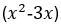

**Options:**
- **[1]** 10

---

### Q2. (+2 / -0)

A contractor agreed to construct a 6 km road in 200 days. He employed 140 persons for the work. After 60 days, he realized that only 1.5 km road has been completed. How many additional people would he need to employ to finish the work exactly on time?

**Options:**
- **[1]** 40

---

### Q3. (+2 / -0)

A sum of Rs. 45500 is to be paid back in 3 equal annual installments. How much is each installment if the interest is compounded annually at 20% per annum ?

**Options:**
- **[1]** 21600

---

### Q4. (+2 / -0)

Note : Type ans in Min Only without unit

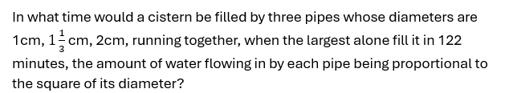

**Options:**
- **[1]** 72

---

### Q5. (+2 / -0)

Note : Ans in days

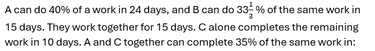

**Options:**
- **[1]** 6

---

### Q6. (+2 / -0)

If a 10-digit number= 5432y1749x is divisible by 72, then what is the value of (5x-4y)?

**Options:**
- **[1]** 14

---

### Q7. (+2 / -0)

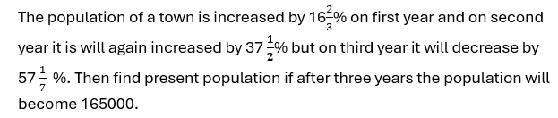

**Options:**
- **[1]** 240000

---

### Q8. (+2 / -0)

If x is the mean of the first 8 positive integers multiple of 9 and Y is the Median for the same , then find the value of 5X-3Y.

**Options:**
- **[1]** 81

---

### Q9. (+2 / -0)

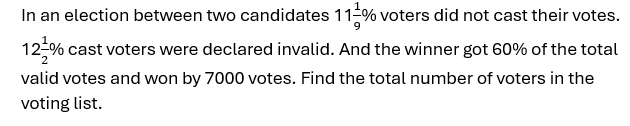

**Options:**
- **[1]** 45000

---

### Q10. (+1 / -0)

X and Y enter into a business partnership with capital in the ratio 3:5. After 5 months, X adds 50% of his capital, while Y withdraws 60% of his capital. What is the share ( in Rs lakhs) of X in the annual profit of Rs 10.26 lakhs?

**Options:**
- **[1]** 5.89
- **[2]** 4.56
- **[3]** 5.58 ✅ **[CORRECT]**
- **[4]** 6.24

---

### Q11. (+1 / -0)

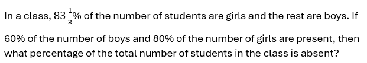

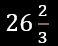

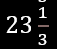

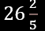

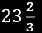

**Options:**
- **[1]** 
- **[2]**  ✅ **[CORRECT]**
- **[3]** 
- **[4]** 

---

### Q12. (+1 / -0)

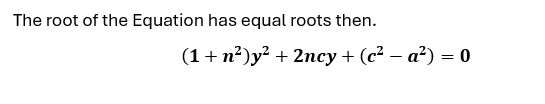

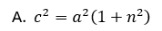

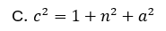

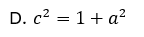

**Options:**
- **[1]**  ✅ **[CORRECT]**
- **[2]** 
- **[3]** 
- **[4]** 

---

### Q13. (+1 / -0)

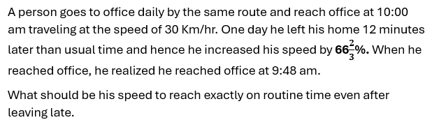

**Options:**
- **[1]** 35km/hr
- **[2]** 40km/hr
- **[3]** 37.5km/hr ✅ **[CORRECT]**
- **[4]** 45 km/hr

---

### Q14. (+1 / -0)

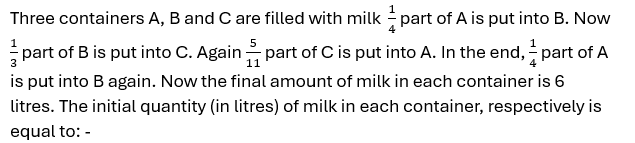

**Options:**
- **[1]** 4,5,9 ✅ **[CORRECT]**
- **[2]** 3,7,8
- **[3]** 3,6,9
- **[4]** 4,7,7

---

### Q15. (+1 / -0)

A shopkeeper earns a profit of 20% by selling an article by giving 25% discount on its marked price. If the cost price of the article increases by 10%, then how much discount percent should he give now on the same marked price to earn the same percentage of profit as earlier?

**Options:**
- **[1]** 17.5% ✅ **[CORRECT]**
- **[2]** 16.5%
- **[3]** 18%
- **[4]** 15%

---

### Q16. (+1 / -0)

In the given questions, two quantities are given, one as 'Quantity 1' and another as 'Quantity 2'. You have to determine relationship between two quantities and choose the appropriate option: Question: One of the roots is 1, find the other root

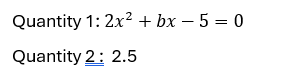

**Options:**
- **[1]** Quantity 1 > Quantity 2
- **[2]** Quantity 1 &ge; Quantity 2
- **[3]** Quantity 2 > Quantity 1 ✅ **[CORRECT]**
- **[4]** Quantity 2 &ge; Quantity 1
- **[5]** Quantity 1 = Quantity 2 or Relation cannot be established

---

### Q17. (+1 / -0)

In a river, the ratio of the speed of stream and speed of a boat A in still water is 2 : 5. Again, in the same river ratio of the speed of stream and speed of another boat B in still water is 3 : 4. What is the ratio of the speeds of the first boat to the second boat in still water ?

**Options:**
- **[1]** 10 : 7
- **[2]** 15 : 8 ✅ **[CORRECT]**
- **[3]** 4 : 3
- **[4]** 5 : 4
- **[5]** 7 : 11

---

### Q18. (+1 / -0)

Find the area of blue portion.

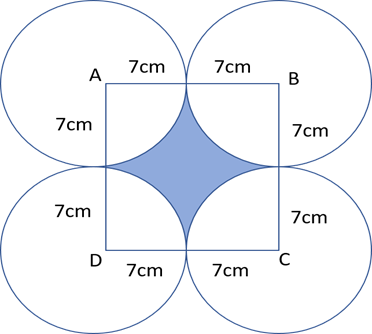

**Options:**
- **[1]** 52
- **[2]** 62
- **[3]** 72
- **[4]** None of these ✅ **[CORRECT]**

---

### Q19. (+1 / -0)

In the given questions, two quantities are given, one as 'Quantity 1' and another as 'Quantity 2'. You have to determine relationship between two quantities and choose the appropriate option: Question: Two dices are rolled simultaneously. Quantity 1: Probability that the sum of the numbers that appeared is a multiple of 5. Quantity 2: 1/6

**Options:**
- **[1]** Quantity 1 > Quantity 2 ✅ **[CORRECT]**
- **[2]** Quantity 1 &ge; Quantity 2
- **[3]** Quantity 2 > Quantity 1
- **[4]** Quantity 2 &ge; Quantity 1
- **[5]** Quantity 1 = Quantity 2 or Relation cannot be established

---

### Q20. (+1 / -0)

What is the mean of the mode and median of the data given below? 8, 7, 5, 4, 9, 1, 3, 7, 6, 5, 2, 1, 6, 3, 9, 8, 4, 6

**Options:**
- **[1]** 6.5
- **[2]** 6.25
- **[3]** 5.5
- **[4]** 5.75 ✅ **[CORRECT]**

---

