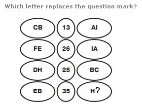
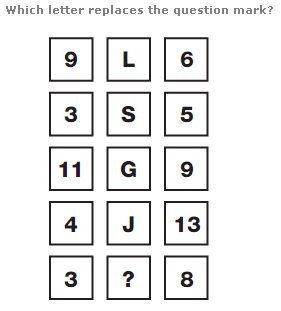
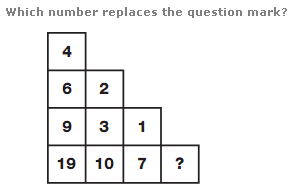

# 📝 Logical Puzzle

- **Engine:** Testbook SDK
- **Folder:** `Infosys Mock Test Series / Day 06 / 1. Full Length Mock I- Based on Infosys PYQ`
- **Total Questions:** 5
- **Total Marks:** 10
- **Duration:** 10.0 Minutes
- **Test ID:** `68d82fecdd30507b0b9ff782`

---

## 🔹 Section: Puzzle

### Q1. (+2 / -0)

**Options:**
- **[1]** I
- **[2]** G ✅ **[CORRECT]**
- **[3]** B
- **[4]** T

---

### Q2. (+2 / -0)

**Options:**
- **[1]** P ✅ **[CORRECT]**
- **[2]** S
- **[3]** R
- **[4]** Q

---

### Q3. (+2 / -0)

Study the 4&times;4 matrix. Each row follows the same rule relating the first two entries to the third entry. Find the missing number ? 8 5 6 53 7 4 8 6 0 5 7 9 5 2 6 9 8 ? e rule.

**Options:**
- **[1]** 57 ✅ **[CORRECT]**
- **[2]** 59
- **[3]** 67
- **[4]** 87

---

### Q4. (+2 / -0)

**Options:**
- **[1]** 5
- **[2]** 6 ✅ **[CORRECT]**
- **[3]** 8
- **[4]** 2

---

### Q5. (+2 / -0)

Study the 3&times;3 matrix. Each row follows the same rule relating the first two entries to the third entry. Find the missing number 2 1 2 16 5 2 5 5 0 7 5 1 ?

**Options:**
- **[1]** 70
- **[2]** 50
- **[3]** 120
- **[4]** 100 ✅ **[CORRECT]**

---

