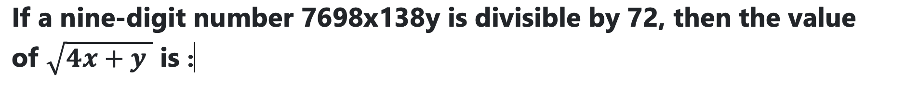
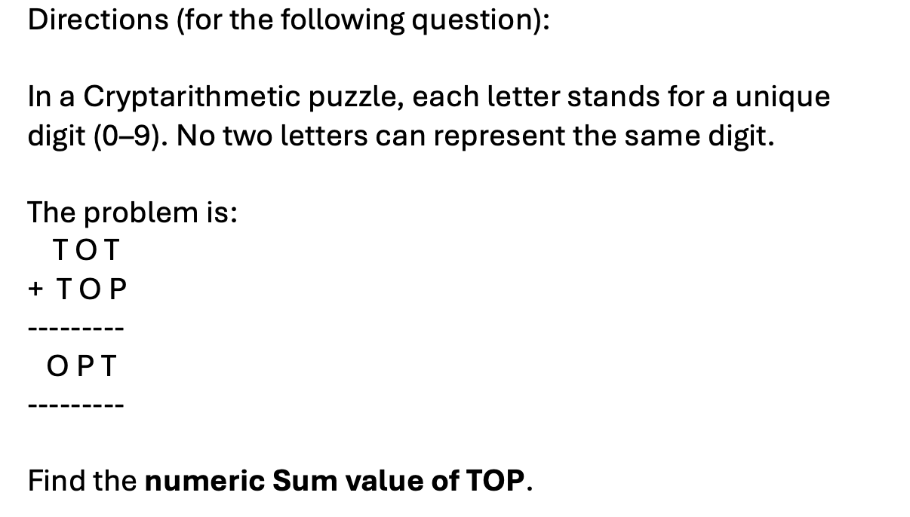

# 📝 Quantitative Aptitude/Technical Abilty

- **Engine:** Testbook SDK
- **Folder:** `Infosys Mock Test Series / Day 06 / 1. Full Length Mock I- Based on Infosys PYQ`
- **Total Questions:** 10
- **Total Marks:** 10
- **Duration:** 20.0 Minutes
- **Test ID:** `68d792eb516b2e6f6a1fe368`

---

## 🔹 Section: Technical Ability - Mathematics /Quantitative Aptitude

### Q1. (+1 / -0)

An Amount of Rs. 3000 is distributed among A, B and C such that A gets 2/3 rd of what B and C together get and C gets 1/2 of what A and B together get. Find B&rsquo;s sh are.

**Options:**
- **[1]** 650
- **[2]** 700
- **[3]** 500
- **[4]** 800 ✅ **[CORRECT]**

---

### Q2. (+1 / -0)

**Options:**
- **[1]** 4
- **[2]** 5
- **[3]** 6 ✅ **[CORRECT]**
- **[4]** None Of these

---

### Q3. (+1 / -0)

An almirah was sold at a profit of 15%. If its cost had been 5% less and it had been sold for Rs 1,470 less, then the profit would have been 10%. What is the cost price of the almirah?

**Options:**
- **[1]** 14400
- **[2]** 14000 ✅ **[CORRECT]**
- **[3]** 16100
- **[4]** 15400

---

### Q4. (+1 / -0)

Seven years ago, the ratio of the ages of A and B was 2: 3. Three years hence, the ratio of their ages will be 5: 7. The sum of their present ages (in years) is:

**Options:**
- **[1]** 100
- **[2]** 200
- **[3]** 112
- **[4]** 114 ✅ **[CORRECT]**

---

### Q5. (+1 / -0)

Veer buys 200 guavas for Rs.1,800. Some of these guavas are rotten and are thrown away. He sells the remaining guavas at Rs.14 each and makes a profit of Rs.230. The percentage of guavas thrown away is:

**Options:**
- **[1]** 27%
- **[2]** 29%
- **[3]** 30%
- **[4]** 27.5% ✅ **[CORRECT]**

---

### Q6. (+1 / -0)

A boy walked along two adjacent sides of a rectangular field. If he had walked along the diagonal, then he would have saved a distance equal to one-fourth of the larger side. The ratio of the smaller to the larger side is:

**Options:**
- **[1]** 11:18
- **[2]** 18:11
- **[3]** 7:24 ✅ **[CORRECT]**
- **[4]** 5:12

---

### Q7. (+1 / -0)

**Options:**
- **[1]** 5
- **[2]** 0
- **[3]** 7 ✅ **[CORRECT]**
- **[4]** 4

---

### Q8. (+1 / -0)

A team of four players are to be selected from among four girls A,B,C,D and four boys P,Q,R,S such that there would be at least two girls in the team and the team selection should meet the following conditions i. B cannot go with R ii .D and P must go together iii S cannot be put up with A iv. R and C must be together

**Options:**
- **[1]** QBSC
- **[2]** DAPQ ✅ **[CORRECT]**
- **[3]** RCQS
- **[4]** BPRA

---

### Q9. (+1 / -0)

While Balbir had his back turned, a dog ran into his butcher shop, snatched a piece of meat off the counter and ran off. Balbir was mad when he realised what had happened. He asked three other shopkeepers, who had seen the dog, to describe it. The shopkeepers really didn&rsquo;t want to help Balbir. So each of them made a statement which contained one truth and one lie. A. Shopkeeper Number 1 said: &ldquo;The dog had black hair and a long tail.&rdquo; B. Shopkeeper Number 2 said: &ldquo;The dog had a short tail and wore a collar.&rdquo; C. Shopkeeper Number 3 said: &ldquo;The dog had white hair and no collar.&rdquo; Based on the above statements, which of the following could be a correct description?

**Options:**
- **[1]** The dog had black hair, long tail and a collar.
- **[2]** The dog had white hair, short tail and no collar.
- **[3]** The dog had black hair, long tail and no collar.
- **[4]** The dog had white hair, long tail and a collar. ✅ **[CORRECT]**

---

### Q10. (+1 / -0)

In a bag, there are coins of 25 p, 10 p and 5 p in the ratio of 1 : 2 : 3. If there is Rs. 30 in all, how many 5 p coins are there?

**Options:**
- **[1]** 50
- **[2]** 100
- **[3]** 150 ✅ **[CORRECT]**
- **[4]** 200

---

