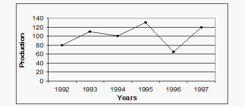
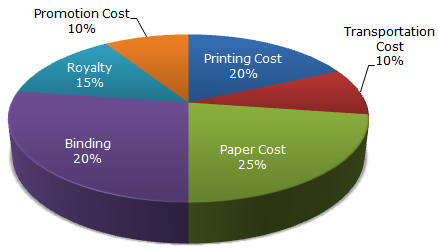
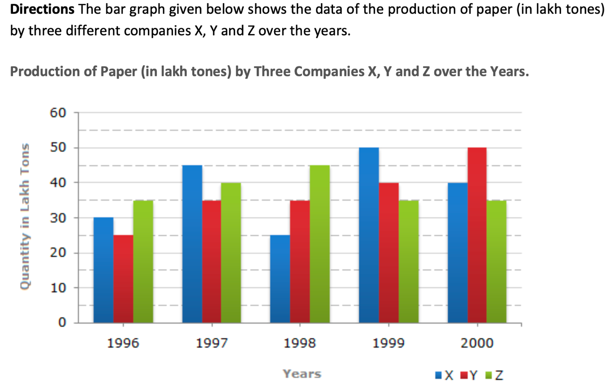

# 📝 SECTION-II: ANALYTICAL THINKING

- **Engine:** Testbook SDK
- **Folder:** `Infosys Mock Test Series / Day 07 / 2. Full Length Mock II- Based on Infosys PYQ`
- **Total Questions:** 15
- **Total Marks:** 15
- **Duration:** 20.0 Minutes
- **Test ID:** `68ce85f06524300fca548c3c`

---

## 🔹 Section: Technical Pseudo Codes -01

### Q1. (+1 / -0)

Directions(1-2): Two statements are followed by four conclusions numbered I, II, III, IV. Take the first two statements to be true even if they are at variance with commonly &ndash; known facts. The statements are followed by conclusions which are themselves followed by answer &ndash; choices. Mark the answer &ndash;choice which correctly points out which of the conclusion follow. Question1 : Statements: 1.All green are blue 2.All blue are white Conclusions: I) some blue are green. II) Some white are green. III) Some green are not white. IV) All white are blue. a) Only I and II follow b) Only II and III follow c)Only I and III follow d) Only I and IV follow

**Options:**
- **[1]** a) Only I and II follow ✅ **[CORRECT]**
- **[2]** b) Only II and III follow
- **[3]** c)Only I and III follow
- **[4]** d) Only I and IV follow
- **[5]** None of these

---

### Q2. (+1 / -0)

Directions(1-2): Two statements are followed by four conclusions numbered I, II, III, IV. Take the first two statements to be true even if they are at variance with commonly &ndash; known facts. The statements are followed by conclusions which are themselves followed by answer &ndash; choices. Mark the answer &ndash;choice which correctly points out which of the conclusion follow. Question2 : Statements: 1) Some boxes are cars 2) Some cars roads Conclusions: I) some roads are boxes II) Some cars are boxes III) No box is a road IV) Some roads are cars.

**Options:**
- **[1]** Only II and III follow
- **[2]** Only I and IV follow
- **[3]** Either I or III ,and II and IV follow ✅ **[CORRECT]**
- **[4]** Only II and IV follow
- **[5]** None of these

---

### Q3. (+1 / -0)

Directions(3-4): The questions given below have four groups of three statements each. Read the statements in each group carefully and identify the group/groups where the third statement logically follows the first two statements in the group. Question 3 : A) All books are copies. All copies are papers. All books are papers. B) All cubes are squares. All cubes are triangles. All triangles are squares. C) All singers are dancers. All dancers are musicians. All musicians are singers. D) No cock is hen. All hens are chickens. No hen is chicken.

**Options:**
- **[1]** Only D
- **[2]** Only A ✅ **[CORRECT]**
- **[3]** Only B & C
- **[4]** Only A and D

---

### Q4. (+1 / -0)

Directions(3-4): The questions given below have four groups of three statements each. Read the statements in each group carefully and identify the group/groups where the third statement logically follows the first two statements in the group. Question 4 : A) All elephants are wild. All lions are wild. So all lions are elephant B) All mangoes are red. Some apples are mangoes. So, all apples are red C) All roads are boxes. All foxes are roads. So, all boxes are foxes D) All XYZ can run. All ABC are XYZ. So, all ABC can run.

**Options:**
- **[1]** A. Only A
- **[2]** A. Only B
- **[3]** A. Only C
- **[4]** A. Only D ✅ **[CORRECT]**

---

### Q5. (+1 / -0)

DIRECTIONS for questions : Given below are line graph examples with questions, which show the annual food grain production from 1992 to 1997. Refer to the graph & answer the questions based on line graph as given below. Question 5 : What is an approximate percentage decrease in production from 1993 to 1994?

**Options:**
- **[1]** A. 87.5%
- **[2]** 37.5%
- **[3]** A. 9.09% ✅ **[CORRECT]**
- **[4]** A. None of these

---

### Q6. (+1 / -0)

The following pie-chart shows the percentage distribution of the expenditure incurred in publishing a book. Study the pie-chart and the answer the questions based on it. Various Expenditures (in percentage) Incurred in Publishing a Book Question 6: If for a certain quantity of books, the publisher has to pay Rs. 30,600 as printing cost, then what will be amount of royalty to be paid for these books?

**Options:**
- **[1]** Rs. 19,450
- **[2]** Rs. 21,200
- **[3]** A Rs. 22,950 ✅ **[CORRECT]**
- **[4]** Rs. 26,150

---

### Q7. (+1 / -0)

The following pie-chart shows the percentage distribution of the expenditure incurred in publishing a book. Study the pie-chart and the answer the questions based on it. Various Expenditures (in percentage) Incurred in Publishing a Book Question 7: The price of the book is marked 20% above the C.P. If the marked price of the book is Rs. 180,then what is the cost of the paper used in a single copy of the book?

**Options:**
- **[1]** A. Rs. 36
- **[2]** A Rs. 42
- **[3]** A. Rs. 37.50 ✅ **[CORRECT]**
- **[4]** A Rs. 44.25

---

### Q8. (+1 / -0)

Question 8: For which of the following years, the percentage rise/fall in production from the previous year is the maximum for Company Y?

**Options:**
- **[1]** 1997 ✅ **[CORRECT]**
- **[2]** 1998
- **[3]** 1999
- **[4]** 2000

---

### Q9. (+1 / -0)

Question 9: What is the ratio of the average production of Company X in the period 1998-2000 to the average production of Company Y in the same period?

**Options:**
- **[1]** 1:1
- **[2]** 15:17
- **[3]** 23:25 ✅ **[CORRECT]**
- **[4]** 27:29

---

### Q10. (+1 / -0)

The question below consists of a question and two statements numbered I and II given. You have to decide whether the data provided in which of the statements are sufficient to answer the question. Choose your answer from the options based on this. Question10 :Among persons S, I, U, V, W and B who is the tallest? I. U is taller than only two persons. T is taller than S but not the tallest. W is taller than only B. II. S is shorter than only two persons. W is taller than B but shorter than U. U is shorter than S. T is shorter than V.

**Options:**
- **[1]** The data in statement II alone are sufficient to answer the question, while the data in statement I alone are not sufficient to answer the question
- **[2]** The data even in both statements I and II together are not sufficient to answer the question
- **[3]** The data either in statement I alone or in statement II alone are sufficient to answer the question ✅ **[CORRECT]**
- **[4]** The data in statement I alone are sufficient to answer the question, while the data in statement II alone are not sufficient to answer the question
- **[5]** The data in both statements I and II together are necessary to answer the question

---

### Q11. (+1 / -0)

The question below consists of a question and two statements numbered I and II given. You have to decide whether the data provided in which of the statements are sufficient to answer the question. Choose your answer from the options based on this. Question 11 . Is M the mother of L? I. T is the mother of M. M is married to J. K is the son of J. F is the sister of K. L is the sister of F. II. K is the grandson of T. K is the bother of F. F is the sister of L. L is daughter of J. J is the son-in-law of T.

**Options:**
- **[1]** The data in statement II alone are sufficient to answer the question, while the data in statement I alone are not sufficient to answer the question
- **[2]** The data even in both statements I and II together are not sufficient to answer the question
- **[3]** The data either in statement I alone or in statement II alone are sufficient to answer the question
- **[4]** The data in statement I alone are sufficient to answer the question, while the data in statement II alone are not sufficient to answer the question
- **[5]** The data in both statements I and II together are necessary to answer the question ✅ **[CORRECT]**

---

### Q12. (+1 / -0)

The question below consists of a question and two statements numbered I and II given. You have to decide whether the data provided in which of the statements are sufficient to answer the question. Choose your answer from the options based on this. Question12: By selling a product with 20% profit, how much profit was earned? I. The difference between cost and selling price is Rs. 40. II. The selling price is 120 percent of the cost price.

**Options:**
- **[1]** The data in statement II alone are sufficient to answer the question, while the data in statement I alone are not sufficient to answer the question
- **[2]** The data even in both statements I and II together are not sufficient to answer the question
- **[3]** The data either in statement I alone or in statement II alone are sufficient to answer the question
- **[4]** The data in statement I alone are sufficient to answer the question, while the data in statement II alone are not sufficient to answer the question ✅ **[CORRECT]**
- **[5]** The data in both statements I and II together are necessary to answer the question

---

### Q13. (+1 / -0)

The question below consists of a question and two statements numbered I and II given. You have to decide whether the data provided in which of the statements are sufficient to answer the question. Choose your answer from the options based on this. I . If b is even II. If a is even

**Options:**
- **[1]** The data in statement II alone are sufficient to answer the question, while the data in statement I alone are not sufficient to answer the question
- **[2]** The data even in both statements I and II together are not sufficient to answer the question
- **[3]** The data either in statement I alone or in statement II alone are sufficient to answer the question
- **[4]** The data in statement I alone are sufficient to answer the question, while the data in statement II alone are not sufficient to answer the question ✅ **[CORRECT]**
- **[5]** The data in both statements I and II together are necessary to answer the question

---

### Q14. (+1 / -0)

A set of football matches is to be organized in a "round-robin" fashion, i.e., every participating team plays a match against every other team once and only once. If 21 matches are totally played, how many teams participated?

**Options:**
- **[1]** 8
- **[2]** 7 ✅ **[CORRECT]**
- **[3]** 9
- **[4]** None of these

---

### Q15. (+1 / -0)

Find the wrong term in the following number series : 15972 , 15629 , 15840 , 15720 , 15784 , 15757

**Options:**
- **[1]** 15840 ✅ **[CORRECT]**
- **[2]** 15757
- **[3]** 15720
- **[4]** 15972

---

