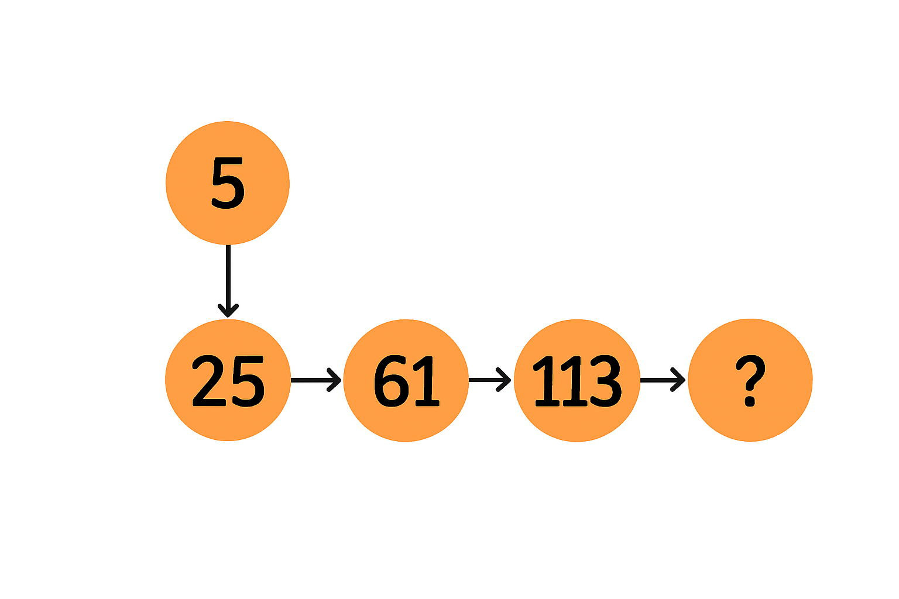
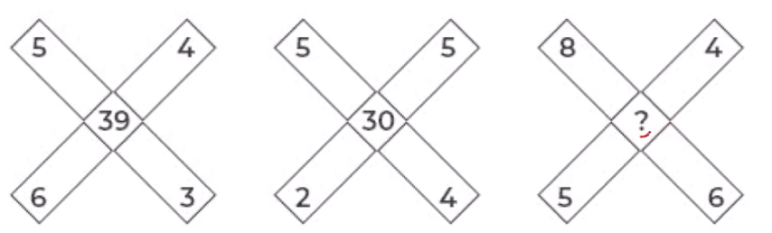

# 📝 Section IV: Puzzle Solving

- **Engine:** Testbook SDK
- **Folder:** `Infosys Mock Test Series / Day 07 / 2. Full Length Mock II- Based on Infosys PYQ`
- **Total Questions:** 4
- **Total Marks:** 4
- **Duration:** 8.0 Minutes
- **Test ID:** `68ce8cfcb9fccbc8274e9152`

---

## 🔹 Section: Technical Pseudo Codes -01

### Q1. (+1 / -0)

Find the value of the question mark (?) Choose the best answer:

**Options:**
- **[1]** 169
- **[2]** 181 ✅ **[CORRECT]**
- **[3]** 197
- **[4]** 205

---

### Q2. (+1 / -0)

Study the 3&times;3 matrix. Each row follows the same rule relating the first two entries to the third entry. Find the missing number ? that makes the middle row obey the same rule. 3 2 11 ? 6 13 3 5 23

**Options:**
- **[1]** 0
- **[2]** 1 ✅ **[CORRECT]**
- **[3]** 2
- **[4]** 4

---

### Q3. (+1 / -0)

In the following question select the number which can be placed at the question ? mark which follows the same rule relating the first two entries to the third entry.

**Options:**
- **[1]** 76
- **[2]** 58
- **[3]** 68 ✅ **[CORRECT]**
- **[4]** 98

---

### Q4. (+1 / -0)

Study the 3&times;3 matrix. Each row follows the same rule relating the first two entries to the third entry. Find the missing number ? that makes the middle row obey the same rule. 5 J G 4 A C B 7 5 V Q ?

**Options:**
- **[1]** Y
- **[2]** X
- **[3]** W
- **[4]** Z ✅ **[CORRECT]**

---

