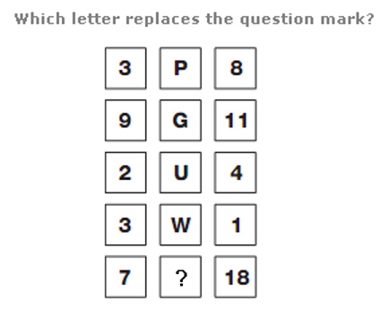
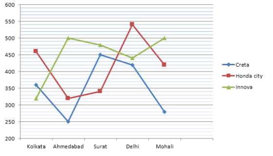

# 📝 Aptitude 01 - All India Mock 01

- **Engine:** Testbook SDK
- **Folder:** `Infosys Mock Test Series / Day 08 / 3 Full Length Mock III- Based on Infosys PYQ`
- **Total Questions:** 33
- **Total Marks:** 40
- **Duration:** 35.0 Minutes
- **Test ID:** `68bbe5b92571a13275bf3004`

---

## 🔹 Section: Quantitative Aptitude

### Q1. (+1 / -0)

Question : If the surface areas of two spheres are in the ratio of 49:81 , then find the ratio of their volumes.

**Options:**
- **[1]** 27:64
- **[2]** 125:512
- **[3]** 343:729 ✅ **[CORRECT]**
- **[4]** 216:512

---

### Q2. (+1 / -0)

Question : If Raman drives his bike at a speed of 24 km/h, he reaches his office 5 minutes late. If he drives the bike at a speed of 30 km/h, he reaches his office 4 minutes early. How much time (in minutes) will he take to reach his office at a speed of 27 km/h?

**Options:**
- **[1]** 40 ✅ **[CORRECT]**
- **[2]** 55
- **[3]** 50
- **[4]** 45

---

### Q3. (+1 / -0)

Question : If the height of a solid right circular cylinder is 27 cm and diameter of its base is 30 cm, the total surface area (in sq cm) of the right circular cylinder is?

**Options:**
- **[1]** 3976
- **[2]** 3964
- **[3]** 3960 ✅ **[CORRECT]**
- **[4]** 3978

---

### Q4. (+1 / -0)

Question : Avra travels from A to B at 74 km/h and returns from B to A through the same route at 111 km/h. What was his average speed during the two-way journey?

**Options:**
- **[1]** 78.88 km/hr
- **[2]** 88.88 km/hr ✅ **[CORRECT]**
- **[3]** 98.88 km/hr
- **[4]** 108.88 km/hr

---

### Q5. (+1 / -0)

Question : A can do 1/4 of a work in 3 days and B can do 1/6 of the same work in 4 days, how much will A get if both work together and are paid Rs. 180 in all?

**Options:**
- **[1]** 150 Rs
- **[2]** 100
- **[3]** 120 ✅ **[CORRECT]**
- **[4]** 160

---

### Q6. (+2 / -0)

Question : At 20% discount the selling price of a refrigerator is Rs 2400. What is the selling price if the discount is 32.5%?

**Options:**
- **[1]** undefined

---

### Q7. (+1 / -0)

Question : A mixture contains milk and water in ratio 5 : 7, when 8 liters milk of and 8 liters of water is added in mixture then ratio becomes 9 : 11. Find initial quantity of milk.

**Options:**
- **[1]** 24 liters
- **[2]** 10 liters ✅ **[CORRECT]**
- **[3]** 16liters
- **[4]** 18 liters

---

### Q8. (+2 / -0)

Question : The mean weight of 34 students of a school is 42 kg. If the weight of the teacher is also included, the mean rises by 400 grams. Find the weight of the teacher (in kg.)

**Options:**
- **[1]** undefined

---

### Q9. (+1 / -0)

Question : A basket contains 6 White 4 Black 2 Pink and 3 Green balls. If four balls are picked at random, what is the probability that at least one is Black?

**Options:**
- **[1]** 69/91 ✅ **[CORRECT]**
- **[2]** 80/91
- **[3]** 21/91
- **[4]** 55/91

---

### Q10. (+2 / -0)

Question : Two boys Rishi and Vamsi start at the same time to ride from Lucknow to Kanpur that is 95 km away. Rishi travels 5 km/h slower than Vamsi. Vamsi reaches Kanpur and immediately start to travel back. On his return journey he meets Rishi who is 25 km away from Kanpur. Find Rishi's speed(Km/hr)

**Options:**
- **[1]** undefined

---

### Q11. (+1 / -0)

Question : The length, Breadth and height of a cuboid increases by 20%, 10% and 30% Respectively. What is the percentage increases in the volume of that cuboid?

**Options:**
- **[1]** 30%
- **[2]** 20%
- **[3]** 71.6% ✅ **[CORRECT]**
- **[4]** 43%

---

### Q12. (+1 / -0)

Question : A bag contains Rs. 4100 in the form of Rs. 5, Rs. 2 and Rs. 1 coin. The number of coins is in ratio 4: 6: 9. So, find the number of 1 Rs. coins.

**Options:**
- **[1]** 40
- **[2]** 500
- **[3]** 900 ✅ **[CORRECT]**
- **[4]** None of these

---

### Q13. (+1 / -0)

Question : The two trains are coming towards each other and cross a signal pole in 30 seconds and 20 seconds respectively and they cross each other in 24seconds. Find the ratio of the speed of these two trains?

**Options:**
- **[1]** 2:3 ✅ **[CORRECT]**
- **[2]** 3:5
- **[3]** 4:5
- **[4]** 3:4

---

## 🔹 Section: logical Reasoning

### Q14. (+1 / -0)

**Prompt:** Which letter replaces the question mark (`?`) in the letter pattern matrix?

```
┌──────────┬──────────┬──────────┐
│    D     │    F     │    I     │  D(4) -> F(6) -> I(9)   (+2, +3)
├──────────┼──────────┼──────────┤
│    G     │    J     │    N     │  G(7) -> J(10) -> N(14) (+3, +4)
├──────────┼──────────┼──────────┤
│    K     │    O     │    T     │  K(11) -> O(15) -> T(20) (+4, +5)
├──────────┼──────────┼──────────┤
│    P     │    U     │    A     │  P(16) -> U(21) -> A(27=1) (+5, +6)
├──────────┼──────────┼──────────┤
│    V     │    C     │    ?     │  V(22) -> C(29=3) -> [B(28=2)] (+7, +something)
└──────────┴──────────┴──────────┘
```



**Options:**
- **[1]** A
- **[2]** C
- **[3]** Z
- **[4]** B ✅ **[CORRECT]**

💡 **Detailed Solution & Logical Derivation:**
1. **Alphabet Rank Transformation:** Replace letters with their standard 1-26 alphabetical positions.
2. **Row Invariant Pattern:** In each row, intervals between consecutive letters advance systematically across columns.
3. **Target Evaluation:** The final row sequence resolves to letter `B`.
4. **Conclusion:** Option `[4]` (`B`) is the verified correct answer.

---

### Q15. (+2 / -0)

Directions : Study the following information carefully to answer these questions. A, B, C, D, E, F, G and H are sitting around a circle, facing the centre. F sits to the immediate right of D and third to the left of A. G sits third to the left of D who does not sit next to E. B sits next to G but not next to D. C does not sit next to either D or A. Question : What is the position of H with respect to C?

**Options:**
- **[1]** Second to the left
- **[2]** First to the right
- **[3]** Third to the right
- **[4]** Second to the right
- **[5]** None of these ✅ **[CORRECT]**

---

### Q16. (+2 / -0)

Directions : Study the following information carefully to answer these questions. A, B, C, D, E, F, G and H are sitting around a circle, facing the centre. F sits to the immediate right of D and third to the left of A. G sits third to the left of D who does not sit next to E. B sits next to G but not next to D. C does not sit next to either D or A. Question : Starting from A&rsquo;s position, if all the eight are arranged in alphabetical order in clockwise direction, the seating position of which of the following (excluding A) would not change?

**Options:**
- **[1]** B
- **[2]** C ✅ **[CORRECT]**
- **[3]** D
- **[4]** H
- **[5]** None of these

---

### Q17. (+1 / -0)

P started from his house towards west. After walking a distance of 25 m. He turned to the right and walked 10 m. He then again turned to the right and walked 15 m. After this he is to turn right at 135 degree and to cover 30 m. In which direction P is going?

**Options:**
- **[1]** West
- **[2]** South
- **[3]** South-East
- **[4]** South-West ✅ **[CORRECT]**

---

### Q18. (+2 / -0)

If GOOD is coded as 164 , BAD is coded as 21 & UGLY is coded as 260 then JUMP will be coded as ?

**Options:**
- **[1]** undefined

---

### Q19. (+1 / -0)

**Prompt:** The line graph shows the data of 3 different types of cars sold across 5 different cities (Kolkata, Ahmedabad, Surat, Delhi, Mohali).
**Question:** The number of Honda cars sold in Ahmedabad is what percent of the total Innova cars sold in Surat?

```
┌───────────┬────────────┬─────────────┐
│   City    │ Honda City │   Innova    │
├───────────┼────────────┼─────────────┤
│  Kolkata  │    450     │     500     │
│ Ahmedabad │    300     │     350     │
│   Surat   │    250     │     450     │
│   Delhi   │    550     │     400     │
│  Mohali   │    350     │     300     │
└───────────┴────────────┴─────────────┘
```



**Options:**
- **[1]** 50%
- **[2]** 66(2/3)% ✅ **[CORRECT]**
- **[3]** 70%
- **[4]** None of these

💡 **Detailed Solution & Mathematical Derivation:**
1. **Data Extraction from Graph:**
   - Number of Honda City cars sold in Ahmedabad = `300`.
   - Number of Innova cars sold in Surat = `450`.
2. **Percentage Calculation:**
   $$\text{Percentage} = \left(\frac{\text{Honda in Ahmedabad}}{\text{Innova in Surat}}\right) \times 100$$
   $$\text{Percentage} = \left(\frac{300}{450}\right) \times 100 = \left(\frac{2}{3}\right) \times 100 = 66\frac{2}{3}\%$$
3. **Conclusion:** Option `[2]` (`66(2/3)%`) is the exact mathematical answer.

---

### Q20. (+1 / -0)

Statements: Some towns are villages. Some villages are lanes. Some lanes are hamlets. Conclusions: I. Some hamlets are villages. II. Some lanes are towns. III. Some hamlets are towns.

**Options:**
- **[1]** Only I follows
- **[2]** Only II follows
- **[3]** Only III follows
- **[4]** Only II and III follows
- **[5]** None follows ✅ **[CORRECT]**

---

### Q21. (+1 / -0)

Question : In a certain code, MONKEY is written as XDJMNL . How is TIGER written in that code ?

**Options:**
- **[1]** SDFHS
- **[2]** SHFDQ
- **[3]** UJHFS
- **[4]** QDFHS ✅ **[CORRECT]**

---

### Q22. (+2 / -0)

Find the Missing Term: 256 , 64 , ? , 24 , 24 , 30

**Options:**
- **[1]** undefined

---

### Q23. (+1 / -0)

Seven girls P, Q, R, S, T, W and X are sitting in a row facing towards the north (not necessarily in the same order). R is at one of the ends of the row. T sits exactly in the middle of row. S is third to the left of X. Q is to the immediate left of W. Q is not at any end of the row. Which of the following statements) is/are correct? I. S is to the immediate right of R. Il. T is to the immediate right of X.

**Options:**
- **[1]** Only I ✅ **[CORRECT]**
- **[2]** Only II
- **[3]** Both I & II
- **[4]** Neither I nor II

---

## 🔹 Section: Verbal Ability

### Q24. (+1 / -0)

Read the passage and answer the questions that follow : Once upon a time, in a quaint little village nestled in a picturesque valley, there lived a young girl named Lily. She was known for her adventurous spirit and her deep curiosity. One sunny afternoon, while exploring the woods that bordered the village, Lily stumbled upon a hidden clearing. In the center of this secret meadow, she found an old oak tree with a peculiar nook. In that nook, half-buried in the earth, was a mysterious locket, ornate and gleaming with intricate designs. Lily carefully unearthed it, and as she held it in her hand, she felt a strange connection to this forgotten piece of jewelry. Back in her cottage, Lily examined the locket more closely. It was made of silver with a hint of gold, and its surface was adorned with delicate engravings of leaves and flowers. On the front, there was an image of a crescent moon, and on the back, an engraving read, &ldquo;To the one who seeks the truth.&rdquo; The locket was sealed tightly, and Lily couldn&rsquo;t open it no matter how hard she tried. Determined to solve the mystery, Lily embarked on a quest to find someone who could open the locket. She asked the village blacksmith, the wise old woman who lived on the hill, and even the town&rsquo;s mayor, but none of them could unlock its secrets. Feeling a bit discouraged, Lily spent her days reading about ancient relics and searching for clues in the library. One day, while immersed in an old book about mystical lockets, Lily came across a passage that mentioned the existence of a &ldquo;key of the heart.&rdquo; It said that this key could open the most stubborn of locks, but it was hidden within each person, waiting to be discovered. This newfound knowledge gave Lily a renewed sense of hope and determination. The next morning, Lily decided to visit the village&rsquo;s recluse, an elderly woman rumored to have deep knowledge of the heart. The recluse lived in a remote cottage surrounded by a lush garden. Lily knocked on the door and explained her quest. The old woman listened attentively and finally agreed to help. She told Lily that the key to opening the locket was hidden within her heart and that she needed to meditate on her truest desires and intentions. Lily followed the recluse&rsquo;s advice, sitting beneath the ancient oak tree where she had found the locket. She closed her eyes, focused on her heart&rsquo;s deepest desires, and as she did, she felt the locket warming in her hand. When she opened her eyes, she found the locket had sprung open, revealing a tiny, folded parchment inside. With trembling hands, she carefully unfolded it and read the message: &ldquo;The truth lies in the journey, not the destination.&rdquo; The mystery of the locket was solved, but Lily realized that the real treasure was the journey of self-discovery she had undertaken. She understood that her quest had led her to understand her heart&rsquo;s desires and the power of her own determination. Question 1- What did Lily discover in the hidden clearing in the woods?

**Options:**
- **[1]** A hidden garden
- **[2]** An old oak tree ✅ **[CORRECT]**
- **[3]** A mysterious book
- **[4]** A magic wand

---

### Q25. (+1 / -0)

Read the passage and answer the questions that follow : Once upon a time, in a quaint little village nestled in a picturesque valley, there lived a young girl named Lily. She was known for her adventurous spirit and her deep curiosity. One sunny afternoon, while exploring the woods that bordered the village, Lily stumbled upon a hidden clearing. In the center of this secret meadow, she found an old oak tree with a peculiar nook. In that nook, half-buried in the earth, was a mysterious locket, ornate and gleaming with intricate designs. Lily carefully unearthed it, and as she held it in her hand, she felt a strange connection to this forgotten piece of jewelry. Back in her cottage, Lily examined the locket more closely. It was made of silver with a hint of gold, and its surface was adorned with delicate engravings of leaves and flowers. On the front, there was an image of a crescent moon, and on the back, an engraving read, &ldquo;To the one who seeks the truth.&rdquo; The locket was sealed tightly, and Lily couldn&rsquo;t open it no matter how hard she tried. Determined to solve the mystery, Lily embarked on a quest to find someone who could open the locket. She asked the village blacksmith, the wise old woman who lived on the hill, and even the town&rsquo;s mayor, but none of them could unlock its secrets. Feeling a bit discouraged, Lily spent her days reading about ancient relics and searching for clues in the library. One day, while immersed in an old book about mystical lockets, Lily came across a passage that mentioned the existence of a &ldquo;key of the heart.&rdquo; It said that this key could open the most stubborn of locks, but it was hidden within each person, waiting to be discovered. This newfound knowledge gave Lily a renewed sense of hope and determination. The next morning, Lily decided to visit the village&rsquo;s recluse, an elderly woman rumored to have deep knowledge of the heart. The recluse lived in a remote cottage surrounded by a lush garden. Lily knocked on the door and explained her quest. The old woman listened attentively and finally agreed to help. She told Lily that the key to opening the locket was hidden within her heart and that she needed to meditate on her truest desires and intentions. Lily followed the recluse&rsquo;s advice, sitting beneath the ancient oak tree where she had found the locket. She closed her eyes, focused on her heart&rsquo;s deepest desires, and as she did, she felt the locket warming in her hand. When she opened her eyes, she found the locket had sprung open, revealing a tiny, folded parchment inside. With trembling hands, she carefully unfolded it and read the message: &ldquo;The truth lies in the journey, not the destination.&rdquo; The mystery of the locket was solved, but Lily realized that the real treasure was the journey of self-discovery she had undertaken. She understood that her quest had led her to understand her heart&rsquo;s desires and the power of her own determination. Question 2- What was inscribed on the back of the mysterious locket?

**Options:**
- **[1]** &ldquo;To the one who seeks adventure&rdquo;
- **[2]** &ldquo;To the one who seeks answers&rdquo;
- **[3]** &ldquo;To the one who seeks the truth&rdquo; ✅ **[CORRECT]**
- **[4]** &ldquo;To the one who seeks gold&rdquo;

---

### Q26. (+1 / -0)

Read the passage and answer the questions that follow : Once upon a time, in a quaint little village nestled in a picturesque valley, there lived a young girl named Lily. She was known for her adventurous spirit and her deep curiosity. One sunny afternoon, while exploring the woods that bordered the village, Lily stumbled upon a hidden clearing. In the center of this secret meadow, she found an old oak tree with a peculiar nook. In that nook, half-buried in the earth, was a mysterious locket, ornate and gleaming with intricate designs. Lily carefully unearthed it, and as she held it in her hand, she felt a strange connection to this forgotten piece of jewelry. Back in her cottage, Lily examined the locket more closely. It was made of silver with a hint of gold, and its surface was adorned with delicate engravings of leaves and flowers. On the front, there was an image of a crescent moon, and on the back, an engraving read, &ldquo;To the one who seeks the truth.&rdquo; The locket was sealed tightly, and Lily couldn&rsquo;t open it no matter how hard she tried. Determined to solve the mystery, Lily embarked on a quest to find someone who could open the locket. She asked the village blacksmith, the wise old woman who lived on the hill, and even the town&rsquo;s mayor, but none of them could unlock its secrets. Feeling a bit discouraged, Lily spent her days reading about ancient relics and searching for clues in the library. One day, while immersed in an old book about mystical lockets, Lily came across a passage that mentioned the existence of a &ldquo;key of the heart.&rdquo; It said that this key could open the most stubborn of locks, but it was hidden within each person, waiting to be discovered. This newfound knowledge gave Lily a renewed sense of hope and determination. The next morning, Lily decided to visit the village&rsquo;s recluse, an elderly woman rumored to have deep knowledge of the heart. The recluse lived in a remote cottage surrounded by a lush garden. Lily knocked on the door and explained her quest. The old woman listened attentively and finally agreed to help. She told Lily that the key to opening the locket was hidden within her heart and that she needed to meditate on her truest desires and intentions. Lily followed the recluse&rsquo;s advice, sitting beneath the ancient oak tree where she had found the locket. She closed her eyes, focused on her heart&rsquo;s deepest desires, and as she did, she felt the locket warming in her hand. When she opened her eyes, she found the locket had sprung open, revealing a tiny, folded parchment inside. With trembling hands, she carefully unfolded it and read the message: &ldquo;The truth lies in the journey, not the destination.&rdquo; The mystery of the locket was solved, but Lily realized that the real treasure was the journey of self-discovery she had undertaken. She understood that her quest had led her to understand her heart&rsquo;s desires and the power of her own determination. Question 3- Who did Lily seek help from in opening the locket?

**Options:**
- **[1]** The village blacksmith
- **[2]** The wise old woman on the hill
- **[3]** The town&rsquo;s mayor
- **[4]** All of the above ✅ **[CORRECT]**

---

### Q27. (+1 / -0)

Rearrange them to form a logically coherent paragraph 1️⃣ Start-ups are increasingly adopting artificial intelligence to automate routine operations and reduce human error. 2️⃣ Investors are keen to fund ventures that can demonstrate scalable AI-driven business models. 3️⃣ As competition intensifies, companies seek innovative tools to gain a market edge. 4️⃣ However, reliance on AI also raises ethical concerns about transparency and job displacement. Q1. After rearranging into a coherent paragraph, which sentence will come second? (Enter the integer only)

**Options:**
- **[1]** undefined

---

### Q28. (+1 / -0)

Rearrange them to form a logically coherent paragraph 1️⃣ Start-ups are increasingly adopting artificial intelligence to automate routine operations and reduce human error. 2️⃣ Investors are keen to fund ventures that can demonstrate scalable AI-driven business models. 3️⃣ As competition intensifies, companies seek innovative tools to gain a market edge. 4️⃣ However, reliance on AI also raises ethical concerns about transparency and job displacement. Q2. Which sentence best serves as the concluding idea for the paragraph? (Enter the integer only)

**Options:**
- **[1]** undefined

---

### Q29. (+1 / -0)

Each sentence below has a blank space. Four options are suggested. Select the most appropriate word/phrase to complete the sentence meaningfully. Mark the correct option. Despite several challenges, the new metro project has made remarkable progress and is now expected to be completed ______ schedule.

**Options:**
- **[1]** beneath
- **[2]** ahead of ✅ **[CORRECT]**
- **[3]** on
- **[4]** over

---

### Q30. (+1 / -0)

Question : The committee urged all departments to work in a ______ manner to achieve the organization&rsquo;s long-term goals.

**Options:**
- **[1]** coordinated ✅ **[CORRECT]**
- **[2]** casual
- **[3]** negligent
- **[4]** contradictory

---

### Q31. (+1 / -0)

Each sentence is split into four numbered parts (1&ndash;4). Identify the part that contains the grammatical error. If there is no error , choose option 5 . Type only the integer (1/2/3/4/5) as your answer. Question Neither the manager nor his assistants was willing to accept the responsibility. No error

**Options:**
- **[1]** undefined

---

### Q32. (+1 / -0)

Each sentence is split into four numbered parts (1&ndash;4). Identify the part containing the grammatical error. If there is no error , choose option 5 . Answer by typing the integer (1/2/3/4/5) only. Question : The teacher along with her students were preparing for the annual function. No error

**Options:**
- **[1]** undefined

---

### Q33. (+1 / -0)

Choose the word that is nearest in meaning to the underlined word. Question The detective&rsquo;s report was meticulous , leaving no room for doubt. careless detailed hasty approximate

**Options:**
- **[1]** careless
- **[2]** detailed ✅ **[CORRECT]**
- **[3]** hasty
- **[4]** approximate

---

