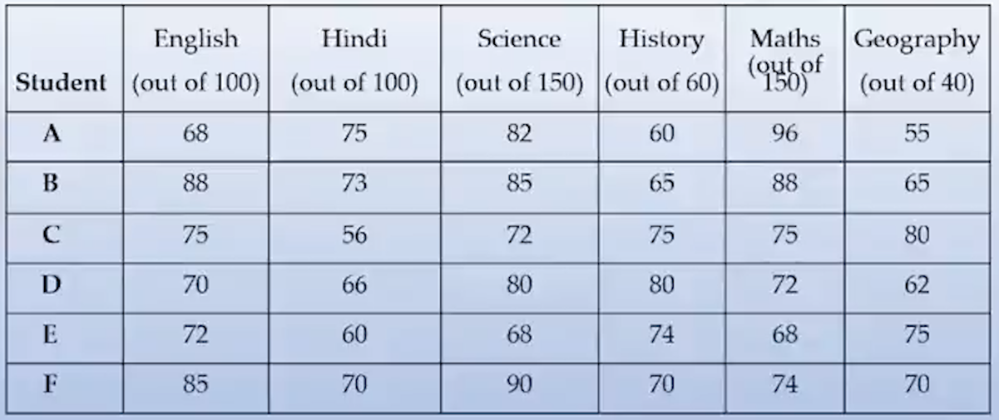
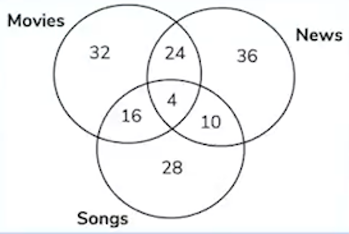
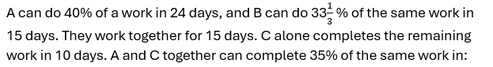
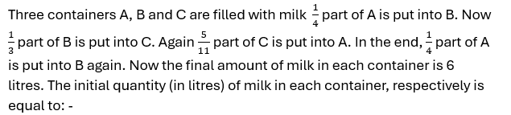
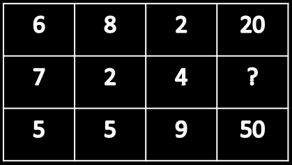

# 📝 Aptitude 02 - All India Mock

- **Engine:** Testbook SDK
- **Folder:** `Infosys Mock Test Series / Day 09 / 4. Full Length Mock IV Based on Infosys PYQ`
- **Total Questions:** 50
- **Total Marks:** 52
- **Duration:** 45.0 Minutes
- **Test ID:** `68c46848de9ec8240386f790`

---

## 🔹 Section: Quantitative aptitude

### Q1. (+1 / -0)

Percentage of Marks obtained by various students in various subjects in an Examination. Q. The marks obtained by E in Geography are what percentage of the marks of the marks obtained by E in Hindi?

**Options:**
- **[1]** 45
- **[2]** 55
- **[3]** 50 ✅ **[CORRECT]**
- **[4]** 60
- **[5]** None of these

---

### Q2. (+1 / -0)

Percentage of Marks obtained by various students in various subjects in an Examination. Q. What are the average marks obtained by all the students together in science?

**Options:**
- **[1]** 77.16
- **[2]** 120.50
- **[3]** 118
- **[4]** 121
- **[5]** None of these ✅ **[CORRECT]**

---

### Q3. (+1 / -0)

Q. In a survey conducted among 120 houses, it was found that 50 read Times of India, 60 read Indian Express and 48 read Hindustan Times; 20 read Times of India and Indian Express, 18 read Times of India and Hindustan. Times and 24 read Indian Express and Hindustan Times. If 10 read all three, how many read only one newspaper?

**Options:**
- **[1]** 61
- **[2]** 62
- **[3]** 63
- **[4]** 64 ✅ **[CORRECT]**

---

### Q4. (+1 / -0)

Directions for questions: Consider the Venn diagram TCS NQT given below. Q. The number in the Venn diagram indicates the number of persons/ people watching TV programmes. The diagram is drawn after surveying 150 persons in a population of 12,000. How many persons/ people can be expected to watch at least two TV programmes?

**Options:**
- **[1]** 4320 ✅ **[CORRECT]**
- **[2]** 4450
- **[3]** 4800
- **[4]** 4960

---

### Q5. (+1 / -0)

The ratio of the age of Ram and Rahim 10 years ago was 1 : 3. The ratio of their age five years hence will be 2 : 3. Then the ratio of their present age is

**Options:**
- **[1]** 1 : 2
- **[2]** 3 : 5 ✅ **[CORRECT]**
- **[3]** 3 : 4
- **[4]** 2 : 5

---

### Q6. (+1 / -0)

Find the missing number in the given seriese. 12, 12, 18, 45, 180, 1170, ?

**Options:**
- **[1]** 12285 ✅ **[CORRECT]**
- **[2]** 10530
- **[3]** 11700
- **[4]** 12870
- **[5]** 9945

---

### Q7. (+2 / -0)

A contractor agreed to construct a 6 km road in 200 days. He employed 140 persons for the work. After 60 days, he realized that only 1.5 km road has been completed. How many additional people would he need to employ to finish the work exactly on time?

**Options:**
- **[1]** 40

---

### Q8. (+2 / -0)

Note : Ans in days

**Options:**
- **[1]** 6

---

### Q9. (+1 / -0)

**Options:**
- **[1]** 4,5,9 ✅ **[CORRECT]**
- **[2]** 3,7,8
- **[3]** 3,6,9
- **[4]** 4,7,7

---

### Q10. (+1 / -0)

A shopkeeper earns a profit of 20% by selling an article by giving 25% discount on its marked price. If the cost price of the article increases by 10%, then how much discount percent should he give now on the same marked price to earn the same percentage of profit as earlier?

**Options:**
- **[1]** 17.5% ✅ **[CORRECT]**
- **[2]** 16.5%
- **[3]** 18%
- **[4]** 15%

---

### Q11. (+1 / -0.25)

If A =x% of y and B =y%of x, then which of the following is true?

**Options:**
- **[1]** A is equal to B ✅ **[CORRECT]**
- **[2]** A is smaller than B.
- **[3]** A relationship between A and B cannot be determined.
- **[4]** If x is greater than y, then A is less than B.

---

### Q12. (+1 / -0.25)

A vendor bought mangoes at 6 for a rupee. How many for a rupee must he sell to gain 20%?

**Options:**
- **[1]** 3
- **[2]** 6
- **[3]** 4
- **[4]** 5 ✅ **[CORRECT]**

---

### Q13. (+1 / -0.25)

How many 3-letter words with or without meaning, can be formed out of the letters of the word, 'ADVERTISING', if repetition of letters is not allowed?

**Options:**
- **[1]** 720 ✅ **[CORRECT]**
- **[2]** 420
- **[3]** 5040
- **[4]** None of these

---

### Q14. (+1 / -0.25)

Seats for Mathematics, Physics and Biology in a school are in the ratio 5 :7 :8. There is a proposal to increase these seats by 40%, 50% and 75% respectively. What will be the ratio of increased seats?

**Options:**
- **[1]** 2 : 3 : 4 ✅ **[CORRECT]**
- **[2]** 6 : 7 : 8
- **[3]** 6 : 8 : 9
- **[4]** 7 : 6 : 9

---

## 🔹 Section: Logical Reasoning

### Q15. (+1 / -0)

Pointing to a woman in a photograph a man says, "She is the only daughter of my wife's mother-in-law." How is the woman related to the man?

**Options:**
- **[1]** Daughter
- **[2]** Wife
- **[3]** Sister ✅ **[CORRECT]**
- **[4]** Sister-in-law

---

### Q16. (+1 / -0)

In a certain code language 'ROAD' is written as '152' and 'MAP' is written as '90'. How 'RAIL' be coded in the similar code language?

**Options:**
- **[1]** 120
- **[2]** 140
- **[3]** 180
- **[4]** 160 ✅ **[CORRECT]**

---

### Q17. (+1 / -0)

If A + B means A is the sister of B; A x B means A is the wife of B, A % B means A is the father of B and A - B means A is the brother of B. Which of the following means T is the daughter of P?

**Options:**
- **[1]** P x Q % R + S &ndash; T
- **[2]** P x Q % R - T + S ✅ **[CORRECT]**
- **[3]** P x Q % R + T &ndash; S
- **[4]** P x Q % R + S + T

---

### Q18. (+1 / -0)

Viraj is eleventh from the left end in a row of children. Pankaj is twelfth from the right end and seventeenth form the left end. How many children are towards the right of Viraj in that row?

**Options:**
- **[1]** 16
- **[2]** 18
- **[3]** 17 ✅ **[CORRECT]**
- **[4]** None of these

---

### Q19. (+1 / -0)

Statement: The Government has made an appeal to all the citizens to honestly pay income tax and file returns reflecting the true income level to help the Government to carry out developmental activities. Assumptions: I. More people may now start paying taxes in response to the appeal. II. The total income tax collection may considerably increase in the near future.

**Options:**
- **[1]** Only I is implicit
- **[2]** Only II is implicit
- **[3]** Both I and II are implicit ✅ **[CORRECT]**
- **[4]** Neither I nor II are implicit

---

### Q20. (+1 / -0)

Each of the six friends - A, B. C. D, E and F - scored different marks in an examination. C scored more only A and E. D scored less than only B. E did not score the least. The one who scored the third highest marks scored 81 marks. E scored 62 marks. Which of the following could possibly be C's core?

**Options:**
- **[1]** 70 ✅ **[CORRECT]**
- **[2]** 94
- **[3]** 86
- **[4]** 61

---

### Q21. (+1 / -0)

Select the letter/letters that can replace the question mark (?) in the following series. Z, U, Q, ?, L

**Options:**
- **[1]** N ✅ **[CORRECT]**
- **[2]** M
- **[3]** K
- **[4]** I

---

### Q22. (+1 / -0)

Statement : In a one day cricket match, the total runs made by a team were 200. Out of these 160 runs were made by spinners. Conclusions : I. 80% of the team consists of spinners. II. The opening batsman were spinners.

**Options:**
- **[1]** Only I is implicit
- **[2]** Only II is implicit
- **[3]** Both I and II are implicit
- **[4]** Neither I nor II are implicit ✅ **[CORRECT]**

---

### Q23. (+1 / -0)

Statement: A major retail store announced thirty percent reduction on all food items during the weekend. Assumption: I. People may still prefer buying food items from other stores. II. A large number of customers may visit the retail store and buy food items.

**Options:**
- **[1]** Only I is implicit
- **[2]** Only II is implicit ✅ **[CORRECT]**
- **[3]** Both I and II are implicit
- **[4]** Neither I nor II are implicit

---

### Q24. (+1 / -0)

In a certain code, '786' means 'study very hard', '958' means 'hard work pays' and '645' means 'study and work'. Which of the following is the code 'very'?

**Options:**
- **[1]** 8
- **[2]** 6
- **[3]** 7 ✅ **[CORRECT]**
- **[4]** Cannot be determined

---

### Q25. (+1 / -0)

In the following question, select the number which can be placed at the sign of question mark (?) from the given alternatives.

**Options:**
- **[1]** 42
- **[2]** 26
- **[3]** 30 ✅ **[CORRECT]**
- **[4]** 36

---

### Q26. (+1 / -0)

Statements: Some books are tables. Some tables are mirrors. Conclusions: I. Some mirrors are books. II. No book is mirror.

**Options:**
- **[1]** If only conclusion I follows
- **[2]** If only conclusion II follows
- **[3]** If either conclusion I or II follows ✅ **[CORRECT]**
- **[4]** If neither conclusion I nor II follows

---

### Q27. (+1 / -0)

Directions: In the following question, select the related letters from the given alternatives. CLDR : YIBQ :: STOP : ?

**Options:**
- **[1]** PROM
- **[2]** OQMO ✅ **[CORRECT]**
- **[3]** PQNO
- **[4]** ORMO

---

### Q28. (+1 / -0)

Statements: All fruits are lions. All lions are foxes. Some foxes are elephants. Conclusions: I. All fruits are foxes. II. Some fruits are elephants.

**Options:**
- **[1]** If only conclusion I follows ✅ **[CORRECT]**
- **[2]** If only conclusion II follows
- **[3]** If either conclusion I or II follows
- **[4]** If neither conclusion I nor II follows

---

### Q29. (+1 / -0)

Directions: In the following question, select the related word from the given alternatives. Square : Cube :: Circle : ?

**Options:**
- **[1]** Sphere ✅ **[CORRECT]**
- **[2]** Circumference
- **[3]** Diameter
- **[4]** Area

---

### Q30. (+1 / -0)

A, B, C, D, E, F & G are sitting in line facing the East. C is immediate right of D. B is at an extreme end and has E as his neighbour. G is between E and F. D is sitting third from the South end. Who are the persons sitting at the extreme ends?

**Options:**
- **[1]** A & E
- **[2]** A & B ✅ **[CORRECT]**
- **[3]** F & B
- **[4]** C & D

---

### Q31. (+1 / -0)

Statements: Some flats are apartments. No apartment is a hall Some halls are rooms Conclusions: I. Atleast some rooms are flats. II. No apartment is room.

**Options:**
- **[1]** If only conclusion I follows
- **[2]** If only conclusion II follows
- **[3]** If either conclusion I or II follows
- **[4]** If neither conclusion I nor II follows ✅ **[CORRECT]**

---

### Q32. (+1 / -0)

Statement: The sale of a particular product has gone down considerably causing great concern to the company. Courses of action: I. The company should make a proper study of rival products in the market. II. The price of the product should be reduced and quality improved.

**Options:**
- **[1]** Only I is implicit ✅ **[CORRECT]**
- **[2]** Only II is implicit
- **[3]** Both I and II are implicit
- **[4]** Neither I nor II are implicit

---

## 🔹 Section: Verbal Ability

### Q33. (+1 / -0)

They don&rsquo;t have any _______ to spend on luxuries

**Options:**
- **[1]** Time
- **[2]** Balance
- **[3]** Money ✅ **[CORRECT]**
- **[4]** Ideas

---

### Q34. (+1 / -0)

They all laughed as they realized that although they had gone off in different directions from working at home to managing companies they were experiencing _______ feeling

**Options:**
- **[1]** Jubilant ✅ **[CORRECT]**
- **[2]** Remorseful
- **[3]** Similar
- **[4]** Strange

---

### Q35. (+1 / -0)

DIRECTIONS: Identify the part which contains an error. Mark that part as your answer. Exercise I enjoy doing are (a)/ running marathons, swimming lengths in a pool, (b)/ riding my bicycle in the park (c)/ and walked along the trails in a trail. (d)/

**Options:**
- **[1]** Part a
- **[2]** Part b
- **[3]** Part c
- **[4]** Part d ✅ **[CORRECT]**

---

### Q36. (+1 / -0)

To my horror, (a)/ my wedding dress looked (b)/ strain, torn (c)/ and wrinkled (d)/

**Options:**
- **[1]** Part a
- **[2]** Part b
- **[3]** Part c ✅ **[CORRECT]**
- **[4]** Part d

---

### Q37. (+1 / -0)

Ram had (a)/ invited few (b)/ friends in the (c)/ party at his lawn (d)/

**Options:**
- **[1]** Part a
- **[2]** Part b ✅ **[CORRECT]**
- **[3]** Part c
- **[4]** Part d

---

### Q38. (+1 / -0)

The population density of (a)/ china is (b)/ greater (c)/ than America (d)/

**Options:**
- **[1]** Part a
- **[2]** Part b
- **[3]** Part c
- **[4]** Part d ✅ **[CORRECT]**

---

### Q39. (+1 / -0)

In each of the questions given below four words are given in bold. These words may or may not be in their correct position. Following each sentence four sequences are provided. Select the sequence of the words which will make the given sentence contextually meaningful. If the words are correct at their current position, then choose option (e) as your answer. India has an advantage (A), as a large origin (B) of semiconductor design engineers globally (C) are either Indian or Indian- portion (D).

**Options:**
- **[1]** DCBA
- **[2]** BADC
- **[3]** ADCB ✅ **[CORRECT]**
- **[4]** CADB
- **[5]** No interchange required

---

### Q40. (+1 / -0)

In each of the questions given below four words are given in bold. These words may or may not be in their correct position. Following each sentence four sequences are provided. Select the sequence of the words which will make the given sentence contextually meaningful. If the words are correct at their current position, then choose option (e) as your answer. Pollution has badly native (A) the fish harvest and has destroyed (B) the breeding grounds (C) of the affected (D) fish.

**Options:**
- **[1]** ABDC
- **[2]** CBAD
- **[3]** DBCA ✅ **[CORRECT]**
- **[4]** BDAC
- **[5]** No interchange required

---

### Q41. (+1 / -0)

Directions (11-15): Read each sentence to find out whether there is any grammatical or idiomatic error in it. The error, if any, will be in one part of the sentence. The number of that part is the answer. If there is &lsquo;No error&rsquo;, the answer is (e). (Ignore errors of punctuation, if any.) In spite of our several request (A)/ the owner of the house (B)/did not open (C)/the door of his house. (D)/No Error (E)

**Options:**
- **[1]** A ✅ **[CORRECT]**
- **[2]** B
- **[3]** C
- **[4]** D
- **[5]** E

---

### Q42. (+1 / -0)

Directions : In each of the question given below a/an idiom/phrase is given in bold which is then followed by five options which then try to decipher its meaning. Choose the option which gives the correct meaning of the phrases Larger than life

**Options:**
- **[1]** to be cruel
- **[2]** to be haughty
- **[3]** to be impressive and important ✅ **[CORRECT]**
- **[4]** to be disrespectful
- **[5]** to be happy

---

### Q43. (+1 / -0)

He was very tired as he is working since 6 O' clock in the morning.

**Options:**
- **[1]** he was working
- **[2]** he had been working
- **[3]** he has been working ✅ **[CORRECT]**
- **[4]** he will be working

---

### Q44. (+1 / -0)

Directions : out of the four alternatives, choose the one which best expresses the meaning of the given word. Our posterity shall hold us responsible for the devastation of Ozone layer.

**Options:**
- **[1]** predecessors
- **[2]** successors ✅ **[CORRECT]**
- **[3]** offsprings
- **[4]** followers

---

### Q45. (+1 / -0)

Directions : ,out of the four alternatives, choose the one which best expresses the meaning of the given word. The ambition of being an IAS is subdued by the poverty within.

**Options:**
- **[1]** modified
- **[2]** challenged
- **[3]** affected
- **[4]** diluted ✅ **[CORRECT]**

---

### Q46. (+1 / -0)

Direction: In Question a sentence/ a part of the sentence is italicised in bold. Below are given alternatives to the italicised part at (A), (B), (C) which may improve the sentence. Choose the correct alternative. In case no improvement is needed your answer is (D). Mark your answer in the Answer Sheet. Q. Ashutosh singh's new book 'Hopes for no brains' land' is an unique book i have ever read.

**Options:**
- **[1]** the most unique
- **[2]** a mostly unique
- **[3]** a unique ✅ **[CORRECT]**
- **[4]** No improvement

---

### Q47. (+1 / -0)

Direction : In these question you have two brief passages with six questions following the passage. Read the passage carefully and choose the best answer to each question out of the four alternatives. Passage &ndash; 1 Education, as Mahatma Gandhi described it, "is the tool for the development of consciousness and reconstitution of society". Since Independence, India has stressed reforming and restructuring the educational system as part of state intervention. The National Policy on Education (NPE), 1986, which is hailed as a landmark in the Indian educational system, provided a comprehensive framework to guide the development of education in the country. The NPE and its Programme of Action was again updated in 1992 through similar consensual process involving all the State governments, resource organisations and educationists. What has been worrying the critics and educationists alike is the non- fulfilment of one of the NPE objectives: education of girl. It has been stated in the NPE that the 'Education For All' meet should have a strong gender focus as Education For All by definition is gender inclusive. . The National Policy on Education provided

**Options:**
- **[1]** guidelines for the comprehension of education in the country
- **[2]** guidance material to develop education in the country
- **[3]** a comprehensive plan for the development of education in the country ✅ **[CORRECT]**
- **[4]** comprehensive development of education in the country

---

### Q48. (+1 / -0)

Direction In these question you have two brief passages with six questions following the passage. Read the passage carefully and choose the best answer to each question out of the four alternatives. Passage &ndash; 1 Education, as Mahatma Gandhi described it, "is the tool for the development of consciousness and reconstitution of society". Since Independence, India has stressed reforming and restructuring the educational system as part of state intervention. The National Policy on Education (NPE), 1986, which is hailed as a landmark in the Indian educational system, provided a comprehensive framework to guide the development of education in the country. The NPE and its Programme of Action was again updated in 1992 through similar consensual process involving all the State governments, resource organisations and educationists. What has been worrying the critics and educationists alike is the non- fulfilment of one of the NPE objectives: education of girl. It has been stated in the NPE that the 'Education For All' meet should have a strong gender focus as Education For All by definition is gender inclusive. According to the passage, critics and educationists are worried that

**Options:**
- **[1]** the education of girls is one of the objectives of NPE.
- **[2]** the objectives of NPE have not been fulfilled.
- **[3]** non-fulfilment of NPE leads to the education of girls.
- **[4]** one of the objectives of NPE has not been fulfilled. ✅ **[CORRECT]**

---

### Q49. (+1 / -0)

Direction In these question you have two brief passages with six questions following the passage. Read the passage carefully and choose the best answer to each question out of the four alternatives. Passage &ndash; 1 Education, as Mahatma Gandhi described it, "is the tool for the development of consciousness and reconstitution of society". Since Independence, India has stressed reforming and restructuring the educational system as part of state intervention. The National Policy on Education (NPE), 1986, which is hailed as a landmark in the Indian educational system, provided a comprehensive framework to guide the development of education in the country. The NPE and its Programme of Action was again updated in 1992 through similar consensual process involving all the State governments, resource organisations and educationists. What has been worrying the critics and educationists alike is the non- fulfilment of one of the NPE objectives: education of girl. It has been stated in the NPE that the 'Education For All' meet should have a strong gender focus as Education For All by definition is gender inclusive. According to the passage, 'a strong gender focus' means

**Options:**
- **[1]** a focus on the strength of gender
- **[2]** a focus on strong gender
- **[3]** a strong focus on gender bias ✅ **[CORRECT]**
- **[4]** a focus on male-female ratio

---

### Q50. (+1 / -0)

Direction In these question you have two brief passages with six questions following the passage. Read the passage carefully and choose the best answer to each question out of the four alternatives. Passage &ndash; 1 Education, as Mahatma Gandhi described it, "is the tool for the development of consciousness and reconstitution of society". Since Independence, India has stressed reforming and restructuring the educational system as part of state intervention. The National Policy on Education (NPE), 1986, which is hailed as a landmark in the Indian educational system, provided a comprehensive framework to guide the development of education in the country. The NPE and its Programme of Action was again updated in 1992 through similar consensual process involving all the State governments, resource organisations and educationists. What has been worrying the critics and educationists alike is the non- fulfilment of one of the NPE objectives: education of girl. It has been stated in the NPE that the 'Education For All' meet should have a strong gender focus as Education For All by definition is gender inclusive. . In the passage, the author makes a plea for

**Options:**
- **[1]** free education
- **[2]** universal education
- **[3]** the education of men
- **[4]** the education of women ✅ **[CORRECT]**

---

