# Infosys Mock Test Series — Topic 1: Logical Reasoning & Analytical Thinking

> **Questions Count**: 124 | **Target Role**: Infosys System Engineer (SE)
> **Official Syllabus Coverage**: Series & Analogies, Coding-Decoding, Blood Relations, Seating Arrangement, Syllogisms, Direction Sense, Analytical Deduction

## Topic Overview & Problem Set
This master compendium compiles all 124 solved questions for Logical Reasoning & Analytical Thinking sourced across Days 01 through 09 and full-length PYQ mocks.

---

### Question 1 (Mock Global Q001)
**ID**: `MOCK_SERIES_Q001` | **Mock Source**: Day 01 — 1. Full Length Logical Reasoning Mock ( Video Sol)

#### Problem Statement
Statements: Some pianos are violins. Some violins are drums. All drums are guitars. No guitar is a flute. Conclusions: I. Some guitars are pianos. II. Some drums are flutes. III.Some pianos are drums. IV. No flute is a drum.

#### Options
- **(A)** None follows
- **(B)** Only I follows
- **(C)** Only either II or IV follows
- **(D)** Only IV follows
- **(E)** None of these

#### Verified Answer
**Option D: Only IV follows**

#### Step-by-Step Solution & Rationale
Correct Answer: Option D: Only IV follows. Solved following standard Infosys System Engineer evaluation criteria.

**Official Video Solution Link**: [https://www.youtube.com/embed/BQSBHRsI8c8](https://www.youtube.com/embed/BQSBHRsI8c8)

---

### Question 2 (Mock Global Q002)
**ID**: `MOCK_SERIES_Q002` | **Mock Source**: Day 01 — 1. Full Length Logical Reasoning Mock ( Video Sol)

#### Problem Statement
Statements: All cups are glasses. Some glasses are bowls. No bowl is a plate. Conclusions: I. No cup is plate. II. No glass is a plate. III. Some plates are bowls. IV. Some cups are not glasses.

#### Options
- **(A)** None follows
- **(B)** Only II follows
- **(C)** Only II or III follows
- **(D)** Only III follows
- **(E)** None of these

#### Verified Answer
**Option A: None follows**

#### Step-by-Step Solution & Rationale
Correct Answer: Option A: None follows. Solved following standard Infosys System Engineer evaluation criteria.

**Official Video Solution Link**: [https://www.youtube.com/embed/bp5XF26v9_A](https://www.youtube.com/embed/bp5XF26v9_A)

---

### Question 3 (Mock Global Q003)
**ID**: `MOCK_SERIES_Q003` | **Mock Source**: Day 01 — 1. Full Length Logical Reasoning Mock ( Video Sol)

#### Problem Statement
Given below is a question and a set of statements. We have to find which of the given statements is required to reach the conclusion. Question : Point Y is in which direction with respect to point X? Statement I Point A is east of point B and north of point X. Point Y is north-west of point A. Statement II II. Point X is east of point B and north of point A. Point Y is north of point A.

#### Options
- **(A)** the data in statement II alone are sufficient to answer the question, while the data in statement I alone are not sufficient to answer the question.
- **(B)** the data either in statement I alone or in statement II alone are sufficient to answer the question.
- **(C)** the data in both statement I and II together are not sufficient to answer the question.
- **(D)** the data in both statement I and II together are necessary to answer the question.
- **(E)** the data in statement I alone is sufficient to answer the question, while the data in statement II alone is not sufficient to answer the question.

#### Verified Answer
**Option E: the data in statement I alone is sufficient to answer the question, while the data in statement II alone is not sufficient to answer the question.**

#### Step-by-Step Solution & Rationale
Correct Answer: Option E: the data in statement I alone is sufficient to answer the question, while the data in statement II alone is not sufficient to answer the question.. Solved following standard Infosys System Engineer evaluation criteria.

**Official Video Solution Link**: [https://www.youtube.com/embed/CzWcjP00KW0](https://www.youtube.com/embed/CzWcjP00KW0)

---

### Question 4 (Mock Global Q004)
**ID**: `MOCK_SERIES_Q004` | **Mock Source**: Day 01 — 1. Full Length Logical Reasoning Mock ( Video Sol)

#### Problem Statement
Six Students ( A,B,C,D,E,and F ) are sitting in a row facing north . At least two people are sitting on both the sides of B and C . A and F are at the ends . D is sitting to the immediate right of F . Who is sitting immediate left of A ?

#### Options
- **(A)** C
- **(B)** B
- **(C)** D
- **(D)** E

#### Verified Answer
**Option D: E**

#### Step-by-Step Solution & Rationale
Correct Answer: Option D: E. Solved following standard Infosys System Engineer evaluation criteria.

**Official Video Solution Link**: [https://www.youtube.com/embed/LiEb4uTB59w](https://www.youtube.com/embed/LiEb4uTB59w)

---

### Question 5 (Mock Global Q005)
**ID**: `MOCK_SERIES_Q005` | **Mock Source**: Day 01 — 1. Full Length Logical Reasoning Mock ( Video Sol)

#### Problem Statement
Read the following information carefully and answer the given questions. There are eight people in a family, all of them are going for vacation. There are two married couple in the family. C is the mother of B. E is the daughter of A who is the sister of F. C is the only sister of G. H is father of C. D is the mother of C. A is the wife of G. Question : Who among the following is grandfather of E?

#### Options
- **(A)** B
- **(B)** G
- **(C)** C
- **(D)** H
- **(E)** None of these

#### Verified Answer
**Option D: H**

#### Step-by-Step Solution & Rationale
Correct Answer: Option D: H. Solved following standard Infosys System Engineer evaluation criteria.

**Official Video Solution Link**: [https://www.youtube.com/embed/i2AHEPjY31E](https://www.youtube.com/embed/i2AHEPjY31E)

---

### Question 6 (Mock Global Q006)
**ID**: `MOCK_SERIES_Q006` | **Mock Source**: Day 01 — 1. Full Length Logical Reasoning Mock ( Video Sol)

#### Problem Statement
Read the following information carefully and answer the given questions. There are eight people in a family, all of them are going for vacation. There are two married couple in the family. C is the mother of B. E is the daughter of A who is the sister of F. C is the only sister of G. H is father of C. D is the mother of C. A is the wife of G. Q. How F is related to G?

#### Options
- **(A)** Mother
- **(B)** Son
- **(C)** Brother in law
- **(D)** Cannot be determine

#### Verified Answer
**Option D: Cannot be determine**

#### Step-by-Step Solution & Rationale
Correct Answer: Option D: Cannot be determine. Solved following standard Infosys System Engineer evaluation criteria.

**Official Video Solution Link**: [https://www.youtube.com/embed/i2AHEPjY31E](https://www.youtube.com/embed/i2AHEPjY31E)

---

### Question 7 (Mock Global Q007)
**ID**: `MOCK_SERIES_Q007` | **Mock Source**: Day 01 — 1. Full Length Logical Reasoning Mock ( Video Sol)

#### Problem Statement
In the following questions find out the alternative which will replace the question mark. 58 : 319 :: 32 : 176 :: 76 : ?

#### Options
- **(A)** 442
- **(B)** 286
- **(C)** 428
- **(D)** 418

#### Verified Answer
**Option D: 418**

#### Step-by-Step Solution & Rationale
Correct Answer: Option D: 418. Solved following standard Infosys System Engineer evaluation criteria.

**Official Video Solution Link**: [https://www.youtube.com/embed/EBBoqFqS2W0](https://www.youtube.com/embed/EBBoqFqS2W0)

---

### Question 8 (Mock Global Q008)
**ID**: `MOCK_SERIES_Q008` | **Mock Source**: Day 01 — 1. Full Length Logical Reasoning Mock ( Video Sol)

#### Problem Statement
Identify the figure given in the options which when put in place of (?) will logically complete the series.

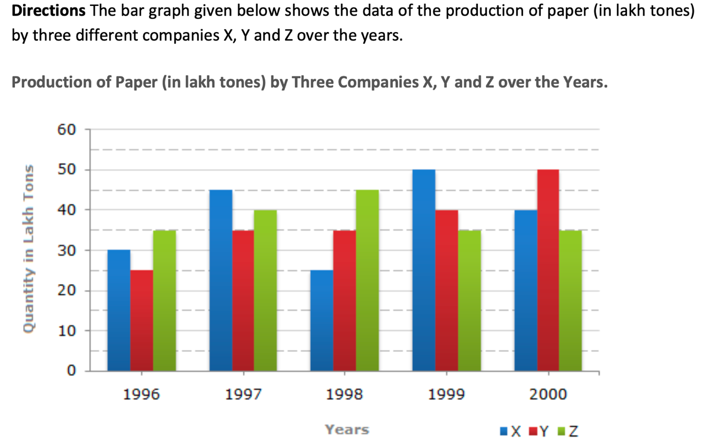

#### Options
- **(A)** Option (A) — Refer to Figure Option A
- **(B)** Option (B) — Refer to Figure Option B
- **(C)** Option (C) — Refer to Figure Option C
- **(D)** Option (D) — Refer to Figure Option D

#### Verified Answer
**Option A: Option (A) — Refer to Figure Option A**

#### Step-by-Step Solution & Rationale
Correct Answer: Option A: Option (A) — Refer to Figure Option A. Solved following standard Infosys System Engineer evaluation criteria.

**Official Video Solution Link**: [https://www.youtube.com/embed/frh-jmOvnAw](https://www.youtube.com/embed/frh-jmOvnAw)

---

### Question 9 (Mock Global Q009)
**ID**: `MOCK_SERIES_Q009` | **Mock Source**: Day 01 — 1. Full Length Logical Reasoning Mock ( Video Sol)

#### Problem Statement
Statement All P are G Some G are B All B are C Conclusion: (1) All P being C is a possibility (2) Some P are B. (3) Some C are G. (4) Some G are P.

#### Options
- **(A)** Only 1 does not follow
- **(B)** Only 2 does not follow
- **(C)** Only 3 does not follow
- **(D)** Only 4 does not follow

#### Verified Answer
**Option B: Only 2 does not follow**

#### Step-by-Step Solution & Rationale
Correct Answer: Option B: Only 2 does not follow. Solved following standard Infosys System Engineer evaluation criteria.

**Official Video Solution Link**: [https://www.youtube.com/embed/ZO5EjLBCobY](https://www.youtube.com/embed/ZO5EjLBCobY)

---

### Question 10 (Mock Global Q010)
**ID**: `MOCK_SERIES_Q010` | **Mock Source**: Day 01 — 1. Full Length Logical Reasoning Mock ( Video Sol)

#### Problem Statement
In a given figure of open dice. Which dice we can make?

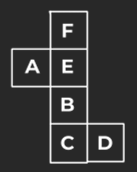

#### Options
- **(A)** Option (A) — Refer to Figure Option A
- **(B)** Option (B) — Refer to Figure Option B
- **(C)** Option (C) — Refer to Figure Option C
- **(D)** Option (D) — Refer to Figure Option D

#### Verified Answer
**Option B: Option (B) — Refer to Figure Option B**

#### Step-by-Step Solution & Rationale
Correct Answer: Option B: Option (B) — Refer to Figure Option B. Solved following standard Infosys System Engineer evaluation criteria.

**Official Video Solution Link**: [https://www.youtube.com/embed/izolyj4er84](https://www.youtube.com/embed/izolyj4er84)

---

### Question 11 (Mock Global Q011)
**ID**: `MOCK_SERIES_Q011` | **Mock Source**: Day 01 — 1. Full Length Logical Reasoning Mock ( Video Sol)

#### Problem Statement
[Visual Reasoning Pattern Problem — Refer to Diagram Below] Analyze the sequence, shape transformations, or spatial pattern in the figure and determine the correct next element.

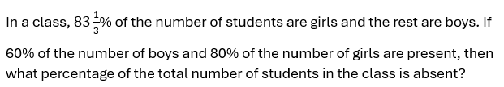

#### Options
- **(A)** Option (A) — Refer to Figure Option A
- **(B)** Option (B) — Refer to Figure Option B
- **(C)** Option (C) — Refer to Figure Option C
- **(D)** Option (D) — Refer to Figure Option D

#### Verified Answer
**Option C: Option (C) — Refer to Figure Option C**

#### Step-by-Step Solution & Rationale
Correct Answer: Option C: Option (C) — Refer to Figure Option C. Solved following standard Infosys System Engineer evaluation criteria.

**Official Video Solution Link**: [https://www.youtube.com/embed/nyG7_YJ0iIY](https://www.youtube.com/embed/nyG7_YJ0iIY)

---

### Question 12 (Mock Global Q012)
**ID**: `MOCK_SERIES_Q012` | **Mock Source**: Day 01 — 1. Full Length Logical Reasoning Mock ( Video Sol)

#### Problem Statement
Choose the correct mirror image which closely resembles the mirror image of the given image.

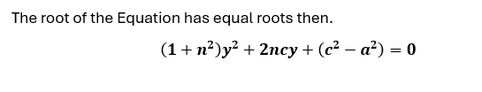

#### Options
- **(A)** Option (A) — Refer to Figure Option A
- **(B)** Option (B) — Refer to Figure Option B
- **(C)** Option (C) — Refer to Figure Option C
- **(D)** Option (D) — Refer to Figure Option D

#### Verified Answer
**Option D: Option (D) — Refer to Figure Option D**

#### Step-by-Step Solution & Rationale
Correct Answer: Option D: Option (D) — Refer to Figure Option D. Solved following standard Infosys System Engineer evaluation criteria.

**Official Video Solution Link**: [https://www.youtube.com/embed/F4qCPvGTx20](https://www.youtube.com/embed/F4qCPvGTx20)

---

### Question 13 (Mock Global Q013)
**ID**: `MOCK_SERIES_Q013` | **Mock Source**: Day 01 — 1. Full Length Logical Reasoning Mock ( Video Sol)

#### Problem Statement
In each question below is given a statement followed by three courses of action numbered I and II and II I. You have to assume everything in the statement to be true and on the basis of the information given in the statement, decide which of the suggested courses of action logically follow(s) Statement: India's pre-eminent position in the world black pepper production and trade is in danger as some of the countries, which recently started production of the 'king of the spices' crop from Indian root stocks, are farming better by adopting modern cultivation practices. Courses of action: I. India should immediately stop supplying root stocks of black pepper to other countries. II. India should adopt modern technology for cultivating black pepper to complete in the International market. III. India should reduce the price of its black pepper to remain competitive in the world market.

#### Options
- **(A)** II and I II follow
- **(B)** Only II I Follow
- **(C)** Only II follows
- **(D)** Only I follows
- **(E)** All follow

#### Verified Answer
**Option C: Only II follows**

#### Step-by-Step Solution & Rationale
Correct Answer: Option C: Only II follows. Solved following standard Infosys System Engineer evaluation criteria.

**Official Video Solution Link**: [https://www.youtube.com/embed/Hkf82wxE7yQ](https://www.youtube.com/embed/Hkf82wxE7yQ)

---

### Question 14 (Mock Global Q014)
**ID**: `MOCK_SERIES_Q014` | **Mock Source**: Day 01 — 1. Full Length Logical Reasoning Mock ( Video Sol)

#### Problem Statement
In a certain code language, 'CARD' is coded as'7359&rsquo;, 'SERV' is coded as '1256' and 'PACK' is coded as '8497&rsquo;. What is the code for 'D' in the given code language?

#### Options
- **(A)** 3

#### Verified Answer
**Numerical Value: 3**

#### Step-by-Step Solution & Rationale
Correct Answer: Numerical Value: 3. Solved following standard Infosys System Engineer evaluation criteria.

**Official Video Solution Link**: [https://www.youtube.com/embed/khyQcSbkPsY](https://www.youtube.com/embed/khyQcSbkPsY)

---

### Question 15 (Mock Global Q015)
**ID**: `MOCK_SERIES_Q015` | **Mock Source**: Day 01 — 1. Full Length Logical Reasoning Mock ( Video Sol)

#### Problem Statement
Find the missing series : 742 2073 345 2542 ? 3173

#### Options
- **(A)** 202
- **(B)** -202
- **(C)** -201
- **(D)** 201

#### Verified Answer
**Option B: -202**

#### Step-by-Step Solution & Rationale
Correct Answer: Option B: -202. Solved following standard Infosys System Engineer evaluation criteria.

**Official Video Solution Link**: [https://www.youtube.com/embed/zvhpW4nC1mA](https://www.youtube.com/embed/zvhpW4nC1mA)

---

### Question 16 (Mock Global Q016)
**ID**: `MOCK_SERIES_Q016` | **Mock Source**: Day 01 — 1. Full Length Logical Reasoning Mock ( Video Sol)

#### Problem Statement
Find the missing series : 16 17 21 ? 304 3429

#### Options
- **(A)** 44
- **(B)** 48
- **(C)** 30
- **(D)** 58

#### Verified Answer
**Option B: 48**

#### Step-by-Step Solution & Rationale
Correct Answer: Option B: 48. Solved following standard Infosys System Engineer evaluation criteria.

**Official Video Solution Link**: [https://www.youtube.com/embed/4stQPaj1iGU](https://www.youtube.com/embed/4stQPaj1iGU)

---

### Question 17 (Mock Global Q017)
**ID**: `MOCK_SERIES_Q017` | **Mock Source**: Day 01 — 1. Full Length Logical Reasoning Mock ( Video Sol)

#### Problem Statement
Study the following arrangement carefully and answer the questions given below: N 4 7 T U J K 3 % F @ &copy; L N 5 P 1 8 U $ E 2 D C 6 # 9 Z Q 8 Y * M A Which of the following is sixth to the left of the fifteenth from the left end of the given arrangement?

#### Options
- **(A)** 2
- **(B)** #
- **(C)** %
- **(D)** $
- **(E)** None of these.

#### Verified Answer
**Option C: %**

#### Step-by-Step Solution & Rationale
Correct Answer: Option C: %. Solved following standard Infosys System Engineer evaluation criteria.

**Official Video Solution Link**: [https://www.youtube.com/embed/qkLXyWsxduQ](https://www.youtube.com/embed/qkLXyWsxduQ)

---

### Question 18 (Mock Global Q018)
**ID**: `MOCK_SERIES_Q018` | **Mock Source**: Day 01 — 1. Full Length Logical Reasoning Mock ( Video Sol)

#### Problem Statement
Four letter-clusters have been given, out of which three are alike in some manner and one is different. Select the letter-cluster that is different

#### Options
- **(A)** BDGT
- **(B)** TVYB
- **(C)** LNQJ
- **(D)** HJMP

#### Verified Answer
**Option D: HJMP**

#### Step-by-Step Solution & Rationale
Correct Answer: Option D: HJMP. Solved following standard Infosys System Engineer evaluation criteria.

**Official Video Solution Link**: [https://www.youtube.com/embed/RyCea3e0Tus](https://www.youtube.com/embed/RyCea3e0Tus)

---

### Question 19 (Mock Global Q019)
**ID**: `MOCK_SERIES_Q019` | **Mock Source**: Day 01 — 1. Full Length Logical Reasoning Mock ( Video Sol)

#### Problem Statement
Each of the following questions below consists of a question and two statements numbered I and II given below it. You have to decide whether the data provided in the statements are sufficient to answer the question. Read both the statements and give answer. Question : Among five friends P, Q, R, S and T having different heights, who is the tallest? Statement I . R is taller than only one friend. Only one friend is taller than T. P is not shortest. Statement II : R is shorter than three persons. Only one person is taller than T. P is neither the tallest nor the shortest in the group. Q is the shortest in group

#### Options
- **(A)** if the data in statement I alone are sufficient to answer the question, while the data in statement II alone are not sufficient in answer the question.
- **(B)** if the data in statement II alone are sufficient to answer the question, while the data in statement I alone are not sufficient to answer the question.
- **(C)** if the data in either in statement I alone or in statement II alone are sufficient to answer the question.
- **(D)** if the data in both the statements I and II together are not sufficient to answer the question.
- **(E)** if the data in both the statements I and II are together necessary to answer the question. oup

#### Verified Answer
**Option B: if the data in statement II alone are sufficient to answer the question, while the data in statement I alone are not sufficient to answer the question.**

#### Step-by-Step Solution & Rationale
Correct Answer: Option B: if the data in statement II alone are sufficient to answer the question, while the data in statement I alone are not sufficient to answer the question.. Solved following standard Infosys System Engineer evaluation criteria.

**Official Video Solution Link**: [https://www.youtube.com/embed/-7riUytu35g](https://www.youtube.com/embed/-7riUytu35g)

---

### Question 20 (Mock Global Q020)
**ID**: `MOCK_SERIES_Q020` | **Mock Source**: Day 01 — 1. Full Length Logical Reasoning Mock ( Video Sol)

#### Problem Statement
Select the figure that will replace the question mark (?) in the following figure series

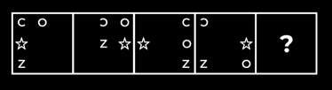

#### Options
- **(A)** Option (A) — Refer to Figure Option A
- **(B)** Option (B) — Refer to Figure Option B
- **(C)** Option (C) — Refer to Figure Option C
- **(D)** Option (D) — Refer to Figure Option D

#### Verified Answer
**Option A: Option (A) — Refer to Figure Option A**

#### Step-by-Step Solution & Rationale
Correct Answer: Option A: Option (A) — Refer to Figure Option A. Solved following standard Infosys System Engineer evaluation criteria.

**Official Video Solution Link**: [https://www.youtube.com/embed/bkE7qYFZpvc](https://www.youtube.com/embed/bkE7qYFZpvc)

---

### Question 1 (Mock Global Q066)
**ID**: `MOCK_SERIES_Q066` | **Mock Source**: Day 02 — 2. Full length Logical Reasoning (with sol)

#### Problem Statement
Which of the following numbers will replace the question mark (?) in the given series.

32 , 32, 32, 34, ?, 106, 530

#### Options
- **(A)** 38
- **(B)** 106
- **(C)** 102
- **(D)** 34

#### Verified Answer
**Option C: 102**

#### Step-by-Step Solution & Rationale
Correct Answer: Option C: 102. Solved following standard Infosys System Engineer evaluation criteria.

---

### Question 2 (Mock Global Q067)
**ID**: `MOCK_SERIES_Q067` | **Mock Source**: Day 02 — 2. Full length Logical Reasoning (with sol)

#### Problem Statement
:Select the odd number/ letter/ word from the given alternatives.

#### Options
- **(A)** ACDF
- **(B)** TUOP
- **(C)** HIVW
- **(D)** POKL

#### Verified Answer
**Option C: HIVW**

#### Step-by-Step Solution & Rationale
Correct Answer: Option C: HIVW. Solved following standard Infosys System Engineer evaluation criteria.

---

### Question 3 (Mock Global Q068)
**ID**: `MOCK_SERIES_Q068` | **Mock Source**: Day 02 — 2. Full length Logical Reasoning (with sol)

#### Problem Statement
Select the figure that will come next in the following figure series.

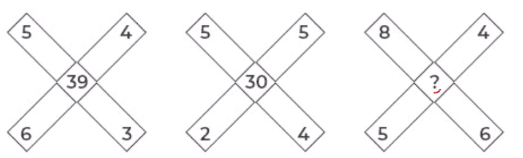

#### Options
- **(A)** Option (A) — Refer to Figure Option A
- **(B)** Option (B) — Refer to Figure Option B
- **(C)** Option (C) — Refer to Figure Option C
- **(D)** Option (D) — Refer to Figure Option D

#### Verified Answer
**Option C: Option (C) — Refer to Figure Option C**

#### Step-by-Step Solution & Rationale
Correct Answer: Option C: Option (C) — Refer to Figure Option C. Solved following standard Infosys System Engineer evaluation criteria.

---

### Question 4 (Mock Global Q069)
**ID**: `MOCK_SERIES_Q069` | **Mock Source**: Day 02 — 2. Full length Logical Reasoning (with sol)

#### Problem Statement
In a certain code language, ‘COUNTRY’ is written as ‘BOWKXLF’. How will ‘DESPAIR’ be written in that Language?

#### Options
- **(A)** GBVMDFU
- **(B)** GBPSXIO
- **(C)** UFDMVBG
- **(D)** ULDSVHG

#### Verified Answer
**Option C: UFDMVBG**

#### Step-by-Step Solution & Rationale
Correct Answer: Option C: UFDMVBG. Solved following standard Infosys System Engineer evaluation criteria.

---

### Question 5 (Mock Global Q070)
**ID**: `MOCK_SERIES_Q070` | **Mock Source**: Day 02 — 2. Full length Logical Reasoning (with sol)

#### Problem Statement
One morning, Chitrashi and Ayaan sit facing each other. If the shadow of Ayaan falls to the left of Chitrashi, then in which direction is Ayaan facing?

#### Options
- **(A)** North
- **(B)** East
- **(C)** South
- **(D)** West

#### Verified Answer
**Option C: South**

#### Step-by-Step Solution & Rationale
Correct Answer: Option C: South. Solved following standard Infosys System Engineer evaluation criteria.

---

### Question 6 (Mock Global Q071)
**ID**: `MOCK_SERIES_Q071` | **Mock Source**: Day 02 — 2. Full length Logical Reasoning (with sol)

#### Problem Statement
How many triangles are there in the given figure?

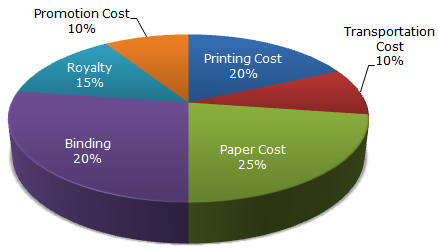

#### Options
- **(A)** 20
- **(B)** 21
- **(C)** 22
- **(D)** 23

#### Verified Answer
**Option A: 20**

#### Step-by-Step Solution & Rationale
Correct Answer: Option A: 20. Solved following standard Infosys System Engineer evaluation criteria.

---

### Question 7 (Mock Global Q072)
**ID**: `MOCK_SERIES_Q072` | **Mock Source**: Day 02 — 2. Full length Logical Reasoning (with sol)

#### Problem Statement
• Six personsA,B,C,D,E and Fare sitting in two rows,(facing each other) three persons are sitting in each row
• E is not at end of any row.
• D is second to the left of F.
• C, the neighbor of E, is sitting diagonally opposite to D.
• B is the neighbor of F.
• Question 7 : Based on the given information who is sitting opposite to B ?

#### Options
- **(A)** A
- **(B)** C
- **(C)** E
- **(D)** G

#### Verified Answer
**Option C: E**

#### Step-by-Step Solution & Rationale
Correct Answer: Option C: E. Solved following standard Infosys System Engineer evaluation criteria.

---

### Question 8 (Mock Global Q073)
**ID**: `MOCK_SERIES_Q073` | **Mock Source**: Day 02 — 2. Full length Logical Reasoning (with sol)

#### Problem Statement
Select the correct water image of the given figure.

#### Options
- **(A)** Option (A) — Refer to Figure Option A
- **(B)** Option (B) — Refer to Figure Option B
- **(C)** Option (C) — Refer to Figure Option C
- **(D)** Option (D) — Refer to Figure Option D

#### Verified Answer
**Option D: Option (D) — Refer to Figure Option D**

#### Step-by-Step Solution & Rationale
Correct Answer: Option D: Option (D) — Refer to Figure Option D. Solved following standard Infosys System Engineer evaluation criteria.

---

### Question 9 (Mock Global Q074)
**ID**: `MOCK_SERIES_Q074` | **Mock Source**: Day 02 — 2. Full length Logical Reasoning (with sol)

#### Problem Statement
An enterprising businessman earns an income of Rs 1 on the first day of his business. On every subsequent day, he earns an income which is just double of that made on the previous day. On the 10th day of business, his income is?

#### Options
- **(A)** Option (A) — Refer to Figure Option A
- **(B)** Option (B) — Refer to Figure Option B
- **(C)** Option (C) — Refer to Figure Option C
- **(D)** Option (D) — Refer to Figure Option D

#### Verified Answer
**Option B: Option (B) — Refer to Figure Option B**

#### Step-by-Step Solution & Rationale
Correct Answer: Option B: Option (B) — Refer to Figure Option B. Solved following standard Infosys System Engineer evaluation criteria.

---

### Question 10 (Mock Global Q075)
**ID**: `MOCK_SERIES_Q075` | **Mock Source**: Day 02 — 2. Full length Logical Reasoning (with sol)

#### Problem Statement
Directions (10-11): Answer the questions based on the information given below:

 Six persons Amanat, Badshah, Chirag, Damodar, Elvi & Farooq have different weights. Badshah is heavier than only two people. Elvi is lighter than Chirag but not than Farooq. Neither Farooq nor Amanat is the lightest. Amanat is not heavier than Elvi

Q1. Who among the following is 2nd lightest

#### Options
- **(A)** Amanat
- **(B)** Farooq
- **(C)** Damodar
- **(D)** Elvi
- **(E)** Either  Farooq or Amanat

#### Verified Answer
**Option E: Either  Farooq or Amanat**

#### Step-by-Step Solution & Rationale
Correct Answer: Option E: Either  Farooq or Amanat. Solved following standard Infosys System Engineer evaluation criteria.

---

### Question 11 (Mock Global Q076)
**ID**: `MOCK_SERIES_Q076` | **Mock Source**: Day 02 — 2. Full length Logical Reasoning (with sol)

#### Problem Statement
In the Venn diagram given below, the 'Circle' represents 'Officers', the 'Triangle' represents 'Married', the 'Rectangle' represents 'Salary above Rs.50,000'and the 'Square' represents 'Post-Graduates'. The numbers given in the diagram represents number of persons of that particular category. How many single officers have salary above Rs.50,000 but do NOT have a post-graduate degree?

#### Options
- **(A)** 4
- **(B)** 8
- **(C)** 10
- **(D)** 2

#### Verified Answer
**Option C: 10**

#### Step-by-Step Solution & Rationale
Correct Answer: Option C: 10. Solved following standard Infosys System Engineer evaluation criteria.

---

### Question 12 (Mock Global Q077)
**ID**: `MOCK_SERIES_Q077` | **Mock Source**: Day 02 — 2. Full length Logical Reasoning (with sol)

#### Problem Statement
Select the option that is related to the third term in the same way as the second term is related to the first term.

 DOGMATIC : EQHOBVJD :: PRODUCTS: ?

#### Options
- **(A)** RTQEWDVU
- **(B)** RTSEWDSQ
- **(C)** RTQFXDVU
- **(D)** RTQEWDWV

#### Verified Answer
**Option A: RTQEWDVU**

#### Step-by-Step Solution & Rationale
Correct Answer: Option A: RTQEWDVU. Solved following standard Infosys System Engineer evaluation criteria.

---

### Question 13 (Mock Global Q078)
**ID**: `MOCK_SERIES_Q078` | **Mock Source**: Day 02 — 2. Full length Logical Reasoning (with sol)

#### Problem Statement
Statements: Some Cats are Rats. All bats are tables. All Rats are Bats

 Conclusion:

I. Some Cats are bats
II. All bats are rats
III. All tables are cats
IV. All bats are cats

#### Options
- **(A)** Only I & II follow
- **(B)** Only II follows
- **(C)** Only I & IV follow
- **(D)** None of these

#### Verified Answer
**Option D: None of these**

#### Step-by-Step Solution & Rationale
Correct Answer: Option D: None of these. Solved following standard Infosys System Engineer evaluation criteria.

---

### Question 14 (Mock Global Q079)
**ID**: `MOCK_SERIES_Q079` | **Mock Source**: Day 02 — 2. Full length Logical Reasoning (with sol)

#### Problem Statement
Statements:
Most CPUs are keyboards.
No keyboard is a Mouse.
All Mouses are CPU.

Conclusion

 I. Some keyboards are CPU
II. All CPU’s are Mouse
III. No Mouse is a keyboard
IV. Some Mouse are keyboard

#### Options
- **(A)** Only I follows
- **(B)** Only II and III follow
- **(C)** Only I and III follow
- **(D)** Only II follows

#### Verified Answer
**Option C: Only I and III follow**

#### Step-by-Step Solution & Rationale
Correct Answer: Option C: Only I and III follow. Solved following standard Infosys System Engineer evaluation criteria.

---

### Question 15 (Mock Global Q080)
**ID**: `MOCK_SERIES_Q080` | **Mock Source**: Day 02 — 2. Full length Logical Reasoning (with sol)

#### Problem Statement
Statement- Drinking in moderation can help our health, some research has showed. Many doctors recommend a glass of wine or beer a night as part of diet plans such as the Mediterranean diet and the DASH diet, which have been proven to keep your heart and brain healthy. However, a new study suggests that even moderate drinking may not be great for your brain. Which of the following can be deduced from the above statement?

 (i) Scientific researches can contradict at times.
 (ii) Moderate intake of wine is less harmful than cigarette.
 (iii) Something which is not good for brain does not mean it cannot be healthy.

#### Options
- **(A)** Only 1
- **(B)** Only 1 and 2
- **(C)** Only 3
- **(D)** Both 2 and 3
- **(E)** None of these

#### Verified Answer
**Option A: Only 1**

#### Step-by-Step Solution & Rationale
Correct Answer: Option A: Only 1. Solved following standard Infosys System Engineer evaluation criteria.

---

### Question 1 (Mock Global Q115)
**ID**: `MOCK_SERIES_Q115` | **Mock Source**: Day 03 — 3. Full Length Logical Reasoning Mock(with sol)

#### Problem Statement
Select the set in which the numbers are related in the same way as are the numbers of the following sets.

(49, 63, 441) 

(7, 14, 14)

#### Options
- **(A)** (7, 28, 35)
- **(B)** (14, 28, 56)
- **(C)** (7, 14, 45)
- **(D)** (12, 18, 324)

#### Verified Answer
**Option B: (14, 28, 56)**

#### Step-by-Step Solution & Rationale
Correct Answer: Option B: (14, 28, 56). Solved following standard Infosys System Engineer evaluation criteria.

---

### Question 2 (Mock Global Q116)
**ID**: `MOCK_SERIES_Q116` | **Mock Source**: Day 03 — 3. Full Length Logical Reasoning Mock(with sol)

#### Problem Statement
Which two signs should be interchanged to make the given equation correct?

60 x 4 + 9 ÷  3 – 8 = 34

#### Options
- **(A)** + and –
- **(B)** ÷ and +
- **(C)** + and x
- **(D)** ÷ and x

#### Verified Answer
**Option D: ÷ and x**

#### Step-by-Step Solution & Rationale
Correct Answer: Option D: ÷ and x. Solved following standard Infosys System Engineer evaluation criteria.

---

### Question 3 (Mock Global Q117)
**ID**: `MOCK_SERIES_Q117` | **Mock Source**: Day 03 — 3. Full Length Logical Reasoning Mock(with sol)

#### Problem Statement
Which of the following numbers will replace the question mark (?) in the given series?

15, ?, 27, 39, 55, 75

#### Options
- **(A)** 19
- **(B)** 20
- **(C)** 21
- **(D)** 18

#### Verified Answer
**Option A: 19**

#### Step-by-Step Solution & Rationale
Correct Answer: Option A: 19. Solved following standard Infosys System Engineer evaluation criteria.

---

### Question 4 (Mock Global Q118)
**ID**: `MOCK_SERIES_Q118` | **Mock Source**: Day 03 — 3. Full Length Logical Reasoning Mock(with sol)

#### Problem Statement
In a certain code language, 'MANAGE' is written as 'HJDQDP' and 'LITTLE' is written as 'HOWWLO'. How will 'POLICY' be written in that language?

#### Options
- **(A)** CPMDOZ
- **(B)** QPMJDZ
- **(C)** YCILOP
- **(D)** BFLORS

#### Verified Answer
**Option D: BFLORS**

#### Step-by-Step Solution & Rationale
Correct Answer: Option D: BFLORS. Solved following standard Infosys System Engineer evaluation criteria.

---

### Question 5 (Mock Global Q119)
**ID**: `MOCK_SERIES_Q119` | **Mock Source**: Day 03 — 3. Full Length Logical Reasoning Mock(with sol)

#### Problem Statement
Select the option that is related to the third word in the same way as the second word is related to the first word. (The words must be considered as meaningful English words and must NOT be related to each other based on the number of letters/number of consonants/vowels in the word) Ophthalmology : Eyes Dermatology?

#### Options
- **(A)** Nerves
- **(B)** Skin
- **(C)** Bones
- **(D)** Brain

#### Verified Answer
**Option B: Skin**

#### Step-by-Step Solution & Rationale
Correct Answer: Option B: Skin. Solved following standard Infosys System Engineer evaluation criteria.

---

### Question 6 (Mock Global Q120)
**ID**: `MOCK_SERIES_Q120` | **Mock Source**: Day 03 — 3. Full Length Logical Reasoning Mock(with sol)

#### Problem Statement
Select the set in which the numbers are related in the same way as the numbers of the given sets. 
 (4,6,8)
 (6,8,10)

#### Options
- **(A)** (2, 12, 8)
- **(B)** (8, 12, 16)
- **(C)** (5, 30, 10)
- **(D)** (18, 18, 16)

#### Verified Answer
**Option B: (8, 12, 16)**

#### Step-by-Step Solution & Rationale
Correct Answer: Option B: (8, 12, 16). Solved following standard Infosys System Engineer evaluation criteria.

---

### Question 7 (Mock Global Q121)
**ID**: `MOCK_SERIES_Q121` | **Mock Source**: Day 03 — 3. Full Length Logical Reasoning Mock(with sol)

#### Problem Statement
Select the option that is related to the third word in the same way as the second word is related to the first word. (The words must be considered as meaningful English words and must not be related to each other based on the number of letters/number of consonants/vowels in the word.) 
Tortoise : Hatchling :: Rabbit : ?

#### Options
- **(A)** Shoat
- **(B)** Kitten
- **(C)** Piglet
- **(D)** Calf

#### Verified Answer
**Option B: Kitten**

#### Step-by-Step Solution & Rationale
Correct Answer: Option B: Kitten. Solved following standard Infosys System Engineer evaluation criteria.

---

### Question 8 (Mock Global Q122)
**ID**: `MOCK_SERIES_Q122` | **Mock Source**: Day 03 — 3. Full Length Logical Reasoning Mock(with sol)

#### Problem Statement
Select the set in which the numbers are related in the same way as are the numbers of the following sets. 

(15,20,4) 
(30, 30, 3)

#### Options
- **(A)** (44, 187, 44)
- **(B)** (30, 190, 15)
- **(C)** (35, 120, 19)
- **(D)** (60, 400, 20)

#### Verified Answer
**Option D: (60, 400, 20)**

#### Step-by-Step Solution & Rationale
Correct Answer: Option D: (60, 400, 20). Solved following standard Infosys System Engineer evaluation criteria.

---

### Question 9 (Mock Global Q123)
**ID**: `MOCK_SERIES_Q123` | **Mock Source**: Day 03 — 3. Full Length Logical Reasoning Mock(with sol)

#### Problem Statement
In a certain code, POETRY is written as QONDSQX and OVER is written as PNUDQ. How is MORE written in that code language?

#### Options
- **(A)** LNNQD
- **(B)** NNNQD
- **(C)** NLNQD
- **(D)** NLPQD

#### Verified Answer
**Option C: NLNQD**

#### Step-by-Step Solution & Rationale
Correct Answer: Option C: NLNQD. Solved following standard Infosys System Engineer evaluation criteria.

---

### Question 10 (Mock Global Q124)
**ID**: `MOCK_SERIES_Q124` | **Mock Source**: Day 03 — 3. Full Length Logical Reasoning Mock(with sol)

#### Problem Statement
‘P @ Q' means 'P is the wife of Q’. 
P # Q' means 'P is the brother of Q'.
'P $ Q' means 'P is the father of Q’. 
‘P - Q' means 'P is the daughter of Q’. 
If Z - B $ D $ G, then how is Z related to G

#### Options
- **(A)** Z is the mother of G
- **(B)** Z is the sister of G
- **(C)** Z is the father’s sister of G
- **(D)** Z is the daughter of G

#### Verified Answer
**Option C: Z is the father’s sister of G**

#### Step-by-Step Solution & Rationale
Correct Answer: Option C: Z is the father’s sister of G. Solved following standard Infosys System Engineer evaluation criteria.

---

### Question 11 (Mock Global Q125)
**ID**: `MOCK_SERIES_Q125` | **Mock Source**: Day 03 — 3. Full Length Logical Reasoning Mock(with sol)

#### Problem Statement
The second number in the given number pairs is obtained by performing certain mathematical operation(s) on the first number. The same operation(s) are followed in all the number pairs, EXCEPT one. Find that odd number pair.

#### Options
- **(A)** (87, 522)
- **(B)** (84, 672)
- **(C)** (92, 552)
- **(D)** (64, 384)

#### Verified Answer
**Option B: (84, 672)**

#### Step-by-Step Solution & Rationale
Correct Answer: Option B: (84, 672). Solved following standard Infosys System Engineer evaluation criteria.

---

### Question 12 (Mock Global Q126)
**ID**: `MOCK_SERIES_Q126` | **Mock Source**: Day 03 — 3. Full Length Logical Reasoning Mock(with sol)

#### Problem Statement
Three of the following four letter-clusters are alike in a certain way and one is different. Pick the odd one out.

#### Options
- **(A)** JQM
- **(B)** DWG
- **(C)** BXE
- **(D)** AZD

#### Verified Answer
**Option C: BXE**

#### Step-by-Step Solution & Rationale
Correct Answer: Option C: BXE. Solved following standard Infosys System Engineer evaluation criteria.

---

### Question 13 (Mock Global Q127)
**ID**: `MOCK_SERIES_Q127` | **Mock Source**: Day 03 — 3. Full Length Logical Reasoning Mock(with sol)

#### Problem Statement
Select the option that represents the correct order of the given words as they would appear in an English dictionary.
1. Tertiary
2. Terrace
3. Terrain
4. Termite
5. Territory
6. Terminate

#### Options
- **(A)** 4, 6, 3, 2, 5, 1
- **(B)** 4, 6, 2, 3, 1, 5
- **(C)** 6, 4, 2, 3, 5, 1
- **(D)** 6, 4, 3, 2, 5, 1

#### Verified Answer
**Option C: 6, 4, 2, 3, 5, 1**

#### Step-by-Step Solution & Rationale
Correct Answer: Option C: 6, 4, 2, 3, 5, 1. Solved following standard Infosys System Engineer evaluation criteria.

---

### Question 14 (Mock Global Q128)
**ID**: `MOCK_SERIES_Q128` | **Mock Source**: Day 03 — 3. Full Length Logical Reasoning Mock(with sol)

#### Problem Statement
Select the combination of letters that when sequentially placed in the blanks of the given series will complete the series.
A _ M P S A C _ P S A C O _ S A C P P _

#### Options
- **(A)** S M P A
- **(B)** S C A N
- **(C)** C M A S
- **(D)** C N P S

#### Verified Answer
**Option D: C N P S**

#### Step-by-Step Solution & Rationale
Correct Answer: Option D: C N P S. Solved following standard Infosys System Engineer evaluation criteria.

---

### Question 15 (Mock Global Q129)
**ID**: `MOCK_SERIES_Q129` | **Mock Source**: Day 03 — 3. Full Length Logical Reasoning Mock(with sol)

#### Problem Statement
Which of the following terms will replace the question mark (?) in the given series? OTLN, MSJM, KRHL, IQFK, ?

#### Options
- **(A)** HPDK
- **(B)** GQDJ
- **(C)** GPDJ
- **(D)** GPDK

#### Verified Answer
**Option C: GPDJ**

#### Step-by-Step Solution & Rationale
Correct Answer: Option C: GPDJ. Solved following standard Infosys System Engineer evaluation criteria.

---

### Question 16 (Mock Global Q130)
**ID**: `MOCK_SERIES_Q130` | **Mock Source**: Day 03 — 3. Full Length Logical Reasoning Mock(with sol)

#### Problem Statement
Which two signs should be interchanged to make the given equation correct? 
117 ÷ 13 + 16 x 540 - 40 = 644

#### Options
- **(A)** ÷ and +
- **(B)** + and x
- **(C)** - and +
- **(D)** ÷ and -

#### Verified Answer
**Option B: + and x**

#### Step-by-Step Solution & Rationale
Correct Answer: Option B: + and x. Solved following standard Infosys System Engineer evaluation criteria.

---

### Question 17 (Mock Global Q131)
**ID**: `MOCK_SERIES_Q131` | **Mock Source**: Day 03 — 3. Full Length Logical Reasoning Mock(with sol)

#### Problem Statement
Three different positions of the same dice are shown. Find the number on the face opposite the face showing ‘5’.

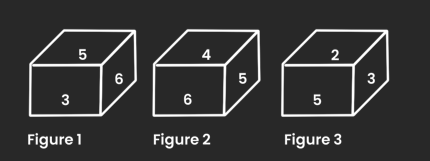

#### Options
- **(A)** 2
- **(B)** 3
- **(C)** 4
- **(D)** 1

#### Verified Answer
**Option D: 1**

#### Step-by-Step Solution & Rationale
Correct Answer: Option D: 1. Solved following standard Infosys System Engineer evaluation criteria.

---

### Question 18 (Mock Global Q132)
**ID**: `MOCK_SERIES_Q132` | **Mock Source**: Day 03 — 3. Full Length Logical Reasoning Mock(with sol)

#### Problem Statement
Which of the answer figures is the exact mirror image of the given problem figure when the mirror is held at the right side?

Problem figure:

#### Options
- **(A)** Option (A) — Refer to Figure Option A
- **(B)** Option (B) — Refer to Figure Option B
- **(C)** Option (C) — Refer to Figure Option C
- **(D)** Option (D) — Refer to Figure Option D

#### Verified Answer
**Option D: Option (D) — Refer to Figure Option D**

#### Step-by-Step Solution & Rationale
Correct Answer: Option D: Option (D) — Refer to Figure Option D. Solved following standard Infosys System Engineer evaluation criteria.

---

### Question 19 (Mock Global Q133)
**ID**: `MOCK_SERIES_Q133` | **Mock Source**: Day 03 — 3. Full Length Logical Reasoning Mock(with sol)

#### Problem Statement
Select the Veen diagram that best illustration the relationship between the following classes.
Women, Professor, Players

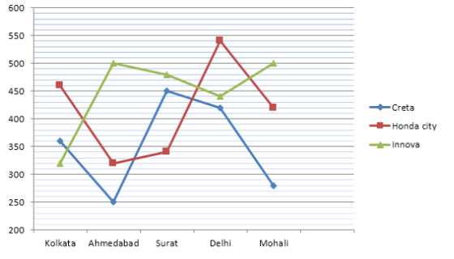

#### Options
- **(A)** Option (A) — Refer to Figure Option A
- **(B)** Option (B) — Refer to Figure Option B
- **(C)** Option (C) — Refer to Figure Option C
- **(D)** Option (D) — Refer to Figure Option D

#### Verified Answer
**Option C: Option (C) — Refer to Figure Option C**

#### Step-by-Step Solution & Rationale
Correct Answer: Option C: Option (C) — Refer to Figure Option C. Solved following standard Infosys System Engineer evaluation criteria.

---

### Question 20 (Mock Global Q134)
**ID**: `MOCK_SERIES_Q134` | **Mock Source**: Day 03 — 3. Full Length Logical Reasoning Mock(with sol)

#### Problem Statement
Select the option figure which is embedded in the given figure (rotation is NOT allowed)

#### Options
- **(A)** Option (A) — Refer to Figure Option A
- **(B)** Option (B) — Refer to Figure Option B
- **(C)** Option (C) — Refer to Figure Option C
- **(D)** Option (D) — Refer to Figure Option D

#### Verified Answer
**Option C: Option (C) — Refer to Figure Option C**

#### Step-by-Step Solution & Rationale
Correct Answer: Option C: Option (C) — Refer to Figure Option C. Solved following standard Infosys System Engineer evaluation criteria.

---

### Question 21 (Mock Global Q135)
**ID**: `MOCK_SERIES_Q135` | **Mock Source**: Day 03 — 3. Full Length Logical Reasoning Mock(with sol)

#### Problem Statement
Select the figure that will replace the question mark (?) in the following figure series.

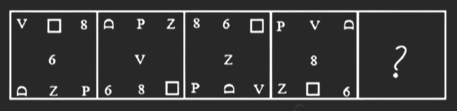

#### Options
- **(A)** Option (A) — Refer to Figure Option A
- **(B)** Option (B) — Refer to Figure Option B
- **(C)** Option (C) — Refer to Figure Option C
- **(D)** Option (D) — Refer to Figure Option D

#### Verified Answer
**Option B: Option (B) — Refer to Figure Option B**

#### Step-by-Step Solution & Rationale
Correct Answer: Option B: Option (B) — Refer to Figure Option B. Solved following standard Infosys System Engineer evaluation criteria.

---

### Question 22 (Mock Global Q136)
**ID**: `MOCK_SERIES_Q136` | **Mock Source**: Day 03 — 3. Full Length Logical Reasoning Mock(with sol)

#### Problem Statement
Select the figure among the given options that can replace the question mark (?) in the following series.

#### Options
- **(A)** Option (A) — Refer to Figure Option A
- **(B)** Option (B) — Refer to Figure Option B
- **(C)** Option (C) — Refer to Figure Option C
- **(D)** Option (D) — Refer to Figure Option D

#### Verified Answer
**Option B: Option (B) — Refer to Figure Option B**

#### Step-by-Step Solution & Rationale
Correct Answer: Option B: Option (B) — Refer to Figure Option B. Solved following standard Infosys System Engineer evaluation criteria.

---

### Question 23 (Mock Global Q137)
**ID**: `MOCK_SERIES_Q137` | **Mock Source**: Day 03 — 3. Full Length Logical Reasoning Mock(with sol)

#### Problem Statement
Find the Missing Number 

      ?           9          16           51          200         1005

#### Options
- **(A)** 6
- **(B)** 7
- **(C)** 8
- **(D)** 9
- **(E)** None of these

#### Verified Answer
**Option C: 8**

#### Step-by-Step Solution & Rationale
Correct Answer: Option C: 8. Solved following standard Infosys System Engineer evaluation criteria.

---

### Question 24 (Mock Global Q138)
**ID**: `MOCK_SERIES_Q138` | **Mock Source**: Day 03 — 3. Full Length Logical Reasoning Mock(with sol)

#### Problem Statement
Find the Missing Term :

        23       12        13        21         44        ?

#### Options
- **(A)** 102.5
- **(B)** 112.5
- **(C)** 123
- **(D)** 103.5
- **(E)** None Of These

#### Verified Answer
**Option B: 112.5**

#### Step-by-Step Solution & Rationale
Correct Answer: Option B: 112.5. Solved following standard Infosys System Engineer evaluation criteria.

---

### Question 25 (Mock Global Q139)
**ID**: `MOCK_SERIES_Q139` | **Mock Source**: Day 03 — 3. Full Length Logical Reasoning Mock(with sol)

#### Problem Statement
Find the Missing Term :

        12       7        9        21         88        ?

#### Options
- **(A)** 702
- **(B)** 709
- **(C)** 809
- **(D)** 158
- **(E)** None Of These

#### Verified Answer
**Option B: 709**

#### Step-by-Step Solution & Rationale
Correct Answer: Option B: 709. Solved following standard Infosys System Engineer evaluation criteria.

---

### Question 26 (Mock Global Q140)
**ID**: `MOCK_SERIES_Q140` | **Mock Source**: Day 03 — 3. Full Length Logical Reasoning Mock(with sol)

#### Problem Statement
Statement: India cricket team is is performing very well.  Particularly the batting line-up is the best in the world.

Courses of action:
1. There should be least changes in the present team.
2. The Indian cricket board should take an action to improve the bowling standard.

#### Options
- **(A)** Only I follows
- **(B)** Only II follows
- **(C)** Neither I nor II follows
- **(D)** Both I and II follow

#### Verified Answer
**Option A: Only I follows**

#### Step-by-Step Solution & Rationale
Correct Answer: Option A: Only I follows. Solved following standard Infosys System Engineer evaluation criteria.

---

### Question 27 (Mock Global Q141)
**ID**: `MOCK_SERIES_Q141` | **Mock Source**: Day 03 — 3. Full Length Logical Reasoning Mock(with sol)

#### Problem Statement
Statement: “Look at his audacity. Rohan has not replied to my letter” - A tells B.

Assumptions:
1. Rohan received his letter.
2. Rohan did not receive his letter.
3. The letter was sent only by post.

#### Options
- **(A)** Only I  is implicit
- **(B)** Only II is implicit
- **(C)** Only III is implicit
- **(D)** All are implicit
- **(E)** None is implicit

#### Verified Answer
**Option A: Only I  is implicit**

#### Step-by-Step Solution & Rationale
Correct Answer: Option A: Only I  is implicit. Solved following standard Infosys System Engineer evaluation criteria.

---

### Question 28 (Mock Global Q142)
**ID**: `MOCK_SERIES_Q142` | **Mock Source**: Day 03 — 3. Full Length Logical Reasoning Mock(with sol)

#### Problem Statement
Statement: A major retail store announced thirty percent reduction on all food items during the weekend.
Assumption
I. People may still prefer buying food items from other stores.
II.  A large number of customers may visit the retail store and buy food items.

#### Options
- **(A)** Only I is implicit
- **(B)** Only II is implicit
- **(C)** All are implicit
- **(D)** None is implicit

#### Verified Answer
**Option B: Only II is implicit**

#### Step-by-Step Solution & Rationale
Correct Answer: Option B: Only II is implicit. Solved following standard Infosys System Engineer evaluation criteria.

---

### Question 29 (Mock Global Q143)
**ID**: `MOCK_SERIES_Q143` | **Mock Source**: Day 03 — 3. Full Length Logical Reasoning Mock(with sol)

#### Problem Statement
Statement : The state government has abolished the scheme of Providing concessional air ticket to students.
Assumptions :
I. Students will not travel by air in future.
II. The students who resort so travel by air can bear the expenses of air ticket.

#### Options
- **(A)** Only I is implicit
- **(B)** Only II is implicit
- **(C)** Both are implicit
- **(D)** None is implicit

#### Verified Answer
**Option B: Only II is implicit**

#### Step-by-Step Solution & Rationale
Correct Answer: Option B: Only II is implicit. Solved following standard Infosys System Engineer evaluation criteria.

---

### Question 1 (Mock Global Q177)
**ID**: `MOCK_SERIES_Q177` | **Mock Source**: Day 04 — 4. Full Length Logical Reasoning(with sol)

#### Problem Statement
Select the figure that will replace the question mark (?) in the following figure series.

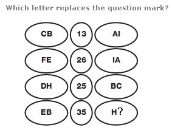

#### Options
- **(A)** Option (A) — Refer to Figure Option A
- **(B)** Option (B) — Refer to Figure Option B
- **(C)** Option (C) — Refer to Figure Option C
- **(D)** Option (D) — Refer to Figure Option D

#### Verified Answer
**Option C: Option (C) — Refer to Figure Option C**

#### Step-by-Step Solution & Rationale
Correct Answer: Option C: Option (C) — Refer to Figure Option C. Solved following standard Infosys System Engineer evaluation criteria.

**Official Video Solution Link**: [https://www.youtube.com/embed/1sdsNJs5cr4](https://www.youtube.com/embed/1sdsNJs5cr4)

---

### Question 2 (Mock Global Q178)
**ID**: `MOCK_SERIES_Q178` | **Mock Source**: Day 04 — 4. Full Length Logical Reasoning(with sol)

#### Problem Statement
Select the option that is related to the fifth number in the same way as the second number is related to the first number and the fourth number is related to the third number. 5:45::3:3::6: ?

#### Options
- **(A)** 90
- **(B)** 106
- **(C)** 110
- **(D)** 96

#### Verified Answer
**Option D: 96**

#### Step-by-Step Solution & Rationale
Correct Answer: Option D: 96. Solved following standard Infosys System Engineer evaluation criteria.

**Official Video Solution Link**: [https://www.youtube.com/embed/MqZlfYAWTq0](https://www.youtube.com/embed/MqZlfYAWTq0)

---

### Question 3 (Mock Global Q179)
**ID**: `MOCK_SERIES_Q179` | **Mock Source**: Day 04 — 4. Full Length Logical Reasoning(with sol)

#### Problem Statement
Three statements are given, followed by four conclusions numbered I, II, III and IV. Assuming the statements to be true, even if they seem to be at variance with commonly known facts, decide which of the conclusions logically follow(s) from the statements. Statements: Some desks are trays. Some trays are plates. Some plates are desks. Conclusions: I. All desks are plates. II. All plates are desks. III. Some plates are trays. IV. All trays are desks.

#### Options
- **(A)** Only conclusion III follows
- **(B)** Only conclusion IV follows
- **(C)** Only conclusion II follows
- **(D)** Only conclusion I follows

#### Verified Answer
**Option A: Only conclusion III follows**

#### Step-by-Step Solution & Rationale
Correct Answer: Option A: Only conclusion III follows. Solved following standard Infosys System Engineer evaluation criteria.

**Official Video Solution Link**: [https://www.youtube.com/embed/T4xkvyDCgao](https://www.youtube.com/embed/T4xkvyDCgao)

---

### Question 4 (Mock Global Q180)
**ID**: `MOCK_SERIES_Q180` | **Mock Source**: Day 04 — 4. Full Length Logical Reasoning(with sol)

#### Problem Statement
Select the set in which the numbers are related in the same way as are the numbers of the following sets. (55, 11, 25) (64,16, 16) (NOTE: Operations should be performed on the whole numbers, without breaking down the numbers into its constituent digits. E.g. 13-Operations on 13 such as adding /subtracting /multiplying etc. to 13 can be performed. Breaking down 13 into 1 and 3 and then performing mathematical operations on 1 and 3 is NOT allowed)

#### Options
- **(A)** ( 33 , 11, 9)
- **(B)** ( 33, 11, 22)
- **(C)** ( 33, 11, 3)
- **(D)** ( 33, 11, 10)

#### Verified Answer
**Option A: ( 33 , 11, 9)**

#### Step-by-Step Solution & Rationale
Correct Answer: Option A: ( 33 , 11, 9). Solved following standard Infosys System Engineer evaluation criteria.

**Official Video Solution Link**: [https://www.youtube.com/embed/hduyhzjafqQ](https://www.youtube.com/embed/hduyhzjafqQ)

---

### Question 5 (Mock Global Q181)
**ID**: `MOCK_SERIES_Q181` | **Mock Source**: Day 04 — 4. Full Length Logical Reasoning(with sol)

#### Problem Statement
Ganesh was taking a walk with his mother's brother's father's granddaughter. Who was he walking with?

#### Options
- **(A)** Daughter
- **(B)** Mother
- **(C)** Cousin
- **(D)** Granddaughter

#### Verified Answer
**Option C: Cousin**

#### Step-by-Step Solution & Rationale
Correct Answer: Option C: Cousin. Solved following standard Infosys System Engineer evaluation criteria.

**Official Video Solution Link**: [https://www.youtube.com/embed/c66NXHBDEPU](https://www.youtube.com/embed/c66NXHBDEPU)

---

### Question 6 (Mock Global Q182)
**ID**: `MOCK_SERIES_Q182` | **Mock Source**: Day 04 — 4. Full Length Logical Reasoning(with sol)

#### Problem Statement
Select the correct mirror image of the given figure when the mirror is placed at MN as shown below. T e 2 9 E K P M _______ N

#### Options
- **(A)** Option (A) — Refer to Figure Option A
- **(B)** Option (B) — Refer to Figure Option B
- **(C)** Option (C) — Refer to Figure Option C
- **(D)** Option (D) — Refer to Figure Option D

#### Verified Answer
**Option D: Option (D) — Refer to Figure Option D**

#### Step-by-Step Solution & Rationale
Correct Answer: Option D: Option (D) — Refer to Figure Option D. Solved following standard Infosys System Engineer evaluation criteria.

**Official Video Solution Link**: [https://www.youtube.com/embed/H5zkD-w5Xgk](https://www.youtube.com/embed/H5zkD-w5Xgk)

---

### Question 7 (Mock Global Q183)
**ID**: `MOCK_SERIES_Q183` | **Mock Source**: Day 04 — 4. Full Length Logical Reasoning(with sol)

#### Problem Statement
Which of the following letter-clusters will replace the question mark (?) in the given series? UV, OY, IB, EE, ?

#### Options
- **(A)** ZK
- **(B)** AH
- **(C)** BI
- **(D)** BH

#### Verified Answer
**Option B: AH**

#### Step-by-Step Solution & Rationale
Correct Answer: Option B: AH. Solved following standard Infosys System Engineer evaluation criteria.

**Official Video Solution Link**: [https://www.youtube.com/embed/rwkQh7KX92w](https://www.youtube.com/embed/rwkQh7KX92w)

---

### Question 8 (Mock Global Q184)
**ID**: `MOCK_SERIES_Q184` | **Mock Source**: Day 04 — 4. Full Length Logical Reasoning(with sol)

#### Problem Statement
The second number in the given number-pairs is obtained by performing certain mathematical operation(s) on the first number. The same operation(s) is/are followed in all the number-pairs except one. Find that odd number-pair.

#### Options
- **(A)** 20:11
- **(B)** 6:4
- **(C)** 15:9
- **(D)** 12:7

#### Verified Answer
**Option C: 15:9**

#### Step-by-Step Solution & Rationale
Correct Answer: Option C: 15:9. Solved following standard Infosys System Engineer evaluation criteria.

**Official Video Solution Link**: [https://www.youtube.com/embed/4PL9xsdqVqE](https://www.youtube.com/embed/4PL9xsdqVqE)

---

### Question 9 (Mock Global Q185)
**ID**: `MOCK_SERIES_Q185` | **Mock Source**: Day 04 — 4. Full Length Logical Reasoning(with sol)

#### Problem Statement
Three different positions of the same dice are shown. Find the number on the face opposite the face showing '1'.

#### Options
- **(A)** 6
- **(B)** 2
- **(C)** 3
- **(D)** 4

#### Verified Answer
**Option C: 3**

#### Step-by-Step Solution & Rationale
Correct Answer: Option C: 3. Solved following standard Infosys System Engineer evaluation criteria.

**Official Video Solution Link**: [https://www.youtube.com/embed/CtKDvKqoo84](https://www.youtube.com/embed/CtKDvKqoo84)

---

### Question 10 (Mock Global Q186)
**ID**: `MOCK_SERIES_Q186` | **Mock Source**: Day 04 — 4. Full Length Logical Reasoning(with sol)

#### Problem Statement
Select the option that is related to the sixth letter-cluster in the same way as the first letter-cluster is related to the second letter-cluster and the third letter-cluster is related to the fourth letter-cluster. HMD: KOE :: BNQ: EPR :: ?: FLV

#### Options
- **(A)** SJE
- **(B)** UJC
- **(C)** EJS
- **(D)** CJU

#### Verified Answer
**Option D: CJU**

#### Step-by-Step Solution & Rationale
Correct Answer: Option D: CJU. Solved following standard Infosys System Engineer evaluation criteria.

**Official Video Solution Link**: [https://www.youtube.com/embed/FM-JKpu3KMo](https://www.youtube.com/embed/FM-JKpu3KMo)

---

### Question 11 (Mock Global Q187)
**ID**: `MOCK_SERIES_Q187` | **Mock Source**: Day 04 — 4. Full Length Logical Reasoning(with sol)

#### Problem Statement
Select the figure from the options that can replace the question mark (?) and complete the given patter.

#### Options
- **(A)** Option (A) — Refer to Figure Option A
- **(B)** Option (B) — Refer to Figure Option B
- **(C)** Option (C) — Refer to Figure Option C
- **(D)** Option (D) — Refer to Figure Option D

#### Verified Answer
**Option D: Option (D) — Refer to Figure Option D**

#### Step-by-Step Solution & Rationale
Correct Answer: Option D: Option (D) — Refer to Figure Option D. Solved following standard Infosys System Engineer evaluation criteria.

**Official Video Solution Link**: [https://www.youtube.com/embed/Kt48WX8f8es](https://www.youtube.com/embed/Kt48WX8f8es)

---

### Question 12 (Mock Global Q188)
**ID**: `MOCK_SERIES_Q188` | **Mock Source**: Day 04 — 4. Full Length Logical Reasoning(with sol)

#### Problem Statement
Four letter-clusters have been given, out of which three are alike in some manner and one is different. Select the odd letter-cluster .

#### Options
- **(A)** BFJN
- **(B)** DHLP
- **(C)** HJKP
- **(D)** JNRV

#### Verified Answer
**Option C: HJKP**

#### Step-by-Step Solution & Rationale
Correct Answer: Option C: HJKP. Solved following standard Infosys System Engineer evaluation criteria.

**Official Video Solution Link**: [https://www.youtube.com/embed/atwRCjo0VCY](https://www.youtube.com/embed/atwRCjo0VCY)

---

### Question 13 (Mock Global Q189)
**ID**: `MOCK_SERIES_Q189` | **Mock Source**: Day 04 — 4. Full Length Logical Reasoning(with sol)

#### Problem Statement
Select the option that represents the correct order of the given words as they would appear in an English dictionary. 1. Warriors 2. Warehouse 3. Warcraft 4. Warranty 5. Wardrobe 6. Wardenship

#### Options
- **(A)** 3, 6, 5, 2, 1, 4
- **(B)** 3, 5, 6, 2, 1, 4
- **(C)** 3, 5, 6, 2, 4, 1
- **(D)** 3, 6, 5, 2, 4, 1

#### Verified Answer
**Option D: 3, 6, 5, 2, 4, 1**

#### Step-by-Step Solution & Rationale
Correct Answer: Option D: 3, 6, 5, 2, 4, 1. Solved following standard Infosys System Engineer evaluation criteria.

**Official Video Solution Link**: [https://www.youtube.com/embed/U3dCCeV6LKA](https://www.youtube.com/embed/U3dCCeV6LKA)

---

### Question 14 (Mock Global Q190)
**ID**: `MOCK_SERIES_Q190` | **Mock Source**: Day 04 — 4. Full Length Logical Reasoning(with sol)

#### Problem Statement
Which of the following numbers will replace the question mark (?) in the given series? 8, 15, 26, ?, 56, 75

#### Options
- **(A)** 39
- **(B)** 41
- **(C)** 35
- **(D)** 43

#### Verified Answer
**Option A: 39**

#### Step-by-Step Solution & Rationale
Correct Answer: Option A: 39. Solved following standard Infosys System Engineer evaluation criteria.

**Official Video Solution Link**: [https://www.youtube.com/embed/tF-KUuhfHYc](https://www.youtube.com/embed/tF-KUuhfHYc)

---

### Question 15 (Mock Global Q191)
**ID**: `MOCK_SERIES_Q191` | **Mock Source**: Day 04 — 4. Full Length Logical Reasoning(with sol)

#### Problem Statement
46 23 34.5 86.25 ?

#### Options
- **(A)** 300
- **(B)** 301.875
- **(C)** 301.975
- **(D)** 300.875

#### Verified Answer
**Option B: 301.875**

#### Step-by-Step Solution & Rationale
Correct Answer: Option B: 301.875. Solved following standard Infosys System Engineer evaluation criteria.

**Official Video Solution Link**: [https://www.youtube.com/embed/vk0KcVe_laE](https://www.youtube.com/embed/vk0KcVe_laE)

---

### Question 16 (Mock Global Q192)
**ID**: `MOCK_SERIES_Q192` | **Mock Source**: Day 04 — 4. Full Length Logical Reasoning(with sol)

#### Problem Statement
Select the option that is related to the fifth number in the same way as the second number is related to the first number and the fourth number is related to the third number. 625 : 5 :: 2560 : 8 :: 5000: ?

#### Options
- **(A)** 9
- **(B)** 12
- **(C)** 10
- **(D)** 15

#### Verified Answer
**Option C: 10**

#### Step-by-Step Solution & Rationale
Correct Answer: Option C: 10. Solved following standard Infosys System Engineer evaluation criteria.

**Official Video Solution Link**: [https://www.youtube.com/embed/PEgmkylBTUA](https://www.youtube.com/embed/PEgmkylBTUA)

---

### Question 17 (Mock Global Q193)
**ID**: `MOCK_SERIES_Q193` | **Mock Source**: Day 04 — 4. Full Length Logical Reasoning(with sol)

#### Problem Statement
In a certain code language, 'ASK' is written as '62' and 'BYE' is written as '64'. How will 'CRY' be written in that language?

#### Options
- **(A)** 68
- **(B)** 72
- **(C)** 86
- **(D)** 92

#### Verified Answer
**Option D: 92**

#### Step-by-Step Solution & Rationale
Correct Answer: Option D: 92. Solved following standard Infosys System Engineer evaluation criteria.

**Official Video Solution Link**: [https://www.youtube.com/embed/ecL1FiF5jlI](https://www.youtube.com/embed/ecL1FiF5jlI)

---

### Question 18 (Mock Global Q194)
**ID**: `MOCK_SERIES_Q194` | **Mock Source**: Day 04 — 4. Full Length Logical Reasoning(with sol)

#### Problem Statement
Select the correct combination of mathematical signs that can sequentially replace the * signs and balance the given equation. 256 * 4 * 9 * 3 * 14 = 51

#### Options
- **(A)** x + &ndash; ÷ &divide;
- **(B)** ÷ &divide; x &ndash; +
- **(C)** x ÷ &divide; + &ndash;
- **(D)** ÷ &divide; &ndash; x +

#### Verified Answer
**Option D: ÷ &divide; &ndash; x +**

#### Step-by-Step Solution & Rationale
Correct Answer: Option D: ÷ &divide; &ndash; x +. Solved following standard Infosys System Engineer evaluation criteria.

**Official Video Solution Link**: [https://www.youtube.com/embed/nb1-bj2n1WI](https://www.youtube.com/embed/nb1-bj2n1WI)

---

### Question 19 (Mock Global Q195)
**ID**: `MOCK_SERIES_Q195` | **Mock Source**: Day 04 — 4. Full Length Logical Reasoning(with sol)

#### Problem Statement
Select the option that represents the letters that, when placed from left to right in the following blanks, will complete the letter-series. C L_V E C_ _W E C L O_ _C_O_E

#### Options
- **(A)** OLPXELY
- **(B)** OLOYELZ
- **(C)** OLOXFMY
- **(D)** OLOXELY

#### Verified Answer
**Option D: OLOXELY**

#### Step-by-Step Solution & Rationale
Correct Answer: Option D: OLOXELY. Solved following standard Infosys System Engineer evaluation criteria.

**Official Video Solution Link**: [https://www.youtube.com/embed/74clV2YW0tM](https://www.youtube.com/embed/74clV2YW0tM)

---

### Question 20 (Mock Global Q196)
**ID**: `MOCK_SERIES_Q196` | **Mock Source**: Day 04 — 4. Full Length Logical Reasoning(with sol)

#### Problem Statement
In a certain code language, 'TABLE' is coded as ELEAT and 'SWING' is coded as GNLWS. How will 'FRAME' be coded in the same language?

#### Options
- **(A)** EMERF
- **(B)** EMDRF
- **(C)** ERMDF
- **(D)** MEDFR

#### Verified Answer
**Option B: EMDRF**

#### Step-by-Step Solution & Rationale
Correct Answer: Option B: EMDRF. Solved following standard Infosys System Engineer evaluation criteria.

**Official Video Solution Link**: [https://www.youtube.com/embed/AUnSULXo9io](https://www.youtube.com/embed/AUnSULXo9io)

---

### Question 21 (Mock Global Q197)
**ID**: `MOCK_SERIES_Q197` | **Mock Source**: Day 04 — 4. Full Length Logical Reasoning(with sol)

#### Problem Statement
Two different positions of the same dice are shown, the six faces of which are marked from A to F. Select the letter that will be on the face opposite to the face showing the letter C.

#### Options
- **(A)** F
- **(B)** B
- **(C)** A
- **(D)** D

#### Verified Answer
**Option B: B**

#### Step-by-Step Solution & Rationale
Correct Answer: Option B: B. Solved following standard Infosys System Engineer evaluation criteria.

**Official Video Solution Link**: [https://www.youtube.com/embed/LXNAodlHYg8](https://www.youtube.com/embed/LXNAodlHYg8)

---

### Question 22 (Mock Global Q198)
**ID**: `MOCK_SERIES_Q198` | **Mock Source**: Day 04 — 4. Full Length Logical Reasoning(with sol)

#### Problem Statement
Select the option figure which is embedded in the given figure. (Rotation is NOT allowed).

#### Options
- **(A)** Option (A) — Refer to Figure Option A
- **(B)** Option (B) — Refer to Figure Option B
- **(C)** Option (C) — Refer to Figure Option C
- **(D)** Option (D) — Refer to Figure Option D

#### Verified Answer
**Option B: Option (B) — Refer to Figure Option B**

#### Step-by-Step Solution & Rationale
Correct Answer: Option B: Option (B) — Refer to Figure Option B. Solved following standard Infosys System Engineer evaluation criteria.

---

### Question 23 (Mock Global Q199)
**ID**: `MOCK_SERIES_Q199` | **Mock Source**: Day 04 — 4. Full Length Logical Reasoning(with sol)

#### Problem Statement
Select the option that is related to the third word in the same way as the second word is related to the first word. (The words must be considered as meaningful English words and must not be related to each other based on the number of letters/number of consonants/vowels in the word.) Skin : Touch :: Nose : ?

#### Options
- **(A)** Smell
- **(B)** Taste
- **(C)** Nose ring
- **(D)** Sweat

#### Verified Answer
**Option A: Smell**

#### Step-by-Step Solution & Rationale
Correct Answer: Option A: Smell. Solved following standard Infosys System Engineer evaluation criteria.

**Official Video Solution Link**: [https://www.youtube.com/embed/m2DNSatwl60](https://www.youtube.com/embed/m2DNSatwl60)

---

### Question 24 (Mock Global Q200)
**ID**: `MOCK_SERIES_Q200` | **Mock Source**: Day 04 — 4. Full Length Logical Reasoning(with sol)

#### Problem Statement
Three different positions of the same dice are shown. Find the number on the face opposite the face showing &lsquo;4&rsquo;.

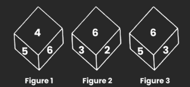

#### Options
- **(A)** 5
- **(B)** 6
- **(C)** 2
- **(D)** 3

#### Verified Answer
**Option D: 3**

#### Step-by-Step Solution & Rationale
Correct Answer: Option D: 3. Solved following standard Infosys System Engineer evaluation criteria.

**Official Video Solution Link**: [https://www.youtube.com/embed/lLmi2OxJpkY](https://www.youtube.com/embed/lLmi2OxJpkY)

---

### Question 25 (Mock Global Q201)
**ID**: `MOCK_SERIES_Q201` | **Mock Source**: Day 04 — 4. Full Length Logical Reasoning(with sol)

#### Problem Statement
Select the Venn diagram that best illustration the relationship between the following classes. Ticket, Aeroplane, Rail

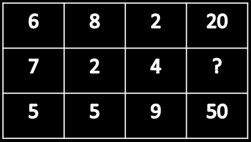

#### Options
- **(A)** Option (A) — Refer to Figure Option A
- **(B)** Option (B) — Refer to Figure Option B
- **(C)** Option (C) — Refer to Figure Option C
- **(D)** Option (D) — Refer to Figure Option D

#### Verified Answer
**Option A: Option (A) — Refer to Figure Option A**

#### Step-by-Step Solution & Rationale
Correct Answer: Option A: Option (A) — Refer to Figure Option A. Solved following standard Infosys System Engineer evaluation criteria.

**Official Video Solution Link**: [https://www.youtube.com/embed/8_ZuJC-5Z1U](https://www.youtube.com/embed/8_ZuJC-5Z1U)

---

### Question 1 (Mock Global Q252)
**ID**: `MOCK_SERIES_Q252` | **Mock Source**: Day 05 — 5 Ful length Logical Reasoning Mock

#### Problem Statement
P, Q, R, S, T, U, V and W are sitting round the circle and are facing the centre: P is second to the right of T who is the neighbour of R and V. S is not the neighbour of P. V is the neighbour of U. Q is not between S and W. W is not between U and S. Which one is immediate right to the V if the position of S and U are interchanged ? .

#### Options
- **(A)** P
- **(B)** U
- **(C)** T
- **(D)** R

#### Verified Answer
**Option C: T**

#### Step-by-Step Solution & Rationale
Correct Answer: Option C: T. Solved following standard Infosys System Engineer evaluation criteria.

**Official Video Solution Link**: [images/img_ec149d41c6cd.png](images/img_ec149d41c6cd.png)

---

### Question 2 (Mock Global Q253)
**ID**: `MOCK_SERIES_Q253` | **Mock Source**: Day 05 — 5 Ful length Logical Reasoning Mock

#### Problem Statement
In a certain language, MANGO is written as PXQDR and APPLE is written as DMSIH. How is PROTEIN written in this language?

#### Options
- **(A)** QFHQROS
- **(B)** SORQLBQ
- **(C)** RPQRGGP
- **(D)** QSPUFJO

#### Verified Answer
**Option B: SORQLBQ**

#### Step-by-Step Solution & Rationale
Correct Answer: Option B: SORQLBQ. Solved following standard Infosys System Engineer evaluation criteria.

---

### Question 3 (Mock Global Q254)
**ID**: `MOCK_SERIES_Q254` | **Mock Source**: Day 05 — 5 Ful length Logical Reasoning Mock

#### Problem Statement
Pointing to a woman, a man said, "she is the daughter of my wife's daughter". How is the man related to this woman?

#### Options
- **(A)** Brother
- **(B)** Uncle
- **(C)** Father
- **(D)** Grandfather

#### Verified Answer
**Option D: Grandfather**

#### Step-by-Step Solution & Rationale
Correct Answer: Option D: Grandfather. Solved following standard Infosys System Engineer evaluation criteria.

---

### Question 4 (Mock Global Q255)
**ID**: `MOCK_SERIES_Q255` | **Mock Source**: Day 05 — 5 Ful length Logical Reasoning Mock

#### Problem Statement
Arun is facing towards the North and turns through 45&deg; clockwise, again 180&deg; clockwise and then turns through 270&deg; anti-clockwise. In which direction is he facing now?

#### Options
- **(A)** South
- **(B)** East
- **(C)** Nort - West
- **(D)** South - West

#### Verified Answer
**Option C: Nort - West**

#### Step-by-Step Solution & Rationale
Correct Answer: Option C: Nort - West. Solved following standard Infosys System Engineer evaluation criteria.

---

### Question 5 (Mock Global Q256)
**ID**: `MOCK_SERIES_Q256` | **Mock Source**: Day 05 — 5 Ful length Logical Reasoning Mock

#### Problem Statement
Arun&rsquo;s and Varun&rsquo;s savings per month are in the proportion of 2:5 respectively. What is Varun's savings? I.Arun saves 30% of his salary. II. Salary of Arun is Rs. 15000

#### Options
- **(A)** 11250
- **(B)** 11000
- **(C)** 45000
- **(D)** 10500

#### Verified Answer
**Option A: 11250**

#### Step-by-Step Solution & Rationale
Correct Answer: Option A: 11250. Solved following standard Infosys System Engineer evaluation criteria.

---

### Question 6 (Mock Global Q257)
**ID**: `MOCK_SERIES_Q257` | **Mock Source**: Day 05 — 5 Ful length Logical Reasoning Mock

#### Problem Statement
In what proportion would 3 sons Amar, AKbar and Anthony divide the money given by their dad for the party? I. Amar takes two &ndash; firth of the total money II. Akbar takes one &ndash; third of the remaining money

#### Options
- **(A)** Only statement I is sufficient to get the answer
- **(B)** Only statement II is sufficient to get the answer
- **(C)** if both the statements taken alone can give the answer
- **(D)** Both the statements are required to get the answer

#### Verified Answer
**Option D: Both the statements are required to get the answer**

#### Step-by-Step Solution & Rationale
Correct Answer: Option D: Both the statements are required to get the answer. Solved following standard Infosys System Engineer evaluation criteria.

---

### Question 7 (Mock Global Q258)
**ID**: `MOCK_SERIES_Q258` | **Mock Source**: Day 05 — 5 Ful length Logical Reasoning Mock

#### Problem Statement
Arrange the following given words to make a meaningful sequence 1. Lecture 2. Earn 3. College 4. Job 5. Examination

#### Options
- **(A)** 51324
- **(B)** 13524
- **(C)** 31524
- **(D)** 31542

#### Verified Answer
**Option D: 31542**

#### Step-by-Step Solution & Rationale
Correct Answer: Option D: 31542. Solved following standard Infosys System Engineer evaluation criteria.

---

### Question 8 (Mock Global Q259)
**ID**: `MOCK_SERIES_Q259` | **Mock Source**: Day 05 — 5 Ful length Logical Reasoning Mock

#### Problem Statement
Find out the number to replace the question mark 2, 12, 120, 1680, 30240, ?

#### Options
- **(A)** 112256
- **(B)** 665280
- **(C)** 365220
- **(D)** 100000

#### Verified Answer
**Option B: 665280**

#### Step-by-Step Solution & Rationale
Correct Answer: Option B: 665280. Solved following standard Infosys System Engineer evaluation criteria.

---

### Question 9 (Mock Global Q260)
**ID**: `MOCK_SERIES_Q260` | **Mock Source**: Day 05 — 5 Ful length Logical Reasoning Mock

#### Problem Statement
If BLACK is coded as DNCEM, then ORANGE is coded as:

#### Options
- **(A)** QTCPIG
- **(B)** PSCOHF
- **(C)** PSBOHF
- **(D)** QTCOIG

#### Verified Answer
**Option A: QTCPIG**

#### Step-by-Step Solution & Rationale
Correct Answer: Option A: QTCPIG. Solved following standard Infosys System Engineer evaluation criteria.

---

### Question 10 (Mock Global Q261)
**ID**: `MOCK_SERIES_Q261` | **Mock Source**: Day 05 — 5 Ful length Logical Reasoning Mock

#### Problem Statement
If FEATURES is written as GCDPZLLK in a code, what will be the fourth letter from the left, if ADVANTAGE is written in that code?

#### Options
- **(A)** E
- **(B)** F
- **(C)** W
- **(D)** X

#### Verified Answer
**Option C: W**

#### Step-by-Step Solution & Rationale
Correct Answer: Option C: W. Solved following standard Infosys System Engineer evaluation criteria.

---

### Question 11 (Mock Global Q262)
**ID**: `MOCK_SERIES_Q262` | **Mock Source**: Day 05 — 5 Ful length Logical Reasoning Mock

#### Problem Statement
In Certain code, FEAT is written as GCDP, what's going to be the 3rd letter from the left, if ADVANCE is written in that code?

#### Options
- **(A)** P
- **(B)** S
- **(C)** T
- **(D)** X

#### Verified Answer
**Option C: T**

#### Step-by-Step Solution & Rationale
Correct Answer: Option C: T. Solved following standard Infosys System Engineer evaluation criteria.

---

### Question 12 (Mock Global Q263)
**ID**: `MOCK_SERIES_Q263` | **Mock Source**: Day 05 — 5 Ful length Logical Reasoning Mock

#### Problem Statement
Based on the detail given below. There is a pattern that defines the connection between the first -element. Determine this courting after which perceive the missing detail of the second one pair, such that both the pairs are analogous. QDXM:SFYM::EIOZ :

#### Options
- **(A)** PAQM
- **(B)** LPWA
- **(C)** QNLA
- **(D)** GKPA

#### Verified Answer
**Option D: GKPA**

#### Step-by-Step Solution & Rationale
Correct Answer: Option D: GKPA. Solved following standard Infosys System Engineer evaluation criteria.

---

### Question 13 (Mock Global Q264)
**ID**: `MOCK_SERIES_Q264` | **Mock Source**: Day 05 — 5 Ful length Logical Reasoning Mock

#### Problem Statement
According to the wide variety series given below. Identify the connection among the numbers and find the missing quantity. 11, 12, 16, 25, 41, 66, ___

#### Options
- **(A)** 101
- **(B)** 102
- **(C)** 103
- **(D)** 104

#### Verified Answer
**Option B: 102**

#### Step-by-Step Solution & Rationale
Correct Answer: Option B: 102. Solved following standard Infosys System Engineer evaluation criteria.

---

### Question 14 (Mock Global Q265)
**ID**: `MOCK_SERIES_Q265` | **Mock Source**: Day 05 — 5 Ful length Logical Reasoning Mock

#### Problem Statement
In the underneath query, there are two statements I and II. Find out if the facts given within the announcement(s) is enough to answer the question or no longer. Question: Is Biswajit taller than Sumith? Statement I. Rahul is of the same peak as Bswajit and Sumit Statement II. Sumit is shorte than Rahul

#### Options
- **(A)** Statement I on my own is enough to reply to the query
- **(B)** Statement II by myself is sufficient to reply to the query
- **(C)** Even both the statement put together are not enought to answer the question
- **(D)** Either of the statement is enough t reply to the question

#### Verified Answer
**Option A: Statement I on my own is enough to reply to the query**

#### Step-by-Step Solution & Rationale
Correct Answer: Option A: Statement I on my own is enough to reply to the query. Solved following standard Infosys System Engineer evaluation criteria.

---

### Question 15 (Mock Global Q266)
**ID**: `MOCK_SERIES_Q266` | **Mock Source**: Day 05 — 5 Ful length Logical Reasoning Mock

#### Problem Statement
Four alternatives are given underneath. Three of those options are similar to every other due to the fact they observe the equal sample. Identify the choice that is special from the opposite three.

#### Options
- **(A)** AE6
- **(B)** FD10
- **(C)** AD6
- **(D)** DE9

#### Verified Answer
**Option C: AD6**

#### Step-by-Step Solution & Rationale
Correct Answer: Option C: AD6. Solved following standard Infosys System Engineer evaluation criteria.

---

### Question 16 (Mock Global Q267)
**ID**: `MOCK_SERIES_Q267` | **Mock Source**: Day 05 — 5 Ful length Logical Reasoning Mock

#### Problem Statement
Look at this series: 36, 34, 30, 28, 24, &hellip; What number should come next?

#### Options
- **(A)** 22
- **(B)** 26
- **(C)** 23
- **(D)** 20

#### Verified Answer
**Option A: 22**

#### Step-by-Step Solution & Rationale
Correct Answer: Option A: 22. Solved following standard Infosys System Engineer evaluation criteria.

---

### Question 17 (Mock Global Q268)
**ID**: `MOCK_SERIES_Q268` | **Mock Source**: Day 05 — 5 Ful length Logical Reasoning Mock

#### Problem Statement
Look at this series: 7, 10, 8, 11, 9, 12, &hellip; What number should come next?

#### Options
- **(A)** 7
- **(B)** 12
- **(C)** 10
- **(D)** 13

#### Verified Answer
**Option C: 10**

#### Step-by-Step Solution & Rationale
Correct Answer: Option C: 10. Solved following standard Infosys System Engineer evaluation criteria.

---

### Question 18 (Mock Global Q269)
**ID**: `MOCK_SERIES_Q269` | **Mock Source**: Day 05 — 5 Ful length Logical Reasoning Mock

#### Problem Statement
Look at this series: 2, 1, (1/2), (1/4), &hellip; What number should come next?

#### Options
- **(A)** (1/3)
- **(B)** (1/8)
- **(C)** (2/8)
- **(D)** (1/16)

#### Verified Answer
**Option B: (1/8)**

#### Step-by-Step Solution & Rationale
Correct Answer: Option B: (1/8). Solved following standard Infosys System Engineer evaluation criteria.

---

### Question 19 (Mock Global Q270)
**ID**: `MOCK_SERIES_Q270` | **Mock Source**: Day 05 — 5 Ful length Logical Reasoning Mock

#### Problem Statement
Look at this series: 80, 10, 70, 15, 60, &hellip; What number should come next?

#### Options
- **(A)** 20
- **(B)** 25
- **(C)** 30
- **(D)** 50

#### Verified Answer
**Option A: 20**

#### Step-by-Step Solution & Rationale
Correct Answer: Option A: 20. Solved following standard Infosys System Engineer evaluation criteria.

---

### Question 20 (Mock Global Q271)
**ID**: `MOCK_SERIES_Q271` | **Mock Source**: Day 05 — 5 Ful length Logical Reasoning Mock

#### Problem Statement
Statements: Applications of applicants who do no fulfil eligibility criteria and/or who do not submit applications before last date will be summarily rejected and will not be called for the written test. Conclusions: I. Those who are called for the written test are those who fulfil eligibility criteria and have submitted their applications before last date. II. Written test will be held only after scrutiny of applications.

#### Options
- **(A)** Only conclusion I follows
- **(B)** Only conclusion II follows
- **(C)** Either I or II follows
- **(D)** Both I and II follow

#### Verified Answer
**Option D: Both I and II follow**

#### Step-by-Step Solution & Rationale
Correct Answer: Option D: Both I and II follow. Solved following standard Infosys System Engineer evaluation criteria.

---

### Question 1 (Mock Global Q345)
**ID**: `MOCK_SERIES_Q345` | **Mock Source**: Day 07 — SECTION-II_ ANALYTICAL THINKING

#### Problem Statement
Directions(1-2): Two statements are followed by four conclusions numbered I, II, III, IV. Take the first two statements to be true even if they are at variance with commonly &ndash; known facts. The statements are followed by conclusions which are themselves followed by answer &ndash; choices. Mark the answer &ndash;choice which correctly points out which of the conclusion follow. Question1 : Statements: 1.All green are blue 2.All blue are white Conclusions: I) some blue are green. II) Some white are green. III) Some green are not white. IV) All white are blue. a) Only I and II follow b) Only II and III follow c)Only I and III follow d) Only I and IV follow

#### Options
- **(A)** a) Only I and II follow
- **(B)** b) Only II and III follow
- **(C)** c)Only I and III follow
- **(D)** d) Only I and IV follow
- **(E)** None of these

#### Verified Answer
**Option A: a) Only I and II follow**

#### Step-by-Step Solution & Rationale
Correct Answer: Option A: a) Only I and II follow. Solved following standard Infosys System Engineer evaluation criteria.

---

### Question 2 (Mock Global Q346)
**ID**: `MOCK_SERIES_Q346` | **Mock Source**: Day 07 — SECTION-II_ ANALYTICAL THINKING

#### Problem Statement
Directions(1-2): Two statements are followed by four conclusions numbered I, II, III, IV. Take the first two statements to be true even if they are at variance with commonly &ndash; known facts. The statements are followed by conclusions which are themselves followed by answer &ndash; choices. Mark the answer &ndash;choice which correctly points out which of the conclusion follow. Question2 : Statements: 1) Some boxes are cars 2) Some cars roads Conclusions: I) some roads are boxes II) Some cars are boxes III) No box is a road IV) Some roads are cars.

#### Options
- **(A)** Only II and III follow
- **(B)** Only I and IV follow
- **(C)** Either I or III ,and II and IV follow
- **(D)** Only II and IV follow
- **(E)** None of these

#### Verified Answer
**Option C: Either I or III ,and II and IV follow**

#### Step-by-Step Solution & Rationale
Correct Answer: Option C: Either I or III ,and II and IV follow. Solved following standard Infosys System Engineer evaluation criteria.

---

### Question 3 (Mock Global Q347)
**ID**: `MOCK_SERIES_Q347` | **Mock Source**: Day 07 — SECTION-II_ ANALYTICAL THINKING

#### Problem Statement
Directions(3-4): The questions given below have four groups of three statements each. Read the statements in each group carefully and identify the group/groups where the third statement logically follows the first two statements in the group. Question 3 : A) All books are copies. All copies are papers. All books are papers. B) All cubes are squares. All cubes are triangles. All triangles are squares. C) All singers are dancers. All dancers are musicians. All musicians are singers. D) No cock is hen. All hens are chickens. No hen is chicken.

#### Options
- **(A)** Only D
- **(B)** Only A
- **(C)** Only B & C
- **(D)** Only A and D

#### Verified Answer
**Option B: Only A**

#### Step-by-Step Solution & Rationale
Correct Answer: Option B: Only A. Solved following standard Infosys System Engineer evaluation criteria.

---

### Question 4 (Mock Global Q348)
**ID**: `MOCK_SERIES_Q348` | **Mock Source**: Day 07 — SECTION-II_ ANALYTICAL THINKING

#### Problem Statement
Directions(3-4): The questions given below have four groups of three statements each. Read the statements in each group carefully and identify the group/groups where the third statement logically follows the first two statements in the group. Question 4 : A) All elephants are wild. All lions are wild. So all lions are elephant B) All mangoes are red. Some apples are mangoes. So, all apples are red C) All roads are boxes. All foxes are roads. So, all boxes are foxes D) All XYZ can run. All ABC are XYZ. So, all ABC can run.

#### Options
- **(A)** A. Only A
- **(B)** A. Only B
- **(C)** A. Only C
- **(D)** A. Only D

#### Verified Answer
**Option D: A. Only D**

#### Step-by-Step Solution & Rationale
Correct Answer: Option D: A. Only D. Solved following standard Infosys System Engineer evaluation criteria.

---

### Question 5 (Mock Global Q349)
**ID**: `MOCK_SERIES_Q349` | **Mock Source**: Day 07 — SECTION-II_ ANALYTICAL THINKING

#### Problem Statement
DIRECTIONS for questions : Given below are line graph examples with questions, which show the annual food grain production from 1992 to 1997. Refer to the graph & answer the questions based on line graph as given below. Question 5 : What is an approximate percentage decrease in production from 1993 to 1994?

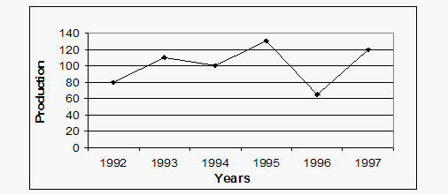

#### Options
- **(A)** A. 87.5%
- **(B)** 37.5%
- **(C)** A. 9.09%
- **(D)** A. None of these

#### Verified Answer
**Option C: A. 9.09%**

#### Step-by-Step Solution & Rationale
Correct Answer: Option C: A. 9.09%. Solved following standard Infosys System Engineer evaluation criteria.

---

### Question 6 (Mock Global Q350)
**ID**: `MOCK_SERIES_Q350` | **Mock Source**: Day 07 — SECTION-II_ ANALYTICAL THINKING

#### Problem Statement
The following pie-chart shows the percentage distribution of the expenditure incurred in publishing a book. Study the pie-chart and the answer the questions based on it. Various Expenditures (in percentage) Incurred in Publishing a Book Question 6: If for a certain quantity of books, the publisher has to pay Rs. 30,600 as printing cost, then what will be amount of royalty to be paid for these books?

#### Options
- **(A)** Rs. 19,450
- **(B)** Rs. 21,200
- **(C)** A Rs. 22,950
- **(D)** Rs. 26,150

#### Verified Answer
**Option C: A Rs. 22,950**

#### Step-by-Step Solution & Rationale
Correct Answer: Option C: A Rs. 22,950. Solved following standard Infosys System Engineer evaluation criteria.

---

### Question 7 (Mock Global Q351)
**ID**: `MOCK_SERIES_Q351` | **Mock Source**: Day 07 — SECTION-II_ ANALYTICAL THINKING

#### Problem Statement
The following pie-chart shows the percentage distribution of the expenditure incurred in publishing a book. Study the pie-chart and the answer the questions based on it. Various Expenditures (in percentage) Incurred in Publishing a Book Question 7: The price of the book is marked 20% above the C.P. If the marked price of the book is Rs. 180,then what is the cost of the paper used in a single copy of the book?

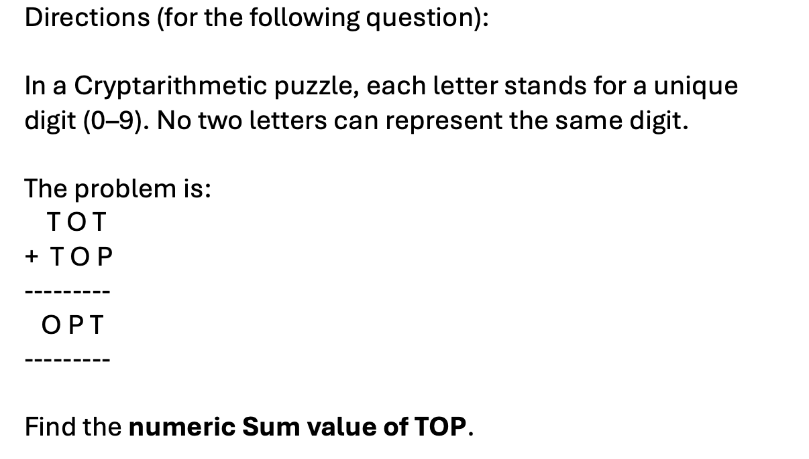

#### Options
- **(A)** A. Rs. 36
- **(B)** A Rs. 42
- **(C)** A. Rs. 37.50
- **(D)** A Rs. 44.25

#### Verified Answer
**Option C: A. Rs. 37.50**

#### Step-by-Step Solution & Rationale
Correct Answer: Option C: A. Rs. 37.50. Solved following standard Infosys System Engineer evaluation criteria.

---

### Question 8 (Mock Global Q352)
**ID**: `MOCK_SERIES_Q352` | **Mock Source**: Day 07 — SECTION-II_ ANALYTICAL THINKING

#### Problem Statement
Question 8: For which of the following years, the percentage rise/fall in production from the previous year is the maximum for Company Y?

#### Options
- **(A)** 1997
- **(B)** 1998
- **(C)** 1999
- **(D)** 2000

#### Verified Answer
**Option A: 1997**

#### Step-by-Step Solution & Rationale
Correct Answer: Option A: 1997. Solved following standard Infosys System Engineer evaluation criteria.

---

### Question 9 (Mock Global Q353)
**ID**: `MOCK_SERIES_Q353` | **Mock Source**: Day 07 — SECTION-II_ ANALYTICAL THINKING

#### Problem Statement
Question 9: What is the ratio of the average production of Company X in the period 1998-2000 to the average production of Company Y in the same period?

#### Options
- **(A)** 1:1
- **(B)** 15:17
- **(C)** 23:25
- **(D)** 27:29

#### Verified Answer
**Option C: 23:25**

#### Step-by-Step Solution & Rationale
Correct Answer: Option C: 23:25. Solved following standard Infosys System Engineer evaluation criteria.

---

### Question 10 (Mock Global Q354)
**ID**: `MOCK_SERIES_Q354` | **Mock Source**: Day 07 — SECTION-II_ ANALYTICAL THINKING

#### Problem Statement
The question below consists of a question and two statements numbered I and II given. You have to decide whether the data provided in which of the statements are sufficient to answer the question. Choose your answer from the options based on this. Question10 :Among persons S, I, U, V, W and B who is the tallest? I. U is taller than only two persons. T is taller than S but not the tallest. W is taller than only B. II. S is shorter than only two persons. W is taller than B but shorter than U. U is shorter than S. T is shorter than V.

#### Options
- **(A)** The data in statement II alone are sufficient to answer the question, while the data in statement I alone are not sufficient to answer the question
- **(B)** The data even in both statements I and II together are not sufficient to answer the question
- **(C)** The data either in statement I alone or in statement II alone are sufficient to answer the question
- **(D)** The data in statement I alone are sufficient to answer the question, while the data in statement II alone are not sufficient to answer the question
- **(E)** The data in both statements I and II together are necessary to answer the question

#### Verified Answer
**Option C: The data either in statement I alone or in statement II alone are sufficient to answer the question**

#### Step-by-Step Solution & Rationale
Correct Answer: Option C: The data either in statement I alone or in statement II alone are sufficient to answer the question. Solved following standard Infosys System Engineer evaluation criteria.

---

### Question 11 (Mock Global Q355)
**ID**: `MOCK_SERIES_Q355` | **Mock Source**: Day 07 — SECTION-II_ ANALYTICAL THINKING

#### Problem Statement
The question below consists of a question and two statements numbered I and II given. You have to decide whether the data provided in which of the statements are sufficient to answer the question. Choose your answer from the options based on this. Question 11 . Is M the mother of L? I. T is the mother of M. M is married to J. K is the son of J. F is the sister of K. L is the sister of F. II. K is the grandson of T. K is the bother of F. F is the sister of L. L is daughter of J. J is the son-in-law of T.

#### Options
- **(A)** The data in statement II alone are sufficient to answer the question, while the data in statement I alone are not sufficient to answer the question
- **(B)** The data even in both statements I and II together are not sufficient to answer the question
- **(C)** The data either in statement I alone or in statement II alone are sufficient to answer the question
- **(D)** The data in statement I alone are sufficient to answer the question, while the data in statement II alone are not sufficient to answer the question
- **(E)** The data in both statements I and II together are necessary to answer the question

#### Verified Answer
**Option E: The data in both statements I and II together are necessary to answer the question**

#### Step-by-Step Solution & Rationale
Correct Answer: Option E: The data in both statements I and II together are necessary to answer the question. Solved following standard Infosys System Engineer evaluation criteria.

---

### Question 12 (Mock Global Q356)
**ID**: `MOCK_SERIES_Q356` | **Mock Source**: Day 07 — SECTION-II_ ANALYTICAL THINKING

#### Problem Statement
The question below consists of a question and two statements numbered I and II given. You have to decide whether the data provided in which of the statements are sufficient to answer the question. Choose your answer from the options based on this. Question12: By selling a product with 20% profit, how much profit was earned? I. The difference between cost and selling price is Rs. 40. II. The selling price is 120 percent of the cost price.

#### Options
- **(A)** The data in statement II alone are sufficient to answer the question, while the data in statement I alone are not sufficient to answer the question
- **(B)** The data even in both statements I and II together are not sufficient to answer the question
- **(C)** The data either in statement I alone or in statement II alone are sufficient to answer the question
- **(D)** The data in statement I alone are sufficient to answer the question, while the data in statement II alone are not sufficient to answer the question
- **(E)** The data in both statements I and II together are necessary to answer the question

#### Verified Answer
**Option D: The data in statement I alone are sufficient to answer the question, while the data in statement II alone are not sufficient to answer the question**

#### Step-by-Step Solution & Rationale
Correct Answer: Option D: The data in statement I alone are sufficient to answer the question, while the data in statement II alone are not sufficient to answer the question. Solved following standard Infosys System Engineer evaluation criteria.

---

### Question 13 (Mock Global Q357)
**ID**: `MOCK_SERIES_Q357` | **Mock Source**: Day 07 — SECTION-II_ ANALYTICAL THINKING

#### Problem Statement
The question below consists of a question and two statements numbered I and II given. You have to decide whether the data provided in which of the statements are sufficient to answer the question. Choose your answer from the options based on this. I . If b is even II. If a is even

#### Options
- **(A)** The data in statement II alone are sufficient to answer the question, while the data in statement I alone are not sufficient to answer the question
- **(B)** The data even in both statements I and II together are not sufficient to answer the question
- **(C)** The data either in statement I alone or in statement II alone are sufficient to answer the question
- **(D)** The data in statement I alone are sufficient to answer the question, while the data in statement II alone are not sufficient to answer the question
- **(E)** The data in both statements I and II together are necessary to answer the question

#### Verified Answer
**Option D: The data in statement I alone are sufficient to answer the question, while the data in statement II alone are not sufficient to answer the question**

#### Step-by-Step Solution & Rationale
Correct Answer: Option D: The data in statement I alone are sufficient to answer the question, while the data in statement II alone are not sufficient to answer the question. Solved following standard Infosys System Engineer evaluation criteria.

---

### Question 14 (Mock Global Q358)
**ID**: `MOCK_SERIES_Q358` | **Mock Source**: Day 07 — SECTION-II_ ANALYTICAL THINKING

#### Problem Statement
A set of football matches is to be organized in a "round-robin" fashion, i.e., every participating team plays a match against every other team once and only once. If 21 matches are totally played, how many teams participated?

#### Options
- **(A)** 8
- **(B)** 7
- **(C)** 9
- **(D)** None of these

#### Verified Answer
**Option B: 7**

#### Step-by-Step Solution & Rationale
Correct Answer: Option B: 7. Solved following standard Infosys System Engineer evaluation criteria.

---

### Question 15 (Mock Global Q359)
**ID**: `MOCK_SERIES_Q359` | **Mock Source**: Day 07 — SECTION-II_ ANALYTICAL THINKING

#### Problem Statement
Find the wrong term in the following number series : 15972 , 15629 , 15840 , 15720 , 15784 , 15757

#### Options
- **(A)** 15840
- **(B)** 15757
- **(C)** 15720
- **(D)** 15972

#### Verified Answer
**Option A: 15840**

#### Step-by-Step Solution & Rationale
Correct Answer: Option A: 15840. Solved following standard Infosys System Engineer evaluation criteria.

---

