# Infosys Mock Test Series — Topic 2: Quantitative Aptitude & Mathematical Ability

> **Questions Count**: 151 | **Target Role**: Infosys System Engineer (SE)
> **Official Syllabus Coverage**: Percentages, Profit & Loss, Time & Work, Time-Speed-Distance, Ratio & Proportion, Averages, Probability, Permutation & Combination, Mensuration

## Topic Overview & Problem Set
This master compendium compiles all 151 solved questions for Quantitative Aptitude & Mathematical Ability sourced across Days 01 through 09 and full-length PYQ mocks.

---

### Question 1 (Mock Global Q021)
**ID**: `MOCK_SERIES_Q021` | **Mock Source**: Day 01 — 1. Full Length Numerical Ability with Video Solution- Level -Medium

#### Problem Statement
720 litres of a mixture contain milk and water only in the ratio of x : 3 respectively. If 30 litres water is added into it, then the ratio of quantity of milk to that of water in the resultant mixture will become 3:2. Find the value of

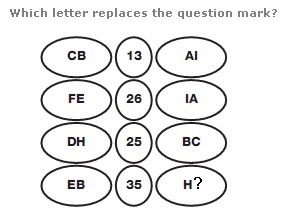

#### Options
- **(A)** 10

#### Verified Answer
**Numerical Value: 10**

#### Step-by-Step Solution & Rationale
Correct Answer: Numerical Value: 10. Solved following standard Infosys System Engineer evaluation criteria.

**Official Video Solution Link**: [https://www.youtube.com/embed/Lrg1kcliIbY](https://www.youtube.com/embed/Lrg1kcliIbY)

---

### Question 2 (Mock Global Q022)
**ID**: `MOCK_SERIES_Q022` | **Mock Source**: Day 01 — 1. Full Length Numerical Ability with Video Solution- Level -Medium

#### Problem Statement
A contractor agreed to construct a 6 km road in 200 days. He employed 140 persons for the work. After 60 days, he realized that only 1.5 km road has been completed. How many additional people would he need to employ to finish the work exactly on time?

#### Options
- **(A)** 40

#### Verified Answer
**Numerical Value: 40**

#### Step-by-Step Solution & Rationale
Correct Answer: Numerical Value: 40. Solved following standard Infosys System Engineer evaluation criteria.

**Official Video Solution Link**: [https://www.youtube.com/embed/cdFZxrezzCo](https://www.youtube.com/embed/cdFZxrezzCo)

---

### Question 3 (Mock Global Q023)
**ID**: `MOCK_SERIES_Q023` | **Mock Source**: Day 01 — 1. Full Length Numerical Ability with Video Solution- Level -Medium

#### Problem Statement
A sum of Rs. 45500 is to be paid back in 3 equal annual installments. How much is each installment if the interest is compounded annually at 20% per annum ?

#### Options
- **(A)** 21600

#### Verified Answer
**Numerical Value: 21600**

#### Step-by-Step Solution & Rationale
Correct Answer: Numerical Value: 21600. Solved following standard Infosys System Engineer evaluation criteria.

**Official Video Solution Link**: [https://www.youtube.com/embed/ReF1N-z2u-s](https://www.youtube.com/embed/ReF1N-z2u-s)

---

### Question 4 (Mock Global Q024)
**ID**: `MOCK_SERIES_Q024` | **Mock Source**: Day 01 — 1. Full Length Numerical Ability with Video Solution- Level -Medium

#### Problem Statement
Note : Type ans in Min Only without unit

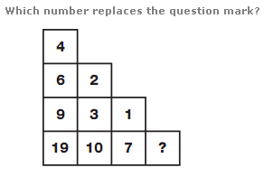

#### Options
- **(A)** 72

#### Verified Answer
**Numerical Value: 72**

#### Step-by-Step Solution & Rationale
Correct Answer: Numerical Value: 72. Solved following standard Infosys System Engineer evaluation criteria.

**Official Video Solution Link**: [https://www.youtube.com/embed/j91psFOaZTY](https://www.youtube.com/embed/j91psFOaZTY)

---

### Question 5 (Mock Global Q025)
**ID**: `MOCK_SERIES_Q025` | **Mock Source**: Day 01 — 1. Full Length Numerical Ability with Video Solution- Level -Medium

#### Problem Statement
Note : Ans in days

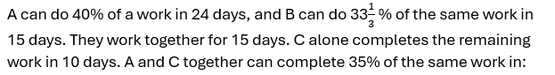

#### Options
- **(A)** 6

#### Verified Answer
**Numerical Value: 6**

#### Step-by-Step Solution & Rationale
Correct Answer: Numerical Value: 6. Solved following standard Infosys System Engineer evaluation criteria.

**Official Video Solution Link**: [https://www.youtube.com/embed/Ba4Sj5hiG5o](https://www.youtube.com/embed/Ba4Sj5hiG5o)

---

### Question 6 (Mock Global Q026)
**ID**: `MOCK_SERIES_Q026` | **Mock Source**: Day 01 — 1. Full Length Numerical Ability with Video Solution- Level -Medium

#### Problem Statement
If a 10-digit number= 5432y1749x is divisible by 72, then what is the value of (5x-4y)?

#### Options
- **(A)** 14

#### Verified Answer
**Numerical Value: 14**

#### Step-by-Step Solution & Rationale
Correct Answer: Numerical Value: 14. Solved following standard Infosys System Engineer evaluation criteria.

**Official Video Solution Link**: [https://www.youtube.com/embed/vD8QfVM6C_g](https://www.youtube.com/embed/vD8QfVM6C_g)

---

### Question 7 (Mock Global Q027)
**ID**: `MOCK_SERIES_Q027` | **Mock Source**: Day 01 — 1. Full Length Numerical Ability with Video Solution- Level -Medium

#### Problem Statement
[Data Interpretation / Graphical Aptitude Problem — Refer to Chart Below] Analyze the data chart, graph, or equation presented in the figure and compute the required value.

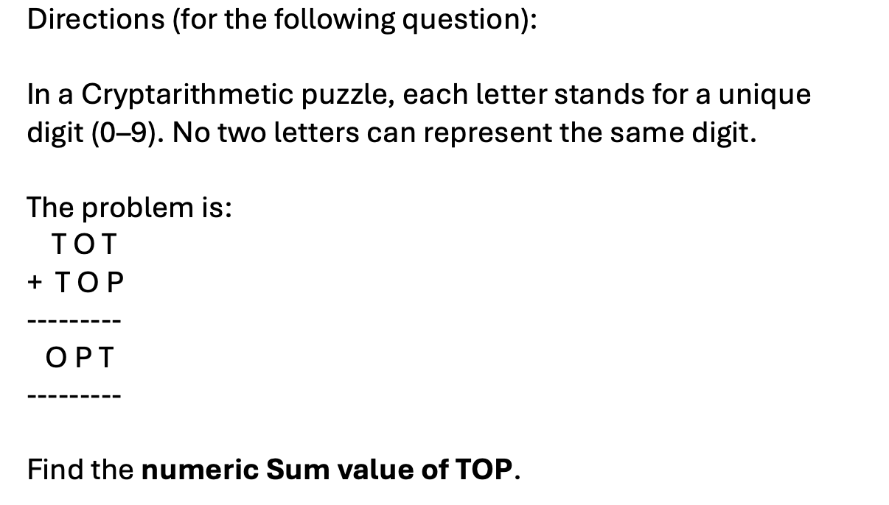

#### Options
- **(A)** 240000

#### Verified Answer
**Numerical Value: 240000**

#### Step-by-Step Solution & Rationale
Correct Answer: Numerical Value: 240000. Solved following standard Infosys System Engineer evaluation criteria.

**Official Video Solution Link**: [https://www.youtube.com/embed/XapZjxCNDLg](https://www.youtube.com/embed/XapZjxCNDLg)

---

### Question 8 (Mock Global Q028)
**ID**: `MOCK_SERIES_Q028` | **Mock Source**: Day 01 — 1. Full Length Numerical Ability with Video Solution- Level -Medium

#### Problem Statement
If x is the mean of the first 8 positive integers multiple of 9 and Y is the Median for the same , then find the value of 5X-3Y.

#### Options
- **(A)** 81

#### Verified Answer
**Numerical Value: 81**

#### Step-by-Step Solution & Rationale
Correct Answer: Numerical Value: 81. Solved following standard Infosys System Engineer evaluation criteria.

**Official Video Solution Link**: [https://www.youtube.com/embed/uePg-C-XGog](https://www.youtube.com/embed/uePg-C-XGog)

---

### Question 9 (Mock Global Q029)
**ID**: `MOCK_SERIES_Q029` | **Mock Source**: Day 01 — 1. Full Length Numerical Ability with Video Solution- Level -Medium

#### Problem Statement
[Data Interpretation / Graphical Aptitude Problem — Refer to Chart Below] Analyze the data chart, graph, or equation presented in the figure and compute the required value.

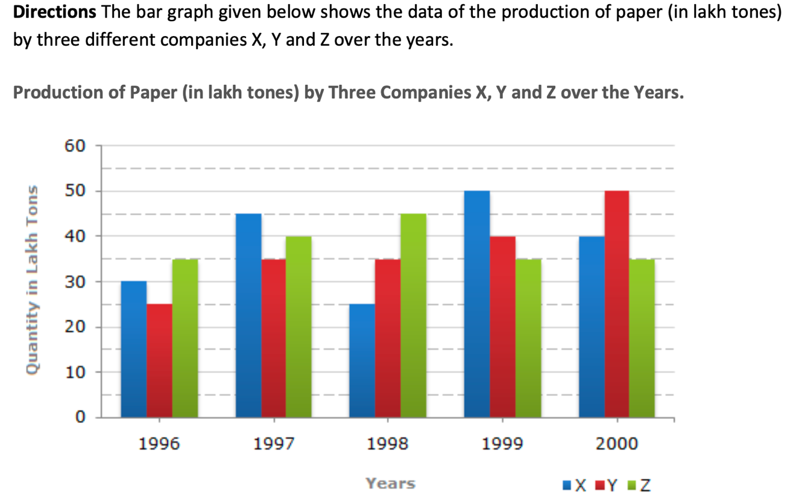

#### Options
- **(A)** 45000

#### Verified Answer
**Numerical Value: 45000**

#### Step-by-Step Solution & Rationale
Correct Answer: Numerical Value: 45000. Solved following standard Infosys System Engineer evaluation criteria.

**Official Video Solution Link**: [https://www.youtube.com/embed/MLCC0vdAJNw](https://www.youtube.com/embed/MLCC0vdAJNw)

---

### Question 10 (Mock Global Q030)
**ID**: `MOCK_SERIES_Q030` | **Mock Source**: Day 01 — 1. Full Length Numerical Ability with Video Solution- Level -Medium

#### Problem Statement
X and Y enter into a business partnership with capital in the ratio 3:5. After 5 months, X adds 50% of his capital, while Y withdraws 60% of his capital. What is the share ( in Rs lakhs) of X in the annual profit of Rs 10.26 lakhs?

#### Options
- **(A)** 5.89
- **(B)** 4.56
- **(C)** 5.58
- **(D)** 6.24

#### Verified Answer
**Option C: 5.58**

#### Step-by-Step Solution & Rationale
Correct Answer: Option C: 5.58. Solved following standard Infosys System Engineer evaluation criteria.

**Official Video Solution Link**: [https://www.youtube.com/embed/IspIF698ufU](https://www.youtube.com/embed/IspIF698ufU)

---

### Question 11 (Mock Global Q031)
**ID**: `MOCK_SERIES_Q031` | **Mock Source**: Day 01 — 1. Full Length Numerical Ability with Video Solution- Level -Medium

#### Problem Statement
[Data Interpretation / Graphical Aptitude Problem — Refer to Chart Below] Analyze the data chart, graph, or equation presented in the figure and compute the required value.

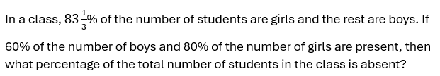

#### Options
- **(A)** Option (A) — Refer to Figure Option A
- **(B)** Option (B) — Refer to Figure Option B
- **(C)** Option (C) — Refer to Figure Option C
- **(D)** Option (D) — Refer to Figure Option D

#### Verified Answer
**Option B: Option (B) — Refer to Figure Option B**

#### Step-by-Step Solution & Rationale
Correct Answer: Option B: Option (B) — Refer to Figure Option B. Solved following standard Infosys System Engineer evaluation criteria.

**Official Video Solution Link**: [https://www.youtube.com/embed/SYLTvjnvJKY](https://www.youtube.com/embed/SYLTvjnvJKY)

---

### Question 12 (Mock Global Q032)
**ID**: `MOCK_SERIES_Q032` | **Mock Source**: Day 01 — 1. Full Length Numerical Ability with Video Solution- Level -Medium

#### Problem Statement
[Data Interpretation / Graphical Aptitude Problem — Refer to Chart Below] Analyze the data chart, graph, or equation presented in the figure and compute the required value.

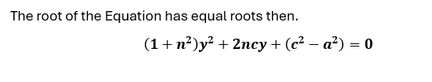

#### Options
- **(A)** Option (A) — Refer to Figure Option A
- **(B)** Option (B) — Refer to Figure Option B
- **(C)** Option (C) — Refer to Figure Option C
- **(D)** Option (D) — Refer to Figure Option D

#### Verified Answer
**Option A: Option (A) — Refer to Figure Option A**

#### Step-by-Step Solution & Rationale
Correct Answer: Option A: Option (A) — Refer to Figure Option A. Solved following standard Infosys System Engineer evaluation criteria.

**Official Video Solution Link**: [https://www.youtube.com/embed/djrfWjIxqeg](https://www.youtube.com/embed/djrfWjIxqeg)

---

### Question 13 (Mock Global Q033)
**ID**: `MOCK_SERIES_Q033` | **Mock Source**: Day 01 — 1. Full Length Numerical Ability with Video Solution- Level -Medium

#### Problem Statement
[Data Interpretation / Graphical Aptitude Problem — Refer to Chart Below] Analyze the data chart, graph, or equation presented in the figure and compute the required value.

#### Options
- **(A)** 35km/hr
- **(B)** 40km/hr
- **(C)** 37.5km/hr
- **(D)** 45 km/hr

#### Verified Answer
**Option C: 37.5km/hr**

#### Step-by-Step Solution & Rationale
Correct Answer: Option C: 37.5km/hr. Solved following standard Infosys System Engineer evaluation criteria.

**Official Video Solution Link**: [https://www.youtube.com/embed/VvcgwtTcP_U](https://www.youtube.com/embed/VvcgwtTcP_U)

---

### Question 14 (Mock Global Q034)
**ID**: `MOCK_SERIES_Q034` | **Mock Source**: Day 01 — 1. Full Length Numerical Ability with Video Solution- Level -Medium

#### Problem Statement
[Data Interpretation / Graphical Aptitude Problem — Refer to Chart Below] Analyze the data chart, graph, or equation presented in the figure and compute the required value.

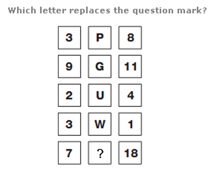

#### Options
- **(A)** 4,5,9
- **(B)** 3,7,8
- **(C)** 3,6,9
- **(D)** 4,7,7

#### Verified Answer
**Option A: 4,5,9**

#### Step-by-Step Solution & Rationale
Correct Answer: Option A: 4,5,9. Solved following standard Infosys System Engineer evaluation criteria.

**Official Video Solution Link**: [https://www.youtube.com/embed/uN3uu8Awy-0](https://www.youtube.com/embed/uN3uu8Awy-0)

---

### Question 15 (Mock Global Q035)
**ID**: `MOCK_SERIES_Q035` | **Mock Source**: Day 01 — 1. Full Length Numerical Ability with Video Solution- Level -Medium

#### Problem Statement
A shopkeeper earns a profit of 20% by selling an article by giving 25% discount on its marked price. If the cost price of the article increases by 10%, then how much discount percent should he give now on the same marked price to earn the same percentage of profit as earlier?

#### Options
- **(A)** 17.5%
- **(B)** 16.5%
- **(C)** 18%
- **(D)** 15%

#### Verified Answer
**Option A: 17.5%**

#### Step-by-Step Solution & Rationale
Correct Answer: Option A: 17.5%. Solved following standard Infosys System Engineer evaluation criteria.

**Official Video Solution Link**: [https://www.youtube.com/embed/9SHym9bcr8U](https://www.youtube.com/embed/9SHym9bcr8U)

---

### Question 16 (Mock Global Q036)
**ID**: `MOCK_SERIES_Q036` | **Mock Source**: Day 01 — 1. Full Length Numerical Ability with Video Solution- Level -Medium

#### Problem Statement
In the given questions, two quantities are given, one as 'Quantity 1' and another as 'Quantity 2'. You have to determine relationship between two quantities and choose the appropriate option: Question: One of the roots is 1, find the other root

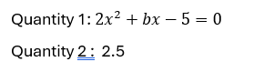

#### Options
- **(A)** Quantity 1 > Quantity 2
- **(B)** Quantity 1 &ge; Quantity 2
- **(C)** Quantity 2 > Quantity 1
- **(D)** Quantity 2 &ge; Quantity 1
- **(E)** Quantity 1 = Quantity 2 or Relation cannot be established

#### Verified Answer
**Option C: Quantity 2 > Quantity 1**

#### Step-by-Step Solution & Rationale
Correct Answer: Option C: Quantity 2 > Quantity 1. Solved following standard Infosys System Engineer evaluation criteria.

**Official Video Solution Link**: [https://www.youtube.com/embed/hVlSBoLKmVs](https://www.youtube.com/embed/hVlSBoLKmVs)

---

### Question 17 (Mock Global Q037)
**ID**: `MOCK_SERIES_Q037` | **Mock Source**: Day 01 — 1. Full Length Numerical Ability with Video Solution- Level -Medium

#### Problem Statement
In a river, the ratio of the speed of stream and speed of a boat A in still water is 2 : 5. Again, in the same river ratio of the speed of stream and speed of another boat B in still water is 3 : 4. What is the ratio of the speeds of the first boat to the second boat in still water ?

#### Options
- **(A)** 10 : 7
- **(B)** 15 : 8
- **(C)** 4 : 3
- **(D)** 5 : 4
- **(E)** 7 : 11

#### Verified Answer
**Option B: 15 : 8**

#### Step-by-Step Solution & Rationale
Correct Answer: Option B: 15 : 8. Solved following standard Infosys System Engineer evaluation criteria.

**Official Video Solution Link**: [https://www.youtube.com/embed/sisAFLdcRVg](https://www.youtube.com/embed/sisAFLdcRVg)

---

### Question 18 (Mock Global Q038)
**ID**: `MOCK_SERIES_Q038` | **Mock Source**: Day 01 — 1. Full Length Numerical Ability with Video Solution- Level -Medium

#### Problem Statement
Find the area of blue portion.

#### Options
- **(A)** 52
- **(B)** 62
- **(C)** 72
- **(D)** None of these

#### Verified Answer
**Option D: None of these**

#### Step-by-Step Solution & Rationale
Correct Answer: Option D: None of these. Solved following standard Infosys System Engineer evaluation criteria.

**Official Video Solution Link**: [https://www.youtube.com/embed/L3kD_FndH5o](https://www.youtube.com/embed/L3kD_FndH5o)

---

### Question 19 (Mock Global Q039)
**ID**: `MOCK_SERIES_Q039` | **Mock Source**: Day 01 — 1. Full Length Numerical Ability with Video Solution- Level -Medium

#### Problem Statement
In the given questions, two quantities are given, one as 'Quantity 1' and another as 'Quantity 2'. You have to determine relationship between two quantities and choose the appropriate option: Question: Two dices are rolled simultaneously. Quantity 1: Probability that the sum of the numbers that appeared is a multiple of 5. Quantity 2: 1/6

#### Options
- **(A)** Quantity 1 > Quantity 2
- **(B)** Quantity 1 &ge; Quantity 2
- **(C)** Quantity 2 > Quantity 1
- **(D)** Quantity 2 &ge; Quantity 1
- **(E)** Quantity 1 = Quantity 2 or Relation cannot be established

#### Verified Answer
**Option A: Quantity 1 > Quantity 2**

#### Step-by-Step Solution & Rationale
Correct Answer: Option A: Quantity 1 > Quantity 2. Solved following standard Infosys System Engineer evaluation criteria.

**Official Video Solution Link**: [https://www.youtube.com/embed/OZWFA9Y3RM0](https://www.youtube.com/embed/OZWFA9Y3RM0)

---

### Question 20 (Mock Global Q040)
**ID**: `MOCK_SERIES_Q040` | **Mock Source**: Day 01 — 1. Full Length Numerical Ability with Video Solution- Level -Medium

#### Problem Statement
What is the mean of the mode and median of the data given below? 8, 7, 5, 4, 9, 1, 3, 7, 6, 5, 2, 1, 6, 3, 9, 8, 4, 6

#### Options
- **(A)** 6.5
- **(B)** 6.25
- **(C)** 5.5
- **(D)** 5.75

#### Verified Answer
**Option D: 5.75**

#### Step-by-Step Solution & Rationale
Correct Answer: Option D: 5.75. Solved following standard Infosys System Engineer evaluation criteria.

**Official Video Solution Link**: [https://www.youtube.com/embed/xiyzH-teu_E](https://www.youtube.com/embed/xiyzH-teu_E)

---

### Question 1 (Mock Global Q081)
**ID**: `MOCK_SERIES_Q081` | **Mock Source**: Day 02 — 2. Full length Quantitative Aptitude (with sol) Level -2

#### Problem Statement
In the IT department of backrub, the administrator password is changed every month. The team of administrators, spread across the globe, receive an 8 digit number via email. This number is to be prefixed with a single digit number and suffixed with a single digit number to get the actual password. The password is divisible by 11 and 8. If the team received 65351364 this month, then which of the following pairs give prefix and suffix respectively.

#### Options
- **(A)** 8, 9
- **(B)** 7, 8
- **(C)** 3, 4
- **(D)** 2, 7

#### Verified Answer
**Option B: 7, 8**

#### Step-by-Step Solution & Rationale
Correct Answer: Option B: 7, 8. Solved following standard Infosys System Engineer evaluation criteria.

---

### Question 2 (Mock Global Q082)
**ID**: `MOCK_SERIES_Q082` | **Mock Source**: Day 02 — 2. Full length Quantitative Aptitude (with sol) Level -2

#### Problem Statement
In the IT department of backrub, the administrator password is changed every month. The team of administrator, spread across the globe, receive an 8 digits number via email. This number is to be prefixed with a single digit number and suffixed with a single digit number to get the actual password. The password is divisible by 11 and 8. If the team received 54218345 this month. Then which of the following pairs give valid prefix and suffix respectively?

#### Options
- **(A)** 3, 7
- **(B)** 1, 6
- **(C)** 2, 4
- **(D)** 4, 2

#### Verified Answer
**Option B: 1, 6**

#### Step-by-Step Solution & Rationale
Correct Answer: Option B: 1, 6. Solved following standard Infosys System Engineer evaluation criteria.

---

### Question 3 (Mock Global Q083)
**ID**: `MOCK_SERIES_Q083` | **Mock Source**: Day 02 — 2. Full length Quantitative Aptitude (with sol) Level -2

#### Problem Statement
Two ants of length 1 cm and 1.2 cm crawl in opposite directions with average speeds of 2 and 3 mm per second respectively. How many seconds will they take to cross each other?

#### Options
- **(A)** 0.44 sec
- **(B)** 44 sec
- **(C)** 6.4 sec
- **(D)** Not

#### Verified Answer
**Option D: Not**

#### Step-by-Step Solution & Rationale
Correct Answer: Option D: Not. Solved following standard Infosys System Engineer evaluation criteria.

---

### Question 4 (Mock Global Q084)
**ID**: `MOCK_SERIES_Q084` | **Mock Source**: Day 02 — 2. Full length Quantitative Aptitude (with sol) Level -2

#### Problem Statement
Rs. 3000 is distributed among A, B and C such that A gets 2/3 rd of what B and C together get and C gets 1/2 of what A and B together get. Find B's share.

#### Options
- **(A)** 800
- **(B)** 1000
- **(C)** 1200
- **(D)** 1500
- **(E)** 1800

#### Verified Answer
**Option A: 800**

#### Step-by-Step Solution & Rationale
Correct Answer: Option A: 800. Solved following standard Infosys System Engineer evaluation criteria.

---

### Question 5 (Mock Global Q085)
**ID**: `MOCK_SERIES_Q085` | **Mock Source**: Day 02 — 2. Full length Quantitative Aptitude (with sol) Level -2

#### Problem Statement
A sum of money invested at compound interest amounts of 800 in 3 years and 882 in 5 years.What is the rate of Interest?

#### Options
- **(A)** 2.5%
- **(B)** 4%
- **(C)** 5%
- **(D)** 6.66%
- **(E)** Option 5None of these

#### Verified Answer
**Option C: 5%**

#### Step-by-Step Solution & Rationale
Correct Answer: Option C: 5%. Solved following standard Infosys System Engineer evaluation criteria.

---

### Question 6 (Mock Global Q086)
**ID**: `MOCK_SERIES_Q086` | **Mock Source**: Day 02 — 2. Full length Quantitative Aptitude (with sol) Level -2

#### Problem Statement
Two trains are on the same line, 100 miles apart, heading towards each other, each traveling at 20 miles/h. A bee starts flying between the trains when the distance between two trains is 100 km. The bee first flies from first train to second train. Once it reaches the second train, it immediately flies back to the first train ... and so on until trains collide. Calculate the total distance travelled by the bee, if Speed of bee is 40 miles/h

#### Options
- **(A)** 100
- **(B)** 150
- **(C)** 170
- **(D)** 200

#### Verified Answer
**Option A: 100**

#### Step-by-Step Solution & Rationale
Correct Answer: Option A: 100. Solved following standard Infosys System Engineer evaluation criteria.

---

### Question 7 (Mock Global Q087)
**ID**: `MOCK_SERIES_Q087` | **Mock Source**: Day 02 — 2. Full length Quantitative Aptitude (with sol) Level -2

#### Problem Statement
The mark price of an article is Rs. 300.After allowing a discount 15% on the marked price, the shopkeeper makes a gain of Rs.15.What is the gain percentage?

#### Options
- **(A)** 16(1/4)
- **(B)** 7(1/4)
- **(C)** 16(2/3)
- **(D)** NOT

#### Verified Answer
**Option D: NOT**

#### Step-by-Step Solution & Rationale
Correct Answer: Option D: NOT. Solved following standard Infosys System Engineer evaluation criteria.

---

### Question 8 (Mock Global Q088)
**ID**: `MOCK_SERIES_Q088` | **Mock Source**: Day 02 — 2. Full length Quantitative Aptitude (with sol) Level -2

#### Problem Statement
Quantity 1: Speed of boat in still water, if a man can travel 54 km downstream in 9 hours and 40 km upstream in 10 hours. Quantity II: Speed of boat in still water, if a man can travel 45 km downstream in 9 hours and the speed of stream is 1 kmph.

#### Options
- **(A)** Option (A) — Refer to Figure Option A
- **(B)** Option (B) — Refer to Figure Option B
- **(C)** Option (C) — Refer to Figure Option C
- **(D)** Option (D) — Refer to Figure Option D

#### Verified Answer
**Option C: Option (C) — Refer to Figure Option C**

#### Step-by-Step Solution & Rationale
Correct Answer: Option C: Option (C) — Refer to Figure Option C. Solved following standard Infosys System Engineer evaluation criteria.

---

### Question 9 (Mock Global Q089)
**ID**: `MOCK_SERIES_Q089` | **Mock Source**: Day 02 — 2. Full length Quantitative Aptitude (with sol) Level -2

#### Problem Statement
In an envelope there are 5 green, 3 yellow and 4 pink tablets. 3 tablets are picked at random.Quantity I: The probability that 2 tablets are yellow in colour and 1 tablet is pink in colour.Quantity II: The probability that all the tablets are green in colour.

#### Options
- **(A)** Option (A) — Refer to Figure Option A
- **(B)** Option (B) — Refer to Figure Option B
- **(C)** Option (C) — Refer to Figure Option C
- **(D)** Option (D) — Refer to Figure Option D

#### Verified Answer
**Option A: Option (A) — Refer to Figure Option A**

#### Step-by-Step Solution & Rationale
Correct Answer: Option A: Option (A) — Refer to Figure Option A. Solved following standard Infosys System Engineer evaluation criteria.

---

### Question 10 (Mock Global Q090)
**ID**: `MOCK_SERIES_Q090` | **Mock Source**: Day 02 — 2. Full length Quantitative Aptitude (with sol) Level -2

#### Problem Statement
Sum of CP's of two cows is Rs. 39, 000. Both the cows are sold at a profit of 20% and 40% respectively with their SP's being the same. What is the difference of CP's of both the cows?

#### Options
- **(A)** Rs. 3,000
- **(B)** Rs. 2,000
- **(C)** Rs. 1,500
- **(D)** Rs. 2,500
- **(E)** None of these

#### Verified Answer
**Option A: Rs. 3,000**

#### Step-by-Step Solution & Rationale
Correct Answer: Option A: Rs. 3,000. Solved following standard Infosys System Engineer evaluation criteria.

---

### Question 11 (Mock Global Q091)
**ID**: `MOCK_SERIES_Q091` | **Mock Source**: Day 02 — 2. Full length Quantitative Aptitude (with sol) Level -2

#### Problem Statement
If the sum of five consecutive is S, then the largest of, those integers in term of S is:

#### Options
- **(A)** (S-10)/4
- **(B)** (S+4)/4
- **(C)** (S+5)/4
- **(D)** (S+10)/5

#### Verified Answer
**Option D: (S+10)/5**

#### Step-by-Step Solution & Rationale
Correct Answer: Option D: (S+10)/5. Solved following standard Infosys System Engineer evaluation criteria.

---

### Question 12 (Mock Global Q092)
**ID**: `MOCK_SERIES_Q092` | **Mock Source**: Day 02 — 2. Full length Quantitative Aptitude (with sol) Level -2

#### Problem Statement
A person can complete a job in 120 days. He works alone on Day 1. On Day 2, he is joined by another person who also can complete the job in exactly 120 days. On Day 3, they are joined by another person of equal efficiency. Like this, everyday a new person with the same efficiency joins the work. How many days are required to complete the job?

#### Options
- **(A)** 20
- **(B)** 15
- **(C)** 25
- **(D)** NOT

#### Verified Answer
**Option B: 15**

#### Step-by-Step Solution & Rationale
Correct Answer: Option B: 15. Solved following standard Infosys System Engineer evaluation criteria.

---

### Question 13 (Mock Global Q093)
**ID**: `MOCK_SERIES_Q093` | **Mock Source**: Day 02 — 2. Full length Quantitative Aptitude (with sol) Level -2

#### Problem Statement
A container contains 40 liters of milk. From this container 4 liters of milk was taken out and replaced by water. This process was repeated further two times. How much milk Is now contained by the container?

#### Options
- **(A)** 26.34 liters
- **(B)** 29.16 liters
- **(C)** 28.34 liters
- **(D)** 29.18 liters

#### Verified Answer
**Option B: 29.16 liters**

#### Step-by-Step Solution & Rationale
Correct Answer: Option B: 29.16 liters. Solved following standard Infosys System Engineer evaluation criteria.

---

### Question 14 (Mock Global Q094)
**ID**: `MOCK_SERIES_Q094` | **Mock Source**: Day 02 — 2. Full length Quantitative Aptitude (with sol) Level -2

#### Problem Statement
The Ghaziabad-Hapur-Meerut EMU and the Meerut-Hapur- Ghaziabad EMU start at the same time from Ghaziabad and Meerut and proceed towards each other at 16 km/hr and 21 km/hr, respectively. When they meet, it is found that one train has travelled 60 km more than the other. The distance between two stations is:

#### Options
- **(A)** 445 km
- **(B)** 444 km
- **(C)** 440 km
- **(D)** 450 km

#### Verified Answer
**Option B: 444 km**

#### Step-by-Step Solution & Rationale
Correct Answer: Option B: 444 km. Solved following standard Infosys System Engineer evaluation criteria.

---

### Question 1 (Mock Global Q144)
**ID**: `MOCK_SERIES_Q144` | **Mock Source**: Day 03 — 3. Full length Quantitative Aptitude (with sol) Level -1-2

#### Problem Statement
Study the pie chart carefully and answer the questions. The pie chart shows the percentage breakup students in different classes from VI to X in the year 2017

1. The total number of students study in class VI and class IX together is approximately what percentage more than that of the total number of students study in class X?

#### Options
- **(A)** 125%
- **(B)** 280%
- **(C)** 217%
- **(D)** 189%
- **(E)** 77%

#### Verified Answer
**Option C: 217%**

#### Step-by-Step Solution & Rationale
Correct Answer: Option C: 217%. Solved following standard Infosys System Engineer evaluation criteria.

---

### Question 2 (Mock Global Q145)
**ID**: `MOCK_SERIES_Q145` | **Mock Source**: Day 03 — 3. Full length Quantitative Aptitude (with sol) Level -1-2

#### Problem Statement
Study the pie chart carefully and answer the questions. The pie chart shows the percentage breakup students in different classes from VI to X in the year 2017

2. If in class VI, the ratio of boys to girls is 6:5 and the total number of girls in class VI is 50 less than that of the total number of girls in class VII. Find the ratio of the total number of boys in class VI to class VII.

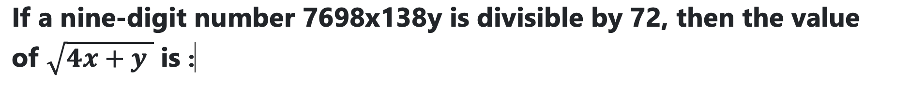

#### Options
- **(A)** 5:7
- **(B)** 7:11
- **(C)** 9:13
- **(D)** 6:13
- **(E)** Option 54:5

#### Verified Answer
**Option D: 6:13**

#### Step-by-Step Solution & Rationale
Correct Answer: Option D: 6:13. Solved following standard Infosys System Engineer evaluation criteria.

---

### Question 3 (Mock Global Q146)
**ID**: `MOCK_SERIES_Q146` | **Mock Source**: Day 03 — 3. Full length Quantitative Aptitude (with sol) Level -1-2

#### Problem Statement
Study the pie chart carefully and answer the questions. The pie chart shows the percentage breakup students in different classes from VI to X in the year 2017

3. If the total number of boys in class VIII is "x" and the total number of boys in class IX is "x+40". The total number of girls in class VIII and class IX together is 306. Then find the value of "x".

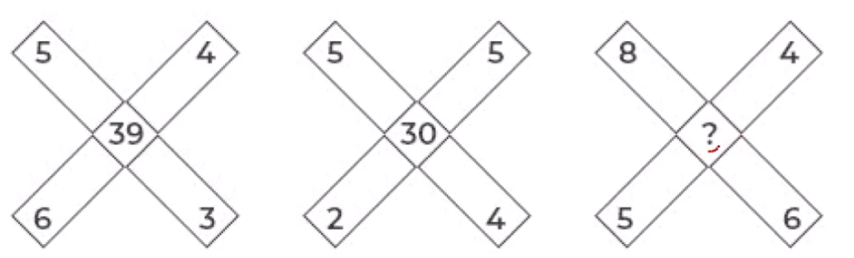

#### Options
- **(A)** 190
- **(B)** 210
- **(C)** 174
- **(D)** 184
- **(E)** 196

#### Verified Answer
**Option A: 190**

#### Step-by-Step Solution & Rationale
Correct Answer: Option A: 190. Solved following standard Infosys System Engineer evaluation criteria.

---

### Question 4 (Mock Global Q147)
**ID**: `MOCK_SERIES_Q147` | **Mock Source**: Day 03 — 3. Full length Quantitative Aptitude (with sol) Level -1-2

#### Problem Statement
Study the pie chart carefully and answer the questions. The pie chart shows the percentage breakup students in different classes from VI to X in the year 2017

4. What is the difference between the total number of students in class VII and class VIII together to that of the total number of students in class IX and class X together?

#### Options
- **(A)** 480
- **(B)** 520
- **(C)** 440
- **(D)** 400
- **(E)** 560

#### Verified Answer
**Option C: 440**

#### Step-by-Step Solution & Rationale
Correct Answer: Option C: 440. Solved following standard Infosys System Engineer evaluation criteria.

---

### Question 5 (Mock Global Q148)
**ID**: `MOCK_SERIES_Q148` | **Mock Source**: Day 03 — 3. Full length Quantitative Aptitude (with sol) Level -1-2

#### Problem Statement
Four circles having equal radii are drawn with centres at the four corners of a square. Each circle touches the other two adjacent circle. If remaining area of the square is 168 cm square, what is the size of the radius of the circle? (in centimeters) (take π = 22/7)

#### Options
- **(A)** 1.4
- **(B)** 14
- **(C)** 35
- **(D)** 21
- **(E)** 3.5

#### Verified Answer
**Option B: 14**

#### Step-by-Step Solution & Rationale
Correct Answer: Option B: 14. Solved following standard Infosys System Engineer evaluation criteria.

---

### Question 6 (Mock Global Q149)
**ID**: `MOCK_SERIES_Q149` | **Mock Source**: Day 03 — 3. Full length Quantitative Aptitude (with sol) Level -1-2

#### Problem Statement
A man wants to invest Rs. 16850 in bank account of his 2 sons, whose ages are 12 years & 16 years in such a way so that they will get equal amount at an age of 120 years at the rate of 33(1/3)% compounded annually. Find the share of younger son?

#### Options
- **(A)** 4050
- **(B)** 4080
- **(C)** 4090
- **(D)** 4085

#### Verified Answer
**Option A: 4050**

#### Step-by-Step Solution & Rationale
Correct Answer: Option A: 4050. Solved following standard Infosys System Engineer evaluation criteria.

---

### Question 7 (Mock Global Q150)
**ID**: `MOCK_SERIES_Q150` | **Mock Source**: Day 03 — 3. Full length Quantitative Aptitude (with sol) Level -1-2

#### Problem Statement
A bag contains 5 red and 7 white balls. Four balls are drawn out one by one and not replaced. What is the probability that they are alternatively of different colours?

#### Options
- **(A)** 7/99
- **(B)** 11/99
- **(C)** 14/99
- **(D)** 19/99
- **(E)** None of these

#### Verified Answer
**Option C: 14/99**

#### Step-by-Step Solution & Rationale
Correct Answer: Option C: 14/99. Solved following standard Infosys System Engineer evaluation criteria.

---

### Question 8 (Mock Global Q151)
**ID**: `MOCK_SERIES_Q151` | **Mock Source**: Day 03 — 3. Full length Quantitative Aptitude (with sol) Level -1-2

#### Problem Statement
The ratio of the age of Ram and Rahim 10 years ago was 1 : 3. The ratio of their age five years hence will be
2 : 3. Then the ratio of their present age is

#### Options
- **(A)** 1 : 2
- **(B)** 3 : 5
- **(C)** 3 : 4
- **(D)** 2 : 5

#### Verified Answer
**Option B: 3 : 5**

#### Step-by-Step Solution & Rationale
Correct Answer: Option B: 3 : 5. Solved following standard Infosys System Engineer evaluation criteria.

**Official Video Solution Link**: [https://www.youtube.com/embed/1LjiPiJ92Xo](https://www.youtube.com/embed/1LjiPiJ92Xo)

---

### Question 9 (Mock Global Q152)
**ID**: `MOCK_SERIES_Q152` | **Mock Source**: Day 03 — 3. Full length Quantitative Aptitude (with sol) Level -1-2

#### Problem Statement
"A" can complete a piece of work in 8 days,while "B" is 20% more efficient than him. A works for 2 days,then B works for 1 day, and the cycle continues like this.in how many days would the work be completed?

#### Options
- **(A)** 7(3/5)
- **(B)** 7 days
- **(C)** 7(7/9)
- **(D)** not

#### Verified Answer
**Option A: 7(3/5)**

#### Step-by-Step Solution & Rationale
Correct Answer: Option A: 7(3/5). Solved following standard Infosys System Engineer evaluation criteria.

---

### Question 10 (Mock Global Q153)
**ID**: `MOCK_SERIES_Q153` | **Mock Source**: Day 03 — 3. Full length Quantitative Aptitude (with sol) Level -1-2

#### Problem Statement
The simple interest (p.a.) accrued on an amount of Rs 17,000 at the end of four years is Rs 6,800. What would be the compound interest (compounded annually) accrued on the same amount at the same rate in two years?

#### Options
- **(A)** Cannot be determined
- **(B)** Other than those given as option
- **(C)** 3570
- **(D)** 3260
- **(E)** 3980

#### Verified Answer
**Option C: 3570**

#### Step-by-Step Solution & Rationale
Correct Answer: Option C: 3570. Solved following standard Infosys System Engineer evaluation criteria.

---

### Question 11 (Mock Global Q154)
**ID**: `MOCK_SERIES_Q154` | **Mock Source**: Day 03 — 3. Full length Quantitative Aptitude (with sol) Level -1-2

#### Problem Statement
Find the missing number in the given seriese.
2, 7, 10, 22, 18, 37, 26,?

#### Options
- **(A)** 42
- **(B)** 52
- **(C)** 46
- **(D)** 62
- **(E)** None of these

#### Verified Answer
**Option B: 52**

#### Step-by-Step Solution & Rationale
Correct Answer: Option B: 52. Solved following standard Infosys System Engineer evaluation criteria.

---

### Question 12 (Mock Global Q155)
**ID**: `MOCK_SERIES_Q155` | **Mock Source**: Day 03 — 3. Full length Quantitative Aptitude (with sol) Level -1-2

#### Problem Statement
Find the missing number in the given seriese.

12,     12,     18,     45,     180,     1170,     ?

#### Options
- **(A)** 12285
- **(B)** 10530
- **(C)** 11700
- **(D)** 12870
- **(E)** 9945

#### Verified Answer
**Option A: 12285**

#### Step-by-Step Solution & Rationale
Correct Answer: Option A: 12285. Solved following standard Infosys System Engineer evaluation criteria.

**Official Video Solution Link**: [https://www.youtube.com/embed/fCG8tbOsgBk](https://www.youtube.com/embed/fCG8tbOsgBk)

---

### Question 13 (Mock Global Q156)
**ID**: `MOCK_SERIES_Q156` | **Mock Source**: Day 03 — 3. Full length Quantitative Aptitude (with sol) Level -1-2

#### Problem Statement
Find the wrong term in the series

2,   3,   10,   38,   172

#### Options
- **(A)** 2
- **(B)** 3
- **(C)** 10
- **(D)** 38
- **(E)** 172

#### Verified Answer
**Option D: 38**

#### Step-by-Step Solution & Rationale
Correct Answer: Option D: 38. Solved following standard Infosys System Engineer evaluation criteria.

---

### Question 1 (Mock Global Q302)
**ID**: `MOCK_SERIES_Q302` | **Mock Source**: Day 06 — Quantitative Aptitude_Technical Abilty

#### Problem Statement
An Amount of Rs. 3000 is distributed among A, B and C such that A gets 2/3 rd of what B and C together get and C gets 1/2 of what A and B together get. Find B&rsquo;s sh are.

#### Options
- **(A)** 650
- **(B)** 700
- **(C)** 500
- **(D)** 800

#### Verified Answer
**Option D: 800**

#### Step-by-Step Solution & Rationale
Correct Answer: Option D: 800. Solved following standard Infosys System Engineer evaluation criteria.

---

### Question 2 (Mock Global Q303)
**ID**: `MOCK_SERIES_Q303` | **Mock Source**: Day 06 — Quantitative Aptitude_Technical Abilty

#### Problem Statement
[Data Interpretation / Graphical Aptitude Problem — Refer to Chart Below] Analyze the data chart, graph, or equation presented in the figure and compute the required value.

#### Options
- **(A)** 4
- **(B)** 5
- **(C)** 6
- **(D)** None Of these

#### Verified Answer
**Option C: 6**

#### Step-by-Step Solution & Rationale
Correct Answer: Option C: 6. Solved following standard Infosys System Engineer evaluation criteria.

---

### Question 3 (Mock Global Q304)
**ID**: `MOCK_SERIES_Q304` | **Mock Source**: Day 06 — Quantitative Aptitude_Technical Abilty

#### Problem Statement
An almirah was sold at a profit of 15%. If its cost had been 5% less and it had been sold for Rs 1,470 less, then the profit would have been 10%. What is the cost price of the almirah?

#### Options
- **(A)** 14400
- **(B)** 14000
- **(C)** 16100
- **(D)** 15400

#### Verified Answer
**Option B: 14000**

#### Step-by-Step Solution & Rationale
Correct Answer: Option B: 14000. Solved following standard Infosys System Engineer evaluation criteria.

---

### Question 4 (Mock Global Q305)
**ID**: `MOCK_SERIES_Q305` | **Mock Source**: Day 06 — Quantitative Aptitude_Technical Abilty

#### Problem Statement
Seven years ago, the ratio of the ages of A and B was 2: 3. Three years hence, the ratio of their ages will be 5: 7. The sum of their present ages (in years) is:

#### Options
- **(A)** 100
- **(B)** 200
- **(C)** 112
- **(D)** 114

#### Verified Answer
**Option D: 114**

#### Step-by-Step Solution & Rationale
Correct Answer: Option D: 114. Solved following standard Infosys System Engineer evaluation criteria.

---

### Question 5 (Mock Global Q306)
**ID**: `MOCK_SERIES_Q306` | **Mock Source**: Day 06 — Quantitative Aptitude_Technical Abilty

#### Problem Statement
Veer buys 200 guavas for Rs.1,800. Some of these guavas are rotten and are thrown away. He sells the remaining guavas at Rs.14 each and makes a profit of Rs.230. The percentage of guavas thrown away is:

#### Options
- **(A)** 27%
- **(B)** 29%
- **(C)** 30%
- **(D)** 27.5%

#### Verified Answer
**Option D: 27.5%**

#### Step-by-Step Solution & Rationale
Correct Answer: Option D: 27.5%. Solved following standard Infosys System Engineer evaluation criteria.

---

### Question 6 (Mock Global Q307)
**ID**: `MOCK_SERIES_Q307` | **Mock Source**: Day 06 — Quantitative Aptitude_Technical Abilty

#### Problem Statement
A boy walked along two adjacent sides of a rectangular field. If he had walked along the diagonal, then he would have saved a distance equal to one-fourth of the larger side. The ratio of the smaller to the larger side is:

#### Options
- **(A)** 11:18
- **(B)** 18:11
- **(C)** 7:24
- **(D)** 5:12

#### Verified Answer
**Option C: 7:24**

#### Step-by-Step Solution & Rationale
Correct Answer: Option C: 7:24. Solved following standard Infosys System Engineer evaluation criteria.

---

### Question 7 (Mock Global Q308)
**ID**: `MOCK_SERIES_Q308` | **Mock Source**: Day 06 — Quantitative Aptitude_Technical Abilty

#### Problem Statement
[Data Interpretation / Graphical Aptitude Problem — Refer to Chart Below] Analyze the data chart, graph, or equation presented in the figure and compute the required value.

#### Options
- **(A)** 5
- **(B)** 0
- **(C)** 7
- **(D)** 4

#### Verified Answer
**Option C: 7**

#### Step-by-Step Solution & Rationale
Correct Answer: Option C: 7. Solved following standard Infosys System Engineer evaluation criteria.

---

### Question 8 (Mock Global Q309)
**ID**: `MOCK_SERIES_Q309` | **Mock Source**: Day 06 — Quantitative Aptitude_Technical Abilty

#### Problem Statement
A team of four players are to be selected from among four girls A,B,C,D and four boys P,Q,R,S such that there would be at least two girls in the team and the team selection should meet the following conditions i. B cannot go with R ii .D and P must go together iii S cannot be put up with A iv. R and C must be together

#### Options
- **(A)** QBSC
- **(B)** DAPQ
- **(C)** RCQS
- **(D)** BPRA

#### Verified Answer
**Option B: DAPQ**

#### Step-by-Step Solution & Rationale
Correct Answer: Option B: DAPQ. Solved following standard Infosys System Engineer evaluation criteria.

---

### Question 9 (Mock Global Q310)
**ID**: `MOCK_SERIES_Q310` | **Mock Source**: Day 06 — Quantitative Aptitude_Technical Abilty

#### Problem Statement
While Balbir had his back turned, a dog ran into his butcher shop, snatched a piece of meat off the counter and ran off. Balbir was mad when he realised what had happened. He asked three other shopkeepers, who had seen the dog, to describe it. The shopkeepers really didn&rsquo;t want to help Balbir. So each of them made a statement which contained one truth and one lie. A. Shopkeeper Number 1 said: &ldquo;The dog had black hair and a long tail.&rdquo; B. Shopkeeper Number 2 said: &ldquo;The dog had a short tail and wore a collar.&rdquo; C. Shopkeeper Number 3 said: &ldquo;The dog had white hair and no collar.&rdquo; Based on the above statements, which of the following could be a correct description?

#### Options
- **(A)** The dog had black hair, long tail and a collar.
- **(B)** The dog had white hair, short tail and no collar.
- **(C)** The dog had black hair, long tail and no collar.
- **(D)** The dog had white hair, long tail and a collar.

#### Verified Answer
**Option D: The dog had white hair, long tail and a collar.**

#### Step-by-Step Solution & Rationale
Correct Answer: Option D: The dog had white hair, long tail and a collar.. Solved following standard Infosys System Engineer evaluation criteria.

---

### Question 10 (Mock Global Q311)
**ID**: `MOCK_SERIES_Q311` | **Mock Source**: Day 06 — Quantitative Aptitude_Technical Abilty

#### Problem Statement
In a bag, there are coins of 25 p, 10 p and 5 p in the ratio of 1 : 2 : 3. If there is Rs. 30 in all, how many 5 p coins are there?

#### Options
- **(A)** 50
- **(B)** 100
- **(C)** 150
- **(D)** 200

#### Verified Answer
**Option C: 150**

#### Step-by-Step Solution & Rationale
Correct Answer: Option C: 150. Solved following standard Infosys System Engineer evaluation criteria.

---

### Question 1 (Mock Global Q334)
**ID**: `MOCK_SERIES_Q334` | **Mock Source**: Day 07 — SECTION-I_ MATHEMATICAL ABILITY

#### Problem Statement
A code word is to consist of two distinct English alphabets followed by two distinct numbers from1 and 9 ( both Inclusive ). For example, CA23 is a code word. How many such code words are there?

#### Options
- **(A)** 615800
- **(B)** 46800
- **(C)** 719500
- **(D)** 410800

#### Verified Answer
**Option B: 46800**

#### Step-by-Step Solution & Rationale
Correct Answer: Option B: 46800. Solved following standard Infosys System Engineer evaluation criteria.

---

### Question 2 (Mock Global Q335)
**ID**: `MOCK_SERIES_Q335` | **Mock Source**: Day 07 — SECTION-I_ MATHEMATICAL ABILITY

#### Problem Statement
In an entrance exam of 200 objective questions, a student can score 1 point for every correct answer, loss 1/4 points for every wrong answer and loss 1/2 point for every unanswered question. If he attempts only 160 questions and he scores 100 points then the number of questions answered by him correctly is:

#### Options
- **(A)** A. 132
- **(B)** A. 126
- **(C)** A. 139
- **(D)** A. 128

#### Verified Answer
**Option D: A. 128**

#### Step-by-Step Solution & Rationale
Correct Answer: Option D: A. 128. Solved following standard Infosys System Engineer evaluation criteria.

---

### Question 3 (Mock Global Q336)
**ID**: `MOCK_SERIES_Q336` | **Mock Source**: Day 07 — SECTION-I_ MATHEMATICAL ABILITY

#### Problem Statement
Two containers of milk contain mixtures of water and milk in ratio 5:4 and 7:9. In what ratio they should be mixed so that mixture is of 6:6 ratios?

#### Options
- **(A)** A. 6:5
- **(B)** A. 7:5
- **(C)** A. 8:9
- **(D)** A. 9:8

#### Verified Answer
**Option D: A. 9:8**

#### Step-by-Step Solution & Rationale
Correct Answer: Option D: A. 9:8. Solved following standard Infosys System Engineer evaluation criteria.

---

### Question 4 (Mock Global Q337)
**ID**: `MOCK_SERIES_Q337` | **Mock Source**: Day 07 — SECTION-I_ MATHEMATICAL ABILITY

#### Problem Statement
There are two pipes in a tank. Pipe A is for filling the tank and pipe b is for emptying the tank. If A can fill the tank in 10 hours and b can empty the tank in 15 hours then find how many hours will it take to completely fill a half empty tank?

#### Options
- **(A)** A. 30 hours
- **(B)** A. 15 hours
- **(C)** A. 20 hours
- **(D)** A. 33.33 hours

#### Verified Answer
**Option B: A. 15 hours**

#### Step-by-Step Solution & Rationale
Correct Answer: Option B: A. 15 hours. Solved following standard Infosys System Engineer evaluation criteria.

---

### Question 5 (Mock Global Q338)
**ID**: `MOCK_SERIES_Q338` | **Mock Source**: Day 07 — SECTION-I_ MATHEMATICAL ABILITY

#### Problem Statement
A good costs Rs 12000/-. A customer can choose either of the pairs of successive discounts. Pair A consists of successive discounts of 20% & 30% and pair B consists of 40% & 10%. Customer X chose A & customer Y choose B. What is the difference between their payments

#### Options
- **(A)** A) Rs 120
- **(B)** A) Rs 240
- **(C)** A) Rs 180
- **(D)** A) Rs 60

#### Verified Answer
**Option B: A) Rs 240**

#### Step-by-Step Solution & Rationale
Correct Answer: Option B: A) Rs 240. Solved following standard Infosys System Engineer evaluation criteria.

---

### Question 6 (Mock Global Q339)
**ID**: `MOCK_SERIES_Q339` | **Mock Source**: Day 07 — SECTION-I_ MATHEMATICAL ABILITY

#### Problem Statement
A towel was 40 cm broad and 90 cm long. When bleached, it was found to have lost 20% of its length and 10% of its width. The percentage decrease in area is:

#### Options
- **(A)** 28%
- **(B)** 30%
- **(C)** 32%
- **(D)** 33%

#### Verified Answer
**Option A: 28%**

#### Step-by-Step Solution & Rationale
Correct Answer: Option A: 28%. Solved following standard Infosys System Engineer evaluation criteria.

---

### Question 7 (Mock Global Q340)
**ID**: `MOCK_SERIES_Q340` | **Mock Source**: Day 07 — SECTION-I_ MATHEMATICAL ABILITY

#### Problem Statement
The total time taken by a boat to cover 'D+25' km downstream and same distance in upstream is 20 hours. If speed of boat is 15 km/hr. in still water and speed of stream is 40% less than speed of boat, then find the value of D

#### Options
- **(A)** 66 km
- **(B)** 78 km
- **(C)** 62km
- **(D)** 71 km

#### Verified Answer
**Option D: 71 km**

#### Step-by-Step Solution & Rationale
Correct Answer: Option D: 71 km. Solved following standard Infosys System Engineer evaluation criteria.

---

### Question 8 (Mock Global Q341)
**ID**: `MOCK_SERIES_Q341` | **Mock Source**: Day 07 — SECTION-I_ MATHEMATICAL ABILITY

#### Problem Statement
Direction : There are seven friends - Brian, Paul, Qasim, Rustam, Sam, Tom and Winston - each of whom likes a different subject among Chemistry, Geography, Physics, Math Sociology, History and Biology. They are ranked 1 to 7 in their final exams, with 1 being the best rank and 7 the worst. With the help of the information given below you have to deduce their respective ranks and the subjects they like. Qasim likes Sociology, and he stands above Tom but below Winston. Tom gets the worst rank, and he likes neither Geography nor History. Sam likes Physics, and he stands above both Qasim and Winston but below Paul Rustam gets Rank 2, and he likes neither Chemistry nor Math. Paul likes Biology, and he hasn't secured the best rank. The student who likes maths gets the best rank. Rustam doesn't like Geography Question8 : Which of the following pairs is correct for Rustam?

#### Options
- **(A)** Rank 2 &ndash; History
- **(B)** Rank 3 &ndash; Chemistry
- **(C)** Rank 4 &ndash; Physics
- **(D)** Rank 5 &ndash; Biology

#### Verified Answer
**Option A: Rank 2 &ndash; History**

#### Step-by-Step Solution & Rationale
Correct Answer: Option A: Rank 2 &ndash; History. Solved following standard Infosys System Engineer evaluation criteria.

---

### Question 9 (Mock Global Q342)
**ID**: `MOCK_SERIES_Q342` | **Mock Source**: Day 07 — SECTION-I_ MATHEMATICAL ABILITY

#### Problem Statement
Direction : There are seven friends - Brian, Paul, Qasim, Rustam, Sam, Tom and Winston - each of whom likes a different subject among Chemistry, Geography, Physics, Math Sociology, History and Biology. They are ranked 1 to 7 in their final exams, with 1 being the best rank and 7 the worst. With the help of the information given below you have to deduce their respective ranks and the subjects they like. Qasim likes Sociology, and he stands above Tom but below Winston. Tom gets the worst rank, and he likes neither Geography nor History. Sam likes Physics, and he stands above both Qasim and Winston but below Paul Rustam gets Rank 2, and he likes neither Chemistry nor Math. Paul likes Biology, and he hasn't secured the best rank. The student who likes maths gets the best rank. Rustam doesn't like Geography Question 9 : Which subject is liked by the student who got exactly the middle rank (Rank 4)?

#### Options
- **(A)** Physics
- **(B)** History
- **(C)** Chemistry
- **(D)** Sociology

#### Verified Answer
**Option A: Physics**

#### Step-by-Step Solution & Rationale
Correct Answer: Option A: Physics. Solved following standard Infosys System Engineer evaluation criteria.

---

### Question 10 (Mock Global Q343)
**ID**: `MOCK_SERIES_Q343` | **Mock Source**: Day 07 — SECTION-I_ MATHEMATICAL ABILITY

#### Problem Statement
Direction : There are seven friends - Brian, Paul, Qasim, Rustam, Sam, Tom and Winston - each of whom likes a different subject among Chemistry, Geography, Physics, Math Sociology, History and Biology. They are ranked 1 to 7 in their final exams, with 1 being the best rank and 7 the worst. With the help of the information given below you have to deduce their respective ranks and the subjects they like. Qasim likes Sociology, and he stands above Tom but below Winston. Tom gets the worst rank, and he likes neither Geography nor History. Sam likes Physics, and he stands above both Qasim and Winston but below Paul Rustam gets Rank 2, and he likes neither Chemistry nor Math. Paul likes Biology, and he hasn't secured the best rank. The student who likes maths gets the best rank. Rustam doesn't like Geography Question 10: Which of the following is the correct sequence of students in consecutive ranks (from higher to lower)?

#### Options
- **(A)** Winston &ndash; Paul &ndash; Sam &ndash; Qasim &ndash; Tom
- **(B)** Sam &ndash; Paul &ndash; Winston &ndash; Qasim &ndash; Tom
- **(C)** Paul &ndash; Sam &ndash; Winston &ndash; Qasim &ndash; Tom
- **(D)** Paul &ndash; Winston &ndash; Sam &ndash; Qasim &ndash; Tom

#### Verified Answer
**Option C: Paul &ndash; Sam &ndash; Winston &ndash; Qasim &ndash; Tom**

#### Step-by-Step Solution & Rationale
Correct Answer: Option C: Paul &ndash; Sam &ndash; Winston &ndash; Qasim &ndash; Tom. Solved following standard Infosys System Engineer evaluation criteria.

---

### Question 11 (Mock Global Q344)
**ID**: `MOCK_SERIES_Q344` | **Mock Source**: Day 07 — SECTION-I_ MATHEMATICAL ABILITY

#### Problem Statement
To solve a crime, police interrogate both Felix and Victor. Felix speaks the truth in 60% of cases, and Victor in 40% of cases. Police can catch the criminal only if at least one of them speaks the truth. What is the probability that the police catch the criminal?

#### Options
- **(A)** 13/25
- **(B)** 21/25
- **(C)** 6/25
- **(D)** 19/25

#### Verified Answer
**Option D: 19/25**

#### Step-by-Step Solution & Rationale
Correct Answer: Option D: 19/25. Solved following standard Infosys System Engineer evaluation criteria.

---

### Question 1 (Mock Global Q360)
**ID**: `MOCK_SERIES_Q360` | **Mock Source**: Day 08 — Aptitude 01 - All India Mock 01

#### Problem Statement
Question : If the surface areas of two spheres are in the ratio of 49:81 , then find the ratio of their volumes.

#### Options
- **(A)** 27:64
- **(B)** 125:512
- **(C)** 343:729
- **(D)** 216:512

#### Verified Answer
**Option C: 343:729**

#### Step-by-Step Solution & Rationale
Correct Answer: Option C: 343:729. Solved following standard Infosys System Engineer evaluation criteria.

---

### Question 2 (Mock Global Q361)
**ID**: `MOCK_SERIES_Q361` | **Mock Source**: Day 08 — Aptitude 01 - All India Mock 01

#### Problem Statement
Question : If Raman drives his bike at a speed of 24 km/h, he reaches his office 5 minutes late. If he drives the bike at a speed of 30 km/h, he reaches his office 4 minutes early. How much time (in minutes) will he take to reach his office at a speed of 27 km/h?

#### Options
- **(A)** 40
- **(B)** 55
- **(C)** 50
- **(D)** 45

#### Verified Answer
**Option A: 40**

#### Step-by-Step Solution & Rationale
Correct Answer: Option A: 40. Solved following standard Infosys System Engineer evaluation criteria.

---

### Question 3 (Mock Global Q362)
**ID**: `MOCK_SERIES_Q362` | **Mock Source**: Day 08 — Aptitude 01 - All India Mock 01

#### Problem Statement
Question : If the height of a solid right circular cylinder is 27 cm and diameter of its base is 30 cm, the total surface area (in sq cm) of the right circular cylinder is?

#### Options
- **(A)** 3976
- **(B)** 3964
- **(C)** 3960
- **(D)** 3978

#### Verified Answer
**Option C: 3960**

#### Step-by-Step Solution & Rationale
Correct Answer: Option C: 3960. Solved following standard Infosys System Engineer evaluation criteria.

---

### Question 4 (Mock Global Q363)
**ID**: `MOCK_SERIES_Q363` | **Mock Source**: Day 08 — Aptitude 01 - All India Mock 01

#### Problem Statement
Question : Avra travels from A to B at 74 km/h and returns from B to A through the same route at 111 km/h. What was his average speed during the two-way journey?

#### Options
- **(A)** 78.88 km/hr
- **(B)** 88.88 km/hr
- **(C)** 98.88 km/hr
- **(D)** 108.88 km/hr

#### Verified Answer
**Option B: 88.88 km/hr**

#### Step-by-Step Solution & Rationale
Correct Answer: Option B: 88.88 km/hr. Solved following standard Infosys System Engineer evaluation criteria.

---

### Question 5 (Mock Global Q364)
**ID**: `MOCK_SERIES_Q364` | **Mock Source**: Day 08 — Aptitude 01 - All India Mock 01

#### Problem Statement
Question : A can do 1/4 of a work in 3 days and B can do 1/6 of the same work in 4 days, how much will A get if both work together and are paid Rs. 180 in all?

#### Options
- **(A)** 150 Rs
- **(B)** 100
- **(C)** 120
- **(D)** 160

#### Verified Answer
**Option C: 120**

#### Step-by-Step Solution & Rationale
Correct Answer: Option C: 120. Solved following standard Infosys System Engineer evaluation criteria.

---

### Question 6 (Mock Global Q365)
**ID**: `MOCK_SERIES_Q365` | **Mock Source**: Day 08 — Aptitude 01 - All India Mock 01

#### Problem Statement
Question : At 20% discount the selling price of a refrigerator is Rs 2400. What is the selling price if the discount is 32.5%?

#### Options
- **(A)** undefined

#### Verified Answer
**Numerical Value: 2025**

#### Step-by-Step Solution & Rationale
Correct Answer: Numerical Value: 2025. Solved following standard Infosys System Engineer evaluation criteria.

---

### Question 7 (Mock Global Q366)
**ID**: `MOCK_SERIES_Q366` | **Mock Source**: Day 08 — Aptitude 01 - All India Mock 01

#### Problem Statement
Question : A mixture contains milk and water in ratio 5 : 7, when 8 liters milk of and 8 liters of water is added in mixture then ratio becomes 9 : 11. Find initial quantity of milk.

#### Options
- **(A)** 24 liters
- **(B)** 10 liters
- **(C)** 16liters
- **(D)** 18 liters

#### Verified Answer
**Option B: 10 liters**

#### Step-by-Step Solution & Rationale
Correct Answer: Option B: 10 liters. Solved following standard Infosys System Engineer evaluation criteria.

---

### Question 8 (Mock Global Q367)
**ID**: `MOCK_SERIES_Q367` | **Mock Source**: Day 08 — Aptitude 01 - All India Mock 01

#### Problem Statement
Question : The mean weight of 34 students of a school is 42 kg. If the weight of the teacher is also included, the mean rises by 400 grams. Find the weight of the teacher (in kg.)

#### Options
- **(A)** undefined

#### Verified Answer
**Numerical Value: 56**

#### Step-by-Step Solution & Rationale
Correct Answer: Numerical Value: 56. Solved following standard Infosys System Engineer evaluation criteria.

---

### Question 9 (Mock Global Q368)
**ID**: `MOCK_SERIES_Q368` | **Mock Source**: Day 08 — Aptitude 01 - All India Mock 01

#### Problem Statement
Question : A basket contains 6 White 4 Black 2 Pink and 3 Green balls. If four balls are picked at random, what is the probability that at least one is Black?

#### Options
- **(A)** 69/91
- **(B)** 80/91
- **(C)** 21/91
- **(D)** 55/91

#### Verified Answer
**Option A: 69/91**

#### Step-by-Step Solution & Rationale
Correct Answer: Option A: 69/91. Solved following standard Infosys System Engineer evaluation criteria.

---

### Question 10 (Mock Global Q369)
**ID**: `MOCK_SERIES_Q369` | **Mock Source**: Day 08 — Aptitude 01 - All India Mock 01

#### Problem Statement
Question : Two boys Rishi and Vamsi start at the same time to ride from Lucknow to Kanpur that is 95 km away. Rishi travels 5 km/h slower than Vamsi. Vamsi reaches Kanpur and immediately start to travel back. On his return journey he meets Rishi who is 25 km away from Kanpur. Find Rishi's speed(Km/hr)

#### Options
- **(A)** undefined

#### Verified Answer
**Numerical Value: 21**

#### Step-by-Step Solution & Rationale
Correct Answer: Numerical Value: 21. Solved following standard Infosys System Engineer evaluation criteria.

---

### Question 11 (Mock Global Q370)
**ID**: `MOCK_SERIES_Q370` | **Mock Source**: Day 08 — Aptitude 01 - All India Mock 01

#### Problem Statement
Question : The length, Breadth and height of a cuboid increases by 20%, 10% and 30% Respectively. What is the percentage increases in the volume of that cuboid?

#### Options
- **(A)** 30%
- **(B)** 20%
- **(C)** 71.6%
- **(D)** 43%

#### Verified Answer
**Option C: 71.6%**

#### Step-by-Step Solution & Rationale
Correct Answer: Option C: 71.6%. Solved following standard Infosys System Engineer evaluation criteria.

---

### Question 12 (Mock Global Q371)
**ID**: `MOCK_SERIES_Q371` | **Mock Source**: Day 08 — Aptitude 01 - All India Mock 01

#### Problem Statement
Question : A bag contains Rs. 4100 in the form of Rs. 5, Rs. 2 and Rs. 1 coin. The number of coins is in ratio 4: 6: 9. So, find the number of 1 Rs. coins.

#### Options
- **(A)** 40
- **(B)** 500
- **(C)** 900
- **(D)** None of these

#### Verified Answer
**Option C: 900**

#### Step-by-Step Solution & Rationale
Correct Answer: Option C: 900. Solved following standard Infosys System Engineer evaluation criteria.

---

### Question 13 (Mock Global Q372)
**ID**: `MOCK_SERIES_Q372` | **Mock Source**: Day 08 — Aptitude 01 - All India Mock 01

#### Problem Statement
Question : The two trains are coming towards each other and cross a signal pole in 30 seconds and 20 seconds respectively and they cross each other in 24seconds. Find the ratio of the speed of these two trains?

#### Options
- **(A)** 2:3
- **(B)** 3:5
- **(C)** 4:5
- **(D)** 3:4

#### Verified Answer
**Option A: 2:3**

#### Step-by-Step Solution & Rationale
Correct Answer: Option A: 2:3. Solved following standard Infosys System Engineer evaluation criteria.

---

### Question 14 (Mock Global Q373)
**ID**: `MOCK_SERIES_Q373` | **Mock Source**: Day 08 — Aptitude 01 - All India Mock 01

#### Problem Statement
[Data Interpretation / Graphical Aptitude Problem — Refer to Chart Below] Analyze the data chart, graph, or equation presented in the figure and compute the required value.

#### Options
- **(A)** A
- **(B)** C
- **(C)** Z
- **(D)** B

#### Verified Answer
**Option D: B**

#### Step-by-Step Solution & Rationale
Correct Answer: Option D: B. Solved following standard Infosys System Engineer evaluation criteria.

---

### Question 15 (Mock Global Q374)
**ID**: `MOCK_SERIES_Q374` | **Mock Source**: Day 08 — Aptitude 01 - All India Mock 01

#### Problem Statement
Directions : Study the following information carefully to answer these questions. A, B, C, D, E, F, G and H are sitting around a circle, facing the centre. F sits to the immediate right of D and third to the left of A. G sits third to the left of D who does not sit next to E. B sits next to G but not next to D. C does not sit next to either D or A. Question : What is the position of H with respect to C?

#### Options
- **(A)** Second to the left
- **(B)** First to the right
- **(C)** Third to the right
- **(D)** Second to the right
- **(E)** None of these

#### Verified Answer
**Option E: None of these**

#### Step-by-Step Solution & Rationale
Correct Answer: Option E: None of these. Solved following standard Infosys System Engineer evaluation criteria.

---

### Question 16 (Mock Global Q375)
**ID**: `MOCK_SERIES_Q375` | **Mock Source**: Day 08 — Aptitude 01 - All India Mock 01

#### Problem Statement
Directions : Study the following information carefully to answer these questions. A, B, C, D, E, F, G and H are sitting around a circle, facing the centre. F sits to the immediate right of D and third to the left of A. G sits third to the left of D who does not sit next to E. B sits next to G but not next to D. C does not sit next to either D or A. Question : Starting from A&rsquo;s position, if all the eight are arranged in alphabetical order in clockwise direction, the seating position of which of the following (excluding A) would not change?

#### Options
- **(A)** B
- **(B)** C
- **(C)** D
- **(D)** H
- **(E)** None of these

#### Verified Answer
**Option B: C**

#### Step-by-Step Solution & Rationale
Correct Answer: Option B: C. Solved following standard Infosys System Engineer evaluation criteria.

---

### Question 17 (Mock Global Q376)
**ID**: `MOCK_SERIES_Q376` | **Mock Source**: Day 08 — Aptitude 01 - All India Mock 01

#### Problem Statement
P started from his house towards west. After walking a distance of 25 m. He turned to the right and walked 10 m. He then again turned to the right and walked 15 m. After this he is to turn right at 135 degree and to cover 30 m. In which direction P is going?

#### Options
- **(A)** West
- **(B)** South
- **(C)** South-East
- **(D)** South-West

#### Verified Answer
**Option D: South-West**

#### Step-by-Step Solution & Rationale
Correct Answer: Option D: South-West. Solved following standard Infosys System Engineer evaluation criteria.

---

### Question 18 (Mock Global Q377)
**ID**: `MOCK_SERIES_Q377` | **Mock Source**: Day 08 — Aptitude 01 - All India Mock 01

#### Problem Statement
If GOOD is coded as 164 , BAD is coded as 21 & UGLY is coded as 260 then JUMP will be coded as ?

#### Options
- **(A)** undefined

#### Verified Answer
**Numerical Value: 240**

#### Step-by-Step Solution & Rationale
Correct Answer: Numerical Value: 240. Solved following standard Infosys System Engineer evaluation criteria.

---

### Question 19 (Mock Global Q378)
**ID**: `MOCK_SERIES_Q378` | **Mock Source**: Day 08 — Aptitude 01 - All India Mock 01

#### Problem Statement
The Line graph shows the data of 3 different types of cars sold in 5 different cities : Questio : Number of Honda car sold in Ahmedabad is what percent of the total Innova car sold in surat ?

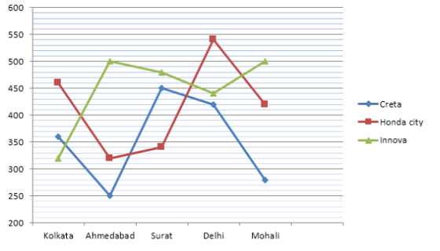

#### Options
- **(A)** 50 %
- **(B)** 66(2/3)%
- **(C)** 70%
- **(D)** None of these

#### Verified Answer
**Option B: 66(2/3)%**

#### Step-by-Step Solution & Rationale
Correct Answer: Option B: 66(2/3)%. Solved following standard Infosys System Engineer evaluation criteria.

---

### Question 20 (Mock Global Q379)
**ID**: `MOCK_SERIES_Q379` | **Mock Source**: Day 08 — Aptitude 01 - All India Mock 01

#### Problem Statement
Statements: Some towns are villages. Some villages are lanes. Some lanes are hamlets. Conclusions: I. Some hamlets are villages. II. Some lanes are towns. III. Some hamlets are towns.

#### Options
- **(A)** Only I follows
- **(B)** Only II follows
- **(C)** Only III follows
- **(D)** Only II and III follows
- **(E)** None follows

#### Verified Answer
**Option E: None follows**

#### Step-by-Step Solution & Rationale
Correct Answer: Option E: None follows. Solved following standard Infosys System Engineer evaluation criteria.

---

### Question 21 (Mock Global Q380)
**ID**: `MOCK_SERIES_Q380` | **Mock Source**: Day 08 — Aptitude 01 - All India Mock 01

#### Problem Statement
Question : In a certain code, MONKEY is written as XDJMNL . How is TIGER written in that code ?

#### Options
- **(A)** SDFHS
- **(B)** SHFDQ
- **(C)** UJHFS
- **(D)** QDFHS

#### Verified Answer
**Option D: QDFHS**

#### Step-by-Step Solution & Rationale
Correct Answer: Option D: QDFHS. Solved following standard Infosys System Engineer evaluation criteria.

---

### Question 22 (Mock Global Q381)
**ID**: `MOCK_SERIES_Q381` | **Mock Source**: Day 08 — Aptitude 01 - All India Mock 01

#### Problem Statement
Find the Missing Term: 256 , 64 , ? , 24 , 24 , 30

#### Options
- **(A)** undefined

#### Verified Answer
**Numerical Value: 32**

#### Step-by-Step Solution & Rationale
Correct Answer: Numerical Value: 32. Solved following standard Infosys System Engineer evaluation criteria.

---

### Question 23 (Mock Global Q382)
**ID**: `MOCK_SERIES_Q382` | **Mock Source**: Day 08 — Aptitude 01 - All India Mock 01

#### Problem Statement
Seven girls P, Q, R, S, T, W and X are sitting in a row facing towards the north (not necessarily in the same order). R is at one of the ends of the row. T sits exactly in the middle of row. S is third to the left of X. Q is to the immediate left of W. Q is not at any end of the row. Which of the following statements) is/are correct? I. S is to the immediate right of R. Il. T is to the immediate right of X.

#### Options
- **(A)** Only I
- **(B)** Only II
- **(C)** Both I & II
- **(D)** Neither I nor II

#### Verified Answer
**Option A: Only I**

#### Step-by-Step Solution & Rationale
Correct Answer: Option A: Only I. Solved following standard Infosys System Engineer evaluation criteria.

---

### Question 24 (Mock Global Q383)
**ID**: `MOCK_SERIES_Q383` | **Mock Source**: Day 08 — Aptitude 01 - All India Mock 01

#### Problem Statement
Read the passage and answer the questions that follow : Once upon a time, in a quaint little village nestled in a picturesque valley, there lived a young girl named Lily. She was known for her adventurous spirit and her deep curiosity. One sunny afternoon, while exploring the woods that bordered the village, Lily stumbled upon a hidden clearing. In the center of this secret meadow, she found an old oak tree with a peculiar nook. In that nook, half-buried in the earth, was a mysterious locket, ornate and gleaming with intricate designs. Lily carefully unearthed it, and as she held it in her hand, she felt a strange connection to this forgotten piece of jewelry. Back in her cottage, Lily examined the locket more closely. It was made of silver with a hint of gold, and its surface was adorned with delicate engravings of leaves and flowers. On the front, there was an image of a crescent moon, and on the back, an engraving read, &ldquo;To the one who seeks the truth.&rdquo; The locket was sealed tightly, and Lily couldn&rsquo;t open it no matter how hard she tried. Determined to solve the mystery, Lily embarked on a quest to find someone who could open the locket. She asked the village blacksmith, the wise old woman who lived on the hill, and even the town&rsquo;s mayor, but none of them could unlock its secrets. Feeling a bit discouraged, Lily spent her days reading about ancient relics and searching for clues in the library. One day, while immersed in an old book about mystical lockets, Lily came across a passage that mentioned the existence of a &ldquo;key of the heart.&rdquo; It said that this key could open the most stubborn of locks, but it was hidden within each person, waiting to be discovered. This newfound knowledge gave Lily a renewed sense of hope and determination. The next morning, Lily decided to visit the village&rsquo;s recluse, an elderly woman rumored to have deep knowledge of the heart. The recluse lived in a remote cottage surrounded by a lush garden. Lily knocked on the door and explained her quest. The old woman listened attentively and finally agreed to help. She told Lily that the key to opening the locket was hidden within her heart and that she needed to meditate on her truest desires and intentions. Lily followed the recluse&rsquo;s advice, sitting beneath the ancient oak tree where she had found the locket. She closed her eyes, focused on her heart&rsquo;s deepest desires, and as she did, she felt the locket warming in her hand. When she opened her eyes, she found the locket had sprung open, revealing a tiny, folded parchment inside. With trembling hands, she carefully unfolded it and read the message: &ldquo;The truth lies in the journey, not the destination.&rdquo; The mystery of the locket was solved, but Lily realized that the real treasure was the journey of self-discovery she had undertaken. She understood that her quest had led her to understand her heart&rsquo;s desires and the power of her own determination. Question 1- What did Lily discover in the hidden clearing in the woods?

#### Options
- **(A)** A hidden garden
- **(B)** An old oak tree
- **(C)** A mysterious book
- **(D)** A magic wand

#### Verified Answer
**Option B: An old oak tree**

#### Step-by-Step Solution & Rationale
Correct Answer: Option B: An old oak tree. Solved following standard Infosys System Engineer evaluation criteria.

---

### Question 25 (Mock Global Q384)
**ID**: `MOCK_SERIES_Q384` | **Mock Source**: Day 08 — Aptitude 01 - All India Mock 01

#### Problem Statement
Read the passage and answer the questions that follow : Once upon a time, in a quaint little village nestled in a picturesque valley, there lived a young girl named Lily. She was known for her adventurous spirit and her deep curiosity. One sunny afternoon, while exploring the woods that bordered the village, Lily stumbled upon a hidden clearing. In the center of this secret meadow, she found an old oak tree with a peculiar nook. In that nook, half-buried in the earth, was a mysterious locket, ornate and gleaming with intricate designs. Lily carefully unearthed it, and as she held it in her hand, she felt a strange connection to this forgotten piece of jewelry. Back in her cottage, Lily examined the locket more closely. It was made of silver with a hint of gold, and its surface was adorned with delicate engravings of leaves and flowers. On the front, there was an image of a crescent moon, and on the back, an engraving read, &ldquo;To the one who seeks the truth.&rdquo; The locket was sealed tightly, and Lily couldn&rsquo;t open it no matter how hard she tried. Determined to solve the mystery, Lily embarked on a quest to find someone who could open the locket. She asked the village blacksmith, the wise old woman who lived on the hill, and even the town&rsquo;s mayor, but none of them could unlock its secrets. Feeling a bit discouraged, Lily spent her days reading about ancient relics and searching for clues in the library. One day, while immersed in an old book about mystical lockets, Lily came across a passage that mentioned the existence of a &ldquo;key of the heart.&rdquo; It said that this key could open the most stubborn of locks, but it was hidden within each person, waiting to be discovered. This newfound knowledge gave Lily a renewed sense of hope and determination. The next morning, Lily decided to visit the village&rsquo;s recluse, an elderly woman rumored to have deep knowledge of the heart. The recluse lived in a remote cottage surrounded by a lush garden. Lily knocked on the door and explained her quest. The old woman listened attentively and finally agreed to help. She told Lily that the key to opening the locket was hidden within her heart and that she needed to meditate on her truest desires and intentions. Lily followed the recluse&rsquo;s advice, sitting beneath the ancient oak tree where she had found the locket. She closed her eyes, focused on her heart&rsquo;s deepest desires, and as she did, she felt the locket warming in her hand. When she opened her eyes, she found the locket had sprung open, revealing a tiny, folded parchment inside. With trembling hands, she carefully unfolded it and read the message: &ldquo;The truth lies in the journey, not the destination.&rdquo; The mystery of the locket was solved, but Lily realized that the real treasure was the journey of self-discovery she had undertaken. She understood that her quest had led her to understand her heart&rsquo;s desires and the power of her own determination. Question 2- What was inscribed on the back of the mysterious locket?

#### Options
- **(A)** &ldquo;To the one who seeks adventure&rdquo;
- **(B)** &ldquo;To the one who seeks answers&rdquo;
- **(C)** &ldquo;To the one who seeks the truth&rdquo;
- **(D)** &ldquo;To the one who seeks gold&rdquo;

#### Verified Answer
**Option C: &ldquo;To the one who seeks the truth&rdquo;**

#### Step-by-Step Solution & Rationale
Correct Answer: Option C: &ldquo;To the one who seeks the truth&rdquo;. Solved following standard Infosys System Engineer evaluation criteria.

---

### Question 26 (Mock Global Q385)
**ID**: `MOCK_SERIES_Q385` | **Mock Source**: Day 08 — Aptitude 01 - All India Mock 01

#### Problem Statement
Read the passage and answer the questions that follow : Once upon a time, in a quaint little village nestled in a picturesque valley, there lived a young girl named Lily. She was known for her adventurous spirit and her deep curiosity. One sunny afternoon, while exploring the woods that bordered the village, Lily stumbled upon a hidden clearing. In the center of this secret meadow, she found an old oak tree with a peculiar nook. In that nook, half-buried in the earth, was a mysterious locket, ornate and gleaming with intricate designs. Lily carefully unearthed it, and as she held it in her hand, she felt a strange connection to this forgotten piece of jewelry. Back in her cottage, Lily examined the locket more closely. It was made of silver with a hint of gold, and its surface was adorned with delicate engravings of leaves and flowers. On the front, there was an image of a crescent moon, and on the back, an engraving read, &ldquo;To the one who seeks the truth.&rdquo; The locket was sealed tightly, and Lily couldn&rsquo;t open it no matter how hard she tried. Determined to solve the mystery, Lily embarked on a quest to find someone who could open the locket. She asked the village blacksmith, the wise old woman who lived on the hill, and even the town&rsquo;s mayor, but none of them could unlock its secrets. Feeling a bit discouraged, Lily spent her days reading about ancient relics and searching for clues in the library. One day, while immersed in an old book about mystical lockets, Lily came across a passage that mentioned the existence of a &ldquo;key of the heart.&rdquo; It said that this key could open the most stubborn of locks, but it was hidden within each person, waiting to be discovered. This newfound knowledge gave Lily a renewed sense of hope and determination. The next morning, Lily decided to visit the village&rsquo;s recluse, an elderly woman rumored to have deep knowledge of the heart. The recluse lived in a remote cottage surrounded by a lush garden. Lily knocked on the door and explained her quest. The old woman listened attentively and finally agreed to help. She told Lily that the key to opening the locket was hidden within her heart and that she needed to meditate on her truest desires and intentions. Lily followed the recluse&rsquo;s advice, sitting beneath the ancient oak tree where she had found the locket. She closed her eyes, focused on her heart&rsquo;s deepest desires, and as she did, she felt the locket warming in her hand. When she opened her eyes, she found the locket had sprung open, revealing a tiny, folded parchment inside. With trembling hands, she carefully unfolded it and read the message: &ldquo;The truth lies in the journey, not the destination.&rdquo; The mystery of the locket was solved, but Lily realized that the real treasure was the journey of self-discovery she had undertaken. She understood that her quest had led her to understand her heart&rsquo;s desires and the power of her own determination. Question 3- Who did Lily seek help from in opening the locket?

#### Options
- **(A)** The village blacksmith
- **(B)** The wise old woman on the hill
- **(C)** The town&rsquo;s mayor
- **(D)** All of the above

#### Verified Answer
**Option D: All of the above**

#### Step-by-Step Solution & Rationale
Correct Answer: Option D: All of the above. Solved following standard Infosys System Engineer evaluation criteria.

---

### Question 27 (Mock Global Q386)
**ID**: `MOCK_SERIES_Q386` | **Mock Source**: Day 08 — Aptitude 01 - All India Mock 01

#### Problem Statement
Rearrange them to form a logically coherent paragraph 1️⃣ Start-ups are increasingly adopting artificial intelligence to automate routine operations and reduce human error. 2️⃣ Investors are keen to fund ventures that can demonstrate scalable AI-driven business models. 3️⃣ As competition intensifies, companies seek innovative tools to gain a market edge. 4️⃣ However, reliance on AI also raises ethical concerns about transparency and job displacement. Q1. After rearranging into a coherent paragraph, which sentence will come second? (Enter the integer only)

#### Options
- **(A)** undefined

#### Verified Answer
**Numerical Value: 1**

#### Step-by-Step Solution & Rationale
Correct Answer: Numerical Value: 1. Solved following standard Infosys System Engineer evaluation criteria.

---

### Question 28 (Mock Global Q387)
**ID**: `MOCK_SERIES_Q387` | **Mock Source**: Day 08 — Aptitude 01 - All India Mock 01

#### Problem Statement
Rearrange them to form a logically coherent paragraph 1️⃣ Start-ups are increasingly adopting artificial intelligence to automate routine operations and reduce human error. 2️⃣ Investors are keen to fund ventures that can demonstrate scalable AI-driven business models. 3️⃣ As competition intensifies, companies seek innovative tools to gain a market edge. 4️⃣ However, reliance on AI also raises ethical concerns about transparency and job displacement. Q2. Which sentence best serves as the concluding idea for the paragraph? (Enter the integer only)

#### Options
- **(A)** undefined

#### Verified Answer
**Numerical Value: 4**

#### Step-by-Step Solution & Rationale
Correct Answer: Numerical Value: 4. Solved following standard Infosys System Engineer evaluation criteria.

---

### Question 29 (Mock Global Q388)
**ID**: `MOCK_SERIES_Q388` | **Mock Source**: Day 08 — Aptitude 01 - All India Mock 01

#### Problem Statement
Each sentence below has a blank space. Four options are suggested. Select the most appropriate word/phrase to complete the sentence meaningfully. Mark the correct option. Despite several challenges, the new metro project has made remarkable progress and is now expected to be completed ______ schedule.

#### Options
- **(A)** beneath
- **(B)** ahead of
- **(C)** on
- **(D)** over

#### Verified Answer
**Option B: ahead of**

#### Step-by-Step Solution & Rationale
Correct Answer: Option B: ahead of. Solved following standard Infosys System Engineer evaluation criteria.

---

### Question 30 (Mock Global Q389)
**ID**: `MOCK_SERIES_Q389` | **Mock Source**: Day 08 — Aptitude 01 - All India Mock 01

#### Problem Statement
Question : The committee urged all departments to work in a ______ manner to achieve the organization&rsquo;s long-term goals.

#### Options
- **(A)** coordinated
- **(B)** casual
- **(C)** negligent
- **(D)** contradictory

#### Verified Answer
**Option A: coordinated**

#### Step-by-Step Solution & Rationale
Correct Answer: Option A: coordinated. Solved following standard Infosys System Engineer evaluation criteria.

---

### Question 31 (Mock Global Q390)
**ID**: `MOCK_SERIES_Q390` | **Mock Source**: Day 08 — Aptitude 01 - All India Mock 01

#### Problem Statement
Each sentence is split into four numbered parts (1&ndash;4). Identify the part that contains the grammatical error. If there is no error , choose option 5 . Type only the integer (1/2/3/4/5) as your answer. Question Neither the manager nor his assistants was willing to accept the responsibility. No error

#### Options
- **(A)** undefined

#### Verified Answer
**Numerical Value: 3**

#### Step-by-Step Solution & Rationale
Correct Answer: Numerical Value: 3. Solved following standard Infosys System Engineer evaluation criteria.

---

### Question 32 (Mock Global Q391)
**ID**: `MOCK_SERIES_Q391` | **Mock Source**: Day 08 — Aptitude 01 - All India Mock 01

#### Problem Statement
Each sentence is split into four numbered parts (1&ndash;4). Identify the part containing the grammatical error. If there is no error , choose option 5 . Answer by typing the integer (1/2/3/4/5) only. Question : The teacher along with her students were preparing for the annual function. No error

#### Options
- **(A)** undefined

#### Verified Answer
**Numerical Value: 3**

#### Step-by-Step Solution & Rationale
Correct Answer: Numerical Value: 3. Solved following standard Infosys System Engineer evaluation criteria.

---

### Question 33 (Mock Global Q392)
**ID**: `MOCK_SERIES_Q392` | **Mock Source**: Day 08 — Aptitude 01 - All India Mock 01

#### Problem Statement
Choose the word that is nearest in meaning to the underlined word. Question The detective&rsquo;s report was meticulous , leaving no room for doubt. careless detailed hasty approximate

#### Options
- **(A)** careless
- **(B)** detailed
- **(C)** hasty
- **(D)** approximate

#### Verified Answer
**Option B: detailed**

#### Step-by-Step Solution & Rationale
Correct Answer: Option B: detailed. Solved following standard Infosys System Engineer evaluation criteria.

---

### Question 1 (Mock Global Q403)
**ID**: `MOCK_SERIES_Q403` | **Mock Source**: Day 09 — Aptitude 02 - All India Mock

#### Problem Statement
Percentage of Marks obtained by various students in various subjects in an Examination. Q. The marks obtained by E in Geography are what percentage of the marks of the marks obtained by E in Hindi?

#### Options
- **(A)** 45
- **(B)** 55
- **(C)** 50
- **(D)** 60
- **(E)** None of these

#### Verified Answer
**Option C: 50**

#### Step-by-Step Solution & Rationale
Correct Answer: Option C: 50. Solved following standard Infosys System Engineer evaluation criteria.

**Official Video Solution Link**: [https://www.youtube.com/embed/zs-pzzzxxWI](https://www.youtube.com/embed/zs-pzzzxxWI)

---

### Question 2 (Mock Global Q404)
**ID**: `MOCK_SERIES_Q404` | **Mock Source**: Day 09 — Aptitude 02 - All India Mock

#### Problem Statement
Percentage of Marks obtained by various students in various subjects in an Examination. Q. What are the average marks obtained by all the students together in science?

#### Options
- **(A)** 77.16
- **(B)** 120.50
- **(C)** 118
- **(D)** 121
- **(E)** None of these

#### Verified Answer
**Option E: None of these**

#### Step-by-Step Solution & Rationale
Correct Answer: Option E: None of these. Solved following standard Infosys System Engineer evaluation criteria.

**Official Video Solution Link**: [https://www.youtube.com/embed/M-C8GYWRhJk](https://www.youtube.com/embed/M-C8GYWRhJk)

---

### Question 3 (Mock Global Q405)
**ID**: `MOCK_SERIES_Q405` | **Mock Source**: Day 09 — Aptitude 02 - All India Mock

#### Problem Statement
Q. In a survey conducted among 120 houses, it was found that 50 read Times of India, 60 read Indian Express and 48 read Hindustan Times; 20 read Times of India and Indian Express, 18 read Times of India and Hindustan. Times and 24 read Indian Express and Hindustan Times. If 10 read all three, how many read only one newspaper?

#### Options
- **(A)** 61
- **(B)** 62
- **(C)** 63
- **(D)** 64

#### Verified Answer
**Option D: 64**

#### Step-by-Step Solution & Rationale
Correct Answer: Option D: 64. Solved following standard Infosys System Engineer evaluation criteria.

**Official Video Solution Link**: [https://www.youtube.com/embed/Rv1dAPN0pzw](https://www.youtube.com/embed/Rv1dAPN0pzw)

---

### Question 4 (Mock Global Q406)
**ID**: `MOCK_SERIES_Q406` | **Mock Source**: Day 09 — Aptitude 02 - All India Mock

#### Problem Statement
Directions for questions: Consider the Venn diagram TCS NQT given below. Q. The number in the Venn diagram indicates the number of persons/ people watching TV programmes. The diagram is drawn after surveying 150 persons in a population of 12,000. How many persons/ people can be expected to watch at least two TV programmes?

#### Options
- **(A)** 4320
- **(B)** 4450
- **(C)** 4800
- **(D)** 4960

#### Verified Answer
**Option A: 4320**

#### Step-by-Step Solution & Rationale
Correct Answer: Option A: 4320. Solved following standard Infosys System Engineer evaluation criteria.

**Official Video Solution Link**: [https://www.youtube.com/embed/ERHgI_ebXc8](https://www.youtube.com/embed/ERHgI_ebXc8)

---

### Question 5 (Mock Global Q407)
**ID**: `MOCK_SERIES_Q407` | **Mock Source**: Day 09 — Aptitude 02 - All India Mock

#### Problem Statement
The ratio of the age of Ram and Rahim 10 years ago was 1 : 3. The ratio of their age five years hence will be 2 : 3. Then the ratio of their present age is

#### Options
- **(A)** 1 : 2
- **(B)** 3 : 5
- **(C)** 3 : 4
- **(D)** 2 : 5

#### Verified Answer
**Option B: 3 : 5**

#### Step-by-Step Solution & Rationale
Correct Answer: Option B: 3 : 5. Solved following standard Infosys System Engineer evaluation criteria.

**Official Video Solution Link**: [https://www.youtube.com/embed/1LjiPiJ92Xo](https://www.youtube.com/embed/1LjiPiJ92Xo)

---

### Question 6 (Mock Global Q408)
**ID**: `MOCK_SERIES_Q408` | **Mock Source**: Day 09 — Aptitude 02 - All India Mock

#### Problem Statement
Find the missing number in the given seriese. 12, 12, 18, 45, 180, 1170, ?

#### Options
- **(A)** 12285
- **(B)** 10530
- **(C)** 11700
- **(D)** 12870
- **(E)** 9945

#### Verified Answer
**Option A: 12285**

#### Step-by-Step Solution & Rationale
Correct Answer: Option A: 12285. Solved following standard Infosys System Engineer evaluation criteria.

**Official Video Solution Link**: [https://www.youtube.com/embed/fCG8tbOsgBk](https://www.youtube.com/embed/fCG8tbOsgBk)

---

### Question 7 (Mock Global Q409)
**ID**: `MOCK_SERIES_Q409` | **Mock Source**: Day 09 — Aptitude 02 - All India Mock

#### Problem Statement
A contractor agreed to construct a 6 km road in 200 days. He employed 140 persons for the work. After 60 days, he realized that only 1.5 km road has been completed. How many additional people would he need to employ to finish the work exactly on time?

#### Options
- **(A)** 40

#### Verified Answer
**Numerical Value: 40**

#### Step-by-Step Solution & Rationale
Correct Answer: Numerical Value: 40. Solved following standard Infosys System Engineer evaluation criteria.

**Official Video Solution Link**: [https://www.youtube.com/embed/cdFZxrezzCo](https://www.youtube.com/embed/cdFZxrezzCo)

---

### Question 8 (Mock Global Q410)
**ID**: `MOCK_SERIES_Q410` | **Mock Source**: Day 09 — Aptitude 02 - All India Mock

#### Problem Statement
Note : Ans in days

#### Options
- **(A)** 6

#### Verified Answer
**Numerical Value: 6**

#### Step-by-Step Solution & Rationale
Correct Answer: Numerical Value: 6. Solved following standard Infosys System Engineer evaluation criteria.

**Official Video Solution Link**: [https://www.youtube.com/embed/Ba4Sj5hiG5o](https://www.youtube.com/embed/Ba4Sj5hiG5o)

---

### Question 9 (Mock Global Q411)
**ID**: `MOCK_SERIES_Q411` | **Mock Source**: Day 09 — Aptitude 02 - All India Mock

#### Problem Statement
[Data Interpretation / Graphical Aptitude Problem — Refer to Chart Below] Analyze the data chart, graph, or equation presented in the figure and compute the required value.

#### Options
- **(A)** 4,5,9
- **(B)** 3,7,8
- **(C)** 3,6,9
- **(D)** 4,7,7

#### Verified Answer
**Option A: 4,5,9**

#### Step-by-Step Solution & Rationale
Correct Answer: Option A: 4,5,9. Solved following standard Infosys System Engineer evaluation criteria.

**Official Video Solution Link**: [https://www.youtube.com/embed/uN3uu8Awy-0](https://www.youtube.com/embed/uN3uu8Awy-0)

---

### Question 10 (Mock Global Q412)
**ID**: `MOCK_SERIES_Q412` | **Mock Source**: Day 09 — Aptitude 02 - All India Mock

#### Problem Statement
A shopkeeper earns a profit of 20% by selling an article by giving 25% discount on its marked price. If the cost price of the article increases by 10%, then how much discount percent should he give now on the same marked price to earn the same percentage of profit as earlier?

#### Options
- **(A)** 17.5%
- **(B)** 16.5%
- **(C)** 18%
- **(D)** 15%

#### Verified Answer
**Option A: 17.5%**

#### Step-by-Step Solution & Rationale
Correct Answer: Option A: 17.5%. Solved following standard Infosys System Engineer evaluation criteria.

**Official Video Solution Link**: [https://www.youtube.com/embed/9SHym9bcr8U](https://www.youtube.com/embed/9SHym9bcr8U)

---

### Question 11 (Mock Global Q413)
**ID**: `MOCK_SERIES_Q413` | **Mock Source**: Day 09 — Aptitude 02 - All India Mock

#### Problem Statement
If A =x% of y and B =y%of x, then which of the following is true?

#### Options
- **(A)** A is equal to B
- **(B)** A is smaller than B.
- **(C)** A relationship between A and B cannot be determined.
- **(D)** If x is greater than y, then A is less than B.

#### Verified Answer
**Option A: A is equal to B**

#### Step-by-Step Solution & Rationale
Correct Answer: Option A: A is equal to B. Solved following standard Infosys System Engineer evaluation criteria.

---

### Question 12 (Mock Global Q414)
**ID**: `MOCK_SERIES_Q414` | **Mock Source**: Day 09 — Aptitude 02 - All India Mock

#### Problem Statement
A vendor bought mangoes at 6 for a rupee. How many for a rupee must he sell to gain 20%?

#### Options
- **(A)** 3
- **(B)** 6
- **(C)** 4
- **(D)** 5

#### Verified Answer
**Option D: 5**

#### Step-by-Step Solution & Rationale
Correct Answer: Option D: 5. Solved following standard Infosys System Engineer evaluation criteria.

---

### Question 13 (Mock Global Q415)
**ID**: `MOCK_SERIES_Q415` | **Mock Source**: Day 09 — Aptitude 02 - All India Mock

#### Problem Statement
How many 3-letter words with or without meaning, can be formed out of the letters of the word, 'ADVERTISING', if repetition of letters is not allowed?

#### Options
- **(A)** 720
- **(B)** 420
- **(C)** 5040
- **(D)** None of these

#### Verified Answer
**Option A: 720**

#### Step-by-Step Solution & Rationale
Correct Answer: Option A: 720. Solved following standard Infosys System Engineer evaluation criteria.

---

### Question 14 (Mock Global Q416)
**ID**: `MOCK_SERIES_Q416` | **Mock Source**: Day 09 — Aptitude 02 - All India Mock

#### Problem Statement
Seats for Mathematics, Physics and Biology in a school are in the ratio 5 :7 :8. There is a proposal to increase these seats by 40%, 50% and 75% respectively. What will be the ratio of increased seats?

#### Options
- **(A)** 2 : 3 : 4
- **(B)** 6 : 7 : 8
- **(C)** 6 : 8 : 9
- **(D)** 7 : 6 : 9

#### Verified Answer
**Option A: 2 : 3 : 4**

#### Step-by-Step Solution & Rationale
Correct Answer: Option A: 2 : 3 : 4. Solved following standard Infosys System Engineer evaluation criteria.

---

### Question 15 (Mock Global Q417)
**ID**: `MOCK_SERIES_Q417` | **Mock Source**: Day 09 — Aptitude 02 - All India Mock

#### Problem Statement
Pointing to a woman in a photograph a man says, "She is the only daughter of my wife's mother-in-law." How is the woman related to the man?

#### Options
- **(A)** Daughter
- **(B)** Wife
- **(C)** Sister
- **(D)** Sister-in-law

#### Verified Answer
**Option C: Sister**

#### Step-by-Step Solution & Rationale
Correct Answer: Option C: Sister. Solved following standard Infosys System Engineer evaluation criteria.

---

### Question 16 (Mock Global Q418)
**ID**: `MOCK_SERIES_Q418` | **Mock Source**: Day 09 — Aptitude 02 - All India Mock

#### Problem Statement
In a certain code language 'ROAD' is written as '152' and 'MAP' is written as '90'. How 'RAIL' be coded in the similar code language?

#### Options
- **(A)** 120
- **(B)** 140
- **(C)** 180
- **(D)** 160

#### Verified Answer
**Option D: 160**

#### Step-by-Step Solution & Rationale
Correct Answer: Option D: 160. Solved following standard Infosys System Engineer evaluation criteria.

---

### Question 17 (Mock Global Q419)
**ID**: `MOCK_SERIES_Q419` | **Mock Source**: Day 09 — Aptitude 02 - All India Mock

#### Problem Statement
If A + B means A is the sister of B; A x B means A is the wife of B, A % B means A is the father of B and A - B means A is the brother of B. Which of the following means T is the daughter of P?

#### Options
- **(A)** P x Q % R + S &ndash; T
- **(B)** P x Q % R - T + S
- **(C)** P x Q % R + T &ndash; S
- **(D)** P x Q % R + S + T

#### Verified Answer
**Option B: P x Q % R - T + S**

#### Step-by-Step Solution & Rationale
Correct Answer: Option B: P x Q % R - T + S. Solved following standard Infosys System Engineer evaluation criteria.

---

### Question 18 (Mock Global Q420)
**ID**: `MOCK_SERIES_Q420` | **Mock Source**: Day 09 — Aptitude 02 - All India Mock

#### Problem Statement
Viraj is eleventh from the left end in a row of children. Pankaj is twelfth from the right end and seventeenth form the left end. How many children are towards the right of Viraj in that row?

#### Options
- **(A)** 16
- **(B)** 18
- **(C)** 17
- **(D)** None of these

#### Verified Answer
**Option C: 17**

#### Step-by-Step Solution & Rationale
Correct Answer: Option C: 17. Solved following standard Infosys System Engineer evaluation criteria.

---

### Question 19 (Mock Global Q421)
**ID**: `MOCK_SERIES_Q421` | **Mock Source**: Day 09 — Aptitude 02 - All India Mock

#### Problem Statement
Statement: The Government has made an appeal to all the citizens to honestly pay income tax and file returns reflecting the true income level to help the Government to carry out developmental activities. Assumptions: I. More people may now start paying taxes in response to the appeal. II. The total income tax collection may considerably increase in the near future.

#### Options
- **(A)** Only I is implicit
- **(B)** Only II is implicit
- **(C)** Both I and II are implicit
- **(D)** Neither I nor II are implicit

#### Verified Answer
**Option C: Both I and II are implicit**

#### Step-by-Step Solution & Rationale
Correct Answer: Option C: Both I and II are implicit. Solved following standard Infosys System Engineer evaluation criteria.

---

### Question 20 (Mock Global Q422)
**ID**: `MOCK_SERIES_Q422` | **Mock Source**: Day 09 — Aptitude 02 - All India Mock

#### Problem Statement
Each of the six friends - A, B. C. D, E and F - scored different marks in an examination. C scored more only A and E. D scored less than only B. E did not score the least. The one who scored the third highest marks scored 81 marks. E scored 62 marks. Which of the following could possibly be C's core?

#### Options
- **(A)** 70
- **(B)** 94
- **(C)** 86
- **(D)** 61

#### Verified Answer
**Option A: 70**

#### Step-by-Step Solution & Rationale
Correct Answer: Option A: 70. Solved following standard Infosys System Engineer evaluation criteria.

---

### Question 21 (Mock Global Q423)
**ID**: `MOCK_SERIES_Q423` | **Mock Source**: Day 09 — Aptitude 02 - All India Mock

#### Problem Statement
Select the letter/letters that can replace the question mark (?) in the following series. Z, U, Q, ?, L

#### Options
- **(A)** N
- **(B)** M
- **(C)** K
- **(D)** I

#### Verified Answer
**Option A: N**

#### Step-by-Step Solution & Rationale
Correct Answer: Option A: N. Solved following standard Infosys System Engineer evaluation criteria.

---

### Question 22 (Mock Global Q424)
**ID**: `MOCK_SERIES_Q424` | **Mock Source**: Day 09 — Aptitude 02 - All India Mock

#### Problem Statement
Statement : In a one day cricket match, the total runs made by a team were 200. Out of these 160 runs were made by spinners. Conclusions : I. 80% of the team consists of spinners. II. The opening batsman were spinners.

#### Options
- **(A)** Only I is implicit
- **(B)** Only II is implicit
- **(C)** Both I and II are implicit
- **(D)** Neither I nor II are implicit

#### Verified Answer
**Option D: Neither I nor II are implicit**

#### Step-by-Step Solution & Rationale
Correct Answer: Option D: Neither I nor II are implicit. Solved following standard Infosys System Engineer evaluation criteria.

---

### Question 23 (Mock Global Q425)
**ID**: `MOCK_SERIES_Q425` | **Mock Source**: Day 09 — Aptitude 02 - All India Mock

#### Problem Statement
Statement: A major retail store announced thirty percent reduction on all food items during the weekend. Assumption: I. People may still prefer buying food items from other stores. II. A large number of customers may visit the retail store and buy food items.

#### Options
- **(A)** Only I is implicit
- **(B)** Only II is implicit
- **(C)** Both I and II are implicit
- **(D)** Neither I nor II are implicit

#### Verified Answer
**Option B: Only II is implicit**

#### Step-by-Step Solution & Rationale
Correct Answer: Option B: Only II is implicit. Solved following standard Infosys System Engineer evaluation criteria.

---

### Question 24 (Mock Global Q426)
**ID**: `MOCK_SERIES_Q426` | **Mock Source**: Day 09 — Aptitude 02 - All India Mock

#### Problem Statement
In a certain code, '786' means 'study very hard', '958' means 'hard work pays' and '645' means 'study and work'. Which of the following is the code 'very'?

#### Options
- **(A)** 8
- **(B)** 6
- **(C)** 7
- **(D)** Cannot be determined

#### Verified Answer
**Option C: 7**

#### Step-by-Step Solution & Rationale
Correct Answer: Option C: 7. Solved following standard Infosys System Engineer evaluation criteria.

---

### Question 25 (Mock Global Q427)
**ID**: `MOCK_SERIES_Q427` | **Mock Source**: Day 09 — Aptitude 02 - All India Mock

#### Problem Statement
In the following question, select the number which can be placed at the sign of question mark (?) from the given alternatives.

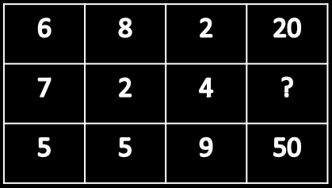

#### Options
- **(A)** 42
- **(B)** 26
- **(C)** 30
- **(D)** 36

#### Verified Answer
**Option C: 30**

#### Step-by-Step Solution & Rationale
Correct Answer: Option C: 30. Solved following standard Infosys System Engineer evaluation criteria.

---

### Question 26 (Mock Global Q428)
**ID**: `MOCK_SERIES_Q428` | **Mock Source**: Day 09 — Aptitude 02 - All India Mock

#### Problem Statement
Statements: Some books are tables. Some tables are mirrors. Conclusions: I. Some mirrors are books. II. No book is mirror.

#### Options
- **(A)** If only conclusion I follows
- **(B)** If only conclusion II follows
- **(C)** If either conclusion I or II follows
- **(D)** If neither conclusion I nor II follows

#### Verified Answer
**Option C: If either conclusion I or II follows**

#### Step-by-Step Solution & Rationale
Correct Answer: Option C: If either conclusion I or II follows. Solved following standard Infosys System Engineer evaluation criteria.

---

### Question 27 (Mock Global Q429)
**ID**: `MOCK_SERIES_Q429` | **Mock Source**: Day 09 — Aptitude 02 - All India Mock

#### Problem Statement
Directions: In the following question, select the related letters from the given alternatives. CLDR : YIBQ :: STOP : ?

#### Options
- **(A)** PROM
- **(B)** OQMO
- **(C)** PQNO
- **(D)** ORMO

#### Verified Answer
**Option B: OQMO**

#### Step-by-Step Solution & Rationale
Correct Answer: Option B: OQMO. Solved following standard Infosys System Engineer evaluation criteria.

---

### Question 28 (Mock Global Q430)
**ID**: `MOCK_SERIES_Q430` | **Mock Source**: Day 09 — Aptitude 02 - All India Mock

#### Problem Statement
Statements: All fruits are lions. All lions are foxes. Some foxes are elephants. Conclusions: I. All fruits are foxes. II. Some fruits are elephants.

#### Options
- **(A)** If only conclusion I follows
- **(B)** If only conclusion II follows
- **(C)** If either conclusion I or II follows
- **(D)** If neither conclusion I nor II follows

#### Verified Answer
**Option A: If only conclusion I follows**

#### Step-by-Step Solution & Rationale
Correct Answer: Option A: If only conclusion I follows. Solved following standard Infosys System Engineer evaluation criteria.

---

### Question 29 (Mock Global Q431)
**ID**: `MOCK_SERIES_Q431` | **Mock Source**: Day 09 — Aptitude 02 - All India Mock

#### Problem Statement
Directions: In the following question, select the related word from the given alternatives. Square : Cube :: Circle : ?

#### Options
- **(A)** Sphere
- **(B)** Circumference
- **(C)** Diameter
- **(D)** Area

#### Verified Answer
**Option A: Sphere**

#### Step-by-Step Solution & Rationale
Correct Answer: Option A: Sphere. Solved following standard Infosys System Engineer evaluation criteria.

---

### Question 30 (Mock Global Q432)
**ID**: `MOCK_SERIES_Q432` | **Mock Source**: Day 09 — Aptitude 02 - All India Mock

#### Problem Statement
A, B, C, D, E, F & G are sitting in line facing the East. C is immediate right of D. B is at an extreme end and has E as his neighbour. G is between E and F. D is sitting third from the South end. Who are the persons sitting at the extreme ends?

#### Options
- **(A)** A & E
- **(B)** A & B
- **(C)** F & B
- **(D)** C & D

#### Verified Answer
**Option B: A & B**

#### Step-by-Step Solution & Rationale
Correct Answer: Option B: A & B. Solved following standard Infosys System Engineer evaluation criteria.

---

### Question 31 (Mock Global Q433)
**ID**: `MOCK_SERIES_Q433` | **Mock Source**: Day 09 — Aptitude 02 - All India Mock

#### Problem Statement
Statements: Some flats are apartments. No apartment is a hall Some halls are rooms Conclusions: I. Atleast some rooms are flats. II. No apartment is room.

#### Options
- **(A)** If only conclusion I follows
- **(B)** If only conclusion II follows
- **(C)** If either conclusion I or II follows
- **(D)** If neither conclusion I nor II follows

#### Verified Answer
**Option D: If neither conclusion I nor II follows**

#### Step-by-Step Solution & Rationale
Correct Answer: Option D: If neither conclusion I nor II follows. Solved following standard Infosys System Engineer evaluation criteria.

---

### Question 32 (Mock Global Q434)
**ID**: `MOCK_SERIES_Q434` | **Mock Source**: Day 09 — Aptitude 02 - All India Mock

#### Problem Statement
Statement: The sale of a particular product has gone down considerably causing great concern to the company. Courses of action: I. The company should make a proper study of rival products in the market. II. The price of the product should be reduced and quality improved.

#### Options
- **(A)** Only I is implicit
- **(B)** Only II is implicit
- **(C)** Both I and II are implicit
- **(D)** Neither I nor II are implicit

#### Verified Answer
**Option A: Only I is implicit**

#### Step-by-Step Solution & Rationale
Correct Answer: Option A: Only I is implicit. Solved following standard Infosys System Engineer evaluation criteria.

---

### Question 33 (Mock Global Q435)
**ID**: `MOCK_SERIES_Q435` | **Mock Source**: Day 09 — Aptitude 02 - All India Mock

#### Problem Statement
They don&rsquo;t have any _______ to spend on luxuries

#### Options
- **(A)** Time
- **(B)** Balance
- **(C)** Money
- **(D)** Ideas

#### Verified Answer
**Option C: Money**

#### Step-by-Step Solution & Rationale
Correct Answer: Option C: Money. Solved following standard Infosys System Engineer evaluation criteria.

**Official Video Solution Link**: [https://www.youtube.com/embed/frb1-QvMIBY](https://www.youtube.com/embed/frb1-QvMIBY)

---

### Question 34 (Mock Global Q436)
**ID**: `MOCK_SERIES_Q436` | **Mock Source**: Day 09 — Aptitude 02 - All India Mock

#### Problem Statement
They all laughed as they realized that although they had gone off in different directions from working at home to managing companies they were experiencing _______ feeling

#### Options
- **(A)** Jubilant
- **(B)** Remorseful
- **(C)** Similar
- **(D)** Strange

#### Verified Answer
**Option A: Jubilant**

#### Step-by-Step Solution & Rationale
Correct Answer: Option A: Jubilant. Solved following standard Infosys System Engineer evaluation criteria.

**Official Video Solution Link**: [https://www.youtube.com/embed/WJIFSgLantM](https://www.youtube.com/embed/WJIFSgLantM)

---

### Question 35 (Mock Global Q437)
**ID**: `MOCK_SERIES_Q437` | **Mock Source**: Day 09 — Aptitude 02 - All India Mock

#### Problem Statement
DIRECTIONS: Identify the part which contains an error. Mark that part as your answer. Exercise I enjoy doing are (a)/ running marathons, swimming lengths in a pool, (b)/ riding my bicycle in the park (c)/ and walked along the trails in a trail. (d)/

#### Options
- **(A)** Part a
- **(B)** Part b
- **(C)** Part c
- **(D)** Part d

#### Verified Answer
**Option D: Part d**

#### Step-by-Step Solution & Rationale
Correct Answer: Option D: Part d. Solved following standard Infosys System Engineer evaluation criteria.

**Official Video Solution Link**: [https://www.youtube.com/embed/D-axUo72iqs](https://www.youtube.com/embed/D-axUo72iqs)

---

### Question 36 (Mock Global Q438)
**ID**: `MOCK_SERIES_Q438` | **Mock Source**: Day 09 — Aptitude 02 - All India Mock

#### Problem Statement
To my horror, (a)/ my wedding dress looked (b)/ strain, torn (c)/ and wrinkled (d)/

#### Options
- **(A)** Part a
- **(B)** Part b
- **(C)** Part c
- **(D)** Part d

#### Verified Answer
**Option C: Part c**

#### Step-by-Step Solution & Rationale
Correct Answer: Option C: Part c. Solved following standard Infosys System Engineer evaluation criteria.

**Official Video Solution Link**: [https://www.youtube.com/embed/e7nIEaoOCMI](https://www.youtube.com/embed/e7nIEaoOCMI)

---

### Question 37 (Mock Global Q439)
**ID**: `MOCK_SERIES_Q439` | **Mock Source**: Day 09 — Aptitude 02 - All India Mock

#### Problem Statement
Ram had (a)/ invited few (b)/ friends in the (c)/ party at his lawn (d)/

#### Options
- **(A)** Part a
- **(B)** Part b
- **(C)** Part c
- **(D)** Part d

#### Verified Answer
**Option B: Part b**

#### Step-by-Step Solution & Rationale
Correct Answer: Option B: Part b. Solved following standard Infosys System Engineer evaluation criteria.

**Official Video Solution Link**: [https://www.youtube.com/embed/9WF_P94ni0M](https://www.youtube.com/embed/9WF_P94ni0M)

---

### Question 38 (Mock Global Q440)
**ID**: `MOCK_SERIES_Q440` | **Mock Source**: Day 09 — Aptitude 02 - All India Mock

#### Problem Statement
The population density of (a)/ china is (b)/ greater (c)/ than America (d)/

#### Options
- **(A)** Part a
- **(B)** Part b
- **(C)** Part c
- **(D)** Part d

#### Verified Answer
**Option D: Part d**

#### Step-by-Step Solution & Rationale
Correct Answer: Option D: Part d. Solved following standard Infosys System Engineer evaluation criteria.

**Official Video Solution Link**: [https://www.youtube.com/embed/O6y0VffvTlY](https://www.youtube.com/embed/O6y0VffvTlY)

---

### Question 39 (Mock Global Q441)
**ID**: `MOCK_SERIES_Q441` | **Mock Source**: Day 09 — Aptitude 02 - All India Mock

#### Problem Statement
In each of the questions given below four words are given in bold. These words may or may not be in their correct position. Following each sentence four sequences are provided. Select the sequence of the words which will make the given sentence contextually meaningful. If the words are correct at their current position, then choose option (e) as your answer. India has an advantage (A), as a large origin (B) of semiconductor design engineers globally (C) are either Indian or Indian- portion (D).

#### Options
- **(A)** DCBA
- **(B)** BADC
- **(C)** ADCB
- **(D)** CADB
- **(E)** No interchange required

#### Verified Answer
**Option C: ADCB**

#### Step-by-Step Solution & Rationale
Correct Answer: Option C: ADCB. Solved following standard Infosys System Engineer evaluation criteria.

---

### Question 40 (Mock Global Q442)
**ID**: `MOCK_SERIES_Q442` | **Mock Source**: Day 09 — Aptitude 02 - All India Mock

#### Problem Statement
In each of the questions given below four words are given in bold. These words may or may not be in their correct position. Following each sentence four sequences are provided. Select the sequence of the words which will make the given sentence contextually meaningful. If the words are correct at their current position, then choose option (e) as your answer. Pollution has badly native (A) the fish harvest and has destroyed (B) the breeding grounds (C) of the affected (D) fish.

#### Options
- **(A)** ABDC
- **(B)** CBAD
- **(C)** DBCA
- **(D)** BDAC
- **(E)** No interchange required

#### Verified Answer
**Option C: DBCA**

#### Step-by-Step Solution & Rationale
Correct Answer: Option C: DBCA. Solved following standard Infosys System Engineer evaluation criteria.

---

### Question 41 (Mock Global Q443)
**ID**: `MOCK_SERIES_Q443` | **Mock Source**: Day 09 — Aptitude 02 - All India Mock

#### Problem Statement
Directions (11-15): Read each sentence to find out whether there is any grammatical or idiomatic error in it. The error, if any, will be in one part of the sentence. The number of that part is the answer. If there is &lsquo;No error&rsquo;, the answer is (e). (Ignore errors of punctuation, if any.) In spite of our several request (A)/ the owner of the house (B)/did not open (C)/the door of his house. (D)/No Error (E)

#### Options
- **(A)** A
- **(B)** B
- **(C)** C
- **(D)** D
- **(E)** E

#### Verified Answer
**Option A: A**

#### Step-by-Step Solution & Rationale
Correct Answer: Option A: A. Solved following standard Infosys System Engineer evaluation criteria.

---

### Question 42 (Mock Global Q444)
**ID**: `MOCK_SERIES_Q444` | **Mock Source**: Day 09 — Aptitude 02 - All India Mock

#### Problem Statement
Directions : In each of the question given below a/an idiom/phrase is given in bold which is then followed by five options which then try to decipher its meaning. Choose the option which gives the correct meaning of the phrases Larger than life

#### Options
- **(A)** to be cruel
- **(B)** to be haughty
- **(C)** to be impressive and important
- **(D)** to be disrespectful
- **(E)** to be happy

#### Verified Answer
**Option C: to be impressive and important**

#### Step-by-Step Solution & Rationale
Correct Answer: Option C: to be impressive and important. Solved following standard Infosys System Engineer evaluation criteria.

---

### Question 43 (Mock Global Q445)
**ID**: `MOCK_SERIES_Q445` | **Mock Source**: Day 09 — Aptitude 02 - All India Mock

#### Problem Statement
He was very tired as he is working since 6 O' clock in the morning.

#### Options
- **(A)** he was working
- **(B)** he had been working
- **(C)** he has been working
- **(D)** he will be working

#### Verified Answer
**Option C: he has been working**

#### Step-by-Step Solution & Rationale
Correct Answer: Option C: he has been working. Solved following standard Infosys System Engineer evaluation criteria.

**Official Video Solution Link**: [https://www.youtube.com/embed/n9_Lz2yq_1I](https://www.youtube.com/embed/n9_Lz2yq_1I)

---

### Question 44 (Mock Global Q446)
**ID**: `MOCK_SERIES_Q446` | **Mock Source**: Day 09 — Aptitude 02 - All India Mock

#### Problem Statement
Directions : out of the four alternatives, choose the one which best expresses the meaning of the given word. Our posterity shall hold us responsible for the devastation of Ozone layer.

#### Options
- **(A)** predecessors
- **(B)** successors
- **(C)** offsprings
- **(D)** followers

#### Verified Answer
**Option B: successors**

#### Step-by-Step Solution & Rationale
Correct Answer: Option B: successors. Solved following standard Infosys System Engineer evaluation criteria.

---

### Question 45 (Mock Global Q447)
**ID**: `MOCK_SERIES_Q447` | **Mock Source**: Day 09 — Aptitude 02 - All India Mock

#### Problem Statement
Directions : ,out of the four alternatives, choose the one which best expresses the meaning of the given word. The ambition of being an IAS is subdued by the poverty within.

#### Options
- **(A)** modified
- **(B)** challenged
- **(C)** affected
- **(D)** diluted

#### Verified Answer
**Option D: diluted**

#### Step-by-Step Solution & Rationale
Correct Answer: Option D: diluted. Solved following standard Infosys System Engineer evaluation criteria.

---

### Question 46 (Mock Global Q448)
**ID**: `MOCK_SERIES_Q448` | **Mock Source**: Day 09 — Aptitude 02 - All India Mock

#### Problem Statement
Direction: In Question a sentence/ a part of the sentence is italicised in bold. Below are given alternatives to the italicised part at (A), (B), (C) which may improve the sentence. Choose the correct alternative. In case no improvement is needed your answer is (D). Mark your answer in the Answer Sheet. Q. Ashutosh singh's new book 'Hopes for no brains' land' is an unique book i have ever read.

#### Options
- **(A)** the most unique
- **(B)** a mostly unique
- **(C)** a unique
- **(D)** No improvement

#### Verified Answer
**Option C: a unique**

#### Step-by-Step Solution & Rationale
Correct Answer: Option C: a unique. Solved following standard Infosys System Engineer evaluation criteria.

---

### Question 47 (Mock Global Q449)
**ID**: `MOCK_SERIES_Q449` | **Mock Source**: Day 09 — Aptitude 02 - All India Mock

#### Problem Statement
Direction : In these question you have two brief passages with six questions following the passage. Read the passage carefully and choose the best answer to each question out of the four alternatives. Passage &ndash; 1 Education, as Mahatma Gandhi described it, "is the tool for the development of consciousness and reconstitution of society". Since Independence, India has stressed reforming and restructuring the educational system as part of state intervention. The National Policy on Education (NPE), 1986, which is hailed as a landmark in the Indian educational system, provided a comprehensive framework to guide the development of education in the country. The NPE and its Programme of Action was again updated in 1992 through similar consensual process involving all the State governments, resource organisations and educationists. What has been worrying the critics and educationists alike is the non- fulfilment of one of the NPE objectives: education of girl. It has been stated in the NPE that the 'Education For All' meet should have a strong gender focus as Education For All by definition is gender inclusive. . The National Policy on Education provided

#### Options
- **(A)** guidelines for the comprehension of education in the country
- **(B)** guidance material to develop education in the country
- **(C)** a comprehensive plan for the development of education in the country
- **(D)** comprehensive development of education in the country

#### Verified Answer
**Option C: a comprehensive plan for the development of education in the country**

#### Step-by-Step Solution & Rationale
Correct Answer: Option C: a comprehensive plan for the development of education in the country. Solved following standard Infosys System Engineer evaluation criteria.

---

### Question 48 (Mock Global Q450)
**ID**: `MOCK_SERIES_Q450` | **Mock Source**: Day 09 — Aptitude 02 - All India Mock

#### Problem Statement
Direction In these question you have two brief passages with six questions following the passage. Read the passage carefully and choose the best answer to each question out of the four alternatives. Passage &ndash; 1 Education, as Mahatma Gandhi described it, "is the tool for the development of consciousness and reconstitution of society". Since Independence, India has stressed reforming and restructuring the educational system as part of state intervention. The National Policy on Education (NPE), 1986, which is hailed as a landmark in the Indian educational system, provided a comprehensive framework to guide the development of education in the country. The NPE and its Programme of Action was again updated in 1992 through similar consensual process involving all the State governments, resource organisations and educationists. What has been worrying the critics and educationists alike is the non- fulfilment of one of the NPE objectives: education of girl. It has been stated in the NPE that the 'Education For All' meet should have a strong gender focus as Education For All by definition is gender inclusive. According to the passage, critics and educationists are worried that

#### Options
- **(A)** the education of girls is one of the objectives of NPE.
- **(B)** the objectives of NPE have not been fulfilled.
- **(C)** non-fulfilment of NPE leads to the education of girls.
- **(D)** one of the objectives of NPE has not been fulfilled.

#### Verified Answer
**Option D: one of the objectives of NPE has not been fulfilled.**

#### Step-by-Step Solution & Rationale
Correct Answer: Option D: one of the objectives of NPE has not been fulfilled.. Solved following standard Infosys System Engineer evaluation criteria.

---

### Question 49 (Mock Global Q451)
**ID**: `MOCK_SERIES_Q451` | **Mock Source**: Day 09 — Aptitude 02 - All India Mock

#### Problem Statement
Direction In these question you have two brief passages with six questions following the passage. Read the passage carefully and choose the best answer to each question out of the four alternatives. Passage &ndash; 1 Education, as Mahatma Gandhi described it, "is the tool for the development of consciousness and reconstitution of society". Since Independence, India has stressed reforming and restructuring the educational system as part of state intervention. The National Policy on Education (NPE), 1986, which is hailed as a landmark in the Indian educational system, provided a comprehensive framework to guide the development of education in the country. The NPE and its Programme of Action was again updated in 1992 through similar consensual process involving all the State governments, resource organisations and educationists. What has been worrying the critics and educationists alike is the non- fulfilment of one of the NPE objectives: education of girl. It has been stated in the NPE that the 'Education For All' meet should have a strong gender focus as Education For All by definition is gender inclusive. According to the passage, 'a strong gender focus' means

#### Options
- **(A)** a focus on the strength of gender
- **(B)** a focus on strong gender
- **(C)** a strong focus on gender bias
- **(D)** a focus on male-female ratio

#### Verified Answer
**Option C: a strong focus on gender bias**

#### Step-by-Step Solution & Rationale
Correct Answer: Option C: a strong focus on gender bias. Solved following standard Infosys System Engineer evaluation criteria.

---

### Question 50 (Mock Global Q452)
**ID**: `MOCK_SERIES_Q452` | **Mock Source**: Day 09 — Aptitude 02 - All India Mock

#### Problem Statement
Direction In these question you have two brief passages with six questions following the passage. Read the passage carefully and choose the best answer to each question out of the four alternatives. Passage &ndash; 1 Education, as Mahatma Gandhi described it, "is the tool for the development of consciousness and reconstitution of society". Since Independence, India has stressed reforming and restructuring the educational system as part of state intervention. The National Policy on Education (NPE), 1986, which is hailed as a landmark in the Indian educational system, provided a comprehensive framework to guide the development of education in the country. The NPE and its Programme of Action was again updated in 1992 through similar consensual process involving all the State governments, resource organisations and educationists. What has been worrying the critics and educationists alike is the non- fulfilment of one of the NPE objectives: education of girl. It has been stated in the NPE that the 'Education For All' meet should have a strong gender focus as Education For All by definition is gender inclusive. . In the passage, the author makes a plea for

#### Options
- **(A)** free education
- **(B)** universal education
- **(C)** the education of men
- **(D)** the education of women

#### Verified Answer
**Option D: the education of women**

#### Step-by-Step Solution & Rationale
Correct Answer: Option D: the education of women. Solved following standard Infosys System Engineer evaluation criteria.

---

