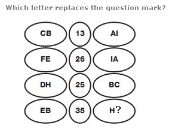
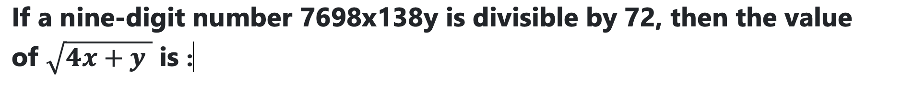
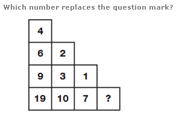
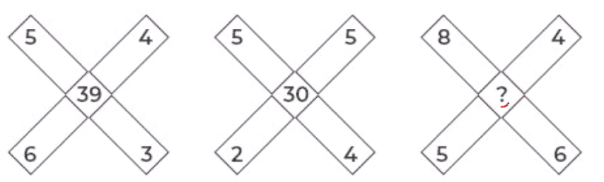

# Infosys Mock Test Series — Topic 5: Puzzle Solving & Advanced Logical Puzzles

> **Questions Count**: 9 | **Target Role**: Infosys System Engineer (SE)
> **Official Syllabus Coverage**: Grid Puzzles, Missing Numbers, Cryptarithmetic, Number Patterns, Cyclic Logic

## Topic Overview & Problem Set
This master compendium compiles all 9 solved questions for Puzzle Solving & Advanced Logical Puzzles sourced across Days 01 through 09 and full-length PYQ mocks.

---

### Question 1 (Mock Global Q287)
**ID**: `MOCK_SERIES_Q287` | **Mock Source**: Day 06 — Logical Puzzle

#### Problem Statement
[Visual Puzzle Problem — Refer to Diagram Below] Identify the numerical pattern or missing element shown in the puzzle figure and select the correct option.

#### Options
- **(A)** I
- **(B)** G
- **(C)** B
- **(D)** T

#### Verified Answer
**Option B: G**

#### Step-by-Step Solution & Rationale
Correct Answer: Option B: G. Solved following standard Infosys System Engineer evaluation criteria.

---

### Question 2 (Mock Global Q288)
**ID**: `MOCK_SERIES_Q288` | **Mock Source**: Day 06 — Logical Puzzle

#### Problem Statement
[Visual Puzzle Problem — Refer to Diagram Below] Identify the numerical pattern or missing element shown in the puzzle figure and select the correct option.

#### Options
- **(A)** P
- **(B)** S
- **(C)** R
- **(D)** Q

#### Verified Answer
**Option A: P**

#### Step-by-Step Solution & Rationale
Correct Answer: Option A: P. Solved following standard Infosys System Engineer evaluation criteria.

---

### Question 3 (Mock Global Q289)
**ID**: `MOCK_SERIES_Q289` | **Mock Source**: Day 06 — Logical Puzzle

#### Problem Statement
Study the 4&times;4 matrix. Each row follows the same rule relating the first two entries to the third entry. Find the missing number ? 8 5 6 53 7 4 8 6 0 5 7 9 5 2 6 9 8 ? e rule.

#### Options
- **(A)** 57
- **(B)** 59
- **(C)** 67
- **(D)** 87

#### Verified Answer
**Option A: 57**

#### Step-by-Step Solution & Rationale
Correct Answer: Option A: 57. Solved following standard Infosys System Engineer evaluation criteria.

---

### Question 4 (Mock Global Q290)
**ID**: `MOCK_SERIES_Q290` | **Mock Source**: Day 06 — Logical Puzzle

#### Problem Statement
[Visual Puzzle Problem — Refer to Diagram Below] Identify the numerical pattern or missing element shown in the puzzle figure and select the correct option.

#### Options
- **(A)** 5
- **(B)** 6
- **(C)** 8
- **(D)** 2

#### Verified Answer
**Option B: 6**

#### Step-by-Step Solution & Rationale
Correct Answer: Option B: 6. Solved following standard Infosys System Engineer evaluation criteria.

---

### Question 5 (Mock Global Q291)
**ID**: `MOCK_SERIES_Q291` | **Mock Source**: Day 06 — Logical Puzzle

#### Problem Statement
Study the 3&times;3 matrix. Each row follows the same rule relating the first two entries to the third entry. Find the missing number 2 1 2 16 5 2 5 5 0 7 5 1 ?

#### Options
- **(A)** 70
- **(B)** 50
- **(C)** 120
- **(D)** 100

#### Verified Answer
**Option D: 100**

#### Step-by-Step Solution & Rationale
Correct Answer: Option D: 100. Solved following standard Infosys System Engineer evaluation criteria.

---

### Question 1 (Mock Global Q330)
**ID**: `MOCK_SERIES_Q330` | **Mock Source**: Day 07 — Section IV_ Puzzle Solving

#### Problem Statement
Find the value of the question mark (?) Choose the best answer:

#### Options
- **(A)** 169
- **(B)** 181
- **(C)** 197
- **(D)** 205

#### Verified Answer
**Option B: 181**

#### Step-by-Step Solution & Rationale
Correct Answer: Option B: 181. Solved following standard Infosys System Engineer evaluation criteria.

---

### Question 2 (Mock Global Q331)
**ID**: `MOCK_SERIES_Q331` | **Mock Source**: Day 07 — Section IV_ Puzzle Solving

#### Problem Statement
Study the 3&times;3 matrix. Each row follows the same rule relating the first two entries to the third entry. Find the missing number ? that makes the middle row obey the same rule. 3 2 11 ? 6 13 3 5 23

#### Options
- **(A)** 0
- **(B)** 1
- **(C)** 2
- **(D)** 4

#### Verified Answer
**Option B: 1**

#### Step-by-Step Solution & Rationale
Correct Answer: Option B: 1. Solved following standard Infosys System Engineer evaluation criteria.

---

### Question 3 (Mock Global Q332)
**ID**: `MOCK_SERIES_Q332` | **Mock Source**: Day 07 — Section IV_ Puzzle Solving

#### Problem Statement
In the following question select the number which can be placed at the question ? mark which follows the same rule relating the first two entries to the third entry.

#### Options
- **(A)** 76
- **(B)** 58
- **(C)** 68
- **(D)** 98

#### Verified Answer
**Option C: 68**

#### Step-by-Step Solution & Rationale
Correct Answer: Option C: 68. Solved following standard Infosys System Engineer evaluation criteria.

---

### Question 4 (Mock Global Q333)
**ID**: `MOCK_SERIES_Q333` | **Mock Source**: Day 07 — Section IV_ Puzzle Solving

#### Problem Statement
Study the 3&times;3 matrix. Each row follows the same rule relating the first two entries to the third entry. Find the missing number ? that makes the middle row obey the same rule. 5 J G 4 A C B 7 5 V Q ?

#### Options
- **(A)** Y
- **(B)** X
- **(C)** W
- **(D)** Z

#### Verified Answer
**Option D: Z**

#### Step-by-Step Solution & Rationale
Correct Answer: Option D: Z. Solved following standard Infosys System Engineer evaluation criteria.

---

