# Infosys Video Curriculum — Logical Reasoning & Analytical Puzzles

> **Target Track**: Infosys System Engineer (SE) | **Videos Count**: 33 | **Total Runtime**: 28h 8m
> **Curriculum Topics**: Coding-Decoding, Distance & Direction, Blood Relations, Syllogisms, Seating Arrangement, Clocks & Calendar, Critical Reasoning, Puzzle Solving

## Section Overview & Curriculum Map
This master compendium documents all 33 high-yield video lectures for Logical Reasoning & Analytical Puzzles. Every lecture includes full metadata, curriculum path, high-resolution slide thumbnail plate, and core conceptual focus.

---

### Video 001: One Shot   Alphabatic Logical Reasoning
- **Video ID**: `178884968` | **Duration**: `01:24:10` (5,050s)
- **Track**: Infosys System Engineer (SE) | **Topic**: Logical Reasoning & Analytical Puzzles
- **Curriculum Path**: `1.0 LIVE: Infosys Prep / Aptitude Prep With Rachit sir / Day 1: One Shot   Alphabatic Logical Reasoning  C`

#### Master Video Slide Thumbnail Plate
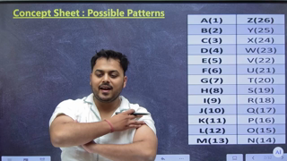

#### Core Concepts & Learning Objectives
Comprehensive video masterclass covering One Shot   Alphabatic Logical Reasoning. Focuses on fundamental principles, algorithm analysis, edge-case handling, and Infosys exam question solutions.

---

### Video 011: 1. Linear Arrangement
- **Video ID**: `162552109` | **Duration**: `01:23:49` (5,029s)
- **Track**: Infosys System Engineer (SE) | **Topic**: Logical Reasoning & Analytical Puzzles
- **Curriculum Path**: `2. Infosys System Eng Prep- Apti + Pseudo / Section I : Logical Reasoning & Puzzle / 3: Linear & Parallel Arrangement`

#### Master Video Slide Thumbnail Plate
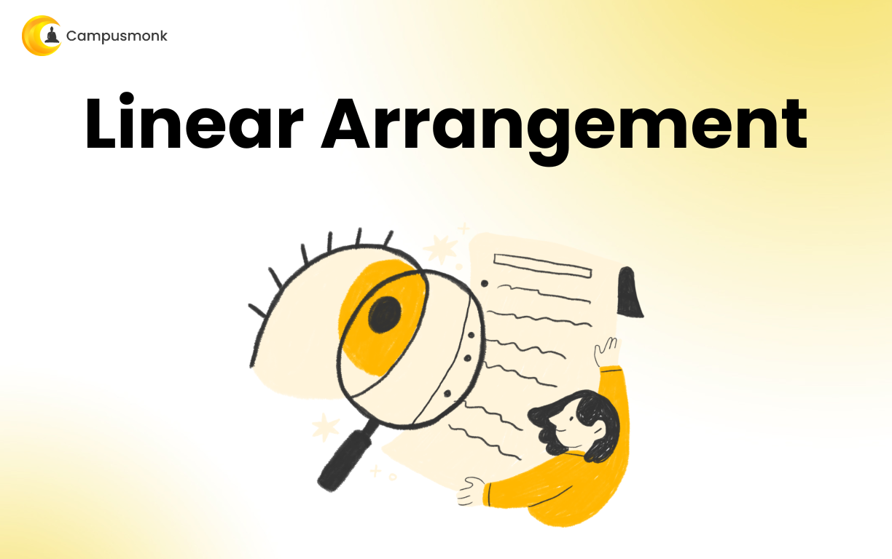

#### Core Concepts & Learning Objectives
Comprehensive video masterclass covering 1. Linear Arrangement. Focuses on fundamental principles, algorithm analysis, edge-case handling, and Infosys exam question solutions.

---

### Video 012: 2 Parallel Arrangement
- **Video ID**: `162552108` | **Duration**: `01:19:36` (4,776s)
- **Track**: Infosys System Engineer (SE) | **Topic**: Logical Reasoning & Analytical Puzzles
- **Curriculum Path**: `2. Infosys System Eng Prep- Apti + Pseudo / Section I : Logical Reasoning & Puzzle / 3: Linear & Parallel Arrangement`

#### Master Video Slide Thumbnail Plate
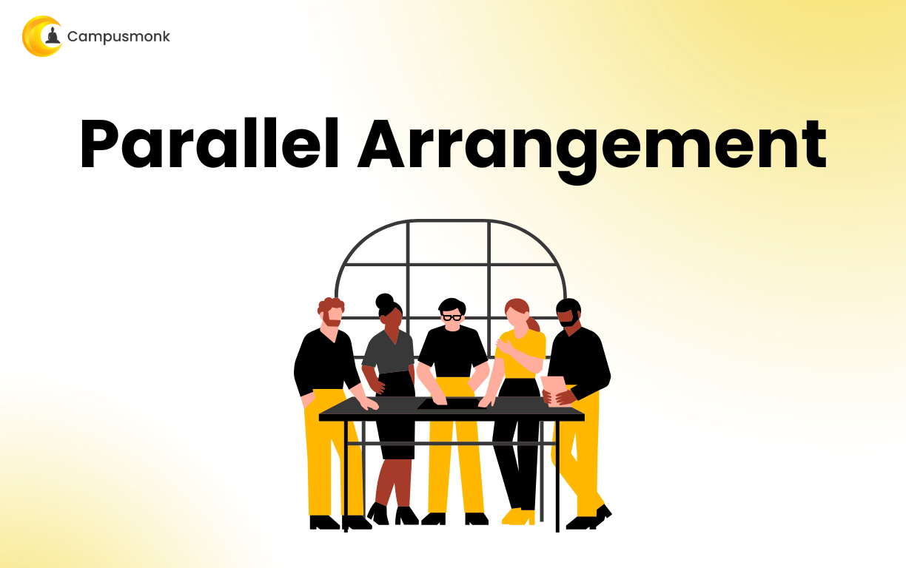

#### Core Concepts & Learning Objectives
Comprehensive video masterclass covering 2 Parallel Arrangement. Focuses on fundamental principles, algorithm analysis, edge-case handling, and Infosys exam question solutions.

---

### Video 013: 1. Distance & Directions
- **Video ID**: `162552068` | **Duration**: `01:34:04` (5,644s)
- **Track**: Infosys System Engineer (SE) | **Topic**: Logical Reasoning & Analytical Puzzles
- **Curriculum Path**: `2. Infosys System Eng Prep- Apti + Pseudo / Section I : Logical Reasoning & Puzzle / 2 : Distance and Direction`

#### Master Video Slide Thumbnail Plate
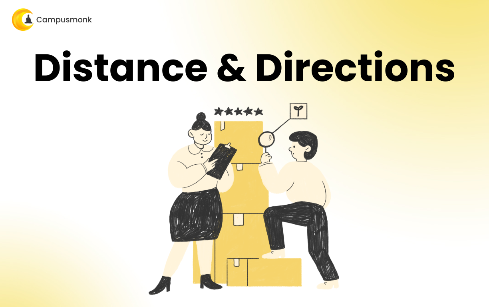

#### Core Concepts & Learning Objectives
Comprehensive video masterclass covering 1. Distance & Directions. Focuses on fundamental principles, algorithm analysis, edge-case handling, and Infosys exam question solutions.

---

### Video 014: 2. Types: distance , angle ,Shadow
- **Video ID**: `162552069` | **Duration**: `00:46:55` (2,815s)
- **Track**: Infosys System Engineer (SE) | **Topic**: Logical Reasoning & Analytical Puzzles
- **Curriculum Path**: `2. Infosys System Eng Prep- Apti + Pseudo / Section I : Logical Reasoning & Puzzle / 2 : Distance and Direction`

#### Master Video Slide Thumbnail Plate
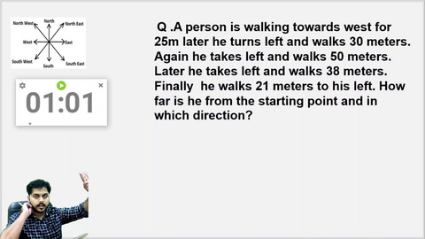

#### Core Concepts & Learning Objectives
Comprehensive video masterclass covering 2. Types: distance , angle ,Shadow. Focuses on fundamental principles, algorithm analysis, edge-case handling, and Infosys exam question solutions.

---

### Video 015: Circular Arrangement
- **Video ID**: `162552201` | **Duration**: `01:29:31` (5,371s)
- **Track**: Infosys System Engineer (SE) | **Topic**: Logical Reasoning & Analytical Puzzles
- **Curriculum Path**: `2. Infosys System Eng Prep- Apti + Pseudo / Section I : Logical Reasoning & Puzzle / 5 Circular Arrangement`

#### Master Video Slide Thumbnail Plate
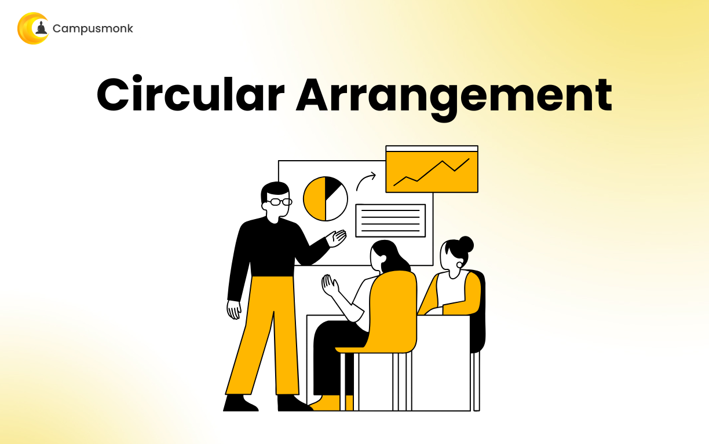

#### Core Concepts & Learning Objectives
Comprehensive video masterclass covering Circular Arrangement. Focuses on fundamental principles, algorithm analysis, edge-case handling, and Infosys exam question solutions.

---

### Video 016: 1. Coding Decoding _ By Rachit Rastogi
- **Video ID**: `162552070` | **Duration**: `00:28:04` (1,684s)
- **Track**: Infosys System Engineer (SE) | **Topic**: Logical Reasoning & Analytical Puzzles
- **Curriculum Path**: `2. Infosys System Eng Prep- Apti + Pseudo / Section I : Logical Reasoning & Puzzle / 1 : Alphabet Related Topics / 2. Coding Decoding Concept Videos`

#### Master Video Slide Thumbnail Plate
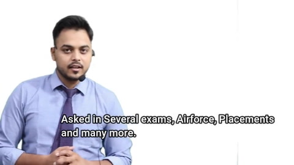

#### Core Concepts & Learning Objectives
Comprehensive video masterclass covering 1. Coding Decoding _ By Rachit Rastogi. Focuses on fundamental principles, algorithm analysis, edge-case handling, and Infosys exam question solutions.

---

### Video 017: 2. Coding Decoding  _ Rachit Rastogi
- **Video ID**: `162552071` | **Duration**: `00:23:27` (1,407s)
- **Track**: Infosys System Engineer (SE) | **Topic**: Logical Reasoning & Analytical Puzzles
- **Curriculum Path**: `2. Infosys System Eng Prep- Apti + Pseudo / Section I : Logical Reasoning & Puzzle / 1 : Alphabet Related Topics / 2. Coding Decoding Concept Videos`

#### Master Video Slide Thumbnail Plate
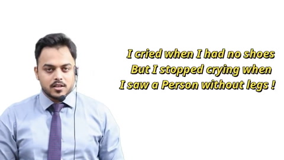

#### Core Concepts & Learning Objectives
Comprehensive video masterclass covering 2. Coding Decoding  _ Rachit Rastogi. Focuses on fundamental principles, algorithm analysis, edge-case handling, and Infosys exam question solutions.

---

### Video 018: 1 Logical Reasoning (0-Hero)
- **Video ID**: `162552048` | **Duration**: `01:07:58` (4,078s)
- **Track**: Infosys System Engineer (SE) | **Topic**: Logical Reasoning & Analytical Puzzles
- **Curriculum Path**: `2. Infosys System Eng Prep- Apti + Pseudo / Section I : Logical Reasoning & Puzzle / 1 : Alphabet Related Topics`

#### Master Video Slide Thumbnail Plate
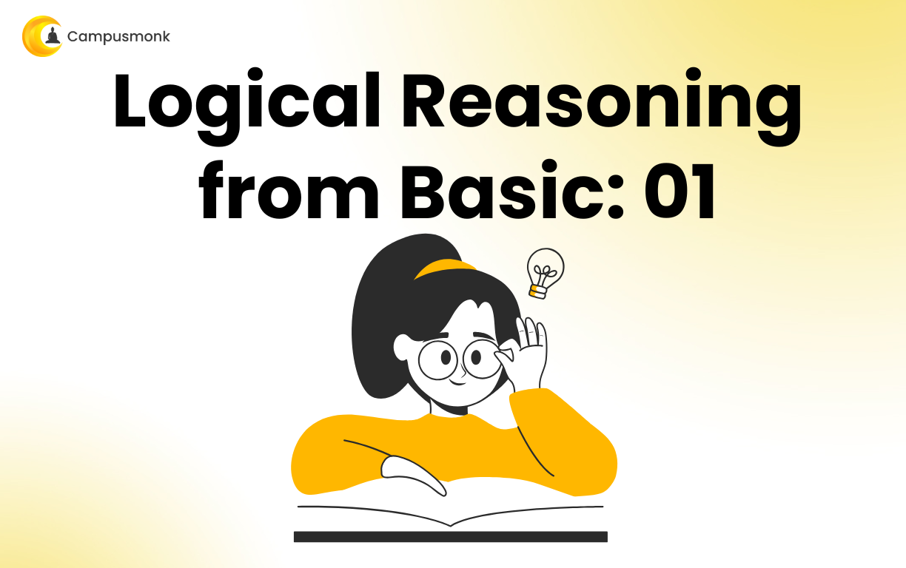

#### Core Concepts & Learning Objectives
Comprehensive video masterclass covering 1 Logical Reasoning (0-Hero). Focuses on fundamental principles, algorithm analysis, edge-case handling, and Infosys exam question solutions.

---

### Video 019: 3 Chinese Coding and New Type Ques
- **Video ID**: `162552049` | **Duration**: `00:43:43` (2,623s)
- **Track**: Infosys System Engineer (SE) | **Topic**: Logical Reasoning & Analytical Puzzles
- **Curriculum Path**: `2. Infosys System Eng Prep- Apti + Pseudo / Section I : Logical Reasoning & Puzzle / 1 : Alphabet Related Topics`

#### Master Video Slide Thumbnail Plate
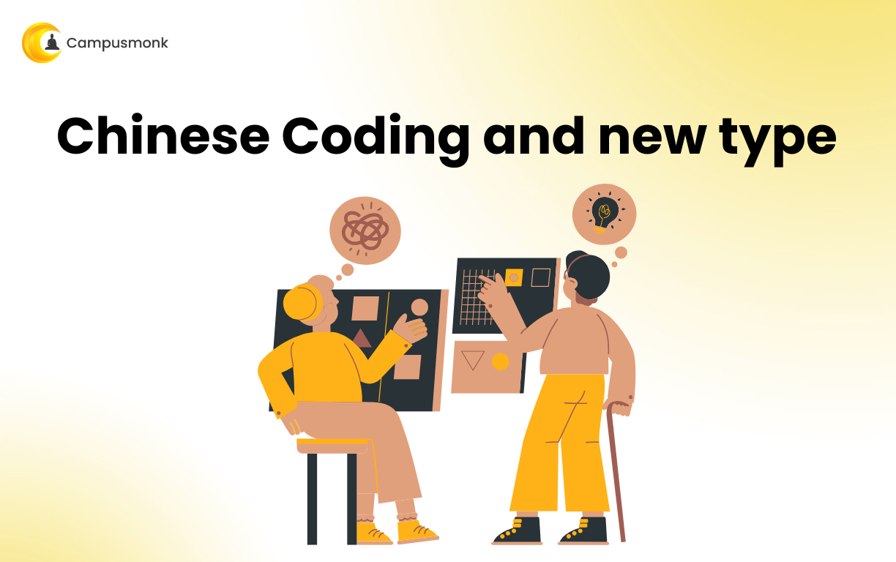

#### Core Concepts & Learning Objectives
Comprehensive video masterclass covering 3 Chinese Coding and New Type Ques. Focuses on fundamental principles, algorithm analysis, edge-case handling, and Infosys exam question solutions.

---

### Video 020: Square Triangle Based Arrangement
- **Video ID**: `162552239` | **Duration**: `01:32:57` (5,577s)
- **Track**: Infosys System Engineer (SE) | **Topic**: Logical Reasoning & Analytical Puzzles
- **Curriculum Path**: `2. Infosys System Eng Prep- Apti + Pseudo / Section I : Logical Reasoning & Puzzle / 6 Square Triangle Based Arrangement`

#### Master Video Slide Thumbnail Plate
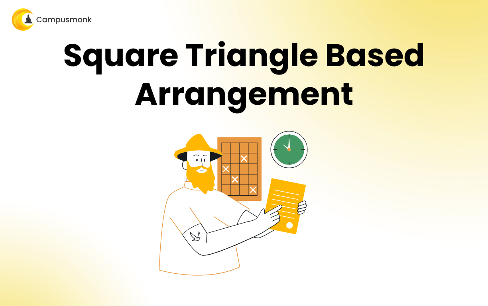

#### Core Concepts & Learning Objectives
Comprehensive video masterclass covering Square Triangle Based Arrangement. Focuses on fundamental principles, algorithm analysis, edge-case handling, and Infosys exam question solutions.

---

### Video 021: Blood Relation
- **Video ID**: `162552212` | **Duration**: `00:54:11` (3,251s)
- **Track**: Infosys System Engineer (SE) | **Topic**: Logical Reasoning & Analytical Puzzles
- **Curriculum Path**: `2. Infosys System Eng Prep- Apti + Pseudo / Section I : Logical Reasoning & Puzzle / 4 :  Blood Relation / Concept Video Blood Relation _ Live`

#### Core Concepts & Learning Objectives
Comprehensive video masterclass covering Blood Relation. Focuses on fundamental principles, algorithm analysis, edge-case handling, and Infosys exam question solutions.

---

### Video 022: BASIC PART 01
- **Video ID**: `162552309` | **Duration**: `00:22:57` (1,377s)
- **Track**: Infosys System Engineer (SE) | **Topic**: Logical Reasoning & Analytical Puzzles
- **Curriculum Path**: `2. Infosys System Eng Prep- Apti + Pseudo / Section I : Logical Reasoning & Puzzle / 7 : Puzzle`

#### Master Video Slide Thumbnail Plate
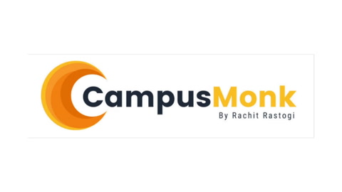

#### Core Concepts & Learning Objectives
Comprehensive video masterclass covering BASIC PART 01. Focuses on fundamental principles, algorithm analysis, edge-case handling, and Infosys exam question solutions.

---

### Video 023: PART 02
- **Video ID**: `162552308` | **Duration**: `00:21:55` (1,315s)
- **Track**: Infosys System Engineer (SE) | **Topic**: Logical Reasoning & Analytical Puzzles
- **Curriculum Path**: `2. Infosys System Eng Prep- Apti + Pseudo / Section I : Logical Reasoning & Puzzle / 7 : Puzzle`

#### Master Video Slide Thumbnail Plate

#### Core Concepts & Learning Objectives
Comprehensive video masterclass covering PART 02. Focuses on fundamental principles, algorithm analysis, edge-case handling, and Infosys exam question solutions.

---

### Video 024: Part 1
- **Video ID**: `162552369` | **Duration**: `00:07:25` (445s)
- **Track**: Infosys System Engineer (SE) | **Topic**: Logical Reasoning & Analytical Puzzles
- **Curriculum Path**: `2. Infosys System Eng Prep- Apti + Pseudo / Section I : Logical Reasoning & Puzzle / 9 : Number Series _ Important types`

#### Master Video Slide Thumbnail Plate
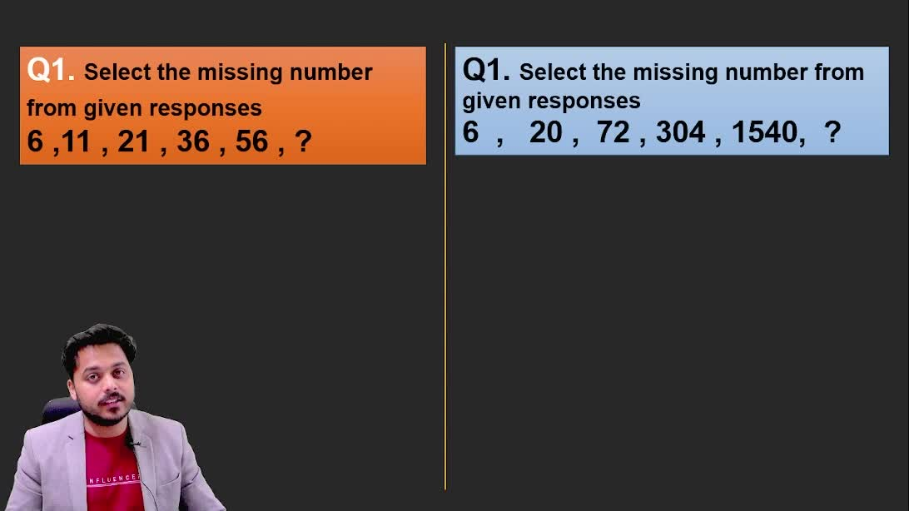

#### Core Concepts & Learning Objectives
Comprehensive video masterclass covering Part 1. Focuses on fundamental principles, algorithm analysis, edge-case handling, and Infosys exam question solutions.

---

### Video 025: Part 2
- **Video ID**: `162552367` | **Duration**: `00:14:46` (886s)
- **Track**: Infosys System Engineer (SE) | **Topic**: Logical Reasoning & Analytical Puzzles
- **Curriculum Path**: `2. Infosys System Eng Prep- Apti + Pseudo / Section I : Logical Reasoning & Puzzle / 9 : Number Series _ Important types`

#### Master Video Slide Thumbnail Plate
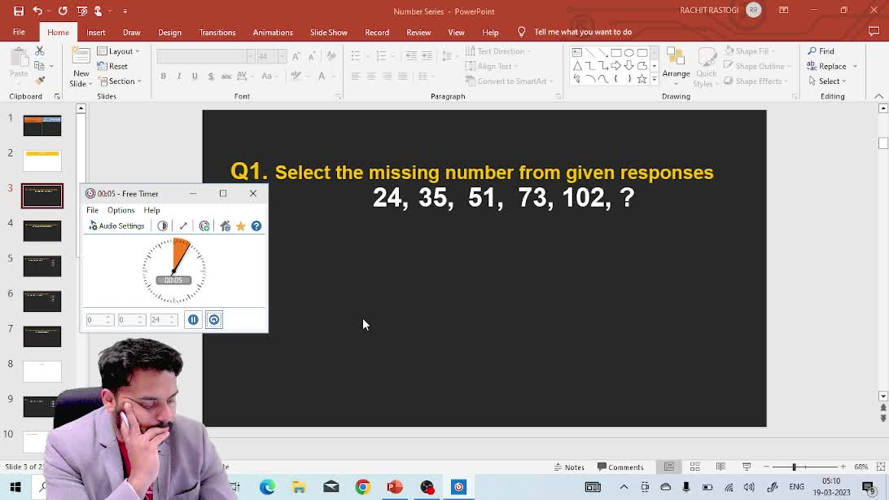

#### Core Concepts & Learning Objectives
Comprehensive video masterclass covering Part 2. Focuses on fundamental principles, algorithm analysis, edge-case handling, and Infosys exam question solutions.

---

### Video 026: Numbe Series 03
- **Video ID**: `162552366` | **Duration**: `00:08:22` (502s)
- **Track**: Infosys System Engineer (SE) | **Topic**: Logical Reasoning & Analytical Puzzles
- **Curriculum Path**: `2. Infosys System Eng Prep- Apti + Pseudo / Section I : Logical Reasoning & Puzzle / 9 : Number Series _ Important types`

#### Master Video Slide Thumbnail Plate
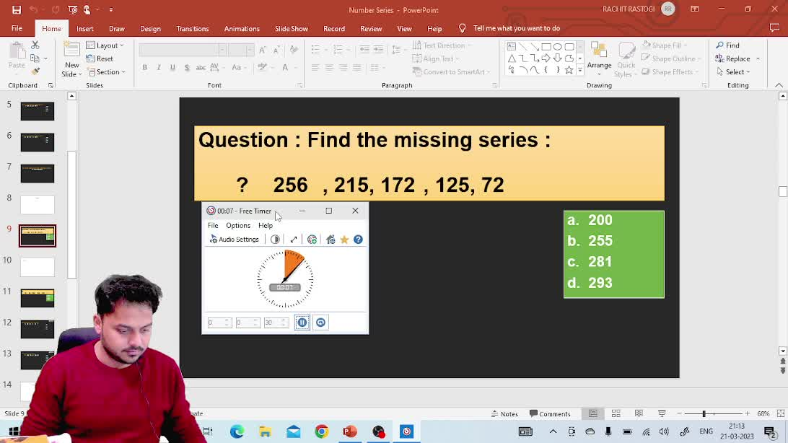

#### Core Concepts & Learning Objectives
Comprehensive video masterclass covering Numbe Series 03. Focuses on fundamental principles, algorithm analysis, edge-case handling, and Infosys exam question solutions.

---

### Video 027: Number Series 04 (Zero Difference)
- **Video ID**: `162552365` | **Duration**: `00:05:52` (352s)
- **Track**: Infosys System Engineer (SE) | **Topic**: Logical Reasoning & Analytical Puzzles
- **Curriculum Path**: `2. Infosys System Eng Prep- Apti + Pseudo / Section I : Logical Reasoning & Puzzle / 9 : Number Series _ Important types`

#### Master Video Slide Thumbnail Plate
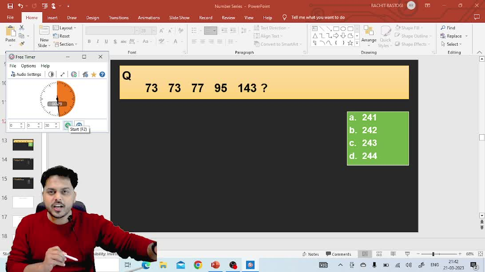

#### Core Concepts & Learning Objectives
Comprehensive video masterclass covering Number Series 04 (Zero Difference). Focuses on fundamental principles, algorithm analysis, edge-case handling, and Infosys exam question solutions.

---

### Video 028: Number Series 05
- **Video ID**: `162552368` | **Duration**: `00:06:08` (368s)
- **Track**: Infosys System Engineer (SE) | **Topic**: Logical Reasoning & Analytical Puzzles
- **Curriculum Path**: `2. Infosys System Eng Prep- Apti + Pseudo / Section I : Logical Reasoning & Puzzle / 9 : Number Series _ Important types`

#### Master Video Slide Thumbnail Plate
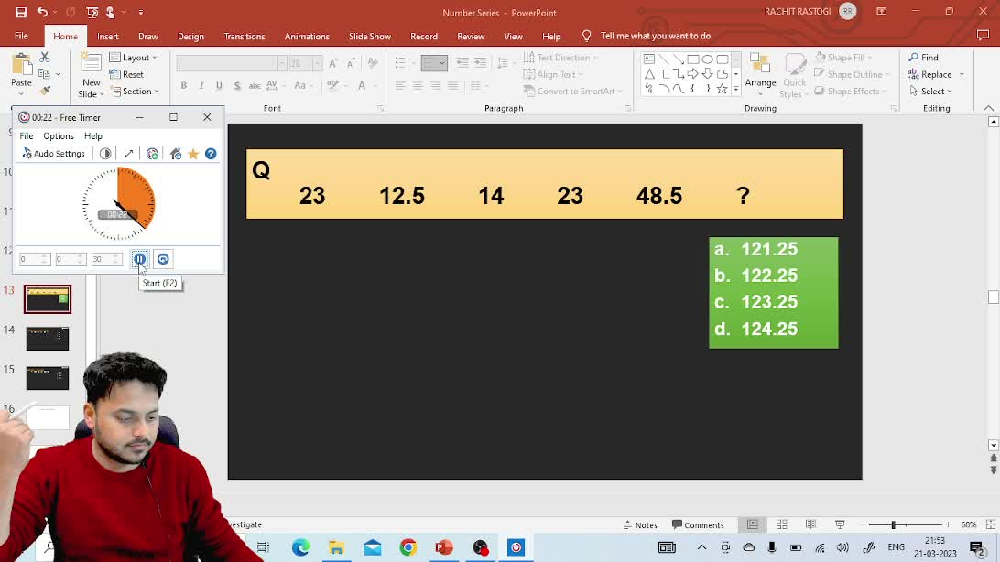

#### Core Concepts & Learning Objectives
Comprehensive video masterclass covering Number Series 05. Focuses on fundamental principles, algorithm analysis, edge-case handling, and Infosys exam question solutions.

---

### Video 029: 1. Logical Reasoning Data Sufficiency Prep
- **Video ID**: `162552386` | **Duration**: `01:29:10` (5,350s)
- **Track**: Infosys System Engineer (SE) | **Topic**: Logical Reasoning & Analytical Puzzles
- **Curriculum Path**: `2. Infosys System Eng Prep- Apti + Pseudo / Section I : Logical Reasoning & Puzzle / 10: IMP LR (Data Sufficiency)`

#### Master Video Slide Thumbnail Plate
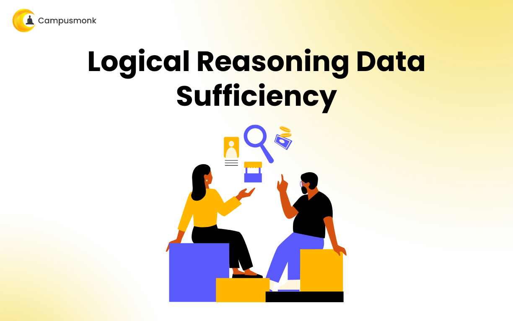

#### Core Concepts & Learning Objectives
Comprehensive video masterclass covering 1. Logical Reasoning Data Sufficiency Prep. Focuses on fundamental principles, algorithm analysis, edge-case handling, and Infosys exam question solutions.

---

### Video 030: 2.Data Sufficiency
- **Video ID**: `162552388` | **Duration**: `00:15:59` (959s)
- **Track**: Infosys System Engineer (SE) | **Topic**: Logical Reasoning & Analytical Puzzles
- **Curriculum Path**: `2. Infosys System Eng Prep- Apti + Pseudo / Section I : Logical Reasoning & Puzzle / 10: IMP LR (Data Sufficiency)`

#### Master Video Slide Thumbnail Plate
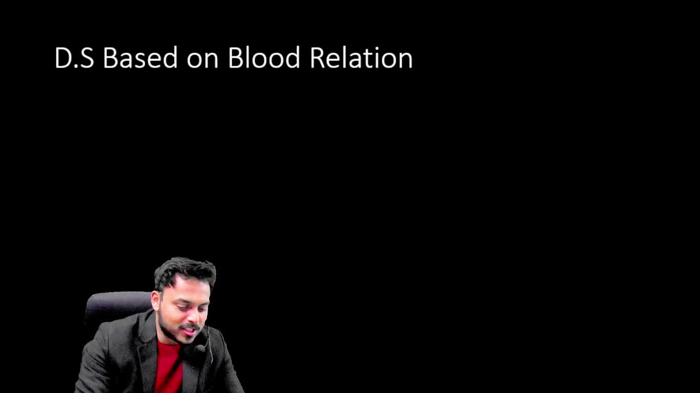

#### Core Concepts & Learning Objectives
Comprehensive video masterclass covering 2.Data Sufficiency. Focuses on fundamental principles, algorithm analysis, edge-case handling, and Infosys exam question solutions.

---

### Video 031: 3.Data Sufficiency
- **Video ID**: `162552387` | **Duration**: `00:14:08` (848s)
- **Track**: Infosys System Engineer (SE) | **Topic**: Logical Reasoning & Analytical Puzzles
- **Curriculum Path**: `2. Infosys System Eng Prep- Apti + Pseudo / Section I : Logical Reasoning & Puzzle / 10: IMP LR (Data Sufficiency)`

#### Master Video Slide Thumbnail Plate
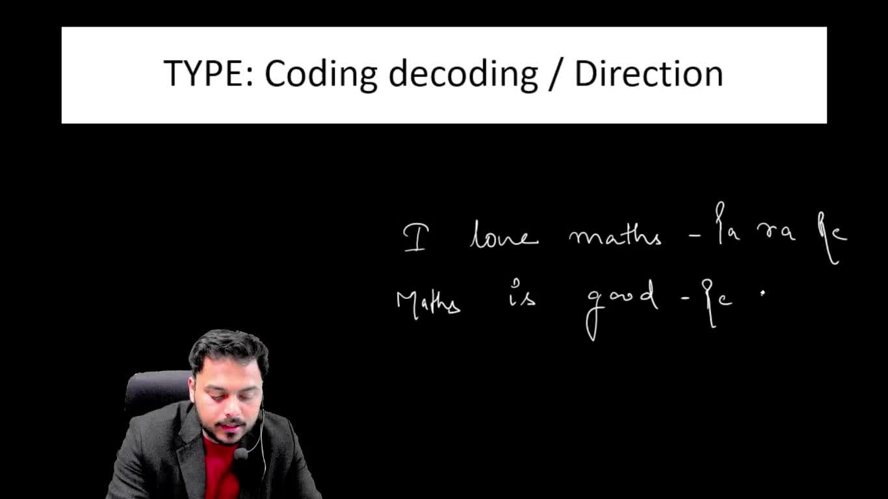

#### Core Concepts & Learning Objectives
Comprehensive video masterclass covering 3.Data Sufficiency. Focuses on fundamental principles, algorithm analysis, edge-case handling, and Infosys exam question solutions.

---

### Video 032: Critical Reasoning Part 1
- **Video ID**: `162552390` | **Duration**: `01:32:58` (5,578s)
- **Track**: Infosys System Engineer (SE) | **Topic**: Logical Reasoning & Analytical Puzzles
- **Curriculum Path**: `2. Infosys System Eng Prep- Apti + Pseudo / Section I : Logical Reasoning & Puzzle / 8 : Critical Reasoning & Syllogism / Assumption Argument C.R`

#### Master Video Slide Thumbnail Plate
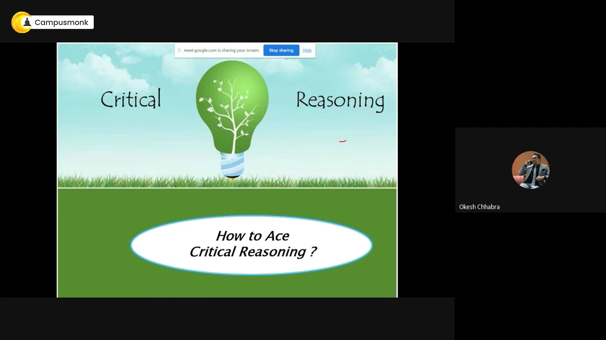

#### Core Concepts & Learning Objectives
Comprehensive video masterclass covering Critical Reasoning Part 1. Focuses on fundamental principles, algorithm analysis, edge-case handling, and Infosys exam question solutions.

---

### Video 033: Critical Reasoning - Part 2
- **Video ID**: `162552389` | **Duration**: `01:15:17` (4,517s)
- **Track**: Infosys System Engineer (SE) | **Topic**: Logical Reasoning & Analytical Puzzles
- **Curriculum Path**: `2. Infosys System Eng Prep- Apti + Pseudo / Section I : Logical Reasoning & Puzzle / 8 : Critical Reasoning & Syllogism / Assumption Argument C.R`

#### Master Video Slide Thumbnail Plate
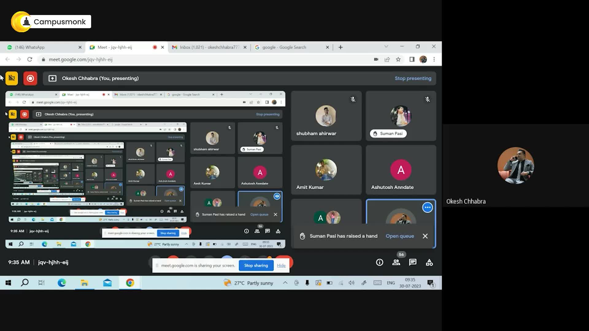

#### Core Concepts & Learning Objectives
Comprehensive video masterclass covering Critical Reasoning - Part 2. Focuses on fundamental principles, algorithm analysis, edge-case handling, and Infosys exam question solutions.

---

### Video 034: Critical Reasoning - Part 3
- **Video ID**: `162552391` | **Duration**: `01:02:58` (3,778s)
- **Track**: Infosys System Engineer (SE) | **Topic**: Logical Reasoning & Analytical Puzzles
- **Curriculum Path**: `2. Infosys System Eng Prep- Apti + Pseudo / Section I : Logical Reasoning & Puzzle / 8 : Critical Reasoning & Syllogism / Assumption Argument C.R`

#### Master Video Slide Thumbnail Plate
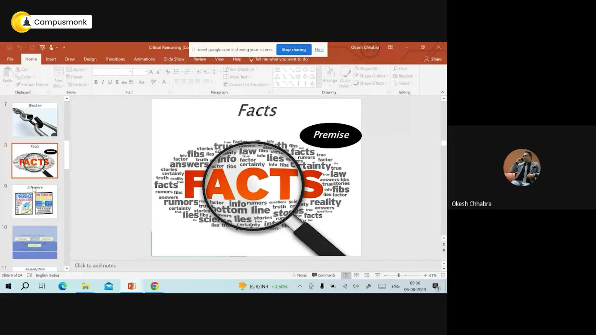

#### Core Concepts & Learning Objectives
Comprehensive video masterclass covering Critical Reasoning - Part 3. Focuses on fundamental principles, algorithm analysis, edge-case handling, and Infosys exam question solutions.

---

### Video 035: Syllogism 1_ Foundation
- **Video ID**: `162552392` | **Duration**: `01:10:03` (4,203s)
- **Track**: Infosys System Engineer (SE) | **Topic**: Logical Reasoning & Analytical Puzzles
- **Curriculum Path**: `2. Infosys System Eng Prep- Apti + Pseudo / Section I : Logical Reasoning & Puzzle / 8 : Critical Reasoning & Syllogism / Syllogism / Concept Videos`

#### Master Video Slide Thumbnail Plate
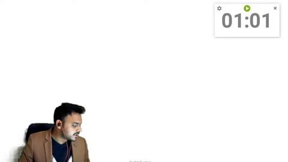

#### Core Concepts & Learning Objectives
Comprehensive video masterclass covering Syllogism 1_ Foundation. Focuses on fundamental principles, algorithm analysis, edge-case handling, and Infosys exam question solutions.

---

### Video 036: Syllogisms 2 _ Reverse Syllogism
- **Video ID**: `162552393` | **Duration**: `00:43:51` (2,631s)
- **Track**: Infosys System Engineer (SE) | **Topic**: Logical Reasoning & Analytical Puzzles
- **Curriculum Path**: `2. Infosys System Eng Prep- Apti + Pseudo / Section I : Logical Reasoning & Puzzle / 8 : Critical Reasoning & Syllogism / Syllogism / Concept Videos`

#### Master Video Slide Thumbnail Plate
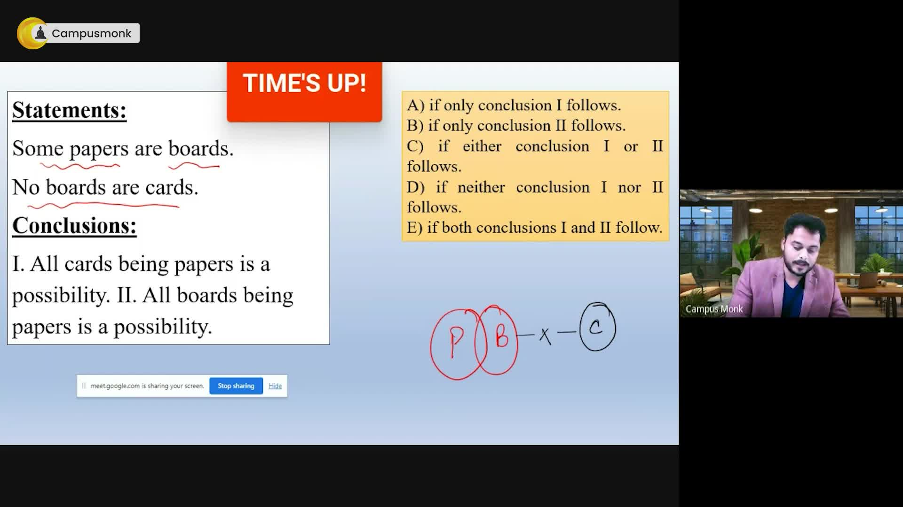

#### Core Concepts & Learning Objectives
Comprehensive video masterclass covering Syllogisms 2 _ Reverse Syllogism. Focuses on fundamental principles, algorithm analysis, edge-case handling, and Infosys exam question solutions.

---

### Video 037: Calendar Class
- **Video ID**: `162552426` | **Duration**: `00:56:48` (3,408s)
- **Track**: Infosys System Engineer (SE) | **Topic**: Logical Reasoning & Analytical Puzzles
- **Curriculum Path**: `2. Infosys System Eng Prep- Apti + Pseudo / Section I : Logical Reasoning & Puzzle / Module 12: Clocks & Calendar / Calenadar`

#### Master Video Slide Thumbnail Plate
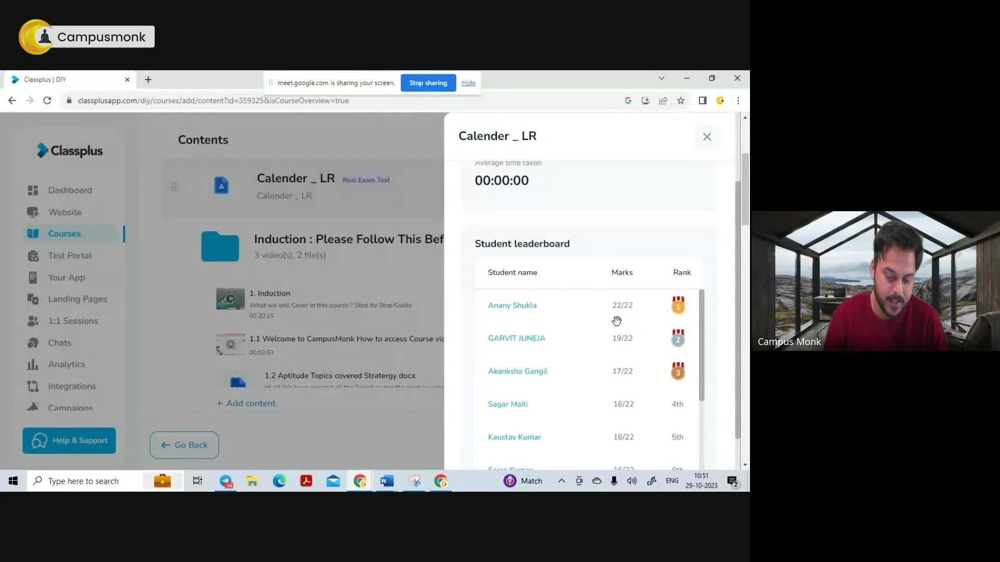

#### Core Concepts & Learning Objectives
Comprehensive video masterclass covering Calendar Class. Focuses on fundamental principles, algorithm analysis, edge-case handling, and Infosys exam question solutions.

---

### Video 038: Clocks 01
- **Video ID**: `162552419` | **Duration**: `00:56:00` (3,360s)
- **Track**: Infosys System Engineer (SE) | **Topic**: Logical Reasoning & Analytical Puzzles
- **Curriculum Path**: `2. Infosys System Eng Prep- Apti + Pseudo / Section I : Logical Reasoning & Puzzle / Module 12: Clocks & Calendar`

#### Master Video Slide Thumbnail Plate
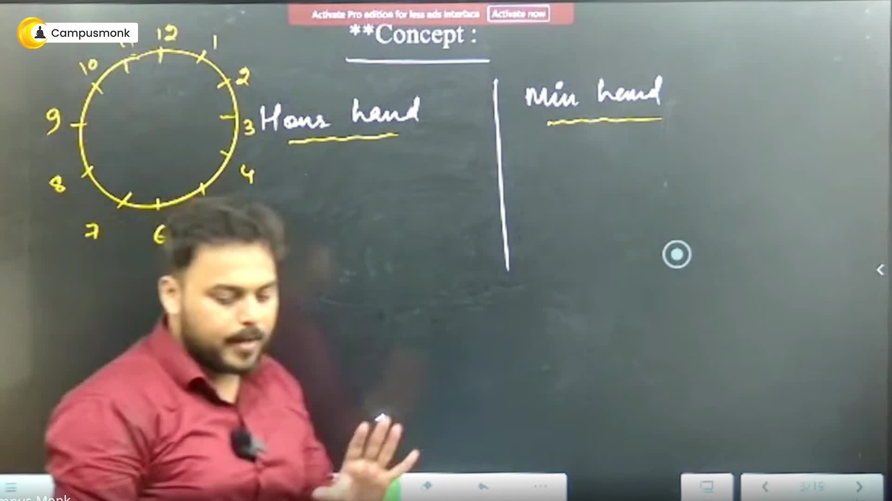

#### Core Concepts & Learning Objectives
Comprehensive video masterclass covering Clocks 01. Focuses on fundamental principles, algorithm analysis, edge-case handling, and Infosys exam question solutions.

---

### Video 039: Live 2 Clocks
- **Video ID**: `162552420` | **Duration**: `01:03:16` (3,796s)
- **Track**: Infosys System Engineer (SE) | **Topic**: Logical Reasoning & Analytical Puzzles
- **Curriculum Path**: `2. Infosys System Eng Prep- Apti + Pseudo / Section I : Logical Reasoning & Puzzle / Module 12: Clocks & Calendar`

#### Master Video Slide Thumbnail Plate
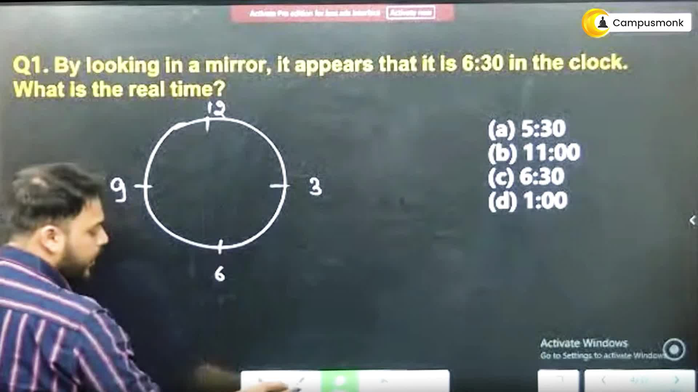

#### Core Concepts & Learning Objectives
Comprehensive video masterclass covering Live 2 Clocks. Focuses on fundamental principles, algorithm analysis, edge-case handling, and Infosys exam question solutions.

---

### Video 040: Dice
- **Video ID**: `162552427` | **Duration**: `00:23:43` (1,423s)
- **Track**: Infosys System Engineer (SE) | **Topic**: Logical Reasoning & Analytical Puzzles
- **Curriculum Path**: `2. Infosys System Eng Prep- Apti + Pseudo / Section I : Logical Reasoning & Puzzle / Module 11 :  Dice Mirror Image Water / Dice`

#### Master Video Slide Thumbnail Plate
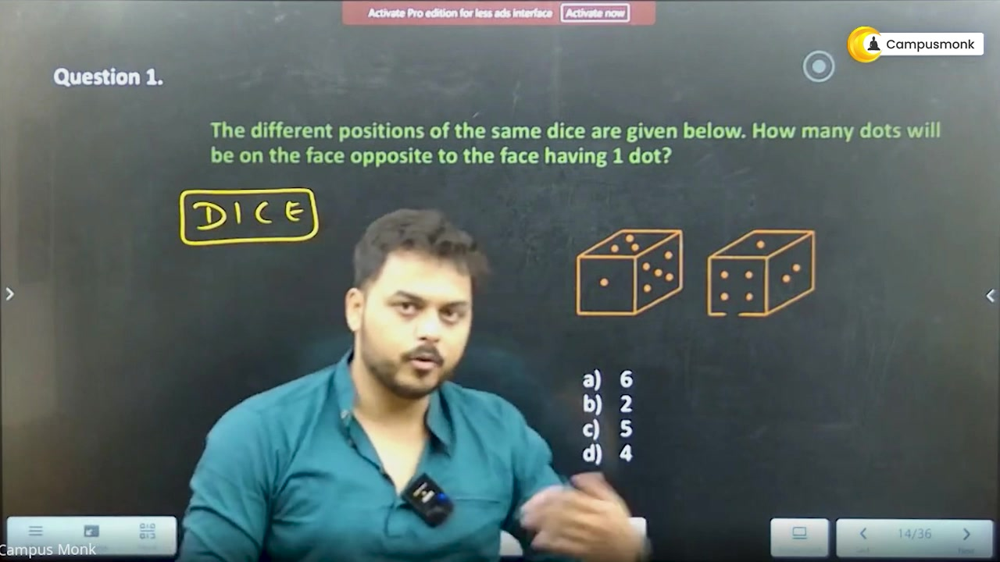

#### Core Concepts & Learning Objectives
Comprehensive video masterclass covering Dice. Focuses on fundamental principles, algorithm analysis, edge-case handling, and Infosys exam question solutions.

---

### Video 041: Paper Folding
- **Video ID**: `162552428` | **Duration**: `00:42:56` (2,576s)
- **Track**: Infosys System Engineer (SE) | **Topic**: Logical Reasoning & Analytical Puzzles
- **Curriculum Path**: `2. Infosys System Eng Prep- Apti + Pseudo / Section I : Logical Reasoning & Puzzle / Module 11 :  Dice Mirror Image Water / Paper Folding / Concept Video`

#### Master Video Slide Thumbnail Plate
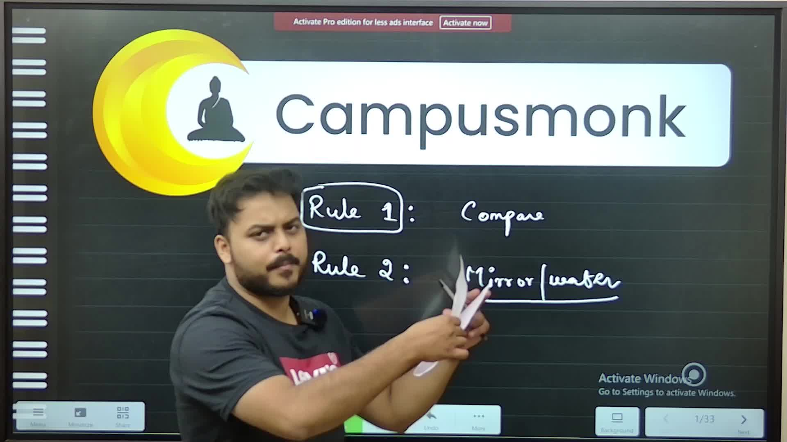

#### Core Concepts & Learning Objectives
Comprehensive video masterclass covering Paper Folding. Focuses on fundamental principles, algorithm analysis, edge-case handling, and Infosys exam question solutions.

---

### Video 144: Infosys Number puzzle
- **Video ID**: `162552110` | **Duration**: `01:45:26` (6,326s)
- **Track**: Infosys System Engineer (SE) | **Topic**: Logical Reasoning & Analytical Puzzles
- **Curriculum Path**: `2. Infosys System Eng Prep- Apti + Pseudo / Section VI: Puzzle Solving`

#### Master Video Slide Thumbnail Plate
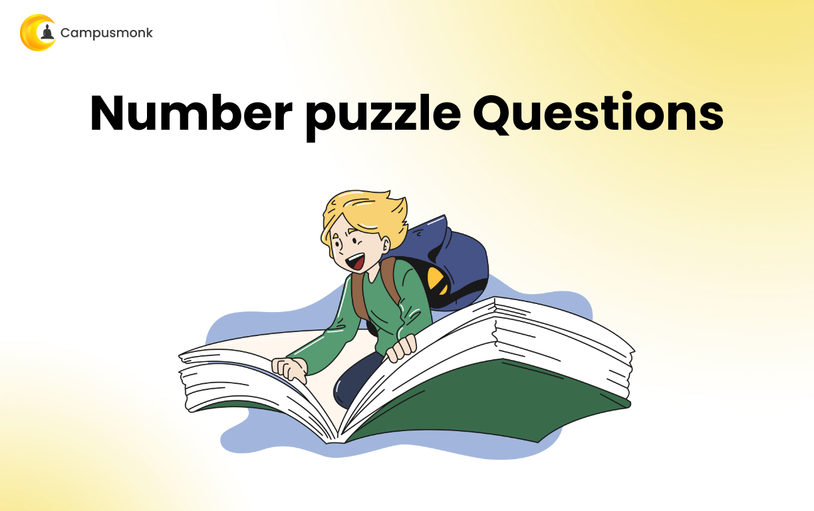

#### Core Concepts & Learning Objectives
Comprehensive video masterclass covering Infosys Number puzzle. Focuses on fundamental principles, algorithm analysis, edge-case handling, and Infosys exam question solutions.

---

