# Infosys Video Curriculum — Quantitative Aptitude & Numerical Ability

> **Target Track**: Infosys System Engineer (SE) | **Videos Count**: 55 | **Total Runtime**: 57h 39m
> **Curriculum Topics**: Percentages, Profit & Loss, Time & Work, Time-Speed-Distance, Ratio & Proportion, Averages, Alligation, Mensuration, Number System

## Section Overview & Curriculum Map
This master compendium documents all 55 high-yield video lectures for Quantitative Aptitude & Numerical Ability. Every lecture includes full metadata, curriculum path, high-resolution slide thumbnail plate, and core conceptual focus.

---

### Video 042: 1. D.I-  01 Pie chart  SET 01 of sheet
- **Video ID**: `162552076` | **Duration**: `00:25:41` (1,541s)
- **Track**: Infosys System Engineer (SE) | **Topic**: Quantitative Aptitude & Numerical Ability
- **Curriculum Path**: `2. Infosys System Eng Prep- Apti + Pseudo / Section II : Technical Ability ( Numerical ) / 1. Most Most Imp - Data Interpretation / 1.Pie Chart`

#### Master Video Slide Thumbnail Plate

#### Core Concepts & Learning Objectives
Comprehensive video masterclass covering 1. D.I-  01 Pie chart  SET 01 of sheet. Focuses on fundamental principles, algorithm analysis, edge-case handling, and Infosys exam question solutions.

---

### Video 043: 2 - 02 Pie chart SET 02 SET 03 of sheet
- **Video ID**: `162552077` | **Duration**: `00:14:59` (899s)
- **Track**: Infosys System Engineer (SE) | **Topic**: Quantitative Aptitude & Numerical Ability
- **Curriculum Path**: `2. Infosys System Eng Prep- Apti + Pseudo / Section II : Technical Ability ( Numerical ) / 1. Most Most Imp - Data Interpretation / 1.Pie Chart`

#### Master Video Slide Thumbnail Plate
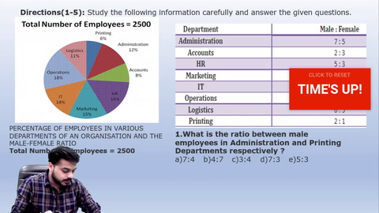

#### Core Concepts & Learning Objectives
Comprehensive video masterclass covering 2 - 02 Pie chart SET 02 SET 03 of sheet. Focuses on fundamental principles, algorithm analysis, edge-case handling, and Infosys exam question solutions.

---

### Video 044: LRDI from basic
- **Video ID**: `162552137` | **Duration**: `01:18:50` (4,730s)
- **Track**: Infosys System Engineer (SE) | **Topic**: Quantitative Aptitude & Numerical Ability
- **Curriculum Path**: `2. Infosys System Eng Prep- Apti + Pseudo / Section II : Technical Ability ( Numerical ) / 1. Most Most Imp - Data Interpretation / 2: LRDI - Live Imp`

#### Master Video Slide Thumbnail Plate
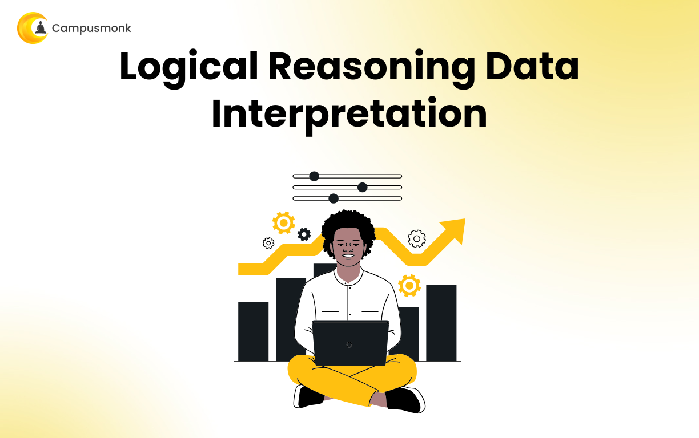

#### Core Concepts & Learning Objectives
Comprehensive video masterclass covering LRDI from basic. Focuses on fundamental principles, algorithm analysis, edge-case handling, and Infosys exam question solutions.

---

### Video 045: 02 LRDI
- **Video ID**: `162552138` | **Duration**: `01:19:31` (4,771s)
- **Track**: Infosys System Engineer (SE) | **Topic**: Quantitative Aptitude & Numerical Ability
- **Curriculum Path**: `2. Infosys System Eng Prep- Apti + Pseudo / Section II : Technical Ability ( Numerical ) / 1. Most Most Imp - Data Interpretation / 2: LRDI - Live Imp`

#### Master Video Slide Thumbnail Plate
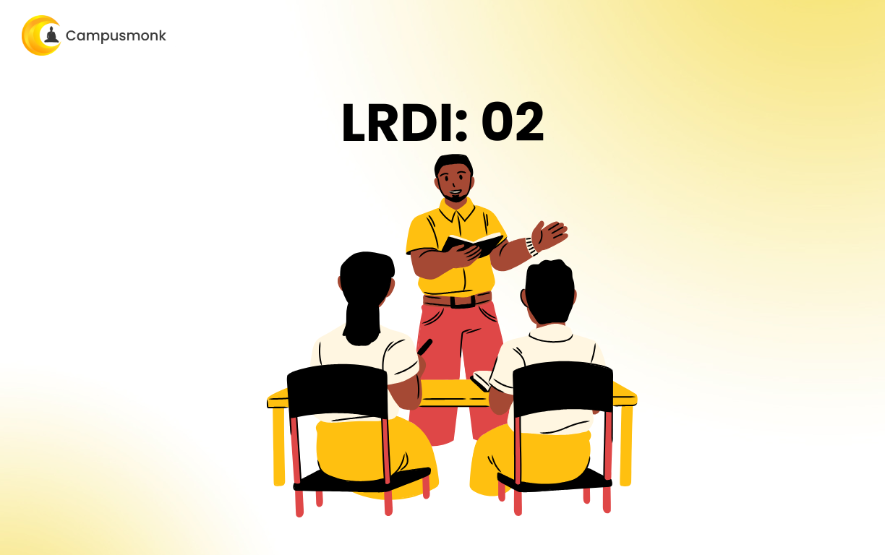

#### Core Concepts & Learning Objectives
Comprehensive video masterclass covering 02 LRDI. Focuses on fundamental principles, algorithm analysis, edge-case handling, and Infosys exam question solutions.

---

### Video 046: 03 LRDI
- **Video ID**: `162552139` | **Duration**: `01:09:15` (4,155s)
- **Track**: Infosys System Engineer (SE) | **Topic**: Quantitative Aptitude & Numerical Ability
- **Curriculum Path**: `2. Infosys System Eng Prep- Apti + Pseudo / Section II : Technical Ability ( Numerical ) / 1. Most Most Imp - Data Interpretation / 2: LRDI - Live Imp`

#### Master Video Slide Thumbnail Plate
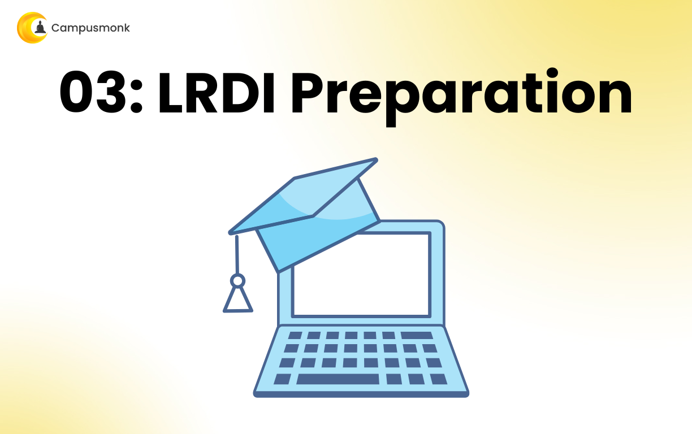

#### Core Concepts & Learning Objectives
Comprehensive video masterclass covering 03 LRDI. Focuses on fundamental principles, algorithm analysis, edge-case handling, and Infosys exam question solutions.

---

### Video 047: Radar Based D.I
- **Video ID**: `162552160` | **Duration**: `00:21:12` (1,272s)
- **Track**: Infosys System Engineer (SE) | **Topic**: Quantitative Aptitude & Numerical Ability
- **Curriculum Path**: `2. Infosys System Eng Prep- Apti + Pseudo / Section II : Technical Ability ( Numerical ) / 1. Most Most Imp - Data Interpretation / 3. Advance Radar D. I`

#### Master Video Slide Thumbnail Plate
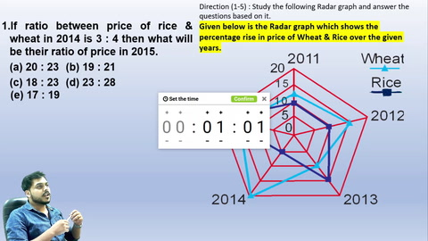

#### Core Concepts & Learning Objectives
Comprehensive video masterclass covering Radar Based D.I. Focuses on fundamental principles, algorithm analysis, edge-case handling, and Infosys exam question solutions.

---

### Video 048: caselete1.0
- **Video ID**: `162552222` | **Duration**: `00:22:59` (1,379s)
- **Track**: Infosys System Engineer (SE) | **Topic**: Quantitative Aptitude & Numerical Ability
- **Curriculum Path**: `2. Infosys System Eng Prep- Apti + Pseudo / Section II : Technical Ability ( Numerical ) / 1. Most Most Imp - Data Interpretation / 4. Caselet based D.I`

#### Master Video Slide Thumbnail Plate
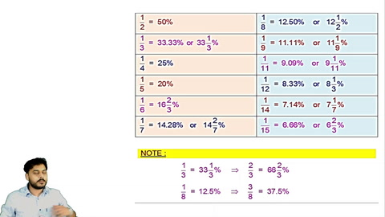

#### Core Concepts & Learning Objectives
Comprehensive video masterclass covering caselete1.0. Focuses on fundamental principles, algorithm analysis, edge-case handling, and Infosys exam question solutions.

---

### Video 049: Missing D.I Q.1-5 solution
- **Video ID**: `162552256` | **Duration**: `00:16:01` (961s)
- **Track**: Infosys System Engineer (SE) | **Topic**: Quantitative Aptitude & Numerical Ability
- **Curriculum Path**: `2. Infosys System Eng Prep- Apti + Pseudo / Section II : Technical Ability ( Numerical ) / 1. Most Most Imp - Data Interpretation / 5. Advance Missing D.I`

#### Master Video Slide Thumbnail Plate
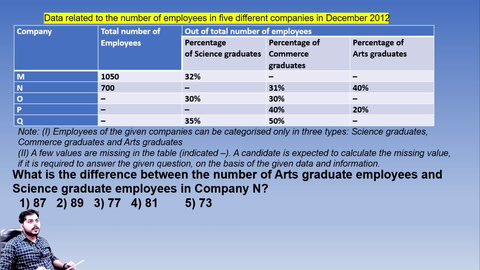

#### Core Concepts & Learning Objectives
Comprehensive video masterclass covering Missing D.I Q.1-5 solution. Focuses on fundamental principles, algorithm analysis, edge-case handling, and Infosys exam question solutions.

---

### Video 050: Miss. D.I Q6-10 solution
- **Video ID**: `162552257` | **Duration**: `00:14:07` (847s)
- **Track**: Infosys System Engineer (SE) | **Topic**: Quantitative Aptitude & Numerical Ability
- **Curriculum Path**: `2. Infosys System Eng Prep- Apti + Pseudo / Section II : Technical Ability ( Numerical ) / 1. Most Most Imp - Data Interpretation / 5. Advance Missing D.I`

#### Master Video Slide Thumbnail Plate
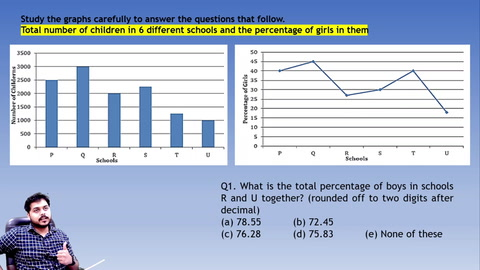

#### Core Concepts & Learning Objectives
Comprehensive video masterclass covering Miss. D.I Q6-10 solution. Focuses on fundamental principles, algorithm analysis, edge-case handling, and Infosys exam question solutions.

---

### Video 051: 1: Percentage All Type
- **Video ID**: `162552136` | **Duration**: `01:34:01` (5,641s)
- **Track**: Infosys System Engineer (SE) | **Topic**: Quantitative Aptitude & Numerical Ability
- **Curriculum Path**: `2. Infosys System Eng Prep- Apti + Pseudo / Section II : Technical Ability ( Numerical ) / 2. Numerical ability/Quantitative Aptitude / 1. Percentage - With DPP Solution ( 100 Questions)`

#### Master Video Slide Thumbnail Plate
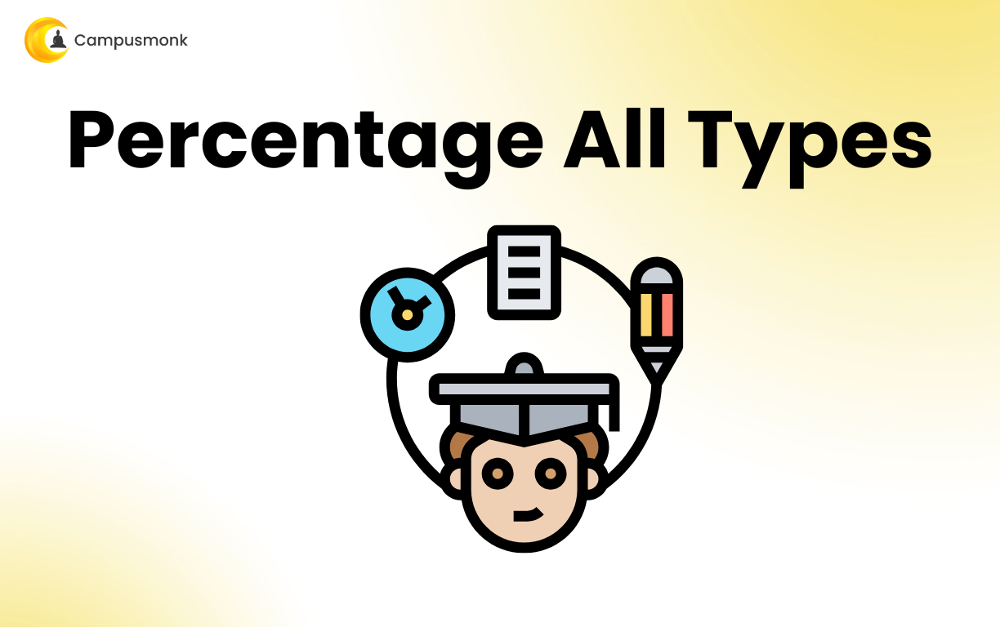

#### Core Concepts & Learning Objectives
Comprehensive video masterclass covering 1: Percentage All Type. Focuses on fundamental principles, algorithm analysis, edge-case handling, and Infosys exam question solutions.

---

### Video 052: 02: Percentage
- **Video ID**: `162552135` | **Duration**: `01:11:09` (4,269s)
- **Track**: Infosys System Engineer (SE) | **Topic**: Quantitative Aptitude & Numerical Ability
- **Curriculum Path**: `2. Infosys System Eng Prep- Apti + Pseudo / Section II : Technical Ability ( Numerical ) / 2. Numerical ability/Quantitative Aptitude / 1. Percentage - With DPP Solution ( 100 Questions)`

#### Master Video Slide Thumbnail Plate

#### Core Concepts & Learning Objectives
Comprehensive video masterclass covering 02: Percentage. Focuses on fundamental principles, algorithm analysis, edge-case handling, and Infosys exam question solutions.

---

### Video 053: 03: Percentage
- **Video ID**: `162552134` | **Duration**: `01:06:18` (3,978s)
- **Track**: Infosys System Engineer (SE) | **Topic**: Quantitative Aptitude & Numerical Ability
- **Curriculum Path**: `2. Infosys System Eng Prep- Apti + Pseudo / Section II : Technical Ability ( Numerical ) / 2. Numerical ability/Quantitative Aptitude / 1. Percentage - With DPP Solution ( 100 Questions)`

#### Master Video Slide Thumbnail Plate

#### Core Concepts & Learning Objectives
Comprehensive video masterclass covering 03: Percentage. Focuses on fundamental principles, algorithm analysis, edge-case handling, and Infosys exam question solutions.

---

### Video 054: Ratio And Proportion Prep
- **Video ID**: `162552159` | **Duration**: `01:48:42` (6,522s)
- **Track**: Infosys System Engineer (SE) | **Topic**: Quantitative Aptitude & Numerical Ability
- **Curriculum Path**: `2. Infosys System Eng Prep- Apti + Pseudo / Section II : Technical Ability ( Numerical ) / 2. Numerical ability/Quantitative Aptitude / 2. Ratio & Proportion`

#### Master Video Slide Thumbnail Plate
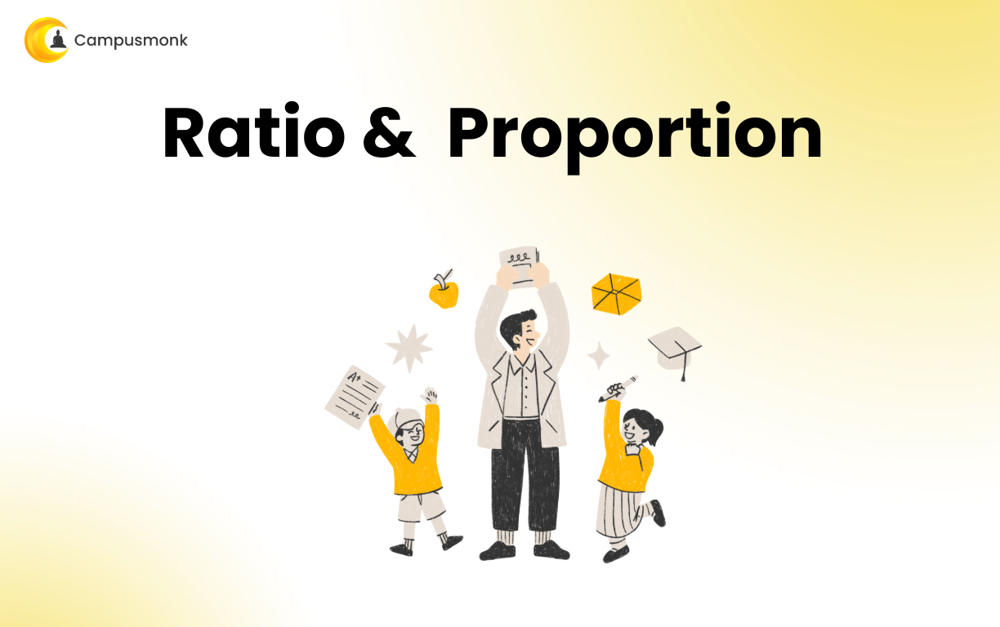

#### Core Concepts & Learning Objectives
Comprehensive video masterclass covering Ratio And Proportion Prep. Focuses on fundamental principles, algorithm analysis, edge-case handling, and Infosys exam question solutions.

---

### Video 055: Part 2: Ratio And Proportion Prep
- **Video ID**: `162552158` | **Duration**: `01:16:01` (4,561s)
- **Track**: Infosys System Engineer (SE) | **Topic**: Quantitative Aptitude & Numerical Ability
- **Curriculum Path**: `2. Infosys System Eng Prep- Apti + Pseudo / Section II : Technical Ability ( Numerical ) / 2. Numerical ability/Quantitative Aptitude / 2. Ratio & Proportion`

#### Master Video Slide Thumbnail Plate
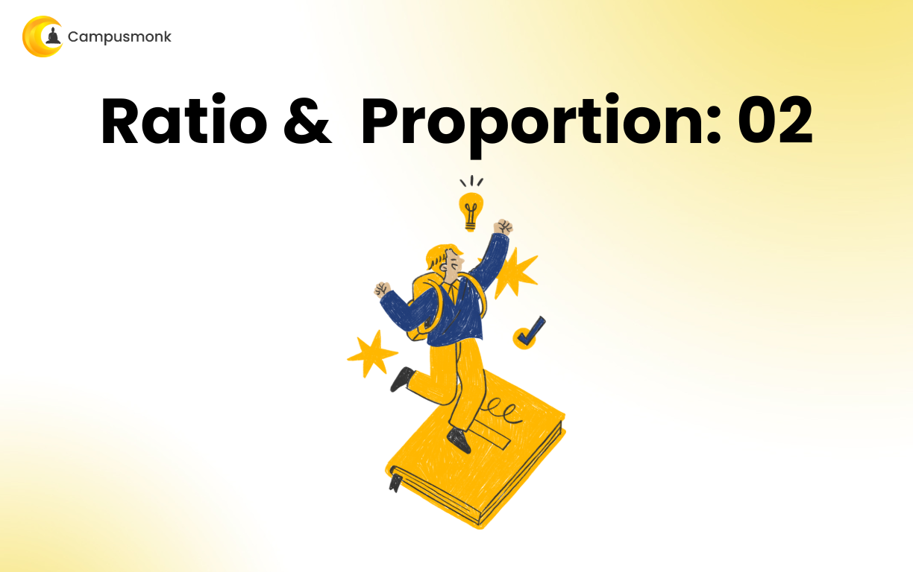

#### Core Concepts & Learning Objectives
Comprehensive video masterclass covering Part 2: Ratio And Proportion Prep. Focuses on fundamental principles, algorithm analysis, edge-case handling, and Infosys exam question solutions.

---

### Video 056: ALLIGATION 01
- **Video ID**: `162552218` | **Duration**: `01:22:10` (4,930s)
- **Track**: Infosys System Engineer (SE) | **Topic**: Quantitative Aptitude & Numerical Ability
- **Curriculum Path**: `2. Infosys System Eng Prep- Apti + Pseudo / Section II : Technical Ability ( Numerical ) / 2. Numerical ability/Quantitative Aptitude / 3: Mixture & Alligation`

#### Master Video Slide Thumbnail Plate

#### Core Concepts & Learning Objectives
Comprehensive video masterclass covering ALLIGATION 01. Focuses on fundamental principles, algorithm analysis, edge-case handling, and Infosys exam question solutions.

---

### Video 057: MIXTURES 1
- **Video ID**: `162552219` | **Duration**: `00:57:17` (3,437s)
- **Track**: Infosys System Engineer (SE) | **Topic**: Quantitative Aptitude & Numerical Ability
- **Curriculum Path**: `2. Infosys System Eng Prep- Apti + Pseudo / Section II : Technical Ability ( Numerical ) / 2. Numerical ability/Quantitative Aptitude / 3: Mixture & Alligation`

#### Master Video Slide Thumbnail Plate

#### Core Concepts & Learning Objectives
Comprehensive video masterclass covering MIXTURES 1. Focuses on fundamental principles, algorithm analysis, edge-case handling, and Infosys exam question solutions.

---

### Video 058: Tawa Fry Method + Replacement
- **Video ID**: `162552221` | **Duration**: `01:30:19` (5,419s)
- **Track**: Infosys System Engineer (SE) | **Topic**: Quantitative Aptitude & Numerical Ability
- **Curriculum Path**: `2. Infosys System Eng Prep- Apti + Pseudo / Section II : Technical Ability ( Numerical ) / 2. Numerical ability/Quantitative Aptitude / 3: Mixture & Alligation`

#### Master Video Slide Thumbnail Plate
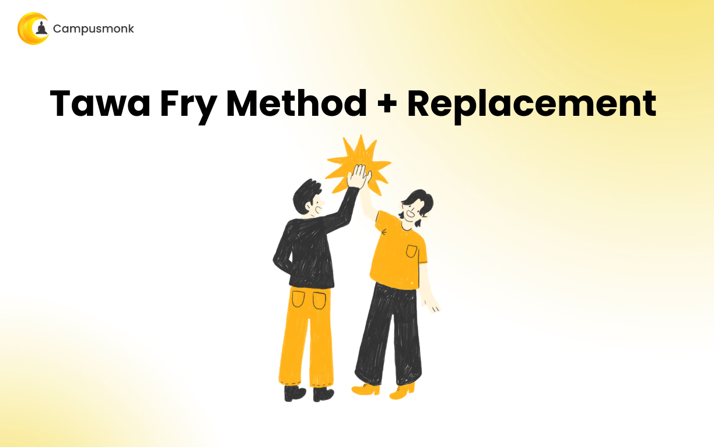

#### Core Concepts & Learning Objectives
Comprehensive video masterclass covering Tawa Fry Method + Replacement. Focuses on fundamental principles, algorithm analysis, edge-case handling, and Infosys exam question solutions.

---

### Video 059: 1: Simple interest
- **Video ID**: `162552322` | **Duration**: `01:58:45` (7,125s)
- **Track**: Infosys System Engineer (SE) | **Topic**: Quantitative Aptitude & Numerical Ability
- **Curriculum Path**: `2. Infosys System Eng Prep- Apti + Pseudo / Section II : Technical Ability ( Numerical ) / 2. Numerical ability/Quantitative Aptitude / 5: Simple & Compound interest + Installment`

#### Master Video Slide Thumbnail Plate

#### Core Concepts & Learning Objectives
Comprehensive video masterclass covering 1: Simple interest. Focuses on fundamental principles, algorithm analysis, edge-case handling, and Infosys exam question solutions.

---

### Video 060: 2: Compound Interest
- **Video ID**: `162552321` | **Duration**: `01:38:55` (5,935s)
- **Track**: Infosys System Engineer (SE) | **Topic**: Quantitative Aptitude & Numerical Ability
- **Curriculum Path**: `2. Infosys System Eng Prep- Apti + Pseudo / Section II : Technical Ability ( Numerical ) / 2. Numerical ability/Quantitative Aptitude / 5: Simple & Compound interest + Installment`

#### Master Video Slide Thumbnail Plate

#### Core Concepts & Learning Objectives
Comprehensive video masterclass covering 2: Compound Interest. Focuses on fundamental principles, algorithm analysis, edge-case handling, and Infosys exam question solutions.

---

### Video 061: 3: SIMPLE & COMPOUND INTEREST
- **Video ID**: `162552323` | **Duration**: `01:23:25` (5,005s)
- **Track**: Infosys System Engineer (SE) | **Topic**: Quantitative Aptitude & Numerical Ability
- **Curriculum Path**: `2. Infosys System Eng Prep- Apti + Pseudo / Section II : Technical Ability ( Numerical ) / 2. Numerical ability/Quantitative Aptitude / 5: Simple & Compound interest + Installment`

#### Master Video Slide Thumbnail Plate

#### Core Concepts & Learning Objectives
Comprehensive video masterclass covering 3: SIMPLE & COMPOUND INTEREST. Focuses on fundamental principles, algorithm analysis, edge-case handling, and Infosys exam question solutions.

---

### Video 062: Profit and loss 01
- **Video ID**: `162552253` | **Duration**: `01:30:02` (5,402s)
- **Track**: Infosys System Engineer (SE) | **Topic**: Quantitative Aptitude & Numerical Ability
- **Curriculum Path**: `2. Infosys System Eng Prep- Apti + Pseudo / Section II : Technical Ability ( Numerical ) / 2. Numerical ability/Quantitative Aptitude / 4: Profit Loss & discount`

#### Master Video Slide Thumbnail Plate
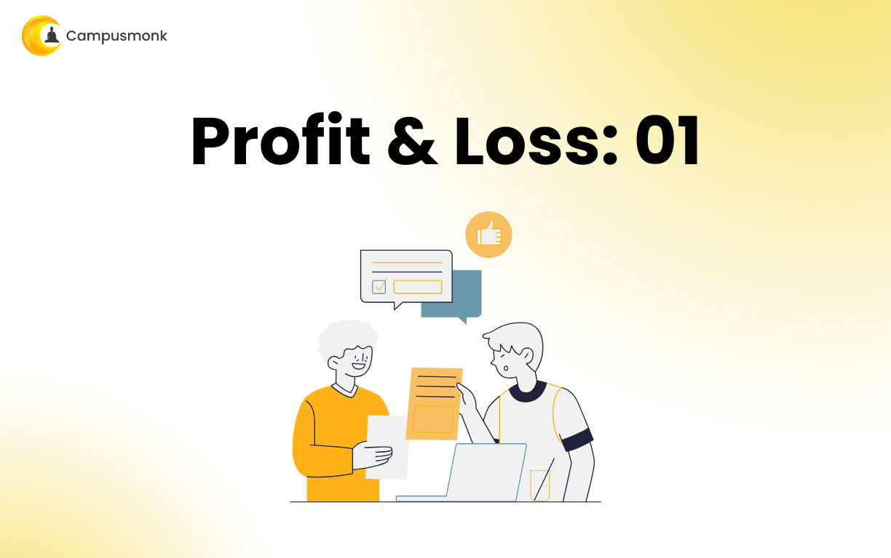

#### Core Concepts & Learning Objectives
Comprehensive video masterclass covering Profit and loss 01. Focuses on fundamental principles, algorithm analysis, edge-case handling, and Infosys exam question solutions.

---

### Video 063: Profit and loss 02
- **Video ID**: `162552254` | **Duration**: `01:33:18` (5,598s)
- **Track**: Infosys System Engineer (SE) | **Topic**: Quantitative Aptitude & Numerical Ability
- **Curriculum Path**: `2. Infosys System Eng Prep- Apti + Pseudo / Section II : Technical Ability ( Numerical ) / 2. Numerical ability/Quantitative Aptitude / 4: Profit Loss & discount`

#### Master Video Slide Thumbnail Plate
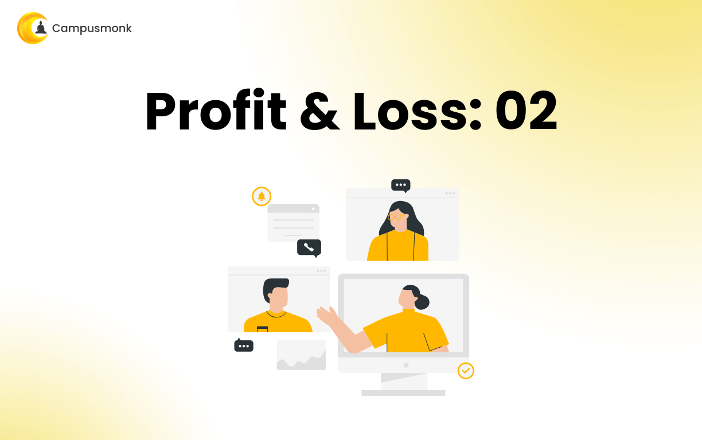

#### Core Concepts & Learning Objectives
Comprehensive video masterclass covering Profit and loss 02. Focuses on fundamental principles, algorithm analysis, edge-case handling, and Infosys exam question solutions.

---

### Video 064: Discount One Shot 1
- **Video ID**: `162552255` | **Duration**: `01:53:12` (6,792s)
- **Track**: Infosys System Engineer (SE) | **Topic**: Quantitative Aptitude & Numerical Ability
- **Curriculum Path**: `2. Infosys System Eng Prep- Apti + Pseudo / Section II : Technical Ability ( Numerical ) / 2. Numerical ability/Quantitative Aptitude / 4: Profit Loss & discount`

#### Master Video Slide Thumbnail Plate

#### Core Concepts & Learning Objectives
Comprehensive video masterclass covering Discount One Shot 1. Focuses on fundamental principles, algorithm analysis, edge-case handling, and Infosys exam question solutions.

---

### Video 065: 01 Time & Work
- **Video ID**: `162552356` | **Duration**: `01:24:51` (5,091s)
- **Track**: Infosys System Engineer (SE) | **Topic**: Quantitative Aptitude & Numerical Ability
- **Curriculum Path**: `2. Infosys System Eng Prep- Apti + Pseudo / Section II : Technical Ability ( Numerical ) / 2. Numerical ability/Quantitative Aptitude / 6: Time & Work/ Pipes & Cistern`

#### Master Video Slide Thumbnail Plate
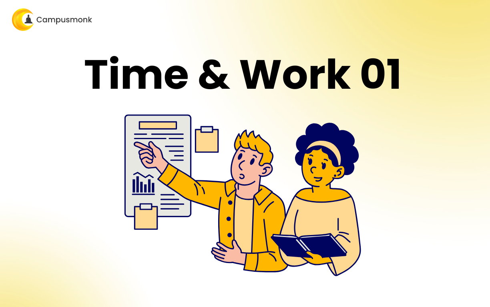

#### Core Concepts & Learning Objectives
Comprehensive video masterclass covering 01 Time & Work. Focuses on fundamental principles, algorithm analysis, edge-case handling, and Infosys exam question solutions.

---

### Video 066: 02 Pipes & Cistern Prep
- **Video ID**: `162552357` | **Duration**: `01:13:14` (4,394s)
- **Track**: Infosys System Engineer (SE) | **Topic**: Quantitative Aptitude & Numerical Ability
- **Curriculum Path**: `2. Infosys System Eng Prep- Apti + Pseudo / Section II : Technical Ability ( Numerical ) / 2. Numerical ability/Quantitative Aptitude / 6: Time & Work/ Pipes & Cistern`

#### Master Video Slide Thumbnail Plate
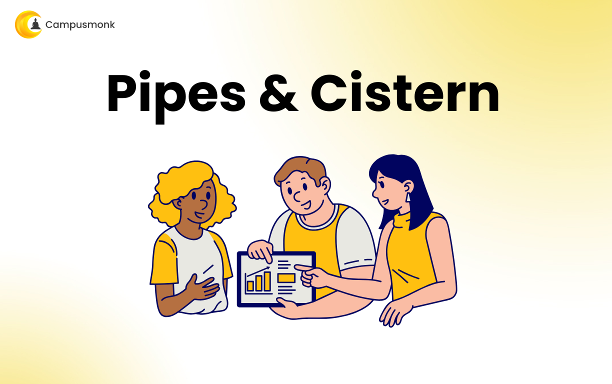

#### Core Concepts & Learning Objectives
Comprehensive video masterclass covering 02 Pipes & Cistern Prep. Focuses on fundamental principles, algorithm analysis, edge-case handling, and Infosys exam question solutions.

---

### Video 067: 03 Time & Work  Men & Women
- **Video ID**: `162552358` | **Duration**: `01:49:00` (6,540s)
- **Track**: Infosys System Engineer (SE) | **Topic**: Quantitative Aptitude & Numerical Ability
- **Curriculum Path**: `2. Infosys System Eng Prep- Apti + Pseudo / Section II : Technical Ability ( Numerical ) / 2. Numerical ability/Quantitative Aptitude / 6: Time & Work/ Pipes & Cistern`

#### Master Video Slide Thumbnail Plate

#### Core Concepts & Learning Objectives
Comprehensive video masterclass covering 03 Time & Work  Men & Women. Focuses on fundamental principles, algorithm analysis, edge-case handling, and Infosys exam question solutions.

---

### Video 068: Q1-Q5
- **Video ID**: `162552380` | **Duration**: `00:17:45` (1,065s)
- **Track**: Infosys System Engineer (SE) | **Topic**: Quantitative Aptitude & Numerical Ability
- **Curriculum Path**: `2. Infosys System Eng Prep- Apti + Pseudo / Section II : Technical Ability ( Numerical ) / 2. Numerical ability/Quantitative Aptitude / 7 Ages _ Tawa Fry Method`

#### Master Video Slide Thumbnail Plate
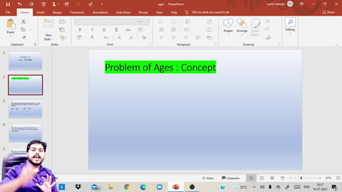

#### Core Concepts & Learning Objectives
Comprehensive video masterclass covering Q1-Q5. Focuses on fundamental principles, algorithm analysis, edge-case handling, and Infosys exam question solutions.

---

### Video 069: Q6-Q11
- **Video ID**: `162552381` | **Duration**: `00:21:35` (1,295s)
- **Track**: Infosys System Engineer (SE) | **Topic**: Quantitative Aptitude & Numerical Ability
- **Curriculum Path**: `2. Infosys System Eng Prep- Apti + Pseudo / Section II : Technical Ability ( Numerical ) / 2. Numerical ability/Quantitative Aptitude / 7 Ages _ Tawa Fry Method`

#### Master Video Slide Thumbnail Plate
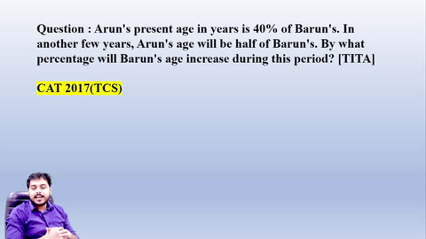

#### Core Concepts & Learning Objectives
Comprehensive video masterclass covering Q6-Q11. Focuses on fundamental principles, algorithm analysis, edge-case handling, and Infosys exam question solutions.

---

### Video 070: Q12-Q15
- **Video ID**: `162552382` | **Duration**: `00:12:36` (756s)
- **Track**: Infosys System Engineer (SE) | **Topic**: Quantitative Aptitude & Numerical Ability
- **Curriculum Path**: `2. Infosys System Eng Prep- Apti + Pseudo / Section II : Technical Ability ( Numerical ) / 2. Numerical ability/Quantitative Aptitude / 7 Ages _ Tawa Fry Method`

#### Master Video Slide Thumbnail Plate
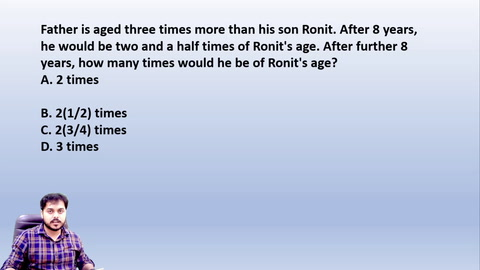

#### Core Concepts & Learning Objectives
Comprehensive video masterclass covering Q12-Q15. Focuses on fundamental principles, algorithm analysis, edge-case handling, and Infosys exam question solutions.

---

### Video 071: Q15-Q20
- **Video ID**: `162552383` | **Duration**: `00:22:14` (1,334s)
- **Track**: Infosys System Engineer (SE) | **Topic**: Quantitative Aptitude & Numerical Ability
- **Curriculum Path**: `2. Infosys System Eng Prep- Apti + Pseudo / Section II : Technical Ability ( Numerical ) / 2. Numerical ability/Quantitative Aptitude / 7 Ages _ Tawa Fry Method`

#### Master Video Slide Thumbnail Plate
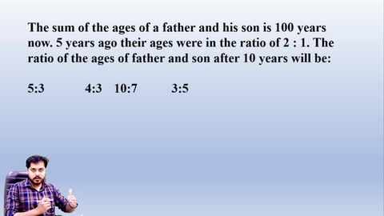

#### Core Concepts & Learning Objectives
Comprehensive video masterclass covering Q15-Q20. Focuses on fundamental principles, algorithm analysis, edge-case handling, and Infosys exam question solutions.

---

### Video 072: TSD 01
- **Video ID**: `162552414` | **Duration**: `01:23:18` (4,998s)
- **Track**: Infosys System Engineer (SE) | **Topic**: Quantitative Aptitude & Numerical Ability
- **Curriculum Path**: `2. Infosys System Eng Prep- Apti + Pseudo / Section II : Technical Ability ( Numerical ) / 2. Numerical ability/Quantitative Aptitude / 10: TSD (Time, Speed & Distance)`

#### Master Video Slide Thumbnail Plate
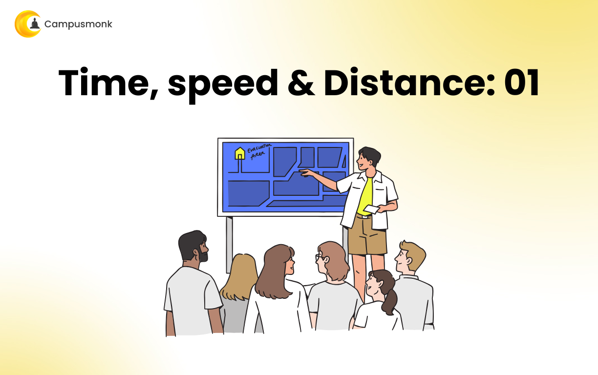

#### Core Concepts & Learning Objectives
Comprehensive video masterclass covering TSD 01. Focuses on fundamental principles, algorithm analysis, edge-case handling, and Infosys exam question solutions.

---

### Video 073: TSD 02
- **Video ID**: `162552415` | **Duration**: `01:34:59` (5,699s)
- **Track**: Infosys System Engineer (SE) | **Topic**: Quantitative Aptitude & Numerical Ability
- **Curriculum Path**: `2. Infosys System Eng Prep- Apti + Pseudo / Section II : Technical Ability ( Numerical ) / 2. Numerical ability/Quantitative Aptitude / 10: TSD (Time, Speed & Distance)`

#### Master Video Slide Thumbnail Plate
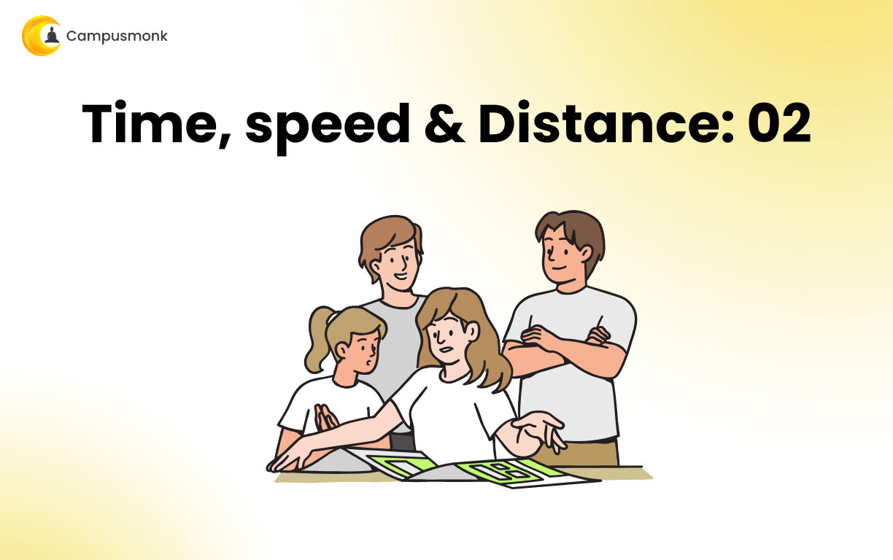

#### Core Concepts & Learning Objectives
Comprehensive video masterclass covering TSD 02. Focuses on fundamental principles, algorithm analysis, edge-case handling, and Infosys exam question solutions.

---

### Video 074: TSD 03
- **Video ID**: `162552416` | **Duration**: `01:26:27` (5,187s)
- **Track**: Infosys System Engineer (SE) | **Topic**: Quantitative Aptitude & Numerical Ability
- **Curriculum Path**: `2. Infosys System Eng Prep- Apti + Pseudo / Section II : Technical Ability ( Numerical ) / 2. Numerical ability/Quantitative Aptitude / 10: TSD (Time, Speed & Distance)`

#### Master Video Slide Thumbnail Plate
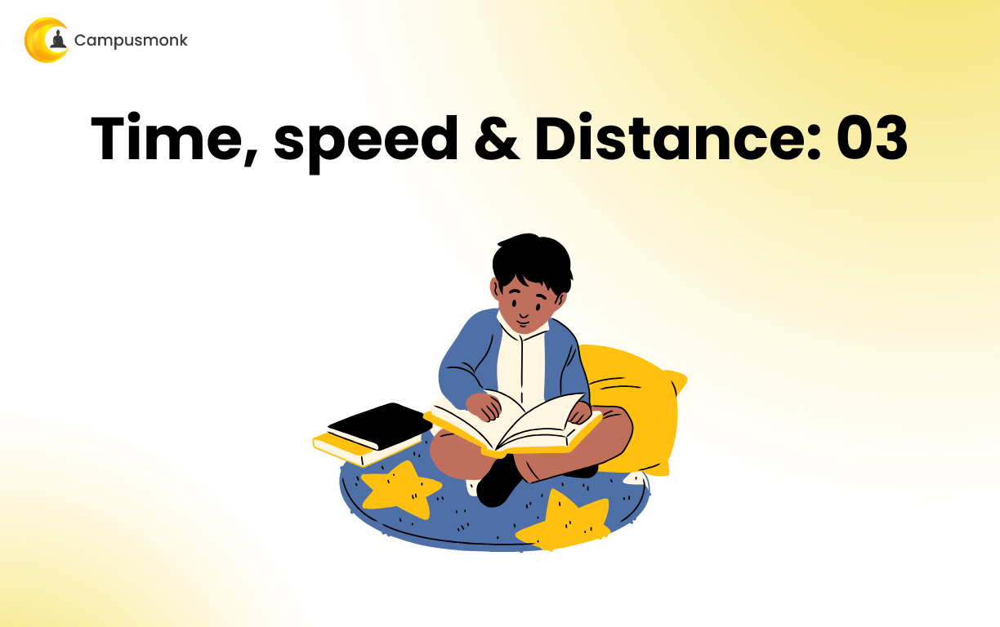

#### Core Concepts & Learning Objectives
Comprehensive video masterclass covering TSD 03. Focuses on fundamental principles, algorithm analysis, edge-case handling, and Infosys exam question solutions.

---

### Video 075: Boat & Stream Questions
- **Video ID**: `162552421` | **Duration**: `01:31:50` (5,510s)
- **Track**: Infosys System Engineer (SE) | **Topic**: Quantitative Aptitude & Numerical Ability
- **Curriculum Path**: `2. Infosys System Eng Prep- Apti + Pseudo / Section II : Technical Ability ( Numerical ) / 2. Numerical ability/Quantitative Aptitude / 11: Boat & Stream`

#### Master Video Slide Thumbnail Plate

#### Core Concepts & Learning Objectives
Comprehensive video masterclass covering Boat & Stream Questions. Focuses on fundamental principles, algorithm analysis, edge-case handling, and Infosys exam question solutions.

---

### Video 076: Partnership 01
- **Video ID**: `162552417` | **Duration**: `00:30:51` (1,851s)
- **Track**: Infosys System Engineer (SE) | **Topic**: Quantitative Aptitude & Numerical Ability
- **Curriculum Path**: `2. Infosys System Eng Prep- Apti + Pseudo / Section II : Technical Ability ( Numerical ) / 2. Numerical ability/Quantitative Aptitude / 8 Partnership & Average / 1 Partnership`

#### Master Video Slide Thumbnail Plate

#### Core Concepts & Learning Objectives
Comprehensive video masterclass covering Partnership 01. Focuses on fundamental principles, algorithm analysis, edge-case handling, and Infosys exam question solutions.

---

### Video 077: Partnership 02
- **Video ID**: `162552418` | **Duration**: `00:35:17` (2,117s)
- **Track**: Infosys System Engineer (SE) | **Topic**: Quantitative Aptitude & Numerical Ability
- **Curriculum Path**: `2. Infosys System Eng Prep- Apti + Pseudo / Section II : Technical Ability ( Numerical ) / 2. Numerical ability/Quantitative Aptitude / 8 Partnership & Average / 1 Partnership`

#### Master Video Slide Thumbnail Plate

#### Core Concepts & Learning Objectives
Comprehensive video masterclass covering Partnership 02. Focuses on fundamental principles, algorithm analysis, edge-case handling, and Infosys exam question solutions.

---

### Video 078: PART 01: Average
- **Video ID**: `162552422` | **Duration**: `01:02:15` (3,735s)
- **Track**: Infosys System Engineer (SE) | **Topic**: Quantitative Aptitude & Numerical Ability
- **Curriculum Path**: `2. Infosys System Eng Prep- Apti + Pseudo / Section II : Technical Ability ( Numerical ) / 2. Numerical ability/Quantitative Aptitude / 8 Partnership & Average / 2 Average`

#### Master Video Slide Thumbnail Plate
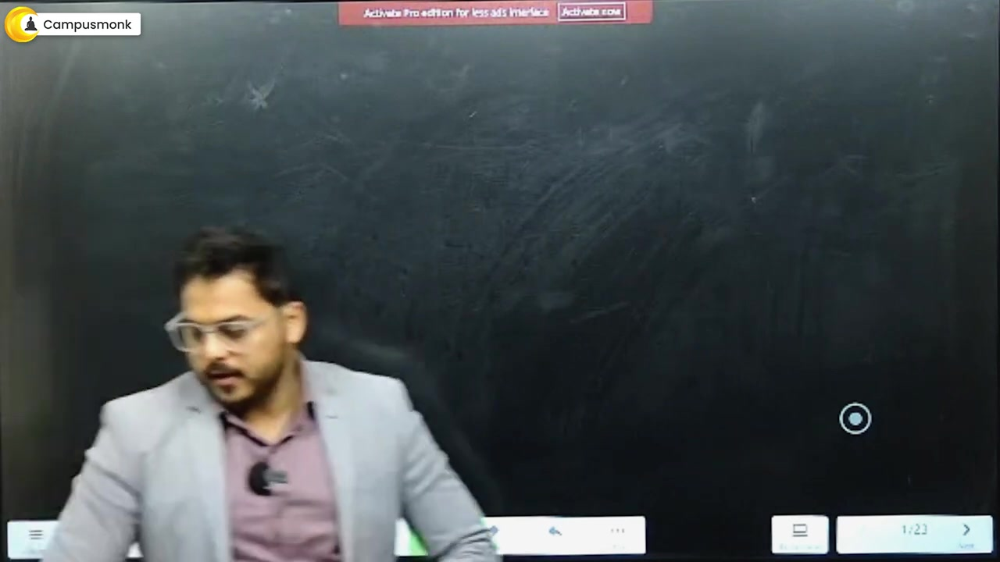

#### Core Concepts & Learning Objectives
Comprehensive video masterclass covering PART 01: Average. Focuses on fundamental principles, algorithm analysis, edge-case handling, and Infosys exam question solutions.

---

### Video 079: Part 02 - Average
- **Video ID**: `162552423` | **Duration**: `01:16:30` (4,590s)
- **Track**: Infosys System Engineer (SE) | **Topic**: Quantitative Aptitude & Numerical Ability
- **Curriculum Path**: `2. Infosys System Eng Prep- Apti + Pseudo / Section II : Technical Ability ( Numerical ) / 2. Numerical ability/Quantitative Aptitude / 8 Partnership & Average / 2 Average`

#### Master Video Slide Thumbnail Plate
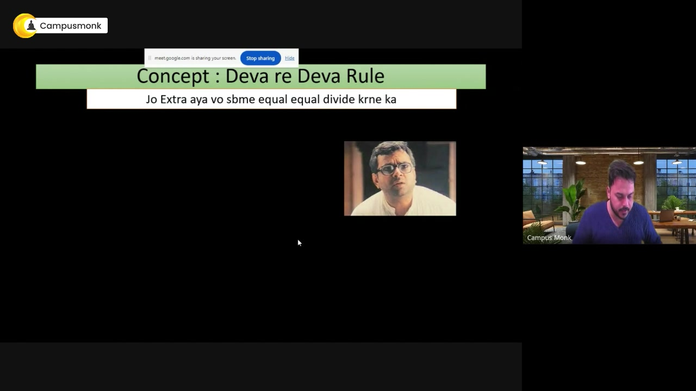

#### Core Concepts & Learning Objectives
Comprehensive video masterclass covering Part 02 - Average. Focuses on fundamental principles, algorithm analysis, edge-case handling, and Infosys exam question solutions.

---

### Video 080: Part 1:  Number System from Basic
- **Video ID**: `162552430` | **Duration**: `01:44:55` (6,295s)
- **Track**: Infosys System Engineer (SE) | **Topic**: Quantitative Aptitude & Numerical Ability
- **Curriculum Path**: `2. Infosys System Eng Prep- Apti + Pseudo / Section II : Technical Ability ( Numerical ) / 2. Numerical ability/Quantitative Aptitude / 12: Number System from basic`

#### Master Video Slide Thumbnail Plate
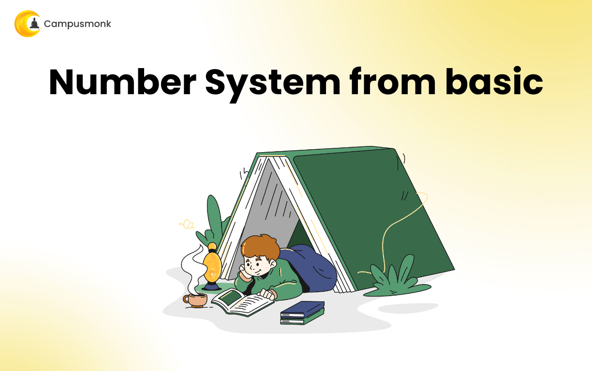

#### Core Concepts & Learning Objectives
Comprehensive video masterclass covering Part 1:  Number System from Basic. Focuses on fundamental principles, algorithm analysis, edge-case handling, and Infosys exam question solutions.

---

### Video 081: Part 2: Number System Updated Questions
- **Video ID**: `162552431` | **Duration**: `01:26:53` (5,213s)
- **Track**: Infosys System Engineer (SE) | **Topic**: Quantitative Aptitude & Numerical Ability
- **Curriculum Path**: `2. Infosys System Eng Prep- Apti + Pseudo / Section II : Technical Ability ( Numerical ) / 2. Numerical ability/Quantitative Aptitude / 12: Number System from basic`

#### Master Video Slide Thumbnail Plate
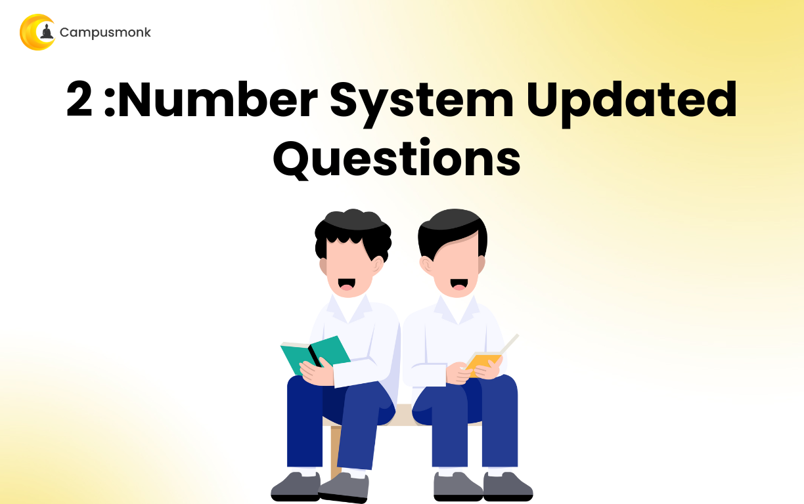

#### Core Concepts & Learning Objectives
Comprehensive video masterclass covering Part 2: Number System Updated Questions. Focuses on fundamental principles, algorithm analysis, edge-case handling, and Infosys exam question solutions.

---

### Video 082: Part 3: UNIT DIGIT & FACTORS
- **Video ID**: `162552432` | **Duration**: `01:15:56` (4,556s)
- **Track**: Infosys System Engineer (SE) | **Topic**: Quantitative Aptitude & Numerical Ability
- **Curriculum Path**: `2. Infosys System Eng Prep- Apti + Pseudo / Section II : Technical Ability ( Numerical ) / 2. Numerical ability/Quantitative Aptitude / 12: Number System from basic`

#### Master Video Slide Thumbnail Plate

#### Core Concepts & Learning Objectives
Comprehensive video masterclass covering Part 3: UNIT DIGIT & FACTORS. Focuses on fundamental principles, algorithm analysis, edge-case handling, and Infosys exam question solutions.

---

### Video 083: 1: LCM/ HCF from basic
- **Video ID**: `162552433` | **Duration**: `01:37:12` (5,832s)
- **Track**: Infosys System Engineer (SE) | **Topic**: Quantitative Aptitude & Numerical Ability
- **Curriculum Path**: `2. Infosys System Eng Prep- Apti + Pseudo / Section II : Technical Ability ( Numerical ) / 2. Numerical ability/Quantitative Aptitude / 13: LCM/ HCF From Basic`

#### Master Video Slide Thumbnail Plate
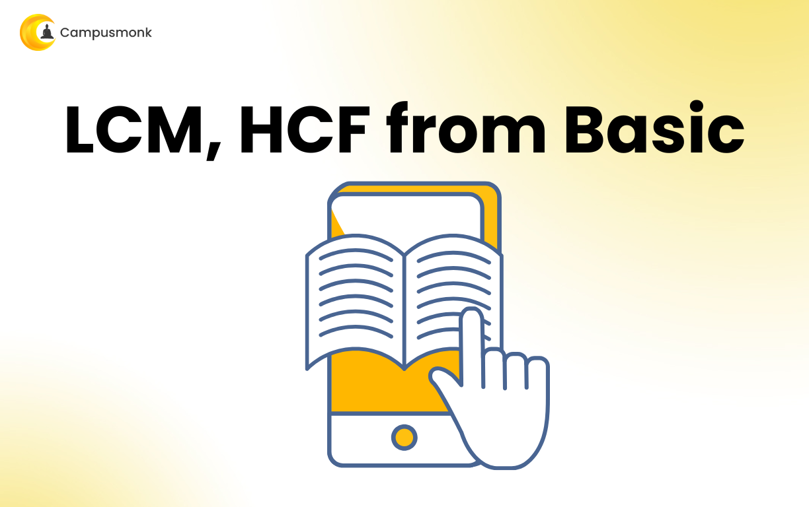

#### Core Concepts & Learning Objectives
Comprehensive video masterclass covering 1: LCM/ HCF from basic. Focuses on fundamental principles, algorithm analysis, edge-case handling, and Infosys exam question solutions.

---

### Video 084: PnC Prep from Basic
- **Video ID**: `162552435` | **Duration**: `01:33:36` (5,616s)
- **Track**: Infosys System Engineer (SE) | **Topic**: Quantitative Aptitude & Numerical Ability
- **Curriculum Path**: `2. Infosys System Eng Prep- Apti + Pseudo / Section II : Technical Ability ( Numerical ) / 2. Numerical ability/Quantitative Aptitude / 14: Permutation & Combination`

#### Master Video Slide Thumbnail Plate

#### Core Concepts & Learning Objectives
Comprehensive video masterclass covering PnC Prep from Basic. Focuses on fundamental principles, algorithm analysis, edge-case handling, and Infosys exam question solutions.

---

### Video 085: 2: Permutation & Combination
- **Video ID**: `162552434` | **Duration**: `01:12:54` (4,374s)
- **Track**: Infosys System Engineer (SE) | **Topic**: Quantitative Aptitude & Numerical Ability
- **Curriculum Path**: `2. Infosys System Eng Prep- Apti + Pseudo / Section II : Technical Ability ( Numerical ) / 2. Numerical ability/Quantitative Aptitude / 14: Permutation & Combination`

#### Master Video Slide Thumbnail Plate
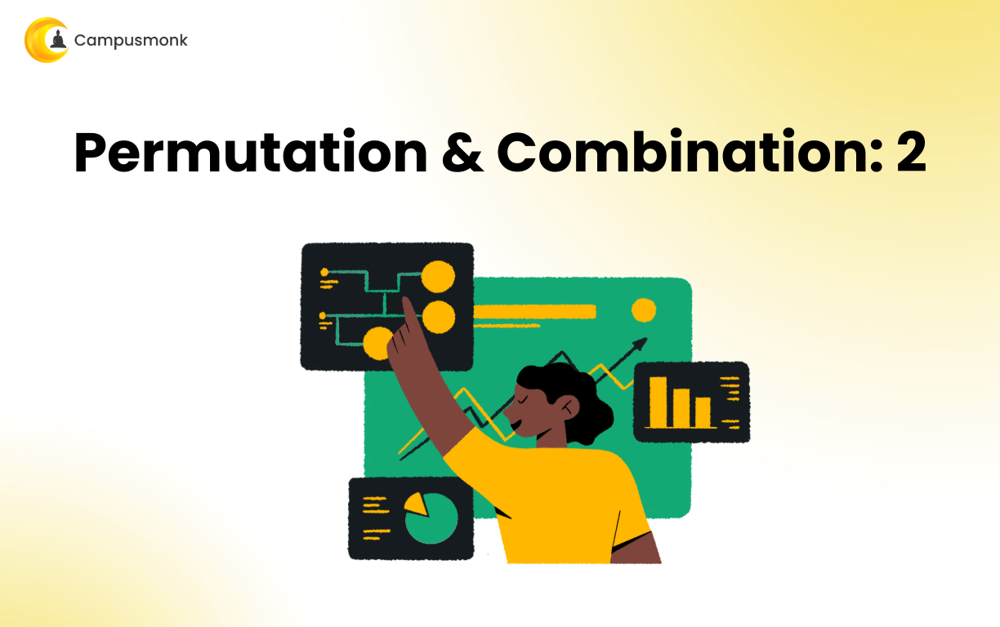

#### Core Concepts & Learning Objectives
Comprehensive video masterclass covering 2: Permutation & Combination. Focuses on fundamental principles, algorithm analysis, edge-case handling, and Infosys exam question solutions.

---

### Video 086: Probability Type Bag based Ques
- **Video ID**: `162552436` | **Duration**: `01:22:30` (4,950s)
- **Track**: Infosys System Engineer (SE) | **Topic**: Quantitative Aptitude & Numerical Ability
- **Curriculum Path**: `2. Infosys System Eng Prep- Apti + Pseudo / Section II : Technical Ability ( Numerical ) / 2. Numerical ability/Quantitative Aptitude / 15: Probability Questions prep`

#### Master Video Slide Thumbnail Plate
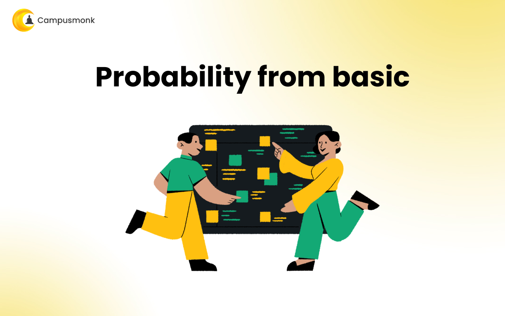

#### Core Concepts & Learning Objectives
Comprehensive video masterclass covering Probability Type Bag based Ques. Focuses on fundamental principles, algorithm analysis, edge-case handling, and Infosys exam question solutions.

---

### Video 087: 1.1 BG Music Mensuration 3D Cheat Sheet
- **Video ID**: `162552438` | **Duration**: `00:19:17` (1,157s)
- **Track**: Infosys System Engineer (SE) | **Topic**: Quantitative Aptitude & Numerical Ability
- **Curriculum Path**: `2. Infosys System Eng Prep- Apti + Pseudo / Section II : Technical Ability ( Numerical ) / 2. Numerical ability/Quantitative Aptitude / 16 : Mensuration / Updated Rachit Sir Mensuration`

#### Master Video Slide Thumbnail Plate
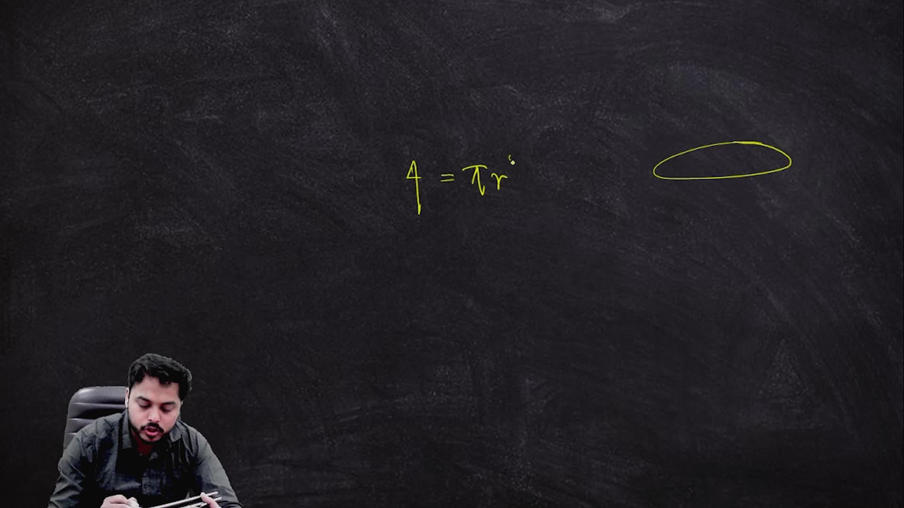

#### Core Concepts & Learning Objectives
Comprehensive video masterclass covering 1.1 BG Music Mensuration 3D Cheat Sheet. Focuses on fundamental principles, algorithm analysis, edge-case handling, and Infosys exam question solutions.

---

### Video 088: Mensuartion 1.1
- **Video ID**: `162552442` | **Duration**: `00:12:24` (744s)
- **Track**: Infosys System Engineer (SE) | **Topic**: Quantitative Aptitude & Numerical Ability
- **Curriculum Path**: `2. Infosys System Eng Prep- Apti + Pseudo / Section II : Technical Ability ( Numerical ) / 2. Numerical ability/Quantitative Aptitude / 16 : Mensuration / Updated Rachit Sir Mensuration`

#### Master Video Slide Thumbnail Plate
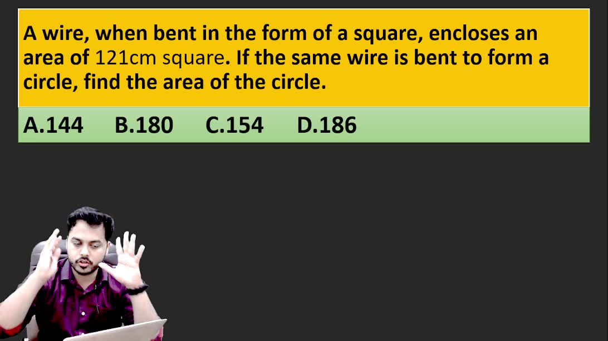

#### Core Concepts & Learning Objectives
Comprehensive video masterclass covering Mensuartion 1.1. Focuses on fundamental principles, algorithm analysis, edge-case handling, and Infosys exam question solutions.

---

### Video 089: Mensuartion 1.2
- **Video ID**: `162552443` | **Duration**: `00:11:54` (714s)
- **Track**: Infosys System Engineer (SE) | **Topic**: Quantitative Aptitude & Numerical Ability
- **Curriculum Path**: `2. Infosys System Eng Prep- Apti + Pseudo / Section II : Technical Ability ( Numerical ) / 2. Numerical ability/Quantitative Aptitude / 16 : Mensuration / Updated Rachit Sir Mensuration`

#### Master Video Slide Thumbnail Plate
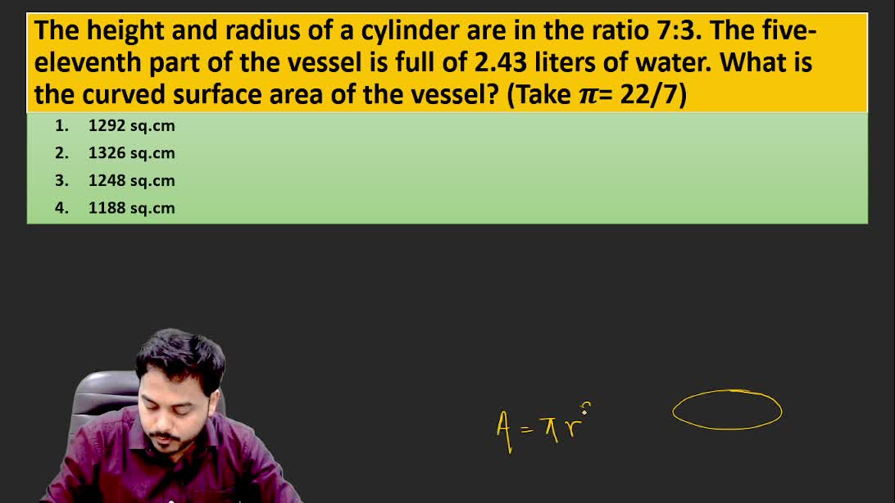

#### Core Concepts & Learning Objectives
Comprehensive video masterclass covering Mensuartion 1.2. Focuses on fundamental principles, algorithm analysis, edge-case handling, and Infosys exam question solutions.

---

### Video 090: Mensuartion 1.3
- **Video ID**: `162552441` | **Duration**: `00:13:13` (793s)
- **Track**: Infosys System Engineer (SE) | **Topic**: Quantitative Aptitude & Numerical Ability
- **Curriculum Path**: `2. Infosys System Eng Prep- Apti + Pseudo / Section II : Technical Ability ( Numerical ) / 2. Numerical ability/Quantitative Aptitude / 16 : Mensuration / Updated Rachit Sir Mensuration`

#### Master Video Slide Thumbnail Plate
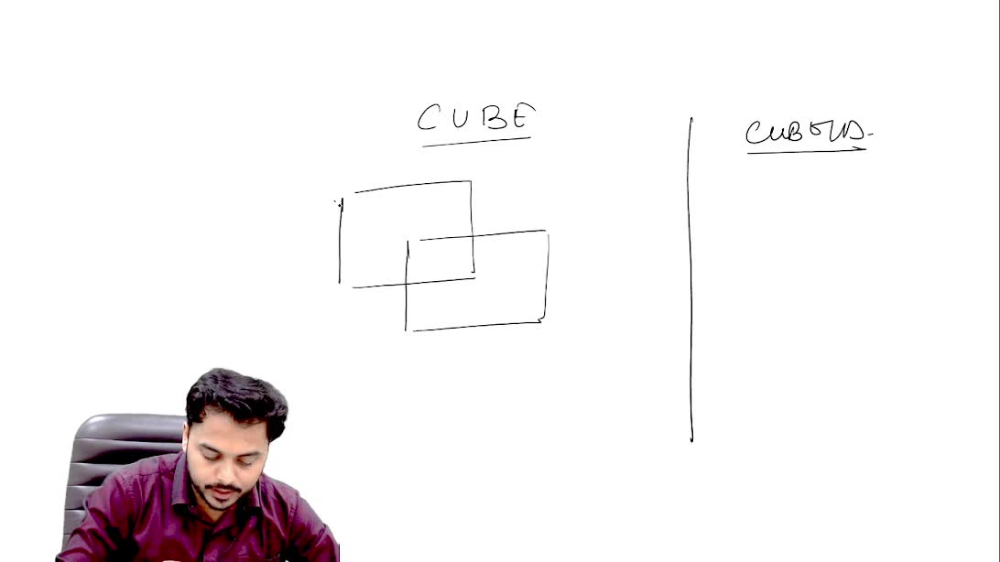

#### Core Concepts & Learning Objectives
Comprehensive video masterclass covering Mensuartion 1.3. Focuses on fundamental principles, algorithm analysis, edge-case handling, and Infosys exam question solutions.

---

### Video 091: Mensuartion 1.6
- **Video ID**: `162552439` | **Duration**: `00:20:26` (1,226s)
- **Track**: Infosys System Engineer (SE) | **Topic**: Quantitative Aptitude & Numerical Ability
- **Curriculum Path**: `2. Infosys System Eng Prep- Apti + Pseudo / Section II : Technical Ability ( Numerical ) / 2. Numerical ability/Quantitative Aptitude / 16 : Mensuration / Updated Rachit Sir Mensuration`

#### Master Video Slide Thumbnail Plate
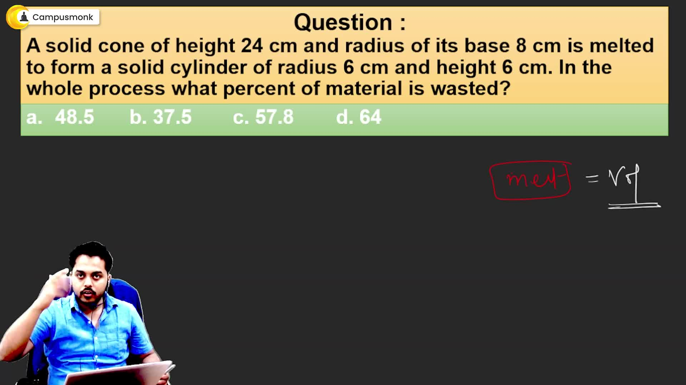

#### Core Concepts & Learning Objectives
Comprehensive video masterclass covering Mensuartion 1.6. Focuses on fundamental principles, algorithm analysis, edge-case handling, and Infosys exam question solutions.

---

### Video 092: Mensuartion 1.4
- **Video ID**: `162552440` | **Duration**: `00:09:46` (586s)
- **Track**: Infosys System Engineer (SE) | **Topic**: Quantitative Aptitude & Numerical Ability
- **Curriculum Path**: `2. Infosys System Eng Prep- Apti + Pseudo / Section II : Technical Ability ( Numerical ) / 2. Numerical ability/Quantitative Aptitude / 16 : Mensuration / Updated Rachit Sir Mensuration`

#### Master Video Slide Thumbnail Plate
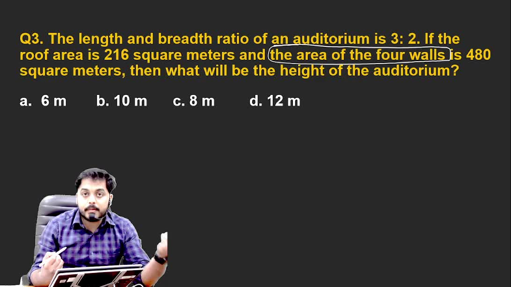

#### Core Concepts & Learning Objectives
Comprehensive video masterclass covering Mensuartion 1.4. Focuses on fundamental principles, algorithm analysis, edge-case handling, and Infosys exam question solutions.

---

### Video 093: Mensuartion 1.5
- **Video ID**: `162552444` | **Duration**: `00:13:56` (836s)
- **Track**: Infosys System Engineer (SE) | **Topic**: Quantitative Aptitude & Numerical Ability
- **Curriculum Path**: `2. Infosys System Eng Prep- Apti + Pseudo / Section II : Technical Ability ( Numerical ) / 2. Numerical ability/Quantitative Aptitude / 16 : Mensuration / Updated Rachit Sir Mensuration`

#### Master Video Slide Thumbnail Plate
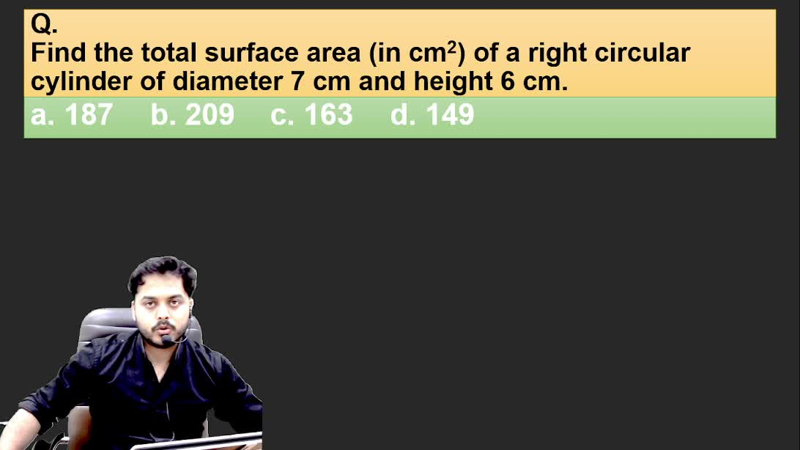

#### Core Concepts & Learning Objectives
Comprehensive video masterclass covering Mensuartion 1.5. Focuses on fundamental principles, algorithm analysis, edge-case handling, and Infosys exam question solutions.

---

### Video 094: Clocks Aptitude Questions
- **Video ID**: `162552437` | **Duration**: `01:42:43` (6,163s)
- **Track**: Infosys System Engineer (SE) | **Topic**: Quantitative Aptitude & Numerical Ability
- **Curriculum Path**: `2. Infosys System Eng Prep- Apti + Pseudo / Section II : Technical Ability ( Numerical ) / 2. Numerical ability/Quantitative Aptitude / 17: Clock Apti Questions`

#### Master Video Slide Thumbnail Plate
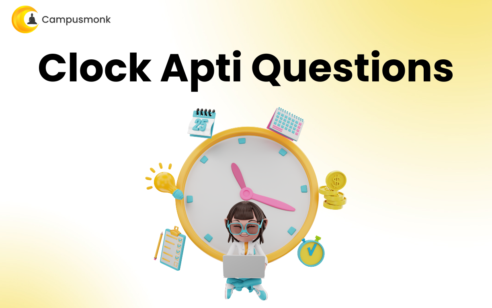

#### Core Concepts & Learning Objectives
Comprehensive video masterclass covering Clocks Aptitude Questions. Focuses on fundamental principles, algorithm analysis, edge-case handling, and Infosys exam question solutions.

---

### Video 095: Part 1: Quadratic Equations
- **Video ID**: `162552445` | **Duration**: `01:20:39` (4,839s)
- **Track**: Infosys System Engineer (SE) | **Topic**: Quantitative Aptitude & Numerical Ability
- **Curriculum Path**: `2. Infosys System Eng Prep- Apti + Pseudo / Section II : Technical Ability ( Numerical ) / 2. Numerical ability/Quantitative Aptitude / 18: Quadratic Equations`

#### Master Video Slide Thumbnail Plate
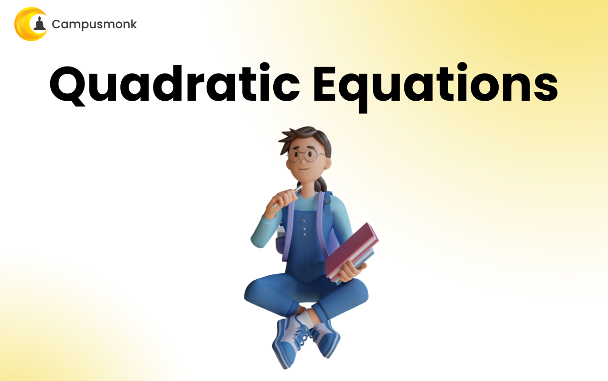

#### Core Concepts & Learning Objectives
Comprehensive video masterclass covering Part 1: Quadratic Equations. Focuses on fundamental principles, algorithm analysis, edge-case handling, and Infosys exam question solutions.

---

### Video 096: Part 2: Quadratic Equations
- **Video ID**: `162552446` | **Duration**: `01:12:05` (4,325s)
- **Track**: Infosys System Engineer (SE) | **Topic**: Quantitative Aptitude & Numerical Ability
- **Curriculum Path**: `2. Infosys System Eng Prep- Apti + Pseudo / Section II : Technical Ability ( Numerical ) / 2. Numerical ability/Quantitative Aptitude / 18: Quadratic Equations`

#### Master Video Slide Thumbnail Plate
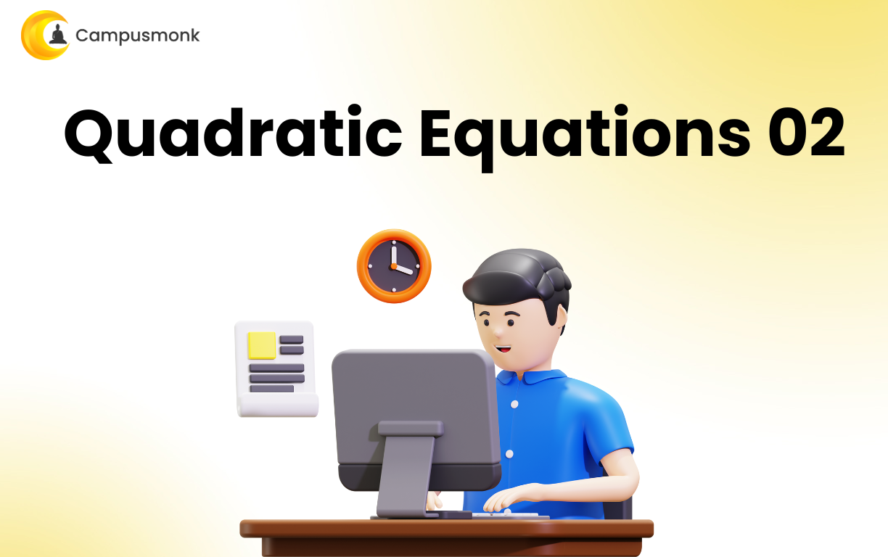

#### Core Concepts & Learning Objectives
Comprehensive video masterclass covering Part 2: Quadratic Equations. Focuses on fundamental principles, algorithm analysis, edge-case handling, and Infosys exam question solutions.

---

