# Infosys Video Curriculum — Pseudo Codes & Program Logic

> **Target Track**: Infosys System Engineer (SE) | **Videos Count**: 21 | **Total Runtime**: 12h 26m
> **Curriculum Topics**: C/C++ Syntax, While/For Loops, Conditionals, Functions, Recursion, Bitwise Operations, Static Variable Scopes, Output Prediction

## Section Overview & Curriculum Map
This master compendium documents all 21 high-yield video lectures for Pseudo Codes & Program Logic. Every lecture includes full metadata, curriculum path, high-resolution slide thumbnail plate, and core conceptual focus.

---

### Video 097: 1. Pseudo Code PYQ
- **Video ID**: `162552072` | **Duration**: `01:01:00` (3,660s)
- **Track**: Infosys System Engineer (SE) | **Topic**: Pseudo Codes & Program Logic
- **Curriculum Path**: `2. Infosys System Eng Prep- Apti + Pseudo / Section III : Pseudo Codes / Infosys Pseudo Live Class`

#### Master Video Slide Thumbnail Plate
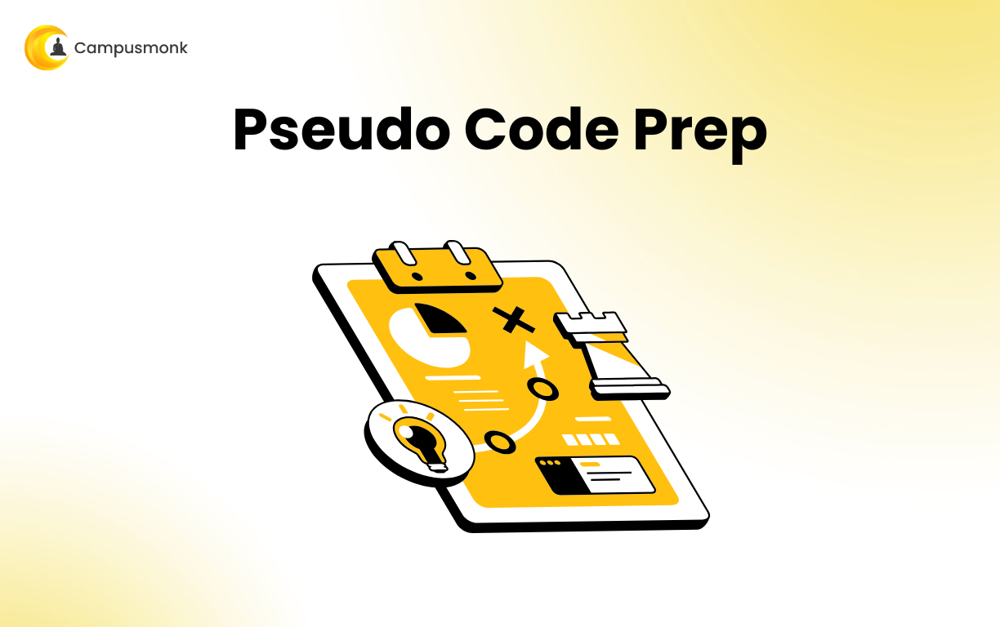

#### Core Concepts & Learning Objectives
Comprehensive video masterclass covering 1. Pseudo Code PYQ. Focuses on fundamental principles, algorithm analysis, edge-case handling, and Infosys exam question solutions.

---

### Video 098: 2: PSEUDO CODES
- **Video ID**: `162552073` | **Duration**: `00:57:01` (3,421s)
- **Track**: Infosys System Engineer (SE) | **Topic**: Pseudo Codes & Program Logic
- **Curriculum Path**: `2. Infosys System Eng Prep- Apti + Pseudo / Section III : Pseudo Codes / Infosys Pseudo Live Class`

#### Master Video Slide Thumbnail Plate

#### Core Concepts & Learning Objectives
Comprehensive video masterclass covering 2: PSEUDO CODES. Focuses on fundamental principles, algorithm analysis, edge-case handling, and Infosys exam question solutions.

---

### Video 099: 3: Pseudo Code for Upcoming Exam
- **Video ID**: `162552074` | **Duration**: `01:05:10` (3,910s)
- **Track**: Infosys System Engineer (SE) | **Topic**: Pseudo Codes & Program Logic
- **Curriculum Path**: `2. Infosys System Eng Prep- Apti + Pseudo / Section III : Pseudo Codes / Infosys Pseudo Live Class`

#### Master Video Slide Thumbnail Plate
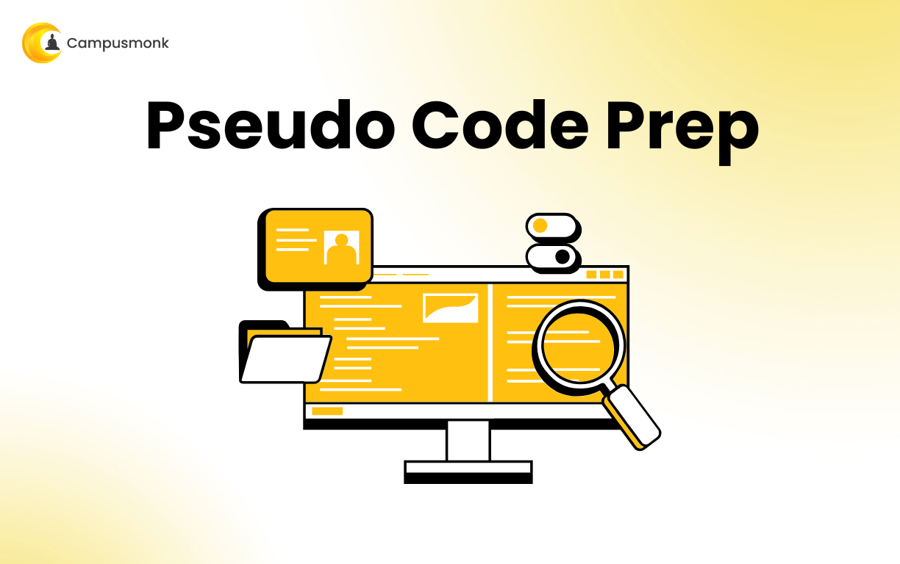

#### Core Concepts & Learning Objectives
Comprehensive video masterclass covering 3: Pseudo Code for Upcoming Exam. Focuses on fundamental principles, algorithm analysis, edge-case handling, and Infosys exam question solutions.

---

### Video 100: 4: PYQ Pseudo code prep
- **Video ID**: `162552075` | **Duration**: `01:05:26` (3,926s)
- **Track**: Infosys System Engineer (SE) | **Topic**: Pseudo Codes & Program Logic
- **Curriculum Path**: `2. Infosys System Eng Prep- Apti + Pseudo / Section III : Pseudo Codes / Infosys Pseudo Live Class`

#### Master Video Slide Thumbnail Plate
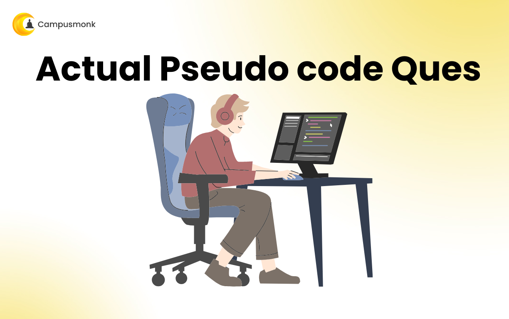

#### Core Concepts & Learning Objectives
Comprehensive video masterclass covering 4: PYQ Pseudo code prep. Focuses on fundamental principles, algorithm analysis, edge-case handling, and Infosys exam question solutions.

---

### Video 101: CapG1
- **Video ID**: `162552119` | **Duration**: `00:11:29` (689s)
- **Track**: Infosys System Engineer (SE) | **Topic**: Pseudo Codes & Program Logic
- **Curriculum Path**: `2. Infosys System Eng Prep- Apti + Pseudo / Section III : Pseudo Codes / 1.1 Pseudo Codes- Cpg/Infosys/Other`

#### Master Video Slide Thumbnail Plate
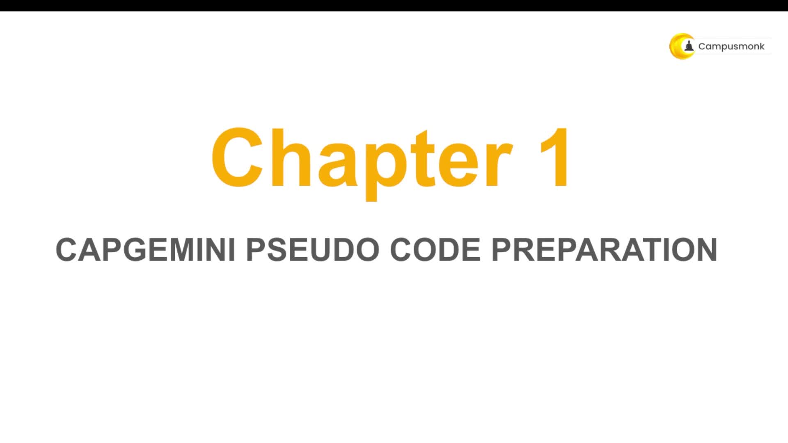

#### Core Concepts & Learning Objectives
Comprehensive video masterclass covering CapG1. Focuses on fundamental principles, algorithm analysis, edge-case handling, and Infosys exam question solutions.

---

### Video 102: CapG 2
- **Video ID**: `162552129` | **Duration**: `00:39:53` (2,393s)
- **Track**: Infosys System Engineer (SE) | **Topic**: Pseudo Codes & Program Logic
- **Curriculum Path**: `2. Infosys System Eng Prep- Apti + Pseudo / Section III : Pseudo Codes / 1.1 Pseudo Codes- Cpg/Infosys/Other`

#### Master Video Slide Thumbnail Plate
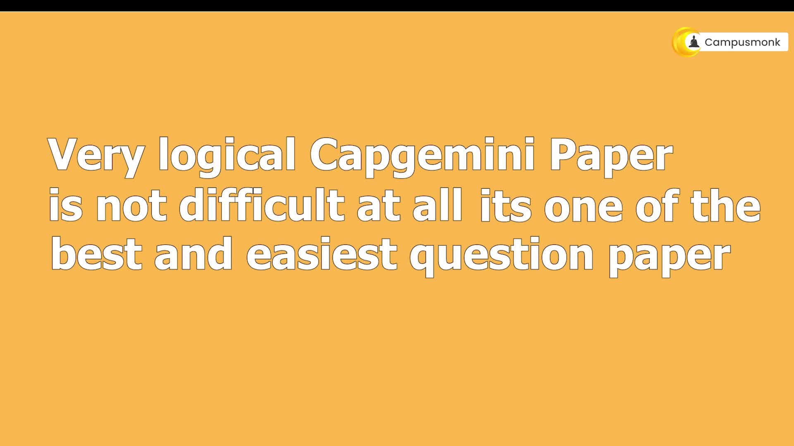

#### Core Concepts & Learning Objectives
Comprehensive video masterclass covering CapG 2. Focuses on fundamental principles, algorithm analysis, edge-case handling, and Infosys exam question solutions.

---

### Video 103: capG 3
- **Video ID**: `162552133` | **Duration**: `00:31:09` (1,869s)
- **Track**: Infosys System Engineer (SE) | **Topic**: Pseudo Codes & Program Logic
- **Curriculum Path**: `2. Infosys System Eng Prep- Apti + Pseudo / Section III : Pseudo Codes / 1.1 Pseudo Codes- Cpg/Infosys/Other`

#### Master Video Slide Thumbnail Plate
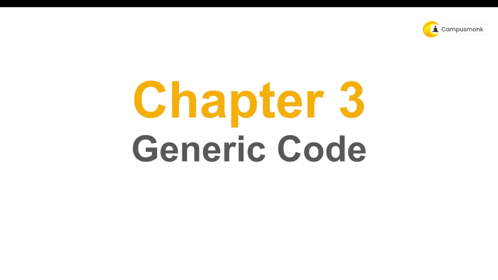

#### Core Concepts & Learning Objectives
Comprehensive video masterclass covering capG 3. Focuses on fundamental principles, algorithm analysis, edge-case handling, and Infosys exam question solutions.

---

### Video 104: capG 4
- **Video ID**: `162552126` | **Duration**: `00:31:10` (1,870s)
- **Track**: Infosys System Engineer (SE) | **Topic**: Pseudo Codes & Program Logic
- **Curriculum Path**: `2. Infosys System Eng Prep- Apti + Pseudo / Section III : Pseudo Codes / 1.1 Pseudo Codes- Cpg/Infosys/Other`

#### Master Video Slide Thumbnail Plate
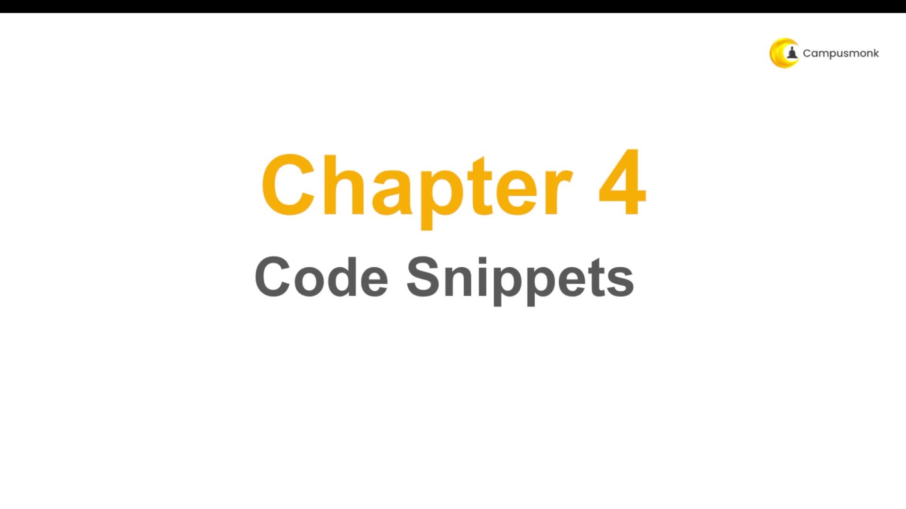

#### Core Concepts & Learning Objectives
Comprehensive video masterclass covering capG 4. Focuses on fundamental principles, algorithm analysis, edge-case handling, and Infosys exam question solutions.

---

### Video 105: capG 5
- **Video ID**: `162552128` | **Duration**: `00:33:13` (1,993s)
- **Track**: Infosys System Engineer (SE) | **Topic**: Pseudo Codes & Program Logic
- **Curriculum Path**: `2. Infosys System Eng Prep- Apti + Pseudo / Section III : Pseudo Codes / 1.1 Pseudo Codes- Cpg/Infosys/Other`

#### Master Video Slide Thumbnail Plate
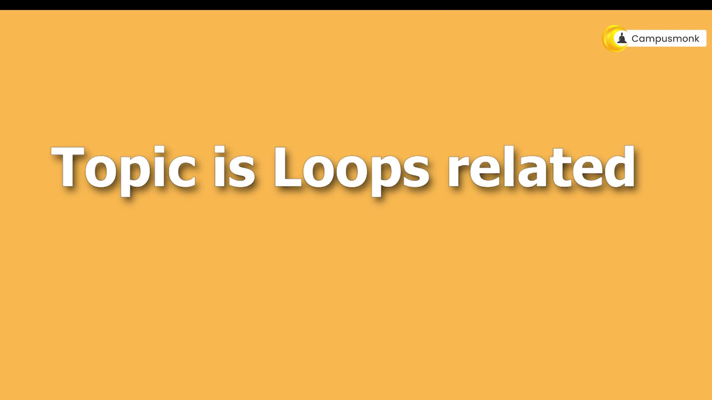

#### Core Concepts & Learning Objectives
Comprehensive video masterclass covering capG 5. Focuses on fundamental principles, algorithm analysis, edge-case handling, and Infosys exam question solutions.

---

### Video 106: capg 6
- **Video ID**: `162552131` | **Duration**: `00:27:14` (1,634s)
- **Track**: Infosys System Engineer (SE) | **Topic**: Pseudo Codes & Program Logic
- **Curriculum Path**: `2. Infosys System Eng Prep- Apti + Pseudo / Section III : Pseudo Codes / 1.1 Pseudo Codes- Cpg/Infosys/Other`

#### Master Video Slide Thumbnail Plate
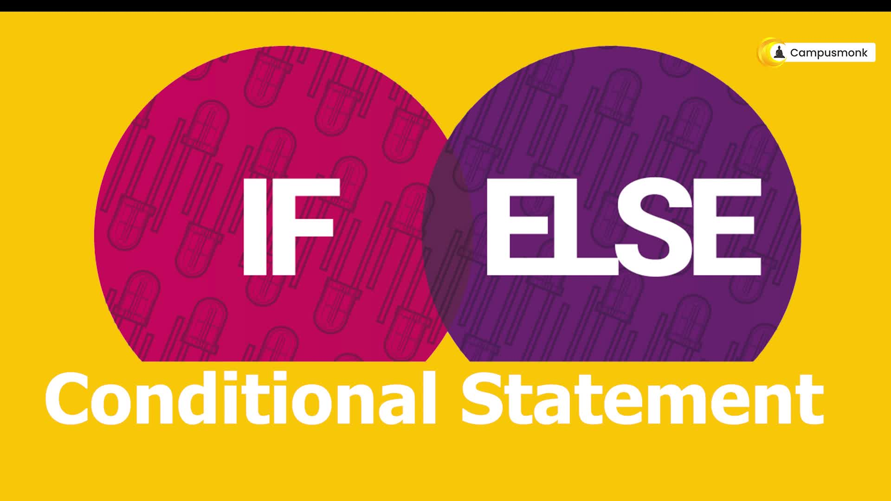

#### Core Concepts & Learning Objectives
Comprehensive video masterclass covering capg 6. Focuses on fundamental principles, algorithm analysis, edge-case handling, and Infosys exam question solutions.

---

### Video 107: capg 7
- **Video ID**: `162552123` | **Duration**: `00:29:48` (1,788s)
- **Track**: Infosys System Engineer (SE) | **Topic**: Pseudo Codes & Program Logic
- **Curriculum Path**: `2. Infosys System Eng Prep- Apti + Pseudo / Section III : Pseudo Codes / 1.1 Pseudo Codes- Cpg/Infosys/Other`

#### Master Video Slide Thumbnail Plate
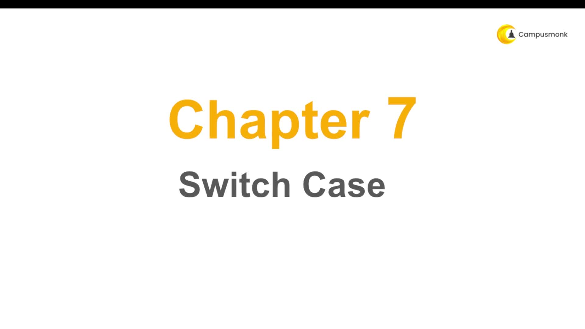

#### Core Concepts & Learning Objectives
Comprehensive video masterclass covering capg 7. Focuses on fundamental principles, algorithm analysis, edge-case handling, and Infosys exam question solutions.

---

### Video 108: capg 8
- **Video ID**: `162552125` | **Duration**: `00:30:48` (1,848s)
- **Track**: Infosys System Engineer (SE) | **Topic**: Pseudo Codes & Program Logic
- **Curriculum Path**: `2. Infosys System Eng Prep- Apti + Pseudo / Section III : Pseudo Codes / 1.1 Pseudo Codes- Cpg/Infosys/Other`

#### Master Video Slide Thumbnail Plate
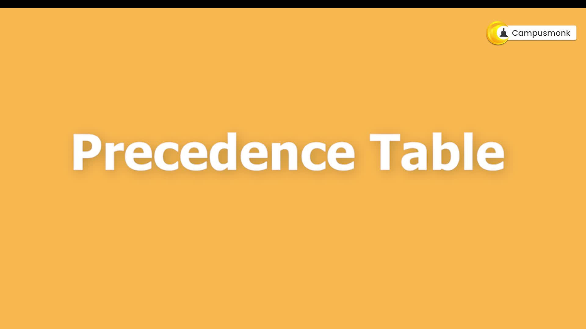

#### Core Concepts & Learning Objectives
Comprehensive video masterclass covering capg 8. Focuses on fundamental principles, algorithm analysis, edge-case handling, and Infosys exam question solutions.

---

### Video 109: capg9
- **Video ID**: `162552124` | **Duration**: `00:34:37` (2,077s)
- **Track**: Infosys System Engineer (SE) | **Topic**: Pseudo Codes & Program Logic
- **Curriculum Path**: `2. Infosys System Eng Prep- Apti + Pseudo / Section III : Pseudo Codes / 1.1 Pseudo Codes- Cpg/Infosys/Other`

#### Master Video Slide Thumbnail Plate
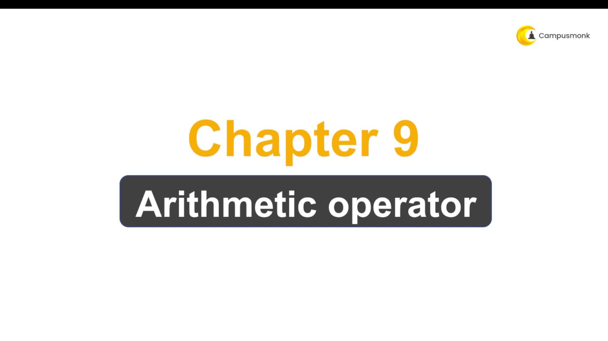

#### Core Concepts & Learning Objectives
Comprehensive video masterclass covering capg9. Focuses on fundamental principles, algorithm analysis, edge-case handling, and Infosys exam question solutions.

---

### Video 110: capg10
- **Video ID**: `162552117` | **Duration**: `00:18:03` (1,083s)
- **Track**: Infosys System Engineer (SE) | **Topic**: Pseudo Codes & Program Logic
- **Curriculum Path**: `2. Infosys System Eng Prep- Apti + Pseudo / Section III : Pseudo Codes / 1.1 Pseudo Codes- Cpg/Infosys/Other`

#### Master Video Slide Thumbnail Plate
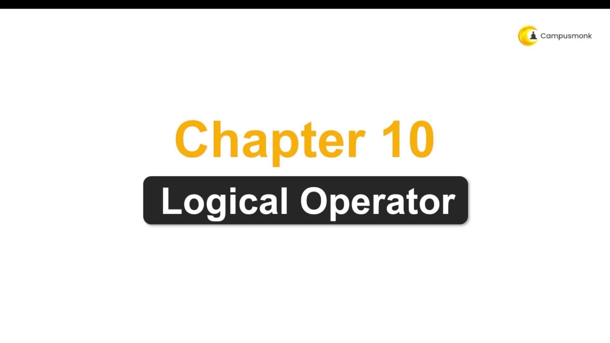

#### Core Concepts & Learning Objectives
Comprehensive video masterclass covering capg10. Focuses on fundamental principles, algorithm analysis, edge-case handling, and Infosys exam question solutions.

---

### Video 111: capg11
- **Video ID**: `162552122` | **Duration**: `00:21:07` (1,267s)
- **Track**: Infosys System Engineer (SE) | **Topic**: Pseudo Codes & Program Logic
- **Curriculum Path**: `2. Infosys System Eng Prep- Apti + Pseudo / Section III : Pseudo Codes / 1.1 Pseudo Codes- Cpg/Infosys/Other`

#### Master Video Slide Thumbnail Plate
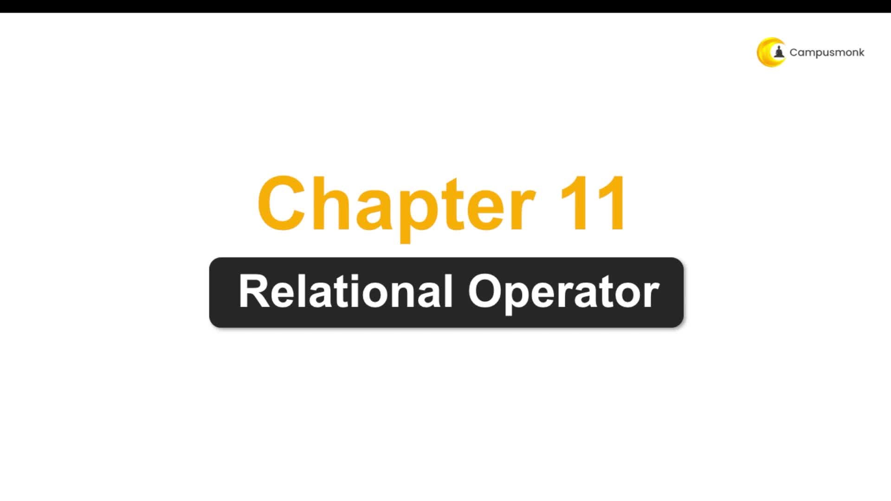

#### Core Concepts & Learning Objectives
Comprehensive video masterclass covering capg11. Focuses on fundamental principles, algorithm analysis, edge-case handling, and Infosys exam question solutions.

---

### Video 112: capg12
- **Video ID**: `162552118` | **Duration**: `00:32:57` (1,977s)
- **Track**: Infosys System Engineer (SE) | **Topic**: Pseudo Codes & Program Logic
- **Curriculum Path**: `2. Infosys System Eng Prep- Apti + Pseudo / Section III : Pseudo Codes / 1.1 Pseudo Codes- Cpg/Infosys/Other`

#### Master Video Slide Thumbnail Plate
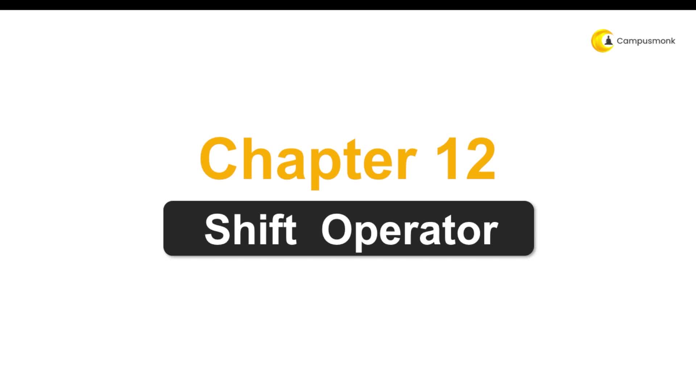

#### Core Concepts & Learning Objectives
Comprehensive video masterclass covering capg12. Focuses on fundamental principles, algorithm analysis, edge-case handling, and Infosys exam question solutions.

---

### Video 113: capg 13 DBMS
- **Video ID**: `162552132` | **Duration**: `00:37:21` (2,241s)
- **Track**: Infosys System Engineer (SE) | **Topic**: Pseudo Codes & Program Logic
- **Curriculum Path**: `2. Infosys System Eng Prep- Apti + Pseudo / Section III : Pseudo Codes / 1.1 Pseudo Codes- Cpg/Infosys/Other`

#### Master Video Slide Thumbnail Plate
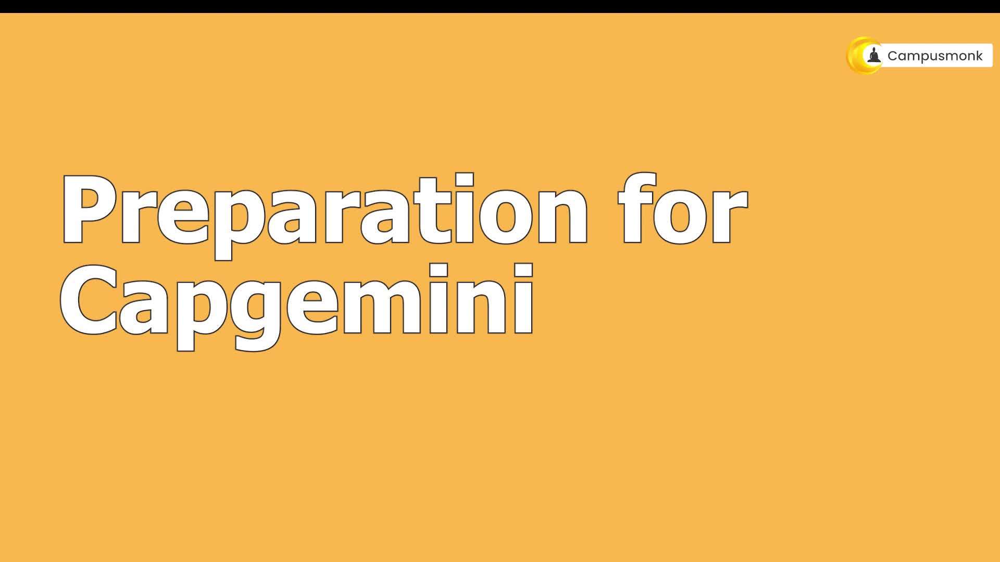

#### Core Concepts & Learning Objectives
Comprehensive video masterclass covering capg 13 DBMS. Focuses on fundamental principles, algorithm analysis, edge-case handling, and Infosys exam question solutions.

---

### Video 114: capg 14 _ Computer Networking
- **Video ID**: `162552120` | **Duration**: `00:26:50` (1,610s)
- **Track**: Infosys System Engineer (SE) | **Topic**: Pseudo Codes & Program Logic
- **Curriculum Path**: `2. Infosys System Eng Prep- Apti + Pseudo / Section III : Pseudo Codes / 1.1 Pseudo Codes- Cpg/Infosys/Other`

#### Master Video Slide Thumbnail Plate
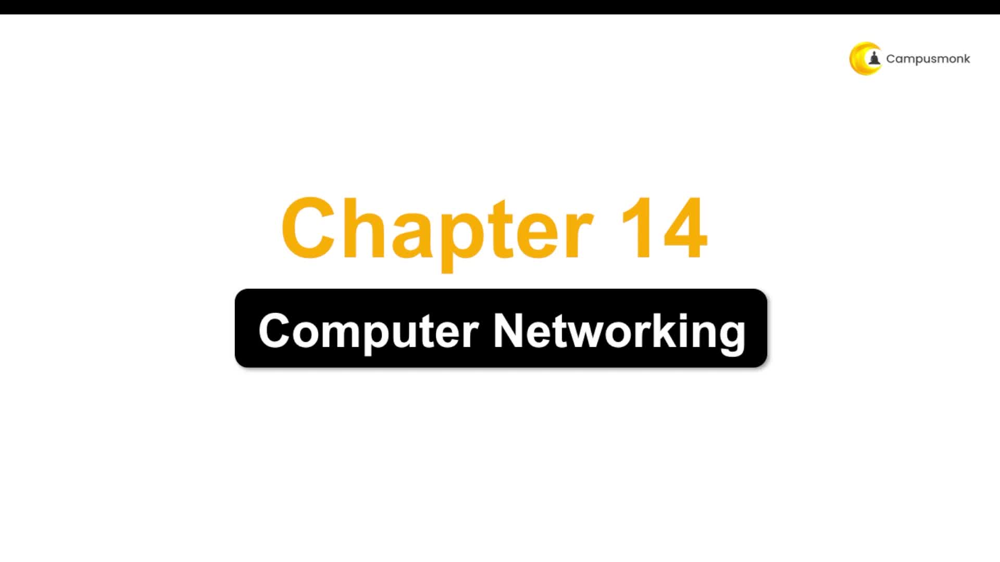

#### Core Concepts & Learning Objectives
Comprehensive video masterclass covering capg 14 _ Computer Networking. Focuses on fundamental principles, algorithm analysis, edge-case handling, and Infosys exam question solutions.

---

### Video 115: capg15 Operating System
- **Video ID**: `162552121` | **Duration**: `00:28:43` (1,723s)
- **Track**: Infosys System Engineer (SE) | **Topic**: Pseudo Codes & Program Logic
- **Curriculum Path**: `2. Infosys System Eng Prep- Apti + Pseudo / Section III : Pseudo Codes / 1.1 Pseudo Codes- Cpg/Infosys/Other`

#### Master Video Slide Thumbnail Plate
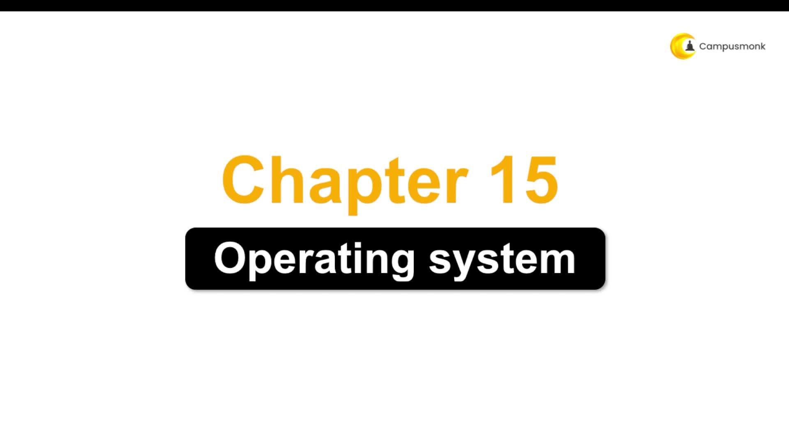

#### Core Concepts & Learning Objectives
Comprehensive video masterclass covering capg15 Operating System. Focuses on fundamental principles, algorithm analysis, edge-case handling, and Infosys exam question solutions.

---

### Video 116: capg16
- **Video ID**: `162552130` | **Duration**: `00:31:20` (1,880s)
- **Track**: Infosys System Engineer (SE) | **Topic**: Pseudo Codes & Program Logic
- **Curriculum Path**: `2. Infosys System Eng Prep- Apti + Pseudo / Section III : Pseudo Codes / 1.1 Pseudo Codes- Cpg/Infosys/Other`

#### Master Video Slide Thumbnail Plate
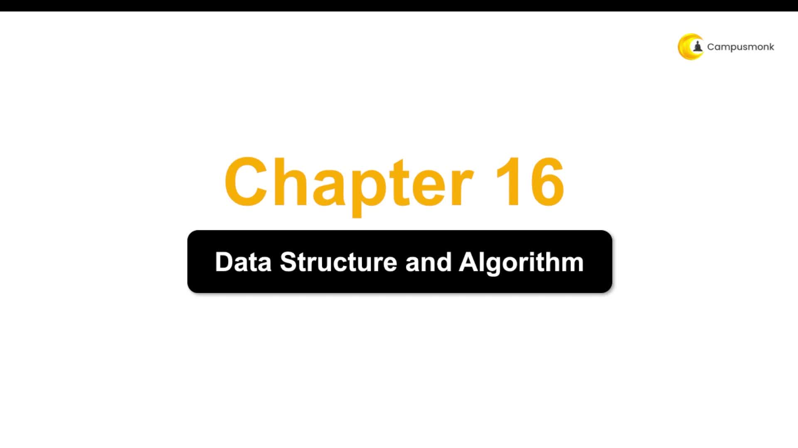

#### Core Concepts & Learning Objectives
Comprehensive video masterclass covering capg16. Focuses on fundamental principles, algorithm analysis, edge-case handling, and Infosys exam question solutions.

---

### Video 117: capg17
- **Video ID**: `162552127` | **Duration**: `00:31:42` (1,902s)
- **Track**: Infosys System Engineer (SE) | **Topic**: Pseudo Codes & Program Logic
- **Curriculum Path**: `2. Infosys System Eng Prep- Apti + Pseudo / Section III : Pseudo Codes / 1.1 Pseudo Codes- Cpg/Infosys/Other`

#### Master Video Slide Thumbnail Plate
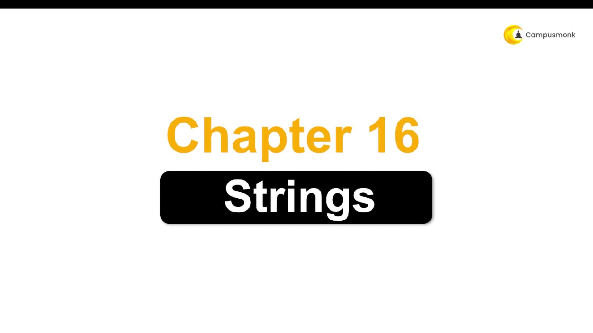

#### Core Concepts & Learning Objectives
Comprehensive video masterclass covering capg17. Focuses on fundamental principles, algorithm analysis, edge-case handling, and Infosys exam question solutions.

---

