# Infosys Video Curriculum — Verbal Ability, English Grammar & Essay Writing

> **Target Track**: Infosys System Engineer (SE) | **Videos Count**: 30 | **Total Runtime**: 17h 32m
> **Curriculum Topics**: Error Spotting, Tenses, Subject-Verb Agreement, Prepositions, Reading Comprehension Passages, Essay Frameworks & Thesis Construction

## Section Overview & Curriculum Map
This master compendium documents all 30 high-yield video lectures for Verbal Ability, English Grammar & Essay Writing. Every lecture includes full metadata, curriculum path, high-resolution slide thumbnail plate, and core conceptual focus.

---

### Video 118: 1. Infosys Actual Paper
- **Video ID**: `162552112` | **Duration**: `00:52:12` (3,132s)
- **Track**: Infosys System Engineer (SE) | **Topic**: Verbal Ability, English Grammar & Essay Writing
- **Curriculum Path**: `2. Infosys System Eng Prep- Apti + Pseudo / Section IV & V : English & Grammar / Live : Infosys Previous year`

#### Master Video Slide Thumbnail Plate
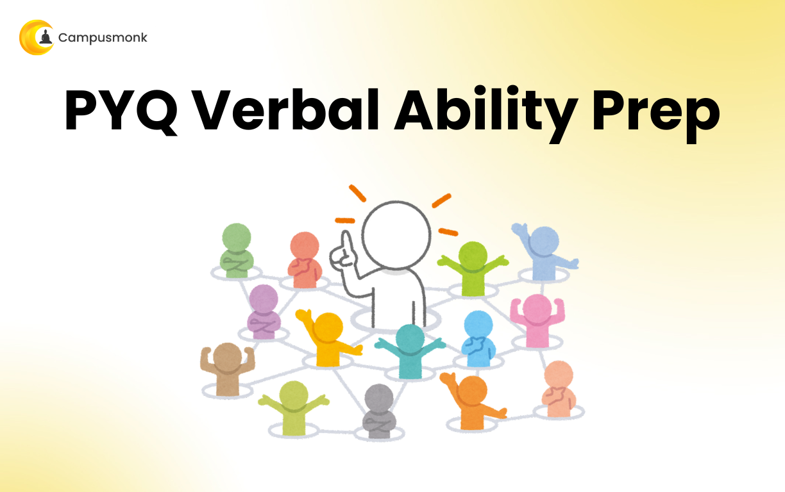

#### Core Concepts & Learning Objectives
Comprehensive video masterclass covering 1. Infosys Actual Paper. Focuses on fundamental principles, algorithm analysis, edge-case handling, and Infosys exam question solutions.

---

### Video 119: 2 Assorted Infosys
- **Video ID**: `162552111` | **Duration**: `01:12:51` (4,371s)
- **Track**: Infosys System Engineer (SE) | **Topic**: Verbal Ability, English Grammar & Essay Writing
- **Curriculum Path**: `2. Infosys System Eng Prep- Apti + Pseudo / Section IV & V : English & Grammar / Live : Infosys Previous year`

#### Master Video Slide Thumbnail Plate
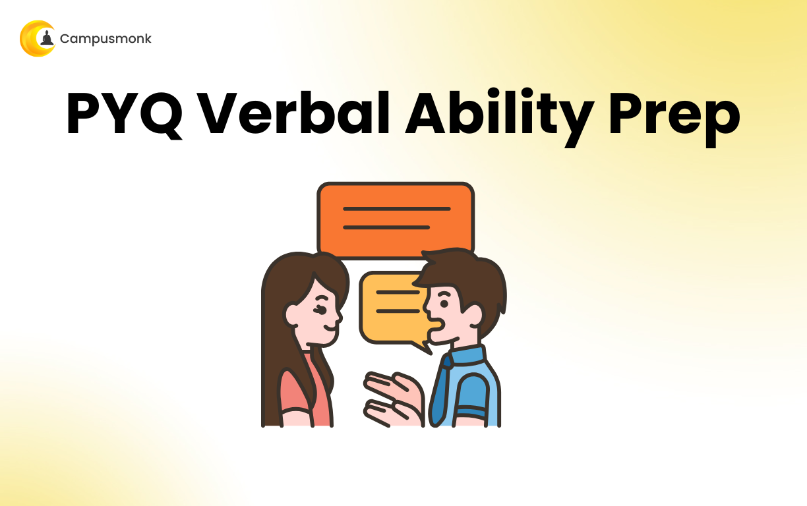

#### Core Concepts & Learning Objectives
Comprehensive video masterclass covering 2 Assorted Infosys. Focuses on fundamental principles, algorithm analysis, edge-case handling, and Infosys exam question solutions.

---

### Video 120: 3: Advance Sentence Correction
- **Video ID**: `162552114` | **Duration**: `01:08:44` (4,124s)
- **Track**: Infosys System Engineer (SE) | **Topic**: Verbal Ability, English Grammar & Essay Writing
- **Curriculum Path**: `2. Infosys System Eng Prep- Apti + Pseudo / Section IV & V : English & Grammar / Live : Infosys Previous year`

#### Master Video Slide Thumbnail Plate
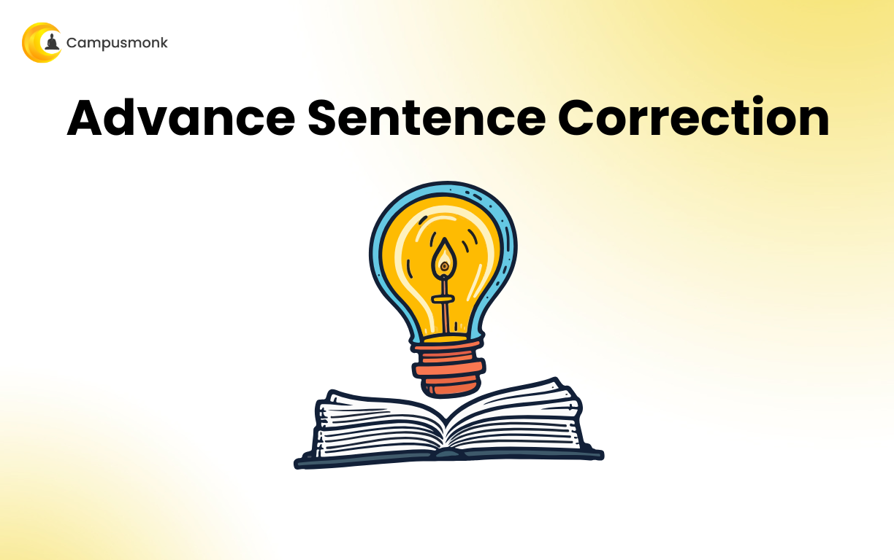

#### Core Concepts & Learning Objectives
Comprehensive video masterclass covering 3: Advance Sentence Correction. Focuses on fundamental principles, algorithm analysis, edge-case handling, and Infosys exam question solutions.

---

### Video 121: 4: PYQ Verbal Assorted Questions
- **Video ID**: `162552113` | **Duration**: `01:18:48` (4,728s)
- **Track**: Infosys System Engineer (SE) | **Topic**: Verbal Ability, English Grammar & Essay Writing
- **Curriculum Path**: `2. Infosys System Eng Prep- Apti + Pseudo / Section IV & V : English & Grammar / Live : Infosys Previous year`

#### Master Video Slide Thumbnail Plate
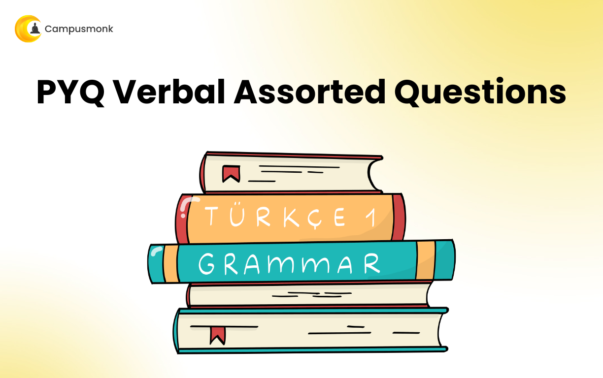

#### Core Concepts & Learning Objectives
Comprehensive video masterclass covering 4: PYQ Verbal Assorted Questions. Focuses on fundamental principles, algorithm analysis, edge-case handling, and Infosys exam question solutions.

---

### Video 122: 5: PYQ Verbal Ability
- **Video ID**: `162552115` | **Duration**: `01:11:09` (4,269s)
- **Track**: Infosys System Engineer (SE) | **Topic**: Verbal Ability, English Grammar & Essay Writing
- **Curriculum Path**: `2. Infosys System Eng Prep- Apti + Pseudo / Section IV & V : English & Grammar / Live : Infosys Previous year`

#### Master Video Slide Thumbnail Plate
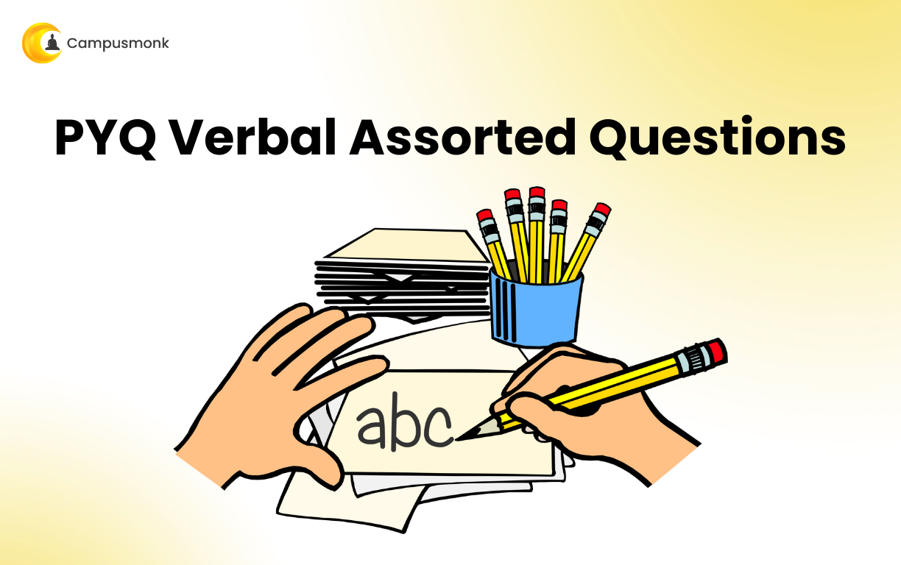

#### Core Concepts & Learning Objectives
Comprehensive video masterclass covering 5: PYQ Verbal Ability. Focuses on fundamental principles, algorithm analysis, edge-case handling, and Infosys exam question solutions.

---

### Video 123: 6: Assorted Verbal Questions
- **Video ID**: `162552116` | **Duration**: `01:02:11` (3,731s)
- **Track**: Infosys System Engineer (SE) | **Topic**: Verbal Ability, English Grammar & Essay Writing
- **Curriculum Path**: `2. Infosys System Eng Prep- Apti + Pseudo / Section IV & V : English & Grammar / Live : Infosys Previous year`

#### Master Video Slide Thumbnail Plate
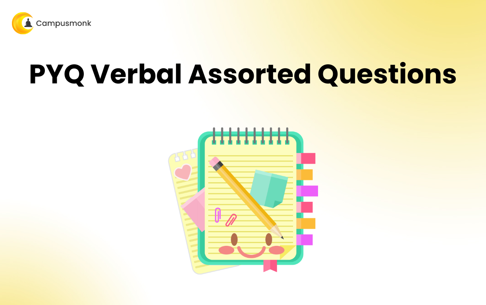

#### Core Concepts & Learning Objectives
Comprehensive video masterclass covering 6: Assorted Verbal Questions. Focuses on fundamental principles, algorithm analysis, edge-case handling, and Infosys exam question solutions.

---

### Video 124: One word substitution 1
- **Video ID**: `162552252` | **Duration**: `00:23:24` (1,404s)
- **Track**: Infosys System Engineer (SE) | **Topic**: Verbal Ability, English Grammar & Essay Writing
- **Curriculum Path**: `2. Infosys System Eng Prep- Apti + Pseudo / Section IV & V : English & Grammar / Module 2: One word  substitution`

#### Master Video Slide Thumbnail Plate
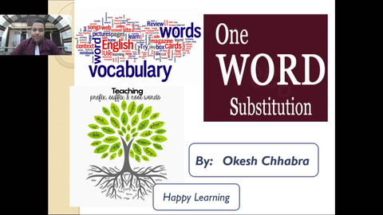

#### Core Concepts & Learning Objectives
Comprehensive video masterclass covering One word substitution 1. Focuses on fundamental principles, algorithm analysis, edge-case handling, and Infosys exam question solutions.

---

### Video 125: One word substitution 2
- **Video ID**: `162552251` | **Duration**: `00:15:46` (946s)
- **Track**: Infosys System Engineer (SE) | **Topic**: Verbal Ability, English Grammar & Essay Writing
- **Curriculum Path**: `2. Infosys System Eng Prep- Apti + Pseudo / Section IV & V : English & Grammar / Module 2: One word  substitution`

#### Master Video Slide Thumbnail Plate
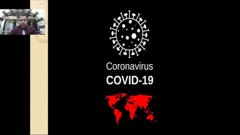

#### Core Concepts & Learning Objectives
Comprehensive video masterclass covering One word substitution 2. Focuses on fundamental principles, algorithm analysis, edge-case handling, and Infosys exam question solutions.

---

### Video 126: One word substitution 3
- **Video ID**: `162552250` | **Duration**: `00:24:40` (1,480s)
- **Track**: Infosys System Engineer (SE) | **Topic**: Verbal Ability, English Grammar & Essay Writing
- **Curriculum Path**: `2. Infosys System Eng Prep- Apti + Pseudo / Section IV & V : English & Grammar / Module 2: One word  substitution`

#### Master Video Slide Thumbnail Plate
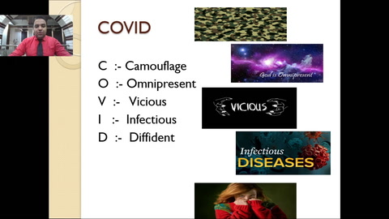

#### Core Concepts & Learning Objectives
Comprehensive video masterclass covering One word substitution 3. Focuses on fundamental principles, algorithm analysis, edge-case handling, and Infosys exam question solutions.

---

### Video 127: vocab 1
- **Video ID**: `162552213` | **Duration**: `00:23:15` (1,395s)
- **Track**: Infosys System Engineer (SE) | **Topic**: Verbal Ability, English Grammar & Essay Writing
- **Curriculum Path**: `2. Infosys System Eng Prep- Apti + Pseudo / Section IV & V : English & Grammar / Module 1: Vocab`

#### Master Video Slide Thumbnail Plate
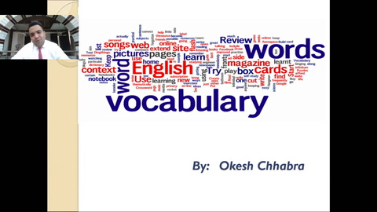

#### Core Concepts & Learning Objectives
Comprehensive video masterclass covering vocab 1. Focuses on fundamental principles, algorithm analysis, edge-case handling, and Infosys exam question solutions.

---

### Video 128: vocab 2
- **Video ID**: `162552216` | **Duration**: `00:22:03` (1,323s)
- **Track**: Infosys System Engineer (SE) | **Topic**: Verbal Ability, English Grammar & Essay Writing
- **Curriculum Path**: `2. Infosys System Eng Prep- Apti + Pseudo / Section IV & V : English & Grammar / Module 1: Vocab`

#### Master Video Slide Thumbnail Plate
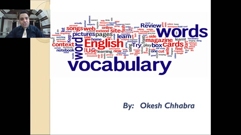

#### Core Concepts & Learning Objectives
Comprehensive video masterclass covering vocab 2. Focuses on fundamental principles, algorithm analysis, edge-case handling, and Infosys exam question solutions.

---

### Video 129: vocab 3
- **Video ID**: `162552214` | **Duration**: `00:22:09` (1,329s)
- **Track**: Infosys System Engineer (SE) | **Topic**: Verbal Ability, English Grammar & Essay Writing
- **Curriculum Path**: `2. Infosys System Eng Prep- Apti + Pseudo / Section IV & V : English & Grammar / Module 1: Vocab`

#### Master Video Slide Thumbnail Plate
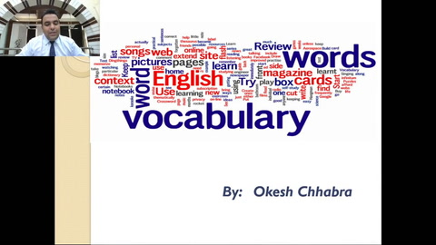

#### Core Concepts & Learning Objectives
Comprehensive video masterclass covering vocab 3. Focuses on fundamental principles, algorithm analysis, edge-case handling, and Infosys exam question solutions.

---

### Video 130: Vocab Lec 4
- **Video ID**: `162552217` | **Duration**: `00:22:36` (1,356s)
- **Track**: Infosys System Engineer (SE) | **Topic**: Verbal Ability, English Grammar & Essay Writing
- **Curriculum Path**: `2. Infosys System Eng Prep- Apti + Pseudo / Section IV & V : English & Grammar / Module 1: Vocab`

#### Master Video Slide Thumbnail Plate
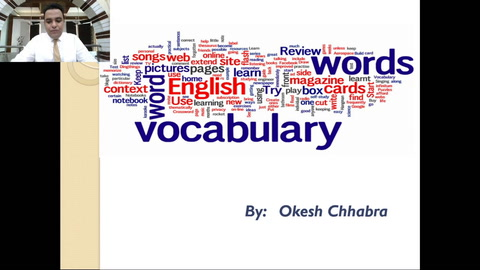

#### Core Concepts & Learning Objectives
Comprehensive video masterclass covering Vocab Lec 4. Focuses on fundamental principles, algorithm analysis, edge-case handling, and Infosys exam question solutions.

---

### Video 131: Vocab Lec 5
- **Video ID**: `162552215` | **Duration**: `00:23:03` (1,383s)
- **Track**: Infosys System Engineer (SE) | **Topic**: Verbal Ability, English Grammar & Essay Writing
- **Curriculum Path**: `2. Infosys System Eng Prep- Apti + Pseudo / Section IV & V : English & Grammar / Module 1: Vocab`

#### Master Video Slide Thumbnail Plate
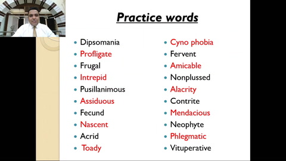

#### Core Concepts & Learning Objectives
Comprehensive video masterclass covering Vocab Lec 5. Focuses on fundamental principles, algorithm analysis, edge-case handling, and Infosys exam question solutions.

---

### Video 132: 1. RC Introduction
- **Video ID**: `162552317` | **Duration**: `00:22:08` (1,328s)
- **Track**: Infosys System Engineer (SE) | **Topic**: Verbal Ability, English Grammar & Essay Writing
- **Curriculum Path**: `2. Infosys System Eng Prep- Apti + Pseudo / Section IV & V : English & Grammar / Module 3: Reading Comprehension`

#### Master Video Slide Thumbnail Plate
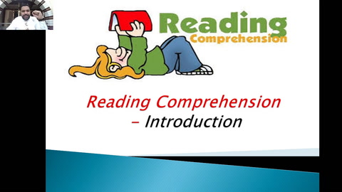

#### Core Concepts & Learning Objectives
Comprehensive video masterclass covering 1. RC Introduction. Focuses on fundamental principles, algorithm analysis, edge-case handling, and Infosys exam question solutions.

---

### Video 133: 2. RC Tones
- **Video ID**: `162552319` | **Duration**: `00:29:34` (1,774s)
- **Track**: Infosys System Engineer (SE) | **Topic**: Verbal Ability, English Grammar & Essay Writing
- **Curriculum Path**: `2. Infosys System Eng Prep- Apti + Pseudo / Section IV & V : English & Grammar / Module 3: Reading Comprehension`

#### Master Video Slide Thumbnail Plate
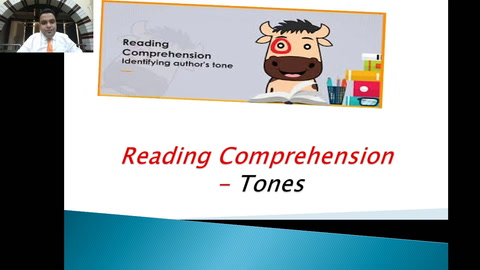

#### Core Concepts & Learning Objectives
Comprehensive video masterclass covering 2. RC Tones. Focuses on fundamental principles, algorithm analysis, edge-case handling, and Infosys exam question solutions.

---

### Video 134: 3. Strategies to ace RC
- **Video ID**: `162552318` | **Duration**: `00:19:30` (1,170s)
- **Track**: Infosys System Engineer (SE) | **Topic**: Verbal Ability, English Grammar & Essay Writing
- **Curriculum Path**: `2. Infosys System Eng Prep- Apti + Pseudo / Section IV & V : English & Grammar / Module 3: Reading Comprehension`

#### Master Video Slide Thumbnail Plate
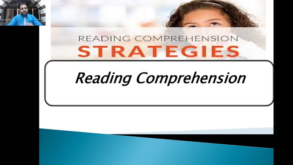

#### Core Concepts & Learning Objectives
Comprehensive video masterclass covering 3. Strategies to ace RC. Focuses on fundamental principles, algorithm analysis, edge-case handling, and Infosys exam question solutions.

---

### Video 135: 4. Tones Identification  Questions
- **Video ID**: `162552320` | **Duration**: `00:10:22` (622s)
- **Track**: Infosys System Engineer (SE) | **Topic**: Verbal Ability, English Grammar & Essay Writing
- **Curriculum Path**: `2. Infosys System Eng Prep- Apti + Pseudo / Section IV & V : English & Grammar / Module 3: Reading Comprehension`

#### Master Video Slide Thumbnail Plate
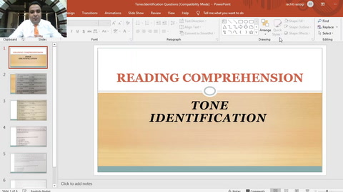

#### Core Concepts & Learning Objectives
Comprehensive video masterclass covering 4. Tones Identification  Questions. Focuses on fundamental principles, algorithm analysis, edge-case handling, and Infosys exam question solutions.

---

### Video 136: 5. Types of Questions in RC
- **Video ID**: `162552316` | **Duration**: `00:17:24` (1,044s)
- **Track**: Infosys System Engineer (SE) | **Topic**: Verbal Ability, English Grammar & Essay Writing
- **Curriculum Path**: `2. Infosys System Eng Prep- Apti + Pseudo / Section IV & V : English & Grammar / Module 3: Reading Comprehension`

#### Master Video Slide Thumbnail Plate
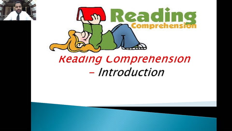

#### Core Concepts & Learning Objectives
Comprehensive video masterclass covering 5. Types of Questions in RC. Focuses on fundamental principles, algorithm analysis, edge-case handling, and Infosys exam question solutions.

---

### Video 137: SVA 1
- **Video ID**: `162552354` | **Duration**: `00:22:46` (1,366s)
- **Track**: Infosys System Engineer (SE) | **Topic**: Verbal Ability, English Grammar & Essay Writing
- **Curriculum Path**: `2. Infosys System Eng Prep- Apti + Pseudo / Section IV & V : English & Grammar / Module 4: Error Detection- SVA`

#### Master Video Slide Thumbnail Plate
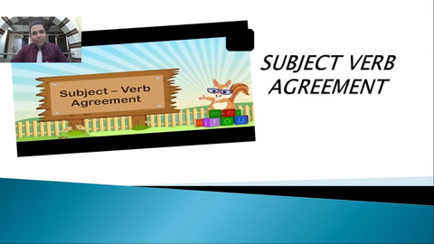

#### Core Concepts & Learning Objectives
Comprehensive video masterclass covering SVA 1. Focuses on fundamental principles, algorithm analysis, edge-case handling, and Infosys exam question solutions.

---

### Video 138: SVA 2
- **Video ID**: `162552355` | **Duration**: `00:13:17` (797s)
- **Track**: Infosys System Engineer (SE) | **Topic**: Verbal Ability, English Grammar & Essay Writing
- **Curriculum Path**: `2. Infosys System Eng Prep- Apti + Pseudo / Section IV & V : English & Grammar / Module 4: Error Detection- SVA`

#### Master Video Slide Thumbnail Plate
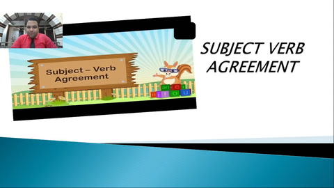

#### Core Concepts & Learning Objectives
Comprehensive video masterclass covering SVA 2. Focuses on fundamental principles, algorithm analysis, edge-case handling, and Infosys exam question solutions.

---

### Video 139: SVA 3
- **Video ID**: `162552353` | **Duration**: `00:12:34` (754s)
- **Track**: Infosys System Engineer (SE) | **Topic**: Verbal Ability, English Grammar & Essay Writing
- **Curriculum Path**: `2. Infosys System Eng Prep- Apti + Pseudo / Section IV & V : English & Grammar / Module 4: Error Detection- SVA`

#### Master Video Slide Thumbnail Plate
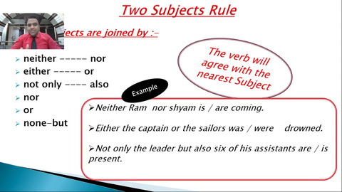

#### Core Concepts & Learning Objectives
Comprehensive video masterclass covering SVA 3. Focuses on fundamental principles, algorithm analysis, edge-case handling, and Infosys exam question solutions.

---

### Video 140: Live (SVA)
- **Video ID**: `162552352` | **Duration**: `01:00:33` (3,633s)
- **Track**: Infosys System Engineer (SE) | **Topic**: Verbal Ability, English Grammar & Essay Writing
- **Curriculum Path**: `2. Infosys System Eng Prep- Apti + Pseudo / Section IV & V : English & Grammar / Module 4: Error Detection- SVA`

#### Master Video Slide Thumbnail Plate
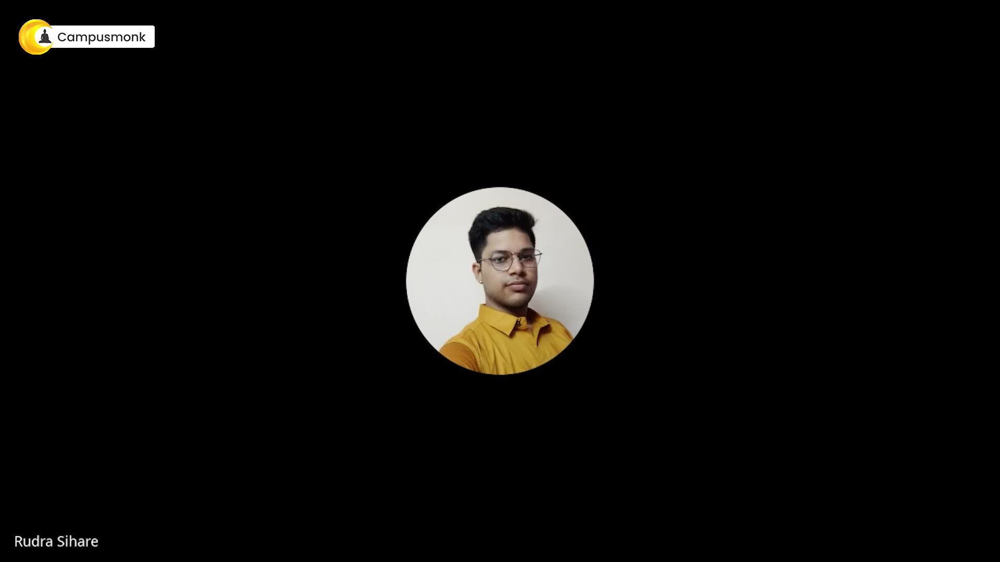

#### Core Concepts & Learning Objectives
Comprehensive video masterclass covering Live (SVA). Focuses on fundamental principles, algorithm analysis, edge-case handling, and Infosys exam question solutions.

---

### Video 141: Articles
- **Video ID**: `162552378` | **Duration**: `01:13:17` (4,397s)
- **Track**: Infosys System Engineer (SE) | **Topic**: Verbal Ability, English Grammar & Essay Writing
- **Curriculum Path**: `2. Infosys System Eng Prep- Apti + Pseudo / Section IV & V : English & Grammar / Module 5: Error - Article`

#### Master Video Slide Thumbnail Plate
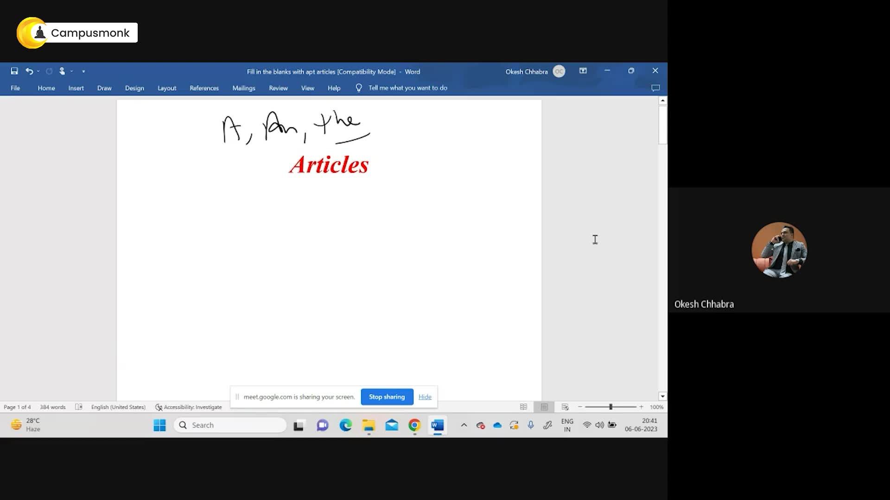

#### Core Concepts & Learning Objectives
Comprehensive video masterclass covering Articles. Focuses on fundamental principles, algorithm analysis, edge-case handling, and Infosys exam question solutions.

---

### Video 142: Article 2
- **Video ID**: `162552379` | **Duration**: `01:02:08` (3,728s)
- **Track**: Infosys System Engineer (SE) | **Topic**: Verbal Ability, English Grammar & Essay Writing
- **Curriculum Path**: `2. Infosys System Eng Prep- Apti + Pseudo / Section IV & V : English & Grammar / Module 5: Error - Article`

#### Master Video Slide Thumbnail Plate
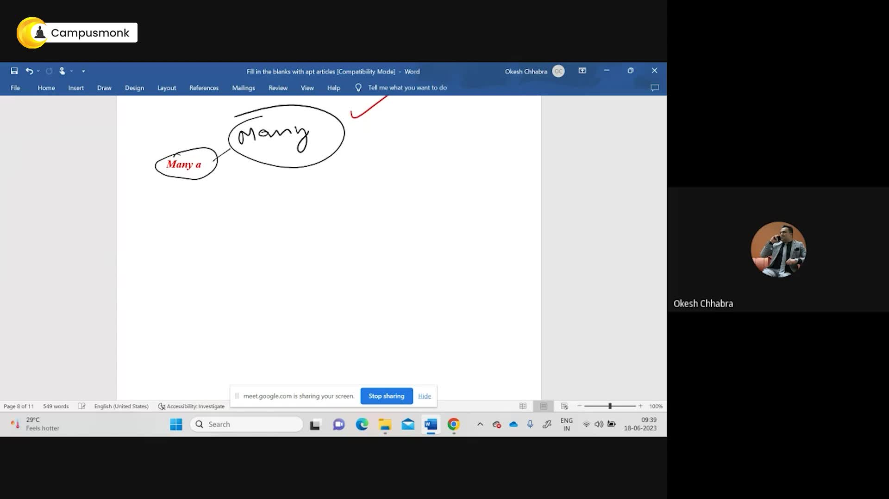

#### Core Concepts & Learning Objectives
Comprehensive video masterclass covering Article 2. Focuses on fundamental principles, algorithm analysis, edge-case handling, and Infosys exam question solutions.

---

### Video 143: Live - 1
- **Video ID**: `162552403` | **Duration**: `01:26:46` (5,206s)
- **Track**: Infosys System Engineer (SE) | **Topic**: Verbal Ability, English Grammar & Essay Writing
- **Curriculum Path**: `2. Infosys System Eng Prep- Apti + Pseudo / Section IV & V : English & Grammar / Module 6: Error- Parallelism`

#### Master Video Slide Thumbnail Plate
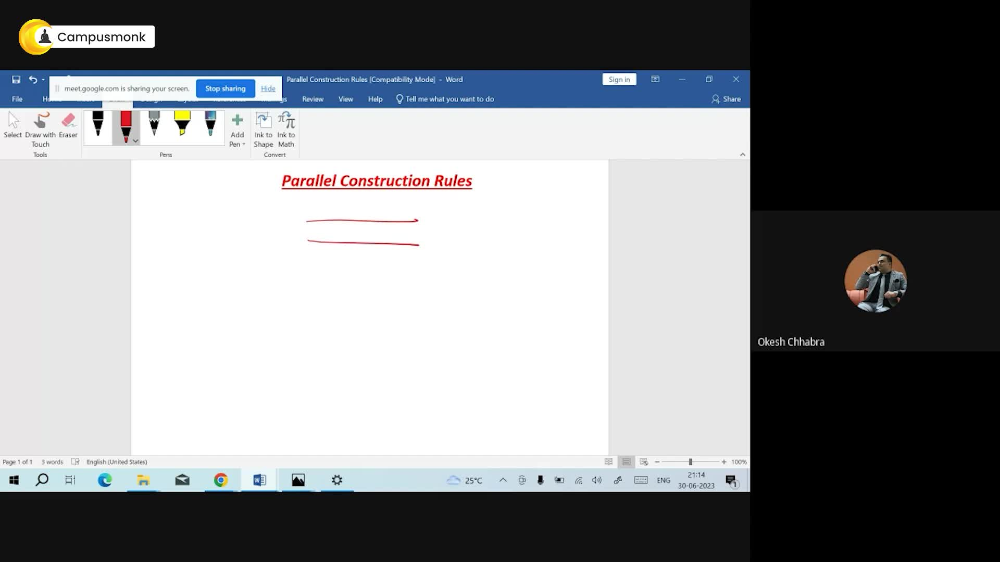

#### Core Concepts & Learning Objectives
Comprehensive video masterclass covering Live - 1. Focuses on fundamental principles, algorithm analysis, edge-case handling, and Infosys exam question solutions.

---

### Video 145: Part 1: Essay Question Prep
- **Video ID**: `162552154` | **Duration**: `00:10:27` (627s)
- **Track**: Infosys System Engineer (SE) | **Topic**: Verbal Ability, English Grammar & Essay Writing
- **Curriculum Path**: `2. Infosys System Eng Prep- Apti + Pseudo / Section VII : Essay Writing`

#### Core Concepts & Learning Objectives
Comprehensive video masterclass covering Part 1: Essay Question Prep. Focuses on fundamental principles, algorithm analysis, edge-case handling, and Infosys exam question solutions.

---

### Video 146: Part 2: Essay Question Prep
- **Video ID**: `162552157` | **Duration**: `00:07:47` (467s)
- **Track**: Infosys System Engineer (SE) | **Topic**: Verbal Ability, English Grammar & Essay Writing
- **Curriculum Path**: `2. Infosys System Eng Prep- Apti + Pseudo / Section VII : Essay Writing`

#### Core Concepts & Learning Objectives
Comprehensive video masterclass covering Part 2: Essay Question Prep. Focuses on fundamental principles, algorithm analysis, edge-case handling, and Infosys exam question solutions.

---

### Video 147: Part 3: Essay Question Prep
- **Video ID**: `162552155` | **Duration**: `00:10:15` (615s)
- **Track**: Infosys System Engineer (SE) | **Topic**: Verbal Ability, English Grammar & Essay Writing
- **Curriculum Path**: `2. Infosys System Eng Prep- Apti + Pseudo / Section VII : Essay Writing`

#### Core Concepts & Learning Objectives
Comprehensive video masterclass covering Part 3: Essay Question Prep. Focuses on fundamental principles, algorithm analysis, edge-case handling, and Infosys exam question solutions.

---

### Video 148: Part 4: Essay Question Prep
- **Video ID**: `162552156` | **Duration**: `00:10:45` (645s)
- **Track**: Infosys System Engineer (SE) | **Topic**: Verbal Ability, English Grammar & Essay Writing
- **Curriculum Path**: `2. Infosys System Eng Prep- Apti + Pseudo / Section VII : Essay Writing`

#### Core Concepts & Learning Objectives
Comprehensive video masterclass covering Part 4: Essay Question Prep. Focuses on fundamental principles, algorithm analysis, edge-case handling, and Infosys exam question solutions.

---

