# Infosys Video Curriculum — Data Structures & Algorithms in Python

> **Target Track**: Infosys DSE & SP Role Preparation | **Videos Count**: 98 | **Total Runtime**: 32h 4m
> **Curriculum Topics**: Python DSA Foundations, Arrays, Strings, Recursion, Linked Lists, Stacks, Queues, Binary Trees, Graph Algorithms, Dynamic Programming

## Section Overview & Curriculum Map
This master compendium documents all 98 high-yield video lectures for Data Structures & Algorithms in Python. Every lecture includes full metadata, curriculum path, high-resolution slide thumbnail plate, and core conceptual focus.

---

### Video 235: 1: Introduction
- **Video ID**: `162552052` | **Duration**: `00:14:01` (841s)
- **Track**: Infosys DSE & SP Role Preparation | **Topic**: Data Structures & Algorithms in Python
- **Curriculum Path**: `3. Infosys DSE & SP Role Prep / 2.3 DSA with Python / Python: Basic`

#### Master Video Slide Thumbnail Plate

#### Core Concepts & Learning Objectives
Comprehensive video masterclass covering 1: Introduction. Focuses on fundamental principles, algorithm analysis, edge-case handling, and Infosys exam question solutions.

---

### Video 236: DSA 2: Basic Syntax and Operations using Python
- **Video ID**: `162552050` | **Duration**: `00:21:31` (1,291s)
- **Track**: Infosys DSE & SP Role Preparation | **Topic**: Data Structures & Algorithms in Python
- **Curriculum Path**: `3. Infosys DSE & SP Role Prep / 2.3 DSA with Python / Python: Basic`

#### Master Video Slide Thumbnail Plate

#### Core Concepts & Learning Objectives
Comprehensive video masterclass covering DSA 2: Basic Syntax and Operations using Python. Focuses on fundamental principles, algorithm analysis, edge-case handling, and Infosys exam question solutions.

---

### Video 237: DSA 3-  final trip list
- **Video ID**: `162552051` | **Duration**: `00:23:16` (1,396s)
- **Track**: Infosys DSE & SP Role Preparation | **Topic**: Data Structures & Algorithms in Python
- **Curriculum Path**: `3. Infosys DSE & SP Role Prep / 2.3 DSA with Python / Python: Basic`

#### Master Video Slide Thumbnail Plate

#### Core Concepts & Learning Objectives
Comprehensive video masterclass covering DSA 3-  final trip list. Focuses on fundamental principles, algorithm analysis, edge-case handling, and Infosys exam question solutions.

---

### Video 238: DSA 4: List, for while loop, increment decrement operations and logical and Logical OR operations
- **Video ID**: `162552053` | **Duration**: `00:37:03` (2,223s)
- **Track**: Infosys DSE & SP Role Preparation | **Topic**: Data Structures & Algorithms in Python
- **Curriculum Path**: `3. Infosys DSE & SP Role Prep / 2.3 DSA with Python / Python: Basic`

#### Master Video Slide Thumbnail Plate

#### Core Concepts & Learning Objectives
Comprehensive video masterclass covering DSA 4: List, for while loop, increment decrement operations and logical and Logical OR operations. Focuses on fundamental principles, algorithm analysis, edge-case handling, and Infosys exam question solutions.

---

### Video 239: DSA-5-Functions
- **Video ID**: `162552055` | **Duration**: `00:31:14` (1,874s)
- **Track**: Infosys DSE & SP Role Preparation | **Topic**: Data Structures & Algorithms in Python
- **Curriculum Path**: `3. Infosys DSE & SP Role Prep / 2.3 DSA with Python / Python: Basic`

#### Master Video Slide Thumbnail Plate

#### Core Concepts & Learning Objectives
Comprehensive video masterclass covering DSA-5-Functions. Focuses on fundamental principles, algorithm analysis, edge-case handling, and Infosys exam question solutions.

---

### Video 240: DSA-6-part1- IS & Function Tricks
- **Video ID**: `162552054` | **Duration**: `00:20:48` (1,248s)
- **Track**: Infosys DSE & SP Role Preparation | **Topic**: Data Structures & Algorithms in Python
- **Curriculum Path**: `3. Infosys DSE & SP Role Prep / 2.3 DSA with Python / Python: Basic`

#### Master Video Slide Thumbnail Plate

#### Core Concepts & Learning Objectives
Comprehensive video masterclass covering DSA-6-part1- IS & Function Tricks. Focuses on fundamental principles, algorithm analysis, edge-case handling, and Infosys exam question solutions.

---

### Video 241: DSA-7-part2- IS & Function Tricks
- **Video ID**: `162552057` | **Duration**: `00:18:57` (1,137s)
- **Track**: Infosys DSE & SP Role Preparation | **Topic**: Data Structures & Algorithms in Python
- **Curriculum Path**: `3. Infosys DSE & SP Role Prep / 2.3 DSA with Python / Python: Basic`

#### Master Video Slide Thumbnail Plate

#### Core Concepts & Learning Objectives
Comprehensive video masterclass covering DSA-7-part2- IS & Function Tricks. Focuses on fundamental principles, algorithm analysis, edge-case handling, and Infosys exam question solutions.

---

### Video 242: DSA-8-File Reading and File Writing
- **Video ID**: `162552059` | **Duration**: `00:25:02` (1,502s)
- **Track**: Infosys DSE & SP Role Preparation | **Topic**: Data Structures & Algorithms in Python
- **Curriculum Path**: `3. Infosys DSE & SP Role Prep / 2.3 DSA with Python / Python: Basic`

#### Master Video Slide Thumbnail Plate

#### Core Concepts & Learning Objectives
Comprehensive video masterclass covering DSA-8-File Reading and File Writing. Focuses on fundamental principles, algorithm analysis, edge-case handling, and Infosys exam question solutions.

---

### Video 243: DSA-9-Class & Objects
- **Video ID**: `162552058` | **Duration**: `00:30:07` (1,807s)
- **Track**: Infosys DSE & SP Role Preparation | **Topic**: Data Structures & Algorithms in Python
- **Curriculum Path**: `3. Infosys DSE & SP Role Prep / 2.3 DSA with Python / Python: Basic`

#### Master Video Slide Thumbnail Plate

#### Core Concepts & Learning Objectives
Comprehensive video masterclass covering DSA-9-Class & Objects. Focuses on fundamental principles, algorithm analysis, edge-case handling, and Infosys exam question solutions.

---

### Video 244: DSA-10-Comments,Help & Lists
- **Video ID**: `162552064` | **Duration**: `00:37:38` (2,258s)
- **Track**: Infosys DSE & SP Role Preparation | **Topic**: Data Structures & Algorithms in Python
- **Curriculum Path**: `3. Infosys DSE & SP Role Prep / 2.3 DSA with Python / Python: Basic`

#### Master Video Slide Thumbnail Plate

#### Core Concepts & Learning Objectives
Comprehensive video masterclass covering DSA-10-Comments,Help & Lists. Focuses on fundamental principles, algorithm analysis, edge-case handling, and Infosys exam question solutions.

---

### Video 245: DSA-11-Dictionary
- **Video ID**: `162552056` | **Duration**: `00:25:41` (1,541s)
- **Track**: Infosys DSE & SP Role Preparation | **Topic**: Data Structures & Algorithms in Python
- **Curriculum Path**: `3. Infosys DSE & SP Role Prep / 2.3 DSA with Python / Python: Basic`

#### Master Video Slide Thumbnail Plate

#### Core Concepts & Learning Objectives
Comprehensive video masterclass covering DSA-11-Dictionary. Focuses on fundamental principles, algorithm analysis, edge-case handling, and Infosys exam question solutions.

---

### Video 246: DSA-12-Strings
- **Video ID**: `162552063` | **Duration**: `00:25:47` (1,547s)
- **Track**: Infosys DSE & SP Role Preparation | **Topic**: Data Structures & Algorithms in Python
- **Curriculum Path**: `3. Infosys DSE & SP Role Prep / 2.3 DSA with Python / Python: Basic`

#### Master Video Slide Thumbnail Plate

#### Core Concepts & Learning Objectives
Comprehensive video masterclass covering DSA-12-Strings. Focuses on fundamental principles, algorithm analysis, edge-case handling, and Infosys exam question solutions.

---

### Video 247: DSA-13-Tuples/Sets
- **Video ID**: `162552060` | **Duration**: `00:20:47` (1,247s)
- **Track**: Infosys DSE & SP Role Preparation | **Topic**: Data Structures & Algorithms in Python
- **Curriculum Path**: `3. Infosys DSE & SP Role Prep / 2.3 DSA with Python / Python: Basic`

#### Master Video Slide Thumbnail Plate

#### Core Concepts & Learning Objectives
Comprehensive video masterclass covering DSA-13-Tuples/Sets. Focuses on fundamental principles, algorithm analysis, edge-case handling, and Infosys exam question solutions.

---

### Video 248: DSA-14-Error/Try/Except
- **Video ID**: `162552062` | **Duration**: `00:17:59` (1,079s)
- **Track**: Infosys DSE & SP Role Preparation | **Topic**: Data Structures & Algorithms in Python
- **Curriculum Path**: `3. Infosys DSE & SP Role Prep / 2.3 DSA with Python / Python: Basic`

#### Master Video Slide Thumbnail Plate

#### Core Concepts & Learning Objectives
Comprehensive video masterclass covering DSA-14-Error/Try/Except. Focuses on fundamental principles, algorithm analysis, edge-case handling, and Infosys exam question solutions.

---

### Video 249: DSA-15-List Comprehension
- **Video ID**: `162552061` | **Duration**: `00:22:58` (1,378s)
- **Track**: Infosys DSE & SP Role Preparation | **Topic**: Data Structures & Algorithms in Python
- **Curriculum Path**: `3. Infosys DSE & SP Role Prep / 2.3 DSA with Python / Python: Basic`

#### Master Video Slide Thumbnail Plate

#### Core Concepts & Learning Objectives
Comprehensive video masterclass covering DSA-15-List Comprehension. Focuses on fundamental principles, algorithm analysis, edge-case handling, and Infosys exam question solutions.

---

### Video 250: DSA-16-ASCII, Modules & Packages
- **Video ID**: `162552066` | **Duration**: `00:21:04` (1,264s)
- **Track**: Infosys DSE & SP Role Preparation | **Topic**: Data Structures & Algorithms in Python
- **Curriculum Path**: `3. Infosys DSE & SP Role Prep / 2.3 DSA with Python / Python: Basic`

#### Master Video Slide Thumbnail Plate

#### Core Concepts & Learning Objectives
Comprehensive video masterclass covering DSA-16-ASCII, Modules & Packages. Focuses on fundamental principles, algorithm analysis, edge-case handling, and Infosys exam question solutions.

---

### Video 251: DSA-17-Python Script
- **Video ID**: `162552065` | **Duration**: `00:18:09` (1,089s)
- **Track**: Infosys DSE & SP Role Preparation | **Topic**: Data Structures & Algorithms in Python
- **Curriculum Path**: `3. Infosys DSE & SP Role Prep / 2.3 DSA with Python / Python: Basic`

#### Master Video Slide Thumbnail Plate

#### Core Concepts & Learning Objectives
Comprehensive video masterclass covering DSA-17-Python Script. Focuses on fundamental principles, algorithm analysis, edge-case handling, and Infosys exam question solutions.

---

### Video 252: DSA-18-Lambda Functions
- **Video ID**: `162552067` | **Duration**: `00:38:15` (2,295s)
- **Track**: Infosys DSE & SP Role Preparation | **Topic**: Data Structures & Algorithms in Python
- **Curriculum Path**: `3. Infosys DSE & SP Role Prep / 2.3 DSA with Python / Python: Basic`

#### Master Video Slide Thumbnail Plate

#### Core Concepts & Learning Objectives
Comprehensive video masterclass covering DSA-18-Lambda Functions. Focuses on fundamental principles, algorithm analysis, edge-case handling, and Infosys exam question solutions.

---

### Video 253: DSA-19- Static Arrays, Dynamic Arrays & Strings-part 1
- **Video ID**: `162552083` | **Duration**: `00:38:24` (2,304s)
- **Track**: Infosys DSE & SP Role Preparation | **Topic**: Data Structures & Algorithms in Python
- **Curriculum Path**: `3. Infosys DSE & SP Role Prep / 2.3 DSA with Python / Python: Data Structures & Concepts`

#### Master Video Slide Thumbnail Plate

#### Core Concepts & Learning Objectives
Comprehensive video masterclass covering DSA-19- Static Arrays, Dynamic Arrays & Strings-part 1. Focuses on fundamental principles, algorithm analysis, edge-case handling, and Infosys exam question solutions.

---

### Video 254: DSA-20- Static Arrays, Dynamic Arrays & Strings-part 2
- **Video ID**: `162552080` | **Duration**: `00:27:30` (1,650s)
- **Track**: Infosys DSE & SP Role Preparation | **Topic**: Data Structures & Algorithms in Python
- **Curriculum Path**: `3. Infosys DSE & SP Role Prep / 2.3 DSA with Python / Python: Data Structures & Concepts`

#### Master Video Slide Thumbnail Plate

#### Core Concepts & Learning Objectives
Comprehensive video masterclass covering DSA-20- Static Arrays, Dynamic Arrays & Strings-part 2. Focuses on fundamental principles, algorithm analysis, edge-case handling, and Infosys exam question solutions.

---

### Video 255: DSA-21-Singly Linked Lists & Doubly Linked Lists – part 1
- **Video ID**: `162552082` | **Duration**: `00:35:39` (2,139s)
- **Track**: Infosys DSE & SP Role Preparation | **Topic**: Data Structures & Algorithms in Python
- **Curriculum Path**: `3. Infosys DSE & SP Role Prep / 2.3 DSA with Python / Python: Data Structures & Concepts`

#### Master Video Slide Thumbnail Plate

#### Core Concepts & Learning Objectives
Comprehensive video masterclass covering DSA-21-Singly Linked Lists & Doubly Linked Lists – part 1. Focuses on fundamental principles, algorithm analysis, edge-case handling, and Infosys exam question solutions.

---

### Video 256: DSA-22-Singly Linked Lists & Doubly Linked Lists – part 2
- **Video ID**: `162552081` | **Duration**: `00:38:17` (2,297s)
- **Track**: Infosys DSE & SP Role Preparation | **Topic**: Data Structures & Algorithms in Python
- **Curriculum Path**: `3. Infosys DSE & SP Role Prep / 2.3 DSA with Python / Python: Data Structures & Concepts`

#### Master Video Slide Thumbnail Plate

#### Core Concepts & Learning Objectives
Comprehensive video masterclass covering DSA-22-Singly Linked Lists & Doubly Linked Lists – part 2. Focuses on fundamental principles, algorithm analysis, edge-case handling, and Infosys exam question solutions.

---

### Video 257: DSA-23-Hash Table: Hash Function, Sets & Maps- Part 1
- **Video ID**: `162552078` | **Duration**: `00:24:46` (1,486s)
- **Track**: Infosys DSE & SP Role Preparation | **Topic**: Data Structures & Algorithms in Python
- **Curriculum Path**: `3. Infosys DSE & SP Role Prep / 2.3 DSA with Python / Python: Data Structures & Concepts`

#### Master Video Slide Thumbnail Plate

#### Core Concepts & Learning Objectives
Comprehensive video masterclass covering DSA-23-Hash Table: Hash Function, Sets & Maps- Part 1. Focuses on fundamental principles, algorithm analysis, edge-case handling, and Infosys exam question solutions.

---

### Video 258: DSA-24-Hash Table: Hash Function, Sets & Maps- Part 2
- **Video ID**: `162552079` | **Duration**: `00:29:35` (1,775s)
- **Track**: Infosys DSE & SP Role Preparation | **Topic**: Data Structures & Algorithms in Python
- **Curriculum Path**: `3. Infosys DSE & SP Role Prep / 2.3 DSA with Python / Python: Data Structures & Concepts`

#### Master Video Slide Thumbnail Plate

#### Core Concepts & Learning Objectives
Comprehensive video masterclass covering DSA-24-Hash Table: Hash Function, Sets & Maps- Part 2. Focuses on fundamental principles, algorithm analysis, edge-case handling, and Infosys exam question solutions.

---

### Video 259: DSA-25-Hash Table: Hash Function, Sets & Maps- Part 3
- **Video ID**: `162552084` | **Duration**: `00:31:13` (1,873s)
- **Track**: Infosys DSE & SP Role Preparation | **Topic**: Data Structures & Algorithms in Python
- **Curriculum Path**: `3. Infosys DSE & SP Role Prep / 2.3 DSA with Python / Python: Data Structures & Concepts`

#### Master Video Slide Thumbnail Plate

#### Core Concepts & Learning Objectives
Comprehensive video masterclass covering DSA-25-Hash Table: Hash Function, Sets & Maps- Part 3. Focuses on fundamental principles, algorithm analysis, edge-case handling, and Infosys exam question solutions.

---

### Video 260: DSA-26-Stacks & Queue – Part 1
- **Video ID**: `162552086` | **Duration**: `00:27:31` (1,651s)
- **Track**: Infosys DSE & SP Role Preparation | **Topic**: Data Structures & Algorithms in Python
- **Curriculum Path**: `3. Infosys DSE & SP Role Prep / 2.3 DSA with Python / Python: Data Structures & Concepts`

#### Master Video Slide Thumbnail Plate

#### Core Concepts & Learning Objectives
Comprehensive video masterclass covering DSA-26-Stacks & Queue – Part 1. Focuses on fundamental principles, algorithm analysis, edge-case handling, and Infosys exam question solutions.

---

### Video 261: DSA-27-Stacks & Queue – Part 2
- **Video ID**: `162552085` | **Duration**: `00:22:37` (1,357s)
- **Track**: Infosys DSE & SP Role Preparation | **Topic**: Data Structures & Algorithms in Python
- **Curriculum Path**: `3. Infosys DSE & SP Role Prep / 2.3 DSA with Python / Python: Data Structures & Concepts`

#### Master Video Slide Thumbnail Plate

#### Core Concepts & Learning Objectives
Comprehensive video masterclass covering DSA-27-Stacks & Queue – Part 2. Focuses on fundamental principles, algorithm analysis, edge-case handling, and Infosys exam question solutions.

---

### Video 262: DSA-28-Recursion-Recursion Call Stack & Algorithm- Part 1
- **Video ID**: `162552089` | **Duration**: `00:28:11` (1,691s)
- **Track**: Infosys DSE & SP Role Preparation | **Topic**: Data Structures & Algorithms in Python
- **Curriculum Path**: `3. Infosys DSE & SP Role Prep / 2.3 DSA with Python / Python: Data Structures & Concepts`

#### Master Video Slide Thumbnail Plate

#### Core Concepts & Learning Objectives
Comprehensive video masterclass covering DSA-28-Recursion-Recursion Call Stack & Algorithm- Part 1. Focuses on fundamental principles, algorithm analysis, edge-case handling, and Infosys exam question solutions.

---

### Video 263: DSA-29-Recursion-Recursion Call Stack & Algorithm- Part 2
- **Video ID**: `162552092` | **Duration**: `00:26:54` (1,614s)
- **Track**: Infosys DSE & SP Role Preparation | **Topic**: Data Structures & Algorithms in Python
- **Curriculum Path**: `3. Infosys DSE & SP Role Prep / 2.3 DSA with Python / Python: Data Structures & Concepts`

#### Master Video Slide Thumbnail Plate

#### Core Concepts & Learning Objectives
Comprehensive video masterclass covering DSA-29-Recursion-Recursion Call Stack & Algorithm- Part 2. Focuses on fundamental principles, algorithm analysis, edge-case handling, and Infosys exam question solutions.

---

### Video 264: DSA-30-Binary Search -part 1
- **Video ID**: `162552087` | **Duration**: `00:23:37` (1,417s)
- **Track**: Infosys DSE & SP Role Preparation | **Topic**: Data Structures & Algorithms in Python
- **Curriculum Path**: `3. Infosys DSE & SP Role Prep / 2.3 DSA with Python / Python: Data Structures & Concepts`

#### Master Video Slide Thumbnail Plate

#### Core Concepts & Learning Objectives
Comprehensive video masterclass covering DSA-30-Binary Search -part 1. Focuses on fundamental principles, algorithm analysis, edge-case handling, and Infosys exam question solutions.

---

### Video 265: DSA-31-Binary Search -part 2
- **Video ID**: `162552088` | **Duration**: `00:23:47` (1,427s)
- **Track**: Infosys DSE & SP Role Preparation | **Topic**: Data Structures & Algorithms in Python
- **Curriculum Path**: `3. Infosys DSE & SP Role Prep / 2.3 DSA with Python / Python: Data Structures & Concepts`

#### Master Video Slide Thumbnail Plate

#### Core Concepts & Learning Objectives
Comprehensive video masterclass covering DSA-31-Binary Search -part 2. Focuses on fundamental principles, algorithm analysis, edge-case handling, and Infosys exam question solutions.

---

### Video 266: DSA-32-Binary Tree -Part 1
- **Video ID**: `162552090` | **Duration**: `00:34:53` (2,093s)
- **Track**: Infosys DSE & SP Role Preparation | **Topic**: Data Structures & Algorithms in Python
- **Curriculum Path**: `3. Infosys DSE & SP Role Prep / 2.3 DSA with Python / Python: Data Structures & Concepts`

#### Master Video Slide Thumbnail Plate

#### Core Concepts & Learning Objectives
Comprehensive video masterclass covering DSA-32-Binary Tree -Part 1. Focuses on fundamental principles, algorithm analysis, edge-case handling, and Infosys exam question solutions.

---

### Video 267: DSA-33-Binary Tree -Part 2
- **Video ID**: `162552091` | **Duration**: `00:28:55` (1,735s)
- **Track**: Infosys DSE & SP Role Preparation | **Topic**: Data Structures & Algorithms in Python
- **Curriculum Path**: `3. Infosys DSE & SP Role Prep / 2.3 DSA with Python / Python: Data Structures & Concepts`

#### Master Video Slide Thumbnail Plate

#### Core Concepts & Learning Objectives
Comprehensive video masterclass covering DSA-33-Binary Tree -Part 2. Focuses on fundamental principles, algorithm analysis, edge-case handling, and Infosys exam question solutions.

---

### Video 268: DSA-34-Binary Tree -Part 3
- **Video ID**: `162552098` | **Duration**: `00:26:52` (1,612s)
- **Track**: Infosys DSE & SP Role Preparation | **Topic**: Data Structures & Algorithms in Python
- **Curriculum Path**: `3. Infosys DSE & SP Role Prep / 2.3 DSA with Python / Python: Data Structures & Concepts`

#### Master Video Slide Thumbnail Plate

#### Core Concepts & Learning Objectives
Comprehensive video masterclass covering DSA-34-Binary Tree -Part 3. Focuses on fundamental principles, algorithm analysis, edge-case handling, and Infosys exam question solutions.

---

### Video 269: DSA-35- Heaps & Priority Queue - part 1
- **Video ID**: `162552106` | **Duration**: `00:36:13` (2,173s)
- **Track**: Infosys DSE & SP Role Preparation | **Topic**: Data Structures & Algorithms in Python
- **Curriculum Path**: `3. Infosys DSE & SP Role Prep / 2.3 DSA with Python / Python: Data Structures & Concepts`

#### Master Video Slide Thumbnail Plate
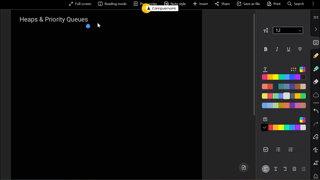

#### Core Concepts & Learning Objectives
Comprehensive video masterclass covering DSA-35- Heaps & Priority Queue - part 1. Focuses on fundamental principles, algorithm analysis, edge-case handling, and Infosys exam question solutions.

---

### Video 270: DSA-36- Heaps & Priority Queue-Part2
- **Video ID**: `162552096` | **Duration**: `00:24:03` (1,443s)
- **Track**: Infosys DSE & SP Role Preparation | **Topic**: Data Structures & Algorithms in Python
- **Curriculum Path**: `3. Infosys DSE & SP Role Prep / 2.3 DSA with Python / Python: Data Structures & Concepts`

#### Master Video Slide Thumbnail Plate

#### Core Concepts & Learning Objectives
Comprehensive video masterclass covering DSA-36- Heaps & Priority Queue-Part2. Focuses on fundamental principles, algorithm analysis, edge-case handling, and Infosys exam question solutions.

---

### Video 271: DSA-37-Bubble Sort, Insertion Sort & Selection Sort
- **Video ID**: `162552095` | **Duration**: `00:28:08` (1,688s)
- **Track**: Infosys DSE & SP Role Preparation | **Topic**: Data Structures & Algorithms in Python
- **Curriculum Path**: `3. Infosys DSE & SP Role Prep / 2.3 DSA with Python / Python: Data Structures & Concepts`

#### Master Video Slide Thumbnail Plate

#### Core Concepts & Learning Objectives
Comprehensive video masterclass covering DSA-37-Bubble Sort, Insertion Sort & Selection Sort. Focuses on fundamental principles, algorithm analysis, edge-case handling, and Infosys exam question solutions.

---

### Video 272: DSA-38-Merge Sort
- **Video ID**: `162552097` | **Duration**: `00:27:32` (1,652s)
- **Track**: Infosys DSE & SP Role Preparation | **Topic**: Data Structures & Algorithms in Python
- **Curriculum Path**: `3. Infosys DSE & SP Role Prep / 2.3 DSA with Python / Python: Data Structures & Concepts`

#### Master Video Slide Thumbnail Plate

#### Core Concepts & Learning Objectives
Comprehensive video masterclass covering DSA-38-Merge Sort. Focuses on fundamental principles, algorithm analysis, edge-case handling, and Infosys exam question solutions.

---

### Video 273: DSA-39-Quick Sort
- **Video ID**: `162552093` | **Duration**: `00:19:39` (1,179s)
- **Track**: Infosys DSE & SP Role Preparation | **Topic**: Data Structures & Algorithms in Python
- **Curriculum Path**: `3. Infosys DSE & SP Role Prep / 2.3 DSA with Python / Python: Data Structures & Concepts`

#### Master Video Slide Thumbnail Plate

#### Core Concepts & Learning Objectives
Comprehensive video masterclass covering DSA-39-Quick Sort. Focuses on fundamental principles, algorithm analysis, edge-case handling, and Infosys exam question solutions.

---

### Video 274: DSA-40-Counting Sort
- **Video ID**: `162552100` | **Duration**: `00:29:38` (1,778s)
- **Track**: Infosys DSE & SP Role Preparation | **Topic**: Data Structures & Algorithms in Python
- **Curriculum Path**: `3. Infosys DSE & SP Role Prep / 2.3 DSA with Python / Python: Data Structures & Concepts`

#### Master Video Slide Thumbnail Plate

#### Core Concepts & Learning Objectives
Comprehensive video masterclass covering DSA-40-Counting Sort. Focuses on fundamental principles, algorithm analysis, edge-case handling, and Infosys exam question solutions.

---

### Video 275: DSA-41-Graphs-Part 1
- **Video ID**: `162552099` | **Duration**: `00:30:31` (1,831s)
- **Track**: Infosys DSE & SP Role Preparation | **Topic**: Data Structures & Algorithms in Python
- **Curriculum Path**: `3. Infosys DSE & SP Role Prep / 2.3 DSA with Python / Python: Data Structures & Concepts`

#### Master Video Slide Thumbnail Plate

#### Core Concepts & Learning Objectives
Comprehensive video masterclass covering DSA-41-Graphs-Part 1. Focuses on fundamental principles, algorithm analysis, edge-case handling, and Infosys exam question solutions.

---

### Video 276: DSA-42-Graphs-Part 2
- **Video ID**: `162552094` | **Duration**: `00:16:32` (992s)
- **Track**: Infosys DSE & SP Role Preparation | **Topic**: Data Structures & Algorithms in Python
- **Curriculum Path**: `3. Infosys DSE & SP Role Prep / 2.3 DSA with Python / Python: Data Structures & Concepts`

#### Master Video Slide Thumbnail Plate

#### Core Concepts & Learning Objectives
Comprehensive video masterclass covering DSA-42-Graphs-Part 2. Focuses on fundamental principles, algorithm analysis, edge-case handling, and Infosys exam question solutions.

---

### Video 277: DSA-43-Graphs-Part 3
- **Video ID**: `162552105` | **Duration**: `00:22:37` (1,357s)
- **Track**: Infosys DSE & SP Role Preparation | **Topic**: Data Structures & Algorithms in Python
- **Curriculum Path**: `3. Infosys DSE & SP Role Prep / 2.3 DSA with Python / Python: Data Structures & Concepts`

#### Master Video Slide Thumbnail Plate
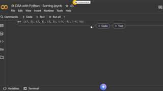

#### Core Concepts & Learning Objectives
Comprehensive video masterclass covering DSA-43-Graphs-Part 3. Focuses on fundamental principles, algorithm analysis, edge-case handling, and Infosys exam question solutions.

---

### Video 278: DSA-44-Two Pointers
- **Video ID**: `162552102` | **Duration**: `00:16:49` (1,009s)
- **Track**: Infosys DSE & SP Role Preparation | **Topic**: Data Structures & Algorithms in Python
- **Curriculum Path**: `3. Infosys DSE & SP Role Prep / 2.3 DSA with Python / Python: Data Structures & Concepts`

#### Master Video Slide Thumbnail Plate
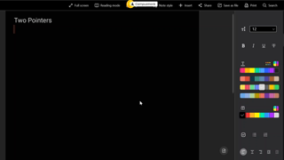

#### Core Concepts & Learning Objectives
Comprehensive video masterclass covering DSA-44-Two Pointers. Focuses on fundamental principles, algorithm analysis, edge-case handling, and Infosys exam question solutions.

---

### Video 279: DSA-45-Sliding Window – Part 1
- **Video ID**: `162552101` | **Duration**: `00:21:16` (1,276s)
- **Track**: Infosys DSE & SP Role Preparation | **Topic**: Data Structures & Algorithms in Python
- **Curriculum Path**: `3. Infosys DSE & SP Role Prep / 2.3 DSA with Python / Python: Data Structures & Concepts`

#### Master Video Slide Thumbnail Plate
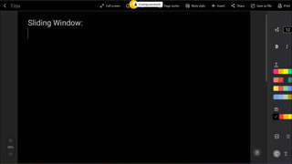

#### Core Concepts & Learning Objectives
Comprehensive video masterclass covering DSA-45-Sliding Window – Part 1. Focuses on fundamental principles, algorithm analysis, edge-case handling, and Infosys exam question solutions.

---

### Video 280: DSA-46-Sliding Window – Part 2
- **Video ID**: `162552103` | **Duration**: `00:20:41` (1,241s)
- **Track**: Infosys DSE & SP Role Preparation | **Topic**: Data Structures & Algorithms in Python
- **Curriculum Path**: `3. Infosys DSE & SP Role Prep / 2.3 DSA with Python / Python: Data Structures & Concepts`

#### Master Video Slide Thumbnail Plate
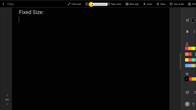

#### Core Concepts & Learning Objectives
Comprehensive video masterclass covering DSA-46-Sliding Window – Part 2. Focuses on fundamental principles, algorithm analysis, edge-case handling, and Infosys exam question solutions.

---

### Video 281: DSA-47-Recursive Backtracking
- **Video ID**: `162552104` | **Duration**: `00:17:59` (1,079s)
- **Track**: Infosys DSE & SP Role Preparation | **Topic**: Data Structures & Algorithms in Python
- **Curriculum Path**: `3. Infosys DSE & SP Role Prep / 2.3 DSA with Python / Python: Data Structures & Concepts`

#### Master Video Slide Thumbnail Plate
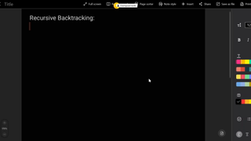

#### Core Concepts & Learning Objectives
Comprehensive video masterclass covering DSA-47-Recursive Backtracking. Focuses on fundamental principles, algorithm analysis, edge-case handling, and Infosys exam question solutions.

---

### Video 282: DSA-48-DynamicProgramming
- **Video ID**: `162552107` | **Duration**: `00:31:25` (1,885s)
- **Track**: Infosys DSE & SP Role Preparation | **Topic**: Data Structures & Algorithms in Python
- **Curriculum Path**: `3. Infosys DSE & SP Role Prep / 2.3 DSA with Python / Python: Data Structures & Concepts`

#### Master Video Slide Thumbnail Plate
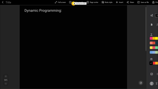

#### Core Concepts & Learning Objectives
Comprehensive video masterclass covering DSA-48-DynamicProgramming. Focuses on fundamental principles, algorithm analysis, edge-case handling, and Infosys exam question solutions.

---

### Video 283: DSA-L1-leetcode-2239-Find closest number to zero
- **Video ID**: `162552203` | **Duration**: `00:07:41` (461s)
- **Track**: Infosys DSE & SP Role Preparation | **Topic**: Data Structures & Algorithms in Python
- **Curriculum Path**: `3. Infosys DSE & SP Role Prep / 2.3 DSA with Python / Python LeetCode Series / 1. Arrays & Strings`

#### Master Video Slide Thumbnail Plate
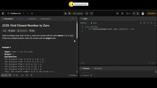

#### Core Concepts & Learning Objectives
Comprehensive video masterclass covering DSA-L1-leetcode-2239-Find closest number to zero. Focuses on fundamental principles, algorithm analysis, edge-case handling, and Infosys exam question solutions.

---

### Video 284: DSA-L2-leetcode-1768-Merge strings alternatively
- **Video ID**: `162552208` | **Duration**: `00:16:36` (996s)
- **Track**: Infosys DSE & SP Role Preparation | **Topic**: Data Structures & Algorithms in Python
- **Curriculum Path**: `3. Infosys DSE & SP Role Prep / 2.3 DSA with Python / Python LeetCode Series / 1. Arrays & Strings`

#### Master Video Slide Thumbnail Plate
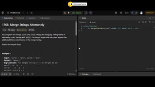

#### Core Concepts & Learning Objectives
Comprehensive video masterclass covering DSA-L2-leetcode-1768-Merge strings alternatively. Focuses on fundamental principles, algorithm analysis, edge-case handling, and Infosys exam question solutions.

---

### Video 285: DSA-L4-leetcode-392-Is Subsequence
- **Video ID**: `162552206` | **Duration**: `00:13:13` (793s)
- **Track**: Infosys DSE & SP Role Preparation | **Topic**: Data Structures & Algorithms in Python
- **Curriculum Path**: `3. Infosys DSE & SP Role Prep / 2.3 DSA with Python / Python LeetCode Series / 1. Arrays & Strings`

#### Master Video Slide Thumbnail Plate
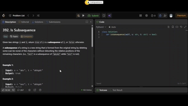

#### Core Concepts & Learning Objectives
Comprehensive video masterclass covering DSA-L4-leetcode-392-Is Subsequence. Focuses on fundamental principles, algorithm analysis, edge-case handling, and Infosys exam question solutions.

---

### Video 286: DSA-L5-leetcode-121-Best time to buy and sell Stock
- **Video ID**: `162552204` | **Duration**: `00:12:15` (735s)
- **Track**: Infosys DSE & SP Role Preparation | **Topic**: Data Structures & Algorithms in Python
- **Curriculum Path**: `3. Infosys DSE & SP Role Prep / 2.3 DSA with Python / Python LeetCode Series / 1. Arrays & Strings`

#### Master Video Slide Thumbnail Plate
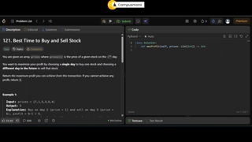

#### Core Concepts & Learning Objectives
Comprehensive video masterclass covering DSA-L5-leetcode-121-Best time to buy and sell Stock. Focuses on fundamental principles, algorithm analysis, edge-case handling, and Infosys exam question solutions.

---

### Video 287: DSA-L6-Longest Common Prefix-leetcode-14
- **Video ID**: `162552210` | **Duration**: `00:10:14` (614s)
- **Track**: Infosys DSE & SP Role Preparation | **Topic**: Data Structures & Algorithms in Python
- **Curriculum Path**: `3. Infosys DSE & SP Role Prep / 2.3 DSA with Python / Python LeetCode Series / 1. Arrays & Strings`

#### Master Video Slide Thumbnail Plate
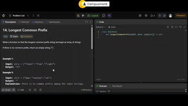

#### Core Concepts & Learning Objectives
Comprehensive video masterclass covering DSA-L6-Longest Common Prefix-leetcode-14. Focuses on fundamental principles, algorithm analysis, edge-case handling, and Infosys exam question solutions.

---

### Video 288: DSA-L7-leetcode-228-Summary Ranges
- **Video ID**: `162552202` | **Duration**: `00:14:36` (876s)
- **Track**: Infosys DSE & SP Role Preparation | **Topic**: Data Structures & Algorithms in Python
- **Curriculum Path**: `3. Infosys DSE & SP Role Prep / 2.3 DSA with Python / Python LeetCode Series / 1. Arrays & Strings`

#### Master Video Slide Thumbnail Plate
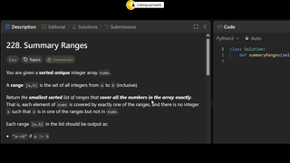

#### Core Concepts & Learning Objectives
Comprehensive video masterclass covering DSA-L7-leetcode-228-Summary Ranges. Focuses on fundamental principles, algorithm analysis, edge-case handling, and Infosys exam question solutions.

---

### Video 289: DSA-L8-leetcode-238-Product of Array Except Self
- **Video ID**: `162552205` | **Duration**: `00:15:17` (917s)
- **Track**: Infosys DSE & SP Role Preparation | **Topic**: Data Structures & Algorithms in Python
- **Curriculum Path**: `3. Infosys DSE & SP Role Prep / 2.3 DSA with Python / Python LeetCode Series / 1. Arrays & Strings`

#### Master Video Slide Thumbnail Plate
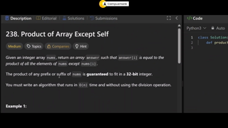

#### Core Concepts & Learning Objectives
Comprehensive video masterclass covering DSA-L8-leetcode-238-Product of Array Except Self. Focuses on fundamental principles, algorithm analysis, edge-case handling, and Infosys exam question solutions.

---

### Video 290: DSA-9 Leetcode 56- Merge Intervals( Array&Strings)
- **Video ID**: `162552209` | **Duration**: `00:14:57` (897s)
- **Track**: Infosys DSE & SP Role Preparation | **Topic**: Data Structures & Algorithms in Python
- **Curriculum Path**: `3. Infosys DSE & SP Role Prep / 2.3 DSA with Python / Python LeetCode Series / 1. Arrays & Strings`

#### Master Video Slide Thumbnail Plate
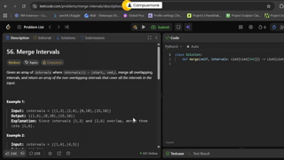

#### Core Concepts & Learning Objectives
Comprehensive video masterclass covering DSA-9 Leetcode 56- Merge Intervals( Array&Strings). Focuses on fundamental principles, algorithm analysis, edge-case handling, and Infosys exam question solutions.

---

### Video 291: DSA-L 10 Leetcode-54-Spiral Matrix(Arrays & String
- **Video ID**: `162552211` | **Duration**: `00:18:14` (1,094s)
- **Track**: Infosys DSE & SP Role Preparation | **Topic**: Data Structures & Algorithms in Python
- **Curriculum Path**: `3. Infosys DSE & SP Role Prep / 2.3 DSA with Python / Python LeetCode Series / 1. Arrays & Strings`

#### Master Video Slide Thumbnail Plate
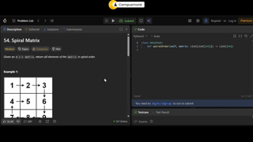

#### Core Concepts & Learning Objectives
Comprehensive video masterclass covering DSA-L 10 Leetcode-54-Spiral Matrix(Arrays & String. Focuses on fundamental principles, algorithm analysis, edge-case handling, and Infosys exam question solutions.

---

### Video 292: DSA L-11 Leetcode 48- Rotate Image(Arrays&Strings)
- **Video ID**: `162552207` | **Duration**: `00:12:44` (764s)
- **Track**: Infosys DSE & SP Role Preparation | **Topic**: Data Structures & Algorithms in Python
- **Curriculum Path**: `3. Infosys DSE & SP Role Prep / 2.3 DSA with Python / Python LeetCode Series / 1. Arrays & Strings`

#### Master Video Slide Thumbnail Plate
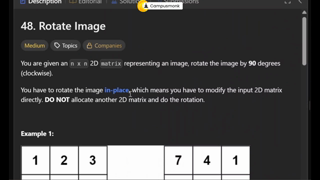

#### Core Concepts & Learning Objectives
Comprehensive video masterclass covering DSA L-11 Leetcode 48- Rotate Image(Arrays&Strings). Focuses on fundamental principles, algorithm analysis, edge-case handling, and Infosys exam question solutions.

---

### Video 293: DSA L-12 Leetcode-771-Jewels & Stones(Hashmap & Ha
- **Video ID**: `162552240` | **Duration**: `00:08:29` (509s)
- **Track**: Infosys DSE & SP Role Preparation | **Topic**: Data Structures & Algorithms in Python
- **Curriculum Path**: `3. Infosys DSE & SP Role Prep / 2.3 DSA with Python / Python LeetCode Series / 2. Hash Maps & Hash Set`

#### Master Video Slide Thumbnail Plate
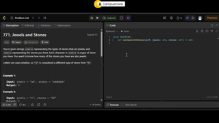

#### Core Concepts & Learning Objectives
Comprehensive video masterclass covering DSA L-12 Leetcode-771-Jewels & Stones(Hashmap & Ha. Focuses on fundamental principles, algorithm analysis, edge-case handling, and Infosys exam question solutions.

---

### Video 294: DSA L-13 Leetcode-383-Ransom Note( Hashmap & Hashs
- **Video ID**: `162552243` | **Duration**: `00:12:34` (754s)
- **Track**: Infosys DSE & SP Role Preparation | **Topic**: Data Structures & Algorithms in Python
- **Curriculum Path**: `3. Infosys DSE & SP Role Prep / 2.3 DSA with Python / Python LeetCode Series / 2. Hash Maps & Hash Set`

#### Master Video Slide Thumbnail Plate
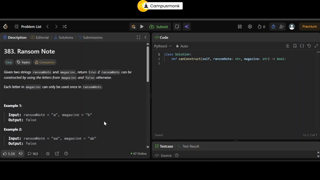

#### Core Concepts & Learning Objectives
Comprehensive video masterclass covering DSA L-13 Leetcode-383-Ransom Note( Hashmap & Hashs. Focuses on fundamental principles, algorithm analysis, edge-case handling, and Infosys exam question solutions.

---

### Video 295: Leetcode-14- Longest Common Prefix(Array & Strings
- **Video ID**: `162552242` | **Duration**: `00:10:14` (614s)
- **Track**: Infosys DSE & SP Role Preparation | **Topic**: Data Structures & Algorithms in Python
- **Curriculum Path**: `3. Infosys DSE & SP Role Prep / 2.3 DSA with Python / Python LeetCode Series / 2. Hash Maps & Hash Set`

#### Master Video Slide Thumbnail Plate

#### Core Concepts & Learning Objectives
Comprehensive video masterclass covering Leetcode-14- Longest Common Prefix(Array & Strings. Focuses on fundamental principles, algorithm analysis, edge-case handling, and Infosys exam question solutions.

---

### Video 296: DSA L-15 Valid Anagrams (Hash Maps & Hash Sets)
- **Video ID**: `162552241` | **Duration**: `00:07:48` (468s)
- **Track**: Infosys DSE & SP Role Preparation | **Topic**: Data Structures & Algorithms in Python
- **Curriculum Path**: `3. Infosys DSE & SP Role Prep / 2.3 DSA with Python / Python LeetCode Series / 2. Hash Maps & Hash Set`

#### Master Video Slide Thumbnail Plate
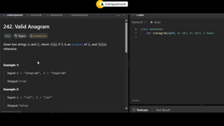

#### Core Concepts & Learning Objectives
Comprehensive video masterclass covering DSA L-15 Valid Anagrams (Hash Maps & Hash Sets). Focuses on fundamental principles, algorithm analysis, edge-case handling, and Infosys exam question solutions.

---

### Video 297: DSA L16 Leetcode -1- Two Sums( Hash map & Hash set
- **Video ID**: `162552244` | **Duration**: `00:08:16` (496s)
- **Track**: Infosys DSE & SP Role Preparation | **Topic**: Data Structures & Algorithms in Python
- **Curriculum Path**: `3. Infosys DSE & SP Role Prep / 2.3 DSA with Python / Python LeetCode Series / 2. Hash Maps & Hash Set`

#### Master Video Slide Thumbnail Plate
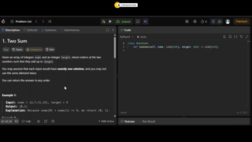

#### Core Concepts & Learning Objectives
Comprehensive video masterclass covering DSA L16 Leetcode -1- Two Sums( Hash map & Hash set. Focuses on fundamental principles, algorithm analysis, edge-case handling, and Infosys exam question solutions.

---

### Video 298: DSA L-17 Group Anagrams-Leetcode- 49(Hash map & Ha
- **Video ID**: `162552246` | **Duration**: `00:09:43` (583s)
- **Track**: Infosys DSE & SP Role Preparation | **Topic**: Data Structures & Algorithms in Python
- **Curriculum Path**: `3. Infosys DSE & SP Role Prep / 2.3 DSA with Python / Python LeetCode Series / 2. Hash Maps & Hash Set`

#### Master Video Slide Thumbnail Plate
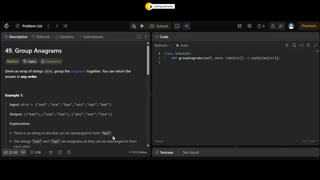

#### Core Concepts & Learning Objectives
Comprehensive video masterclass covering DSA L-17 Group Anagrams-Leetcode- 49(Hash map & Ha. Focuses on fundamental principles, algorithm analysis, edge-case handling, and Infosys exam question solutions.

---

### Video 299: DSA L-18 Valid Sudoku- Leetcode-36(Hashmap&hashset
- **Video ID**: `162552248` | **Duration**: `00:11:26` (686s)
- **Track**: Infosys DSE & SP Role Preparation | **Topic**: Data Structures & Algorithms in Python
- **Curriculum Path**: `3. Infosys DSE & SP Role Prep / 2.3 DSA with Python / Python LeetCode Series / 2. Hash Maps & Hash Set`

#### Master Video Slide Thumbnail Plate
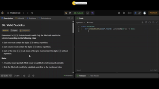

#### Core Concepts & Learning Objectives
Comprehensive video masterclass covering DSA L-18 Valid Sudoku- Leetcode-36(Hashmap&hashset. Focuses on fundamental principles, algorithm analysis, edge-case handling, and Infosys exam question solutions.

---

### Video 300: DSA L-19 maximum number of balloons-leetcode-1189(
- **Video ID**: `162552245` | **Duration**: `00:09:09` (549s)
- **Track**: Infosys DSE & SP Role Preparation | **Topic**: Data Structures & Algorithms in Python
- **Curriculum Path**: `3. Infosys DSE & SP Role Prep / 2.3 DSA with Python / Python LeetCode Series / 2. Hash Maps & Hash Set`

#### Master Video Slide Thumbnail Plate
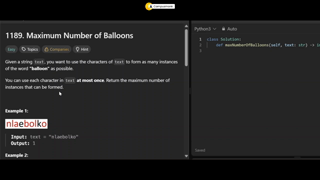

#### Core Concepts & Learning Objectives
Comprehensive video masterclass covering DSA L-19 maximum number of balloons-leetcode-1189(. Focuses on fundamental principles, algorithm analysis, edge-case handling, and Infosys exam question solutions.

---

### Video 301: DSA L-20 Longest Consecutive Sequence-LeetCode-128
- **Video ID**: `162552249` | **Duration**: `00:11:02` (662s)
- **Track**: Infosys DSE & SP Role Preparation | **Topic**: Data Structures & Algorithms in Python
- **Curriculum Path**: `3. Infosys DSE & SP Role Prep / 2.3 DSA with Python / Python LeetCode Series / 2. Hash Maps & Hash Set`

#### Master Video Slide Thumbnail Plate
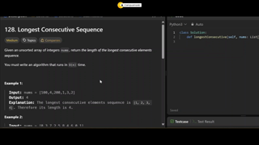

#### Core Concepts & Learning Objectives
Comprehensive video masterclass covering DSA L-20 Longest Consecutive Sequence-LeetCode-128. Focuses on fundamental principles, algorithm analysis, edge-case handling, and Infosys exam question solutions.

---

### Video 302: DSA L-21 Majority Element- Leetcode-169(Hash Maps
- **Video ID**: `162552247` | **Duration**: `00:09:42` (582s)
- **Track**: Infosys DSE & SP Role Preparation | **Topic**: Data Structures & Algorithms in Python
- **Curriculum Path**: `3. Infosys DSE & SP Role Prep / 2.3 DSA with Python / Python LeetCode Series / 2. Hash Maps & Hash Set`

#### Master Video Slide Thumbnail Plate
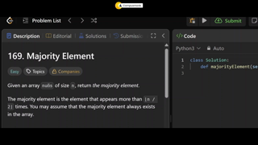

#### Core Concepts & Learning Objectives
Comprehensive video masterclass covering DSA L-21 Majority Element- Leetcode-169(Hash Maps. Focuses on fundamental principles, algorithm analysis, edge-case handling, and Infosys exam question solutions.

---

### Video 303: DSA L-22 Reverse String- LeetCode- 344( Two pointe
- **Video ID**: `162552310` | **Duration**: `00:06:09` (369s)
- **Track**: Infosys DSE & SP Role Preparation | **Topic**: Data Structures & Algorithms in Python
- **Curriculum Path**: `3. Infosys DSE & SP Role Prep / 2.3 DSA with Python / Python LeetCode Series / 3. Two Pointers`

#### Master Video Slide Thumbnail Plate
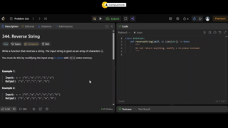

#### Core Concepts & Learning Objectives
Comprehensive video masterclass covering DSA L-22 Reverse String- LeetCode- 344( Two pointe. Focuses on fundamental principles, algorithm analysis, edge-case handling, and Infosys exam question solutions.

---

### Video 304: DSA L-23 Two Sum II-Input Array is Sorted- Leetcod
- **Video ID**: `162552311` | **Duration**: `00:09:42` (582s)
- **Track**: Infosys DSE & SP Role Preparation | **Topic**: Data Structures & Algorithms in Python
- **Curriculum Path**: `3. Infosys DSE & SP Role Prep / 2.3 DSA with Python / Python LeetCode Series / 3. Two Pointers`

#### Master Video Slide Thumbnail Plate

#### Core Concepts & Learning Objectives
Comprehensive video masterclass covering DSA L-23 Two Sum II-Input Array is Sorted- Leetcod. Focuses on fundamental principles, algorithm analysis, edge-case handling, and Infosys exam question solutions.

---

### Video 305: DSA L-24 Valid Palindrome-LeetCode-125(Two Pointer
- **Video ID**: `162552312` | **Duration**: `00:08:17` (497s)
- **Track**: Infosys DSE & SP Role Preparation | **Topic**: Data Structures & Algorithms in Python
- **Curriculum Path**: `3. Infosys DSE & SP Role Prep / 2.3 DSA with Python / Python LeetCode Series / 3. Two Pointers`

#### Master Video Slide Thumbnail Plate
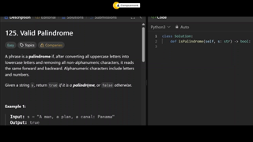

#### Core Concepts & Learning Objectives
Comprehensive video masterclass covering DSA L-24 Valid Palindrome-LeetCode-125(Two Pointer. Focuses on fundamental principles, algorithm analysis, edge-case handling, and Infosys exam question solutions.

---

### Video 306: DSA L-25 3Sum -Leetcode-15( Two Pointers)
- **Video ID**: `162552313` | **Duration**: `00:15:44` (944s)
- **Track**: Infosys DSE & SP Role Preparation | **Topic**: Data Structures & Algorithms in Python
- **Curriculum Path**: `3. Infosys DSE & SP Role Prep / 2.3 DSA with Python / Python LeetCode Series / 3. Two Pointers`

#### Master Video Slide Thumbnail Plate
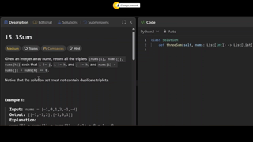

#### Core Concepts & Learning Objectives
Comprehensive video masterclass covering DSA L-25 3Sum -Leetcode-15( Two Pointers). Focuses on fundamental principles, algorithm analysis, edge-case handling, and Infosys exam question solutions.

---

### Video 307: DSA L-26 trapping Rain Water -LeetCode-42 (Two Poi
- **Video ID**: `162552314` | **Duration**: `00:11:26` (686s)
- **Track**: Infosys DSE & SP Role Preparation | **Topic**: Data Structures & Algorithms in Python
- **Curriculum Path**: `3. Infosys DSE & SP Role Prep / 2.3 DSA with Python / Python LeetCode Series / 3. Two Pointers`

#### Master Video Slide Thumbnail Plate
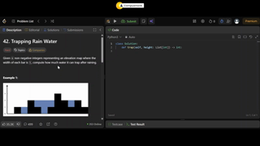

#### Core Concepts & Learning Objectives
Comprehensive video masterclass covering DSA L-26 trapping Rain Water -LeetCode-42 (Two Poi. Focuses on fundamental principles, algorithm analysis, edge-case handling, and Infosys exam question solutions.

---

### Video 308: DSA L-27 Baseball Game-Leetcode-682(Stacks)
- **Video ID**: `162552347` | **Duration**: `00:07:54` (474s)
- **Track**: Infosys DSE & SP Role Preparation | **Topic**: Data Structures & Algorithms in Python
- **Curriculum Path**: `3. Infosys DSE & SP Role Prep / 2.3 DSA with Python / Python LeetCode Series / 4. Stacks`

#### Master Video Slide Thumbnail Plate
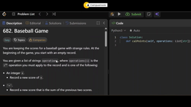

#### Core Concepts & Learning Objectives
Comprehensive video masterclass covering DSA L-27 Baseball Game-Leetcode-682(Stacks). Focuses on fundamental principles, algorithm analysis, edge-case handling, and Infosys exam question solutions.

---

### Video 309: DSA L- 28 valid Parentheses-Leetcode-20(Stacks)
- **Video ID**: `162552351` | **Duration**: `00:11:02` (662s)
- **Track**: Infosys DSE & SP Role Preparation | **Topic**: Data Structures & Algorithms in Python
- **Curriculum Path**: `3. Infosys DSE & SP Role Prep / 2.3 DSA with Python / Python LeetCode Series / 4. Stacks`

#### Master Video Slide Thumbnail Plate
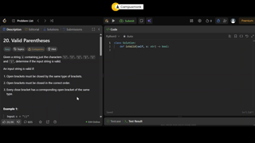

#### Core Concepts & Learning Objectives
Comprehensive video masterclass covering DSA L- 28 valid Parentheses-Leetcode-20(Stacks). Focuses on fundamental principles, algorithm analysis, edge-case handling, and Infosys exam question solutions.

---

### Video 310: DSA L-29 3Sum -Leetcode-15( Two Pointers)
- **Video ID**: `162552350` | **Duration**: `00:13:47` (827s)
- **Track**: Infosys DSE & SP Role Preparation | **Topic**: Data Structures & Algorithms in Python
- **Curriculum Path**: `3. Infosys DSE & SP Role Prep / 2.3 DSA with Python / Python LeetCode Series / 4. Stacks`

#### Master Video Slide Thumbnail Plate
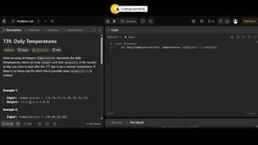

#### Core Concepts & Learning Objectives
Comprehensive video masterclass covering DSA L-29 3Sum -Leetcode-15( Two Pointers). Focuses on fundamental principles, algorithm analysis, edge-case handling, and Infosys exam question solutions.

---

### Video 311: DSA L - 30 Leetcode 150-Evaluate Reverse Polish Notation
- **Video ID**: `162552348` | **Duration**: `00:10:13` (613s)
- **Track**: Infosys DSE & SP Role Preparation | **Topic**: Data Structures & Algorithms in Python
- **Curriculum Path**: `3. Infosys DSE & SP Role Prep / 2.3 DSA with Python / Python LeetCode Series / 4. Stacks`

#### Master Video Slide Thumbnail Plate
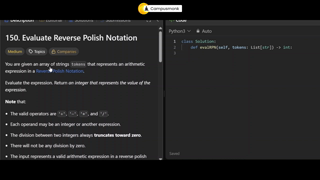

#### Core Concepts & Learning Objectives
Comprehensive video masterclass covering DSA L - 30 Leetcode 150-Evaluate Reverse Polish Notation. Focuses on fundamental principles, algorithm analysis, edge-case handling, and Infosys exam question solutions.

---

### Video 312: DSA L-31 leetcode-155-Min Stack
- **Video ID**: `162552349` | **Duration**: `00:10:50` (650s)
- **Track**: Infosys DSE & SP Role Preparation | **Topic**: Data Structures & Algorithms in Python
- **Curriculum Path**: `3. Infosys DSE & SP Role Prep / 2.3 DSA with Python / Python LeetCode Series / 4. Stacks`

#### Master Video Slide Thumbnail Plate
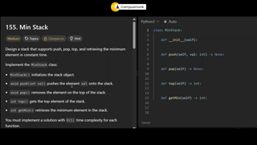

#### Core Concepts & Learning Objectives
Comprehensive video masterclass covering DSA L-31 leetcode-155-Min Stack. Focuses on fundamental principles, algorithm analysis, edge-case handling, and Infosys exam question solutions.

---

### Video 313: DSA L-32 leetcode-704-Binary Search
- **Video ID**: `162552373` | **Duration**: `00:08:29` (509s)
- **Track**: Infosys DSE & SP Role Preparation | **Topic**: Data Structures & Algorithms in Python
- **Curriculum Path**: `3. Infosys DSE & SP Role Prep / 2.3 DSA with Python / Python LeetCode Series / 5. Binary Search`

#### Master Video Slide Thumbnail Plate
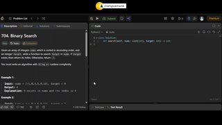

#### Core Concepts & Learning Objectives
Comprehensive video masterclass covering DSA L-32 leetcode-704-Binary Search. Focuses on fundamental principles, algorithm analysis, edge-case handling, and Infosys exam question solutions.

---

### Video 314: DSA L- 33 Search Insert Position -Leetcode-35(Bina
- **Video ID**: `162552377` | **Duration**: `00:08:18` (498s)
- **Track**: Infosys DSE & SP Role Preparation | **Topic**: Data Structures & Algorithms in Python
- **Curriculum Path**: `3. Infosys DSE & SP Role Prep / 2.3 DSA with Python / Python LeetCode Series / 5. Binary Search`

#### Master Video Slide Thumbnail Plate
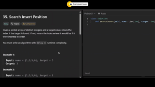

#### Core Concepts & Learning Objectives
Comprehensive video masterclass covering DSA L- 33 Search Insert Position -Leetcode-35(Bina. Focuses on fundamental principles, algorithm analysis, edge-case handling, and Infosys exam question solutions.

---

### Video 315: DSA L- 34 Search a 2D Matrix-LeetCode-74(Binary Se
- **Video ID**: `162552376` | **Duration**: `00:08:47` (527s)
- **Track**: Infosys DSE & SP Role Preparation | **Topic**: Data Structures & Algorithms in Python
- **Curriculum Path**: `3. Infosys DSE & SP Role Prep / 2.3 DSA with Python / Python LeetCode Series / 5. Binary Search`

#### Master Video Slide Thumbnail Plate
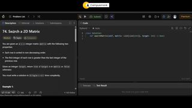

#### Core Concepts & Learning Objectives
Comprehensive video masterclass covering DSA L- 34 Search a 2D Matrix-LeetCode-74(Binary Se. Focuses on fundamental principles, algorithm analysis, edge-case handling, and Infosys exam question solutions.

---

### Video 316: DSA L-35 Find Minimum in Rotated Sorted Array- Lee (1)
- **Video ID**: `162552370` | **Duration**: `00:10:20` (620s)
- **Track**: Infosys DSE & SP Role Preparation | **Topic**: Data Structures & Algorithms in Python
- **Curriculum Path**: `3. Infosys DSE & SP Role Prep / 2.3 DSA with Python / Python LeetCode Series / 5. Binary Search`

#### Master Video Slide Thumbnail Plate
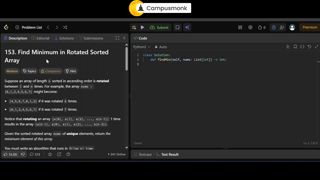

#### Core Concepts & Learning Objectives
Comprehensive video masterclass covering DSA L-35 Find Minimum in Rotated Sorted Array- Lee (1). Focuses on fundamental principles, algorithm analysis, edge-case handling, and Infosys exam question solutions.

---

### Video 317: DSA L-36  Search in Rotated Sorted Array-Leetcode-
- **Video ID**: `162552374` | **Duration**: `00:14:11` (851s)
- **Track**: Infosys DSE & SP Role Preparation | **Topic**: Data Structures & Algorithms in Python
- **Curriculum Path**: `3. Infosys DSE & SP Role Prep / 2.3 DSA with Python / Python LeetCode Series / 5. Binary Search`

#### Master Video Slide Thumbnail Plate
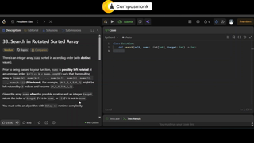

#### Core Concepts & Learning Objectives
Comprehensive video masterclass covering DSA L-36  Search in Rotated Sorted Array-Leetcode-. Focuses on fundamental principles, algorithm analysis, edge-case handling, and Infosys exam question solutions.

---

### Video 318: DSA L-37 First Bad Version-Leetcode-278(Binary Sea
- **Video ID**: `162552375` | **Duration**: `00:14:21` (861s)
- **Track**: Infosys DSE & SP Role Preparation | **Topic**: Data Structures & Algorithms in Python
- **Curriculum Path**: `3. Infosys DSE & SP Role Prep / 2.3 DSA with Python / Python LeetCode Series / 5. Binary Search`

#### Master Video Slide Thumbnail Plate
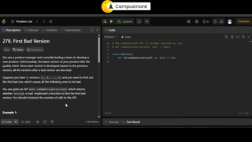

#### Core Concepts & Learning Objectives
Comprehensive video masterclass covering DSA L-37 First Bad Version-Leetcode-278(Binary Sea. Focuses on fundamental principles, algorithm analysis, edge-case handling, and Infosys exam question solutions.

---

### Video 319: DSA L-38 valid Perfect Square-LeetCode-367(Binary
- **Video ID**: `162552371` | **Duration**: `00:11:30` (690s)
- **Track**: Infosys DSE & SP Role Preparation | **Topic**: Data Structures & Algorithms in Python
- **Curriculum Path**: `3. Infosys DSE & SP Role Prep / 2.3 DSA with Python / Python LeetCode Series / 5. Binary Search`

#### Master Video Slide Thumbnail Plate
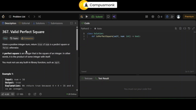

#### Core Concepts & Learning Objectives
Comprehensive video masterclass covering DSA L-38 valid Perfect Square-LeetCode-367(Binary. Focuses on fundamental principles, algorithm analysis, edge-case handling, and Infosys exam question solutions.

---

### Video 320: DSA L-39 Koko Eating Bananas-Leetcode-875(Binary S
- **Video ID**: `162552372` | **Duration**: `00:13:19` (799s)
- **Track**: Infosys DSE & SP Role Preparation | **Topic**: Data Structures & Algorithms in Python
- **Curriculum Path**: `3. Infosys DSE & SP Role Prep / 2.3 DSA with Python / Python LeetCode Series / 5. Binary Search`

#### Master Video Slide Thumbnail Plate
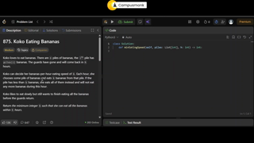

#### Core Concepts & Learning Objectives
Comprehensive video masterclass covering DSA L-39 Koko Eating Bananas-Leetcode-875(Binary S. Focuses on fundamental principles, algorithm analysis, edge-case handling, and Infosys exam question solutions.

---

### Video 321: DSA L-40 Remove Duplicates from Sorted List-LeetCo
- **Video ID**: `162552395` | **Duration**: `00:05:19` (319s)
- **Track**: Infosys DSE & SP Role Preparation | **Topic**: Data Structures & Algorithms in Python
- **Curriculum Path**: `3. Infosys DSE & SP Role Prep / 2.3 DSA with Python / Python LeetCode Series / 6. Linked List`

#### Master Video Slide Thumbnail Plate
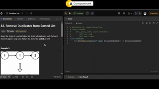

#### Core Concepts & Learning Objectives
Comprehensive video masterclass covering DSA L-40 Remove Duplicates from Sorted List-LeetCo. Focuses on fundamental principles, algorithm analysis, edge-case handling, and Infosys exam question solutions.

---

### Video 322: DSA L-41 Reverse Linked List-Leetcode-206(Linked L
- **Video ID**: `162552399` | **Duration**: `00:10:16` (616s)
- **Track**: Infosys DSE & SP Role Preparation | **Topic**: Data Structures & Algorithms in Python
- **Curriculum Path**: `3. Infosys DSE & SP Role Prep / 2.3 DSA with Python / Python LeetCode Series / 6. Linked List`

#### Master Video Slide Thumbnail Plate
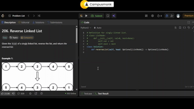

#### Core Concepts & Learning Objectives
Comprehensive video masterclass covering DSA L-41 Reverse Linked List-Leetcode-206(Linked L. Focuses on fundamental principles, algorithm analysis, edge-case handling, and Infosys exam question solutions.

---

### Video 323: DSA L- 42 Merge Two Sorted Lists-LeetCode-21(Linke
- **Video ID**: `162552400` | **Duration**: `00:09:36` (576s)
- **Track**: Infosys DSE & SP Role Preparation | **Topic**: Data Structures & Algorithms in Python
- **Curriculum Path**: `3. Infosys DSE & SP Role Prep / 2.3 DSA with Python / Python LeetCode Series / 6. Linked List`

#### Master Video Slide Thumbnail Plate
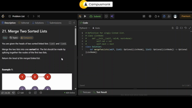

#### Core Concepts & Learning Objectives
Comprehensive video masterclass covering DSA L- 42 Merge Two Sorted Lists-LeetCode-21(Linke. Focuses on fundamental principles, algorithm analysis, edge-case handling, and Infosys exam question solutions.

---

### Video 324: DSA L-43 Linked List Cycle-Leetcode-141(Linked Lis
- **Video ID**: `162552398` | **Duration**: `00:14:58` (898s)
- **Track**: Infosys DSE & SP Role Preparation | **Topic**: Data Structures & Algorithms in Python
- **Curriculum Path**: `3. Infosys DSE & SP Role Prep / 2.3 DSA with Python / Python LeetCode Series / 6. Linked List`

#### Master Video Slide Thumbnail Plate
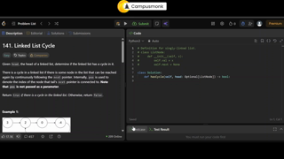

#### Core Concepts & Learning Objectives
Comprehensive video masterclass covering DSA L-43 Linked List Cycle-Leetcode-141(Linked Lis. Focuses on fundamental principles, algorithm analysis, edge-case handling, and Infosys exam question solutions.

---

### Video 325: DSA L-44 Insert Greatest Common Divisor in Linked
- **Video ID**: `162552396` | **Duration**: `00:05:55` (355s)
- **Track**: Infosys DSE & SP Role Preparation | **Topic**: Data Structures & Algorithms in Python
- **Curriculum Path**: `3. Infosys DSE & SP Role Prep / 2.3 DSA with Python / Python LeetCode Series / 6. Linked List`

#### Master Video Slide Thumbnail Plate
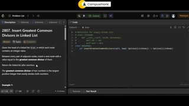

#### Core Concepts & Learning Objectives
Comprehensive video masterclass covering DSA L-44 Insert Greatest Common Divisor in Linked. Focuses on fundamental principles, algorithm analysis, edge-case handling, and Infosys exam question solutions.

---

### Video 326: DSA L-45 Remove the Nth Node from End of the Linke
- **Video ID**: `162552397` | **Duration**: `00:07:34` (454s)
- **Track**: Infosys DSE & SP Role Preparation | **Topic**: Data Structures & Algorithms in Python
- **Curriculum Path**: `3. Infosys DSE & SP Role Prep / 2.3 DSA with Python / Python LeetCode Series / 6. Linked List`

#### Master Video Slide Thumbnail Plate
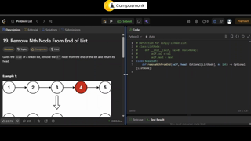

#### Core Concepts & Learning Objectives
Comprehensive video masterclass covering DSA L-45 Remove the Nth Node from End of the Linke. Focuses on fundamental principles, algorithm analysis, edge-case handling, and Infosys exam question solutions.

---

### Video 327: DSA L-46 Middle of the Linked List-LeetCode-876(Li
- **Video ID**: `162552394` | **Duration**: `00:06:54` (414s)
- **Track**: Infosys DSE & SP Role Preparation | **Topic**: Data Structures & Algorithms in Python
- **Curriculum Path**: `3. Infosys DSE & SP Role Prep / 2.3 DSA with Python / Python LeetCode Series / 6. Linked List`

#### Master Video Slide Thumbnail Plate
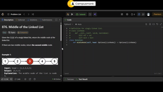

#### Core Concepts & Learning Objectives
Comprehensive video masterclass covering DSA L-46 Middle of the Linked List-LeetCode-876(Li. Focuses on fundamental principles, algorithm analysis, edge-case handling, and Infosys exam question solutions.

---

### Video 328: DSA L- 47 Copy List with Random Pointer-Leetcode-
- **Video ID**: `162552401` | **Duration**: `00:10:11` (611s)
- **Track**: Infosys DSE & SP Role Preparation | **Topic**: Data Structures & Algorithms in Python
- **Curriculum Path**: `3. Infosys DSE & SP Role Prep / 2.3 DSA with Python / Python LeetCode Series / 6. Linked List`

#### Master Video Slide Thumbnail Plate

#### Core Concepts & Learning Objectives
Comprehensive video masterclass covering DSA L- 47 Copy List with Random Pointer-Leetcode-. Focuses on fundamental principles, algorithm analysis, edge-case handling, and Infosys exam question solutions.

---

### Video 329: DSA L-48 max Consecutive Ones III - Leetcode-1004(
- **Video ID**: `162552411` | **Duration**: `00:09:42` (582s)
- **Track**: Infosys DSE & SP Role Preparation | **Topic**: Data Structures & Algorithms in Python
- **Curriculum Path**: `3. Infosys DSE & SP Role Prep / 2.3 DSA with Python / Python LeetCode Series / 7. Sliding Window`

#### Master Video Slide Thumbnail Plate

#### Core Concepts & Learning Objectives
Comprehensive video masterclass covering DSA L-48 max Consecutive Ones III - Leetcode-1004(. Focuses on fundamental principles, algorithm analysis, edge-case handling, and Infosys exam question solutions.

---

### Video 330: DSA L-49 Longest Repeating Character Replacement-L
- **Video ID**: `162552412` | **Duration**: `00:11:01` (661s)
- **Track**: Infosys DSE & SP Role Preparation | **Topic**: Data Structures & Algorithms in Python
- **Curriculum Path**: `3. Infosys DSE & SP Role Prep / 2.3 DSA with Python / Python LeetCode Series / 7. Sliding Window`

#### Master Video Slide Thumbnail Plate

#### Core Concepts & Learning Objectives
Comprehensive video masterclass covering DSA L-49 Longest Repeating Character Replacement-L. Focuses on fundamental principles, algorithm analysis, edge-case handling, and Infosys exam question solutions.

---

### Video 331: DSA L-50 Minimum Size Subarray Sum- Leetcode-209(S
- **Video ID**: `162552413` | **Duration**: `00:08:47` (527s)
- **Track**: Infosys DSE & SP Role Preparation | **Topic**: Data Structures & Algorithms in Python
- **Curriculum Path**: `3. Infosys DSE & SP Role Prep / 2.3 DSA with Python / Python LeetCode Series / 7. Sliding Window`

#### Master Video Slide Thumbnail Plate

#### Core Concepts & Learning Objectives
Comprehensive video masterclass covering DSA L-50 Minimum Size Subarray Sum- Leetcode-209(S. Focuses on fundamental principles, algorithm analysis, edge-case handling, and Infosys exam question solutions.

---

### Video 414: Infosys DSE & SP _ Hard DSA level questions ( Python & Java)
- **Video ID**: `162552045` | **Duration**: `02:14:06` (8,046s)
- **Track**: Infosys DSE & SP Role Preparation | **Topic**: Data Structures & Algorithms in Python
- **Curriculum Path**: `3. Infosys DSE & SP Role Prep`

#### Master Video Slide Thumbnail Plate

#### Core Concepts & Learning Objectives
Comprehensive video masterclass covering Infosys DSE & SP _ Hard DSA level questions ( Python & Java). Focuses on fundamental principles, algorithm analysis, edge-case handling, and Infosys exam question solutions.

---

