# Infosys Video Curriculum — Data Structures & Algorithms in C++ and Java

> **Target Track**: Infosys DSE & SP Role Preparation | **Videos Count**: 155 | **Total Runtime**: 83h 22m
> **Curriculum Topics**: C++ STL, Memory Pointers, Sorting Algorithms, Java Black Book Solutions, Java Collections, Tree Algorithms, DP Grids, Graph Traversals

## Section Overview & Curriculum Map
This master compendium documents all 155 high-yield video lectures for Data Structures & Algorithms in C++ and Java. Every lecture includes full metadata, curriculum path, high-resolution slide thumbnail plate, and core conceptual focus.

---

### Video 162: Java Intro
- **Video ID**: `162552140` | **Duration**: `00:05:45` (345s)
- **Track**: Infosys DSE & SP Role Preparation | **Topic**: Data Structures & Algorithms in C++ and Java
- **Curriculum Path**: `3. Infosys DSE & SP Role Prep / 2.1. DSA in Java with Itika Ma'am - Black Book Sol / Module 1:  Basic Java Intro and how to take Input/`

#### Master Video Slide Thumbnail Plate
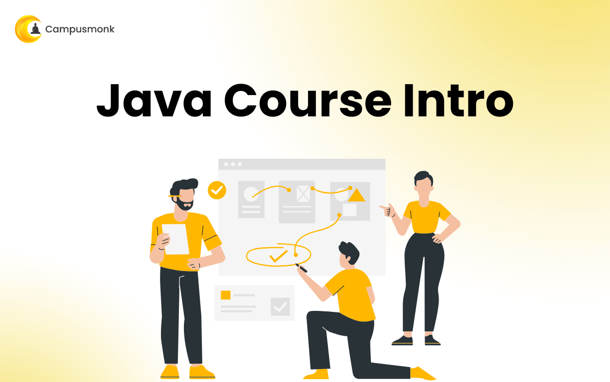

#### Core Concepts & Learning Objectives
Comprehensive video masterclass covering Java Intro. Focuses on fundamental principles, algorithm analysis, edge-case handling, and Infosys exam question solutions.

---

### Video 163: Class 1 :  Java Basic Introduction
- **Video ID**: `162552141` | **Duration**: `00:33:36` (2,016s)
- **Track**: Infosys DSE & SP Role Preparation | **Topic**: Data Structures & Algorithms in C++ and Java
- **Curriculum Path**: `3. Infosys DSE & SP Role Prep / 2.1. DSA in Java with Itika Ma'am - Black Book Sol / Module 1:  Basic Java Intro and how to take Input/`

#### Master Video Slide Thumbnail Plate
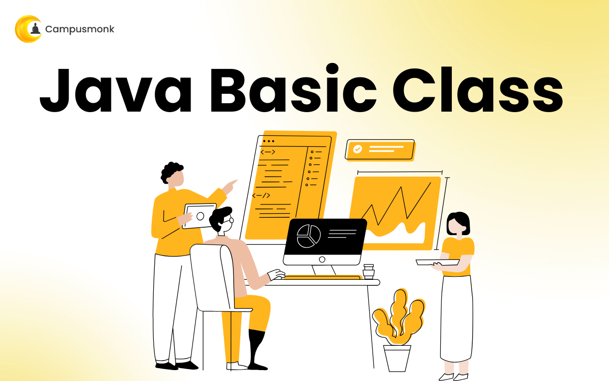

#### Core Concepts & Learning Objectives
Comprehensive video masterclass covering Class 1 :  Java Basic Introduction. Focuses on fundamental principles, algorithm analysis, edge-case handling, and Infosys exam question solutions.

---

### Video 164: Class 2 :  Taking Input & Output in Java
- **Video ID**: `162552142` | **Duration**: `00:30:52` (1,852s)
- **Track**: Infosys DSE & SP Role Preparation | **Topic**: Data Structures & Algorithms in C++ and Java
- **Curriculum Path**: `3. Infosys DSE & SP Role Prep / 2.1. DSA in Java with Itika Ma'am - Black Book Sol / Module 1:  Basic Java Intro and how to take Input/`

#### Master Video Slide Thumbnail Plate
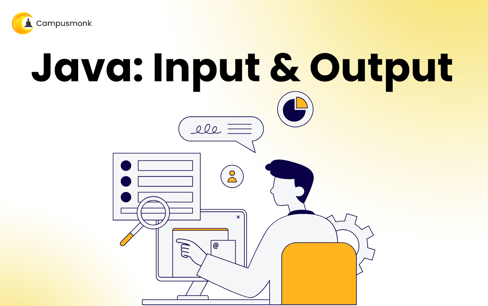

#### Core Concepts & Learning Objectives
Comprehensive video masterclass covering Class 2 :  Taking Input & Output in Java. Focuses on fundamental principles, algorithm analysis, edge-case handling, and Infosys exam question solutions.

---

### Video 165: Class 3 :  Basic Maths Important Questions 1
- **Video ID**: `162552161` | **Duration**: `00:54:57` (3,297s)
- **Track**: Infosys DSE & SP Role Preparation | **Topic**: Data Structures & Algorithms in C++ and Java
- **Curriculum Path**: `3. Infosys DSE & SP Role Prep / 2.1. DSA in Java with Itika Ma'am - Black Book Sol / Module 2: Important Mathematics concepts and PYQ`

#### Master Video Slide Thumbnail Plate
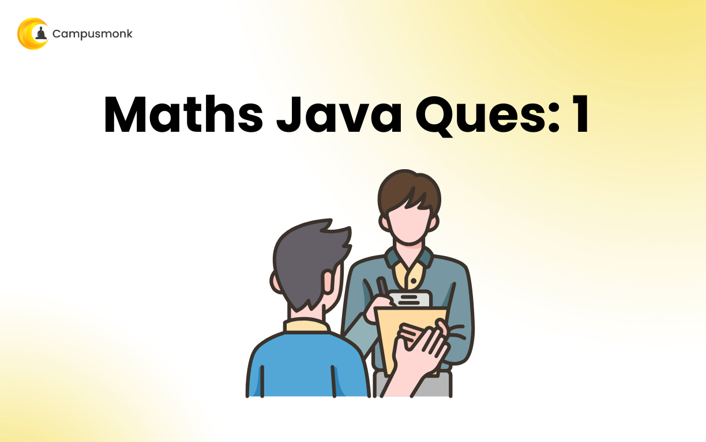

#### Core Concepts & Learning Objectives
Comprehensive video masterclass covering Class 3 :  Basic Maths Important Questions 1. Focuses on fundamental principles, algorithm analysis, edge-case handling, and Infosys exam question solutions.

---

### Video 166: Class 4 :  Maths Important Questions 2
- **Video ID**: `162552162` | **Duration**: `01:03:12` (3,792s)
- **Track**: Infosys DSE & SP Role Preparation | **Topic**: Data Structures & Algorithms in C++ and Java
- **Curriculum Path**: `3. Infosys DSE & SP Role Prep / 2.1. DSA in Java with Itika Ma'am - Black Book Sol / Module 2: Important Mathematics concepts and PYQ`

#### Master Video Slide Thumbnail Plate
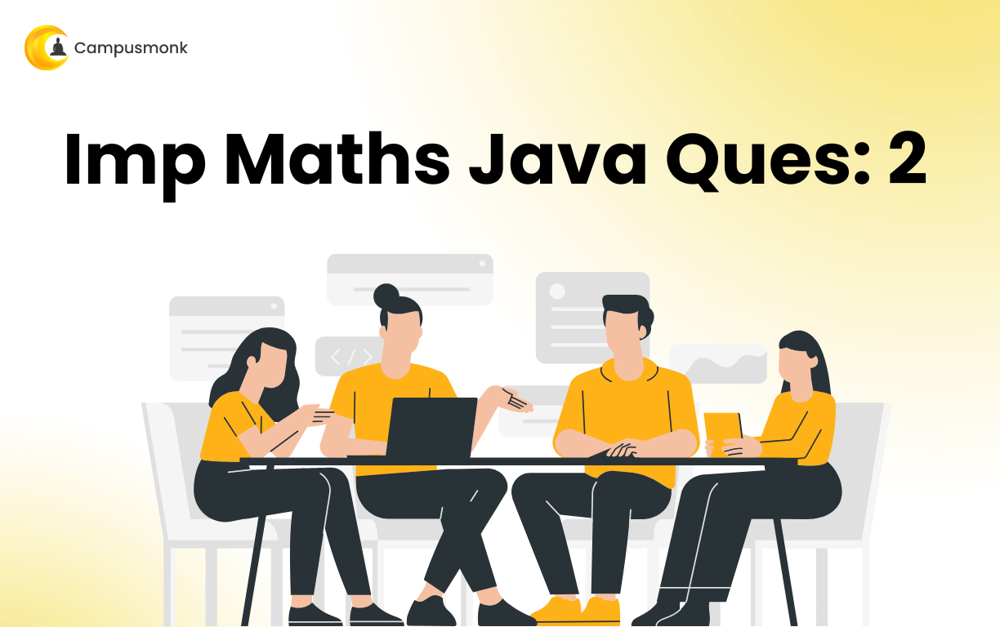

#### Core Concepts & Learning Objectives
Comprehensive video masterclass covering Class 4 :  Maths Important Questions 2. Focuses on fundamental principles, algorithm analysis, edge-case handling, and Infosys exam question solutions.

---

### Video 167: Class 5 : Java Arrays Introduction
- **Video ID**: `162552226` | **Duration**: `00:33:24` (2,004s)
- **Track**: Infosys DSE & SP Role Preparation | **Topic**: Data Structures & Algorithms in C++ and Java
- **Curriculum Path**: `3. Infosys DSE & SP Role Prep / 2.1. DSA in Java with Itika Ma'am - Black Book Sol / Module 3: Java Arrays`

#### Master Video Slide Thumbnail Plate
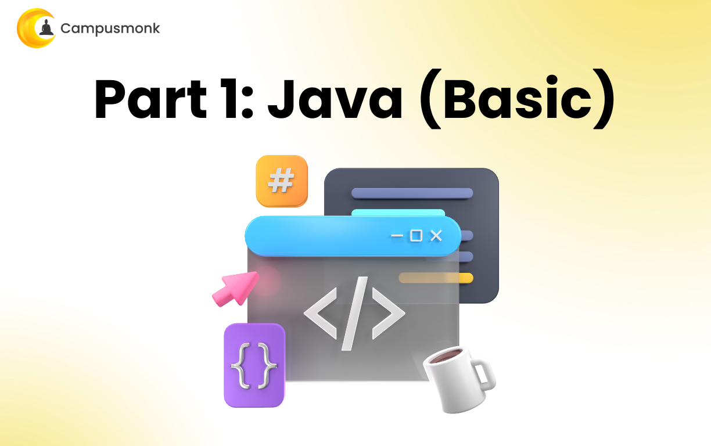

#### Core Concepts & Learning Objectives
Comprehensive video masterclass covering Class 5 : Java Arrays Introduction. Focuses on fundamental principles, algorithm analysis, edge-case handling, and Infosys exam question solutions.

---

### Video 168: Class 6 : Input an Array in Java
- **Video ID**: `162552227` | **Duration**: `00:20:06` (1,206s)
- **Track**: Infosys DSE & SP Role Preparation | **Topic**: Data Structures & Algorithms in C++ and Java
- **Curriculum Path**: `3. Infosys DSE & SP Role Prep / 2.1. DSA in Java with Itika Ma'am - Black Book Sol / Module 3: Java Arrays`

#### Master Video Slide Thumbnail Plate
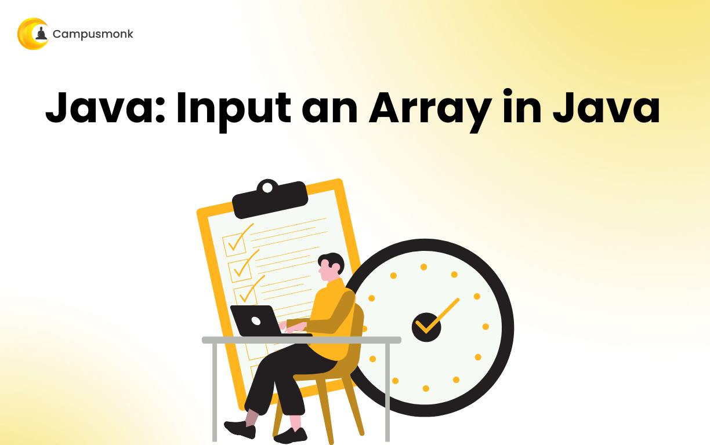

#### Core Concepts & Learning Objectives
Comprehensive video masterclass covering Class 6 : Input an Array in Java. Focuses on fundamental principles, algorithm analysis, edge-case handling, and Infosys exam question solutions.

---

### Video 169: Class 7 : Searching in Array
- **Video ID**: `162552225` | **Duration**: `01:10:32` (4,232s)
- **Track**: Infosys DSE & SP Role Preparation | **Topic**: Data Structures & Algorithms in C++ and Java
- **Curriculum Path**: `3. Infosys DSE & SP Role Prep / 2.1. DSA in Java with Itika Ma'am - Black Book Sol / Module 3: Java Arrays`

#### Master Video Slide Thumbnail Plate
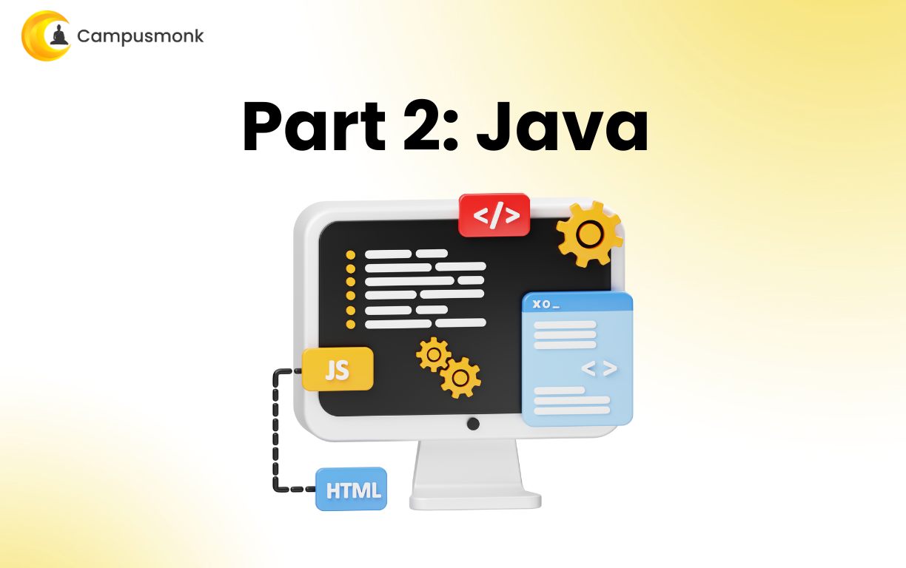

#### Core Concepts & Learning Objectives
Comprehensive video masterclass covering Class 7 : Searching in Array. Focuses on fundamental principles, algorithm analysis, edge-case handling, and Infosys exam question solutions.

---

### Video 170: Class 8 : Reverse & Rotate Array in Java
- **Video ID**: `162552224` | **Duration**: `00:54:58` (3,298s)
- **Track**: Infosys DSE & SP Role Preparation | **Topic**: Data Structures & Algorithms in C++ and Java
- **Curriculum Path**: `3. Infosys DSE & SP Role Prep / 2.1. DSA in Java with Itika Ma'am - Black Book Sol / Module 3: Java Arrays`

#### Master Video Slide Thumbnail Plate

#### Core Concepts & Learning Objectives
Comprehensive video masterclass covering Class 8 : Reverse & Rotate Array in Java. Focuses on fundamental principles, algorithm analysis, edge-case handling, and Infosys exam question solutions.

---

### Video 171: Class 9 : Dynamic Arrays in Java
- **Video ID**: `162552223` | **Duration**: `00:34:40` (2,080s)
- **Track**: Infosys DSE & SP Role Preparation | **Topic**: Data Structures & Algorithms in C++ and Java
- **Curriculum Path**: `3. Infosys DSE & SP Role Prep / 2.1. DSA in Java with Itika Ma'am - Black Book Sol / Module 3: Java Arrays`

#### Master Video Slide Thumbnail Plate
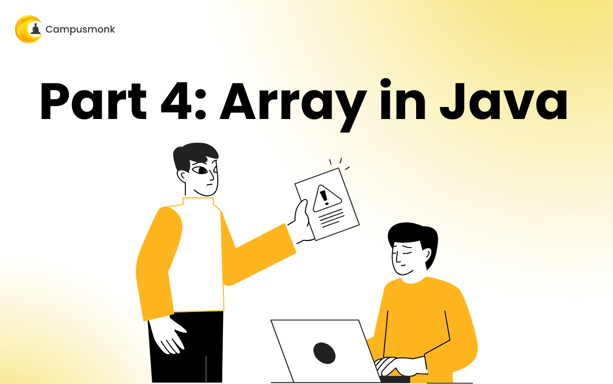

#### Core Concepts & Learning Objectives
Comprehensive video masterclass covering Class 9 : Dynamic Arrays in Java. Focuses on fundamental principles, algorithm analysis, edge-case handling, and Infosys exam question solutions.

---

### Video 172: Class 10 : Java Array PYQ
- **Video ID**: `162552229` | **Duration**: `00:53:07` (3,187s)
- **Track**: Infosys DSE & SP Role Preparation | **Topic**: Data Structures & Algorithms in C++ and Java
- **Curriculum Path**: `3. Infosys DSE & SP Role Prep / 2.1. DSA in Java with Itika Ma'am - Black Book Sol / Module 3: Java Arrays`

#### Master Video Slide Thumbnail Plate
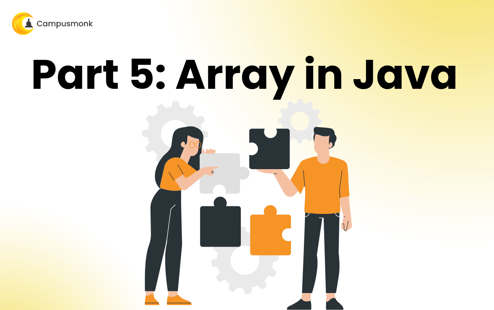

#### Core Concepts & Learning Objectives
Comprehensive video masterclass covering Class 10 : Java Array PYQ. Focuses on fundamental principles, algorithm analysis, edge-case handling, and Infosys exam question solutions.

---

### Video 173: Class 11 : Java Arrays PYQ
- **Video ID**: `162552228` | **Duration**: `00:27:26` (1,646s)
- **Track**: Infosys DSE & SP Role Preparation | **Topic**: Data Structures & Algorithms in C++ and Java
- **Curriculum Path**: `3. Infosys DSE & SP Role Prep / 2.1. DSA in Java with Itika Ma'am - Black Book Sol / Module 3: Java Arrays`

#### Master Video Slide Thumbnail Plate
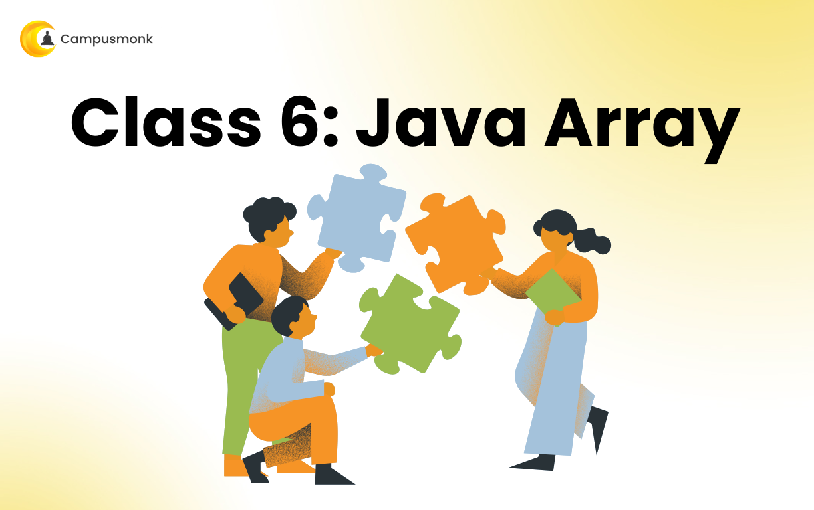

#### Core Concepts & Learning Objectives
Comprehensive video masterclass covering Class 11 : Java Arrays PYQ. Focuses on fundamental principles, algorithm analysis, edge-case handling, and Infosys exam question solutions.

---

### Video 174: Class 12: Java union of two sorted arrays
- **Video ID**: `162552231` | **Duration**: `00:30:38` (1,838s)
- **Track**: Infosys DSE & SP Role Preparation | **Topic**: Data Structures & Algorithms in C++ and Java
- **Curriculum Path**: `3. Infosys DSE & SP Role Prep / 2.1. DSA in Java with Itika Ma'am - Black Book Sol / Module 3: Java Arrays`

#### Master Video Slide Thumbnail Plate
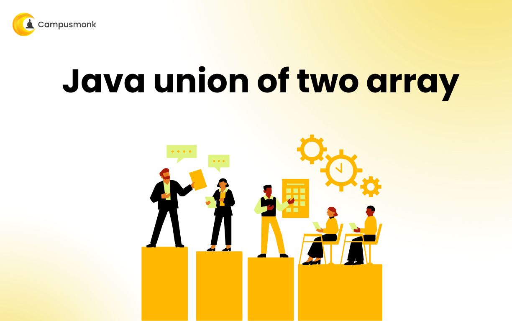

#### Core Concepts & Learning Objectives
Comprehensive video masterclass covering Class 12: Java union of two sorted arrays. Focuses on fundamental principles, algorithm analysis, edge-case handling, and Infosys exam question solutions.

---

### Video 175: Class 14: Dutch National Flag Algorithm
- **Video ID**: `162552230` | **Duration**: `00:29:59` (1,799s)
- **Track**: Infosys DSE & SP Role Preparation | **Topic**: Data Structures & Algorithms in C++ and Java
- **Curriculum Path**: `3. Infosys DSE & SP Role Prep / 2.1. DSA in Java with Itika Ma'am - Black Book Sol / Module 3: Java Arrays`

#### Master Video Slide Thumbnail Plate

#### Core Concepts & Learning Objectives
Comprehensive video masterclass covering Class 14: Dutch National Flag Algorithm. Focuses on fundamental principles, algorithm analysis, edge-case handling, and Infosys exam question solutions.

---

### Video 176: Class 15: Single among double in sorted array
- **Video ID**: `162552232` | **Duration**: `00:37:31` (2,251s)
- **Track**: Infosys DSE & SP Role Preparation | **Topic**: Data Structures & Algorithms in C++ and Java
- **Curriculum Path**: `3. Infosys DSE & SP Role Prep / 2.1. DSA in Java with Itika Ma'am - Black Book Sol / Module 3: Java Arrays`

#### Master Video Slide Thumbnail Plate
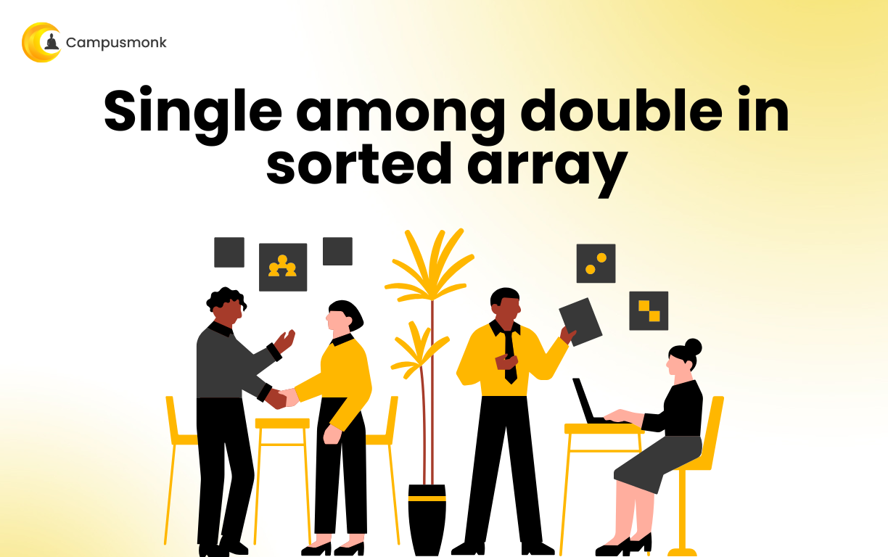

#### Core Concepts & Learning Objectives
Comprehensive video masterclass covering Class 15: Single among double in sorted array. Focuses on fundamental principles, algorithm analysis, edge-case handling, and Infosys exam question solutions.

---

### Video 177: Class 16: Map in Java
- **Video ID**: `162552258` | **Duration**: `00:25:01` (1,501s)
- **Track**: Infosys DSE & SP Role Preparation | **Topic**: Data Structures & Algorithms in C++ and Java
- **Curriculum Path**: `3. Infosys DSE & SP Role Prep / 2.1. DSA in Java with Itika Ma'am - Black Book Sol / Module 4: Map in Java`

#### Master Video Slide Thumbnail Plate
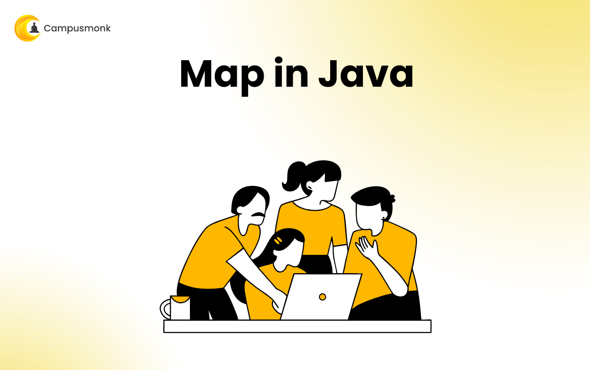

#### Core Concepts & Learning Objectives
Comprehensive video masterclass covering Class 16: Map in Java. Focuses on fundamental principles, algorithm analysis, edge-case handling, and Infosys exam question solutions.

---

### Video 178: Class 17: Find frequency of each element
- **Video ID**: `162552261` | **Duration**: `00:18:37` (1,117s)
- **Track**: Infosys DSE & SP Role Preparation | **Topic**: Data Structures & Algorithms in C++ and Java
- **Curriculum Path**: `3. Infosys DSE & SP Role Prep / 2.1. DSA in Java with Itika Ma'am - Black Book Sol / Module 4: Map in Java`

#### Master Video Slide Thumbnail Plate
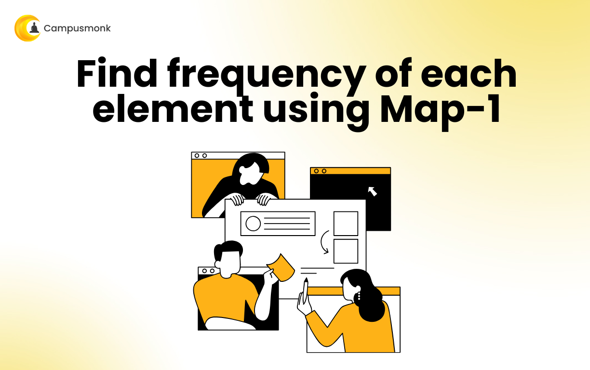

#### Core Concepts & Learning Objectives
Comprehensive video masterclass covering Class 17: Find frequency of each element. Focuses on fundamental principles, algorithm analysis, edge-case handling, and Infosys exam question solutions.

---

### Video 179: Class 18: Find Length of longest subarray with sum k
- **Video ID**: `162552259` | **Duration**: `00:52:09` (3,129s)
- **Track**: Infosys DSE & SP Role Preparation | **Topic**: Data Structures & Algorithms in C++ and Java
- **Curriculum Path**: `3. Infosys DSE & SP Role Prep / 2.1. DSA in Java with Itika Ma'am - Black Book Sol / Module 4: Map in Java`

#### Master Video Slide Thumbnail Plate
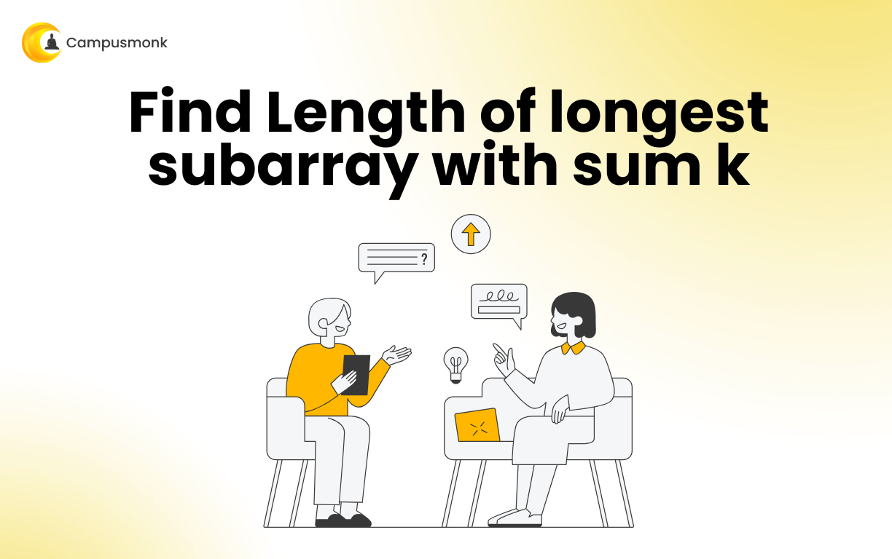

#### Core Concepts & Learning Objectives
Comprehensive video masterclass covering Class 18: Find Length of longest subarray with sum k. Focuses on fundamental principles, algorithm analysis, edge-case handling, and Infosys exam question solutions.

---

### Video 180: Class 19: Find Longest sub-array with sum k ( all positives )
- **Video ID**: `162552262` | **Duration**: `00:22:20` (1,340s)
- **Track**: Infosys DSE & SP Role Preparation | **Topic**: Data Structures & Algorithms in C++ and Java
- **Curriculum Path**: `3. Infosys DSE & SP Role Prep / 2.1. DSA in Java with Itika Ma'am - Black Book Sol / Module 4: Map in Java`

#### Master Video Slide Thumbnail Plate

#### Core Concepts & Learning Objectives
Comprehensive video masterclass covering Class 19: Find Longest sub-array with sum k ( all positives ). Focuses on fundamental principles, algorithm analysis, edge-case handling, and Infosys exam question solutions.

---

### Video 181: Class 20: Two sum problem (brute force , better and optimal solution )
- **Video ID**: `162552260` | **Duration**: `00:38:56` (2,336s)
- **Track**: Infosys DSE & SP Role Preparation | **Topic**: Data Structures & Algorithms in C++ and Java
- **Curriculum Path**: `3. Infosys DSE & SP Role Prep / 2.1. DSA in Java with Itika Ma'am - Black Book Sol / Module 4: Map in Java`

#### Master Video Slide Thumbnail Plate
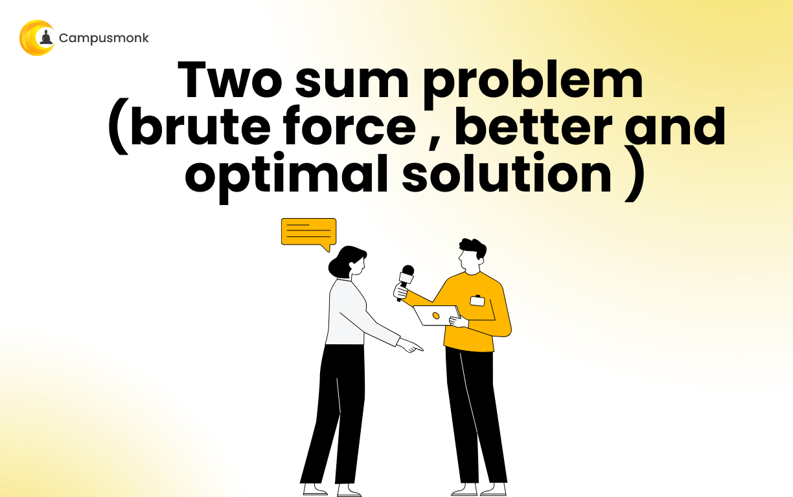

#### Core Concepts & Learning Objectives
Comprehensive video masterclass covering Class 20: Two sum problem (brute force , better and optimal solution ). Focuses on fundamental principles, algorithm analysis, edge-case handling, and Infosys exam question solutions.

---

### Video 182: Class 21: Sliding Window Technique
- **Video ID**: `162552326` | **Duration**: `00:22:12` (1,332s)
- **Track**: Infosys DSE & SP Role Preparation | **Topic**: Data Structures & Algorithms in C++ and Java
- **Curriculum Path**: `3. Infosys DSE & SP Role Prep / 2.1. DSA in Java with Itika Ma'am - Black Book Sol / Module 5: Sliding Window technique and 2 Pointer A`

#### Master Video Slide Thumbnail Plate
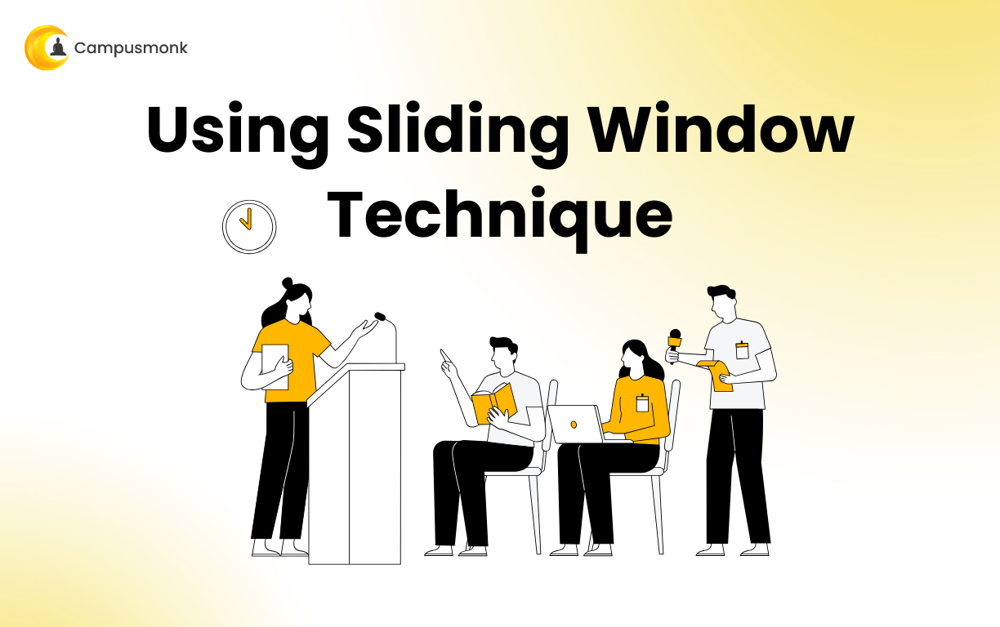

#### Core Concepts & Learning Objectives
Comprehensive video masterclass covering Class 21: Sliding Window Technique. Focuses on fundamental principles, algorithm analysis, edge-case handling, and Infosys exam question solutions.

---

### Video 183: Class 22: Rearrange array elements by  sign
- **Video ID**: `162552325` | **Duration**: `00:27:29` (1,649s)
- **Track**: Infosys DSE & SP Role Preparation | **Topic**: Data Structures & Algorithms in C++ and Java
- **Curriculum Path**: `3. Infosys DSE & SP Role Prep / 2.1. DSA in Java with Itika Ma'am - Black Book Sol / Module 5: Sliding Window technique and 2 Pointer A`

#### Master Video Slide Thumbnail Plate
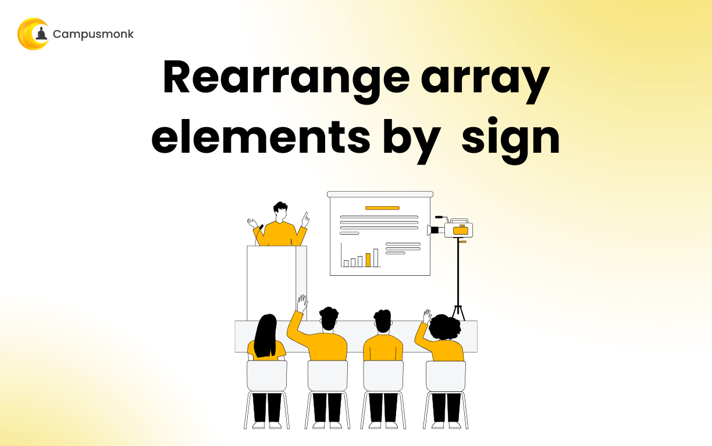

#### Core Concepts & Learning Objectives
Comprehensive video masterclass covering Class 22: Rearrange array elements by  sign. Focuses on fundamental principles, algorithm analysis, edge-case handling, and Infosys exam question solutions.

---

### Video 184: Class 23: Maximum Consecutive One
- **Video ID**: `162552324` | **Duration**: `00:10:42` (642s)
- **Track**: Infosys DSE & SP Role Preparation | **Topic**: Data Structures & Algorithms in C++ and Java
- **Curriculum Path**: `3. Infosys DSE & SP Role Prep / 2.1. DSA in Java with Itika Ma'am - Black Book Sol / Module 5: Sliding Window technique and 2 Pointer A`

#### Master Video Slide Thumbnail Plate
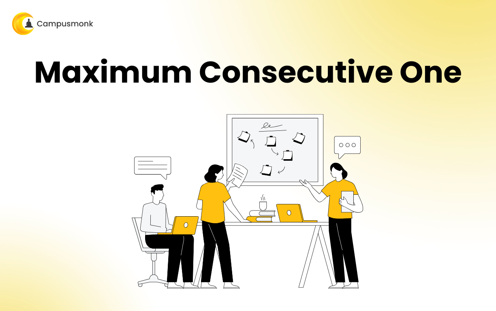

#### Core Concepts & Learning Objectives
Comprehensive video masterclass covering Class 23: Maximum Consecutive One. Focuses on fundamental principles, algorithm analysis, edge-case handling, and Infosys exam question solutions.

---

### Video 185: Class 24: Moore's Voting Algorithm
- **Video ID**: `162552327` | **Duration**: `00:34:25` (2,065s)
- **Track**: Infosys DSE & SP Role Preparation | **Topic**: Data Structures & Algorithms in C++ and Java
- **Curriculum Path**: `3. Infosys DSE & SP Role Prep / 2.1. DSA in Java with Itika Ma'am - Black Book Sol / Module 5: Sliding Window technique and 2 Pointer A`

#### Master Video Slide Thumbnail Plate

#### Core Concepts & Learning Objectives
Comprehensive video masterclass covering Class 24: Moore's Voting Algorithm. Focuses on fundamental principles, algorithm analysis, edge-case handling, and Infosys exam question solutions.

---

### Video 186: DSA JAVA L-1
- **Video ID**: `162552153` | **Duration**: `00:05:17` (317s)
- **Track**: Infosys DSE & SP Role Preparation | **Topic**: Data Structures & Algorithms in C++ and Java
- **Curriculum Path**: `3. Infosys DSE & SP Role Prep / 2.1. DSA in Java with Itika Ma'am - Black Book Sol / Java Leet Code Series (Basic - Advance) / 1. Arrays & Strings`

#### Master Video Slide Thumbnail Plate
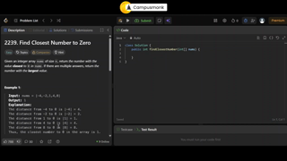

#### Core Concepts & Learning Objectives
Comprehensive video masterclass covering DSA JAVA L-1. Focuses on fundamental principles, algorithm analysis, edge-case handling, and Infosys exam question solutions.

---

### Video 187: DSA JAVA 2 - Merge strings alternatively
- **Video ID**: `162552146` | **Duration**: `00:03:20` (200s)
- **Track**: Infosys DSE & SP Role Preparation | **Topic**: Data Structures & Algorithms in C++ and Java
- **Curriculum Path**: `3. Infosys DSE & SP Role Prep / 2.1. DSA in Java with Itika Ma'am - Black Book Sol / Java Leet Code Series (Basic - Advance) / 1. Arrays & Strings`

#### Master Video Slide Thumbnail Plate
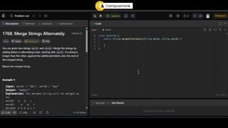

#### Core Concepts & Learning Objectives
Comprehensive video masterclass covering DSA JAVA 2 - Merge strings alternatively. Focuses on fundamental principles, algorithm analysis, edge-case handling, and Infosys exam question solutions.

---

### Video 188: DSA JAVA 3 - Roman to integer
- **Video ID**: `162552150` | **Duration**: `00:05:18` (318s)
- **Track**: Infosys DSE & SP Role Preparation | **Topic**: Data Structures & Algorithms in C++ and Java
- **Curriculum Path**: `3. Infosys DSE & SP Role Prep / 2.1. DSA in Java with Itika Ma'am - Black Book Sol / Java Leet Code Series (Basic - Advance) / 1. Arrays & Strings`

#### Master Video Slide Thumbnail Plate
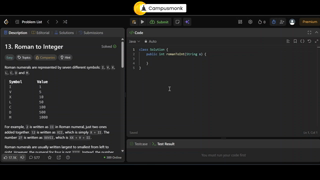

#### Core Concepts & Learning Objectives
Comprehensive video masterclass covering DSA JAVA 3 - Roman to integer. Focuses on fundamental principles, algorithm analysis, edge-case handling, and Infosys exam question solutions.

---

### Video 189: DSA JAVA 4 - Is Subsequence
- **Video ID**: `162552144` | **Duration**: `00:02:02` (122s)
- **Track**: Infosys DSE & SP Role Preparation | **Topic**: Data Structures & Algorithms in C++ and Java
- **Curriculum Path**: `3. Infosys DSE & SP Role Prep / 2.1. DSA in Java with Itika Ma'am - Black Book Sol / Java Leet Code Series (Basic - Advance) / 1. Arrays & Strings`

#### Master Video Slide Thumbnail Plate
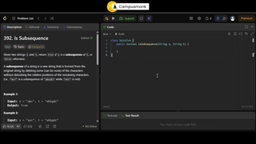

#### Core Concepts & Learning Objectives
Comprehensive video masterclass covering DSA JAVA 4 - Is Subsequence. Focuses on fundamental principles, algorithm analysis, edge-case handling, and Infosys exam question solutions.

---

### Video 190: DSA JAVA 5 - Best time to buy and sell Stock
- **Video ID**: `162552143` | **Duration**: `00:02:59` (179s)
- **Track**: Infosys DSE & SP Role Preparation | **Topic**: Data Structures & Algorithms in C++ and Java
- **Curriculum Path**: `3. Infosys DSE & SP Role Prep / 2.1. DSA in Java with Itika Ma'am - Black Book Sol / Java Leet Code Series (Basic - Advance) / 1. Arrays & Strings`

#### Master Video Slide Thumbnail Plate
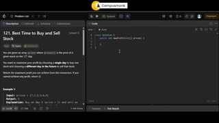

#### Core Concepts & Learning Objectives
Comprehensive video masterclass covering DSA JAVA 5 - Best time to buy and sell Stock. Focuses on fundamental principles, algorithm analysis, edge-case handling, and Infosys exam question solutions.

---

### Video 191: DSA JAVA 6 - Longest Common Prefix
- **Video ID**: `162552149` | **Duration**: `00:04:03` (243s)
- **Track**: Infosys DSE & SP Role Preparation | **Topic**: Data Structures & Algorithms in C++ and Java
- **Curriculum Path**: `3. Infosys DSE & SP Role Prep / 2.1. DSA in Java with Itika Ma'am - Black Book Sol / Java Leet Code Series (Basic - Advance) / 1. Arrays & Strings`

#### Master Video Slide Thumbnail Plate
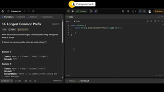

#### Core Concepts & Learning Objectives
Comprehensive video masterclass covering DSA JAVA 6 - Longest Common Prefix. Focuses on fundamental principles, algorithm analysis, edge-case handling, and Infosys exam question solutions.

---

### Video 192: DSA JAVA 7 - Summary Ranges
- **Video ID**: `162552147` | **Duration**: `00:03:46` (226s)
- **Track**: Infosys DSE & SP Role Preparation | **Topic**: Data Structures & Algorithms in C++ and Java
- **Curriculum Path**: `3. Infosys DSE & SP Role Prep / 2.1. DSA in Java with Itika Ma'am - Black Book Sol / Java Leet Code Series (Basic - Advance) / 1. Arrays & Strings`

#### Master Video Slide Thumbnail Plate
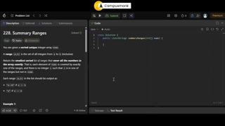

#### Core Concepts & Learning Objectives
Comprehensive video masterclass covering DSA JAVA 7 - Summary Ranges. Focuses on fundamental principles, algorithm analysis, edge-case handling, and Infosys exam question solutions.

---

### Video 193: DSA JAVA 8 - Product of Array Except Self
- **Video ID**: `162552145` | **Duration**: `00:03:26` (206s)
- **Track**: Infosys DSE & SP Role Preparation | **Topic**: Data Structures & Algorithms in C++ and Java
- **Curriculum Path**: `3. Infosys DSE & SP Role Prep / 2.1. DSA in Java with Itika Ma'am - Black Book Sol / Java Leet Code Series (Basic - Advance) / 1. Arrays & Strings`

#### Master Video Slide Thumbnail Plate
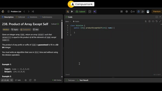

#### Core Concepts & Learning Objectives
Comprehensive video masterclass covering DSA JAVA 8 - Product of Array Except Self. Focuses on fundamental principles, algorithm analysis, edge-case handling, and Infosys exam question solutions.

---

### Video 194: DSA JAVA 9 - Merge Intervals
- **Video ID**: `162552152` | **Duration**: `00:06:08` (368s)
- **Track**: Infosys DSE & SP Role Preparation | **Topic**: Data Structures & Algorithms in C++ and Java
- **Curriculum Path**: `3. Infosys DSE & SP Role Prep / 2.1. DSA in Java with Itika Ma'am - Black Book Sol / Java Leet Code Series (Basic - Advance) / 1. Arrays & Strings`

#### Master Video Slide Thumbnail Plate
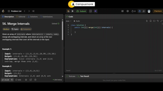

#### Core Concepts & Learning Objectives
Comprehensive video masterclass covering DSA JAVA 9 - Merge Intervals. Focuses on fundamental principles, algorithm analysis, edge-case handling, and Infosys exam question solutions.

---

### Video 195: DSA JAVA 10 - Spiral Matrix
- **Video ID**: `162552151` | **Duration**: `00:11:25` (685s)
- **Track**: Infosys DSE & SP Role Preparation | **Topic**: Data Structures & Algorithms in C++ and Java
- **Curriculum Path**: `3. Infosys DSE & SP Role Prep / 2.1. DSA in Java with Itika Ma'am - Black Book Sol / Java Leet Code Series (Basic - Advance) / 1. Arrays & Strings`

#### Master Video Slide Thumbnail Plate
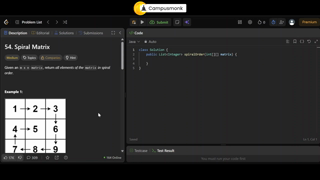

#### Core Concepts & Learning Objectives
Comprehensive video masterclass covering DSA JAVA 10 - Spiral Matrix. Focuses on fundamental principles, algorithm analysis, edge-case handling, and Infosys exam question solutions.

---

### Video 196: DSA JAVA 11 - Rotate Image
- **Video ID**: `162552148` | **Duration**: `00:03:45` (225s)
- **Track**: Infosys DSE & SP Role Preparation | **Topic**: Data Structures & Algorithms in C++ and Java
- **Curriculum Path**: `3. Infosys DSE & SP Role Prep / 2.1. DSA in Java with Itika Ma'am - Black Book Sol / Java Leet Code Series (Basic - Advance) / 1. Arrays & Strings`

#### Master Video Slide Thumbnail Plate
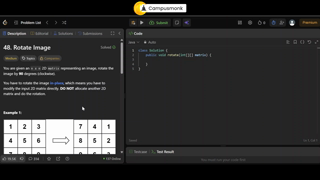

#### Core Concepts & Learning Objectives
Comprehensive video masterclass covering DSA JAVA 11 - Rotate Image. Focuses on fundamental principles, algorithm analysis, edge-case handling, and Infosys exam question solutions.

---

### Video 197: DSA JAVA 12  - jewels and stones
- **Video ID**: `162552165` | **Duration**: `00:03:53` (233s)
- **Track**: Infosys DSE & SP Role Preparation | **Topic**: Data Structures & Algorithms in C++ and Java
- **Curriculum Path**: `3. Infosys DSE & SP Role Prep / 2.1. DSA in Java with Itika Ma'am - Black Book Sol / Java Leet Code Series (Basic - Advance) / 2. Hash Maps & Hash Set`

#### Master Video Slide Thumbnail Plate
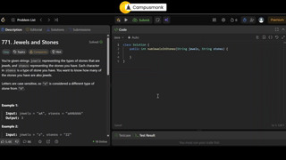

#### Core Concepts & Learning Objectives
Comprehensive video masterclass covering DSA JAVA 12  - jewels and stones. Focuses on fundamental principles, algorithm analysis, edge-case handling, and Infosys exam question solutions.

---

### Video 198: DSA JAVA 13 - Ransome Note
- **Video ID**: `162552167` | **Duration**: `00:04:01` (241s)
- **Track**: Infosys DSE & SP Role Preparation | **Topic**: Data Structures & Algorithms in C++ and Java
- **Curriculum Path**: `3. Infosys DSE & SP Role Prep / 2.1. DSA in Java with Itika Ma'am - Black Book Sol / Java Leet Code Series (Basic - Advance) / 2. Hash Maps & Hash Set`

#### Master Video Slide Thumbnail Plate
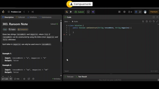

#### Core Concepts & Learning Objectives
Comprehensive video masterclass covering DSA JAVA 13 - Ransome Note. Focuses on fundamental principles, algorithm analysis, edge-case handling, and Infosys exam question solutions.

---

### Video 199: DSA JAVA 14 - Contains Duplicate
- **Video ID**: `162552163` | **Duration**: `00:02:13` (133s)
- **Track**: Infosys DSE & SP Role Preparation | **Topic**: Data Structures & Algorithms in C++ and Java
- **Curriculum Path**: `3. Infosys DSE & SP Role Prep / 2.1. DSA in Java with Itika Ma'am - Black Book Sol / Java Leet Code Series (Basic - Advance) / 2. Hash Maps & Hash Set`

#### Master Video Slide Thumbnail Plate
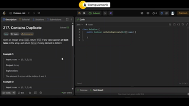

#### Core Concepts & Learning Objectives
Comprehensive video masterclass covering DSA JAVA 14 - Contains Duplicate. Focuses on fundamental principles, algorithm analysis, edge-case handling, and Infosys exam question solutions.

---

### Video 200: DSA JAVA 15 - Valid Anagram
- **Video ID**: `162552164` | **Duration**: `00:03:37` (217s)
- **Track**: Infosys DSE & SP Role Preparation | **Topic**: Data Structures & Algorithms in C++ and Java
- **Curriculum Path**: `3. Infosys DSE & SP Role Prep / 2.1. DSA in Java with Itika Ma'am - Black Book Sol / Java Leet Code Series (Basic - Advance) / 2. Hash Maps & Hash Set`

#### Master Video Slide Thumbnail Plate
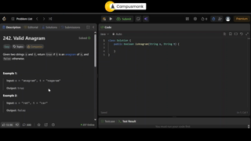

#### Core Concepts & Learning Objectives
Comprehensive video masterclass covering DSA JAVA 15 - Valid Anagram. Focuses on fundamental principles, algorithm analysis, edge-case handling, and Infosys exam question solutions.

---

### Video 201: DSA JAVA 16 - Two Sum
- **Video ID**: `162552166` | **Duration**: `00:03:58` (238s)
- **Track**: Infosys DSE & SP Role Preparation | **Topic**: Data Structures & Algorithms in C++ and Java
- **Curriculum Path**: `3. Infosys DSE & SP Role Prep / 2.1. DSA in Java with Itika Ma'am - Black Book Sol / Java Leet Code Series (Basic - Advance) / 2. Hash Maps & Hash Set`

#### Master Video Slide Thumbnail Plate
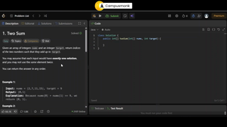

#### Core Concepts & Learning Objectives
Comprehensive video masterclass covering DSA JAVA 16 - Two Sum. Focuses on fundamental principles, algorithm analysis, edge-case handling, and Infosys exam question solutions.

---

### Video 202: DSA JAVA 17 - Group Anagrams
- **Video ID**: `162552168` | **Duration**: `00:05:07` (307s)
- **Track**: Infosys DSE & SP Role Preparation | **Topic**: Data Structures & Algorithms in C++ and Java
- **Curriculum Path**: `3. Infosys DSE & SP Role Prep / 2.1. DSA in Java with Itika Ma'am - Black Book Sol / Java Leet Code Series (Basic - Advance) / 2. Hash Maps & Hash Set`

#### Master Video Slide Thumbnail Plate
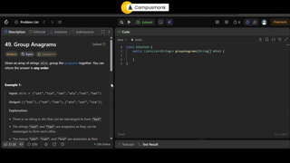

#### Core Concepts & Learning Objectives
Comprehensive video masterclass covering DSA JAVA 17 - Group Anagrams. Focuses on fundamental principles, algorithm analysis, edge-case handling, and Infosys exam question solutions.

---

### Video 203: DSA JAVA 18 - Valid Sudoku
- **Video ID**: `162552169` | **Duration**: `00:07:59` (479s)
- **Track**: Infosys DSE & SP Role Preparation | **Topic**: Data Structures & Algorithms in C++ and Java
- **Curriculum Path**: `3. Infosys DSE & SP Role Prep / 2.1. DSA in Java with Itika Ma'am - Black Book Sol / Java Leet Code Series (Basic - Advance) / 2. Hash Maps & Hash Set`

#### Master Video Slide Thumbnail Plate
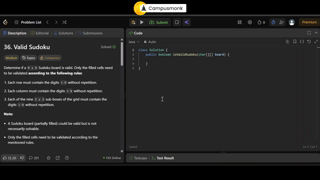

#### Core Concepts & Learning Objectives
Comprehensive video masterclass covering DSA JAVA 18 - Valid Sudoku. Focuses on fundamental principles, algorithm analysis, edge-case handling, and Infosys exam question solutions.

---

### Video 204: DSA JAVA 19 Maximum number of balloons
- **Video ID**: `162552172` | **Duration**: `00:11:31` (691s)
- **Track**: Infosys DSE & SP Role Preparation | **Topic**: Data Structures & Algorithms in C++ and Java
- **Curriculum Path**: `3. Infosys DSE & SP Role Prep / 2.1. DSA in Java with Itika Ma'am - Black Book Sol / Java Leet Code Series (Basic - Advance) / 2. Hash Maps & Hash Set`

#### Master Video Slide Thumbnail Plate
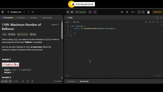

#### Core Concepts & Learning Objectives
Comprehensive video masterclass covering DSA JAVA 19 Maximum number of balloons. Focuses on fundamental principles, algorithm analysis, edge-case handling, and Infosys exam question solutions.

---

### Video 205: DSA JAVA 20 Longest Consecutive Sequence
- **Video ID**: `162552171` | **Duration**: `00:03:53` (233s)
- **Track**: Infosys DSE & SP Role Preparation | **Topic**: Data Structures & Algorithms in C++ and Java
- **Curriculum Path**: `3. Infosys DSE & SP Role Prep / 2.1. DSA in Java with Itika Ma'am - Black Book Sol / Java Leet Code Series (Basic - Advance) / 2. Hash Maps & Hash Set`

#### Master Video Slide Thumbnail Plate
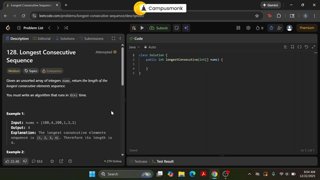

#### Core Concepts & Learning Objectives
Comprehensive video masterclass covering DSA JAVA 20 Longest Consecutive Sequence. Focuses on fundamental principles, algorithm analysis, edge-case handling, and Infosys exam question solutions.

---

### Video 206: DSA JAVA 21 Majority Elements
- **Video ID**: `162552170` | **Duration**: `00:02:22` (142s)
- **Track**: Infosys DSE & SP Role Preparation | **Topic**: Data Structures & Algorithms in C++ and Java
- **Curriculum Path**: `3. Infosys DSE & SP Role Prep / 2.1. DSA in Java with Itika Ma'am - Black Book Sol / Java Leet Code Series (Basic - Advance) / 2. Hash Maps & Hash Set`

#### Master Video Slide Thumbnail Plate
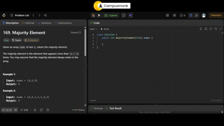

#### Core Concepts & Learning Objectives
Comprehensive video masterclass covering DSA JAVA 21 Majority Elements. Focuses on fundamental principles, algorithm analysis, edge-case handling, and Infosys exam question solutions.

---

### Video 207: DSA JAVA 22 Reverse String
- **Video ID**: `162552234` | **Duration**: `00:02:17` (137s)
- **Track**: Infosys DSE & SP Role Preparation | **Topic**: Data Structures & Algorithms in C++ and Java
- **Curriculum Path**: `3. Infosys DSE & SP Role Prep / 2.1. DSA in Java with Itika Ma'am - Black Book Sol / Java Leet Code Series (Basic - Advance) / 3. Two Pointers`

#### Master Video Slide Thumbnail Plate
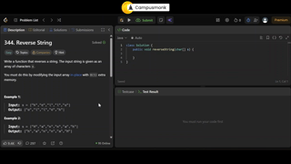

#### Core Concepts & Learning Objectives
Comprehensive video masterclass covering DSA JAVA 22 Reverse String. Focuses on fundamental principles, algorithm analysis, edge-case handling, and Infosys exam question solutions.

---

### Video 208: DSA JAVA 23 Two Sum II – Input Array is Sorted
- **Video ID**: `162552233` | **Duration**: `00:04:15` (255s)
- **Track**: Infosys DSE & SP Role Preparation | **Topic**: Data Structures & Algorithms in C++ and Java
- **Curriculum Path**: `3. Infosys DSE & SP Role Prep / 2.1. DSA in Java with Itika Ma'am - Black Book Sol / Java Leet Code Series (Basic - Advance) / 3. Two Pointers`

#### Master Video Slide Thumbnail Plate
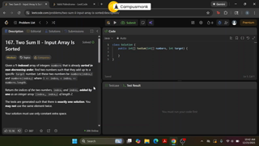

#### Core Concepts & Learning Objectives
Comprehensive video masterclass covering DSA JAVA 23 Two Sum II – Input Array is Sorted. Focuses on fundamental principles, algorithm analysis, edge-case handling, and Infosys exam question solutions.

---

### Video 209: DSA JAVA 25 Trapping Rain Water
- **Video ID**: `162552235` | **Duration**: `00:08:24` (504s)
- **Track**: Infosys DSE & SP Role Preparation | **Topic**: Data Structures & Algorithms in C++ and Java
- **Curriculum Path**: `3. Infosys DSE & SP Role Prep / 2.1. DSA in Java with Itika Ma'am - Black Book Sol / Java Leet Code Series (Basic - Advance) / 3. Two Pointers`

#### Master Video Slide Thumbnail Plate
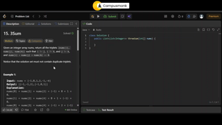

#### Core Concepts & Learning Objectives
Comprehensive video masterclass covering DSA JAVA 25 Trapping Rain Water. Focuses on fundamental principles, algorithm analysis, edge-case handling, and Infosys exam question solutions.

---

### Video 210: DSA JAVA 24 Valid Palindrome
- **Video ID**: `162552236` | **Duration**: `00:04:12` (252s)
- **Track**: Infosys DSE & SP Role Preparation | **Topic**: Data Structures & Algorithms in C++ and Java
- **Curriculum Path**: `3. Infosys DSE & SP Role Prep / 2.1. DSA in Java with Itika Ma'am - Black Book Sol / Java Leet Code Series (Basic - Advance) / 3. Two Pointers`

#### Master Video Slide Thumbnail Plate
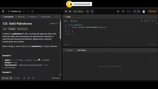

#### Core Concepts & Learning Objectives
Comprehensive video masterclass covering DSA JAVA 24 Valid Palindrome. Focuses on fundamental principles, algorithm analysis, edge-case handling, and Infosys exam question solutions.

---

### Video 211: DSA JAVA 26 Trapping Rain Water
- **Video ID**: `162552237` | **Duration**: `00:04:48` (288s)
- **Track**: Infosys DSE & SP Role Preparation | **Topic**: Data Structures & Algorithms in C++ and Java
- **Curriculum Path**: `3. Infosys DSE & SP Role Prep / 2.1. DSA in Java with Itika Ma'am - Black Book Sol / Java Leet Code Series (Basic - Advance) / 3. Two Pointers`

#### Master Video Slide Thumbnail Plate
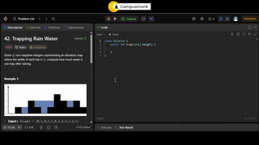

#### Core Concepts & Learning Objectives
Comprehensive video masterclass covering DSA JAVA 26 Trapping Rain Water. Focuses on fundamental principles, algorithm analysis, edge-case handling, and Infosys exam question solutions.

---

### Video 212: DSA JAVA 27 Baseball Game
- **Video ID**: `162552291` | **Duration**: `00:05:17` (317s)
- **Track**: Infosys DSE & SP Role Preparation | **Topic**: Data Structures & Algorithms in C++ and Java
- **Curriculum Path**: `3. Infosys DSE & SP Role Prep / 2.1. DSA in Java with Itika Ma'am - Black Book Sol / Java Leet Code Series (Basic - Advance) / 4. Stacks`

#### Master Video Slide Thumbnail Plate
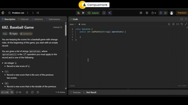

#### Core Concepts & Learning Objectives
Comprehensive video masterclass covering DSA JAVA 27 Baseball Game. Focuses on fundamental principles, algorithm analysis, edge-case handling, and Infosys exam question solutions.

---

### Video 213: DSA JAVA 28 Valid Parentheses
- **Video ID**: `162552292` | **Duration**: `00:04:49` (289s)
- **Track**: Infosys DSE & SP Role Preparation | **Topic**: Data Structures & Algorithms in C++ and Java
- **Curriculum Path**: `3. Infosys DSE & SP Role Prep / 2.1. DSA in Java with Itika Ma'am - Black Book Sol / Java Leet Code Series (Basic - Advance) / 4. Stacks`

#### Master Video Slide Thumbnail Plate
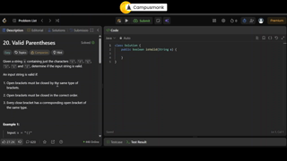

#### Core Concepts & Learning Objectives
Comprehensive video masterclass covering DSA JAVA 28 Valid Parentheses. Focuses on fundamental principles, algorithm analysis, edge-case handling, and Infosys exam question solutions.

---

### Video 214: DSA JAVA 29 Daily Temperatures
- **Video ID**: `162552289` | **Duration**: `00:04:15` (255s)
- **Track**: Infosys DSE & SP Role Preparation | **Topic**: Data Structures & Algorithms in C++ and Java
- **Curriculum Path**: `3. Infosys DSE & SP Role Prep / 2.1. DSA in Java with Itika Ma'am - Black Book Sol / Java Leet Code Series (Basic - Advance) / 4. Stacks`

#### Master Video Slide Thumbnail Plate
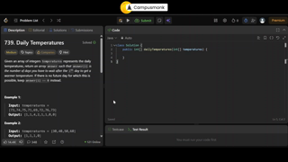

#### Core Concepts & Learning Objectives
Comprehensive video masterclass covering DSA JAVA 29 Daily Temperatures. Focuses on fundamental principles, algorithm analysis, edge-case handling, and Infosys exam question solutions.

---

### Video 215: DSA JAVA 30 Evaluate Reverse Polish Notation
- **Video ID**: `162552290` | **Duration**: `00:06:52` (412s)
- **Track**: Infosys DSE & SP Role Preparation | **Topic**: Data Structures & Algorithms in C++ and Java
- **Curriculum Path**: `3. Infosys DSE & SP Role Prep / 2.1. DSA in Java with Itika Ma'am - Black Book Sol / Java Leet Code Series (Basic - Advance) / 4. Stacks`

#### Master Video Slide Thumbnail Plate
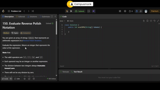

#### Core Concepts & Learning Objectives
Comprehensive video masterclass covering DSA JAVA 30 Evaluate Reverse Polish Notation. Focuses on fundamental principles, algorithm analysis, edge-case handling, and Infosys exam question solutions.

---

### Video 216: DSA JAVA 31 155-Min Stack
- **Video ID**: `162552293` | **Duration**: `00:04:05` (245s)
- **Track**: Infosys DSE & SP Role Preparation | **Topic**: Data Structures & Algorithms in C++ and Java
- **Curriculum Path**: `3. Infosys DSE & SP Role Prep / 2.1. DSA in Java with Itika Ma'am - Black Book Sol / Java Leet Code Series (Basic - Advance) / 4. Stacks`

#### Master Video Slide Thumbnail Plate

#### Core Concepts & Learning Objectives
Comprehensive video masterclass covering DSA JAVA 31 155-Min Stack. Focuses on fundamental principles, algorithm analysis, edge-case handling, and Infosys exam question solutions.

---

### Video 217: DSA JAVA 32 Binary Search
- **Video ID**: `162552345` | **Duration**: `00:03:20` (200s)
- **Track**: Infosys DSE & SP Role Preparation | **Topic**: Data Structures & Algorithms in C++ and Java
- **Curriculum Path**: `3. Infosys DSE & SP Role Prep / 2.1. DSA in Java with Itika Ma'am - Black Book Sol / Java Leet Code Series (Basic - Advance) / 5. Binary Search`

#### Master Video Slide Thumbnail Plate

#### Core Concepts & Learning Objectives
Comprehensive video masterclass covering DSA JAVA 32 Binary Search. Focuses on fundamental principles, algorithm analysis, edge-case handling, and Infosys exam question solutions.

---

### Video 218: DSA JAVA 33 Search Insert Position
- **Video ID**: `162552344` | **Duration**: `00:03:07` (187s)
- **Track**: Infosys DSE & SP Role Preparation | **Topic**: Data Structures & Algorithms in C++ and Java
- **Curriculum Path**: `3. Infosys DSE & SP Role Prep / 2.1. DSA in Java with Itika Ma'am - Black Book Sol / Java Leet Code Series (Basic - Advance) / 5. Binary Search`

#### Master Video Slide Thumbnail Plate

#### Core Concepts & Learning Objectives
Comprehensive video masterclass covering DSA JAVA 33 Search Insert Position. Focuses on fundamental principles, algorithm analysis, edge-case handling, and Infosys exam question solutions.

---

### Video 219: DSA JAVA 34 Search a 2D Matrix
- **Video ID**: `162552342` | **Duration**: `00:03:26` (206s)
- **Track**: Infosys DSE & SP Role Preparation | **Topic**: Data Structures & Algorithms in C++ and Java
- **Curriculum Path**: `3. Infosys DSE & SP Role Prep / 2.1. DSA in Java with Itika Ma'am - Black Book Sol / Java Leet Code Series (Basic - Advance) / 5. Binary Search`

#### Master Video Slide Thumbnail Plate

#### Core Concepts & Learning Objectives
Comprehensive video masterclass covering DSA JAVA 34 Search a 2D Matrix. Focuses on fundamental principles, algorithm analysis, edge-case handling, and Infosys exam question solutions.

---

### Video 220: DSA JAVA 35 Find Minimum in Rotated Sorted Array
- **Video ID**: `162552343` | **Duration**: `00:02:43` (163s)
- **Track**: Infosys DSE & SP Role Preparation | **Topic**: Data Structures & Algorithms in C++ and Java
- **Curriculum Path**: `3. Infosys DSE & SP Role Prep / 2.1. DSA in Java with Itika Ma'am - Black Book Sol / Java Leet Code Series (Basic - Advance) / 5. Binary Search`

#### Master Video Slide Thumbnail Plate

#### Core Concepts & Learning Objectives
Comprehensive video masterclass covering DSA JAVA 35 Find Minimum in Rotated Sorted Array. Focuses on fundamental principles, algorithm analysis, edge-case handling, and Infosys exam question solutions.

---

### Video 221: DSA JAVA 36 Search in Rotated Sorted Array
- **Video ID**: `162552346` | **Duration**: `00:05:12` (312s)
- **Track**: Infosys DSE & SP Role Preparation | **Topic**: Data Structures & Algorithms in C++ and Java
- **Curriculum Path**: `3. Infosys DSE & SP Role Prep / 2.1. DSA in Java with Itika Ma'am - Black Book Sol / Java Leet Code Series (Basic - Advance) / 5. Binary Search`

#### Master Video Slide Thumbnail Plate

#### Core Concepts & Learning Objectives
Comprehensive video masterclass covering DSA JAVA 36 Search in Rotated Sorted Array. Focuses on fundamental principles, algorithm analysis, edge-case handling, and Infosys exam question solutions.

---

### Video 222: Class 25: Assign cookies
- **Video ID**: `162552359` | **Duration**: `00:16:02` (962s)
- **Track**: Infosys DSE & SP Role Preparation | **Topic**: Data Structures & Algorithms in C++ and Java
- **Curriculum Path**: `3. Infosys DSE & SP Role Prep / 2.1. DSA in Java with Itika Ma'am - Black Book Sol / Module 6: Greedy Algorithm`

#### Master Video Slide Thumbnail Plate

#### Core Concepts & Learning Objectives
Comprehensive video masterclass covering Class 25: Assign cookies. Focuses on fundamental principles, algorithm analysis, edge-case handling, and Infosys exam question solutions.

---

### Video 223: Class 26: Lemonade Change
- **Video ID**: `162552360` | **Duration**: `00:13:58` (838s)
- **Track**: Infosys DSE & SP Role Preparation | **Topic**: Data Structures & Algorithms in C++ and Java
- **Curriculum Path**: `3. Infosys DSE & SP Role Prep / 2.1. DSA in Java with Itika Ma'am - Black Book Sol / Module 6: Greedy Algorithm`

#### Master Video Slide Thumbnail Plate

#### Core Concepts & Learning Objectives
Comprehensive video masterclass covering Class 26: Lemonade Change. Focuses on fundamental principles, algorithm analysis, edge-case handling, and Infosys exam question solutions.

---

### Video 224: Class 27: Jump Game 1
- **Video ID**: `162552361` | **Duration**: `00:18:44` (1,124s)
- **Track**: Infosys DSE & SP Role Preparation | **Topic**: Data Structures & Algorithms in C++ and Java
- **Curriculum Path**: `3. Infosys DSE & SP Role Prep / 2.1. DSA in Java with Itika Ma'am - Black Book Sol / Module 6: Greedy Algorithm`

#### Master Video Slide Thumbnail Plate

#### Core Concepts & Learning Objectives
Comprehensive video masterclass covering Class 27: Jump Game 1. Focuses on fundamental principles, algorithm analysis, edge-case handling, and Infosys exam question solutions.

---

### Video 225: Class 28: Search in rotated sorted array-1
- **Video ID**: `162552362` | **Duration**: `00:26:20` (1,580s)
- **Track**: Infosys DSE & SP Role Preparation | **Topic**: Data Structures & Algorithms in C++ and Java
- **Curriculum Path**: `3. Infosys DSE & SP Role Prep / 2.1. DSA in Java with Itika Ma'am - Black Book Sol / Module 6: Greedy Algorithm`

#### Master Video Slide Thumbnail Plate

#### Core Concepts & Learning Objectives
Comprehensive video masterclass covering Class 28: Search in rotated sorted array-1. Focuses on fundamental principles, algorithm analysis, edge-case handling, and Infosys exam question solutions.

---

### Video 226: Class 29: Find Minimum in rotated sorted array
- **Video ID**: `162552384` | **Duration**: `00:25:29` (1,529s)
- **Track**: Infosys DSE & SP Role Preparation | **Topic**: Data Structures & Algorithms in C++ and Java
- **Curriculum Path**: `3. Infosys DSE & SP Role Prep / 2.1. DSA in Java with Itika Ma'am - Black Book Sol / Module 7: Binary search Questions`

#### Master Video Slide Thumbnail Plate

#### Core Concepts & Learning Objectives
Comprehensive video masterclass covering Class 29: Find Minimum in rotated sorted array. Focuses on fundamental principles, algorithm analysis, edge-case handling, and Infosys exam question solutions.

---

### Video 227: Class 30: How many times array is rotated
- **Video ID**: `162552385` | **Duration**: `00:08:09` (489s)
- **Track**: Infosys DSE & SP Role Preparation | **Topic**: Data Structures & Algorithms in C++ and Java
- **Curriculum Path**: `3. Infosys DSE & SP Role Prep / 2.1. DSA in Java with Itika Ma'am - Black Book Sol / Module 7: Binary search Questions`

#### Master Video Slide Thumbnail Plate

#### Core Concepts & Learning Objectives
Comprehensive video masterclass covering Class 30: How many times array is rotated. Focuses on fundamental principles, algorithm analysis, edge-case handling, and Infosys exam question solutions.

---

### Video 228: Class 31: Strings in JAVA
- **Video ID**: `162552405` | **Duration**: `00:40:44` (2,444s)
- **Track**: Infosys DSE & SP Role Preparation | **Topic**: Data Structures & Algorithms in C++ and Java
- **Curriculum Path**: `3. Infosys DSE & SP Role Prep / 2.1. DSA in Java with Itika Ma'am - Black Book Sol / Module 8:  Strings in Java`

#### Master Video Slide Thumbnail Plate

#### Core Concepts & Learning Objectives
Comprehensive video masterclass covering Class 31: Strings in JAVA. Focuses on fundamental principles, algorithm analysis, edge-case handling, and Infosys exam question solutions.

---

### Video 229: Class 32: Longest Odd number in String
- **Video ID**: `162552404` | **Duration**: `00:16:45` (1,005s)
- **Track**: Infosys DSE & SP Role Preparation | **Topic**: Data Structures & Algorithms in C++ and Java
- **Curriculum Path**: `3. Infosys DSE & SP Role Prep / 2.1. DSA in Java with Itika Ma'am - Black Book Sol / Module 8:  Strings in Java`

#### Master Video Slide Thumbnail Plate

#### Core Concepts & Learning Objectives
Comprehensive video masterclass covering Class 32: Longest Odd number in String. Focuses on fundamental principles, algorithm analysis, edge-case handling, and Infosys exam question solutions.

---

### Video 230: Class 33: Longest Common Prefix
- **Video ID**: `162552406` | **Duration**: `00:25:44` (1,544s)
- **Track**: Infosys DSE & SP Role Preparation | **Topic**: Data Structures & Algorithms in C++ and Java
- **Curriculum Path**: `3. Infosys DSE & SP Role Prep / 2.1. DSA in Java with Itika Ma'am - Black Book Sol / Module 8:  Strings in Java`

#### Master Video Slide Thumbnail Plate

#### Core Concepts & Learning Objectives
Comprehensive video masterclass covering Class 33: Longest Common Prefix. Focuses on fundamental principles, algorithm analysis, edge-case handling, and Infosys exam question solutions.

---

### Video 231: Class 34: Isomorphic strings
- **Video ID**: `162552410` | **Duration**: `00:25:05` (1,505s)
- **Track**: Infosys DSE & SP Role Preparation | **Topic**: Data Structures & Algorithms in C++ and Java
- **Curriculum Path**: `3. Infosys DSE & SP Role Prep / 2.1. DSA in Java with Itika Ma'am - Black Book Sol / Module 8:  Strings in Java`

#### Master Video Slide Thumbnail Plate

#### Core Concepts & Learning Objectives
Comprehensive video masterclass covering Class 34: Isomorphic strings. Focuses on fundamental principles, algorithm analysis, edge-case handling, and Infosys exam question solutions.

---

### Video 232: Class 35: Rotate String
- **Video ID**: `162552407` | **Duration**: `00:21:00` (1,260s)
- **Track**: Infosys DSE & SP Role Preparation | **Topic**: Data Structures & Algorithms in C++ and Java
- **Curriculum Path**: `3. Infosys DSE & SP Role Prep / 2.1. DSA in Java with Itika Ma'am - Black Book Sol / Module 8:  Strings in Java`

#### Master Video Slide Thumbnail Plate

#### Core Concepts & Learning Objectives
Comprehensive video masterclass covering Class 35: Rotate String. Focuses on fundamental principles, algorithm analysis, edge-case handling, and Infosys exam question solutions.

---

### Video 233: Class 36: Valid Anagram Leetcode 242
- **Video ID**: `162552409` | **Duration**: `00:19:31` (1,171s)
- **Track**: Infosys DSE & SP Role Preparation | **Topic**: Data Structures & Algorithms in C++ and Java
- **Curriculum Path**: `3. Infosys DSE & SP Role Prep / 2.1. DSA in Java with Itika Ma'am - Black Book Sol / Module 8:  Strings in Java`

#### Master Video Slide Thumbnail Plate

#### Core Concepts & Learning Objectives
Comprehensive video masterclass covering Class 36: Valid Anagram Leetcode 242. Focuses on fundamental principles, algorithm analysis, edge-case handling, and Infosys exam question solutions.

---

### Video 234: Class 37: Number of substrings with only 1\'s
- **Video ID**: `162552408` | **Duration**: `00:21:44` (1,304s)
- **Track**: Infosys DSE & SP Role Preparation | **Topic**: Data Structures & Algorithms in C++ and Java
- **Curriculum Path**: `3. Infosys DSE & SP Role Prep / 2.1. DSA in Java with Itika Ma'am - Black Book Sol / Module 8:  Strings in Java`

#### Master Video Slide Thumbnail Plate

#### Core Concepts & Learning Objectives
Comprehensive video masterclass covering Class 37: Number of substrings with only 1\'s. Focuses on fundamental principles, algorithm analysis, edge-case handling, and Infosys exam question solutions.

---

### Video 332: Day 1 - DSA (Introduction)
- **Video ID**: `162552264` | **Duration**: `01:14:01` (4,441s)
- **Track**: Infosys DSE & SP Role Preparation | **Topic**: Data Structures & Algorithms in C++ and Java
- **Curriculum Path**: `3. Infosys DSE & SP Role Prep / DSA With C/C++ / 1.3 DSA by Akshat Sir / DSA by Akshat Sir`

#### Master Video Slide Thumbnail Plate

#### Core Concepts & Learning Objectives
Comprehensive video masterclass covering Day 1 - DSA (Introduction). Focuses on fundamental principles, algorithm analysis, edge-case handling, and Infosys exam question solutions.

---

### Video 333: Day 2 - Time Complexity and Space Complexity
- **Video ID**: `162552272` | **Duration**: `01:02:38` (3,758s)
- **Track**: Infosys DSE & SP Role Preparation | **Topic**: Data Structures & Algorithms in C++ and Java
- **Curriculum Path**: `3. Infosys DSE & SP Role Prep / DSA With C/C++ / 1.3 DSA by Akshat Sir / DSA by Akshat Sir`

#### Master Video Slide Thumbnail Plate

#### Core Concepts & Learning Objectives
Comprehensive video masterclass covering Day 2 - Time Complexity and Space Complexity. Focuses on fundamental principles, algorithm analysis, edge-case handling, and Infosys exam question solutions.

---

### Video 334: Day 3 - Array (Mathematics Approach)
- **Video ID**: `162552288` | **Duration**: `00:50:16` (3,016s)
- **Track**: Infosys DSE & SP Role Preparation | **Topic**: Data Structures & Algorithms in C++ and Java
- **Curriculum Path**: `3. Infosys DSE & SP Role Prep / DSA With C/C++ / 1.3 DSA by Akshat Sir / DSA by Akshat Sir`

#### Master Video Slide Thumbnail Plate

#### Core Concepts & Learning Objectives
Comprehensive video masterclass covering Day 3 - Array (Mathematics Approach). Focuses on fundamental principles, algorithm analysis, edge-case handling, and Infosys exam question solutions.

---

### Video 335: Day 4 - Maps and Two Pointer
- **Video ID**: `162552275` | **Duration**: `00:47:17` (2,837s)
- **Track**: Infosys DSE & SP Role Preparation | **Topic**: Data Structures & Algorithms in C++ and Java
- **Curriculum Path**: `3. Infosys DSE & SP Role Prep / DSA With C/C++ / 1.3 DSA by Akshat Sir / DSA by Akshat Sir`

#### Master Video Slide Thumbnail Plate

#### Core Concepts & Learning Objectives
Comprehensive video masterclass covering Day 4 - Maps and Two Pointer. Focuses on fundamental principles, algorithm analysis, edge-case handling, and Infosys exam question solutions.

---

### Video 336: Day 5 - Union and Intersection of Array
- **Video ID**: `162552267` | **Duration**: `01:17:40` (4,660s)
- **Track**: Infosys DSE & SP Role Preparation | **Topic**: Data Structures & Algorithms in C++ and Java
- **Curriculum Path**: `3. Infosys DSE & SP Role Prep / DSA With C/C++ / 1.3 DSA by Akshat Sir / DSA by Akshat Sir`

#### Master Video Slide Thumbnail Plate

#### Core Concepts & Learning Objectives
Comprehensive video masterclass covering Day 5 - Union and Intersection of Array. Focuses on fundamental principles, algorithm analysis, edge-case handling, and Infosys exam question solutions.

---

### Video 337: Day 6 - Kadane's Algo and Dutch National Flag Algo
- **Video ID**: `162552282` | **Duration**: `01:07:32` (4,052s)
- **Track**: Infosys DSE & SP Role Preparation | **Topic**: Data Structures & Algorithms in C++ and Java
- **Curriculum Path**: `3. Infosys DSE & SP Role Prep / DSA With C/C++ / 1.3 DSA by Akshat Sir / DSA by Akshat Sir`

#### Master Video Slide Thumbnail Plate

#### Core Concepts & Learning Objectives
Comprehensive video masterclass covering Day 6 - Kadane's Algo and Dutch National Flag Algo. Focuses on fundamental principles, algorithm analysis, edge-case handling, and Infosys exam question solutions.

---

### Video 338: Day 7 - Arrays Advance
- **Video ID**: `162552265` | **Duration**: `01:10:45` (4,245s)
- **Track**: Infosys DSE & SP Role Preparation | **Topic**: Data Structures & Algorithms in C++ and Java
- **Curriculum Path**: `3. Infosys DSE & SP Role Prep / DSA With C/C++ / 1.3 DSA by Akshat Sir / DSA by Akshat Sir`

#### Master Video Slide Thumbnail Plate

#### Core Concepts & Learning Objectives
Comprehensive video masterclass covering Day 7 - Arrays Advance. Focuses on fundamental principles, algorithm analysis, edge-case handling, and Infosys exam question solutions.

---

### Video 339: Day 8 - Maps (Hashmaps)
- **Video ID**: `162552263` | **Duration**: `00:52:52` (3,172s)
- **Track**: Infosys DSE & SP Role Preparation | **Topic**: Data Structures & Algorithms in C++ and Java
- **Curriculum Path**: `3. Infosys DSE & SP Role Prep / DSA With C/C++ / 1.3 DSA by Akshat Sir / DSA by Akshat Sir`

#### Master Video Slide Thumbnail Plate

#### Core Concepts & Learning Objectives
Comprehensive video masterclass covering Day 8 - Maps (Hashmaps). Focuses on fundamental principles, algorithm analysis, edge-case handling, and Infosys exam question solutions.

---

### Video 340: Day 9 - Recursion (1)
- **Video ID**: `162552287` | **Duration**: `00:50:30` (3,030s)
- **Track**: Infosys DSE & SP Role Preparation | **Topic**: Data Structures & Algorithms in C++ and Java
- **Curriculum Path**: `3. Infosys DSE & SP Role Prep / DSA With C/C++ / 1.3 DSA by Akshat Sir / DSA by Akshat Sir`

#### Master Video Slide Thumbnail Plate

#### Core Concepts & Learning Objectives
Comprehensive video masterclass covering Day 9 - Recursion (1). Focuses on fundamental principles, algorithm analysis, edge-case handling, and Infosys exam question solutions.

---

### Video 341: Day 10 - Recursion (2)
- **Video ID**: `162552270` | **Duration**: `01:09:24` (4,164s)
- **Track**: Infosys DSE & SP Role Preparation | **Topic**: Data Structures & Algorithms in C++ and Java
- **Curriculum Path**: `3. Infosys DSE & SP Role Prep / DSA With C/C++ / 1.3 DSA by Akshat Sir / DSA by Akshat Sir`

#### Master Video Slide Thumbnail Plate

#### Core Concepts & Learning Objectives
Comprehensive video masterclass covering Day 10 - Recursion (2). Focuses on fundamental principles, algorithm analysis, edge-case handling, and Infosys exam question solutions.

---

### Video 342: Day 11 - Recursion (3)
- **Video ID**: `162552276` | **Duration**: `00:46:36` (2,796s)
- **Track**: Infosys DSE & SP Role Preparation | **Topic**: Data Structures & Algorithms in C++ and Java
- **Curriculum Path**: `3. Infosys DSE & SP Role Prep / DSA With C/C++ / 1.3 DSA by Akshat Sir / DSA by Akshat Sir`

#### Master Video Slide Thumbnail Plate

#### Core Concepts & Learning Objectives
Comprehensive video masterclass covering Day 11 - Recursion (3). Focuses on fundamental principles, algorithm analysis, edge-case handling, and Infosys exam question solutions.

---

### Video 343: Day 12 - Recursion (Revision)
- **Video ID**: `162552269` | **Duration**: `00:39:41` (2,381s)
- **Track**: Infosys DSE & SP Role Preparation | **Topic**: Data Structures & Algorithms in C++ and Java
- **Curriculum Path**: `3. Infosys DSE & SP Role Prep / DSA With C/C++ / 1.3 DSA by Akshat Sir / DSA by Akshat Sir`

#### Master Video Slide Thumbnail Plate

#### Core Concepts & Learning Objectives
Comprehensive video masterclass covering Day 12 - Recursion (Revision). Focuses on fundamental principles, algorithm analysis, edge-case handling, and Infosys exam question solutions.

---

### Video 344: Day 13 - Backtracking
- **Video ID**: `162552268` | **Duration**: `00:43:34` (2,614s)
- **Track**: Infosys DSE & SP Role Preparation | **Topic**: Data Structures & Algorithms in C++ and Java
- **Curriculum Path**: `3. Infosys DSE & SP Role Prep / DSA With C/C++ / 1.3 DSA by Akshat Sir / DSA by Akshat Sir`

#### Master Video Slide Thumbnail Plate

#### Core Concepts & Learning Objectives
Comprehensive video masterclass covering Day 13 - Backtracking. Focuses on fundamental principles, algorithm analysis, edge-case handling, and Infosys exam question solutions.

---

### Video 345: Day 14 - Strings + Bit Manipulation (Easy)
- **Video ID**: `162552279` | **Duration**: `00:43:42` (2,622s)
- **Track**: Infosys DSE & SP Role Preparation | **Topic**: Data Structures & Algorithms in C++ and Java
- **Curriculum Path**: `3. Infosys DSE & SP Role Prep / DSA With C/C++ / 1.3 DSA by Akshat Sir / DSA by Akshat Sir`

#### Master Video Slide Thumbnail Plate

#### Core Concepts & Learning Objectives
Comprehensive video masterclass covering Day 14 - Strings + Bit Manipulation (Easy). Focuses on fundamental principles, algorithm analysis, edge-case handling, and Infosys exam question solutions.

---

### Video 346: Day 15 - String (2)
- **Video ID**: `162552274` | **Duration**: `00:34:34` (2,074s)
- **Track**: Infosys DSE & SP Role Preparation | **Topic**: Data Structures & Algorithms in C++ and Java
- **Curriculum Path**: `3. Infosys DSE & SP Role Prep / DSA With C/C++ / 1.3 DSA by Akshat Sir / DSA by Akshat Sir`

#### Master Video Slide Thumbnail Plate

#### Core Concepts & Learning Objectives
Comprehensive video masterclass covering Day 15 - String (2). Focuses on fundamental principles, algorithm analysis, edge-case handling, and Infosys exam question solutions.

---

### Video 347: Day 16 - String (Maps)
- **Video ID**: `162552278` | **Duration**: `00:54:07` (3,247s)
- **Track**: Infosys DSE & SP Role Preparation | **Topic**: Data Structures & Algorithms in C++ and Java
- **Curriculum Path**: `3. Infosys DSE & SP Role Prep / DSA With C/C++ / 1.3 DSA by Akshat Sir / DSA by Akshat Sir`

#### Master Video Slide Thumbnail Plate

#### Core Concepts & Learning Objectives
Comprehensive video masterclass covering Day 16 - String (Maps). Focuses on fundamental principles, algorithm analysis, edge-case handling, and Infosys exam question solutions.

---

### Video 348: Day 17 - Introduction : Sliding Window
- **Video ID**: `162552266` | **Duration**: `00:59:03` (3,543s)
- **Track**: Infosys DSE & SP Role Preparation | **Topic**: Data Structures & Algorithms in C++ and Java
- **Curriculum Path**: `3. Infosys DSE & SP Role Prep / DSA With C/C++ / 1.3 DSA by Akshat Sir / DSA by Akshat Sir`

#### Master Video Slide Thumbnail Plate

#### Core Concepts & Learning Objectives
Comprehensive video masterclass covering Day 17 - Introduction : Sliding Window. Focuses on fundamental principles, algorithm analysis, edge-case handling, and Infosys exam question solutions.

---

### Video 349: Day 18 - Contest Discussion
- **Video ID**: `162552283` | **Duration**: `00:45:58` (2,758s)
- **Track**: Infosys DSE & SP Role Preparation | **Topic**: Data Structures & Algorithms in C++ and Java
- **Curriculum Path**: `3. Infosys DSE & SP Role Prep / DSA With C/C++ / 1.3 DSA by Akshat Sir / DSA by Akshat Sir`

#### Master Video Slide Thumbnail Plate

#### Core Concepts & Learning Objectives
Comprehensive video masterclass covering Day 18 - Contest Discussion. Focuses on fundamental principles, algorithm analysis, edge-case handling, and Infosys exam question solutions.

---

### Video 350: Day 19 - Introduction : Stack and Queue
- **Video ID**: `162552271` | **Duration**: `00:45:14` (2,714s)
- **Track**: Infosys DSE & SP Role Preparation | **Topic**: Data Structures & Algorithms in C++ and Java
- **Curriculum Path**: `3. Infosys DSE & SP Role Prep / DSA With C/C++ / 1.3 DSA by Akshat Sir / DSA by Akshat Sir`

#### Master Video Slide Thumbnail Plate

#### Core Concepts & Learning Objectives
Comprehensive video masterclass covering Day 19 - Introduction : Stack and Queue. Focuses on fundamental principles, algorithm analysis, edge-case handling, and Infosys exam question solutions.

---

### Video 351: Day 20 -  Trees Foundation
- **Video ID**: `162552280` | **Duration**: `00:49:18` (2,958s)
- **Track**: Infosys DSE & SP Role Preparation | **Topic**: Data Structures & Algorithms in C++ and Java
- **Curriculum Path**: `3. Infosys DSE & SP Role Prep / DSA With C/C++ / 1.3 DSA by Akshat Sir / DSA by Akshat Sir`

#### Master Video Slide Thumbnail Plate

#### Core Concepts & Learning Objectives
Comprehensive video masterclass covering Day 20 -  Trees Foundation. Focuses on fundamental principles, algorithm analysis, edge-case handling, and Infosys exam question solutions.

---

### Video 352: Day 21 - Trees (Part 2)
- **Video ID**: `162552284` | **Duration**: `00:44:51` (2,691s)
- **Track**: Infosys DSE & SP Role Preparation | **Topic**: Data Structures & Algorithms in C++ and Java
- **Curriculum Path**: `3. Infosys DSE & SP Role Prep / DSA With C/C++ / 1.3 DSA by Akshat Sir / DSA by Akshat Sir`

#### Master Video Slide Thumbnail Plate

#### Core Concepts & Learning Objectives
Comprehensive video masterclass covering Day 21 - Trees (Part 2). Focuses on fundamental principles, algorithm analysis, edge-case handling, and Infosys exam question solutions.

---

### Video 353: Day 22 - Trees (Questions)
- **Video ID**: `162552285` | **Duration**: `00:40:08` (2,408s)
- **Track**: Infosys DSE & SP Role Preparation | **Topic**: Data Structures & Algorithms in C++ and Java
- **Curriculum Path**: `3. Infosys DSE & SP Role Prep / DSA With C/C++ / 1.3 DSA by Akshat Sir / DSA by Akshat Sir`

#### Master Video Slide Thumbnail Plate

#### Core Concepts & Learning Objectives
Comprehensive video masterclass covering Day 22 - Trees (Questions). Focuses on fundamental principles, algorithm analysis, edge-case handling, and Infosys exam question solutions.

---

### Video 354: DSA (Live - 21)
- **Video ID**: `162552277` | **Duration**: `00:43:00` (2,580s)
- **Track**: Infosys DSE & SP Role Preparation | **Topic**: Data Structures & Algorithms in C++ and Java
- **Curriculum Path**: `3. Infosys DSE & SP Role Prep / DSA With C/C++ / 1.3 DSA by Akshat Sir / DSA by Akshat Sir`

#### Master Video Slide Thumbnail Plate

#### Core Concepts & Learning Objectives
Comprehensive video masterclass covering DSA (Live - 21). Focuses on fundamental principles, algorithm analysis, edge-case handling, and Infosys exam question solutions.

---

### Video 355: DSA (Live - 22)
- **Video ID**: `162552286` | **Duration**: `00:44:57` (2,697s)
- **Track**: Infosys DSE & SP Role Preparation | **Topic**: Data Structures & Algorithms in C++ and Java
- **Curriculum Path**: `3. Infosys DSE & SP Role Prep / DSA With C/C++ / 1.3 DSA by Akshat Sir / DSA by Akshat Sir`

#### Master Video Slide Thumbnail Plate

#### Core Concepts & Learning Objectives
Comprehensive video masterclass covering DSA (Live - 22). Focuses on fundamental principles, algorithm analysis, edge-case handling, and Infosys exam question solutions.

---

### Video 356: DSA (Live - 23)
- **Video ID**: `162552281` | **Duration**: `00:37:36` (2,256s)
- **Track**: Infosys DSE & SP Role Preparation | **Topic**: Data Structures & Algorithms in C++ and Java
- **Curriculum Path**: `3. Infosys DSE & SP Role Prep / DSA With C/C++ / 1.3 DSA by Akshat Sir / DSA by Akshat Sir`

#### Master Video Slide Thumbnail Plate

#### Core Concepts & Learning Objectives
Comprehensive video masterclass covering DSA (Live - 23). Focuses on fundamental principles, algorithm analysis, edge-case handling, and Infosys exam question solutions.

---

### Video 357: DSA (Live - 24)
- **Video ID**: `162552273` | **Duration**: `00:40:36` (2,436s)
- **Track**: Infosys DSE & SP Role Preparation | **Topic**: Data Structures & Algorithms in C++ and Java
- **Curriculum Path**: `3. Infosys DSE & SP Role Prep / DSA With C/C++ / 1.3 DSA by Akshat Sir / DSA by Akshat Sir`

#### Master Video Slide Thumbnail Plate

#### Core Concepts & Learning Objectives
Comprehensive video masterclass covering DSA (Live - 24). Focuses on fundamental principles, algorithm analysis, edge-case handling, and Infosys exam question solutions.

---

### Video 358: 1.1 Arrays & Strings - Remove element
- **Video ID**: `162552334` | **Duration**: `00:07:13` (433s)
- **Track**: Infosys DSE & SP Role Preparation | **Topic**: Data Structures & Algorithms in C++ and Java
- **Curriculum Path**: `3. Infosys DSE & SP Role Prep / DSA With C/C++ / 1.3 DSA by Akshat Sir / CM DSA Black Book Top 100 Question With Video Solu`

#### Master Video Slide Thumbnail Plate

#### Core Concepts & Learning Objectives
Comprehensive video masterclass covering 1.1 Arrays & Strings - Remove element. Focuses on fundamental principles, algorithm analysis, edge-case handling, and Infosys exam question solutions.

---

### Video 359: 1.2 Arrays & Strings - Needle & Haystack
- **Video ID**: `162552336` | **Duration**: `00:08:03` (483s)
- **Track**: Infosys DSE & SP Role Preparation | **Topic**: Data Structures & Algorithms in C++ and Java
- **Curriculum Path**: `3. Infosys DSE & SP Role Prep / DSA With C/C++ / 1.3 DSA by Akshat Sir / CM DSA Black Book Top 100 Question With Video Solu`

#### Master Video Slide Thumbnail Plate

#### Core Concepts & Learning Objectives
Comprehensive video masterclass covering 1.2 Arrays & Strings - Needle & Haystack. Focuses on fundamental principles, algorithm analysis, edge-case handling, and Infosys exam question solutions.

---

### Video 360: 1.3 Arrays & Strings - Longest Common Prefix
- **Video ID**: `162552333` | **Duration**: `00:07:26` (446s)
- **Track**: Infosys DSE & SP Role Preparation | **Topic**: Data Structures & Algorithms in C++ and Java
- **Curriculum Path**: `3. Infosys DSE & SP Role Prep / DSA With C/C++ / 1.3 DSA by Akshat Sir / CM DSA Black Book Top 100 Question With Video Solu`

#### Master Video Slide Thumbnail Plate

#### Core Concepts & Learning Objectives
Comprehensive video masterclass covering 1.3 Arrays & Strings - Longest Common Prefix. Focuses on fundamental principles, algorithm analysis, edge-case handling, and Infosys exam question solutions.

---

### Video 361: 1.4 Arrays & Strings - Length of Last word
- **Video ID**: `162552337` | **Duration**: `00:05:35` (335s)
- **Track**: Infosys DSE & SP Role Preparation | **Topic**: Data Structures & Algorithms in C++ and Java
- **Curriculum Path**: `3. Infosys DSE & SP Role Prep / DSA With C/C++ / 1.3 DSA by Akshat Sir / CM DSA Black Book Top 100 Question With Video Solu`

#### Master Video Slide Thumbnail Plate

#### Core Concepts & Learning Objectives
Comprehensive video masterclass covering 1.4 Arrays & Strings - Length of Last word. Focuses on fundamental principles, algorithm analysis, edge-case handling, and Infosys exam question solutions.

---

### Video 362: 1.5 Arrays & Strings - Roman to Integer
- **Video ID**: `162552330` | **Duration**: `00:12:04` (724s)
- **Track**: Infosys DSE & SP Role Preparation | **Topic**: Data Structures & Algorithms in C++ and Java
- **Curriculum Path**: `3. Infosys DSE & SP Role Prep / DSA With C/C++ / 1.3 DSA by Akshat Sir / CM DSA Black Book Top 100 Question With Video Solu`

#### Master Video Slide Thumbnail Plate

#### Core Concepts & Learning Objectives
Comprehensive video masterclass covering 1.5 Arrays & Strings - Roman to Integer. Focuses on fundamental principles, algorithm analysis, edge-case handling, and Infosys exam question solutions.

---

### Video 363: 1.6 Arrays & Strings - Merge Sorted Arrays
- **Video ID**: `162552329` | **Duration**: `00:10:01` (601s)
- **Track**: Infosys DSE & SP Role Preparation | **Topic**: Data Structures & Algorithms in C++ and Java
- **Curriculum Path**: `3. Infosys DSE & SP Role Prep / DSA With C/C++ / 1.3 DSA by Akshat Sir / CM DSA Black Book Top 100 Question With Video Solu`

#### Master Video Slide Thumbnail Plate

#### Core Concepts & Learning Objectives
Comprehensive video masterclass covering 1.6 Arrays & Strings - Merge Sorted Arrays. Focuses on fundamental principles, algorithm analysis, edge-case handling, and Infosys exam question solutions.

---

### Video 364: 1.7 Arrays & Strings - Buy & Sell Stocks
- **Video ID**: `162552340` | **Duration**: `00:07:45` (465s)
- **Track**: Infosys DSE & SP Role Preparation | **Topic**: Data Structures & Algorithms in C++ and Java
- **Curriculum Path**: `3. Infosys DSE & SP Role Prep / DSA With C/C++ / 1.3 DSA by Akshat Sir / CM DSA Black Book Top 100 Question With Video Solu`

#### Master Video Slide Thumbnail Plate

#### Core Concepts & Learning Objectives
Comprehensive video masterclass covering 1.7 Arrays & Strings - Buy & Sell Stocks. Focuses on fundamental principles, algorithm analysis, edge-case handling, and Infosys exam question solutions.

---

### Video 365: 1.9 Arrays & Strings - Rotate Array
- **Video ID**: `162552328` | **Duration**: `00:08:08` (488s)
- **Track**: Infosys DSE & SP Role Preparation | **Topic**: Data Structures & Algorithms in C++ and Java
- **Curriculum Path**: `3. Infosys DSE & SP Role Prep / DSA With C/C++ / 1.3 DSA by Akshat Sir / CM DSA Black Book Top 100 Question With Video Solu`

#### Master Video Slide Thumbnail Plate

#### Core Concepts & Learning Objectives
Comprehensive video masterclass covering 1.9 Arrays & Strings - Rotate Array. Focuses on fundamental principles, algorithm analysis, edge-case handling, and Infosys exam question solutions.

---

### Video 366: 1.13 Arrays & Strings - Trapping Rain Water
- **Video ID**: `162552332` | **Duration**: `00:12:33` (753s)
- **Track**: Infosys DSE & SP Role Preparation | **Topic**: Data Structures & Algorithms in C++ and Java
- **Curriculum Path**: `3. Infosys DSE & SP Role Prep / DSA With C/C++ / 1.3 DSA by Akshat Sir / CM DSA Black Book Top 100 Question With Video Solu`

#### Master Video Slide Thumbnail Plate

#### Core Concepts & Learning Objectives
Comprehensive video masterclass covering 1.13 Arrays & Strings - Trapping Rain Water. Focuses on fundamental principles, algorithm analysis, edge-case handling, and Infosys exam question solutions.

---

### Video 367: 2.1 Arrays & Strings - Defanging IP Address
- **Video ID**: `162552335` | **Duration**: `00:07:03` (423s)
- **Track**: Infosys DSE & SP Role Preparation | **Topic**: Data Structures & Algorithms in C++ and Java
- **Curriculum Path**: `3. Infosys DSE & SP Role Prep / DSA With C/C++ / 1.3 DSA by Akshat Sir / CM DSA Black Book Top 100 Question With Video Solu`

#### Master Video Slide Thumbnail Plate

#### Core Concepts & Learning Objectives
Comprehensive video masterclass covering 2.1 Arrays & Strings - Defanging IP Address. Focuses on fundamental principles, algorithm analysis, edge-case handling, and Infosys exam question solutions.

---

### Video 368: 2.2 Arrays & Strings - Max Words
- **Video ID**: `162552331` | **Duration**: `00:10:30` (630s)
- **Track**: Infosys DSE & SP Role Preparation | **Topic**: Data Structures & Algorithms in C++ and Java
- **Curriculum Path**: `3. Infosys DSE & SP Role Prep / DSA With C/C++ / 1.3 DSA by Akshat Sir / CM DSA Black Book Top 100 Question With Video Solu`

#### Master Video Slide Thumbnail Plate

#### Core Concepts & Learning Objectives
Comprehensive video masterclass covering 2.2 Arrays & Strings - Max Words. Focuses on fundamental principles, algorithm analysis, edge-case handling, and Infosys exam question solutions.

---

### Video 369: 2.3 Arrays & Strings - Number of Senior Citizen
- **Video ID**: `162552341` | **Duration**: `00:05:49` (349s)
- **Track**: Infosys DSE & SP Role Preparation | **Topic**: Data Structures & Algorithms in C++ and Java
- **Curriculum Path**: `3. Infosys DSE & SP Role Prep / DSA With C/C++ / 1.3 DSA by Akshat Sir / CM DSA Black Book Top 100 Question With Video Solu`

#### Master Video Slide Thumbnail Plate

#### Core Concepts & Learning Objectives
Comprehensive video masterclass covering 2.3 Arrays & Strings - Number of Senior Citizen. Focuses on fundamental principles, algorithm analysis, edge-case handling, and Infosys exam question solutions.

---

### Video 370: 2.4 Arrays & Strings - Collect Garbage
- **Video ID**: `162552338` | **Duration**: `00:15:23` (923s)
- **Track**: Infosys DSE & SP Role Preparation | **Topic**: Data Structures & Algorithms in C++ and Java
- **Curriculum Path**: `3. Infosys DSE & SP Role Prep / DSA With C/C++ / 1.3 DSA by Akshat Sir / CM DSA Black Book Top 100 Question With Video Solu`

#### Master Video Slide Thumbnail Plate

#### Core Concepts & Learning Objectives
Comprehensive video masterclass covering 2.4 Arrays & Strings - Collect Garbage. Focuses on fundamental principles, algorithm analysis, edge-case handling, and Infosys exam question solutions.

---

### Video 371: 2.5 Arrays & Strings - Find & Replace Pattern
- **Video ID**: `162552339` | **Duration**: `00:11:03` (663s)
- **Track**: Infosys DSE & SP Role Preparation | **Topic**: Data Structures & Algorithms in C++ and Java
- **Curriculum Path**: `3. Infosys DSE & SP Role Prep / DSA With C/C++ / 1.3 DSA by Akshat Sir / CM DSA Black Book Top 100 Question With Video Solu`

#### Master Video Slide Thumbnail Plate

#### Core Concepts & Learning Objectives
Comprehensive video masterclass covering 2.5 Arrays & Strings - Find & Replace Pattern. Focuses on fundamental principles, algorithm analysis, edge-case handling, and Infosys exam question solutions.

---

### Video 372: Lecture 1 : Basics of Programming
- **Video ID**: `162552176` | **Duration**: `00:49:26` (2,966s)
- **Track**: Infosys DSE & SP Role Preparation | **Topic**: Data Structures & Algorithms in C++ and Java
- **Curriculum Path**: `3. Infosys DSE & SP Role Prep / DSA With C/C++ / 1.1 Basic to Advance - Anshul Sir ( Google) / 1.1 Basic to Advance (Programming)`

#### Master Video Slide Thumbnail Plate

#### Core Concepts & Learning Objectives
Comprehensive video masterclass covering Lecture 1 : Basics of Programming. Focuses on fundamental principles, algorithm analysis, edge-case handling, and Infosys exam question solutions.

---

### Video 373: Lecture 2 : Introduction to Arrays
- **Video ID**: `162552184` | **Duration**: `00:49:01` (2,941s)
- **Track**: Infosys DSE & SP Role Preparation | **Topic**: Data Structures & Algorithms in C++ and Java
- **Curriculum Path**: `3. Infosys DSE & SP Role Prep / DSA With C/C++ / 1.1 Basic to Advance - Anshul Sir ( Google) / 1.1 Basic to Advance (Programming)`

#### Master Video Slide Thumbnail Plate

#### Core Concepts & Learning Objectives
Comprehensive video masterclass covering Lecture 2 : Introduction to Arrays. Focuses on fundamental principles, algorithm analysis, edge-case handling, and Infosys exam question solutions.

---

### Video 374: Lecture 3 : Questions on array (Part 1)
- **Video ID**: `162552178` | **Duration**: `00:48:09` (2,889s)
- **Track**: Infosys DSE & SP Role Preparation | **Topic**: Data Structures & Algorithms in C++ and Java
- **Curriculum Path**: `3. Infosys DSE & SP Role Prep / DSA With C/C++ / 1.1 Basic to Advance - Anshul Sir ( Google) / 1.1 Basic to Advance (Programming)`

#### Master Video Slide Thumbnail Plate

#### Core Concepts & Learning Objectives
Comprehensive video masterclass covering Lecture 3 : Questions on array (Part 1). Focuses on fundamental principles, algorithm analysis, edge-case handling, and Infosys exam question solutions.

---

### Video 375: Lecture  4:  Questions on Array (Part 2)
- **Video ID**: `162552196` | **Duration**: `00:56:01` (3,361s)
- **Track**: Infosys DSE & SP Role Preparation | **Topic**: Data Structures & Algorithms in C++ and Java
- **Curriculum Path**: `3. Infosys DSE & SP Role Prep / DSA With C/C++ / 1.1 Basic to Advance - Anshul Sir ( Google) / 1.1 Basic to Advance (Programming)`

#### Master Video Slide Thumbnail Plate

#### Core Concepts & Learning Objectives
Comprehensive video masterclass covering Lecture  4:  Questions on Array (Part 2). Focuses on fundamental principles, algorithm analysis, edge-case handling, and Infosys exam question solutions.

---

### Video 376: Lecture 5 :  Question on Arrays (Part-3)
- **Video ID**: `162552179` | **Duration**: `00:42:59` (2,579s)
- **Track**: Infosys DSE & SP Role Preparation | **Topic**: Data Structures & Algorithms in C++ and Java
- **Curriculum Path**: `3. Infosys DSE & SP Role Prep / DSA With C/C++ / 1.1 Basic to Advance - Anshul Sir ( Google) / 1.1 Basic to Advance (Programming)`

#### Master Video Slide Thumbnail Plate

#### Core Concepts & Learning Objectives
Comprehensive video masterclass covering Lecture 5 :  Question on Arrays (Part-3). Focuses on fundamental principles, algorithm analysis, edge-case handling, and Infosys exam question solutions.

---

### Video 377: Lecture 6 : Introduction to String
- **Video ID**: `162552174` | **Duration**: `00:49:30` (2,970s)
- **Track**: Infosys DSE & SP Role Preparation | **Topic**: Data Structures & Algorithms in C++ and Java
- **Curriculum Path**: `3. Infosys DSE & SP Role Prep / DSA With C/C++ / 1.1 Basic to Advance - Anshul Sir ( Google) / 1.1 Basic to Advance (Programming)`

#### Master Video Slide Thumbnail Plate

#### Core Concepts & Learning Objectives
Comprehensive video masterclass covering Lecture 6 : Introduction to String. Focuses on fundamental principles, algorithm analysis, edge-case handling, and Infosys exam question solutions.

---

### Video 378: Lecture 7 : Question on strings (Part 1)
- **Video ID**: `162552173` | **Duration**: `00:49:23` (2,963s)
- **Track**: Infosys DSE & SP Role Preparation | **Topic**: Data Structures & Algorithms in C++ and Java
- **Curriculum Path**: `3. Infosys DSE & SP Role Prep / DSA With C/C++ / 1.1 Basic to Advance - Anshul Sir ( Google) / 1.1 Basic to Advance (Programming)`

#### Master Video Slide Thumbnail Plate

#### Core Concepts & Learning Objectives
Comprehensive video masterclass covering Lecture 7 : Question on strings (Part 1). Focuses on fundamental principles, algorithm analysis, edge-case handling, and Infosys exam question solutions.

---

### Video 379: Lecture  8 : Question on strings(Part 2)
- **Video ID**: `162552175` | **Duration**: `00:44:21` (2,661s)
- **Track**: Infosys DSE & SP Role Preparation | **Topic**: Data Structures & Algorithms in C++ and Java
- **Curriculum Path**: `3. Infosys DSE & SP Role Prep / DSA With C/C++ / 1.1 Basic to Advance - Anshul Sir ( Google) / 1.1 Basic to Advance (Programming)`

#### Master Video Slide Thumbnail Plate

#### Core Concepts & Learning Objectives
Comprehensive video masterclass covering Lecture  8 : Question on strings(Part 2). Focuses on fundamental principles, algorithm analysis, edge-case handling, and Infosys exam question solutions.

---

### Video 380: Lecture 9 : Strings, Intro to Matrix(2-D Array)
- **Video ID**: `162552197` | **Duration**: `00:39:49` (2,389s)
- **Track**: Infosys DSE & SP Role Preparation | **Topic**: Data Structures & Algorithms in C++ and Java
- **Curriculum Path**: `3. Infosys DSE & SP Role Prep / DSA With C/C++ / 1.1 Basic to Advance - Anshul Sir ( Google) / 1.1 Basic to Advance (Programming)`

#### Master Video Slide Thumbnail Plate

#### Core Concepts & Learning Objectives
Comprehensive video masterclass covering Lecture 9 : Strings, Intro to Matrix(2-D Array). Focuses on fundamental principles, algorithm analysis, edge-case handling, and Infosys exam question solutions.

---

### Video 381: Lecture 10 : Question on Matrix (Part-1)
- **Video ID**: `162552195` | **Duration**: `00:39:36` (2,376s)
- **Track**: Infosys DSE & SP Role Preparation | **Topic**: Data Structures & Algorithms in C++ and Java
- **Curriculum Path**: `3. Infosys DSE & SP Role Prep / DSA With C/C++ / 1.1 Basic to Advance - Anshul Sir ( Google) / 1.1 Basic to Advance (Programming)`

#### Master Video Slide Thumbnail Plate

#### Core Concepts & Learning Objectives
Comprehensive video masterclass covering Lecture 10 : Question on Matrix (Part-1). Focuses on fundamental principles, algorithm analysis, edge-case handling, and Infosys exam question solutions.

---

### Video 382: Lecture 11 : Question on Matrix (Part 2)
- **Video ID**: `162552185` | **Duration**: `00:47:01` (2,821s)
- **Track**: Infosys DSE & SP Role Preparation | **Topic**: Data Structures & Algorithms in C++ and Java
- **Curriculum Path**: `3. Infosys DSE & SP Role Prep / DSA With C/C++ / 1.1 Basic to Advance - Anshul Sir ( Google) / 1.1 Basic to Advance (Programming)`

#### Master Video Slide Thumbnail Plate

#### Core Concepts & Learning Objectives
Comprehensive video masterclass covering Lecture 11 : Question on Matrix (Part 2). Focuses on fundamental principles, algorithm analysis, edge-case handling, and Infosys exam question solutions.

---

### Video 383: Lecture 12 : Time and Space Complexity
- **Video ID**: `162552177` | **Duration**: `00:44:25` (2,665s)
- **Track**: Infosys DSE & SP Role Preparation | **Topic**: Data Structures & Algorithms in C++ and Java
- **Curriculum Path**: `3. Infosys DSE & SP Role Prep / DSA With C/C++ / 1.1 Basic to Advance - Anshul Sir ( Google) / 1.1 Basic to Advance (Programming)`

#### Master Video Slide Thumbnail Plate

#### Core Concepts & Learning Objectives
Comprehensive video masterclass covering Lecture 12 : Time and Space Complexity. Focuses on fundamental principles, algorithm analysis, edge-case handling, and Infosys exam question solutions.

---

### Video 384: Lecture 13 :  Binary Search
- **Video ID**: `162552183` | **Duration**: `00:43:14` (2,594s)
- **Track**: Infosys DSE & SP Role Preparation | **Topic**: Data Structures & Algorithms in C++ and Java
- **Curriculum Path**: `3. Infosys DSE & SP Role Prep / DSA With C/C++ / 1.1 Basic to Advance - Anshul Sir ( Google) / 1.1 Basic to Advance (Programming)`

#### Master Video Slide Thumbnail Plate

#### Core Concepts & Learning Objectives
Comprehensive video masterclass covering Lecture 13 :  Binary Search. Focuses on fundamental principles, algorithm analysis, edge-case handling, and Infosys exam question solutions.

---

### Video 385: Lecture 14 : Recursion
- **Video ID**: `162552181` | **Duration**: `00:40:54` (2,454s)
- **Track**: Infosys DSE & SP Role Preparation | **Topic**: Data Structures & Algorithms in C++ and Java
- **Curriculum Path**: `3. Infosys DSE & SP Role Prep / DSA With C/C++ / 1.1 Basic to Advance - Anshul Sir ( Google) / 1.1 Basic to Advance (Programming)`

#### Master Video Slide Thumbnail Plate

#### Core Concepts & Learning Objectives
Comprehensive video masterclass covering Lecture 14 : Recursion. Focuses on fundamental principles, algorithm analysis, edge-case handling, and Infosys exam question solutions.

---

### Video 386: Lecture 15 : Recursion (PART 2)
- **Video ID**: `162552193` | **Duration**: `00:34:56` (2,096s)
- **Track**: Infosys DSE & SP Role Preparation | **Topic**: Data Structures & Algorithms in C++ and Java
- **Curriculum Path**: `3. Infosys DSE & SP Role Prep / DSA With C/C++ / 1.1 Basic to Advance - Anshul Sir ( Google) / 1.1 Basic to Advance (Programming)`

#### Master Video Slide Thumbnail Plate

#### Core Concepts & Learning Objectives
Comprehensive video masterclass covering Lecture 15 : Recursion (PART 2). Focuses on fundamental principles, algorithm analysis, edge-case handling, and Infosys exam question solutions.

---

### Video 387: Lecture 16  : (Intro to STL)
- **Video ID**: `162552180` | **Duration**: `00:38:24` (2,304s)
- **Track**: Infosys DSE & SP Role Preparation | **Topic**: Data Structures & Algorithms in C++ and Java
- **Curriculum Path**: `3. Infosys DSE & SP Role Prep / DSA With C/C++ / 1.1 Basic to Advance - Anshul Sir ( Google) / 1.1 Basic to Advance (Programming)`

#### Master Video Slide Thumbnail Plate

#### Core Concepts & Learning Objectives
Comprehensive video masterclass covering Lecture 16  : (Intro to STL). Focuses on fundamental principles, algorithm analysis, edge-case handling, and Infosys exam question solutions.

---

### Video 388: Lecture  17 : (Implementation of STL - Vector, Set)
- **Video ID**: `162552188` | **Duration**: `00:32:34` (1,954s)
- **Track**: Infosys DSE & SP Role Preparation | **Topic**: Data Structures & Algorithms in C++ and Java
- **Curriculum Path**: `3. Infosys DSE & SP Role Prep / DSA With C/C++ / 1.1 Basic to Advance - Anshul Sir ( Google) / 1.1 Basic to Advance (Programming)`

#### Master Video Slide Thumbnail Plate

#### Core Concepts & Learning Objectives
Comprehensive video masterclass covering Lecture  17 : (Implementation of STL - Vector, Set). Focuses on fundamental principles, algorithm analysis, edge-case handling, and Infosys exam question solutions.

---

### Video 389: Lecture  18 : (Implementation of STL - maps)
- **Video ID**: `162552186` | **Duration**: `00:50:21` (3,021s)
- **Track**: Infosys DSE & SP Role Preparation | **Topic**: Data Structures & Algorithms in C++ and Java
- **Curriculum Path**: `3. Infosys DSE & SP Role Prep / DSA With C/C++ / 1.1 Basic to Advance - Anshul Sir ( Google) / 1.1 Basic to Advance (Programming)`

#### Master Video Slide Thumbnail Plate

#### Core Concepts & Learning Objectives
Comprehensive video masterclass covering Lecture  18 : (Implementation of STL - maps). Focuses on fundamental principles, algorithm analysis, edge-case handling, and Infosys exam question solutions.

---

### Video 390: Lecture - 19 (Questions1)
- **Video ID**: `162552198` | **Duration**: `00:35:51` (2,151s)
- **Track**: Infosys DSE & SP Role Preparation | **Topic**: Data Structures & Algorithms in C++ and Java
- **Curriculum Path**: `3. Infosys DSE & SP Role Prep / DSA With C/C++ / 1.1 Basic to Advance - Anshul Sir ( Google) / 1.1 Basic to Advance (Programming)`

#### Master Video Slide Thumbnail Plate

#### Core Concepts & Learning Objectives
Comprehensive video masterclass covering Lecture - 19 (Questions1). Focuses on fundamental principles, algorithm analysis, edge-case handling, and Infosys exam question solutions.

---

### Video 391: Lecture - 20 (Questions2)
- **Video ID**: `162552182` | **Duration**: `00:39:26` (2,366s)
- **Track**: Infosys DSE & SP Role Preparation | **Topic**: Data Structures & Algorithms in C++ and Java
- **Curriculum Path**: `3. Infosys DSE & SP Role Prep / DSA With C/C++ / 1.1 Basic to Advance - Anshul Sir ( Google) / 1.1 Basic to Advance (Programming)`

#### Master Video Slide Thumbnail Plate

#### Core Concepts & Learning Objectives
Comprehensive video masterclass covering Lecture - 20 (Questions2). Focuses on fundamental principles, algorithm analysis, edge-case handling, and Infosys exam question solutions.

---

### Video 392: Lecture - 21(Bubble,Selection and Insertion Sort)
- **Video ID**: `162552199` | **Duration**: `00:43:09` (2,589s)
- **Track**: Infosys DSE & SP Role Preparation | **Topic**: Data Structures & Algorithms in C++ and Java
- **Curriculum Path**: `3. Infosys DSE & SP Role Prep / DSA With C/C++ / 1.1 Basic to Advance - Anshul Sir ( Google) / 1.1 Basic to Advance (Programming)`

#### Master Video Slide Thumbnail Plate

#### Core Concepts & Learning Objectives
Comprehensive video masterclass covering Lecture - 21(Bubble,Selection and Insertion Sort). Focuses on fundamental principles, algorithm analysis, edge-case handling, and Infosys exam question solutions.

---

### Video 393: Lecture - 22  (Kadane's Algo)
- **Video ID**: `162552187` | **Duration**: `00:24:15` (1,455s)
- **Track**: Infosys DSE & SP Role Preparation | **Topic**: Data Structures & Algorithms in C++ and Java
- **Curriculum Path**: `3. Infosys DSE & SP Role Prep / DSA With C/C++ / 1.1 Basic to Advance - Anshul Sir ( Google) / 1.1 Basic to Advance (Programming)`

#### Master Video Slide Thumbnail Plate

#### Core Concepts & Learning Objectives
Comprehensive video masterclass covering Lecture - 22  (Kadane's Algo). Focuses on fundamental principles, algorithm analysis, edge-case handling, and Infosys exam question solutions.

---

### Video 394: Lecture - 23 (Generate all subsequences)
- **Video ID**: `162552192` | **Duration**: `00:30:00` (1,800s)
- **Track**: Infosys DSE & SP Role Preparation | **Topic**: Data Structures & Algorithms in C++ and Java
- **Curriculum Path**: `3. Infosys DSE & SP Role Prep / DSA With C/C++ / 1.1 Basic to Advance - Anshul Sir ( Google) / 1.1 Basic to Advance (Programming)`

#### Master Video Slide Thumbnail Plate

#### Core Concepts & Learning Objectives
Comprehensive video masterclass covering Lecture - 23 (Generate all subsequences). Focuses on fundamental principles, algorithm analysis, edge-case handling, and Infosys exam question solutions.

---

### Video 395: Lecture - 24 (Merge Sort)
- **Video ID**: `162552191` | **Duration**: `00:44:32` (2,672s)
- **Track**: Infosys DSE & SP Role Preparation | **Topic**: Data Structures & Algorithms in C++ and Java
- **Curriculum Path**: `3. Infosys DSE & SP Role Prep / DSA With C/C++ / 1.1 Basic to Advance - Anshul Sir ( Google) / 1.1 Basic to Advance (Programming)`

#### Master Video Slide Thumbnail Plate

#### Core Concepts & Learning Objectives
Comprehensive video masterclass covering Lecture - 24 (Merge Sort). Focuses on fundamental principles, algorithm analysis, edge-case handling, and Infosys exam question solutions.

---

### Video 396: Lecture - 25 (Minimum Number of Jumps)
- **Video ID**: `162552200` | **Duration**: `00:27:03` (1,623s)
- **Track**: Infosys DSE & SP Role Preparation | **Topic**: Data Structures & Algorithms in C++ and Java
- **Curriculum Path**: `3. Infosys DSE & SP Role Prep / DSA With C/C++ / 1.1 Basic to Advance - Anshul Sir ( Google) / 1.1 Basic to Advance (Programming)`

#### Master Video Slide Thumbnail Plate

#### Core Concepts & Learning Objectives
Comprehensive video masterclass covering Lecture - 25 (Minimum Number of Jumps). Focuses on fundamental principles, algorithm analysis, edge-case handling, and Infosys exam question solutions.

---

### Video 397: Lecture - 26 (Pointers)
- **Video ID**: `162552190` | **Duration**: `00:22:35` (1,355s)
- **Track**: Infosys DSE & SP Role Preparation | **Topic**: Data Structures & Algorithms in C++ and Java
- **Curriculum Path**: `3. Infosys DSE & SP Role Prep / DSA With C/C++ / 1.1 Basic to Advance - Anshul Sir ( Google) / 1.1 Basic to Advance (Programming)`

#### Master Video Slide Thumbnail Plate

#### Core Concepts & Learning Objectives
Comprehensive video masterclass covering Lecture - 26 (Pointers). Focuses on fundamental principles, algorithm analysis, edge-case handling, and Infosys exam question solutions.

---

### Video 398: Lecture - 27 (Knapsack and Fractional)
- **Video ID**: `162552194` | **Duration**: `00:31:15` (1,875s)
- **Track**: Infosys DSE & SP Role Preparation | **Topic**: Data Structures & Algorithms in C++ and Java
- **Curriculum Path**: `3. Infosys DSE & SP Role Prep / DSA With C/C++ / 1.1 Basic to Advance - Anshul Sir ( Google) / 1.1 Basic to Advance (Programming)`

#### Master Video Slide Thumbnail Plate

#### Core Concepts & Learning Objectives
Comprehensive video masterclass covering Lecture - 27 (Knapsack and Fractional). Focuses on fundamental principles, algorithm analysis, edge-case handling, and Infosys exam question solutions.

---

### Video 399: Lecture - 28 (Valid Parenthesis)
- **Video ID**: `162552189` | **Duration**: `00:25:19` (1,519s)
- **Track**: Infosys DSE & SP Role Preparation | **Topic**: Data Structures & Algorithms in C++ and Java
- **Curriculum Path**: `3. Infosys DSE & SP Role Prep / DSA With C/C++ / 1.1 Basic to Advance - Anshul Sir ( Google) / 1.1 Basic to Advance (Programming)`

#### Master Video Slide Thumbnail Plate

#### Core Concepts & Learning Objectives
Comprehensive video masterclass covering Lecture - 28 (Valid Parenthesis). Focuses on fundamental principles, algorithm analysis, edge-case handling, and Infosys exam question solutions.

---

### Video 400: Logic Building - 1
- **Video ID**: `162552298` | **Duration**: `01:17:36` (4,656s)
- **Track**: Infosys DSE & SP Role Preparation | **Topic**: Data Structures & Algorithms in C++ and Java
- **Curriculum Path**: `3. Infosys DSE & SP Role Prep / DSA With C/C++ / 1.1 Basic to Advance - Anshul Sir ( Google) / 1.2  Logic Building by Anshul Sir / Logic Building by Anshul Sir`

#### Master Video Slide Thumbnail Plate

#### Core Concepts & Learning Objectives
Comprehensive video masterclass covering Logic Building - 1. Focuses on fundamental principles, algorithm analysis, edge-case handling, and Infosys exam question solutions.

---

### Video 401: Logic Building - 2
- **Video ID**: `162552300` | **Duration**: `01:02:35` (3,755s)
- **Track**: Infosys DSE & SP Role Preparation | **Topic**: Data Structures & Algorithms in C++ and Java
- **Curriculum Path**: `3. Infosys DSE & SP Role Prep / DSA With C/C++ / 1.1 Basic to Advance - Anshul Sir ( Google) / 1.2  Logic Building by Anshul Sir / Logic Building by Anshul Sir`

#### Master Video Slide Thumbnail Plate

#### Core Concepts & Learning Objectives
Comprehensive video masterclass covering Logic Building - 2. Focuses on fundamental principles, algorithm analysis, edge-case handling, and Infosys exam question solutions.

---

### Video 402: Logic Building - 3
- **Video ID**: `162552302` | **Duration**: `01:02:35` (3,755s)
- **Track**: Infosys DSE & SP Role Preparation | **Topic**: Data Structures & Algorithms in C++ and Java
- **Curriculum Path**: `3. Infosys DSE & SP Role Prep / DSA With C/C++ / 1.1 Basic to Advance - Anshul Sir ( Google) / 1.2  Logic Building by Anshul Sir / Logic Building by Anshul Sir`

#### Master Video Slide Thumbnail Plate

#### Core Concepts & Learning Objectives
Comprehensive video masterclass covering Logic Building - 3. Focuses on fundamental principles, algorithm analysis, edge-case handling, and Infosys exam question solutions.

---

### Video 403: Logic Building - 4
- **Video ID**: `162552307` | **Duration**: `01:09:31` (4,171s)
- **Track**: Infosys DSE & SP Role Preparation | **Topic**: Data Structures & Algorithms in C++ and Java
- **Curriculum Path**: `3. Infosys DSE & SP Role Prep / DSA With C/C++ / 1.1 Basic to Advance - Anshul Sir ( Google) / 1.2  Logic Building by Anshul Sir / Logic Building by Anshul Sir`

#### Master Video Slide Thumbnail Plate

#### Core Concepts & Learning Objectives
Comprehensive video masterclass covering Logic Building - 4. Focuses on fundamental principles, algorithm analysis, edge-case handling, and Infosys exam question solutions.

---

### Video 404: Live - 5
- **Video ID**: `162552306` | **Duration**: `00:58:32` (3,512s)
- **Track**: Infosys DSE & SP Role Preparation | **Topic**: Data Structures & Algorithms in C++ and Java
- **Curriculum Path**: `3. Infosys DSE & SP Role Prep / DSA With C/C++ / 1.1 Basic to Advance - Anshul Sir ( Google) / 1.2  Logic Building by Anshul Sir / Logic Building by Anshul Sir`

#### Master Video Slide Thumbnail Plate

#### Core Concepts & Learning Objectives
Comprehensive video masterclass covering Live - 5. Focuses on fundamental principles, algorithm analysis, edge-case handling, and Infosys exam question solutions.

---

### Video 405: Live - 6
- **Video ID**: `162552297` | **Duration**: `01:20:13` (4,813s)
- **Track**: Infosys DSE & SP Role Preparation | **Topic**: Data Structures & Algorithms in C++ and Java
- **Curriculum Path**: `3. Infosys DSE & SP Role Prep / DSA With C/C++ / 1.1 Basic to Advance - Anshul Sir ( Google) / 1.2  Logic Building by Anshul Sir / Logic Building by Anshul Sir`

#### Master Video Slide Thumbnail Plate

#### Core Concepts & Learning Objectives
Comprehensive video masterclass covering Live - 6. Focuses on fundamental principles, algorithm analysis, edge-case handling, and Infosys exam question solutions.

---

### Video 406: Live - 7
- **Video ID**: `162552294` | **Duration**: `01:41:33` (6,093s)
- **Track**: Infosys DSE & SP Role Preparation | **Topic**: Data Structures & Algorithms in C++ and Java
- **Curriculum Path**: `3. Infosys DSE & SP Role Prep / DSA With C/C++ / 1.1 Basic to Advance - Anshul Sir ( Google) / 1.2  Logic Building by Anshul Sir / Logic Building by Anshul Sir`

#### Master Video Slide Thumbnail Plate

#### Core Concepts & Learning Objectives
Comprehensive video masterclass covering Live - 7. Focuses on fundamental principles, algorithm analysis, edge-case handling, and Infosys exam question solutions.

---

### Video 407: Live - 8
- **Video ID**: `162552299` | **Duration**: `01:39:05` (5,945s)
- **Track**: Infosys DSE & SP Role Preparation | **Topic**: Data Structures & Algorithms in C++ and Java
- **Curriculum Path**: `3. Infosys DSE & SP Role Prep / DSA With C/C++ / 1.1 Basic to Advance - Anshul Sir ( Google) / 1.2  Logic Building by Anshul Sir / Logic Building by Anshul Sir`

#### Master Video Slide Thumbnail Plate

#### Core Concepts & Learning Objectives
Comprehensive video masterclass covering Live - 8. Focuses on fundamental principles, algorithm analysis, edge-case handling, and Infosys exam question solutions.

---

### Video 408: Live - 9
- **Video ID**: `162552305` | **Duration**: `01:32:38` (5,558s)
- **Track**: Infosys DSE & SP Role Preparation | **Topic**: Data Structures & Algorithms in C++ and Java
- **Curriculum Path**: `3. Infosys DSE & SP Role Prep / DSA With C/C++ / 1.1 Basic to Advance - Anshul Sir ( Google) / 1.2  Logic Building by Anshul Sir / Logic Building by Anshul Sir`

#### Master Video Slide Thumbnail Plate

#### Core Concepts & Learning Objectives
Comprehensive video masterclass covering Live - 9. Focuses on fundamental principles, algorithm analysis, edge-case handling, and Infosys exam question solutions.

---

### Video 409: Live - 10
- **Video ID**: `162552295` | **Duration**: `01:32:15` (5,535s)
- **Track**: Infosys DSE & SP Role Preparation | **Topic**: Data Structures & Algorithms in C++ and Java
- **Curriculum Path**: `3. Infosys DSE & SP Role Prep / DSA With C/C++ / 1.1 Basic to Advance - Anshul Sir ( Google) / 1.2  Logic Building by Anshul Sir / Logic Building by Anshul Sir`

#### Master Video Slide Thumbnail Plate

#### Core Concepts & Learning Objectives
Comprehensive video masterclass covering Live - 10. Focuses on fundamental principles, algorithm analysis, edge-case handling, and Infosys exam question solutions.

---

### Video 410: Live 11
- **Video ID**: `162552303` | **Duration**: `01:22:24` (4,944s)
- **Track**: Infosys DSE & SP Role Preparation | **Topic**: Data Structures & Algorithms in C++ and Java
- **Curriculum Path**: `3. Infosys DSE & SP Role Prep / DSA With C/C++ / 1.1 Basic to Advance - Anshul Sir ( Google) / 1.2  Logic Building by Anshul Sir / Logic Building by Anshul Sir`

#### Master Video Slide Thumbnail Plate

#### Core Concepts & Learning Objectives
Comprehensive video masterclass covering Live 11. Focuses on fundamental principles, algorithm analysis, edge-case handling, and Infosys exam question solutions.

---

### Video 411: Live 12
- **Video ID**: `162552296` | **Duration**: `01:22:57` (4,977s)
- **Track**: Infosys DSE & SP Role Preparation | **Topic**: Data Structures & Algorithms in C++ and Java
- **Curriculum Path**: `3. Infosys DSE & SP Role Prep / DSA With C/C++ / 1.1 Basic to Advance - Anshul Sir ( Google) / 1.2  Logic Building by Anshul Sir / Logic Building by Anshul Sir`

#### Master Video Slide Thumbnail Plate

#### Core Concepts & Learning Objectives
Comprehensive video masterclass covering Live 12. Focuses on fundamental principles, algorithm analysis, edge-case handling, and Infosys exam question solutions.

---

### Video 412: Live - 13
- **Video ID**: `162552301` | **Duration**: `01:08:36` (4,116s)
- **Track**: Infosys DSE & SP Role Preparation | **Topic**: Data Structures & Algorithms in C++ and Java
- **Curriculum Path**: `3. Infosys DSE & SP Role Prep / DSA With C/C++ / 1.1 Basic to Advance - Anshul Sir ( Google) / 1.2  Logic Building by Anshul Sir / Logic Building by Anshul Sir`

#### Master Video Slide Thumbnail Plate

#### Core Concepts & Learning Objectives
Comprehensive video masterclass covering Live - 13. Focuses on fundamental principles, algorithm analysis, edge-case handling, and Infosys exam question solutions.

---

### Video 413: Live 14
- **Video ID**: `162552304` | **Duration**: `01:44:48` (6,288s)
- **Track**: Infosys DSE & SP Role Preparation | **Topic**: Data Structures & Algorithms in C++ and Java
- **Curriculum Path**: `3. Infosys DSE & SP Role Prep / DSA With C/C++ / 1.1 Basic to Advance - Anshul Sir ( Google) / 1.2  Logic Building by Anshul Sir / Logic Building by Anshul Sir`

#### Master Video Slide Thumbnail Plate

#### Core Concepts & Learning Objectives
Comprehensive video masterclass covering Live 14. Focuses on fundamental principles, algorithm analysis, edge-case handling, and Infosys exam question solutions.

---

