# Infosys Video Curriculum — Advanced Coding, Live Masterclasses & Induction Strategy

> **Target Track**: Infosys DSE & SP Advanced Tracks | **Videos Count**: 23 | **Total Runtime**: 15h 39m
> **Curriculum Topics**: Live Aptitude Masterclasses with Rachit Sir, Live Coding Prep with Itika Ma'am, NEW DSE Coding PYQs, Induction & Roadmaps

## Section Overview & Curriculum Map
This master compendium documents all 23 high-yield video lectures for Advanced Coding, Live Masterclasses & Induction Strategy. Every lecture includes full metadata, curriculum path, high-resolution slide thumbnail plate, and core conceptual focus.

---

### Video 002: PART 1: Number System from basic  ALL PYQ series
- **Video ID**: `178884922` | **Duration**: `01:37:05` (5,825s)
- **Track**: Infosys DSE & SP Advanced Tracks | **Topic**: Advanced Coding, Live Masterclasses & Induction Strategy
- **Curriculum Path**: `1.0 LIVE: Infosys Prep / Aptitude Prep With Rachit sir / Day 2:  Number System`

#### Master Video Slide Thumbnail Plate
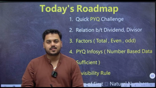

#### Core Concepts & Learning Objectives
Comprehensive video masterclass covering PART 1: Number System from basic  ALL PYQ series. Focuses on fundamental principles, algorithm analysis, edge-case handling, and Infosys exam question solutions.

---

### Video 003: PART 2: Number system 02
- **Video ID**: `178884923` | **Duration**: `01:31:31` (5,491s)
- **Track**: Infosys DSE & SP Advanced Tracks | **Topic**: Advanced Coding, Live Masterclasses & Induction Strategy
- **Curriculum Path**: `1.0 LIVE: Infosys Prep / Aptitude Prep With Rachit sir / Day 2:  Number System`

#### Master Video Slide Thumbnail Plate
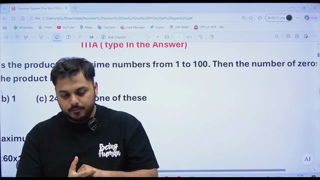

#### Core Concepts & Learning Objectives
Comprehensive video masterclass covering PART 2: Number system 02. Focuses on fundamental principles, algorithm analysis, edge-case handling, and Infosys exam question solutions.

---

### Video 004: PART 3: NUMBER Divisibility Rule One Shot
- **Video ID**: `178984490` | **Duration**: `01:30:38` (5,438s)
- **Track**: Infosys DSE & SP Advanced Tracks | **Topic**: Advanced Coding, Live Masterclasses & Induction Strategy
- **Curriculum Path**: `1.0 LIVE: Infosys Prep / Aptitude Prep With Rachit sir / Day 2:  Number System`

#### Master Video Slide Thumbnail Plate
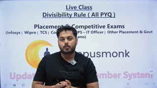

#### Core Concepts & Learning Objectives
Comprehensive video masterclass covering PART 3: NUMBER Divisibility Rule One Shot. Focuses on fundamental principles, algorithm analysis, edge-case handling, and Infosys exam question solutions.

---

### Video 005: LCM HCF One Shot
- **Video ID**: `178884926` | **Duration**: `01:26:34` (5,194s)
- **Track**: Infosys DSE & SP Advanced Tracks | **Topic**: Advanced Coding, Live Masterclasses & Induction Strategy
- **Curriculum Path**: `1.0 LIVE: Infosys Prep / Aptitude Prep With Rachit sir / Day 3: LCM/ HCF`

#### Master Video Slide Thumbnail Plate
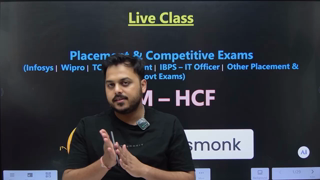

#### Core Concepts & Learning Objectives
Comprehensive video masterclass covering LCM HCF One Shot. Focuses on fundamental principles, algorithm analysis, edge-case handling, and Infosys exam question solutions.

---

### Video 006: PART 1: Infosys PYQ Prep & OTHERS
- **Video ID**: `178884924` | **Duration**: `00:57:24` (3,444s)
- **Track**: Infosys DSE & SP Advanced Tracks | **Topic**: Advanced Coding, Live Masterclasses & Induction Strategy
- **Curriculum Path**: `1.0 LIVE: Infosys Prep / Coding Prep with Itika Ma'am / 1: PYQ's (Infosys & Others)`

#### Master Video Slide Thumbnail Plate
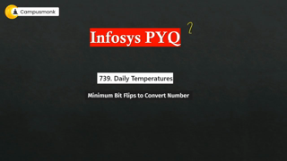

#### Core Concepts & Learning Objectives
Comprehensive video masterclass covering PART 1: Infosys PYQ Prep & OTHERS. Focuses on fundamental principles, algorithm analysis, edge-case handling, and Infosys exam question solutions.

---

### Video 007: PART 2: PYQ Coding Prep TCS, Infosys & others
- **Video ID**: `178884925` | **Duration**: `01:17:03` (4,623s)
- **Track**: Infosys DSE & SP Advanced Tracks | **Topic**: Advanced Coding, Live Masterclasses & Induction Strategy
- **Curriculum Path**: `1.0 LIVE: Infosys Prep / Coding Prep with Itika Ma'am / 1: PYQ's (Infosys & Others)`

#### Master Video Slide Thumbnail Plate
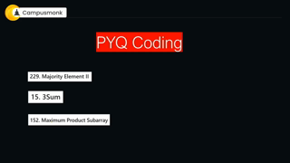

#### Core Concepts & Learning Objectives
Comprehensive video masterclass covering PART 2: PYQ Coding Prep TCS, Infosys & others. Focuses on fundamental principles, algorithm analysis, edge-case handling, and Infosys exam question solutions.

---

### Video 008: PART 3: TCS, IBM, Infosys and other companies
- **Video ID**: `179172460` | **Duration**: `01:23:11` (4,991s)
- **Track**: Infosys DSE & SP Advanced Tracks | **Topic**: Advanced Coding, Live Masterclasses & Induction Strategy
- **Curriculum Path**: `1.0 LIVE: Infosys Prep / Coding Prep with Itika Ma'am / 1: PYQ's (Infosys & Others)`

#### Master Video Slide Thumbnail Plate
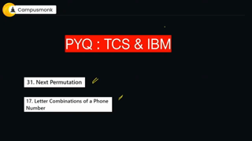

#### Core Concepts & Learning Objectives
Comprehensive video masterclass covering PART 3: TCS, IBM, Infosys and other companies. Focuses on fundamental principles, algorithm analysis, edge-case handling, and Infosys exam question solutions.

---

### Video 009: All About Infosys _ How to Prepare _ Updated Pattern_
- **Video ID**: `162552047` | **Duration**: `00:12:12` (732s)
- **Track**: Infosys DSE & SP Advanced Tracks | **Topic**: Advanced Coding, Live Masterclasses & Induction Strategy
- **Curriculum Path**: `1. RoadMap : Induction Imp`

#### Master Video Slide Thumbnail Plate

#### Core Concepts & Learning Objectives
Comprehensive video masterclass covering All About Infosys _ How to Prepare _ Updated Pattern_. Focuses on fundamental principles, algorithm analysis, edge-case handling, and Infosys exam question solutions.

---

### Video 010: 1. Induction
- **Video ID**: `162552046` | **Duration**: `00:20:15` (1,215s)
- **Track**: Infosys DSE & SP Advanced Tracks | **Topic**: Advanced Coding, Live Masterclasses & Induction Strategy
- **Curriculum Path**: `1. RoadMap : Induction Imp`

#### Master Video Slide Thumbnail Plate
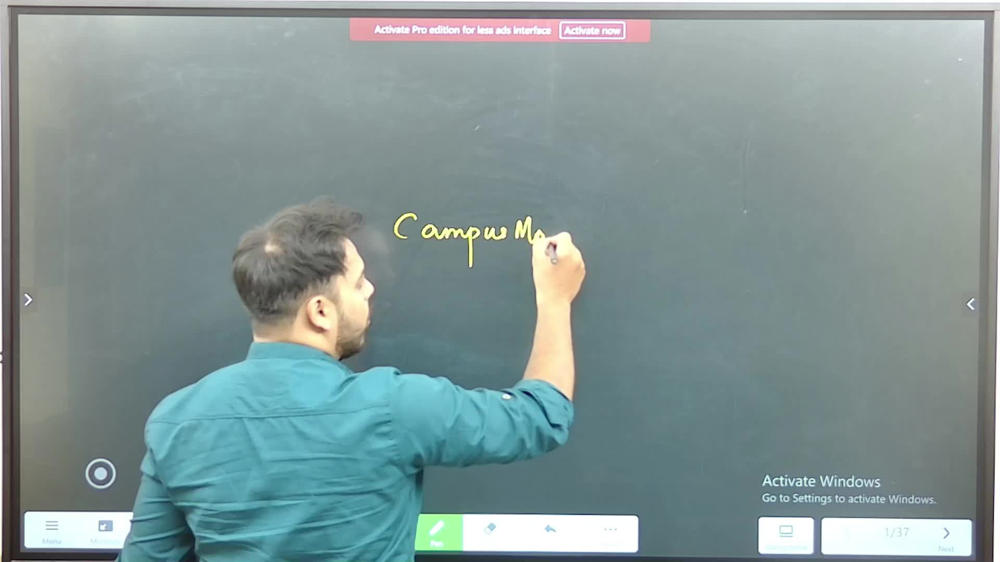

#### Core Concepts & Learning Objectives
Comprehensive video masterclass covering 1. Induction. Focuses on fundamental principles, algorithm analysis, edge-case handling, and Infosys exam question solutions.

---

### Video 149: Q1: Infosys PYQ
- **Video ID**: `170292060` | **Duration**: `00:27:49` (1,669s)
- **Track**: Infosys DSE & SP Advanced Tracks | **Topic**: Advanced Coding, Live Masterclasses & Induction Strategy
- **Curriculum Path**: `3. Infosys DSE & SP Role Prep / NEW - DSE/ SE: Infosys Coding Questions`

#### Master Video Slide Thumbnail Plate
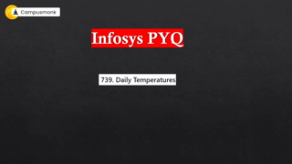

#### Core Concepts & Learning Objectives
Comprehensive video masterclass covering Q1: Infosys PYQ. Focuses on fundamental principles, algorithm analysis, edge-case handling, and Infosys exam question solutions.

---

### Video 150: Q2: Infosys PYQ
- **Video ID**: `170292062` | **Duration**: `00:38:05` (2,285s)
- **Track**: Infosys DSE & SP Advanced Tracks | **Topic**: Advanced Coding, Live Masterclasses & Induction Strategy
- **Curriculum Path**: `3. Infosys DSE & SP Role Prep / NEW - DSE/ SE: Infosys Coding Questions`

#### Master Video Slide Thumbnail Plate
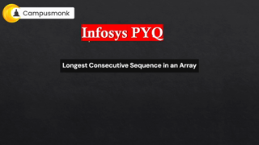

#### Core Concepts & Learning Objectives
Comprehensive video masterclass covering Q2: Infosys PYQ. Focuses on fundamental principles, algorithm analysis, edge-case handling, and Infosys exam question solutions.

---

### Video 151: Q3: Infosys PYQ
- **Video ID**: `170292061` | **Duration**: `00:21:42` (1,302s)
- **Track**: Infosys DSE & SP Advanced Tracks | **Topic**: Advanced Coding, Live Masterclasses & Induction Strategy
- **Curriculum Path**: `3. Infosys DSE & SP Role Prep / NEW - DSE/ SE: Infosys Coding Questions`

#### Master Video Slide Thumbnail Plate

#### Core Concepts & Learning Objectives
Comprehensive video masterclass covering Q3: Infosys PYQ. Focuses on fundamental principles, algorithm analysis, edge-case handling, and Infosys exam question solutions.

---

### Video 152: Q4: Infosys - PYQ - Linked List
- **Video ID**: `170292063` | **Duration**: `00:15:20` (920s)
- **Track**: Infosys DSE & SP Advanced Tracks | **Topic**: Advanced Coding, Live Masterclasses & Induction Strategy
- **Curriculum Path**: `3. Infosys DSE & SP Role Prep / NEW - DSE/ SE: Infosys Coding Questions`

#### Master Video Slide Thumbnail Plate
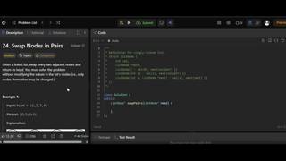

#### Core Concepts & Learning Objectives
Comprehensive video masterclass covering Q4: Infosys - PYQ - Linked List. Focuses on fundamental principles, algorithm analysis, edge-case handling, and Infosys exam question solutions.

---

### Video 153: Q5: Infosys PYQ - Dynamic Programming - 1
- **Video ID**: `170292067` | **Duration**: `00:16:37` (997s)
- **Track**: Infosys DSE & SP Advanced Tracks | **Topic**: Advanced Coding, Live Masterclasses & Induction Strategy
- **Curriculum Path**: `3. Infosys DSE & SP Role Prep / NEW - DSE/ SE: Infosys Coding Questions`

#### Master Video Slide Thumbnail Plate
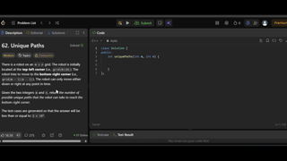

#### Core Concepts & Learning Objectives
Comprehensive video masterclass covering Q5: Infosys PYQ - Dynamic Programming - 1. Focuses on fundamental principles, algorithm analysis, edge-case handling, and Infosys exam question solutions.

---

### Video 154: Q6: Infosys PYQ - Dynamic Programming - 2
- **Video ID**: `170292066` | **Duration**: `00:17:13` (1,033s)
- **Track**: Infosys DSE & SP Advanced Tracks | **Topic**: Advanced Coding, Live Masterclasses & Induction Strategy
- **Curriculum Path**: `3. Infosys DSE & SP Role Prep / NEW - DSE/ SE: Infosys Coding Questions`

#### Master Video Slide Thumbnail Plate
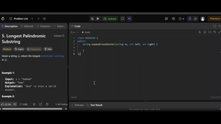

#### Core Concepts & Learning Objectives
Comprehensive video masterclass covering Q6: Infosys PYQ - Dynamic Programming - 2. Focuses on fundamental principles, algorithm analysis, edge-case handling, and Infosys exam question solutions.

---

### Video 155: Q7: Infosys PYQ -  Dynamic Programming
- **Video ID**: `170292065` | **Duration**: `00:12:56` (776s)
- **Track**: Infosys DSE & SP Advanced Tracks | **Topic**: Advanced Coding, Live Masterclasses & Induction Strategy
- **Curriculum Path**: `3. Infosys DSE & SP Role Prep / NEW - DSE/ SE: Infosys Coding Questions`

#### Master Video Slide Thumbnail Plate
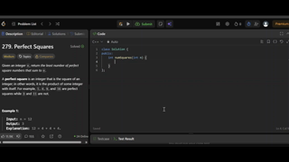

#### Core Concepts & Learning Objectives
Comprehensive video masterclass covering Q7: Infosys PYQ -  Dynamic Programming. Focuses on fundamental principles, algorithm analysis, edge-case handling, and Infosys exam question solutions.

---

### Video 156: Q8: Infosys PYQ- SEDSE - DNF - 1
- **Video ID**: `170292064` | **Duration**: `00:10:56` (656s)
- **Track**: Infosys DSE & SP Advanced Tracks | **Topic**: Advanced Coding, Live Masterclasses & Induction Strategy
- **Curriculum Path**: `3. Infosys DSE & SP Role Prep / NEW - DSE/ SE: Infosys Coding Questions`

#### Master Video Slide Thumbnail Plate
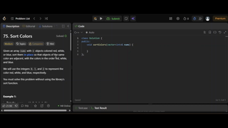

#### Core Concepts & Learning Objectives
Comprehensive video masterclass covering Q8: Infosys PYQ- SEDSE - DNF - 1. Focuses on fundamental principles, algorithm analysis, edge-case handling, and Infosys exam question solutions.

---

### Video 157: Q9: Infosys PYQ - Binary Tree - 1
- **Video ID**: `170292069` | **Duration**: `00:17:57` (1,077s)
- **Track**: Infosys DSE & SP Advanced Tracks | **Topic**: Advanced Coding, Live Masterclasses & Induction Strategy
- **Curriculum Path**: `3. Infosys DSE & SP Role Prep / NEW - DSE/ SE: Infosys Coding Questions`

#### Master Video Slide Thumbnail Plate
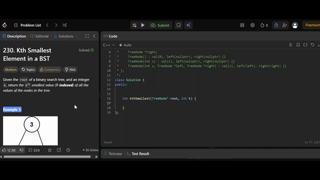

#### Core Concepts & Learning Objectives
Comprehensive video masterclass covering Q9: Infosys PYQ - Binary Tree - 1. Focuses on fundamental principles, algorithm analysis, edge-case handling, and Infosys exam question solutions.

---

### Video 158: Q10: Infosys PYQ - Backtracking - 1
- **Video ID**: `170292068` | **Duration**: `00:27:19` (1,639s)
- **Track**: Infosys DSE & SP Advanced Tracks | **Topic**: Advanced Coding, Live Masterclasses & Induction Strategy
- **Curriculum Path**: `3. Infosys DSE & SP Role Prep / NEW - DSE/ SE: Infosys Coding Questions`

#### Master Video Slide Thumbnail Plate
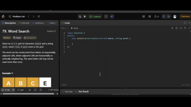

#### Core Concepts & Learning Objectives
Comprehensive video masterclass covering Q10: Infosys PYQ - Backtracking - 1. Focuses on fundamental principles, algorithm analysis, edge-case handling, and Infosys exam question solutions.

---

### Video 159: Q11: Infosys - Validate Binary Search Tree (Infosys series)
- **Video ID**: `171280200` | **Duration**: `00:14:02` (842s)
- **Track**: Infosys DSE & SP Advanced Tracks | **Topic**: Advanced Coding, Live Masterclasses & Induction Strategy
- **Curriculum Path**: `3. Infosys DSE & SP Role Prep / NEW - DSE/ SE: Infosys Coding Questions`

#### Master Video Slide Thumbnail Plate
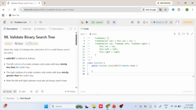

#### Core Concepts & Learning Objectives
Comprehensive video masterclass covering Q11: Infosys - Validate Binary Search Tree (Infosys series). Focuses on fundamental principles, algorithm analysis, edge-case handling, and Infosys exam question solutions.

---

### Video 160: Q12: Infosys - Edit Distance Recursion + DP solution
- **Video ID**: `171280201` | **Duration**: `00:18:12` (1,092s)
- **Track**: Infosys DSE & SP Advanced Tracks | **Topic**: Advanced Coding, Live Masterclasses & Induction Strategy
- **Curriculum Path**: `3. Infosys DSE & SP Role Prep / NEW - DSE/ SE: Infosys Coding Questions`

#### Master Video Slide Thumbnail Plate
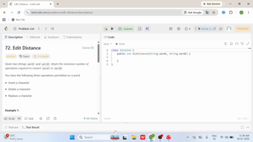

#### Core Concepts & Learning Objectives
Comprehensive video masterclass covering Q12: Infosys - Edit Distance Recursion + DP solution. Focuses on fundamental principles, algorithm analysis, edge-case handling, and Infosys exam question solutions.

---

### Video 161: Q13: Infosys - Maximum Product sub array
- **Video ID**: `171280202` | **Duration**: `00:12:01` (721s)
- **Track**: Infosys DSE & SP Advanced Tracks | **Topic**: Advanced Coding, Live Masterclasses & Induction Strategy
- **Curriculum Path**: `3. Infosys DSE & SP Role Prep / NEW - DSE/ SE: Infosys Coding Questions`

#### Master Video Slide Thumbnail Plate
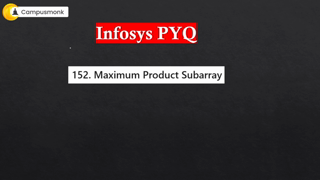

#### Core Concepts & Learning Objectives
Comprehensive video masterclass covering Q13: Infosys - Maximum Product sub array. Focuses on fundamental principles, algorithm analysis, edge-case handling, and Infosys exam question solutions.

---

### Video 415: 1. Full Mock Test Video Solution
- **Video ID**: `162552363` | **Duration**: `01:13:05` (4,385s)
- **Track**: Infosys DSE & SP Advanced Tracks | **Topic**: Advanced Coding, Live Masterclasses & Induction Strategy
- **Curriculum Path**: `Infosys Mock Test Series / Day 06 / 1. Full Length Mock I- Based on Infosys PYQ`

#### Master Video Slide Thumbnail Plate

#### Core Concepts & Learning Objectives
Comprehensive video masterclass covering 1. Full Mock Test Video Solution. Focuses on fundamental principles, algorithm analysis, edge-case handling, and Infosys exam question solutions.

---

