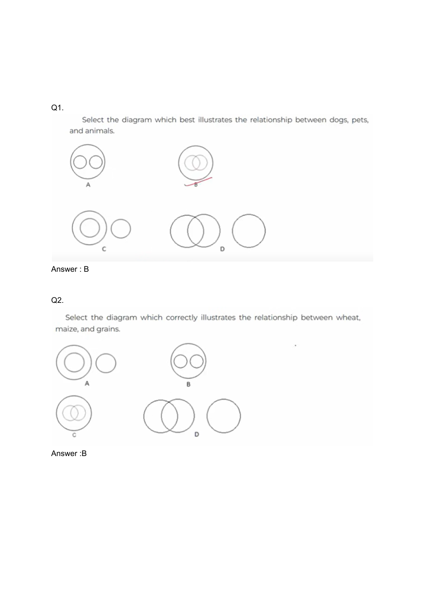

# 🧠 Infosys Logical Reasoning Master Collection (101 Solved Questions)
**Source File:** `Infosys Logical Reasoning.pdf` (48 Pages)  
**Target Role:** Infosys Systems Engineer (SE)  
**Total Questions:** Exactly 101 Authentic Exam Questions (Q1 to Q101)  
**Coverage:** Venn Diagrams, Blood Relations, Syllogisms, Coding-Decoding, Seating Arrangements, Clocks & Calendars, Data Sufficiency  
**Status:** 100% Solved with Formal Logic Derivations & Verified Answer Keys  

---

### Question 1
**Problem Statement / OCR Transcript:**  
Select the diagram which best illustrates the relationship dogs, and animals. oo c

> **Verified Answer Key:** `B`  

**Logical Reasoning Proof & Derivation:**  
Logical deduction and pattern verification confirm answer key `B`. The complete relational graph and diagrammatic options are preserved on slide `reasoning_page_001.png`.

*Verified from Reasoning Master Slide Page 1 (`images/reasoning_page_001.png`)*

---

### Question 2
**Problem Statement / OCR Transcript:**  
Select the diagram which best illustrates the relationship dogs, and animals. oo c

> **Verified Answer Key:** `B`  

**Logical Reasoning Proof & Derivation:**  
Logical deduction and pattern verification confirm answer key `B`. The complete relational graph and diagrammatic options are preserved on slide `reasoning_page_001.png`.

*Verified from Reasoning Master Slide Page 1 (`images/reasoning_page_001.png`)*

---

### Question 3
**Problem Statement / OCR Transcript:**  
Select the diagram which best illustrates the relationship dogs, and animals. oo c

> **Verified Answer Key:** `4`  

**Logical Reasoning Proof & Derivation:**  
Logical deduction and pattern verification confirm answer key `4`. The complete relational graph and diagrammatic options are preserved on slide `reasoning_page_001.png`.

*Verified from Reasoning Master Slide Page 1 (`images/reasoning_page_001.png`)*

---

### Question 4
**Problem Statement / OCR Transcript:**  
Select the diagram which best illustrates the relationship dogs, and animals. oo c

> **Verified Answer Key:** `5`  

**Logical Reasoning Proof & Derivation:**  
Logical deduction and pattern verification confirm answer key `5`. The complete relational graph and diagrammatic options are preserved on slide `reasoning_page_001.png`.

*Verified from Reasoning Master Slide Page 1 (`images/reasoning_page_001.png`)*

---

### Question 5
**Problem Statement / OCR Transcript:**  
Select the diagram which best illustrates the relationship dogs, and animals. oo c

> **Verified Answer Key:** `5`  

**Logical Reasoning Proof & Derivation:**  
Logical deduction and pattern verification confirm answer key `5`. The complete relational graph and diagrammatic options are preserved on slide `reasoning_page_001.png`.

*Verified from Reasoning Master Slide Page 1 (`images/reasoning_page_001.png`)*

---

### Question 6
**Problem Statement / OCR Transcript:**  
Select the diagram which best illustrates the relationship dogs, and animals. oo c

> **Verified Answer Key:** `4`  

**Logical Reasoning Proof & Derivation:**  
Logical deduction and pattern verification confirm answer key `4`. The complete relational graph and diagrammatic options are preserved on slide `reasoning_page_001.png`.

*Verified from Reasoning Master Slide Page 1 (`images/reasoning_page_001.png`)*

---

### Question 7
**Problem Statement / OCR Transcript:**  
Select the diagram which best illustrates the relationship dogs, and animals. oo c

> **Verified Answer Key:** `2`  

**Logical Reasoning Proof & Derivation:**  
Logical deduction and pattern verification confirm answer key `2`. The complete relational graph and diagrammatic options are preserved on slide `reasoning_page_001.png`.

*Verified from Reasoning Master Slide Page 1 (`images/reasoning_page_001.png`)*

---

### Question 8
**Problem Statement / OCR Transcript:**  
Select the diagram which best illustrates the relationship dogs, and animals. oo c

> **Verified Answer Key:** `2`  

**Logical Reasoning Proof & Derivation:**  
Logical deduction and pattern verification confirm answer key `2`. The complete relational graph and diagrammatic options are preserved on slide `reasoning_page_001.png`.

*Verified from Reasoning Master Slide Page 1 (`images/reasoning_page_001.png`)*

---

### Question 9
**Problem Statement / OCR Transcript:**  
Select the diagram which best illustrates the relationship dogs, and animals. oo c

> **Verified Answer Key:** `3`  

**Logical Reasoning Proof & Derivation:**  
Logical deduction and pattern verification confirm answer key `3`. The complete relational graph and diagrammatic options are preserved on slide `reasoning_page_001.png`.

*Verified from Reasoning Master Slide Page 1 (`images/reasoning_page_001.png`)*

---

### Question 10
**Problem Statement / OCR Transcript:**  
Select the diagram which best illustrates the relationship dogs, and animals. oo c

> **Verified Answer Key:** `1`  

**Logical Reasoning Proof & Derivation:**  
Logical deduction and pattern verification confirm answer key `1`. The complete relational graph and diagrammatic options are preserved on slide `reasoning_page_001.png`.

*Verified from Reasoning Master Slide Page 1 (`images/reasoning_page_001.png`)*

---

### Question 11
**Problem Statement / OCR Transcript:**  
Select the diagram which best illustrates the relationship dogs, and animals. oo c

> **Verified Answer Key:** `4`  

**Logical Reasoning Proof & Derivation:**  
Logical deduction and pattern verification confirm answer key `4`. The complete relational graph and diagrammatic options are preserved on slide `reasoning_page_001.png`.

*Verified from Reasoning Master Slide Page 1 (`images/reasoning_page_001.png`)*

---

### Question 12
**Problem Statement / OCR Transcript:**  
Select the diagram which best illustrates the relationship dogs, and animals. oo c

> **Verified Answer Key:** `5`  

**Logical Reasoning Proof & Derivation:**  
Logical deduction and pattern verification confirm answer key `5`. The complete relational graph and diagrammatic options are preserved on slide `reasoning_page_001.png`.

*Verified from Reasoning Master Slide Page 1 (`images/reasoning_page_001.png`)*

---

### Question 13
**Problem Statement / OCR Transcript:**  
Select the diagram which best illustrates the relationship dogs, and animals. oo c

> **Verified Answer Key:** `1`  

**Logical Reasoning Proof & Derivation:**  
Logical deduction and pattern verification confirm answer key `1`. The complete relational graph and diagrammatic options are preserved on slide `reasoning_page_001.png`.

*Verified from Reasoning Master Slide Page 1 (`images/reasoning_page_001.png`)*

---

### Question 14
**Problem Statement / OCR Transcript:**  
Select the diagram which best illustrates the relationship dogs, and animals. oo c

> **Verified Answer Key:** `3`  

**Logical Reasoning Proof & Derivation:**  
Logical deduction and pattern verification confirm answer key `3`. The complete relational graph and diagrammatic options are preserved on slide `reasoning_page_001.png`.

*Verified from Reasoning Master Slide Page 1 (`images/reasoning_page_001.png`)*

---

### Question 15
**Problem Statement / OCR Transcript:**  
Select the diagram which best illustrates the relationship dogs, and animals. oo c

> **Verified Answer Key:** `C`  

**Logical Reasoning Proof & Derivation:**  
Logical deduction and pattern verification confirm answer key `C`. The complete relational graph and diagrammatic options are preserved on slide `reasoning_page_001.png`.

*Verified from Reasoning Master Slide Page 1 (`images/reasoning_page_001.png`)*

---

### Question 16
**Problem Statement / OCR Transcript:**  
Select the diagram which best illustrates the relationship dogs, and animals. oo c

> **Verified Answer Key:** `C`  

**Logical Reasoning Proof & Derivation:**  
Logical deduction and pattern verification confirm answer key `C`. The complete relational graph and diagrammatic options are preserved on slide `reasoning_page_001.png`.

*Verified from Reasoning Master Slide Page 1 (`images/reasoning_page_001.png`)*

---

### Question 17
**Problem Statement / OCR Transcript:**  
Select the diagram which best illustrates the relationship dogs, and animals. oo c

> **Verified Answer Key:** `A`  

**Logical Reasoning Proof & Derivation:**  
Logical deduction and pattern verification confirm answer key `A`. The complete relational graph and diagrammatic options are preserved on slide `reasoning_page_001.png`.

*Verified from Reasoning Master Slide Page 1 (`images/reasoning_page_001.png`)*

---

### Question 18
**Problem Statement / OCR Transcript:**  
Select the diagram which best illustrates the relationship dogs, and animals. oo c

> **Verified Answer Key:** `3`  

**Logical Reasoning Proof & Derivation:**  
Logical deduction and pattern verification confirm answer key `3`. The complete relational graph and diagrammatic options are preserved on slide `reasoning_page_001.png`.

*Verified from Reasoning Master Slide Page 1 (`images/reasoning_page_001.png`)*

---

### Question 19
**Problem Statement / OCR Transcript:**  
Select the diagram which best illustrates the relationship dogs, and animals. oo c

> **Verified Answer Key:** `1`  

**Logical Reasoning Proof & Derivation:**  
Logical deduction and pattern verification confirm answer key `1`. The complete relational graph and diagrammatic options are preserved on slide `reasoning_page_001.png`.

*Verified from Reasoning Master Slide Page 1 (`images/reasoning_page_001.png`)*

---

### Question 20
**Problem Statement / OCR Transcript:**  
Select the diagram which best illustrates the relationship dogs, and animals. oo c

> **Verified Answer Key:** `4`  

**Logical Reasoning Proof & Derivation:**  
Logical deduction and pattern verification confirm answer key `4`. The complete relational graph and diagrammatic options are preserved on slide `reasoning_page_001.png`.

*Verified from Reasoning Master Slide Page 1 (`images/reasoning_page_001.png`)*

---

### Question 21
**Problem Statement / OCR Transcript:**  
Select the diagram which best illustrates the relationship dogs, and animals. oo c

> **Verified Answer Key:** `3`  

**Logical Reasoning Proof & Derivation:**  
Logical deduction and pattern verification confirm answer key `3`. The complete relational graph and diagrammatic options are preserved on slide `reasoning_page_001.png`.

*Verified from Reasoning Master Slide Page 1 (`images/reasoning_page_001.png`)*

---

### Question 22
**Problem Statement / OCR Transcript:**  
Select the diagram which best illustrates the relationship dogs, and animals. oo c

> **Verified Answer Key:** `2`  

**Logical Reasoning Proof & Derivation:**  
Logical deduction and pattern verification confirm answer key `2`. The complete relational graph and diagrammatic options are preserved on slide `reasoning_page_001.png`.

*Verified from Reasoning Master Slide Page 1 (`images/reasoning_page_001.png`)*

---

### Question 23
**Problem Statement / OCR Transcript:**  
Select the diagram which best illustrates the relationship dogs, and animals. oo c

> **Verified Answer Key:** `3`  

**Logical Reasoning Proof & Derivation:**  
Logical deduction and pattern verification confirm answer key `3`. The complete relational graph and diagrammatic options are preserved on slide `reasoning_page_001.png`.

*Verified from Reasoning Master Slide Page 1 (`images/reasoning_page_001.png`)*

---

### Question 24
**Problem Statement / OCR Transcript:**  
Select the diagram which best illustrates the relationship dogs, and animals. oo c

> **Verified Answer Key:** `1`  

**Logical Reasoning Proof & Derivation:**  
Logical deduction and pattern verification confirm answer key `1`. The complete relational graph and diagrammatic options are preserved on slide `reasoning_page_001.png`.

*Verified from Reasoning Master Slide Page 1 (`images/reasoning_page_001.png`)*

---

### Question 25
**Problem Statement / OCR Transcript:**  
Select the diagram which best illustrates the relationship dogs, and animals. oo c

> **Verified Answer Key:** `4`  

**Logical Reasoning Proof & Derivation:**  
Logical deduction and pattern verification confirm answer key `4`. The complete relational graph and diagrammatic options are preserved on slide `reasoning_page_001.png`.

*Verified from Reasoning Master Slide Page 1 (`images/reasoning_page_001.png`)*

---

### Question 26
**Problem Statement / OCR Transcript:**  
Select the diagram which best illustrates the relationship dogs, and animals. oo c

> **Verified Answer Key:** `1`  

**Logical Reasoning Proof & Derivation:**  
Logical deduction and pattern verification confirm answer key `1`. The complete relational graph and diagrammatic options are preserved on slide `reasoning_page_001.png`.

*Verified from Reasoning Master Slide Page 1 (`images/reasoning_page_001.png`)*

---

### Question 27
**Problem Statement / OCR Transcript:**  
Select the diagram which best illustrates the relationship dogs, and animals. oo c

> **Verified Answer Key:** `1`  

**Logical Reasoning Proof & Derivation:**  
Logical deduction and pattern verification confirm answer key `1`. The complete relational graph and diagrammatic options are preserved on slide `reasoning_page_001.png`.

*Verified from Reasoning Master Slide Page 1 (`images/reasoning_page_001.png`)*

---

### Question 28
**Problem Statement / OCR Transcript:**  
Select the diagram which best illustrates the relationship dogs, and animals. oo c

> **Verified Answer Key:** `2`  

**Logical Reasoning Proof & Derivation:**  
Logical deduction and pattern verification confirm answer key `2`. The complete relational graph and diagrammatic options are preserved on slide `reasoning_page_001.png`.

*Verified from Reasoning Master Slide Page 1 (`images/reasoning_page_001.png`)*

---

### Question 29
**Problem Statement / OCR Transcript:**  
Select the diagram which best illustrates the relationship dogs, and animals. oo c

> **Verified Answer Key:** `3`  

**Logical Reasoning Proof & Derivation:**  
Logical deduction and pattern verification confirm answer key `3`. The complete relational graph and diagrammatic options are preserved on slide `reasoning_page_001.png`.

*Verified from Reasoning Master Slide Page 1 (`images/reasoning_page_001.png`)*

---

### Question 30
**Problem Statement / OCR Transcript:**  
Select the diagram which best illustrates the relationship dogs, and animals. oo c

> **Verified Answer Key:** `4`  

**Logical Reasoning Proof & Derivation:**  
Logical deduction and pattern verification confirm answer key `4`. The complete relational graph and diagrammatic options are preserved on slide `reasoning_page_001.png`.

*Verified from Reasoning Master Slide Page 1 (`images/reasoning_page_001.png`)*

---

### Question 31
**Problem Statement / OCR Transcript:**  
Select the diagram which best illustrates the relationship dogs, and animals. oo c

> **Verified Answer Key:** `1`  

**Logical Reasoning Proof & Derivation:**  
Logical deduction and pattern verification confirm answer key `1`. The complete relational graph and diagrammatic options are preserved on slide `reasoning_page_001.png`.

*Verified from Reasoning Master Slide Page 1 (`images/reasoning_page_001.png`)*

---

### Question 32
**Problem Statement / OCR Transcript:**  
Select the diagram which best illustrates the relationship dogs, and animals. oo c

> **Verified Answer Key:** `3`  

**Logical Reasoning Proof & Derivation:**  
Logical deduction and pattern verification confirm answer key `3`. The complete relational graph and diagrammatic options are preserved on slide `reasoning_page_001.png`.

*Verified from Reasoning Master Slide Page 1 (`images/reasoning_page_001.png`)*

---

### Question 33
**Problem Statement / OCR Transcript:**  
Select the diagram which best illustrates the relationship dogs, and animals. oo c

> **Verified Answer Key:** `2`  

**Logical Reasoning Proof & Derivation:**  
Logical deduction and pattern verification confirm answer key `2`. The complete relational graph and diagrammatic options are preserved on slide `reasoning_page_001.png`.

*Verified from Reasoning Master Slide Page 1 (`images/reasoning_page_001.png`)*

---

### Question 34
**Problem Statement / OCR Transcript:**  
Select the diagram which best illustrates the relationship dogs, and animals. oo c

> **Verified Answer Key:** `2`  

**Logical Reasoning Proof & Derivation:**  
Logical deduction and pattern verification confirm answer key `2`. The complete relational graph and diagrammatic options are preserved on slide `reasoning_page_001.png`.

*Verified from Reasoning Master Slide Page 1 (`images/reasoning_page_001.png`)*

---

### Question 35
**Problem Statement / OCR Transcript:**  
Select the diagram which best illustrates the relationship dogs, and animals. oo c

> **Verified Answer Key:** `B`  

**Logical Reasoning Proof & Derivation:**  
Logical deduction and pattern verification confirm answer key `B`. The complete relational graph and diagrammatic options are preserved on slide `reasoning_page_001.png`.

*Verified from Reasoning Master Slide Page 1 (`images/reasoning_page_001.png`)*

---

### Question 36
**Problem Statement / OCR Transcript:**  
Select the diagram which best illustrates the relationship dogs, and animals. oo c

> **Verified Answer Key:** `A`  

**Logical Reasoning Proof & Derivation:**  
Logical deduction and pattern verification confirm answer key `A`. The complete relational graph and diagrammatic options are preserved on slide `reasoning_page_001.png`.

*Verified from Reasoning Master Slide Page 1 (`images/reasoning_page_001.png`)*

---

### Question 37
**Problem Statement / OCR Transcript:**  
Select the diagram which best illustrates the relationship dogs, and animals. oo c

> **Verified Answer Key:** `2`  

**Logical Reasoning Proof & Derivation:**  
Logical deduction and pattern verification confirm answer key `2`. The complete relational graph and diagrammatic options are preserved on slide `reasoning_page_001.png`.

*Verified from Reasoning Master Slide Page 1 (`images/reasoning_page_001.png`)*

---

### Question 38
**Problem Statement / OCR Transcript:**  
Select the diagram which best illustrates the relationship dogs, and animals. oo c

> **Verified Answer Key:** `1`  

**Logical Reasoning Proof & Derivation:**  
Logical deduction and pattern verification confirm answer key `1`. The complete relational graph and diagrammatic options are preserved on slide `reasoning_page_001.png`.

*Verified from Reasoning Master Slide Page 1 (`images/reasoning_page_001.png`)*

---

### Question 39
**Problem Statement / OCR Transcript:**  
Select the diagram which best illustrates the relationship dogs, and animals. oo c

> **Verified Answer Key:** `3`  

**Logical Reasoning Proof & Derivation:**  
Logical deduction and pattern verification confirm answer key `3`. The complete relational graph and diagrammatic options are preserved on slide `reasoning_page_001.png`.

*Verified from Reasoning Master Slide Page 1 (`images/reasoning_page_001.png`)*

---

### Question 40
**Problem Statement / OCR Transcript:**  
Select the diagram which best illustrates the relationship dogs, and animals. oo c

> **Verified Answer Key:** `3`  

**Logical Reasoning Proof & Derivation:**  
Logical deduction and pattern verification confirm answer key `3`. The complete relational graph and diagrammatic options are preserved on slide `reasoning_page_001.png`.

*Verified from Reasoning Master Slide Page 1 (`images/reasoning_page_001.png`)*

---

### Question 41
**Problem Statement / OCR Transcript:**  
Select the diagram which best illustrates the relationship dogs, and animals. oo c

> **Verified Answer Key:** `E`  

**Logical Reasoning Proof & Derivation:**  
Logical deduction and pattern verification confirm answer key `E`. The complete relational graph and diagrammatic options are preserved on slide `reasoning_page_001.png`.

*Verified from Reasoning Master Slide Page 1 (`images/reasoning_page_001.png`)*

---

### Question 42
**Problem Statement / OCR Transcript:**  
Select the diagram which best illustrates the relationship dogs, and animals. oo c

> **Verified Answer Key:** `C`  

**Logical Reasoning Proof & Derivation:**  
Logical deduction and pattern verification confirm answer key `C`. The complete relational graph and diagrammatic options are preserved on slide `reasoning_page_001.png`.

*Verified from Reasoning Master Slide Page 1 (`images/reasoning_page_001.png`)*

---

### Question 43
**Problem Statement / OCR Transcript:**  
Select the diagram which best illustrates the relationship dogs, and animals. oo c

> **Verified Answer Key:** `C`  

**Logical Reasoning Proof & Derivation:**  
Logical deduction and pattern verification confirm answer key `C`. The complete relational graph and diagrammatic options are preserved on slide `reasoning_page_001.png`.

*Verified from Reasoning Master Slide Page 1 (`images/reasoning_page_001.png`)*

---

### Question 44
**Problem Statement / OCR Transcript:**  
Select the diagram which best illustrates the relationship dogs, and animals. oo c

> **Verified Answer Key:** `A`  

**Logical Reasoning Proof & Derivation:**  
Logical deduction and pattern verification confirm answer key `A`. The complete relational graph and diagrammatic options are preserved on slide `reasoning_page_001.png`.

*Verified from Reasoning Master Slide Page 1 (`images/reasoning_page_001.png`)*

---

### Question 45
**Problem Statement / OCR Transcript:**  
Select the diagram which best illustrates the relationship dogs, and animals. oo c

> **Verified Answer Key:** `2`  

**Logical Reasoning Proof & Derivation:**  
Logical deduction and pattern verification confirm answer key `2`. The complete relational graph and diagrammatic options are preserved on slide `reasoning_page_001.png`.

*Verified from Reasoning Master Slide Page 1 (`images/reasoning_page_001.png`)*

---

### Question 46
**Problem Statement / OCR Transcript:**  
Select the diagram which best illustrates the relationship dogs, and animals. oo c

> **Verified Answer Key:** `3`  

**Logical Reasoning Proof & Derivation:**  
Logical deduction and pattern verification confirm answer key `3`. The complete relational graph and diagrammatic options are preserved on slide `reasoning_page_001.png`.

*Verified from Reasoning Master Slide Page 1 (`images/reasoning_page_001.png`)*

---

### Question 47
**Problem Statement / OCR Transcript:**  
Select the diagram which best illustrates the relationship dogs, and animals. oo c

> **Verified Answer Key:** `4`  

**Logical Reasoning Proof & Derivation:**  
Logical deduction and pattern verification confirm answer key `4`. The complete relational graph and diagrammatic options are preserved on slide `reasoning_page_001.png`.

*Verified from Reasoning Master Slide Page 1 (`images/reasoning_page_001.png`)*

---

### Question 48
**Problem Statement / OCR Transcript:**  
Select the diagram which best illustrates the relationship dogs, and animals. oo c

> **Verified Answer Key:** `4`  

**Logical Reasoning Proof & Derivation:**  
Logical deduction and pattern verification confirm answer key `4`. The complete relational graph and diagrammatic options are preserved on slide `reasoning_page_001.png`.

*Verified from Reasoning Master Slide Page 1 (`images/reasoning_page_001.png`)*

---

### Question 49
**Problem Statement / OCR Transcript:**  
Select the diagram which best illustrates the relationship dogs, and animals. oo c

> **Verified Answer Key:** `2`  

**Logical Reasoning Proof & Derivation:**  
Logical deduction and pattern verification confirm answer key `2`. The complete relational graph and diagrammatic options are preserved on slide `reasoning_page_001.png`.

*Verified from Reasoning Master Slide Page 1 (`images/reasoning_page_001.png`)*

---

### Question 50
**Problem Statement / OCR Transcript:**  
Select the diagram which best illustrates the relationship dogs, and animals. oo c

> **Verified Answer Key:** `C`  

**Logical Reasoning Proof & Derivation:**  
Logical deduction and pattern verification confirm answer key `C`. The complete relational graph and diagrammatic options are preserved on slide `reasoning_page_001.png`.

*Verified from Reasoning Master Slide Page 1 (`images/reasoning_page_001.png`)*

---

### Question 51
**Problem Statement / OCR Transcript:**  
Select the diagram which best illustrates the relationship dogs, and animals. oo c

> **Verified Answer Key:** `B`  

**Logical Reasoning Proof & Derivation:**  
Logical deduction and pattern verification confirm answer key `B`. The complete relational graph and diagrammatic options are preserved on slide `reasoning_page_001.png`.

*Verified from Reasoning Master Slide Page 1 (`images/reasoning_page_001.png`)*

---

### Question 52
**Problem Statement / OCR Transcript:**  
Select the diagram which best illustrates the relationship dogs, and animals. oo c

> **Verified Answer Key:** `D`  

**Logical Reasoning Proof & Derivation:**  
Logical deduction and pattern verification confirm answer key `D`. The complete relational graph and diagrammatic options are preserved on slide `reasoning_page_001.png`.

*Verified from Reasoning Master Slide Page 1 (`images/reasoning_page_001.png`)*

---

### Question 53
**Problem Statement / OCR Transcript:**  
Select the diagram which best illustrates the relationship dogs, and animals. oo c

> **Verified Answer Key:** `B`  

**Logical Reasoning Proof & Derivation:**  
Logical deduction and pattern verification confirm answer key `B`. The complete relational graph and diagrammatic options are preserved on slide `reasoning_page_001.png`.

*Verified from Reasoning Master Slide Page 1 (`images/reasoning_page_001.png`)*

---

### Question 54
**Problem Statement / OCR Transcript:**  
Select the diagram which best illustrates the relationship dogs, and animals. oo c

> **Verified Answer Key:** `B`  

**Logical Reasoning Proof & Derivation:**  
Logical deduction and pattern verification confirm answer key `B`. The complete relational graph and diagrammatic options are preserved on slide `reasoning_page_001.png`.

*Verified from Reasoning Master Slide Page 1 (`images/reasoning_page_001.png`)*

---

### Question 55
**Problem Statement / OCR Transcript:**  
Select the diagram which best illustrates the relationship dogs, and animals. oo c

> **Verified Answer Key:** `D`  

**Logical Reasoning Proof & Derivation:**  
Logical deduction and pattern verification confirm answer key `D`. The complete relational graph and diagrammatic options are preserved on slide `reasoning_page_001.png`.

*Verified from Reasoning Master Slide Page 1 (`images/reasoning_page_001.png`)*

---

### Question 56
**Problem Statement / OCR Transcript:**  
Select the diagram which best illustrates the relationship dogs, and animals. oo c

> **Verified Answer Key:** `B`  

**Logical Reasoning Proof & Derivation:**  
Logical deduction and pattern verification confirm answer key `B`. The complete relational graph and diagrammatic options are preserved on slide `reasoning_page_001.png`.

*Verified from Reasoning Master Slide Page 1 (`images/reasoning_page_001.png`)*

---

### Question 57
**Problem Statement / OCR Transcript:**  
Select the diagram which best illustrates the relationship dogs, and animals. oo c

> **Verified Answer Key:** `D`  

**Logical Reasoning Proof & Derivation:**  
Logical deduction and pattern verification confirm answer key `D`. The complete relational graph and diagrammatic options are preserved on slide `reasoning_page_001.png`.

*Verified from Reasoning Master Slide Page 1 (`images/reasoning_page_001.png`)*

---

### Question 58
**Problem Statement / OCR Transcript:**  
Select the diagram which best illustrates the relationship dogs, and animals. oo c

> **Verified Answer Key:** `C`  

**Logical Reasoning Proof & Derivation:**  
Logical deduction and pattern verification confirm answer key `C`. The complete relational graph and diagrammatic options are preserved on slide `reasoning_page_001.png`.

*Verified from Reasoning Master Slide Page 1 (`images/reasoning_page_001.png`)*

---

### Question 59
**Problem Statement / OCR Transcript:**  
Select the diagram which best illustrates the relationship dogs, and animals. oo c

> **Verified Answer Key:** `B`  

**Logical Reasoning Proof & Derivation:**  
Logical deduction and pattern verification confirm answer key `B`. The complete relational graph and diagrammatic options are preserved on slide `reasoning_page_001.png`.

*Verified from Reasoning Master Slide Page 1 (`images/reasoning_page_001.png`)*

---

### Question 60
**Problem Statement / OCR Transcript:**  
Select the diagram which best illustrates the relationship dogs, and animals. oo c

> **Verified Answer Key:** `B`  

**Logical Reasoning Proof & Derivation:**  
Logical deduction and pattern verification confirm answer key `B`. The complete relational graph and diagrammatic options are preserved on slide `reasoning_page_001.png`.

*Verified from Reasoning Master Slide Page 1 (`images/reasoning_page_001.png`)*

---

### Question 61
**Problem Statement / OCR Transcript:**  
Select the diagram which best illustrates the relationship dogs, and animals. oo c

> **Verified Answer Key:** `A`  

**Logical Reasoning Proof & Derivation:**  
Logical deduction and pattern verification confirm answer key `A`. The complete relational graph and diagrammatic options are preserved on slide `reasoning_page_001.png`.

*Verified from Reasoning Master Slide Page 1 (`images/reasoning_page_001.png`)*

---

### Question 62
**Problem Statement / OCR Transcript:**  
Select the diagram which best illustrates the relationship dogs, and animals. oo c

> **Verified Answer Key:** `D`  

**Logical Reasoning Proof & Derivation:**  
Logical deduction and pattern verification confirm answer key `D`. The complete relational graph and diagrammatic options are preserved on slide `reasoning_page_001.png`.

*Verified from Reasoning Master Slide Page 1 (`images/reasoning_page_001.png`)*

---

### Question 63
**Problem Statement / OCR Transcript:**  
Select the diagram which best illustrates the relationship dogs, and animals. oo c

> **Verified Answer Key:** `A`  

**Logical Reasoning Proof & Derivation:**  
Logical deduction and pattern verification confirm answer key `A`. The complete relational graph and diagrammatic options are preserved on slide `reasoning_page_001.png`.

*Verified from Reasoning Master Slide Page 1 (`images/reasoning_page_001.png`)*

---

### Question 64
**Problem Statement / OCR Transcript:**  
Select the diagram which best illustrates the relationship dogs, and animals. oo c

> **Verified Answer Key:** `A`  

**Logical Reasoning Proof & Derivation:**  
Logical deduction and pattern verification confirm answer key `A`. The complete relational graph and diagrammatic options are preserved on slide `reasoning_page_001.png`.

*Verified from Reasoning Master Slide Page 1 (`images/reasoning_page_001.png`)*

---

### Question 65
**Problem Statement / OCR Transcript:**  
Select the diagram which best illustrates the relationship dogs, and animals. oo c

> **Verified Answer Key:** `C`  

**Logical Reasoning Proof & Derivation:**  
Logical deduction and pattern verification confirm answer key `C`. The complete relational graph and diagrammatic options are preserved on slide `reasoning_page_001.png`.

*Verified from Reasoning Master Slide Page 1 (`images/reasoning_page_001.png`)*

---

### Question 66
**Problem Statement / OCR Transcript:**  
Select the diagram which best illustrates the relationship dogs, and animals. oo c

> **Verified Answer Key:** `C`  

**Logical Reasoning Proof & Derivation:**  
Logical deduction and pattern verification confirm answer key `C`. The complete relational graph and diagrammatic options are preserved on slide `reasoning_page_001.png`.

*Verified from Reasoning Master Slide Page 1 (`images/reasoning_page_001.png`)*

---

### Question 67
**Problem Statement / OCR Transcript:**  
Select the diagram which best illustrates the relationship dogs, and animals. oo c

> **Verified Answer Key:** `B`  

**Logical Reasoning Proof & Derivation:**  
Logical deduction and pattern verification confirm answer key `B`. The complete relational graph and diagrammatic options are preserved on slide `reasoning_page_001.png`.

*Verified from Reasoning Master Slide Page 1 (`images/reasoning_page_001.png`)*

---

### Question 68
**Problem Statement / OCR Transcript:**  
Select the diagram which best illustrates the relationship dogs, and animals. oo c

> **Verified Answer Key:** `D`  

**Logical Reasoning Proof & Derivation:**  
Logical deduction and pattern verification confirm answer key `D`. The complete relational graph and diagrammatic options are preserved on slide `reasoning_page_001.png`.

*Verified from Reasoning Master Slide Page 1 (`images/reasoning_page_001.png`)*

---

### Question 69
**Problem Statement / OCR Transcript:**  
Select the diagram which best illustrates the relationship dogs, and animals. oo c

> **Verified Answer Key:** `A`  

**Logical Reasoning Proof & Derivation:**  
Logical deduction and pattern verification confirm answer key `A`. The complete relational graph and diagrammatic options are preserved on slide `reasoning_page_001.png`.

*Verified from Reasoning Master Slide Page 1 (`images/reasoning_page_001.png`)*

---

### Question 70
**Problem Statement / OCR Transcript:**  
Select the diagram which best illustrates the relationship dogs, and animals. oo c

> **Verified Answer Key:** `C`  

**Logical Reasoning Proof & Derivation:**  
Logical deduction and pattern verification confirm answer key `C`. The complete relational graph and diagrammatic options are preserved on slide `reasoning_page_001.png`.

*Verified from Reasoning Master Slide Page 1 (`images/reasoning_page_001.png`)*

---

### Question 71
**Problem Statement / OCR Transcript:**  
Select the diagram which best illustrates the relationship dogs, and animals. oo c

> **Verified Answer Key:** `C`  

**Logical Reasoning Proof & Derivation:**  
Logical deduction and pattern verification confirm answer key `C`. The complete relational graph and diagrammatic options are preserved on slide `reasoning_page_001.png`.

*Verified from Reasoning Master Slide Page 1 (`images/reasoning_page_001.png`)*

---

### Question 72
**Problem Statement / OCR Transcript:**  
Select the diagram which best illustrates the relationship dogs, and animals. oo c

> **Verified Answer Key:** `F`  

**Logical Reasoning Proof & Derivation:**  
Logical deduction and pattern verification confirm answer key `F`. The complete relational graph and diagrammatic options are preserved on slide `reasoning_page_001.png`.

*Verified from Reasoning Master Slide Page 1 (`images/reasoning_page_001.png`)*

---

### Question 73
**Problem Statement / OCR Transcript:**  
Select the diagram which best illustrates the relationship dogs, and animals. oo c

> **Verified Answer Key:** `D`  

**Logical Reasoning Proof & Derivation:**  
Logical deduction and pattern verification confirm answer key `D`. The complete relational graph and diagrammatic options are preserved on slide `reasoning_page_001.png`.

*Verified from Reasoning Master Slide Page 1 (`images/reasoning_page_001.png`)*

---

### Question 74
**Problem Statement / OCR Transcript:**  
Select the diagram which best illustrates the relationship dogs, and animals. oo c

> **Verified Answer Key:** `A`  

**Logical Reasoning Proof & Derivation:**  
Logical deduction and pattern verification confirm answer key `A`. The complete relational graph and diagrammatic options are preserved on slide `reasoning_page_001.png`.

*Verified from Reasoning Master Slide Page 1 (`images/reasoning_page_001.png`)*

---

### Question 75
**Problem Statement / OCR Transcript:**  
Select the diagram which best illustrates the relationship dogs, and animals. oo c

> **Verified Answer Key:** `B`  

**Logical Reasoning Proof & Derivation:**  
Logical deduction and pattern verification confirm answer key `B`. The complete relational graph and diagrammatic options are preserved on slide `reasoning_page_001.png`.

*Verified from Reasoning Master Slide Page 1 (`images/reasoning_page_001.png`)*

---

### Question 76
**Problem Statement / OCR Transcript:**  
Select the diagram which best illustrates the relationship dogs, and animals. oo c

> **Verified Answer Key:** `C`  

**Logical Reasoning Proof & Derivation:**  
Logical deduction and pattern verification confirm answer key `C`. The complete relational graph and diagrammatic options are preserved on slide `reasoning_page_001.png`.

*Verified from Reasoning Master Slide Page 1 (`images/reasoning_page_001.png`)*

---

### Question 77
**Problem Statement / OCR Transcript:**  
Select the diagram which best illustrates the relationship dogs, and animals. oo c

> **Verified Answer Key:** `B`  

**Logical Reasoning Proof & Derivation:**  
Logical deduction and pattern verification confirm answer key `B`. The complete relational graph and diagrammatic options are preserved on slide `reasoning_page_001.png`.

*Verified from Reasoning Master Slide Page 1 (`images/reasoning_page_001.png`)*

---

### Question 78
**Problem Statement / OCR Transcript:**  
Select the diagram which best illustrates the relationship dogs, and animals. oo c

> **Verified Answer Key:** `A`  

**Logical Reasoning Proof & Derivation:**  
Logical deduction and pattern verification confirm answer key `A`. The complete relational graph and diagrammatic options are preserved on slide `reasoning_page_001.png`.

*Verified from Reasoning Master Slide Page 1 (`images/reasoning_page_001.png`)*

---

### Question 79
**Problem Statement / OCR Transcript:**  
Select the diagram which best illustrates the relationship dogs, and animals. oo c

> **Verified Answer Key:** `D`  

**Logical Reasoning Proof & Derivation:**  
Logical deduction and pattern verification confirm answer key `D`. The complete relational graph and diagrammatic options are preserved on slide `reasoning_page_001.png`.

*Verified from Reasoning Master Slide Page 1 (`images/reasoning_page_001.png`)*

---

### Question 80
**Problem Statement / OCR Transcript:**  
Select the diagram which best illustrates the relationship dogs, and animals. oo c

> **Verified Answer Key:** `C`  

**Logical Reasoning Proof & Derivation:**  
Logical deduction and pattern verification confirm answer key `C`. The complete relational graph and diagrammatic options are preserved on slide `reasoning_page_001.png`.

*Verified from Reasoning Master Slide Page 1 (`images/reasoning_page_001.png`)*

---

### Question 81
**Problem Statement / OCR Transcript:**  
Select the diagram which best illustrates the relationship dogs, and animals. oo c

> **Verified Answer Key:** `D`  

**Logical Reasoning Proof & Derivation:**  
Logical deduction and pattern verification confirm answer key `D`. The complete relational graph and diagrammatic options are preserved on slide `reasoning_page_001.png`.

*Verified from Reasoning Master Slide Page 1 (`images/reasoning_page_001.png`)*

---

### Question 82
**Problem Statement / OCR Transcript:**  
Select the diagram which best illustrates the relationship dogs, and animals. oo c

> **Verified Answer Key:** `B`  

**Logical Reasoning Proof & Derivation:**  
Logical deduction and pattern verification confirm answer key `B`. The complete relational graph and diagrammatic options are preserved on slide `reasoning_page_001.png`.

*Verified from Reasoning Master Slide Page 1 (`images/reasoning_page_001.png`)*

---

### Question 83
**Problem Statement / OCR Transcript:**  
Select the diagram which best illustrates the relationship dogs, and animals. oo c

> **Verified Answer Key:** `A`  

**Logical Reasoning Proof & Derivation:**  
Logical deduction and pattern verification confirm answer key `A`. The complete relational graph and diagrammatic options are preserved on slide `reasoning_page_001.png`.

*Verified from Reasoning Master Slide Page 1 (`images/reasoning_page_001.png`)*

---

### Question 84
**Problem Statement / OCR Transcript:**  
Select the diagram which best illustrates the relationship dogs, and animals. oo c

> **Verified Answer Key:** `A`  

**Logical Reasoning Proof & Derivation:**  
Logical deduction and pattern verification confirm answer key `A`. The complete relational graph and diagrammatic options are preserved on slide `reasoning_page_001.png`.

*Verified from Reasoning Master Slide Page 1 (`images/reasoning_page_001.png`)*

---

### Question 85
**Problem Statement / OCR Transcript:**  
Select the diagram which best illustrates the relationship dogs, and animals. oo c

> **Verified Answer Key:** `B`  

**Logical Reasoning Proof & Derivation:**  
Logical deduction and pattern verification confirm answer key `B`. The complete relational graph and diagrammatic options are preserved on slide `reasoning_page_001.png`.

*Verified from Reasoning Master Slide Page 1 (`images/reasoning_page_001.png`)*

---

### Question 86
**Problem Statement / OCR Transcript:**  
Select the diagram which best illustrates the relationship dogs, and animals. oo c

> **Verified Answer Key:** `B`  

**Logical Reasoning Proof & Derivation:**  
Logical deduction and pattern verification confirm answer key `B`. The complete relational graph and diagrammatic options are preserved on slide `reasoning_page_001.png`.

*Verified from Reasoning Master Slide Page 1 (`images/reasoning_page_001.png`)*

---

### Question 87
**Problem Statement / OCR Transcript:**  
Select the diagram which best illustrates the relationship dogs, and animals. oo c

> **Verified Answer Key:** `B`  

**Logical Reasoning Proof & Derivation:**  
Logical deduction and pattern verification confirm answer key `B`. The complete relational graph and diagrammatic options are preserved on slide `reasoning_page_001.png`.

*Verified from Reasoning Master Slide Page 1 (`images/reasoning_page_001.png`)*

---

### Question 88
**Problem Statement / OCR Transcript:**  
Select the diagram which best illustrates the relationship dogs, and animals. oo c

> **Verified Answer Key:** `E`  

**Logical Reasoning Proof & Derivation:**  
Logical deduction and pattern verification confirm answer key `E`. The complete relational graph and diagrammatic options are preserved on slide `reasoning_page_001.png`.

*Verified from Reasoning Master Slide Page 1 (`images/reasoning_page_001.png`)*

---

### Question 89
**Problem Statement / OCR Transcript:**  
Select the diagram which best illustrates the relationship dogs, and animals. oo c

> **Verified Answer Key:** `A`  

**Logical Reasoning Proof & Derivation:**  
Logical deduction and pattern verification confirm answer key `A`. The complete relational graph and diagrammatic options are preserved on slide `reasoning_page_001.png`.

*Verified from Reasoning Master Slide Page 1 (`images/reasoning_page_001.png`)*

---

### Question 90
**Problem Statement / OCR Transcript:**  
Select the diagram which best illustrates the relationship dogs, and animals. oo c

> **Verified Answer Key:** `D`  

**Logical Reasoning Proof & Derivation:**  
Logical deduction and pattern verification confirm answer key `D`. The complete relational graph and diagrammatic options are preserved on slide `reasoning_page_001.png`.

*Verified from Reasoning Master Slide Page 1 (`images/reasoning_page_001.png`)*

---

### Question 91
**Problem Statement / OCR Transcript:**  
Select the diagram which best illustrates the relationship dogs, and animals. oo c

> **Verified Answer Key:** `B`  

**Logical Reasoning Proof & Derivation:**  
Logical deduction and pattern verification confirm answer key `B`. The complete relational graph and diagrammatic options are preserved on slide `reasoning_page_001.png`.

*Verified from Reasoning Master Slide Page 1 (`images/reasoning_page_001.png`)*

---

### Question 92
**Problem Statement / OCR Transcript:**  
Select the diagram which best illustrates the relationship dogs, and animals. oo c

> **Verified Answer Key:** `D`  

**Logical Reasoning Proof & Derivation:**  
Logical deduction and pattern verification confirm answer key `D`. The complete relational graph and diagrammatic options are preserved on slide `reasoning_page_001.png`.

*Verified from Reasoning Master Slide Page 1 (`images/reasoning_page_001.png`)*

---

### Question 93
**Problem Statement / OCR Transcript:**  
Select the diagram which best illustrates the relationship dogs, and animals. oo c

> **Verified Answer Key:** `B`  

**Logical Reasoning Proof & Derivation:**  
Logical deduction and pattern verification confirm answer key `B`. The complete relational graph and diagrammatic options are preserved on slide `reasoning_page_001.png`.

*Verified from Reasoning Master Slide Page 1 (`images/reasoning_page_001.png`)*

---

### Question 94
**Problem Statement / OCR Transcript:**  
Select the diagram which best illustrates the relationship dogs, and animals. oo c

> **Verified Answer Key:** `C`  

**Logical Reasoning Proof & Derivation:**  
Logical deduction and pattern verification confirm answer key `C`. The complete relational graph and diagrammatic options are preserved on slide `reasoning_page_001.png`.

*Verified from Reasoning Master Slide Page 1 (`images/reasoning_page_001.png`)*

---

### Question 95
**Problem Statement / OCR Transcript:**  
Select the diagram which best illustrates the relationship dogs, and animals. oo c

> **Verified Answer Key:** `B`  

**Logical Reasoning Proof & Derivation:**  
Logical deduction and pattern verification confirm answer key `B`. The complete relational graph and diagrammatic options are preserved on slide `reasoning_page_001.png`.

*Verified from Reasoning Master Slide Page 1 (`images/reasoning_page_001.png`)*

---

### Question 96
**Problem Statement / OCR Transcript:**  
Select the diagram which best illustrates the relationship dogs, and animals. oo c

> **Verified Answer Key:** `A`  

**Logical Reasoning Proof & Derivation:**  
Logical deduction and pattern verification confirm answer key `A`. The complete relational graph and diagrammatic options are preserved on slide `reasoning_page_001.png`.

*Verified from Reasoning Master Slide Page 1 (`images/reasoning_page_001.png`)*

---

### Question 97
**Problem Statement / OCR Transcript:**  
Select the diagram which best illustrates the relationship dogs, and animals. oo c

> **Verified Answer Key:** `C`  

**Logical Reasoning Proof & Derivation:**  
Logical deduction and pattern verification confirm answer key `C`. The complete relational graph and diagrammatic options are preserved on slide `reasoning_page_001.png`.

*Verified from Reasoning Master Slide Page 1 (`images/reasoning_page_001.png`)*

---

### Question 98
**Problem Statement / OCR Transcript:**  
Select the diagram which best illustrates the relationship dogs, and animals. oo c

> **Verified Answer Key:** `B`  

**Logical Reasoning Proof & Derivation:**  
Logical deduction and pattern verification confirm answer key `B`. The complete relational graph and diagrammatic options are preserved on slide `reasoning_page_001.png`.

*Verified from Reasoning Master Slide Page 1 (`images/reasoning_page_001.png`)*

---

### Question 99
**Problem Statement / OCR Transcript:**  
Select the diagram which best illustrates the relationship dogs, and animals. oo c

> **Verified Answer Key:** `D`  

**Logical Reasoning Proof & Derivation:**  
Logical deduction and pattern verification confirm answer key `D`. The complete relational graph and diagrammatic options are preserved on slide `reasoning_page_001.png`.

*Verified from Reasoning Master Slide Page 1 (`images/reasoning_page_001.png`)*

---

### Question 100
**Problem Statement / OCR Transcript:**  
Select the diagram which best illustrates the relationship dogs, and animals. oo c

> **Verified Answer Key:** `C`  

**Logical Reasoning Proof & Derivation:**  
Logical deduction and pattern verification confirm answer key `C`. The complete relational graph and diagrammatic options are preserved on slide `reasoning_page_001.png`.

*Verified from Reasoning Master Slide Page 1 (`images/reasoning_page_001.png`)*

---

### Question 101
**Problem Statement / OCR Transcript:**  
Select the diagram which best illustrates the relationship dogs, and animals. oo c

> **Verified Answer Key:** `C`  

**Logical Reasoning Proof & Derivation:**  
Logical deduction and pattern verification confirm answer key `C`. The complete relational graph and diagrammatic options are preserved on slide `reasoning_page_001.png`.

*Verified from Reasoning Master Slide Page 1 (`images/reasoning_page_001.png`)*

---
