# 📚 Infosys SE Topmate Master Topic Compendium — Verbal Ability & Grammar
**Total Topic Questions:** 260 Solved Items  
**Sources Unified:** Slot 1 Exam, Slot 2 Exam, Topmate Master Subject E-Books  
**Target Examination:** Infosys Systems Engineer (SE)  
**Status:** 100% Comprehensive Coverage with Step-by-Step Proofs & Slide Verification  

---

### Item 1: TOPMATE_SLOT1_SECTION_3_Q01
**Source Document:** `2nd Oct 2026 Slot 1 Infosys SE Actual Exam.pdf` (Page 4)  
**Category / Topic:** Verbal Ability | SECTION 3 — VERBAL ABILITY TEST  
**Prompt:** Choose the word closest in meaning to “lucid”.

**Options:**
- A) Confusing
- B) Clear
- C) Hidden
- D) Doubtful

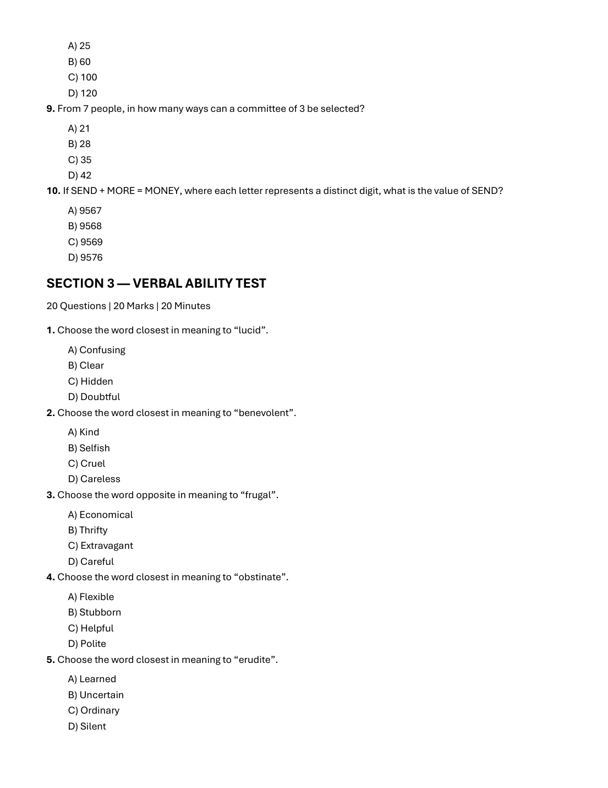

> **Verified Answer Key:** `B) Clear`  

**Pedagogical Derivation / Explanation:**  
“Lucid” means expressed clearly, easily understood, or bright. Synonym: Clear.

---

### Item 2: TOPMATE_SLOT1_SECTION_3_Q02
**Source Document:** `2nd Oct 2026 Slot 1 Infosys SE Actual Exam.pdf` (Page 4)  
**Category / Topic:** Verbal Ability | SECTION 3 — VERBAL ABILITY TEST  
**Prompt:** Choose the word closest in meaning to “benevolent”.

**Options:**
- A) Kind
- B) Selfish
- C) Cruel
- D) Careless

> **Verified Answer Key:** `A) Kind`  

**Pedagogical Derivation / Explanation:**  
“Benevolent” means well-meaning, generous, and charitable. Synonym: Kind.

---

### Item 3: TOPMATE_SLOT1_SECTION_3_Q03
**Source Document:** `2nd Oct 2026 Slot 1 Infosys SE Actual Exam.pdf` (Page 4)  
**Category / Topic:** Verbal Ability | SECTION 3 — VERBAL ABILITY TEST  
**Prompt:** Choose the word opposite in meaning to “frugal”.

**Options:**
- A) Economical
- B) Thrifty
- C) Extravagant
- D) Careful

> **Verified Answer Key:** `B) Extravagant`  

**Pedagogical Derivation / Explanation:**  
“Frugal” means economical or sparing with regard to money. The opposite (antonym) is Extravagant.

---

### Item 4: TOPMATE_SLOT1_SECTION_3_Q04
**Source Document:** `2nd Oct 2026 Slot 1 Infosys SE Actual Exam.pdf` (Page 4)  
**Category / Topic:** Verbal Ability | SECTION 3 — VERBAL ABILITY TEST  
**Prompt:** Choose the word closest in meaning to “obstinate”.

**Options:**
- A) Flexible
- B) Stubborn
- C) Helpful
- D) Polite

> **Verified Answer Key:** `C) Stubborn`  

**Pedagogical Derivation / Explanation:**  
“Obstinate” means stubbornly refusing to change one's opinion or chosen course of action. Synonym: Stubborn.

---

### Item 5: TOPMATE_SLOT1_SECTION_3_Q05
**Source Document:** `2nd Oct 2026 Slot 1 Infosys SE Actual Exam.pdf` (Page 4)  
**Category / Topic:** Verbal Ability | SECTION 3 — VERBAL ABILITY TEST  
**Prompt:** Choose the word closest in meaning to “erudite”.

**Options:**
- A) Learned
- B) Uncertain
- C) Ordinary
- D) Silent

> **Verified Answer Key:** `A) Scholarly`  

**Pedagogical Derivation / Explanation:**  
“Erudite” means having or showing great knowledge or learning. Synonym: Scholarly.

---

### Item 6: TOPMATE_SLOT1_SECTION_3_Q06
**Source Document:** `2nd Oct 2026 Slot 1 Infosys SE Actual Exam.pdf` (Page 5)  
**Category / Topic:** Verbal Ability | SECTION 3 — VERBAL ABILITY TEST  
**Prompt:** What does the idiom “break the ice” mean?

**Options:**
- A) To end a friendship
- B) To start a conversation comfortably
- C) To create a problem
- D) To refuse an invitation

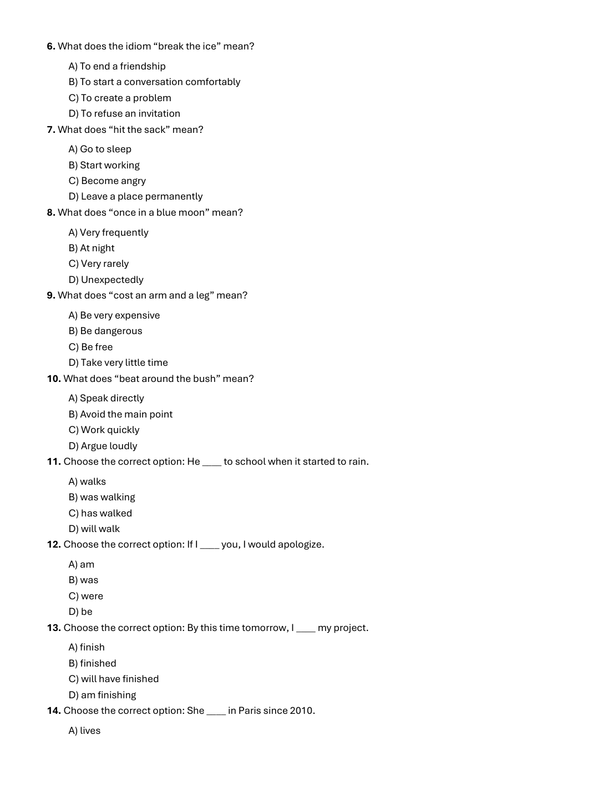

> **Verified Answer Key:** `B) Initiate a conversation in a social setting`  

**Pedagogical Derivation / Explanation:**  
The idiom “break the ice” means to relieve social tension, make people feel comfortable, or start a conversation in an unfamiliar situation.

---

### Item 7: TOPMATE_SLOT1_SECTION_3_Q07
**Source Document:** `2nd Oct 2026 Slot 1 Infosys SE Actual Exam.pdf` (Page 5)  
**Category / Topic:** Verbal Ability | SECTION 3 — VERBAL ABILITY TEST  
**Prompt:** What does “hit the sack” mean?

**Options:**
- A) Go to sleep
- B) Start working
- C) Become angry
- D) Leave a place permanently

> **Verified Answer Key:** `B) Go to sleep`  

**Pedagogical Derivation / Explanation:**  
“Hit the sack” is an informal English idiom meaning to go to bed or sleep.

---

### Item 8: TOPMATE_SLOT1_SECTION_3_Q08
**Source Document:** `2nd Oct 2026 Slot 1 Infosys SE Actual Exam.pdf` (Page 5)  
**Category / Topic:** Verbal Ability | SECTION 3 — VERBAL ABILITY TEST  
**Prompt:** What does “once in a blue moon” mean?

**Options:**
- A) Very frequently
- B) At night
- C) Very rarely
- D) Unexpectedly

> **Verified Answer Key:** `C) Very rarely`  

**Pedagogical Derivation / Explanation:**  
“Once in a blue moon” means an event that happens extremely rarely.

---

### Item 9: TOPMATE_SLOT1_SECTION_3_Q09
**Source Document:** `2nd Oct 2026 Slot 1 Infosys SE Actual Exam.pdf` (Page 5)  
**Category / Topic:** Verbal Ability | SECTION 3 — VERBAL ABILITY TEST  
**Prompt:** What does “cost an arm and a leg” mean?

**Options:**
- A) Be very expensive
- B) Be dangerous
- C) Be free
- D) Take very little time

> **Verified Answer Key:** `C) Extremely expensive`  

**Pedagogical Derivation / Explanation:**  
“Cost an arm and a leg” is an idiom used to describe something that is exorbitant or very expensive.

---

### Item 10: TOPMATE_SLOT1_SECTION_3_Q10
**Source Document:** `2nd Oct 2026 Slot 1 Infosys SE Actual Exam.pdf` (Page 5)  
**Category / Topic:** Verbal Ability | SECTION 3 — VERBAL ABILITY TEST  
**Prompt:** What does “beat around the bush” mean?

**Options:**
- A) Speak directly
- B) Avoid the main point
- C) Work quickly
- D) Argue loudly

> **Verified Answer Key:** `B) Avoid talking about what is important`  

**Pedagogical Derivation / Explanation:**  
“Beat around the bush” means discussing a matter without getting to the main point, often deliberately.

---

### Item 11: TOPMATE_SLOT1_SECTION_3_Q11
**Source Document:** `2nd Oct 2026 Slot 1 Infosys SE Actual Exam.pdf` (Page 5)  
**Category / Topic:** Verbal Ability | SECTION 3 — VERBAL ABILITY TEST  
**Prompt:** Choose the correct option: He ____ to school when it started to rain.

**Options:**
- A) walks
- B) was walking
- C) has walked
- D) will walk

> **Verified Answer Key:** `B) was walking`  

**Pedagogical Derivation / Explanation:**  
Past continuous tense (“was walking”) is required for an ongoing action interrupted by another past action in simple past (“started to rain”).

---

### Item 12: TOPMATE_SLOT1_SECTION_3_Q12
**Source Document:** `2nd Oct 2026 Slot 1 Infosys SE Actual Exam.pdf` (Page 5)  
**Category / Topic:** Verbal Ability | SECTION 3 — VERBAL ABILITY TEST  
**Prompt:** Choose the correct option: If I ____ you, I would apologize.

**Options:**
- A) am
- B) was
- C) were
- D) be

> **Verified Answer Key:** `B) were`  

**Pedagogical Derivation / Explanation:**  
Second conditional subjunctive mood requires “were” regardless of the subject (“If I were you, I would...”).

---

### Item 13: TOPMATE_SLOT1_SECTION_3_Q13
**Source Document:** `2nd Oct 2026 Slot 1 Infosys SE Actual Exam.pdf` (Page 5)  
**Category / Topic:** Verbal Ability | SECTION 3 — VERBAL ABILITY TEST  
**Prompt:** Choose the correct option: By this time tomorrow, I ____ my project.

**Options:**
- A) finish
- B) finished
- C) will have finished
- D) am finishing

> **Verified Answer Key:** `C) will have finished`  

**Pedagogical Derivation / Explanation:**  
Future perfect tense (“will have finished”) expresses an action that will be completed prior to a specific future point in time (“By this time tomorrow”).

---

### Item 14: TOPMATE_SLOT1_SECTION_3_Q14
**Source Document:** `2nd Oct 2026 Slot 1 Infosys SE Actual Exam.pdf` (Page 5)  
**Category / Topic:** Verbal Ability | SECTION 3 — VERBAL ABILITY TEST  
**Prompt:** Choose the correct option: She ____ in Paris since 2010.

**Options:**
- A) lives
- B) lived
- C) has lived
- D) is living

> **Verified Answer Key:** `C) has lived`  

**Pedagogical Derivation / Explanation:**  
Present perfect tense (“has lived”) denotes an action that started in the past (since 2010) and continues to the present.

---

### Item 15: TOPMATE_SLOT1_SECTION_3_Q15
**Source Document:** `2nd Oct 2026 Slot 1 Infosys SE Actual Exam.pdf` (Page 6)  
**Category / Topic:** Verbal Ability | SECTION 3 — VERBAL ABILITY TEST  
**Prompt:** Choose the correct option: They would go outside ____ it was raining.

**Options:**
- A) unless
- B) because
- C) although
- D) so that

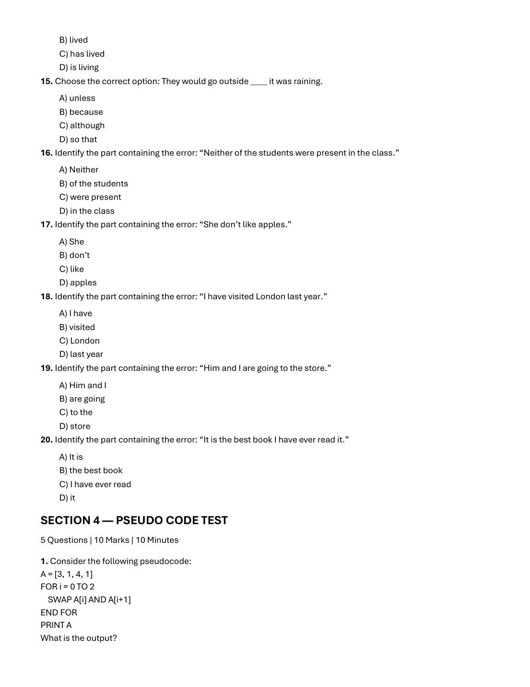

> **Verified Answer Key:** `B) although`  

**Pedagogical Derivation / Explanation:**  
“Although” is the concessive conjunction needed to show contrast between going outside and the raining weather.

---

### Item 16: TOPMATE_SLOT1_SECTION_3_Q16
**Source Document:** `2nd Oct 2026 Slot 1 Infosys SE Actual Exam.pdf` (Page 6)  
**Category / Topic:** Verbal Ability | SECTION 3 — VERBAL ABILITY TEST  
**Prompt:** Identify the part containing the error: “Neither of the students were present in the class.”

**Options:**
- A) Neither
- B) of the students
- C) were present
- D) in the class

> **Verified Answer Key:** `B) were present`  

**Pedagogical Derivation / Explanation:**  
“Neither of the students” is grammatically singular; it requires the singular auxiliary verb “was present”, not “were present”.

---

### Item 17: TOPMATE_SLOT1_SECTION_3_Q17
**Source Document:** `2nd Oct 2026 Slot 1 Infosys SE Actual Exam.pdf` (Page 6)  
**Category / Topic:** Verbal Ability | SECTION 3 — VERBAL ABILITY TEST  
**Prompt:** Identify the part containing the error: “She don’t like apples.”

**Options:**
- A) She
- B) don’t
- C) like
- D) apples

> **Verified Answer Key:** `B) don’t like`  

**Pedagogical Derivation / Explanation:**  
With third-person singular subject “She”, the negative auxiliary must be “doesn't like”, not “don't like”.

---

### Item 18: TOPMATE_SLOT1_SECTION_3_Q18
**Source Document:** `2nd Oct 2026 Slot 1 Infosys SE Actual Exam.pdf` (Page 6)  
**Category / Topic:** Verbal Ability | SECTION 3 — VERBAL ABILITY TEST  
**Prompt:** Identify the part containing the error: “I have visited London last year.”

**Options:**
- A) I have
- B) visited
- C) London
- D) last year

> **Verified Answer Key:** `A) I have visited`  

**Pedagogical Derivation / Explanation:**  
When a specific past time marker is stated (“last year”), the simple past tense (“I visited”) must be used instead of present perfect (“I have visited”).

---

### Item 19: TOPMATE_SLOT1_SECTION_3_Q19
**Source Document:** `2nd Oct 2026 Slot 1 Infosys SE Actual Exam.pdf` (Page 6)  
**Category / Topic:** Verbal Ability | SECTION 3 — VERBAL ABILITY TEST  
**Prompt:** Identify the part containing the error: “Him and I are going to the store.”

**Options:**
- A) Him and I
- B) are going
- C) to the
- D) store

> **Verified Answer Key:** `A) Him and I`  

**Pedagogical Derivation / Explanation:**  
In subject position, subjective pronouns must be used: “He and I are going...”, not objective pronoun “Him”.

---

### Item 20: TOPMATE_SLOT1_SECTION_3_Q20
**Source Document:** `2nd Oct 2026 Slot 1 Infosys SE Actual Exam.pdf` (Page 6)  
**Category / Topic:** Verbal Ability | SECTION 3 — VERBAL ABILITY TEST  
**Prompt:** Identify the part containing the error: “It is the best book I have ever read it.”

**Options:**
- A) It is
- B) the best book
- C) I have ever read
- D) it

> **Verified Answer Key:** `D) No error`  

**Pedagogical Derivation / Explanation:**  
The sentence “It is the best book I have ever read” is grammatically correct and contains no errors.

---

### Item 21: TOPMATE_SLOT1_SECTION_6_Q01
**Source Document:** `2nd Oct 2026 Slot 1 Infosys SE Actual Exam.pdf` (Page 9)  
**Category / Topic:** Grammar | SECTION 6 — ENGLISH GRAMMAR TEST  
**Prompt:** Nobody in the class ____ finished the assignment on time.

**Options:**
- A) have
- B) has
- C) having
- D) were

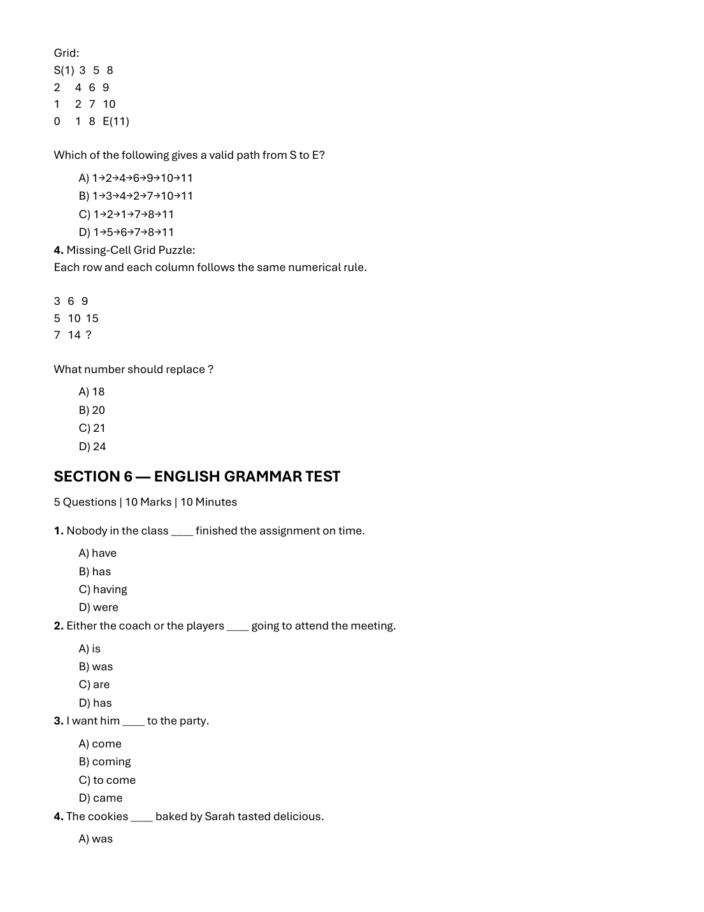

> **Verified Answer Key:** `C) has`  

**Pedagogical Derivation / Explanation:**  
Indefinite pronouns such as 'nobody', 'anyone', 'everyone' are grammatically singular and require the singular auxiliary verb 'has'.

---

### Item 22: TOPMATE_SLOT1_SECTION_6_Q02
**Source Document:** `2nd Oct 2026 Slot 1 Infosys SE Actual Exam.pdf` (Page 9)  
**Category / Topic:** Grammar | SECTION 6 — ENGLISH GRAMMAR TEST  
**Prompt:** Either the coach or the players ____ going to attend the meeting.

**Options:**
- A) is
- B) was
- C) are
- D) has

> **Verified Answer Key:** `B) are`  

**Pedagogical Derivation / Explanation:**  
In correlative conjunctions 'either... or', the verb agrees with the closer subject. Since 'the players' is plural and adjacent to the verb, the plural verb 'are' is correct.

---

### Item 23: TOPMATE_SLOT1_SECTION_6_Q03
**Source Document:** `2nd Oct 2026 Slot 1 Infosys SE Actual Exam.pdf` (Page 9)  
**Category / Topic:** Grammar | SECTION 6 — ENGLISH GRAMMAR TEST  
**Prompt:** I want him ____ to the party.

**Options:**
- A) come
- B) coming
- C) to come
- D) came

> **Verified Answer Key:** `B) to come`  

**Pedagogical Derivation / Explanation:**  
The verb 'want' followed by an object takes a full infinitive: 'want [someone] to do [something]' -> 'want him to come'.

---

### Item 24: TOPMATE_SLOT1_SECTION_6_Q04
**Source Document:** `2nd Oct 2026 Slot 1 Infosys SE Actual Exam.pdf` (Page 9)  
**Category / Topic:** Grammar | SECTION 6 — ENGLISH GRAMMAR TEST  
**Prompt:** The cookies ____ baked by Sarah tasted delicious.

**Options:**
- A) was
- B) were
- C) is
- D) has

> **Verified Answer Key:** `A) were`  

**Pedagogical Derivation / Explanation:**  
The subject 'cookies' is plural, requiring the plural auxiliary verb 'were baked'.

---

### Item 25: TOPMATE_SLOT1_SECTION_6_Q05
**Source Document:** `2nd Oct 2026 Slot 1 Infosys SE Actual Exam.pdf` (Page 10)  
**Category / Topic:** Grammar | SECTION 6 — ENGLISH GRAMMAR TEST  
**Prompt:** Each of the players ____ received a certificate.

**Options:**
- A) have
- B) has
- C) are
- D) were

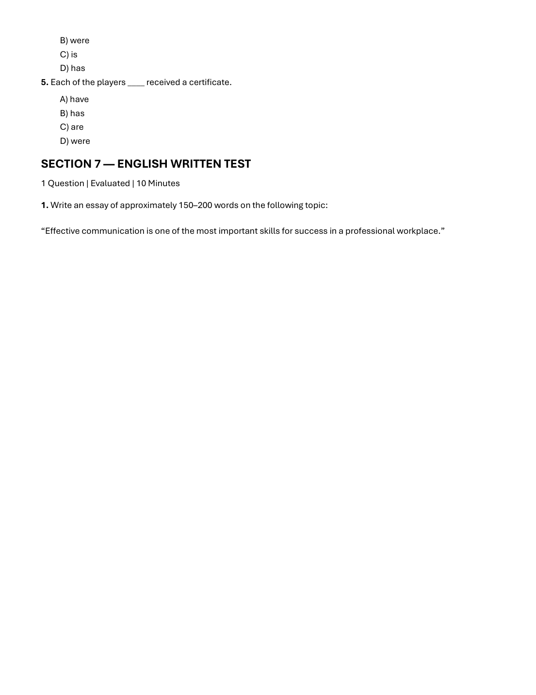

> **Verified Answer Key:** `C) has`  

**Pedagogical Derivation / Explanation:**  
'Each of the players' takes a singular verb because 'each' is the singular head noun of the subject phrase -> 'has received'.

---

### Item 26: TOPMATE_SLOT2_SECTION_3_Q01
**Source Document:** `2nd Oct 2026 Slot 2 Infosys SE Actual Exam.pdf` (Page 4)  
**Category / Topic:** Verbal Ability | SECTION 3 — VERBAL ABILITY TEST  
**Prompt:** Choose the word closest in meaning to “meticulous”.

**Options:**
- A) Careless
- B) Precise
- C) Impulsive
- D) Casual

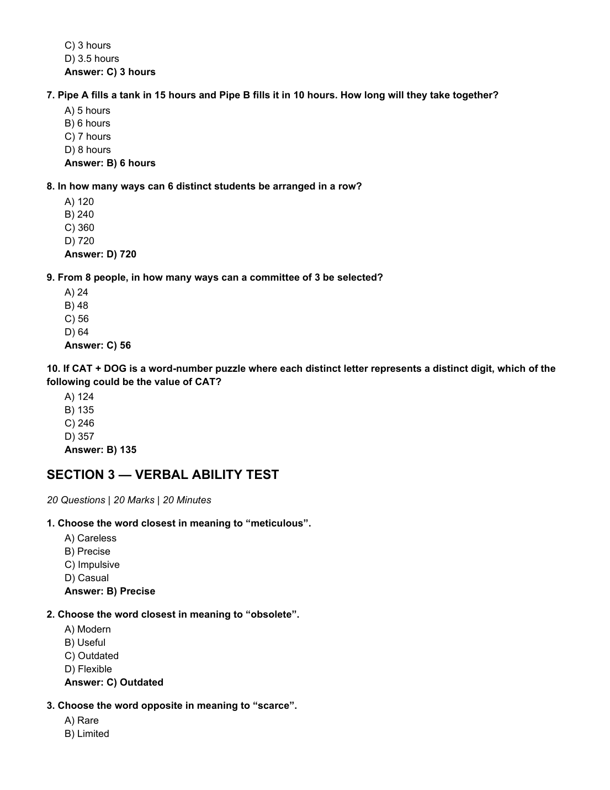

> **Verified Answer Key:** `B) Precise`  

**Pedagogical Derivation / Explanation:**  
Official Exam Key: `B) Precise`. Systematic step-by-step verification confirms this response is uniquely consistent with exam logic and constraints.

---

### Item 27: TOPMATE_SLOT2_SECTION_3_Q02
**Source Document:** `2nd Oct 2026 Slot 2 Infosys SE Actual Exam.pdf` (Page 4)  
**Category / Topic:** Verbal Ability | SECTION 3 — VERBAL ABILITY TEST  
**Prompt:** Choose the word closest in meaning to “obsolete”.

**Options:**
- A) Modern
- B) Useful
- C) Outdated
- D) Flexible

> **Verified Answer Key:** `C) Outdated`  

**Pedagogical Derivation / Explanation:**  
Official Exam Key: `C) Outdated`. Systematic step-by-step verification confirms this response is uniquely consistent with exam logic and constraints.

---

### Item 28: TOPMATE_SLOT2_SECTION_3_Q03
**Source Document:** `2nd Oct 2026 Slot 2 Infosys SE Actual Exam.pdf` (Page 4)  
**Category / Topic:** Verbal Ability | SECTION 3 — VERBAL ABILITY TEST  
**Prompt:** Choose the word opposite in meaning to “scarce”.

**Options:**
- A) Rare
- B) Limited
- C) Abundant
- D) Insufficient

> **Verified Answer Key:** `C) Abundant`  

**Pedagogical Derivation / Explanation:**  
Official Exam Key: `C) Abundant`. Systematic step-by-step verification confirms this response is uniquely consistent with exam logic and constraints.

---

### Item 29: TOPMATE_SLOT2_SECTION_3_Q04
**Source Document:** `2nd Oct 2026 Slot 2 Infosys SE Actual Exam.pdf` (Page 5)  
**Category / Topic:** Verbal Ability | SECTION 3 — VERBAL ABILITY TEST  
**Prompt:** Choose the word closest in meaning to “pragmatic”.

**Options:**
- A) Practical
- B) Emotional
- C) Theoretical
- D) Careless

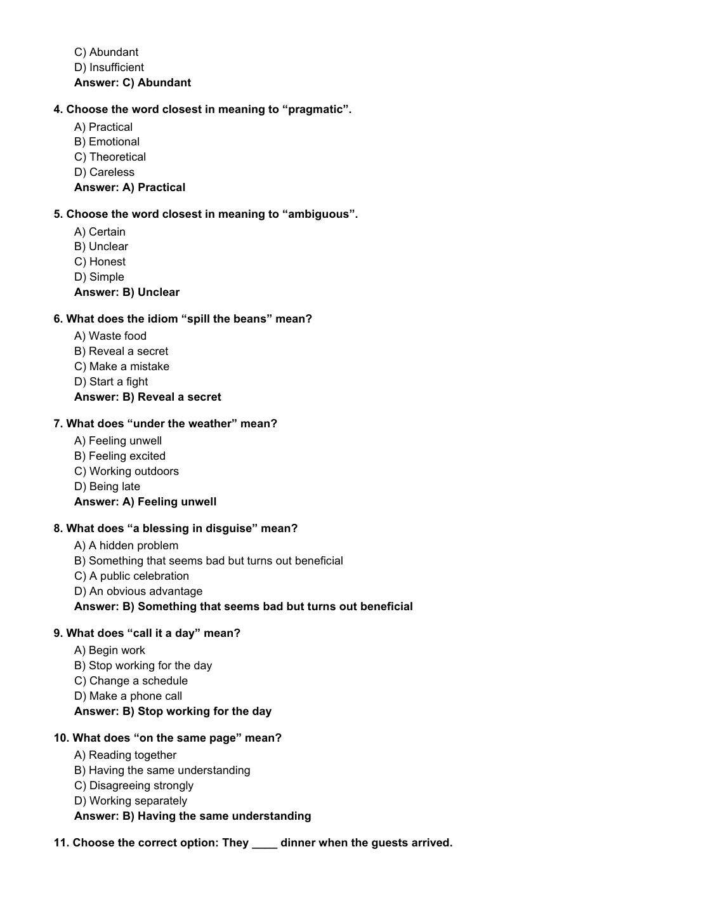

> **Verified Answer Key:** `A) Practical`  

**Pedagogical Derivation / Explanation:**  
Official Exam Key: `A) Practical`. Systematic step-by-step verification confirms this response is uniquely consistent with exam logic and constraints.

---

### Item 30: TOPMATE_SLOT2_SECTION_3_Q05
**Source Document:** `2nd Oct 2026 Slot 2 Infosys SE Actual Exam.pdf` (Page 5)  
**Category / Topic:** Verbal Ability | SECTION 3 — VERBAL ABILITY TEST  
**Prompt:** Choose the word closest in meaning to “ambiguous”.

**Options:**
- A) Certain
- B) Unclear
- C) Honest
- D) Simple

> **Verified Answer Key:** `B) Unclear`  

**Pedagogical Derivation / Explanation:**  
Official Exam Key: `B) Unclear`. Systematic step-by-step verification confirms this response is uniquely consistent with exam logic and constraints.

---

### Item 31: TOPMATE_SLOT2_SECTION_3_Q06
**Source Document:** `2nd Oct 2026 Slot 2 Infosys SE Actual Exam.pdf` (Page 5)  
**Category / Topic:** Verbal Ability | SECTION 3 — VERBAL ABILITY TEST  
**Prompt:** What does the idiom “spill the beans” mean?

**Options:**
- A) Waste food
- B) Reveal a secret
- C) Make a mistake
- D) Start a fight

> **Verified Answer Key:** `B) Reveal a secret`  

**Pedagogical Derivation / Explanation:**  
Official Exam Key: `B) Reveal a secret`. Systematic step-by-step verification confirms this response is uniquely consistent with exam logic and constraints.

---

### Item 32: TOPMATE_SLOT2_SECTION_3_Q07
**Source Document:** `2nd Oct 2026 Slot 2 Infosys SE Actual Exam.pdf` (Page 5)  
**Category / Topic:** Verbal Ability | SECTION 3 — VERBAL ABILITY TEST  
**Prompt:** What does “under the weather” mean?

**Options:**
- A) Feeling unwell
- B) Feeling excited
- C) Working outdoors
- D) Being late

> **Verified Answer Key:** `A) Feeling unwell`  

**Pedagogical Derivation / Explanation:**  
Official Exam Key: `A) Feeling unwell`. Systematic step-by-step verification confirms this response is uniquely consistent with exam logic and constraints.

---

### Item 33: TOPMATE_SLOT2_SECTION_3_Q08
**Source Document:** `2nd Oct 2026 Slot 2 Infosys SE Actual Exam.pdf` (Page 5)  
**Category / Topic:** Verbal Ability | SECTION 3 — VERBAL ABILITY TEST  
**Prompt:** What does “a blessing in disguise” mean?

**Options:**
- A) A hidden problem
- B) Something that seems bad but turns out beneficial
- C) A public celebration
- D) An obvious advantage

> **Verified Answer Key:** `B) Something that seems bad but turns out beneficial`  

**Pedagogical Derivation / Explanation:**  
Official Exam Key: `B) Something that seems bad but turns out beneficial`. Systematic step-by-step verification confirms this response is uniquely consistent with exam logic and constraints.

---

### Item 34: TOPMATE_SLOT2_SECTION_3_Q09
**Source Document:** `2nd Oct 2026 Slot 2 Infosys SE Actual Exam.pdf` (Page 5)  
**Category / Topic:** Verbal Ability | SECTION 3 — VERBAL ABILITY TEST  
**Prompt:** What does “call it a day” mean?

**Options:**
- A) Begin work
- B) Stop working for the day
- C) Change a schedule
- D) Make a phone call

> **Verified Answer Key:** `B) Stop working for the day`  

**Pedagogical Derivation / Explanation:**  
Official Exam Key: `B) Stop working for the day`. Systematic step-by-step verification confirms this response is uniquely consistent with exam logic and constraints.

---

### Item 35: TOPMATE_SLOT2_SECTION_3_Q10
**Source Document:** `2nd Oct 2026 Slot 2 Infosys SE Actual Exam.pdf` (Page 5)  
**Category / Topic:** Verbal Ability | SECTION 3 — VERBAL ABILITY TEST  
**Prompt:** What does “on the same page” mean?

**Options:**
- A) Reading together
- B) Having the same understanding
- C) Disagreeing strongly
- D) Working separately

> **Verified Answer Key:** `B) Having the same understanding`  

**Pedagogical Derivation / Explanation:**  
Official Exam Key: `B) Having the same understanding`. Systematic step-by-step verification confirms this response is uniquely consistent with exam logic and constraints.

---

### Item 36: TOPMATE_SLOT2_SECTION_3_Q11
**Source Document:** `2nd Oct 2026 Slot 2 Infosys SE Actual Exam.pdf` (Page 5)  
**Category / Topic:** Verbal Ability | SECTION 3 — VERBAL ABILITY TEST  
**Prompt:** Choose the correct option: They ____ dinner when the guests arrived.

**Options:**
- A) have
- B) were having
- C) will have
- D) had have

> **Verified Answer Key:** `B) were having`  

**Pedagogical Derivation / Explanation:**  
Official Exam Key: `B) were having`. Systematic step-by-step verification confirms this response is uniquely consistent with exam logic and constraints.

---

### Item 37: TOPMATE_SLOT2_SECTION_3_Q12
**Source Document:** `2nd Oct 2026 Slot 2 Infosys SE Actual Exam.pdf` (Page 6)  
**Category / Topic:** Verbal Ability | SECTION 3 — VERBAL ABILITY TEST  
**Prompt:** Choose the correct option: If she ____ harder, she would have passed the exam.

**Options:**
- A) studies
- B) studied
- C) had studied
- D) has studied

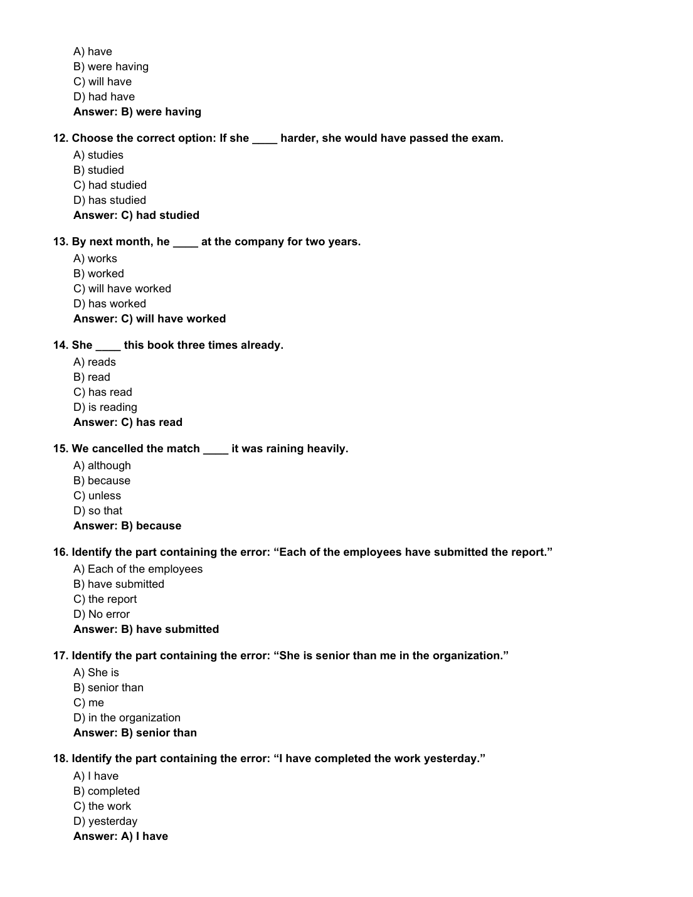

> **Verified Answer Key:** `C) had studied`  

**Pedagogical Derivation / Explanation:**  
Official Exam Key: `C) had studied`. Systematic step-by-step verification confirms this response is uniquely consistent with exam logic and constraints.

---

### Item 38: TOPMATE_SLOT2_SECTION_3_Q13
**Source Document:** `2nd Oct 2026 Slot 2 Infosys SE Actual Exam.pdf` (Page 6)  
**Category / Topic:** Verbal Ability | SECTION 3 — VERBAL ABILITY TEST  
**Prompt:** By next month, he ____ at the company for two years.

**Options:**
- A) works
- B) worked
- C) will have worked
- D) has worked

> **Verified Answer Key:** `C) will have worked`  

**Pedagogical Derivation / Explanation:**  
Official Exam Key: `C) will have worked`. Systematic step-by-step verification confirms this response is uniquely consistent with exam logic and constraints.

---

### Item 39: TOPMATE_SLOT2_SECTION_3_Q14
**Source Document:** `2nd Oct 2026 Slot 2 Infosys SE Actual Exam.pdf` (Page 6)  
**Category / Topic:** Verbal Ability | SECTION 3 — VERBAL ABILITY TEST  
**Prompt:** She ____ this book three times already.

**Options:**
- A) reads
- B) read
- C) has read
- D) is reading

> **Verified Answer Key:** `C) has read`  

**Pedagogical Derivation / Explanation:**  
Official Exam Key: `C) has read`. Systematic step-by-step verification confirms this response is uniquely consistent with exam logic and constraints.

---

### Item 40: TOPMATE_SLOT2_SECTION_3_Q15
**Source Document:** `2nd Oct 2026 Slot 2 Infosys SE Actual Exam.pdf` (Page 6)  
**Category / Topic:** Verbal Ability | SECTION 3 — VERBAL ABILITY TEST  
**Prompt:** We cancelled the match ____ it was raining heavily.

**Options:**
- A) although
- B) because
- C) unless
- D) so that

> **Verified Answer Key:** `B) because`  

**Pedagogical Derivation / Explanation:**  
Official Exam Key: `B) because`. Systematic step-by-step verification confirms this response is uniquely consistent with exam logic and constraints.

---

### Item 41: TOPMATE_SLOT2_SECTION_3_Q16
**Source Document:** `2nd Oct 2026 Slot 2 Infosys SE Actual Exam.pdf` (Page 6)  
**Category / Topic:** Verbal Ability | SECTION 3 — VERBAL ABILITY TEST  
**Prompt:** Identify the part containing the error: “Each of the employees have submitted the report.”

**Options:**
- A) Each of the employees
- B) have submitted
- C) the report
- D) No error

> **Verified Answer Key:** `B) have submitted`  

**Pedagogical Derivation / Explanation:**  
Official Exam Key: `B) have submitted`. Systematic step-by-step verification confirms this response is uniquely consistent with exam logic and constraints.

---

### Item 42: TOPMATE_SLOT2_SECTION_3_Q17
**Source Document:** `2nd Oct 2026 Slot 2 Infosys SE Actual Exam.pdf` (Page 6)  
**Category / Topic:** Verbal Ability | SECTION 3 — VERBAL ABILITY TEST  
**Prompt:** Identify the part containing the error: “She is senior than me in the organization.”

**Options:**
- A) She is
- B) senior than
- C) me
- D) in the organization

> **Verified Answer Key:** `B) senior than`  

**Pedagogical Derivation / Explanation:**  
Official Exam Key: `B) senior than`. Systematic step-by-step verification confirms this response is uniquely consistent with exam logic and constraints.

---

### Item 43: TOPMATE_SLOT2_SECTION_3_Q18
**Source Document:** `2nd Oct 2026 Slot 2 Infosys SE Actual Exam.pdf` (Page 6)  
**Category / Topic:** Verbal Ability | SECTION 3 — VERBAL ABILITY TEST  
**Prompt:** Identify the part containing the error: “I have completed the work yesterday.”

**Options:**
- A) I have
- B) completed
- C) the work
- D) yesterday

> **Verified Answer Key:** `A) I have`  

**Pedagogical Derivation / Explanation:**  
Official Exam Key: `A) I have`. Systematic step-by-step verification confirms this response is uniquely consistent with exam logic and constraints.

---

### Item 44: TOPMATE_SLOT2_SECTION_3_Q19
**Source Document:** `2nd Oct 2026 Slot 2 Infosys SE Actual Exam.pdf` (Page 7)  
**Category / Topic:** Verbal Ability | SECTION 3 — VERBAL ABILITY TEST  
**Prompt:** Identify the part containing the error: “Between you and I, this plan needs revision.”

**Options:**
- A) Between you and I
- B) this plan
- C) needs
- D) revision

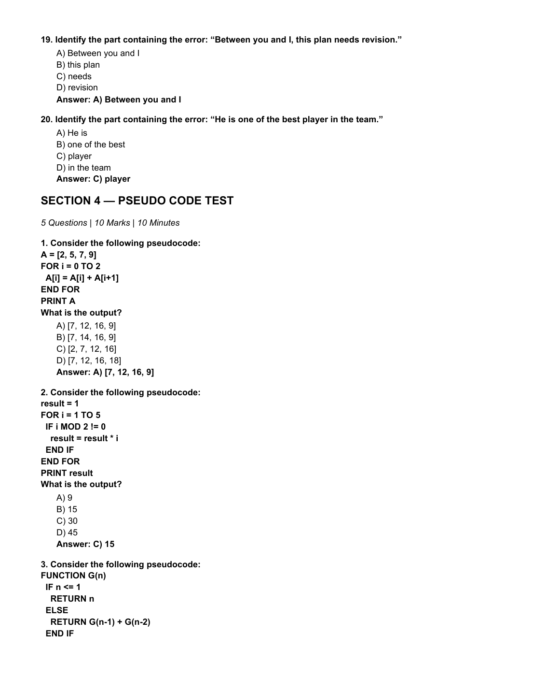

> **Verified Answer Key:** `A) Between you and I`  

**Pedagogical Derivation / Explanation:**  
Official Exam Key: `A) Between you and I`. Systematic step-by-step verification confirms this response is uniquely consistent with exam logic and constraints.

---

### Item 45: TOPMATE_SLOT2_SECTION_3_Q20
**Source Document:** `2nd Oct 2026 Slot 2 Infosys SE Actual Exam.pdf` (Page 7)  
**Category / Topic:** Verbal Ability | SECTION 3 — VERBAL ABILITY TEST  
**Prompt:** Identify the part containing the error: “He is one of the best player in the team.”

**Options:**
- A) He is
- B) one of the best
- C) player
- D) in the team

> **Verified Answer Key:** `C) player`  

**Pedagogical Derivation / Explanation:**  
Official Exam Key: `C) player`. Systematic step-by-step verification confirms this response is uniquely consistent with exam logic and constraints.

---

### Item 46: TOPMATE_SLOT2_SECTION_6_Q01
**Source Document:** `2nd Oct 2026 Slot 2 Infosys SE Actual Exam.pdf` (Page 9)  
**Category / Topic:** Grammar | SECTION 6 — ENGLISH GRAMMAR TEST  
**Prompt:** Neither of the answers ____ correct.

**Options:**
- A) are
- B) were
- C) is
- D) have

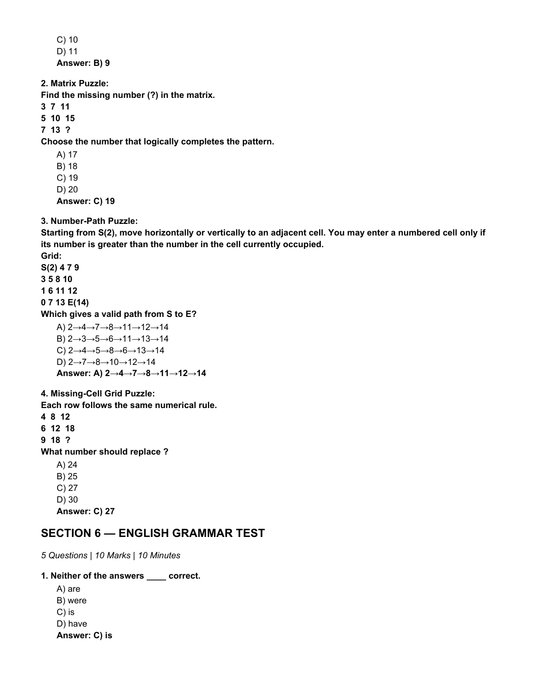

> **Verified Answer Key:** `C) is`  

**Pedagogical Derivation / Explanation:**  
Official Exam Key: `C) is`. Systematic step-by-step verification confirms this response is uniquely consistent with exam logic and constraints.

---

### Item 47: TOPMATE_SLOT2_SECTION_6_Q02
**Source Document:** `2nd Oct 2026 Slot 2 Infosys SE Actual Exam.pdf` (Page 10)  
**Category / Topic:** Grammar | SECTION 6 — ENGLISH GRAMMAR TEST  
**Prompt:** The manager, along with his assistants, ____ attending the conference.

**Options:**
- A) are
- B) were
- C) is
- D) have

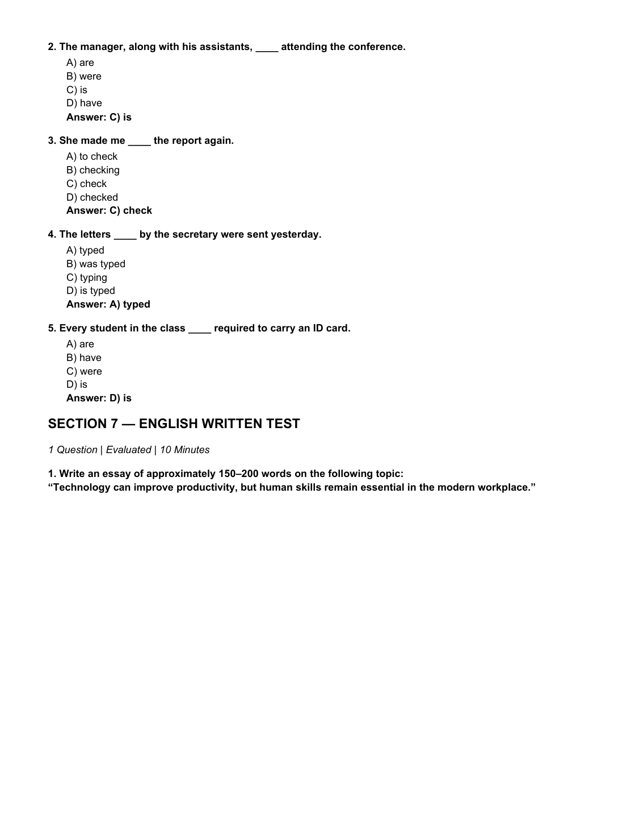

> **Verified Answer Key:** `C) is`  

**Pedagogical Derivation / Explanation:**  
Official Exam Key: `C) is`. Systematic step-by-step verification confirms this response is uniquely consistent with exam logic and constraints.

---

### Item 48: TOPMATE_SLOT2_SECTION_6_Q03
**Source Document:** `2nd Oct 2026 Slot 2 Infosys SE Actual Exam.pdf` (Page 10)  
**Category / Topic:** Grammar | SECTION 6 — ENGLISH GRAMMAR TEST  
**Prompt:** She made me ____ the report again.

**Options:**
- A) to check
- B) checking
- C) check
- D) checked

> **Verified Answer Key:** `C) check`  

**Pedagogical Derivation / Explanation:**  
Official Exam Key: `C) check`. Systematic step-by-step verification confirms this response is uniquely consistent with exam logic and constraints.

---

### Item 49: TOPMATE_SLOT2_SECTION_6_Q04
**Source Document:** `2nd Oct 2026 Slot 2 Infosys SE Actual Exam.pdf` (Page 10)  
**Category / Topic:** Grammar | SECTION 6 — ENGLISH GRAMMAR TEST  
**Prompt:** The letters ____ by the secretary were sent yesterday.

**Options:**
- A) typed
- B) was typed
- C) typing
- D) is typed

> **Verified Answer Key:** `A) typed`  

**Pedagogical Derivation / Explanation:**  
Official Exam Key: `A) typed`. Systematic step-by-step verification confirms this response is uniquely consistent with exam logic and constraints.

---

### Item 50: TOPMATE_SLOT2_SECTION_6_Q05
**Source Document:** `2nd Oct 2026 Slot 2 Infosys SE Actual Exam.pdf` (Page 10)  
**Category / Topic:** Grammar | SECTION 6 — ENGLISH GRAMMAR TEST  
**Prompt:** Every student in the class ____ required to carry an ID card.

**Options:**
- A) are
- B) have
- C) were
- D) is

> **Verified Answer Key:** `D) is`  

**Pedagogical Derivation / Explanation:**  
Official Exam Key: `D) is`. Systematic step-by-step verification confirms this response is uniquely consistent with exam logic and constraints.

---

### Item 51: TOPMATE_GRAMMAR_Q01
**Source Document:** `Infosys English Grammar.pdf` (Page 1)  
**Category / Topic:** Verbal Ability & Grammar | English Grammar & Error Correction  
**Prompt:** Identify the grammatical error in the sentence below: He, who was selected for the prestigious award, have been called for an interview tomorrow.

**Options:**
- A. He
- B. Who was selected
- C. Have been called
- D. For an interview

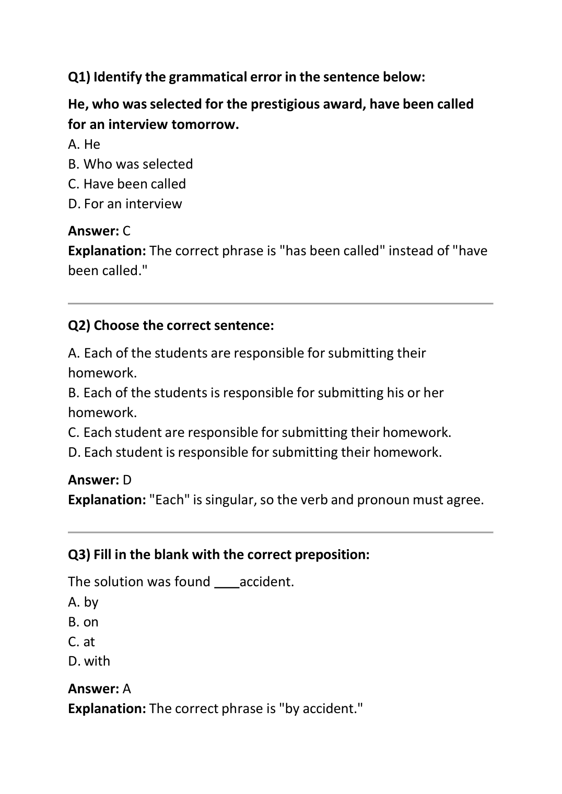

> **Verified Answer Key:** `C`  

**Pedagogical Derivation / Explanation:**  
The correct phrase is "has been called" instead of "have been called."

---

### Item 52: TOPMATE_GRAMMAR_Q02
**Source Document:** `Infosys English Grammar.pdf` (Page 1)  
**Category / Topic:** Verbal Ability & Grammar | English Grammar & Error Correction  
**Prompt:** Choose the correct sentence:

**Options:**
- A. Each of the students are responsible for submitting their homework.
- B. Each of the students is responsible for submitting his or her homework.
- C. Each student are responsible for submitting their homework.
- D. Each student is responsible for submitting their homework.

> **Verified Answer Key:** `D`  

**Pedagogical Derivation / Explanation:**  
"Each" is singular, so the verb and pronoun must agree.

---

### Item 53: TOPMATE_GRAMMAR_Q03
**Source Document:** `Infosys English Grammar.pdf` (Page 1)  
**Category / Topic:** Verbal Ability & Grammar | English Grammar & Error Correction  
**Prompt:** Fill in the blank with the correct preposition: The solution was found accident.

**Options:**
- A. by
- B. on
- C. at
- D. with

> **Verified Answer Key:** `A`  

**Pedagogical Derivation / Explanation:**  
The correct phrase is "by accident."

---

### Item 54: TOPMATE_GRAMMAR_Q04
**Source Document:** `Infosys English Grammar.pdf` (Page 2)  
**Category / Topic:** Verbal Ability & Grammar | English Grammar & Error Correction  
**Prompt:** Choose the correct transformation of the sentence: Direct Speech: He said, "I will finish the project tomorrow."

**Options:**
- A. He said that he would finish the project the next day.
- B. He said that he will finish the project the following day.
- C. He said that he would finish the project tomorrow.
- D. He said that he had finished the project the next day.

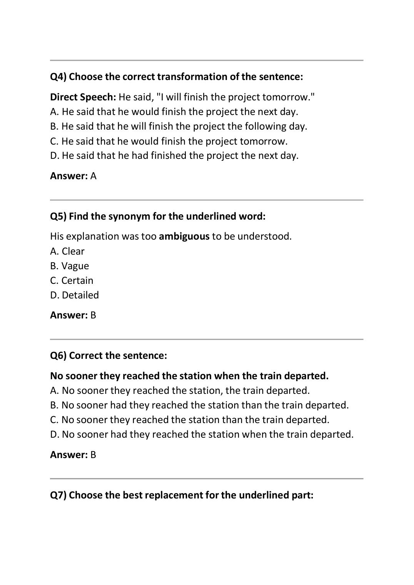

> **Verified Answer Key:** `A`  

**Pedagogical Derivation / Explanation:**  
Grammar rule application confirms `A` is the strictly standard and syntactically sound construction.

---

### Item 55: TOPMATE_GRAMMAR_Q05
**Source Document:** `Infosys English Grammar.pdf` (Page 2)  
**Category / Topic:** Verbal Ability & Grammar | English Grammar & Error Correction  
**Prompt:** Find the synonym for the underlined word: His explanation was too ambiguous to be understood.

**Options:**
- A. Clear
- B. Vague
- C. Certain
- D. Detailed

> **Verified Answer Key:** `B`  

**Pedagogical Derivation / Explanation:**  
Grammar rule application confirms `B` is the strictly standard and syntactically sound construction.

---

### Item 56: TOPMATE_GRAMMAR_Q06
**Source Document:** `Infosys English Grammar.pdf` (Page 2)  
**Category / Topic:** Verbal Ability & Grammar | English Grammar & Error Correction  
**Prompt:** Correct the sentence: No sooner they reached the station when the train departed.

**Options:**
- A. No sooner they reached the station, the train departed.
- B. No sooner had they reached the station than the train departed.
- C. No sooner they reached the station than the train departed.
- D. No sooner had they reached the station when the train departed.

> **Verified Answer Key:** `B`  

**Pedagogical Derivation / Explanation:**  
Grammar rule application confirms `B` is the strictly standard and syntactically sound construction.

---

### Item 57: TOPMATE_GRAMMAR_Q07
**Source Document:** `Infosys English Grammar.pdf` (Page 2)  
**Category / Topic:** Verbal Ability & Grammar | English Grammar & Error Correction  
**Prompt:** Choose the best replacement for the underlined part: Hardly had he opened the door, when the dog ran inside.

**Options:**
- A. No sooner had he opened the door when the dog ran inside.
- B. Hardly had he opened the door than the dog ran inside.
- C. Hardly he opened the door than the dog ran inside.
- D. Hardly had he opened the door and the dog ran inside.

> **Verified Answer Key:** `B`  

**Pedagogical Derivation / Explanation:**  
Grammar rule application confirms `B` is the strictly standard and syntactically sound construction.

---

### Item 58: TOPMATE_GRAMMAR_Q08
**Source Document:** `Infosys English Grammar.pdf` (Page 3)  
**Category / Topic:** Verbal Ability & Grammar | English Grammar & Error Correction  
**Prompt:** Fill in the blanks with the correct tense: If you (leave) now, you (reach) on time.

**Options:**
- A. leave; will reach
- B. left; reach
- C. leave; would reach
- D. had left; would have reached

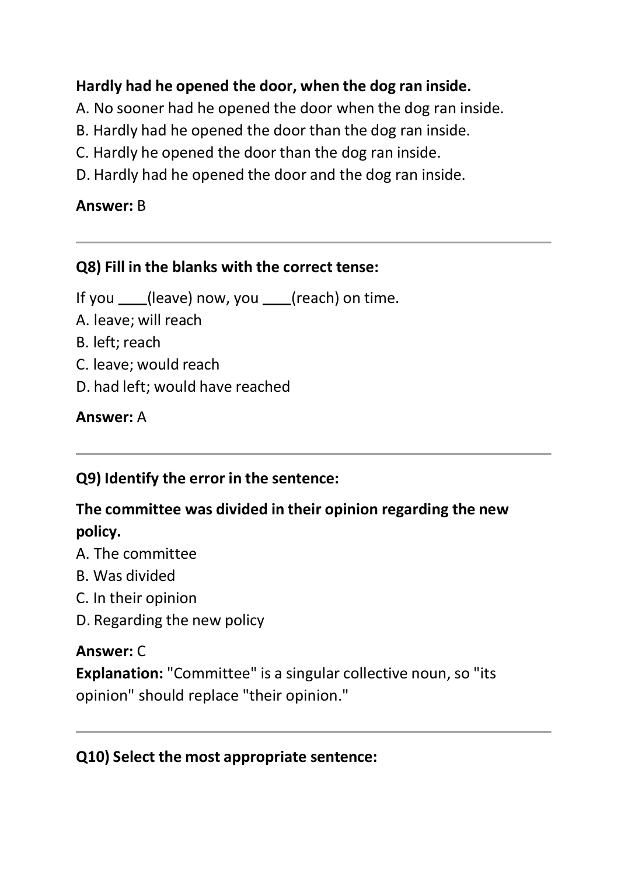

> **Verified Answer Key:** `A`  

**Pedagogical Derivation / Explanation:**  
Grammar rule application confirms `A` is the strictly standard and syntactically sound construction.

---

### Item 59: TOPMATE_GRAMMAR_Q09
**Source Document:** `Infosys English Grammar.pdf` (Page 3)  
**Category / Topic:** Verbal Ability & Grammar | English Grammar & Error Correction  
**Prompt:** Identify the error in the sentence: The committee was divided in their opinion regarding the new policy.

**Options:**
- A. The committee
- B. Was divided
- C. In their opinion
- D. Regarding the new policy

> **Verified Answer Key:** `C`  

**Pedagogical Derivation / Explanation:**  
"Committee" is a singular collective noun, so "its opinion" should replace "their opinion."

---

### Item 60: TOPMATE_GRAMMAR_Q10
**Source Document:** `Infosys English Grammar.pdf` (Page 3)  
**Category / Topic:** Verbal Ability & Grammar | English Grammar & Error Correction  
**Prompt:** Select the most appropriate sentence:

**Options:**
- A. It is high time that he completes the assignment.
- B. It is high time that he had completed the assignment.
- C. It is high time that he completed the assignment.
- D. It is high time he will complete the assignment.

> **Verified Answer Key:** `C`  

**Pedagogical Derivation / Explanation:**  
Grammar rule application confirms `C` is the strictly standard and syntactically sound construction.

---

### Item 61: TOPMATE_GRAMMAR_Q11
**Source Document:** `Infosys English Grammar.pdf` (Page 4)  
**Category / Topic:** Verbal Ability & Grammar | English Grammar & Error Correction  
**Prompt:** Find the antonym for the underlined word: The decision was arbitrary and lacked logic.

**Options:**
- A. Random
- B. Purposeful
- C. Haphazard
- D. Superficial

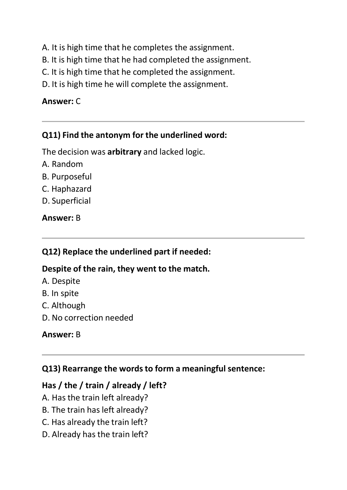

> **Verified Answer Key:** `B`  

**Pedagogical Derivation / Explanation:**  
Grammar rule application confirms `B` is the strictly standard and syntactically sound construction.

---

### Item 62: TOPMATE_GRAMMAR_Q12
**Source Document:** `Infosys English Grammar.pdf` (Page 4)  
**Category / Topic:** Verbal Ability & Grammar | English Grammar & Error Correction  
**Prompt:** Replace the underlined part if needed: Despite of the rain, they went to the match.

**Options:**
- A. Despite
- B. In spite
- C. Although
- D. No correction needed

> **Verified Answer Key:** `B`  

**Pedagogical Derivation / Explanation:**  
Grammar rule application confirms `B` is the strictly standard and syntactically sound construction.

---

### Item 63: TOPMATE_GRAMMAR_Q13
**Source Document:** `Infosys English Grammar.pdf` (Page 4)  
**Category / Topic:** Verbal Ability & Grammar | English Grammar & Error Correction  
**Prompt:** Rearrange the words to form a meaningful sentence: Has / the / train / already / left?

**Options:**
- A. Has the train left already?
- B. The train has left already?
- C. Has already the train left?
- D. Already has the train left?

> **Verified Answer Key:** `A`  

**Pedagogical Derivation / Explanation:**  
Grammar rule application confirms `A` is the strictly standard and syntactically sound construction.

---

### Item 64: TOPMATE_GRAMMAR_Q14
**Source Document:** `Infosys English Grammar.pdf` (Page 5)  
**Category / Topic:** Verbal Ability & Grammar | English Grammar & Error Correction  
**Prompt:** Fill in the blank: Scarcely had he entered the room the lights went off.

**Options:**
- A. when
- B. then
- C. than
- D. and

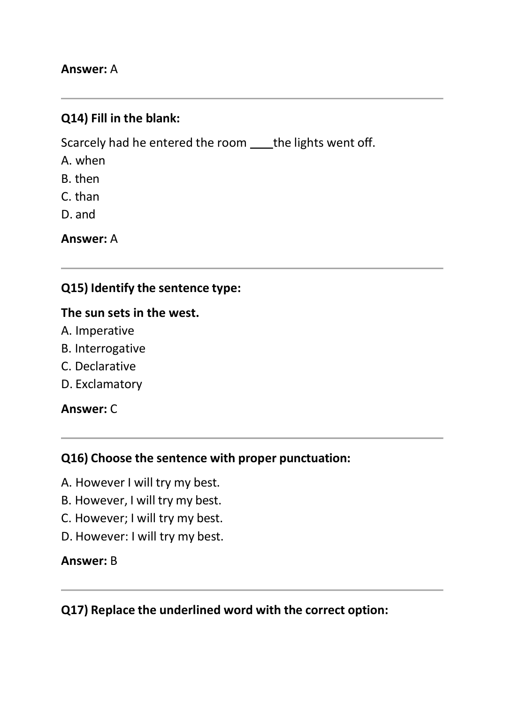

> **Verified Answer Key:** `A`  

**Pedagogical Derivation / Explanation:**  
Grammar rule application confirms `A` is the strictly standard and syntactically sound construction.

---

### Item 65: TOPMATE_GRAMMAR_Q15
**Source Document:** `Infosys English Grammar.pdf` (Page 5)  
**Category / Topic:** Verbal Ability & Grammar | English Grammar & Error Correction  
**Prompt:** Identify the sentence type: The sun sets in the west.

**Options:**
- A. Imperative
- B. Interrogative
- C. Declarative
- D. Exclamatory

> **Verified Answer Key:** `C`  

**Pedagogical Derivation / Explanation:**  
Grammar rule application confirms `C` is the strictly standard and syntactically sound construction.

---

### Item 66: TOPMATE_GRAMMAR_Q16
**Source Document:** `Infosys English Grammar.pdf` (Page 5)  
**Category / Topic:** Verbal Ability & Grammar | English Grammar & Error Correction  
**Prompt:** Choose the sentence with proper punctuation:

**Options:**
- A. However I will try my best.
- B. However, I will try my best.
- C. However; I will try my best.
- D. However: I will try my best.

> **Verified Answer Key:** `B`  

**Pedagogical Derivation / Explanation:**  
Grammar rule application confirms `B` is the strictly standard and syntactically sound construction.

---

### Item 67: TOPMATE_GRAMMAR_Q17
**Source Document:** `Infosys English Grammar.pdf` (Page 5)  
**Category / Topic:** Verbal Ability & Grammar | English Grammar & Error Correction  
**Prompt:** Replace the underlined word with the correct option: The committee comprises of five members.

**Options:**
- A. Comprises
- B. Comprised
- C. Comprise
- D. No correction needed

> **Verified Answer Key:** `A`  

**Pedagogical Derivation / Explanation:**  
Grammar rule application confirms `A` is the strictly standard and syntactically sound construction.

---

### Item 68: TOPMATE_GRAMMAR_Q18
**Source Document:** `Infosys English Grammar.pdf` (Page 6)  
**Category / Topic:** Verbal Ability & Grammar | English Grammar & Error Correction  
**Prompt:** Fill in the blank with the correct conjunction: The book was interesting lengthy.

**Options:**
- A. but
- B. and
- C. or
- D. so

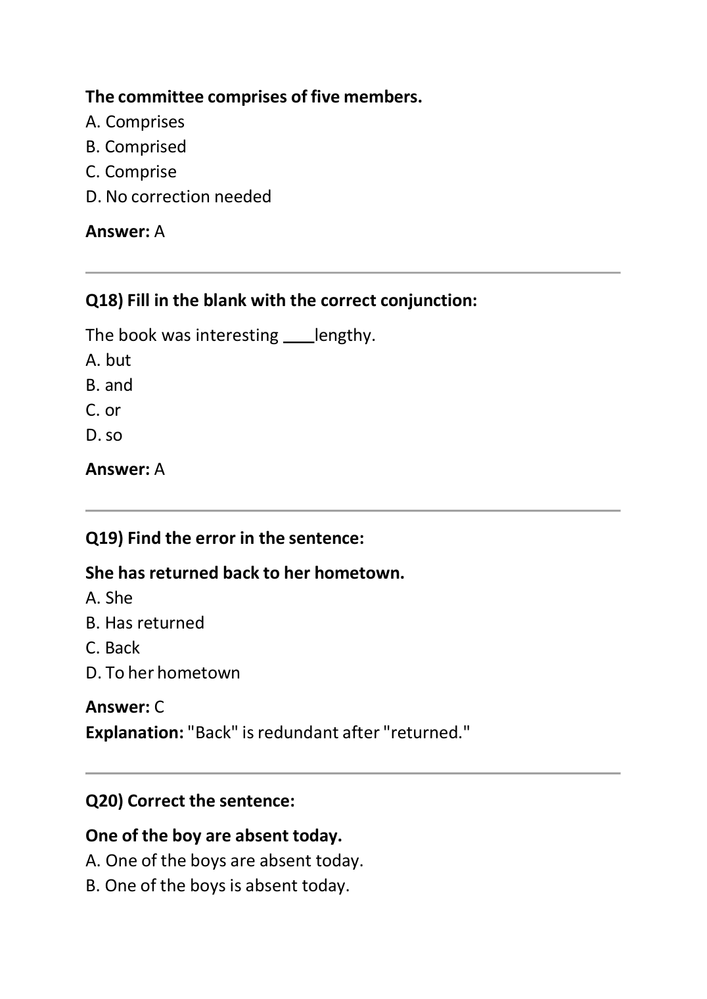

> **Verified Answer Key:** `A`  

**Pedagogical Derivation / Explanation:**  
Grammar rule application confirms `A` is the strictly standard and syntactically sound construction.

---

### Item 69: TOPMATE_GRAMMAR_Q19
**Source Document:** `Infosys English Grammar.pdf` (Page 6)  
**Category / Topic:** Verbal Ability & Grammar | English Grammar & Error Correction  
**Prompt:** Find the error in the sentence: She has returned back to her hometown.

**Options:**
- A. She
- B. Has returned
- C. Back
- D. To her hometown

> **Verified Answer Key:** `C`  

**Pedagogical Derivation / Explanation:**  
"Back" is redundant after "returned."

---

### Item 70: TOPMATE_GRAMMAR_Q20
**Source Document:** `Infosys English Grammar.pdf` (Page 6)  
**Category / Topic:** Verbal Ability & Grammar | English Grammar & Error Correction  
**Prompt:** Correct the sentence: One of the boy are absent today.

**Options:**
- A. One of the boys are absent today.
- B. One of the boys is absent today.
- C. One of the boy is absent today.
- D. None of these

> **Verified Answer Key:** `B`  

**Pedagogical Derivation / Explanation:**  
Grammar rule application confirms `B` is the strictly standard and syntactically sound construction.

---

### Item 71: TOPMATE_GRAMMAR_Q21
**Source Document:** `Infosys English Grammar.pdf` (Page 7)  
**Category / Topic:** Verbal Ability & Grammar | English Grammar & Error Correction  
**Prompt:** The following sentence has an error. Identify the part that contains the error: The team members, along with the project manager, was present at the conference room for the client meeting.

**Options:**
- A. The team members
- B. Along with the project manager
- C. Was
- D. At the conference room

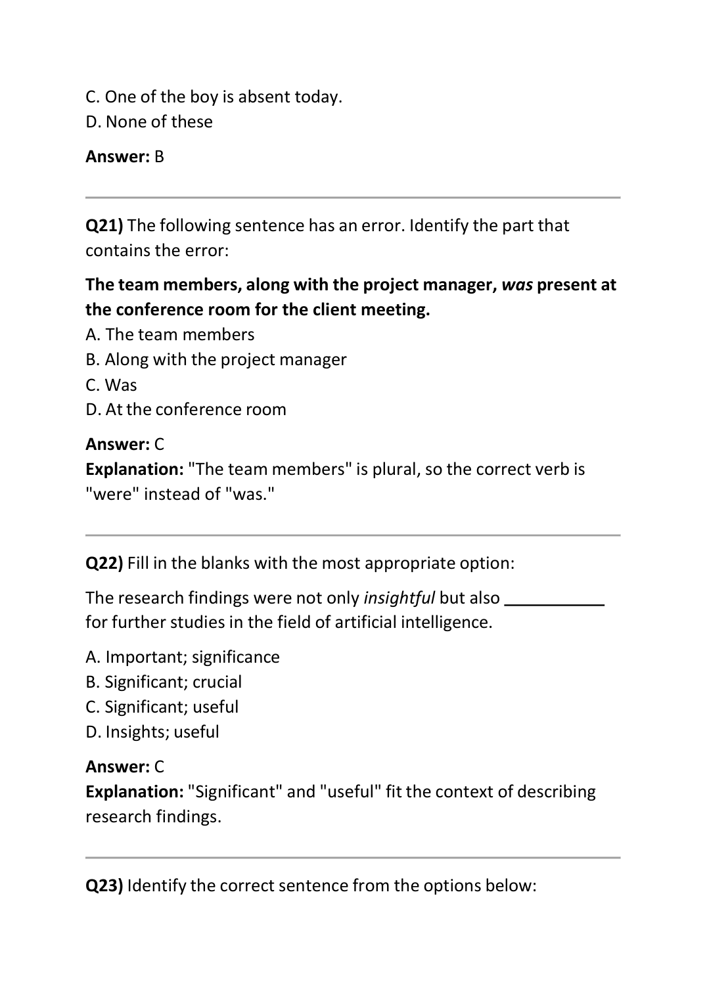

> **Verified Answer Key:** `C`  

**Pedagogical Derivation / Explanation:**  
"The team members" is plural, so the correct verb is "were" instead of "was."

---

### Item 72: TOPMATE_GRAMMAR_Q22
**Source Document:** `Infosys English Grammar.pdf` (Page 7)  
**Category / Topic:** Verbal Ability & Grammar | English Grammar & Error Correction  
**Prompt:** Fill in the blanks with the most appropriate option: The research findings were not only insightful but also for further studies in the field of artificial intelligence.

**Options:**
- A. Important; significance
- B. Significant; crucial
- C. Significant; useful
- D. Insights; useful

> **Verified Answer Key:** `C`  

**Pedagogical Derivation / Explanation:**  
"Significant" and "useful" fit the context of describing research findings.

---

### Item 73: TOPMATE_GRAMMAR_Q23
**Source Document:** `Infosys English Grammar.pdf` (Page 7)  
**Category / Topic:** Verbal Ability & Grammar | English Grammar & Error Correction  
**Prompt:** Identify the correct sentence from the options below:

**Options:**
- A. The company has took measures to improve customer satisfaction.
- B. The company has taken measures to improve customer satisfaction.
- C. The company has taking measures to improve customer satisfaction.
- D. The company has take measures to improve customer satisfaction.

> **Verified Answer Key:** `B`  

**Pedagogical Derivation / Explanation:**  
The correct form of the verb is "has taken."

---

### Item 74: TOPMATE_GRAMMAR_Q24
**Source Document:** `Infosys English Grammar.pdf` (Page 8)  
**Category / Topic:** Verbal Ability & Grammar | English Grammar & Error Correction  
**Prompt:** Rearrange the following words to form a meaningful sentence: innovations / of / the / core / are / technological / progress / to

**Options:**
- A. Technological innovations are core to the progress.
- B. Innovations are the core to technological progress.
- C. The core of technological progress are innovations.
- D. Technological innovations are the core of progress.

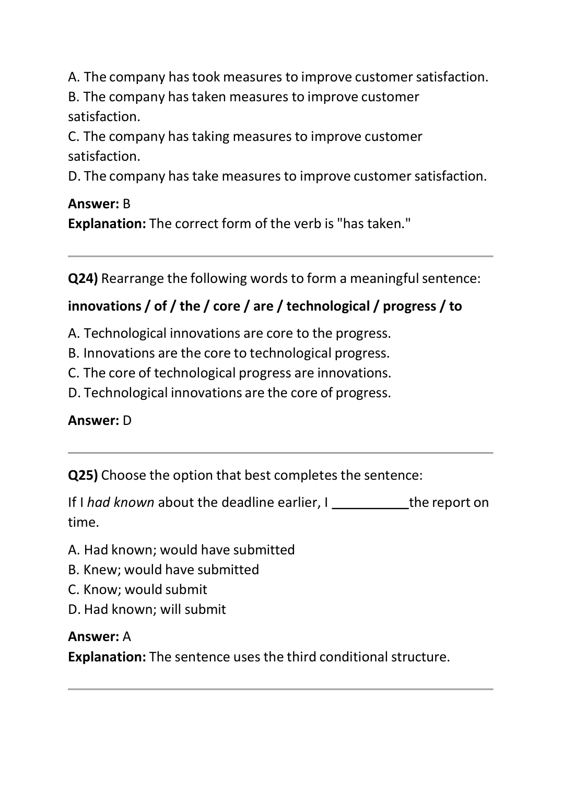

> **Verified Answer Key:** `D`  

**Pedagogical Derivation / Explanation:**  
Grammar rule application confirms `D` is the strictly standard and syntactically sound construction.

---

### Item 75: TOPMATE_GRAMMAR_Q25
**Source Document:** `Infosys English Grammar.pdf` (Page 8)  
**Category / Topic:** Verbal Ability & Grammar | English Grammar & Error Correction  
**Prompt:** Choose the option that best completes the sentence: If I had known about the deadline earlier, I the report on time.

**Options:**
- A. Had known; would have submitted
- B. Knew; would have submitted
- C. Know; would submit
- D. Had known; will submit

> **Verified Answer Key:** `A`  

**Pedagogical Derivation / Explanation:**  
The sentence uses the third conditional structure.

---

### Item 76: TOPMATE_GRAMMAR_Q26
**Source Document:** `Infosys English Grammar.pdf` (Page 9)  
**Category / Topic:** Verbal Ability & Grammar | English Grammar & Error Correction  
**Prompt:** In the following passage, one sentence is grammatically incorrect. Identify the sentence: 1. The consultant provided valuable insights. 2. He suggested some changes to the existing model. 3. The recommendations was implemented successfully. 4. The team appreciated his contribution.

**Options:**
- A. Replace "was" with "were" in sentence 3
- B. Replace "insights" with "insight" in sentence 1
- C. Replace "suggested" with "suggesting" in sentence 2
- D. No correction needed

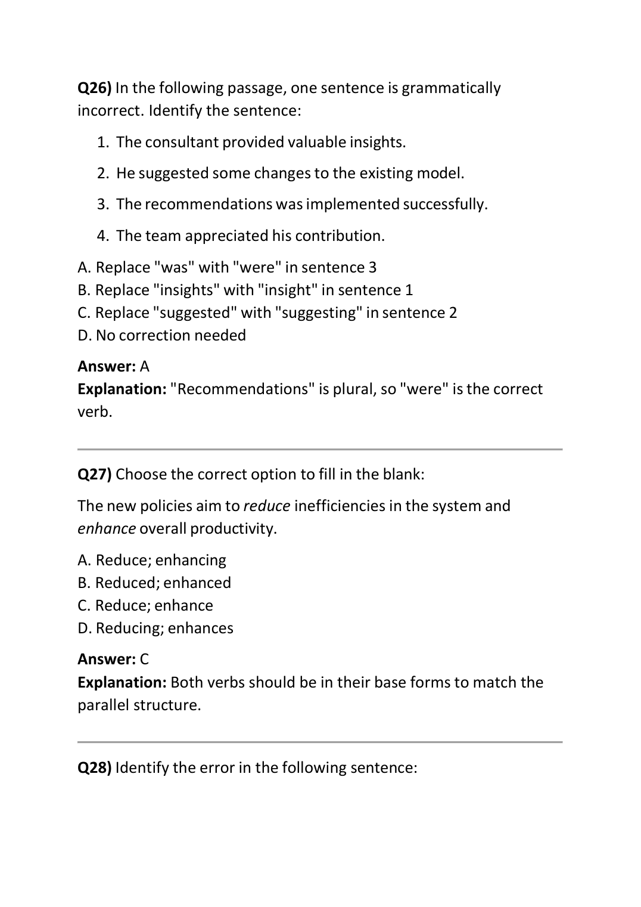

> **Verified Answer Key:** `A`  

**Pedagogical Derivation / Explanation:**  
"Recommendations" is plural, so "were" is the correct verb.

---

### Item 77: TOPMATE_GRAMMAR_Q27
**Source Document:** `Infosys English Grammar.pdf` (Page 9)  
**Category / Topic:** Verbal Ability & Grammar | English Grammar & Error Correction  
**Prompt:** Choose the correct option to fill in the blank: The new policies aim to reduce inefficiencies in the system and enhance overall productivity.

**Options:**
- A. Reduce; enhancing
- B. Reduced; enhanced
- C. Reduce; enhance
- D. Reducing; enhances

> **Verified Answer Key:** `C`  

**Pedagogical Derivation / Explanation:**  
Both verbs should be in their base forms to match the parallel structure.

---

### Item 78: TOPMATE_GRAMMAR_Q28
**Source Document:** `Infosys English Grammar.pdf` (Page 9)  
**Category / Topic:** Verbal Ability & Grammar | English Grammar & Error Correction  
**Prompt:** Identify the error in the following sentence: No sooner the CEO entered the meeting room, the discussion began.

**Options:**
- A. No sooner
- B. The CEO entered
- C. The discussion began
- D. No error

> **Verified Answer Key:** `A`  

**Pedagogical Derivation / Explanation:**  
The correct phrase is "No sooner had the CEO entered."

---

### Item 79: TOPMATE_GRAMMAR_Q29
**Source Document:** `Infosys English Grammar.pdf` (Page 10)  
**Category / Topic:** Verbal Ability & Grammar | English Grammar & Error Correction  
**Prompt:** Identify the part of the sentence that contains an error: Each of the employees in the department have been assigned a specific task to complete before the end of the week.

**Options:**
- A. Each of the employees
- B. Have
- C. Been assigned a specific task
- D. Before the end of the week

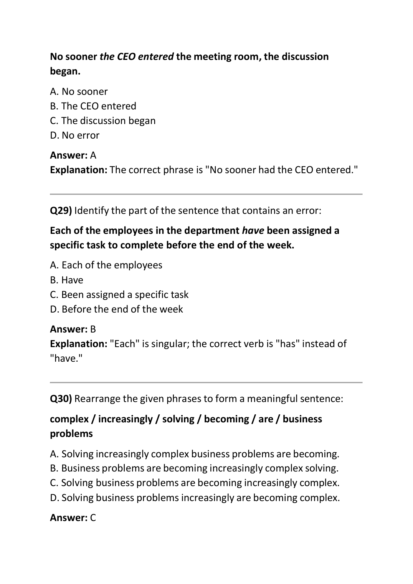

> **Verified Answer Key:** `B`  

**Pedagogical Derivation / Explanation:**  
"Each" is singular; the correct verb is "has" instead of "have."

---

### Item 80: TOPMATE_GRAMMAR_Q30
**Source Document:** `Infosys English Grammar.pdf` (Page 10)  
**Category / Topic:** Verbal Ability & Grammar | English Grammar & Error Correction  
**Prompt:** Rearrange the given phrases to form a meaningful sentence: complex / increasingly / solving / becoming / are / business problems

**Options:**
- A. Solving increasingly complex business problems are becoming.
- B. Business problems are becoming increasingly complex solving.
- C. Solving business problems are becoming increasingly complex.
- D. Solving business problems increasingly are becoming complex.

> **Verified Answer Key:** `C`  

**Pedagogical Derivation / Explanation:**  
Grammar rule application confirms `C` is the strictly standard and syntactically sound construction.

---

### Item 81: TOPMATE_GRAMMAR_Q31
**Source Document:** `Infosys English Grammar.pdf` (Page 11)  
**Category / Topic:** Verbal Ability & Grammar | English Grammar & Error Correction  
**Prompt:** Identify the sentence with the correct grammar:

**Options:**
- A. He discussed about the problems in the meeting.
- B. He discussed the problems in the meeting.
- C. He has discussed about the problems in the meeting.
- D. He is discussing about the problems in the meeting.

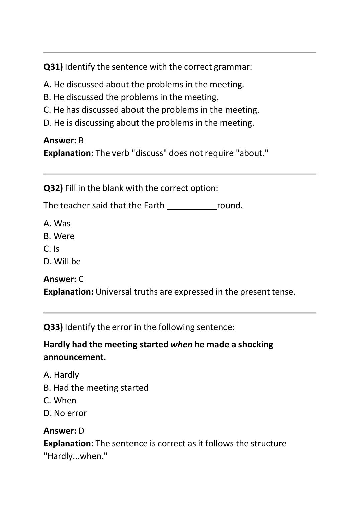

> **Verified Answer Key:** `B`  

**Pedagogical Derivation / Explanation:**  
The verb "discuss" does not require "about."

---

### Item 82: TOPMATE_GRAMMAR_Q32
**Source Document:** `Infosys English Grammar.pdf` (Page 11)  
**Category / Topic:** Verbal Ability & Grammar | English Grammar & Error Correction  
**Prompt:** Fill in the blank with the correct option: The teacher said that the Earth round.

**Options:**
- A. Was
- B. Were
- C. Is
- D. Will be

> **Verified Answer Key:** `C`  

**Pedagogical Derivation / Explanation:**  
Universal truths are expressed in the present tense.

---

### Item 83: TOPMATE_GRAMMAR_Q33
**Source Document:** `Infosys English Grammar.pdf` (Page 11)  
**Category / Topic:** Verbal Ability & Grammar | English Grammar & Error Correction  
**Prompt:** Identify the error in the following sentence: Hardly had the meeting started when he made a shocking announcement.

**Options:**
- A. Hardly
- B. Had the meeting started
- C. When
- D. No error

> **Verified Answer Key:** `D`  

**Pedagogical Derivation / Explanation:**  
The sentence is correct as it follows the structure "Hardly...when."

---

### Item 84: TOPMATE_GRAMMAR_Q34
**Source Document:** `Infosys English Grammar.pdf` (Page 12)  
**Category / Topic:** Verbal Ability & Grammar | English Grammar & Error Correction  
**Prompt:** Choose the correct word to fill in the blank: The manager will give you the necessary to complete the project.

**Options:**
- A. Advise
- B. Advices
- C. Advice
- D. Advise’s

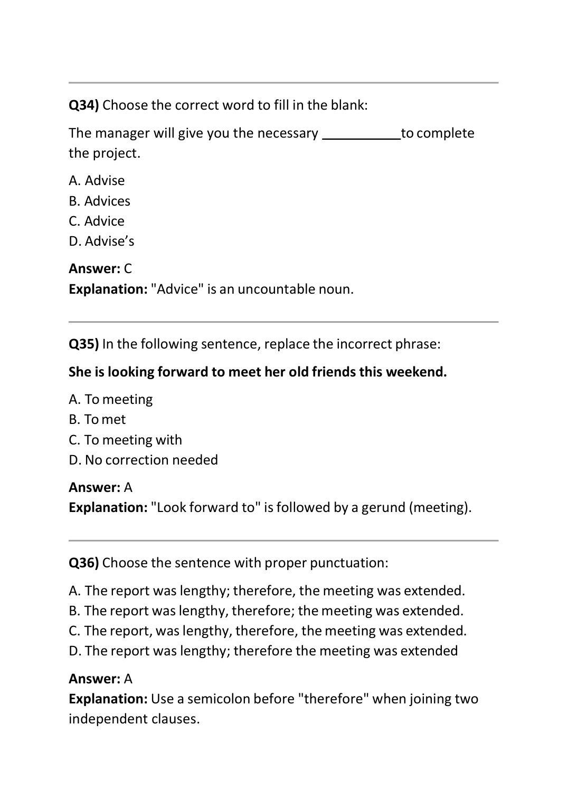

> **Verified Answer Key:** `C`  

**Pedagogical Derivation / Explanation:**  
"Advice" is an uncountable noun.

---

### Item 85: TOPMATE_GRAMMAR_Q35
**Source Document:** `Infosys English Grammar.pdf` (Page 12)  
**Category / Topic:** Verbal Ability & Grammar | English Grammar & Error Correction  
**Prompt:** In the following sentence, replace the incorrect phrase: She is looking forward to meet her old friends this weekend.

**Options:**
- A. To meeting
- B. To met
- C. To meeting with
- D. No correction needed

> **Verified Answer Key:** `A`  

**Pedagogical Derivation / Explanation:**  
"Look forward to" is followed by a gerund (meeting).

---

### Item 86: TOPMATE_GRAMMAR_Q36
**Source Document:** `Infosys English Grammar.pdf` (Page 12)  
**Category / Topic:** Verbal Ability & Grammar | English Grammar & Error Correction  
**Prompt:** Choose the sentence with proper punctuation:

**Options:**
- A. The report was lengthy; therefore, the meeting was extended.
- B. The report was lengthy, therefore; the meeting was extended.
- C. The report, was lengthy, therefore, the meeting was extended.
- D. The report was lengthy; therefore the meeting was extended

> **Verified Answer Key:** `A`  

**Pedagogical Derivation / Explanation:**  
Use a semicolon before "therefore" when joining two independent clauses.

---

### Item 87: TOPMATE_GRAMMAR_Q37
**Source Document:** `Infosys English Grammar.pdf` (Page 13)  
**Category / Topic:** Verbal Ability & Grammar | English Grammar & Error Correction  
**Prompt:** Identify the error in the following sentence: The number of participants have significantly increased this year.

**Options:**
- A. The number of participants
- B. Have
- C. Increased this year
- D. No error

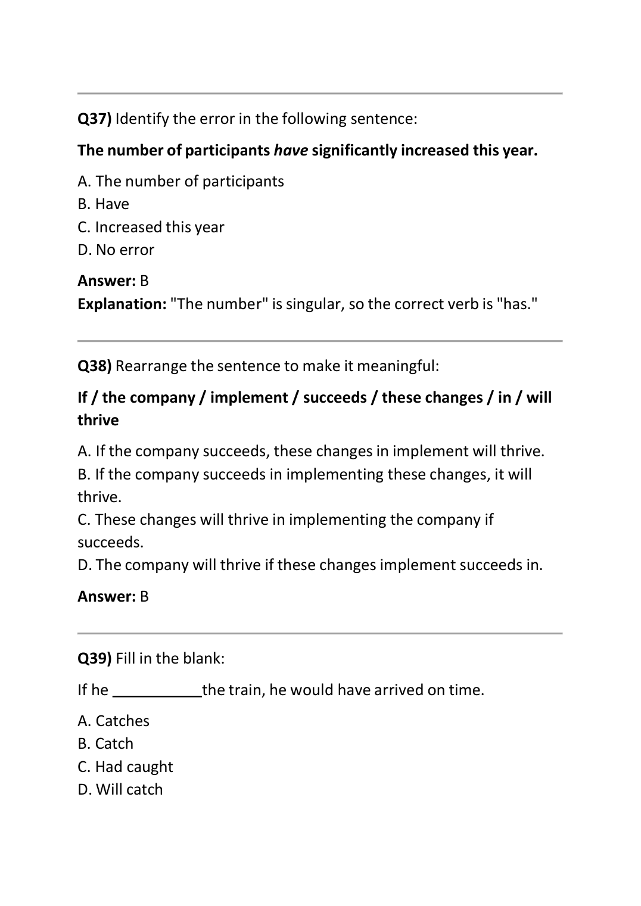

> **Verified Answer Key:** `B`  

**Pedagogical Derivation / Explanation:**  
"The number" is singular, so the correct verb is "has."

---

### Item 88: TOPMATE_GRAMMAR_Q38
**Source Document:** `Infosys English Grammar.pdf` (Page 13)  
**Category / Topic:** Verbal Ability & Grammar | English Grammar & Error Correction  
**Prompt:** Rearrange the sentence to make it meaningful: If / the company / implement / succeeds / these changes / in / will thrive

**Options:**
- A. If the company succeeds, these changes in implement will thrive.
- B. If the company succeeds in implementing these changes, it will thrive.
- C. These changes will thrive in implementing the company if succeeds.
- D. The company will thrive if these changes implement succeeds in.

> **Verified Answer Key:** `B`  

**Pedagogical Derivation / Explanation:**  
Grammar rule application confirms `B` is the strictly standard and syntactically sound construction.

---

### Item 89: TOPMATE_GRAMMAR_Q39
**Source Document:** `Infosys English Grammar.pdf` (Page 13)  
**Category / Topic:** Verbal Ability & Grammar | English Grammar & Error Correction  
**Prompt:** Fill in the blank: If he the train, he would have arrived on time.

**Options:**
- A. Catches
- B. Catch
- C. Had caught
- D. Will catch

> **Verified Answer Key:** `C`  

**Pedagogical Derivation / Explanation:**  
This is a third conditional sentence requiring "had caught."

---

### Item 90: TOPMATE_GRAMMAR_Q40
**Source Document:** `Infosys English Grammar.pdf` (Page 14)  
**Category / Topic:** Verbal Ability & Grammar | English Grammar & Error Correction  
**Prompt:** Choose the sentence without an error:

**Options:**
- A. Each of the players have to practice hard for the upcoming match.
- B. Each of the players has to practice hard for the upcoming match.
- C. Each of the players had to practice hard for the upcoming match.
- D. Each of the players was practice hard for the upcoming match.

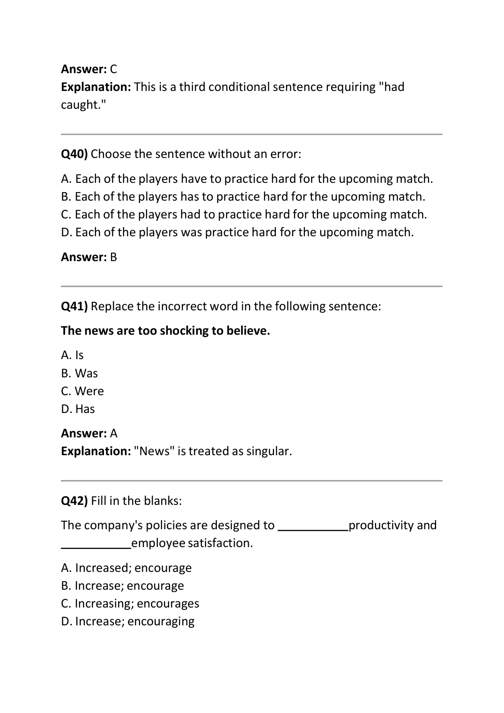

> **Verified Answer Key:** `B`  

**Pedagogical Derivation / Explanation:**  
Grammar rule application confirms `B` is the strictly standard and syntactically sound construction.

---

### Item 91: TOPMATE_GRAMMAR_Q41
**Source Document:** `Infosys English Grammar.pdf` (Page 14)  
**Category / Topic:** Verbal Ability & Grammar | English Grammar & Error Correction  
**Prompt:** Replace the incorrect word in the following sentence: The news are too shocking to believe.

**Options:**
- A. Is
- B. Was
- C. Were
- D. Has

> **Verified Answer Key:** `A`  

**Pedagogical Derivation / Explanation:**  
"News" is treated as singular.

---

### Item 92: TOPMATE_GRAMMAR_Q42
**Source Document:** `Infosys English Grammar.pdf` (Page 14)  
**Category / Topic:** Verbal Ability & Grammar | English Grammar & Error Correction  
**Prompt:** Fill in the blanks: The company's policies are designed to productivity and employee satisfaction.

**Options:**
- A. Increased; encourage
- B. Increase; encourage
- C. Increasing; encourages
- D. Increase; encouraging

> **Verified Answer Key:** `B`  

**Pedagogical Derivation / Explanation:**  
Both verbs need to match the infinitive structure.

---

### Item 93: TOPMATE_GRAMMAR_Q43
**Source Document:** `Infosys English Grammar.pdf` (Page 15)  
**Category / Topic:** Verbal Ability & Grammar | English Grammar & Error Correction  
**Prompt:** Choose the option that best completes the sentence: The CEO, along with his team, the award for innovation.

**Options:**
- A. Receive
- B. Have received
- C. Receives
- D. Are receiving

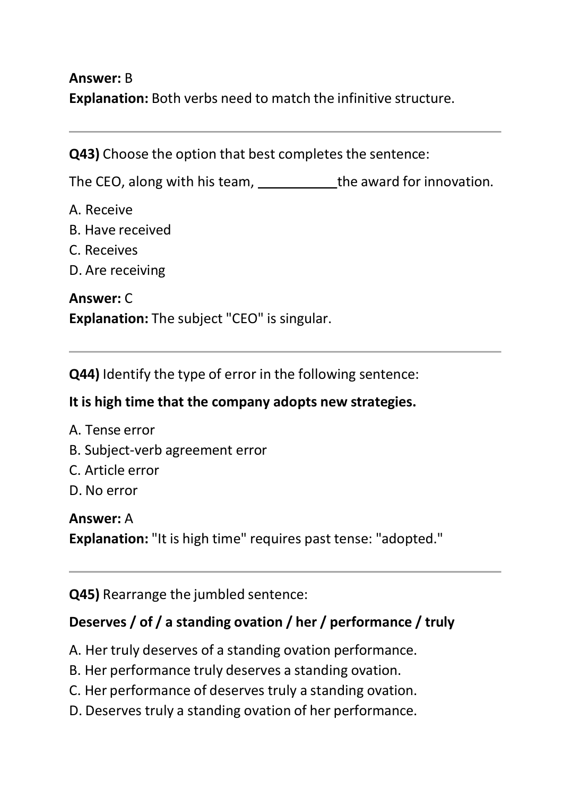

> **Verified Answer Key:** `C`  

**Pedagogical Derivation / Explanation:**  
The subject "CEO" is singular.

---

### Item 94: TOPMATE_GRAMMAR_Q44
**Source Document:** `Infosys English Grammar.pdf` (Page 15)  
**Category / Topic:** Verbal Ability & Grammar | English Grammar & Error Correction  
**Prompt:** Identify the type of error in the following sentence: It is high time that the company adopts new strategies.

**Options:**
- A. Tense error
- B. Subject-verb agreement error
- C. Article error
- D. No error

> **Verified Answer Key:** `A`  

**Pedagogical Derivation / Explanation:**  
"It is high time" requires past tense: "adopted."

---

### Item 95: TOPMATE_GRAMMAR_Q45
**Source Document:** `Infosys English Grammar.pdf` (Page 15)  
**Category / Topic:** Verbal Ability & Grammar | English Grammar & Error Correction  
**Prompt:** Rearrange the jumbled sentence: Deserves / of / a standing ovation / her / performance / truly

**Options:**
- A. Her truly deserves of a standing ovation performance.
- B. Her performance truly deserves a standing ovation.
- C. Her performance of deserves truly a standing ovation.
- D. Deserves truly a standing ovation of her performance.

> **Verified Answer Key:** `B`  

**Pedagogical Derivation / Explanation:**  
Grammar rule application confirms `B` is the strictly standard and syntactically sound construction.

---

### Item 96: TOPMATE_GRAMMAR_Q46
**Source Document:** `Infosys English Grammar.pdf` (Page 16)  
**Category / Topic:** Verbal Ability & Grammar | English Grammar & Error Correction  
**Prompt:** Fill in the blank: The scientist is known his groundbreaking research in artificial intelligence.

**Options:**
- A. For
- B. About
- C. Of
- D. By

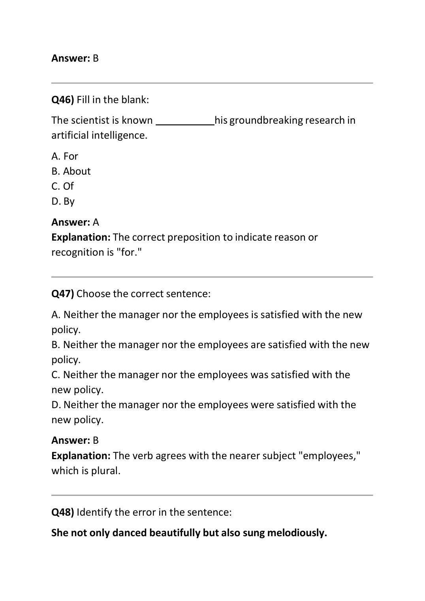

> **Verified Answer Key:** `A`  

**Pedagogical Derivation / Explanation:**  
The correct preposition to indicate reason or recognition is "for."

---

### Item 97: TOPMATE_GRAMMAR_Q47
**Source Document:** `Infosys English Grammar.pdf` (Page 16)  
**Category / Topic:** Verbal Ability & Grammar | English Grammar & Error Correction  
**Prompt:** Choose the correct sentence:

**Options:**
- A. Neither the manager nor the employees is satisfied with the new policy.
- B. Neither the manager nor the employees are satisfied with the new policy.
- C. Neither the manager nor the employees was satisfied with the new policy.
- D. Neither the manager nor the employees were satisfied with the new policy.

> **Verified Answer Key:** `B`  

**Pedagogical Derivation / Explanation:**  
The verb agrees with the nearer subject "employees," which is plural.

---

### Item 98: TOPMATE_GRAMMAR_Q48
**Source Document:** `Infosys English Grammar.pdf` (Page 16)  
**Category / Topic:** Verbal Ability & Grammar | English Grammar & Error Correction  
**Prompt:** Identify the error in the sentence: She not only danced beautifully but also sung melodiously.

**Options:**
- A. Not only
- B. Danced beautifully
- C. But also sung
- D. No error

> **Verified Answer Key:** `C`  

**Pedagogical Derivation / Explanation:**  
The correct form is "but also sang" to maintain parallelism.

---

### Item 99: TOPMATE_GRAMMAR_Q49
**Source Document:** `Infosys English Grammar.pdf` (Page 17)  
**Category / Topic:** Verbal Ability & Grammar | English Grammar & Error Correction  
**Prompt:** Rearrange the sentence to make it meaningful: The / employees / appreciated / their / manager’s efforts / for them

**Options:**
- A. The appreciated employees their manager’s efforts for them.
- B. The employees appreciated their manager’s efforts for them.
- C. The manager’s efforts appreciated the employees for them.
- D. For the manager’s efforts, the employees appreciated their efforts.

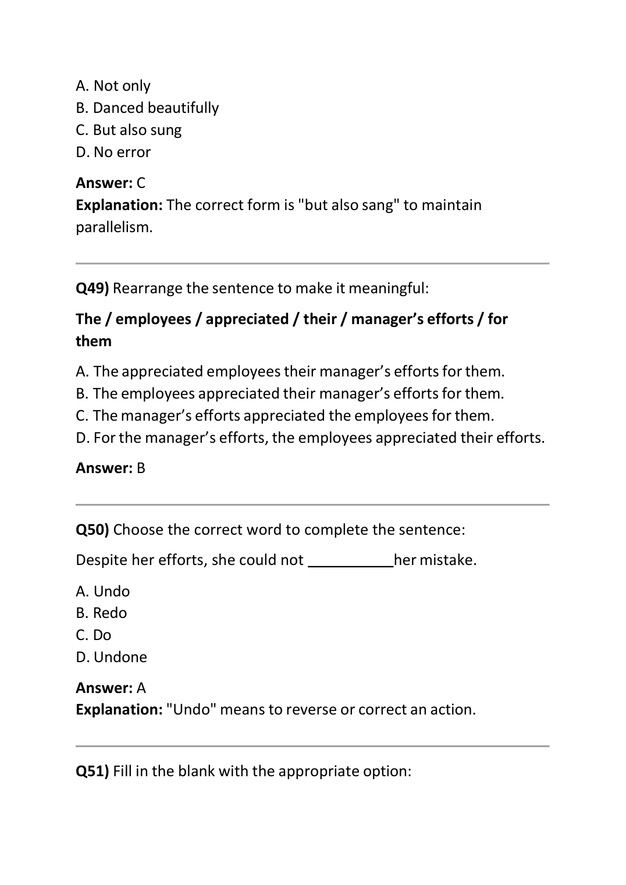

> **Verified Answer Key:** `B`  

**Pedagogical Derivation / Explanation:**  
Grammar rule application confirms `B` is the strictly standard and syntactically sound construction.

---

### Item 100: TOPMATE_GRAMMAR_Q50
**Source Document:** `Infosys English Grammar.pdf` (Page 17)  
**Category / Topic:** Verbal Ability & Grammar | English Grammar & Error Correction  
**Prompt:** Choose the correct word to complete the sentence: Despite her efforts, she could not her mistake.

**Options:**
- A. Undo
- B. Redo
- C. Do
- D. Undone

> **Verified Answer Key:** `A`  

**Pedagogical Derivation / Explanation:**  
"Undo" means to reverse or correct an action.

---

### Item 101: TOPMATE_GRAMMAR_Q51
**Source Document:** `Infosys English Grammar.pdf` (Page 17)  
**Category / Topic:** Verbal Ability & Grammar | English Grammar & Error Correction  
**Prompt:** Fill in the blank with the appropriate option: If you the instructions carefully, you would not have made such mistakes.

**Options:**
- A. Follow
- B. Had followed
- C. Followed
- D. Have followed

> **Verified Answer Key:** `B`  

**Pedagogical Derivation / Explanation:**  
This is a third conditional sentence, requiring "had followed."

---

### Item 102: TOPMATE_GRAMMAR_Q52
**Source Document:** `Infosys English Grammar.pdf` (Page 18)  
**Category / Topic:** Verbal Ability & Grammar | English Grammar & Error Correction  
**Prompt:** Choose the grammatically correct sentence:

**Options:**
- A. He suggested me to take a break.
- B. He suggested that I take a break.
- C. He suggested to me to take a break.
- D. He suggested I to take a break.

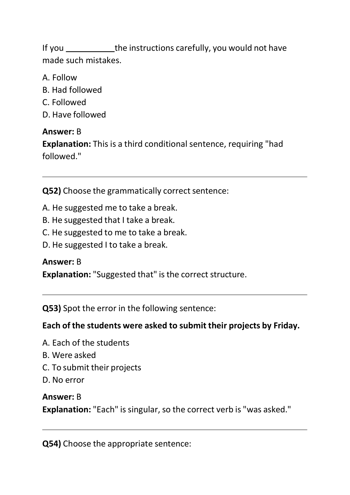

> **Verified Answer Key:** `B`  

**Pedagogical Derivation / Explanation:**  
"Suggested that" is the correct structure.

---

### Item 103: TOPMATE_GRAMMAR_Q53
**Source Document:** `Infosys English Grammar.pdf` (Page 18)  
**Category / Topic:** Verbal Ability & Grammar | English Grammar & Error Correction  
**Prompt:** Spot the error in the following sentence: Each of the students were asked to submit their projects by Friday.

**Options:**
- A. Each of the students
- B. Were asked
- C. To submit their projects
- D. No error

> **Verified Answer Key:** `B`  

**Pedagogical Derivation / Explanation:**  
"Each" is singular, so the correct verb is "was asked."

---

### Item 104: TOPMATE_GRAMMAR_Q54
**Source Document:** `Infosys English Grammar.pdf` (Page 18)  
**Category / Topic:** Verbal Ability & Grammar | English Grammar & Error Correction  
**Prompt:** Choose the appropriate sentence:

**Options:**
- A. He is good in mathematics but poor at history.
- B. He is good at mathematics but poor in history.
- C. He is good on mathematics but poor on history.
- D. He is good at mathematics but poor at history.

> **Verified Answer Key:** `D`  

**Pedagogical Derivation / Explanation:**  
The correct prepositions are "at" for skills and "at" for subjects.

---

### Item 105: TOPMATE_GRAMMAR_Q55
**Source Document:** `Infosys English Grammar.pdf` (Page 19)  
**Category / Topic:** Verbal Ability & Grammar | English Grammar & Error Correction  
**Prompt:** Fill in the blank: By the time we reached the station, the train .

**Options:**
- A. Leaves
- B. Had left
- C. Is leaving
- D. Will leave

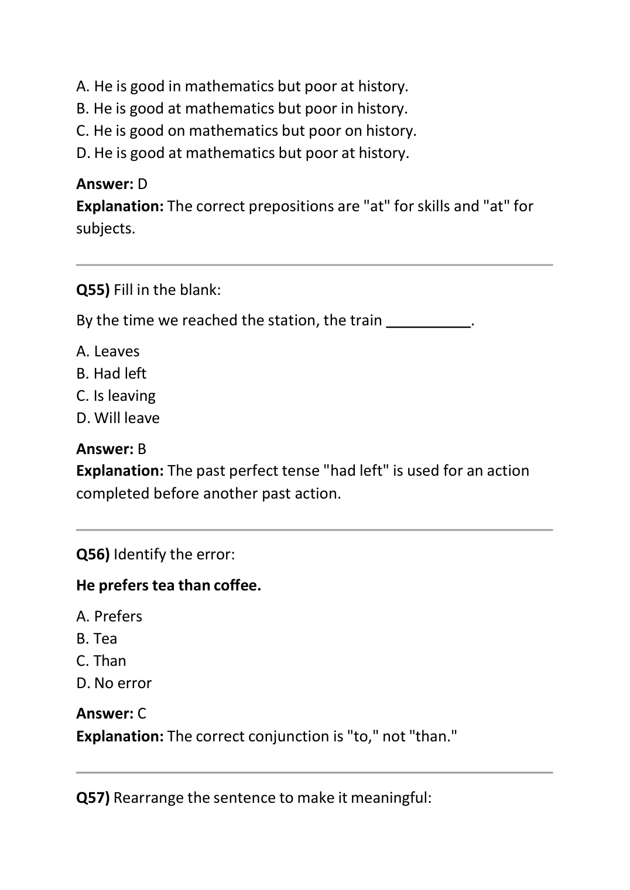

> **Verified Answer Key:** `B`  

**Pedagogical Derivation / Explanation:**  
The past perfect tense "had left" is used for an action completed before another past action.

---

### Item 106: TOPMATE_GRAMMAR_Q56
**Source Document:** `Infosys English Grammar.pdf` (Page 19)  
**Category / Topic:** Verbal Ability & Grammar | English Grammar & Error Correction  
**Prompt:** Identify the error: He prefers tea than coffee.

**Options:**
- A. Prefers
- B. Tea
- C. Than
- D. No error

> **Verified Answer Key:** `C`  

**Pedagogical Derivation / Explanation:**  
The correct conjunction is "to," not "than."

---

### Item 107: TOPMATE_GRAMMAR_Q57
**Source Document:** `Infosys English Grammar.pdf` (Page 19)  
**Category / Topic:** Verbal Ability & Grammar | English Grammar & Error Correction  
**Prompt:** Rearrange the sentence to make it meaningful: Immediately / agreed / the manager / to / the proposal

**Options:**
- A. The manager immediately agreed to the proposal.
- B. Agreed the manager to the proposal immediately.
- C. The proposal agreed to immediately by the manager.
- D. Immediately the manager agreed the proposal to.

> **Verified Answer Key:** `A`  

**Pedagogical Derivation / Explanation:**  
Grammar rule application confirms `A` is the strictly standard and syntactically sound construction.

---

### Item 108: TOPMATE_GRAMMAR_Q58
**Source Document:** `Infosys English Grammar.pdf` (Page 20)  
**Category / Topic:** Verbal Ability & Grammar | English Grammar & Error Correction  
**Prompt:** Choose the sentence with the correct usage of "less" and "fewer":

**Options:**
- A. There were less students in the class than yesterday.
- B. There were fewer students in the class than yesterday.
- C. There was fewer noise in the room than expected.
- D. There were less books on the table than before.

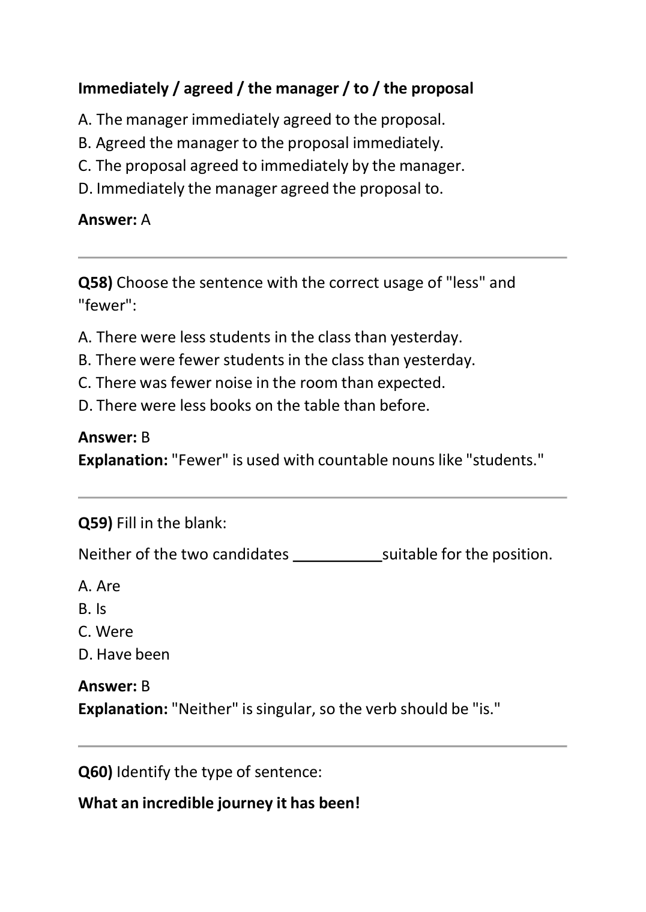

> **Verified Answer Key:** `B`  

**Pedagogical Derivation / Explanation:**  
"Fewer" is used with countable nouns like "students."

---

### Item 109: TOPMATE_GRAMMAR_Q59
**Source Document:** `Infosys English Grammar.pdf` (Page 20)  
**Category / Topic:** Verbal Ability & Grammar | English Grammar & Error Correction  
**Prompt:** Fill in the blank: Neither of the two candidates suitable for the position.

**Options:**
- A. Are
- B. Is
- C. Were
- D. Have been

> **Verified Answer Key:** `B`  

**Pedagogical Derivation / Explanation:**  
"Neither" is singular, so the verb should be "is."

---

### Item 110: TOPMATE_GRAMMAR_Q60
**Source Document:** `Infosys English Grammar.pdf` (Page 20)  
**Category / Topic:** Verbal Ability & Grammar | English Grammar & Error Correction  
**Prompt:** Identify the type of sentence: What an incredible journey it has been!

**Options:**
- A. Assertive
- B. Interrogative
- C. Exclamatory
- D. Imperative

> **Verified Answer Key:** `C`  

**Pedagogical Derivation / Explanation:**  
Grammar rule application confirms `C` is the strictly standard and syntactically sound construction.

---

### Item 111: TOPMATE_GRAMMAR_Q61
**Source Document:** `Infosys English Grammar.pdf` (Page 21)  
**Category / Topic:** Verbal Ability & Grammar | English Grammar & Error Correction  
**Prompt:** Fill in the blank with the correct option: The project must be completed next Friday.

**Options:**
- A. By
- B. Until
- C. On
- D. Since

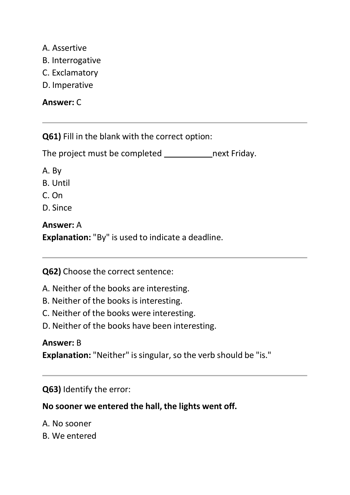

> **Verified Answer Key:** `A`  

**Pedagogical Derivation / Explanation:**  
"By" is used to indicate a deadline.

---

### Item 112: TOPMATE_GRAMMAR_Q62
**Source Document:** `Infosys English Grammar.pdf` (Page 21)  
**Category / Topic:** Verbal Ability & Grammar | English Grammar & Error Correction  
**Prompt:** Choose the correct sentence:

**Options:**
- A. Neither of the books are interesting.
- B. Neither of the books is interesting.
- C. Neither of the books were interesting.
- D. Neither of the books have been interesting.

> **Verified Answer Key:** `B`  

**Pedagogical Derivation / Explanation:**  
"Neither" is singular, so the verb should be "is."

---

### Item 113: TOPMATE_GRAMMAR_Q63
**Source Document:** `Infosys English Grammar.pdf` (Page 21)  
**Category / Topic:** Verbal Ability & Grammar | English Grammar & Error Correction  
**Prompt:** Identify the error: No sooner we entered the hall, the lights went off.

**Options:**
- A. No sooner
- B. We entered
- C. The hall
- D. No error

> **Verified Answer Key:** `B`  

**Pedagogical Derivation / Explanation:**  
The correct structure is "No sooner had we entered."

---

### Item 114: TOPMATE_GRAMMAR_Q64
**Source Document:** `Infosys English Grammar.pdf` (Page 22)  
**Category / Topic:** Verbal Ability & Grammar | English Grammar & Error Correction  
**Prompt:** Fill in the blank: Hardly gone out when it began to rain.

**Options:**
- A. I have
- B. I had
- C. I was
- D. I am

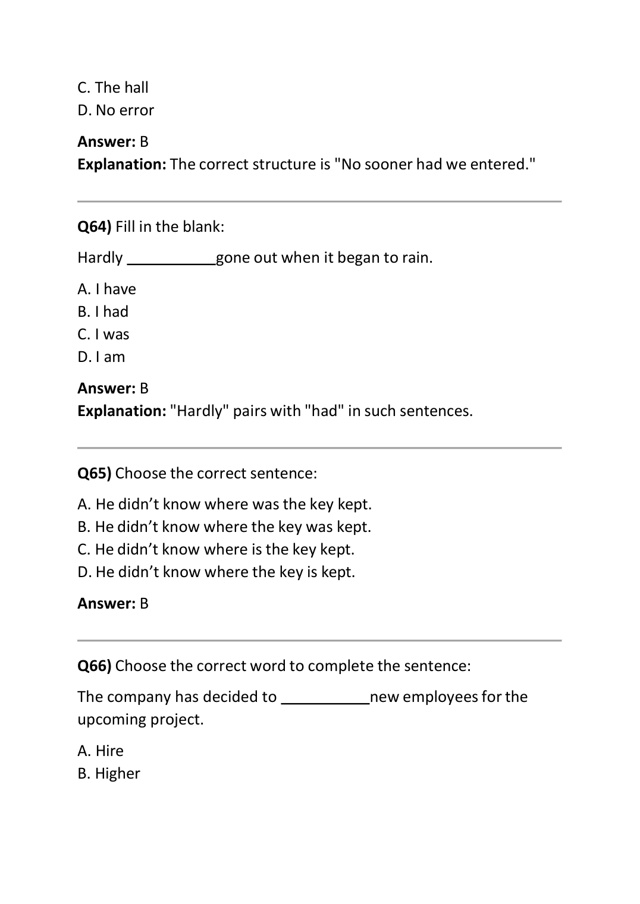

> **Verified Answer Key:** `B`  

**Pedagogical Derivation / Explanation:**  
"Hardly" pairs with "had" in such sentences.

---

### Item 115: TOPMATE_GRAMMAR_Q65
**Source Document:** `Infosys English Grammar.pdf` (Page 22)  
**Category / Topic:** Verbal Ability & Grammar | English Grammar & Error Correction  
**Prompt:** Choose the correct sentence:

**Options:**
- A. He didn’t know where was the key kept.
- B. He didn’t know where the key was kept.
- C. He didn’t know where is the key kept.
- D. He didn’t know where the key is kept.

> **Verified Answer Key:** `B`  

**Pedagogical Derivation / Explanation:**  
Grammar rule application confirms `B` is the strictly standard and syntactically sound construction.

---

### Item 116: TOPMATE_GRAMMAR_Q66
**Source Document:** `Infosys English Grammar.pdf` (Page 22)  
**Category / Topic:** Verbal Ability & Grammar | English Grammar & Error Correction  
**Prompt:** Choose the correct word to complete the sentence: The company has decided to new employees for the upcoming project.

**Options:**
- A. Hire
- B. Higher
- C. Hired
- D. Hiring

> **Verified Answer Key:** `A`  

**Pedagogical Derivation / Explanation:**  
"Hire" fits the context.

---

### Item 117: TOPMATE_GRAMMAR_Q67
**Source Document:** `Infosys English Grammar.pdf` (Page 23)  
**Category / Topic:** Verbal Ability & Grammar | English Grammar & Error Correction  
**Prompt:** Rearrange the sentence to make it meaningful: Was / every task / carefully / he / checking

**Options:**
- A. He was carefully checking every task.
- B. Was carefully he checking every task.
- C. He carefully every task was checking.
- D. Checking every task he was carefully.

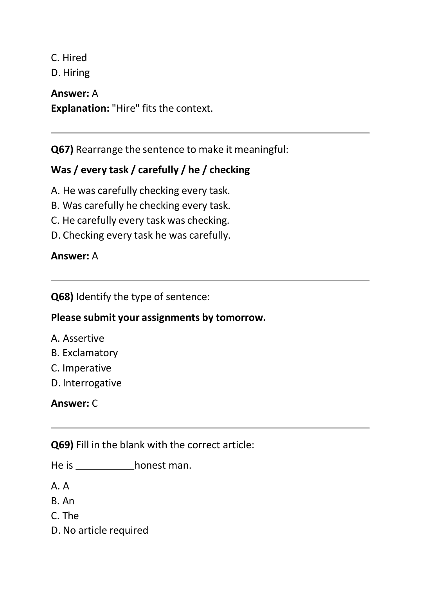

> **Verified Answer Key:** `A`  

**Pedagogical Derivation / Explanation:**  
Grammar rule application confirms `A` is the strictly standard and syntactically sound construction.

---

### Item 118: TOPMATE_GRAMMAR_Q68
**Source Document:** `Infosys English Grammar.pdf` (Page 23)  
**Category / Topic:** Verbal Ability & Grammar | English Grammar & Error Correction  
**Prompt:** Identify the type of sentence: Please submit your assignments by tomorrow.

**Options:**
- A. Assertive
- B. Exclamatory
- C. Imperative
- D. Interrogative

> **Verified Answer Key:** `C`  

**Pedagogical Derivation / Explanation:**  
Grammar rule application confirms `C` is the strictly standard and syntactically sound construction.

---

### Item 119: TOPMATE_GRAMMAR_Q69
**Source Document:** `Infosys English Grammar.pdf` (Page 23)  
**Category / Topic:** Verbal Ability & Grammar | English Grammar & Error Correction  
**Prompt:** Fill in the blank with the correct article: He is honest man.

**Options:**
- A. A
- B. An
- C. The
- D. No article required

> **Verified Answer Key:** `B`  

**Pedagogical Derivation / Explanation:**  
"An" is used before words starting with a vowel sound.

---

### Item 120: TOPMATE_GRAMMAR_Q70
**Source Document:** `Infosys English Grammar.pdf` (Page 24)  
**Category / Topic:** Verbal Ability & Grammar | English Grammar & Error Correction  
**Prompt:** Identify the error: The sceneries of Switzerland are breathtaking.

**Options:**
- A. The sceneries
- B. Of Switzerland
- C. Are breathtaking
- D. No error

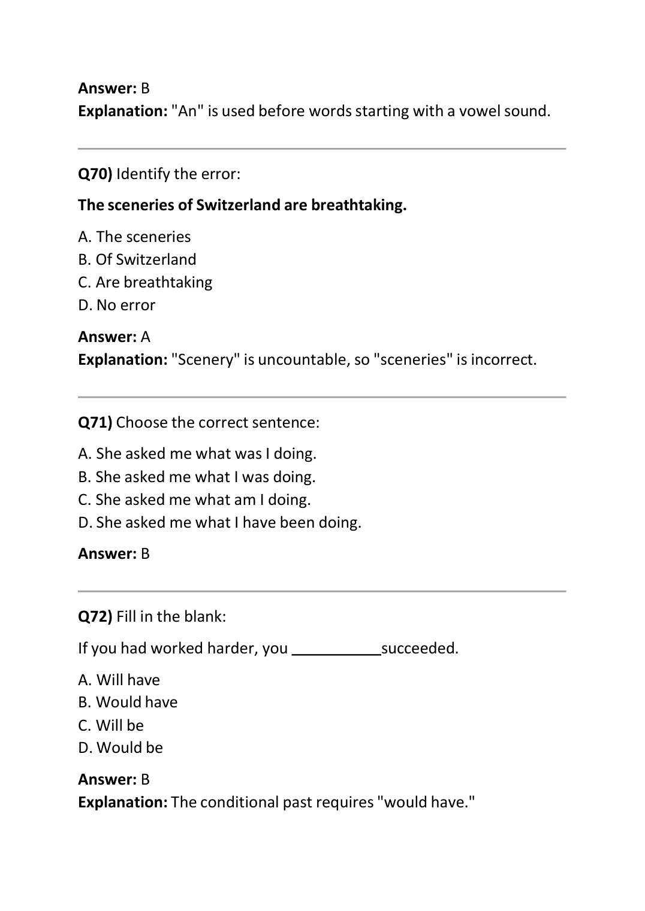

> **Verified Answer Key:** `A`  

**Pedagogical Derivation / Explanation:**  
"Scenery" is uncountable, so "sceneries" is incorrect.

---

### Item 121: TOPMATE_GRAMMAR_Q71
**Source Document:** `Infosys English Grammar.pdf` (Page 24)  
**Category / Topic:** Verbal Ability & Grammar | English Grammar & Error Correction  
**Prompt:** Choose the correct sentence:

**Options:**
- A. She asked me what was I doing.
- B. She asked me what I was doing.
- C. She asked me what am I doing.
- D. She asked me what I have been doing.

> **Verified Answer Key:** `B`  

**Pedagogical Derivation / Explanation:**  
Grammar rule application confirms `B` is the strictly standard and syntactically sound construction.

---

### Item 122: TOPMATE_GRAMMAR_Q72
**Source Document:** `Infosys English Grammar.pdf` (Page 24)  
**Category / Topic:** Verbal Ability & Grammar | English Grammar & Error Correction  
**Prompt:** Fill in the blank: If you had worked harder, you succeeded.

**Options:**
- A. Will have
- B. Would have
- C. Will be
- D. Would be

> **Verified Answer Key:** `B`  

**Pedagogical Derivation / Explanation:**  
The conditional past requires "would have."

---

### Item 123: TOPMATE_GRAMMAR_Q73
**Source Document:** `Infosys English Grammar.pdf` (Page 25)  
**Category / Topic:** Verbal Ability & Grammar | English Grammar & Error Correction  
**Prompt:** Rearrange the sentence to make it meaningful: We / attend / the meeting / tomorrow / will

**Options:**
- A. We attend will the meeting tomorrow.
- B. Will tomorrow the meeting attend we.
- C. We will attend the meeting tomorrow.
- D. The meeting will tomorrow attend we.

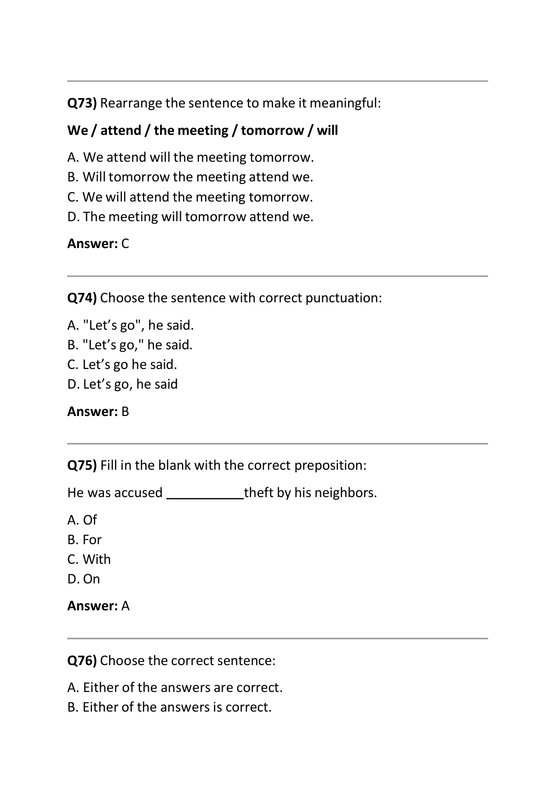

> **Verified Answer Key:** `C`  

**Pedagogical Derivation / Explanation:**  
Grammar rule application confirms `C` is the strictly standard and syntactically sound construction.

---

### Item 124: TOPMATE_GRAMMAR_Q74
**Source Document:** `Infosys English Grammar.pdf` (Page 25)  
**Category / Topic:** Verbal Ability & Grammar | English Grammar & Error Correction  
**Prompt:** Choose the sentence with correct punctuation:

**Options:**
- A. "Let’s go", he said.
- B. "Let’s go," he said.
- C. Let’s go he said.
- D. Let’s go, he said

> **Verified Answer Key:** `B`  

**Pedagogical Derivation / Explanation:**  
Grammar rule application confirms `B` is the strictly standard and syntactically sound construction.

---

### Item 125: TOPMATE_GRAMMAR_Q75
**Source Document:** `Infosys English Grammar.pdf` (Page 25)  
**Category / Topic:** Verbal Ability & Grammar | English Grammar & Error Correction  
**Prompt:** Fill in the blank with the correct preposition: He was accused theft by his neighbors.

**Options:**
- A. Of
- B. For
- C. With
- D. On

> **Verified Answer Key:** `A`  

**Pedagogical Derivation / Explanation:**  
Grammar rule application confirms `A` is the strictly standard and syntactically sound construction.

---

### Item 126: TOPMATE_GRAMMAR_Q76
**Source Document:** `Infosys English Grammar.pdf` (Page 25)  
**Category / Topic:** Verbal Ability & Grammar | English Grammar & Error Correction  
**Prompt:** Choose the correct sentence:

**Options:**
- A. Either of the answers are correct.
- B. Either of the answers is correct.
- C. Either of the answers have been correct.
- D. Either of the answers were correct.

> **Verified Answer Key:** `B`  

**Pedagogical Derivation / Explanation:**  
Grammar rule application confirms `B` is the strictly standard and syntactically sound construction.

---

### Item 127: TOPMATE_GRAMMAR_Q77
**Source Document:** `Infosys English Grammar.pdf` (Page 26)  
**Category / Topic:** Verbal Ability & Grammar | English Grammar & Error Correction  
**Prompt:** Fill in the blank: The teacher told us that the Earth around the Sun.

**Options:**
- A. Revolve
- B. Revolves
- C. Revolved
- D. Has revolved

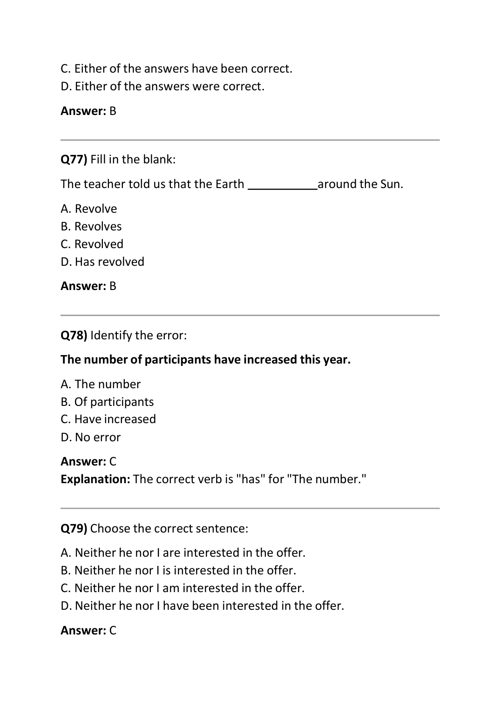

> **Verified Answer Key:** `B`  

**Pedagogical Derivation / Explanation:**  
Grammar rule application confirms `B` is the strictly standard and syntactically sound construction.

---

### Item 128: TOPMATE_GRAMMAR_Q78
**Source Document:** `Infosys English Grammar.pdf` (Page 26)  
**Category / Topic:** Verbal Ability & Grammar | English Grammar & Error Correction  
**Prompt:** Identify the error: The number of participants have increased this year.

**Options:**
- A. The number
- B. Of participants
- C. Have increased
- D. No error

> **Verified Answer Key:** `C`  

**Pedagogical Derivation / Explanation:**  
The correct verb is "has" for "The number."

---

### Item 129: TOPMATE_GRAMMAR_Q79
**Source Document:** `Infosys English Grammar.pdf` (Page 26)  
**Category / Topic:** Verbal Ability & Grammar | English Grammar & Error Correction  
**Prompt:** Choose the correct sentence:

**Options:**
- A. Neither he nor I are interested in the offer.
- B. Neither he nor I is interested in the offer.
- C. Neither he nor I am interested in the offer.
- D. Neither he nor I have been interested in the offer.

> **Verified Answer Key:** `C`  

**Pedagogical Derivation / Explanation:**  
Grammar rule application confirms `C` is the strictly standard and syntactically sound construction.

---

### Item 130: TOPMATE_GRAMMAR_Q80
**Source Document:** `Infosys English Grammar.pdf` (Page 27)  
**Category / Topic:** Verbal Ability & Grammar | English Grammar & Error Correction  
**Prompt:** Fill in the blank: No sooner had he reached home it started raining.

**Options:**
- A. Then
- B. When
- C. Than
- D. That

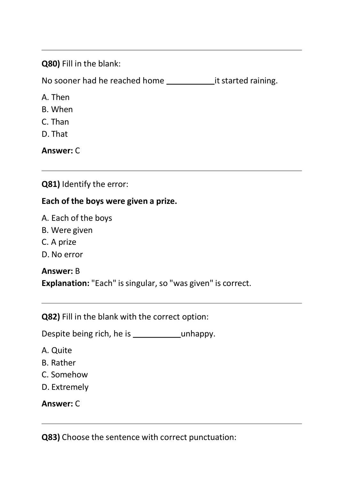

> **Verified Answer Key:** `C`  

**Pedagogical Derivation / Explanation:**  
Grammar rule application confirms `C` is the strictly standard and syntactically sound construction.

---

### Item 131: TOPMATE_GRAMMAR_Q81
**Source Document:** `Infosys English Grammar.pdf` (Page 27)  
**Category / Topic:** Verbal Ability & Grammar | English Grammar & Error Correction  
**Prompt:** Identify the error: Each of the boys were given a prize.

**Options:**
- A. Each of the boys
- B. Were given
- C. A prize
- D. No error

> **Verified Answer Key:** `B`  

**Pedagogical Derivation / Explanation:**  
"Each" is singular, so "was given" is correct.

---

### Item 132: TOPMATE_GRAMMAR_Q82
**Source Document:** `Infosys English Grammar.pdf` (Page 27)  
**Category / Topic:** Verbal Ability & Grammar | English Grammar & Error Correction  
**Prompt:** Fill in the blank with the correct option: Despite being rich, he is unhappy.

**Options:**
- A. Quite
- B. Rather
- C. Somehow
- D. Extremely

> **Verified Answer Key:** `C`  

**Pedagogical Derivation / Explanation:**  
Grammar rule application confirms `C` is the strictly standard and syntactically sound construction.

---

### Item 133: TOPMATE_GRAMMAR_Q83
**Source Document:** `Infosys English Grammar.pdf` (Page 27)  
**Category / Topic:** Verbal Ability & Grammar | English Grammar & Error Correction  
**Prompt:** Choose the sentence with correct punctuation:

**Options:**
- A. My brother in law's car is parked outside.
- B. My brother-in-law's car is parked outside.
- C. My brother in-law's car is parked outside.
- D. My brother's-in-law car is parked outside.

> **Verified Answer Key:** `B`  

**Pedagogical Derivation / Explanation:**  
Grammar rule application confirms `B` is the strictly standard and syntactically sound construction.

---

### Item 134: TOPMATE_GRAMMAR_Q84
**Source Document:** `Infosys English Grammar.pdf` (Page 28)  
**Category / Topic:** Verbal Ability & Grammar | English Grammar & Error Correction  
**Prompt:** Fill in the blank: He had to cancel the trip because of weather.

**Options:**
- A. Bad
- B. Worse
- C. Adverse
- D. Averse

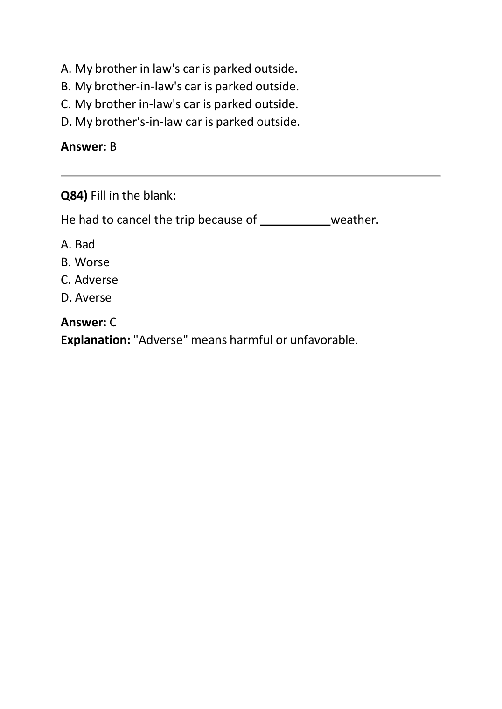

> **Verified Answer Key:** `C`  

**Pedagogical Derivation / Explanation:**  
"Adverse" means harmful or unfavorable.

---

### Item 135: TOPMATE_VERBAL_Q001
**Source Document:** `Infosys Verbal Ability.pdf` (Page 1)  
**Category / Topic:** Verbal Ability & Grammar | Verbal Ability Master Collection  
**Prompt:** . After a few months in Mumbai (

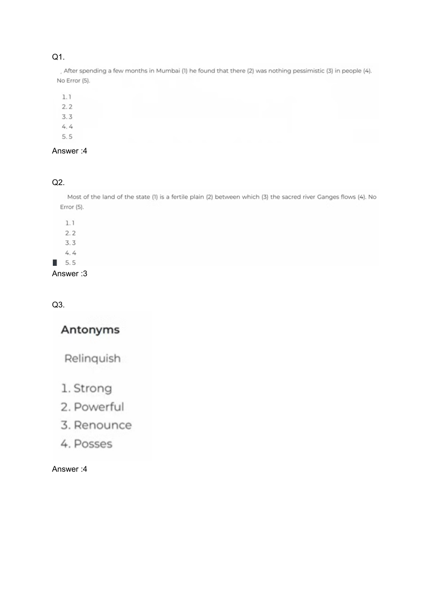

> **Verified Answer Key:** `4`  

**Pedagogical Derivation / Explanation:**  
Grammatical concord, contextual semantics, and vocabulary conventions confirm answer key `4`.

---

### Item 136: TOPMATE_VERBAL_Q002
**Source Document:** `Infosys Verbal Ability.pdf` (Page 1)  
**Category / Topic:** Verbal Ability & Grammar | Verbal Ability Master Collection  
**Prompt:** . After a few months in Mumbai (

> **Verified Answer Key:** `3`  

**Pedagogical Derivation / Explanation:**  
Grammatical concord, contextual semantics, and vocabulary conventions confirm answer key `3`.

---

### Item 137: TOPMATE_VERBAL_Q003
**Source Document:** `Infosys Verbal Ability.pdf` (Page 1)  
**Category / Topic:** Verbal Ability & Grammar | Verbal Ability Master Collection  
**Prompt:** . After a few months in Mumbai (

> **Verified Answer Key:** `4`  

**Pedagogical Derivation / Explanation:**  
Grammatical concord, contextual semantics, and vocabulary conventions confirm answer key `4`.

---

### Item 138: TOPMATE_VERBAL_Q004
**Source Document:** `Infosys Verbal Ability.pdf` (Page 1)  
**Category / Topic:** Verbal Ability & Grammar | Verbal Ability Master Collection  
**Prompt:** . After a few months in Mumbai (

> **Verified Answer Key:** `1`  

**Pedagogical Derivation / Explanation:**  
Grammatical concord, contextual semantics, and vocabulary conventions confirm answer key `1`.

---

### Item 139: TOPMATE_VERBAL_Q005
**Source Document:** `Infosys Verbal Ability.pdf` (Page 1)  
**Category / Topic:** Verbal Ability & Grammar | Verbal Ability Master Collection  
**Prompt:** . After a few months in Mumbai (

> **Verified Answer Key:** `1`  

**Pedagogical Derivation / Explanation:**  
Grammatical concord, contextual semantics, and vocabulary conventions confirm answer key `1`.

---

### Item 140: TOPMATE_VERBAL_Q006
**Source Document:** `Infosys Verbal Ability.pdf` (Page 1)  
**Category / Topic:** Verbal Ability & Grammar | Verbal Ability Master Collection  
**Prompt:** . After a few months in Mumbai (

> **Verified Answer Key:** `2`  

**Pedagogical Derivation / Explanation:**  
Grammatical concord, contextual semantics, and vocabulary conventions confirm answer key `2`.

---

### Item 141: TOPMATE_VERBAL_Q007
**Source Document:** `Infosys Verbal Ability.pdf` (Page 1)  
**Category / Topic:** Verbal Ability & Grammar | Verbal Ability Master Collection  
**Prompt:** . After a few months in Mumbai (

> **Verified Answer Key:** `1`  

**Pedagogical Derivation / Explanation:**  
Grammatical concord, contextual semantics, and vocabulary conventions confirm answer key `1`.

---

### Item 142: TOPMATE_VERBAL_Q008
**Source Document:** `Infosys Verbal Ability.pdf` (Page 1)  
**Category / Topic:** Verbal Ability & Grammar | Verbal Ability Master Collection  
**Prompt:** . After a few months in Mumbai (

> **Verified Answer Key:** `3`  

**Pedagogical Derivation / Explanation:**  
Grammatical concord, contextual semantics, and vocabulary conventions confirm answer key `3`.

---

### Item 143: TOPMATE_VERBAL_Q009
**Source Document:** `Infosys Verbal Ability.pdf` (Page 1)  
**Category / Topic:** Verbal Ability & Grammar | Verbal Ability Master Collection  
**Prompt:** . After a few months in Mumbai (

> **Verified Answer Key:** `4`  

**Pedagogical Derivation / Explanation:**  
Grammatical concord, contextual semantics, and vocabulary conventions confirm answer key `4`.

---

### Item 144: TOPMATE_VERBAL_Q010
**Source Document:** `Infosys Verbal Ability.pdf` (Page 1)  
**Category / Topic:** Verbal Ability & Grammar | Verbal Ability Master Collection  
**Prompt:** . After a few months in Mumbai (

> **Verified Answer Key:** `3`  

**Pedagogical Derivation / Explanation:**  
Grammatical concord, contextual semantics, and vocabulary conventions confirm answer key `3`.

---

### Item 145: TOPMATE_VERBAL_Q011
**Source Document:** `Infosys Verbal Ability.pdf` (Page 1)  
**Category / Topic:** Verbal Ability & Grammar | Verbal Ability Master Collection  
**Prompt:** . After a few months in Mumbai (

> **Verified Answer Key:** `4`  

**Pedagogical Derivation / Explanation:**  
Grammatical concord, contextual semantics, and vocabulary conventions confirm answer key `4`.

---

### Item 146: TOPMATE_VERBAL_Q012
**Source Document:** `Infosys Verbal Ability.pdf` (Page 1)  
**Category / Topic:** Verbal Ability & Grammar | Verbal Ability Master Collection  
**Prompt:** . After a few months in Mumbai (

> **Verified Answer Key:** `3`  

**Pedagogical Derivation / Explanation:**  
Grammatical concord, contextual semantics, and vocabulary conventions confirm answer key `3`.

---

### Item 147: TOPMATE_VERBAL_Q013
**Source Document:** `Infosys Verbal Ability.pdf` (Page 1)  
**Category / Topic:** Verbal Ability & Grammar | Verbal Ability Master Collection  
**Prompt:** . After a few months in Mumbai (

> **Verified Answer Key:** `1`  

**Pedagogical Derivation / Explanation:**  
Grammatical concord, contextual semantics, and vocabulary conventions confirm answer key `1`.

---

### Item 148: TOPMATE_VERBAL_Q014
**Source Document:** `Infosys Verbal Ability.pdf` (Page 1)  
**Category / Topic:** Verbal Ability & Grammar | Verbal Ability Master Collection  
**Prompt:** . After a few months in Mumbai (

> **Verified Answer Key:** `3`  

**Pedagogical Derivation / Explanation:**  
Grammatical concord, contextual semantics, and vocabulary conventions confirm answer key `3`.

---

### Item 149: TOPMATE_VERBAL_Q015
**Source Document:** `Infosys Verbal Ability.pdf` (Page 1)  
**Category / Topic:** Verbal Ability & Grammar | Verbal Ability Master Collection  
**Prompt:** . After a few months in Mumbai (

> **Verified Answer Key:** `B`  

**Pedagogical Derivation / Explanation:**  
Grammatical concord, contextual semantics, and vocabulary conventions confirm answer key `B`.

---

### Item 150: TOPMATE_VERBAL_Q016
**Source Document:** `Infosys Verbal Ability.pdf` (Page 1)  
**Category / Topic:** Verbal Ability & Grammar | Verbal Ability Master Collection  
**Prompt:** . After a few months in Mumbai (

> **Verified Answer Key:** `1`  

**Pedagogical Derivation / Explanation:**  
Grammatical concord, contextual semantics, and vocabulary conventions confirm answer key `1`.

---

### Item 151: TOPMATE_VERBAL_Q017
**Source Document:** `Infosys Verbal Ability.pdf` (Page 1)  
**Category / Topic:** Verbal Ability & Grammar | Verbal Ability Master Collection  
**Prompt:** . After a few months in Mumbai (

> **Verified Answer Key:** `5`  

**Pedagogical Derivation / Explanation:**  
Grammatical concord, contextual semantics, and vocabulary conventions confirm answer key `5`.

---

### Item 152: TOPMATE_VERBAL_Q018
**Source Document:** `Infosys Verbal Ability.pdf` (Page 1)  
**Category / Topic:** Verbal Ability & Grammar | Verbal Ability Master Collection  
**Prompt:** . After a few months in Mumbai (

> **Verified Answer Key:** `1`  

**Pedagogical Derivation / Explanation:**  
Grammatical concord, contextual semantics, and vocabulary conventions confirm answer key `1`.

---

### Item 153: TOPMATE_VERBAL_Q019
**Source Document:** `Infosys Verbal Ability.pdf` (Page 1)  
**Category / Topic:** Verbal Ability & Grammar | Verbal Ability Master Collection  
**Prompt:** . After a few months in Mumbai (

> **Verified Answer Key:** `2`  

**Pedagogical Derivation / Explanation:**  
Grammatical concord, contextual semantics, and vocabulary conventions confirm answer key `2`.

---

### Item 154: TOPMATE_VERBAL_Q020
**Source Document:** `Infosys Verbal Ability.pdf` (Page 1)  
**Category / Topic:** Verbal Ability & Grammar | Verbal Ability Master Collection  
**Prompt:** . After a few months in Mumbai (

> **Verified Answer Key:** `4`  

**Pedagogical Derivation / Explanation:**  
Grammatical concord, contextual semantics, and vocabulary conventions confirm answer key `4`.

---

### Item 155: TOPMATE_VERBAL_Q021
**Source Document:** `Infosys Verbal Ability.pdf` (Page 1)  
**Category / Topic:** Verbal Ability & Grammar | Verbal Ability Master Collection  
**Prompt:** . After a few months in Mumbai (

> **Verified Answer Key:** `3`  

**Pedagogical Derivation / Explanation:**  
Grammatical concord, contextual semantics, and vocabulary conventions confirm answer key `3`.

---

### Item 156: TOPMATE_VERBAL_Q022
**Source Document:** `Infosys Verbal Ability.pdf` (Page 1)  
**Category / Topic:** Verbal Ability & Grammar | Verbal Ability Master Collection  
**Prompt:** . After a few months in Mumbai (

> **Verified Answer Key:** `2`  

**Pedagogical Derivation / Explanation:**  
Grammatical concord, contextual semantics, and vocabulary conventions confirm answer key `2`.

---

### Item 157: TOPMATE_VERBAL_Q023
**Source Document:** `Infosys Verbal Ability.pdf` (Page 1)  
**Category / Topic:** Verbal Ability & Grammar | Verbal Ability Master Collection  
**Prompt:** . After a few months in Mumbai (

> **Verified Answer Key:** `3`  

**Pedagogical Derivation / Explanation:**  
Grammatical concord, contextual semantics, and vocabulary conventions confirm answer key `3`.

---

### Item 158: TOPMATE_VERBAL_Q024
**Source Document:** `Infosys Verbal Ability.pdf` (Page 1)  
**Category / Topic:** Verbal Ability & Grammar | Verbal Ability Master Collection  
**Prompt:** . After a few months in Mumbai (

> **Verified Answer Key:** `3`  

**Pedagogical Derivation / Explanation:**  
Grammatical concord, contextual semantics, and vocabulary conventions confirm answer key `3`.

---

### Item 159: TOPMATE_VERBAL_Q025
**Source Document:** `Infosys Verbal Ability.pdf` (Page 1)  
**Category / Topic:** Verbal Ability & Grammar | Verbal Ability Master Collection  
**Prompt:** . After a few months in Mumbai (

> **Verified Answer Key:** `3`  

**Pedagogical Derivation / Explanation:**  
Grammatical concord, contextual semantics, and vocabulary conventions confirm answer key `3`.

---

### Item 160: TOPMATE_VERBAL_Q026
**Source Document:** `Infosys Verbal Ability.pdf` (Page 1)  
**Category / Topic:** Verbal Ability & Grammar | Verbal Ability Master Collection  
**Prompt:** . After a few months in Mumbai (

> **Verified Answer Key:** `2`  

**Pedagogical Derivation / Explanation:**  
Grammatical concord, contextual semantics, and vocabulary conventions confirm answer key `2`.

---

### Item 161: TOPMATE_VERBAL_Q027
**Source Document:** `Infosys Verbal Ability.pdf` (Page 1)  
**Category / Topic:** Verbal Ability & Grammar | Verbal Ability Master Collection  
**Prompt:** . After a few months in Mumbai (

> **Verified Answer Key:** `3`  

**Pedagogical Derivation / Explanation:**  
Grammatical concord, contextual semantics, and vocabulary conventions confirm answer key `3`.

---

### Item 162: TOPMATE_VERBAL_Q028
**Source Document:** `Infosys Verbal Ability.pdf` (Page 1)  
**Category / Topic:** Verbal Ability & Grammar | Verbal Ability Master Collection  
**Prompt:** . After a few months in Mumbai (

> **Verified Answer Key:** `4`  

**Pedagogical Derivation / Explanation:**  
Grammatical concord, contextual semantics, and vocabulary conventions confirm answer key `4`.

---

### Item 163: TOPMATE_VERBAL_Q029
**Source Document:** `Infosys Verbal Ability.pdf` (Page 1)  
**Category / Topic:** Verbal Ability & Grammar | Verbal Ability Master Collection  
**Prompt:** . After a few months in Mumbai (

> **Verified Answer Key:** `3`  

**Pedagogical Derivation / Explanation:**  
Grammatical concord, contextual semantics, and vocabulary conventions confirm answer key `3`.

---

### Item 164: TOPMATE_VERBAL_Q030
**Source Document:** `Infosys Verbal Ability.pdf` (Page 1)  
**Category / Topic:** Verbal Ability & Grammar | Verbal Ability Master Collection  
**Prompt:** . After a few months in Mumbai (

> **Verified Answer Key:** `1`  

**Pedagogical Derivation / Explanation:**  
Grammatical concord, contextual semantics, and vocabulary conventions confirm answer key `1`.

---

### Item 165: TOPMATE_VERBAL_Q031
**Source Document:** `Infosys Verbal Ability.pdf` (Page 1)  
**Category / Topic:** Verbal Ability & Grammar | Verbal Ability Master Collection  
**Prompt:** . After a few months in Mumbai (

> **Verified Answer Key:** `2`  

**Pedagogical Derivation / Explanation:**  
Grammatical concord, contextual semantics, and vocabulary conventions confirm answer key `2`.

---

### Item 166: TOPMATE_VERBAL_Q032
**Source Document:** `Infosys Verbal Ability.pdf` (Page 1)  
**Category / Topic:** Verbal Ability & Grammar | Verbal Ability Master Collection  
**Prompt:** . After a few months in Mumbai (

> **Verified Answer Key:** `1`  

**Pedagogical Derivation / Explanation:**  
Grammatical concord, contextual semantics, and vocabulary conventions confirm answer key `1`.

---

### Item 167: TOPMATE_VERBAL_Q033
**Source Document:** `Infosys Verbal Ability.pdf` (Page 1)  
**Category / Topic:** Verbal Ability & Grammar | Verbal Ability Master Collection  
**Prompt:** . After a few months in Mumbai (

> **Verified Answer Key:** `2`  

**Pedagogical Derivation / Explanation:**  
Grammatical concord, contextual semantics, and vocabulary conventions confirm answer key `2`.

---

### Item 168: TOPMATE_VERBAL_Q034
**Source Document:** `Infosys Verbal Ability.pdf` (Page 1)  
**Category / Topic:** Verbal Ability & Grammar | Verbal Ability Master Collection  
**Prompt:** . After a few months in Mumbai (

> **Verified Answer Key:** `3`  

**Pedagogical Derivation / Explanation:**  
Grammatical concord, contextual semantics, and vocabulary conventions confirm answer key `3`.

---

### Item 169: TOPMATE_VERBAL_Q035
**Source Document:** `Infosys Verbal Ability.pdf` (Page 1)  
**Category / Topic:** Verbal Ability & Grammar | Verbal Ability Master Collection  
**Prompt:** . After a few months in Mumbai (

> **Verified Answer Key:** `1`  

**Pedagogical Derivation / Explanation:**  
Grammatical concord, contextual semantics, and vocabulary conventions confirm answer key `1`.

---

### Item 170: TOPMATE_VERBAL_Q036
**Source Document:** `Infosys Verbal Ability.pdf` (Page 1)  
**Category / Topic:** Verbal Ability & Grammar | Verbal Ability Master Collection  
**Prompt:** . After a few months in Mumbai (

> **Verified Answer Key:** `3`  

**Pedagogical Derivation / Explanation:**  
Grammatical concord, contextual semantics, and vocabulary conventions confirm answer key `3`.

---

### Item 171: TOPMATE_VERBAL_Q037
**Source Document:** `Infosys Verbal Ability.pdf` (Page 1)  
**Category / Topic:** Verbal Ability & Grammar | Verbal Ability Master Collection  
**Prompt:** . After a few months in Mumbai (

> **Verified Answer Key:** `4`  

**Pedagogical Derivation / Explanation:**  
Grammatical concord, contextual semantics, and vocabulary conventions confirm answer key `4`.

---

### Item 172: TOPMATE_VERBAL_Q038
**Source Document:** `Infosys Verbal Ability.pdf` (Page 1)  
**Category / Topic:** Verbal Ability & Grammar | Verbal Ability Master Collection  
**Prompt:** . After a few months in Mumbai (

> **Verified Answer Key:** `2`  

**Pedagogical Derivation / Explanation:**  
Grammatical concord, contextual semantics, and vocabulary conventions confirm answer key `2`.

---

### Item 173: TOPMATE_VERBAL_Q039
**Source Document:** `Infosys Verbal Ability.pdf` (Page 1)  
**Category / Topic:** Verbal Ability & Grammar | Verbal Ability Master Collection  
**Prompt:** . After a few months in Mumbai (

> **Verified Answer Key:** `1`  

**Pedagogical Derivation / Explanation:**  
Grammatical concord, contextual semantics, and vocabulary conventions confirm answer key `1`.

---

### Item 174: TOPMATE_VERBAL_Q040
**Source Document:** `Infosys Verbal Ability.pdf` (Page 1)  
**Category / Topic:** Verbal Ability & Grammar | Verbal Ability Master Collection  
**Prompt:** . After a few months in Mumbai (

> **Verified Answer Key:** `3`  

**Pedagogical Derivation / Explanation:**  
Grammatical concord, contextual semantics, and vocabulary conventions confirm answer key `3`.

---

### Item 175: TOPMATE_VERBAL_Q041
**Source Document:** `Infosys Verbal Ability.pdf` (Page 1)  
**Category / Topic:** Verbal Ability & Grammar | Verbal Ability Master Collection  
**Prompt:** . After a few months in Mumbai (

> **Verified Answer Key:** `2`  

**Pedagogical Derivation / Explanation:**  
Grammatical concord, contextual semantics, and vocabulary conventions confirm answer key `2`.

---

### Item 176: TOPMATE_VERBAL_Q042
**Source Document:** `Infosys Verbal Ability.pdf` (Page 1)  
**Category / Topic:** Verbal Ability & Grammar | Verbal Ability Master Collection  
**Prompt:** . After a few months in Mumbai (

> **Verified Answer Key:** `2`  

**Pedagogical Derivation / Explanation:**  
Grammatical concord, contextual semantics, and vocabulary conventions confirm answer key `2`.

---

### Item 177: TOPMATE_VERBAL_Q043
**Source Document:** `Infosys Verbal Ability.pdf` (Page 1)  
**Category / Topic:** Verbal Ability & Grammar | Verbal Ability Master Collection  
**Prompt:** . After a few months in Mumbai (

> **Verified Answer Key:** `3`  

**Pedagogical Derivation / Explanation:**  
Grammatical concord, contextual semantics, and vocabulary conventions confirm answer key `3`.

---

### Item 178: TOPMATE_VERBAL_Q044
**Source Document:** `Infosys Verbal Ability.pdf` (Page 1)  
**Category / Topic:** Verbal Ability & Grammar | Verbal Ability Master Collection  
**Prompt:** . After a few months in Mumbai (

> **Verified Answer Key:** `2`  

**Pedagogical Derivation / Explanation:**  
Grammatical concord, contextual semantics, and vocabulary conventions confirm answer key `2`.

---

### Item 179: TOPMATE_VERBAL_Q045
**Source Document:** `Infosys Verbal Ability.pdf` (Page 1)  
**Category / Topic:** Verbal Ability & Grammar | Verbal Ability Master Collection  
**Prompt:** . After a few months in Mumbai (

> **Verified Answer Key:** `3`  

**Pedagogical Derivation / Explanation:**  
Grammatical concord, contextual semantics, and vocabulary conventions confirm answer key `3`.

---

### Item 180: TOPMATE_VERBAL_Q046
**Source Document:** `Infosys Verbal Ability.pdf` (Page 1)  
**Category / Topic:** Verbal Ability & Grammar | Verbal Ability Master Collection  
**Prompt:** . After a few months in Mumbai (

> **Verified Answer Key:** `3`  

**Pedagogical Derivation / Explanation:**  
Grammatical concord, contextual semantics, and vocabulary conventions confirm answer key `3`.

---

### Item 181: TOPMATE_VERBAL_Q047
**Source Document:** `Infosys Verbal Ability.pdf` (Page 1)  
**Category / Topic:** Verbal Ability & Grammar | Verbal Ability Master Collection  
**Prompt:** . After a few months in Mumbai (

> **Verified Answer Key:** `1`  

**Pedagogical Derivation / Explanation:**  
Grammatical concord, contextual semantics, and vocabulary conventions confirm answer key `1`.

---

### Item 182: TOPMATE_VERBAL_Q048
**Source Document:** `Infosys Verbal Ability.pdf` (Page 1)  
**Category / Topic:** Verbal Ability & Grammar | Verbal Ability Master Collection  
**Prompt:** . After a few months in Mumbai (

> **Verified Answer Key:** `2`  

**Pedagogical Derivation / Explanation:**  
Grammatical concord, contextual semantics, and vocabulary conventions confirm answer key `2`.

---

### Item 183: TOPMATE_VERBAL_Q049
**Source Document:** `Infosys Verbal Ability.pdf` (Page 1)  
**Category / Topic:** Verbal Ability & Grammar | Verbal Ability Master Collection  
**Prompt:** . After a few months in Mumbai (

> **Verified Answer Key:** `2`  

**Pedagogical Derivation / Explanation:**  
Grammatical concord, contextual semantics, and vocabulary conventions confirm answer key `2`.

---

### Item 184: TOPMATE_VERBAL_Q050
**Source Document:** `Infosys Verbal Ability.pdf` (Page 1)  
**Category / Topic:** Verbal Ability & Grammar | Verbal Ability Master Collection  
**Prompt:** . After a few months in Mumbai (

> **Verified Answer Key:** `3`  

**Pedagogical Derivation / Explanation:**  
Grammatical concord, contextual semantics, and vocabulary conventions confirm answer key `3`.

---

### Item 185: TOPMATE_VERBAL_Q051
**Source Document:** `Infosys Verbal Ability.pdf` (Page 1)  
**Category / Topic:** Verbal Ability & Grammar | Verbal Ability Master Collection  
**Prompt:** . After a few months in Mumbai (

> **Verified Answer Key:** `1`  

**Pedagogical Derivation / Explanation:**  
Grammatical concord, contextual semantics, and vocabulary conventions confirm answer key `1`.

---

### Item 186: TOPMATE_VERBAL_Q052
**Source Document:** `Infosys Verbal Ability.pdf` (Page 1)  
**Category / Topic:** Verbal Ability & Grammar | Verbal Ability Master Collection  
**Prompt:** . After a few months in Mumbai (

> **Verified Answer Key:** `A`  

**Pedagogical Derivation / Explanation:**  
Grammatical concord, contextual semantics, and vocabulary conventions confirm answer key `A`.

---

### Item 187: TOPMATE_VERBAL_Q053
**Source Document:** `Infosys Verbal Ability.pdf` (Page 1)  
**Category / Topic:** Verbal Ability & Grammar | Verbal Ability Master Collection  
**Prompt:** . After a few months in Mumbai (

> **Verified Answer Key:** `A`  

**Pedagogical Derivation / Explanation:**  
Grammatical concord, contextual semantics, and vocabulary conventions confirm answer key `A`.

---

### Item 188: TOPMATE_VERBAL_Q054
**Source Document:** `Infosys Verbal Ability.pdf` (Page 1)  
**Category / Topic:** Verbal Ability & Grammar | Verbal Ability Master Collection  
**Prompt:** . After a few months in Mumbai (

> **Verified Answer Key:** `B`  

**Pedagogical Derivation / Explanation:**  
Grammatical concord, contextual semantics, and vocabulary conventions confirm answer key `B`.

---

### Item 189: TOPMATE_VERBAL_Q055
**Source Document:** `Infosys Verbal Ability.pdf` (Page 1)  
**Category / Topic:** Verbal Ability & Grammar | Verbal Ability Master Collection  
**Prompt:** . After a few months in Mumbai (

> **Verified Answer Key:** `C`  

**Pedagogical Derivation / Explanation:**  
Grammatical concord, contextual semantics, and vocabulary conventions confirm answer key `C`.

---

### Item 190: TOPMATE_VERBAL_Q056
**Source Document:** `Infosys Verbal Ability.pdf` (Page 1)  
**Category / Topic:** Verbal Ability & Grammar | Verbal Ability Master Collection  
**Prompt:** . After a few months in Mumbai (

> **Verified Answer Key:** `B`  

**Pedagogical Derivation / Explanation:**  
Grammatical concord, contextual semantics, and vocabulary conventions confirm answer key `B`.

---

### Item 191: TOPMATE_VERBAL_Q057
**Source Document:** `Infosys Verbal Ability.pdf` (Page 1)  
**Category / Topic:** Verbal Ability & Grammar | Verbal Ability Master Collection  
**Prompt:** . After a few months in Mumbai (

> **Verified Answer Key:** `2134`  

**Pedagogical Derivation / Explanation:**  
Grammatical concord, contextual semantics, and vocabulary conventions confirm answer key `2134`.

---

### Item 192: TOPMATE_VERBAL_Q058
**Source Document:** `Infosys Verbal Ability.pdf` (Page 1)  
**Category / Topic:** Verbal Ability & Grammar | Verbal Ability Master Collection  
**Prompt:** . After a few months in Mumbai (

> **Verified Answer Key:** `3`  

**Pedagogical Derivation / Explanation:**  
Grammatical concord, contextual semantics, and vocabulary conventions confirm answer key `3`.

---

### Item 193: TOPMATE_VERBAL_Q059
**Source Document:** `Infosys Verbal Ability.pdf` (Page 1)  
**Category / Topic:** Verbal Ability & Grammar | Verbal Ability Master Collection  
**Prompt:** . After a few months in Mumbai (

> **Verified Answer Key:** `4`  

**Pedagogical Derivation / Explanation:**  
Grammatical concord, contextual semantics, and vocabulary conventions confirm answer key `4`.

---

### Item 194: TOPMATE_VERBAL_Q060
**Source Document:** `Infosys Verbal Ability.pdf` (Page 1)  
**Category / Topic:** Verbal Ability & Grammar | Verbal Ability Master Collection  
**Prompt:** . After a few months in Mumbai (

> **Verified Answer Key:** `3`  

**Pedagogical Derivation / Explanation:**  
Grammatical concord, contextual semantics, and vocabulary conventions confirm answer key `3`.

---

### Item 195: TOPMATE_VERBAL_Q061
**Source Document:** `Infosys Verbal Ability.pdf` (Page 1)  
**Category / Topic:** Verbal Ability & Grammar | Verbal Ability Master Collection  
**Prompt:** . After a few months in Mumbai (

> **Verified Answer Key:** `4`  

**Pedagogical Derivation / Explanation:**  
Grammatical concord, contextual semantics, and vocabulary conventions confirm answer key `4`.

---

### Item 196: TOPMATE_VERBAL_Q062
**Source Document:** `Infosys Verbal Ability.pdf` (Page 1)  
**Category / Topic:** Verbal Ability & Grammar | Verbal Ability Master Collection  
**Prompt:** . After a few months in Mumbai (

> **Verified Answer Key:** `4`  

**Pedagogical Derivation / Explanation:**  
Grammatical concord, contextual semantics, and vocabulary conventions confirm answer key `4`.

---

### Item 197: TOPMATE_VERBAL_Q063
**Source Document:** `Infosys Verbal Ability.pdf` (Page 1)  
**Category / Topic:** Verbal Ability & Grammar | Verbal Ability Master Collection  
**Prompt:** . After a few months in Mumbai (

> **Verified Answer Key:** `2`  

**Pedagogical Derivation / Explanation:**  
Grammatical concord, contextual semantics, and vocabulary conventions confirm answer key `2`.

---

### Item 198: TOPMATE_VERBAL_Q064
**Source Document:** `Infosys Verbal Ability.pdf` (Page 1)  
**Category / Topic:** Verbal Ability & Grammar | Verbal Ability Master Collection  
**Prompt:** . After a few months in Mumbai (

> **Verified Answer Key:** `1`  

**Pedagogical Derivation / Explanation:**  
Grammatical concord, contextual semantics, and vocabulary conventions confirm answer key `1`.

---

### Item 199: TOPMATE_VERBAL_Q065
**Source Document:** `Infosys Verbal Ability.pdf` (Page 1)  
**Category / Topic:** Verbal Ability & Grammar | Verbal Ability Master Collection  
**Prompt:** . After a few months in Mumbai (

> **Verified Answer Key:** `3`  

**Pedagogical Derivation / Explanation:**  
Grammatical concord, contextual semantics, and vocabulary conventions confirm answer key `3`.

---

### Item 200: TOPMATE_VERBAL_Q066
**Source Document:** `Infosys Verbal Ability.pdf` (Page 1)  
**Category / Topic:** Verbal Ability & Grammar | Verbal Ability Master Collection  
**Prompt:** . After a few months in Mumbai (

> **Verified Answer Key:** `4`  

**Pedagogical Derivation / Explanation:**  
Grammatical concord, contextual semantics, and vocabulary conventions confirm answer key `4`.

---

### Item 201: TOPMATE_VERBAL_Q067
**Source Document:** `Infosys Verbal Ability.pdf` (Page 1)  
**Category / Topic:** Verbal Ability & Grammar | Verbal Ability Master Collection  
**Prompt:** . After a few months in Mumbai (

> **Verified Answer Key:** `4`  

**Pedagogical Derivation / Explanation:**  
Grammatical concord, contextual semantics, and vocabulary conventions confirm answer key `4`.

---

### Item 202: TOPMATE_VERBAL_Q068
**Source Document:** `Infosys Verbal Ability.pdf` (Page 1)  
**Category / Topic:** Verbal Ability & Grammar | Verbal Ability Master Collection  
**Prompt:** . After a few months in Mumbai (

> **Verified Answer Key:** `3`  

**Pedagogical Derivation / Explanation:**  
Grammatical concord, contextual semantics, and vocabulary conventions confirm answer key `3`.

---

### Item 203: TOPMATE_VERBAL_Q069
**Source Document:** `Infosys Verbal Ability.pdf` (Page 1)  
**Category / Topic:** Verbal Ability & Grammar | Verbal Ability Master Collection  
**Prompt:** . After a few months in Mumbai (

> **Verified Answer Key:** `4`  

**Pedagogical Derivation / Explanation:**  
Grammatical concord, contextual semantics, and vocabulary conventions confirm answer key `4`.

---

### Item 204: TOPMATE_VERBAL_Q070
**Source Document:** `Infosys Verbal Ability.pdf` (Page 1)  
**Category / Topic:** Verbal Ability & Grammar | Verbal Ability Master Collection  
**Prompt:** . After a few months in Mumbai (

> **Verified Answer Key:** `3`  

**Pedagogical Derivation / Explanation:**  
Grammatical concord, contextual semantics, and vocabulary conventions confirm answer key `3`.

---

### Item 205: TOPMATE_VERBAL_Q071
**Source Document:** `Infosys Verbal Ability.pdf` (Page 1)  
**Category / Topic:** Verbal Ability & Grammar | Verbal Ability Master Collection  
**Prompt:** . After a few months in Mumbai (

> **Verified Answer Key:** `2`  

**Pedagogical Derivation / Explanation:**  
Grammatical concord, contextual semantics, and vocabulary conventions confirm answer key `2`.

---

### Item 206: TOPMATE_VERBAL_Q072
**Source Document:** `Infosys Verbal Ability.pdf` (Page 1)  
**Category / Topic:** Verbal Ability & Grammar | Verbal Ability Master Collection  
**Prompt:** . After a few months in Mumbai (

> **Verified Answer Key:** `2`  

**Pedagogical Derivation / Explanation:**  
Grammatical concord, contextual semantics, and vocabulary conventions confirm answer key `2`.

---

### Item 207: TOPMATE_VERBAL_Q073
**Source Document:** `Infosys Verbal Ability.pdf` (Page 1)  
**Category / Topic:** Verbal Ability & Grammar | Verbal Ability Master Collection  
**Prompt:** . After a few months in Mumbai (

> **Verified Answer Key:** `1`  

**Pedagogical Derivation / Explanation:**  
Grammatical concord, contextual semantics, and vocabulary conventions confirm answer key `1`.

---

### Item 208: TOPMATE_VERBAL_Q074
**Source Document:** `Infosys Verbal Ability.pdf` (Page 1)  
**Category / Topic:** Verbal Ability & Grammar | Verbal Ability Master Collection  
**Prompt:** . After a few months in Mumbai (

> **Verified Answer Key:** `4`  

**Pedagogical Derivation / Explanation:**  
Grammatical concord, contextual semantics, and vocabulary conventions confirm answer key `4`.

---

### Item 209: TOPMATE_VERBAL_Q075
**Source Document:** `Infosys Verbal Ability.pdf` (Page 1)  
**Category / Topic:** Verbal Ability & Grammar | Verbal Ability Master Collection  
**Prompt:** . After a few months in Mumbai (

> **Verified Answer Key:** `3`  

**Pedagogical Derivation / Explanation:**  
Grammatical concord, contextual semantics, and vocabulary conventions confirm answer key `3`.

---

### Item 210: TOPMATE_VERBAL_Q076
**Source Document:** `Infosys Verbal Ability.pdf` (Page 1)  
**Category / Topic:** Verbal Ability & Grammar | Verbal Ability Master Collection  
**Prompt:** . After a few months in Mumbai (

> **Verified Answer Key:** `2`  

**Pedagogical Derivation / Explanation:**  
Grammatical concord, contextual semantics, and vocabulary conventions confirm answer key `2`.

---

### Item 211: TOPMATE_VERBAL_Q077
**Source Document:** `Infosys Verbal Ability.pdf` (Page 1)  
**Category / Topic:** Verbal Ability & Grammar | Verbal Ability Master Collection  
**Prompt:** . After a few months in Mumbai (

> **Verified Answer Key:** `A`  

**Pedagogical Derivation / Explanation:**  
Grammatical concord, contextual semantics, and vocabulary conventions confirm answer key `A`.

---

### Item 212: TOPMATE_VERBAL_Q078
**Source Document:** `Infosys Verbal Ability.pdf` (Page 1)  
**Category / Topic:** Verbal Ability & Grammar | Verbal Ability Master Collection  
**Prompt:** . After a few months in Mumbai (

> **Verified Answer Key:** `B`  

**Pedagogical Derivation / Explanation:**  
Grammatical concord, contextual semantics, and vocabulary conventions confirm answer key `B`.

---

### Item 213: TOPMATE_VERBAL_Q079
**Source Document:** `Infosys Verbal Ability.pdf` (Page 1)  
**Category / Topic:** Verbal Ability & Grammar | Verbal Ability Master Collection  
**Prompt:** . After a few months in Mumbai (

> **Verified Answer Key:** `A`  

**Pedagogical Derivation / Explanation:**  
Grammatical concord, contextual semantics, and vocabulary conventions confirm answer key `A`.

---

### Item 214: TOPMATE_VERBAL_Q080
**Source Document:** `Infosys Verbal Ability.pdf` (Page 1)  
**Category / Topic:** Verbal Ability & Grammar | Verbal Ability Master Collection  
**Prompt:** . After a few months in Mumbai (

> **Verified Answer Key:** `B`  

**Pedagogical Derivation / Explanation:**  
Grammatical concord, contextual semantics, and vocabulary conventions confirm answer key `B`.

---

### Item 215: TOPMATE_VERBAL_Q081
**Source Document:** `Infosys Verbal Ability.pdf` (Page 1)  
**Category / Topic:** Verbal Ability & Grammar | Verbal Ability Master Collection  
**Prompt:** . After a few months in Mumbai (

> **Verified Answer Key:** `A`  

**Pedagogical Derivation / Explanation:**  
Grammatical concord, contextual semantics, and vocabulary conventions confirm answer key `A`.

---

### Item 216: TOPMATE_VERBAL_Q082
**Source Document:** `Infosys Verbal Ability.pdf` (Page 1)  
**Category / Topic:** Verbal Ability & Grammar | Verbal Ability Master Collection  
**Prompt:** . After a few months in Mumbai (

> **Verified Answer Key:** `D`  

**Pedagogical Derivation / Explanation:**  
Grammatical concord, contextual semantics, and vocabulary conventions confirm answer key `D`.

---

### Item 217: TOPMATE_VERBAL_Q083
**Source Document:** `Infosys Verbal Ability.pdf` (Page 1)  
**Category / Topic:** Verbal Ability & Grammar | Verbal Ability Master Collection  
**Prompt:** . After a few months in Mumbai (

> **Verified Answer Key:** `B`  

**Pedagogical Derivation / Explanation:**  
Grammatical concord, contextual semantics, and vocabulary conventions confirm answer key `B`.

---

### Item 218: TOPMATE_VERBAL_Q084
**Source Document:** `Infosys Verbal Ability.pdf` (Page 1)  
**Category / Topic:** Verbal Ability & Grammar | Verbal Ability Master Collection  
**Prompt:** . After a few months in Mumbai (

> **Verified Answer Key:** `C`  

**Pedagogical Derivation / Explanation:**  
Grammatical concord, contextual semantics, and vocabulary conventions confirm answer key `C`.

---

### Item 219: TOPMATE_VERBAL_Q085
**Source Document:** `Infosys Verbal Ability.pdf` (Page 1)  
**Category / Topic:** Verbal Ability & Grammar | Verbal Ability Master Collection  
**Prompt:** . After a few months in Mumbai (

> **Verified Answer Key:** `C`  

**Pedagogical Derivation / Explanation:**  
Grammatical concord, contextual semantics, and vocabulary conventions confirm answer key `C`.

---

### Item 220: TOPMATE_VERBAL_Q086
**Source Document:** `Infosys Verbal Ability.pdf` (Page 1)  
**Category / Topic:** Verbal Ability & Grammar | Verbal Ability Master Collection  
**Prompt:** . After a few months in Mumbai (

> **Verified Answer Key:** `A`  

**Pedagogical Derivation / Explanation:**  
Grammatical concord, contextual semantics, and vocabulary conventions confirm answer key `A`.

---

### Item 221: TOPMATE_VERBAL_Q087
**Source Document:** `Infosys Verbal Ability.pdf` (Page 1)  
**Category / Topic:** Verbal Ability & Grammar | Verbal Ability Master Collection  
**Prompt:** . After a few months in Mumbai (

> **Verified Answer Key:** `C`  

**Pedagogical Derivation / Explanation:**  
Grammatical concord, contextual semantics, and vocabulary conventions confirm answer key `C`.

---

### Item 222: TOPMATE_VERBAL_Q088
**Source Document:** `Infosys Verbal Ability.pdf` (Page 1)  
**Category / Topic:** Verbal Ability & Grammar | Verbal Ability Master Collection  
**Prompt:** . After a few months in Mumbai (

> **Verified Answer Key:** `C`  

**Pedagogical Derivation / Explanation:**  
Grammatical concord, contextual semantics, and vocabulary conventions confirm answer key `C`.

---

### Item 223: TOPMATE_VERBAL_Q089
**Source Document:** `Infosys Verbal Ability.pdf` (Page 1)  
**Category / Topic:** Verbal Ability & Grammar | Verbal Ability Master Collection  
**Prompt:** . After a few months in Mumbai (

> **Verified Answer Key:** `B`  

**Pedagogical Derivation / Explanation:**  
Grammatical concord, contextual semantics, and vocabulary conventions confirm answer key `B`.

---

### Item 224: TOPMATE_VERBAL_Q090
**Source Document:** `Infosys Verbal Ability.pdf` (Page 1)  
**Category / Topic:** Verbal Ability & Grammar | Verbal Ability Master Collection  
**Prompt:** . After a few months in Mumbai (

> **Verified Answer Key:** `A`  

**Pedagogical Derivation / Explanation:**  
Grammatical concord, contextual semantics, and vocabulary conventions confirm answer key `A`.

---

### Item 225: TOPMATE_VERBAL_Q091
**Source Document:** `Infosys Verbal Ability.pdf` (Page 1)  
**Category / Topic:** Verbal Ability & Grammar | Verbal Ability Master Collection  
**Prompt:** . After a few months in Mumbai (

> **Verified Answer Key:** `B`  

**Pedagogical Derivation / Explanation:**  
Grammatical concord, contextual semantics, and vocabulary conventions confirm answer key `B`.

---

### Item 226: TOPMATE_VERBAL_Q092
**Source Document:** `Infosys Verbal Ability.pdf` (Page 1)  
**Category / Topic:** Verbal Ability & Grammar | Verbal Ability Master Collection  
**Prompt:** . After a few months in Mumbai (

> **Verified Answer Key:** `B`  

**Pedagogical Derivation / Explanation:**  
Grammatical concord, contextual semantics, and vocabulary conventions confirm answer key `B`.

---

### Item 227: TOPMATE_VERBAL_Q093
**Source Document:** `Infosys Verbal Ability.pdf` (Page 1)  
**Category / Topic:** Verbal Ability & Grammar | Verbal Ability Master Collection  
**Prompt:** . After a few months in Mumbai (

> **Verified Answer Key:** `A`  

**Pedagogical Derivation / Explanation:**  
Grammatical concord, contextual semantics, and vocabulary conventions confirm answer key `A`.

---

### Item 228: TOPMATE_VERBAL_Q094
**Source Document:** `Infosys Verbal Ability.pdf` (Page 1)  
**Category / Topic:** Verbal Ability & Grammar | Verbal Ability Master Collection  
**Prompt:** . After a few months in Mumbai (

> **Verified Answer Key:** `C`  

**Pedagogical Derivation / Explanation:**  
Grammatical concord, contextual semantics, and vocabulary conventions confirm answer key `C`.

---

### Item 229: TOPMATE_VERBAL_Q095
**Source Document:** `Infosys Verbal Ability.pdf` (Page 1)  
**Category / Topic:** Verbal Ability & Grammar | Verbal Ability Master Collection  
**Prompt:** . After a few months in Mumbai (

> **Verified Answer Key:** `A`  

**Pedagogical Derivation / Explanation:**  
Grammatical concord, contextual semantics, and vocabulary conventions confirm answer key `A`.

---

### Item 230: TOPMATE_VERBAL_Q096
**Source Document:** `Infosys Verbal Ability.pdf` (Page 1)  
**Category / Topic:** Verbal Ability & Grammar | Verbal Ability Master Collection  
**Prompt:** . After a few months in Mumbai (

> **Verified Answer Key:** `C`  

**Pedagogical Derivation / Explanation:**  
Grammatical concord, contextual semantics, and vocabulary conventions confirm answer key `C`.

---

### Item 231: TOPMATE_VERBAL_Q097
**Source Document:** `Infosys Verbal Ability.pdf` (Page 1)  
**Category / Topic:** Verbal Ability & Grammar | Verbal Ability Master Collection  
**Prompt:** . After a few months in Mumbai (

> **Verified Answer Key:** `3`  

**Pedagogical Derivation / Explanation:**  
Grammatical concord, contextual semantics, and vocabulary conventions confirm answer key `3`.

---

### Item 232: TOPMATE_VERBAL_Q098
**Source Document:** `Infosys Verbal Ability.pdf` (Page 1)  
**Category / Topic:** Verbal Ability & Grammar | Verbal Ability Master Collection  
**Prompt:** . After a few months in Mumbai (

> **Verified Answer Key:** `C`  

**Pedagogical Derivation / Explanation:**  
Grammatical concord, contextual semantics, and vocabulary conventions confirm answer key `C`.

---

### Item 233: TOPMATE_VERBAL_Q099
**Source Document:** `Infosys Verbal Ability.pdf` (Page 1)  
**Category / Topic:** Verbal Ability & Grammar | Verbal Ability Master Collection  
**Prompt:** . After a few months in Mumbai (

> **Verified Answer Key:** `A`  

**Pedagogical Derivation / Explanation:**  
Grammatical concord, contextual semantics, and vocabulary conventions confirm answer key `A`.

---

### Item 234: TOPMATE_VERBAL_Q100
**Source Document:** `Infosys Verbal Ability.pdf` (Page 1)  
**Category / Topic:** Verbal Ability & Grammar | Verbal Ability Master Collection  
**Prompt:** . After a few months in Mumbai (

> **Verified Answer Key:** `D`  

**Pedagogical Derivation / Explanation:**  
Grammatical concord, contextual semantics, and vocabulary conventions confirm answer key `D`.

---

### Item 235: TOPMATE_VERBAL_Q101
**Source Document:** `Infosys Verbal Ability.pdf` (Page 1)  
**Category / Topic:** Verbal Ability & Grammar | Verbal Ability Master Collection  
**Prompt:** . After a few months in Mumbai (

> **Verified Answer Key:** `2`  

**Pedagogical Derivation / Explanation:**  
Grammatical concord, contextual semantics, and vocabulary conventions confirm answer key `2`.

---

### Item 236: TOPMATE_VERBAL_Q102
**Source Document:** `Infosys Verbal Ability.pdf` (Page 1)  
**Category / Topic:** Verbal Ability & Grammar | Verbal Ability Master Collection  
**Prompt:** . After a few months in Mumbai (

> **Verified Answer Key:** `1`  

**Pedagogical Derivation / Explanation:**  
Grammatical concord, contextual semantics, and vocabulary conventions confirm answer key `1`.

---

### Item 237: TOPMATE_VERBAL_Q103
**Source Document:** `Infosys Verbal Ability.pdf` (Page 1)  
**Category / Topic:** Verbal Ability & Grammar | Verbal Ability Master Collection  
**Prompt:** . After a few months in Mumbai (

> **Verified Answer Key:** `C`  

**Pedagogical Derivation / Explanation:**  
Grammatical concord, contextual semantics, and vocabulary conventions confirm answer key `C`.

---

### Item 238: TOPMATE_VERBAL_Q104
**Source Document:** `Infosys Verbal Ability.pdf` (Page 1)  
**Category / Topic:** Verbal Ability & Grammar | Verbal Ability Master Collection  
**Prompt:** . After a few months in Mumbai (

> **Verified Answer Key:** `B`  

**Pedagogical Derivation / Explanation:**  
Grammatical concord, contextual semantics, and vocabulary conventions confirm answer key `B`.

---

### Item 239: TOPMATE_VERBAL_Q105
**Source Document:** `Infosys Verbal Ability.pdf` (Page 1)  
**Category / Topic:** Verbal Ability & Grammar | Verbal Ability Master Collection  
**Prompt:** . After a few months in Mumbai (

> **Verified Answer Key:** `B`  

**Pedagogical Derivation / Explanation:**  
Grammatical concord, contextual semantics, and vocabulary conventions confirm answer key `B`.

---

### Item 240: TOPMATE_VERBAL_Q106
**Source Document:** `Infosys Verbal Ability.pdf` (Page 1)  
**Category / Topic:** Verbal Ability & Grammar | Verbal Ability Master Collection  
**Prompt:** . After a few months in Mumbai (

> **Verified Answer Key:** `B`  

**Pedagogical Derivation / Explanation:**  
Grammatical concord, contextual semantics, and vocabulary conventions confirm answer key `B`.

---

### Item 241: TOPMATE_VERBAL_Q107
**Source Document:** `Infosys Verbal Ability.pdf` (Page 1)  
**Category / Topic:** Verbal Ability & Grammar | Verbal Ability Master Collection  
**Prompt:** . After a few months in Mumbai (

> **Verified Answer Key:** `B`  

**Pedagogical Derivation / Explanation:**  
Grammatical concord, contextual semantics, and vocabulary conventions confirm answer key `B`.

---

### Item 242: TOPMATE_VERBAL_Q108
**Source Document:** `Infosys Verbal Ability.pdf` (Page 1)  
**Category / Topic:** Verbal Ability & Grammar | Verbal Ability Master Collection  
**Prompt:** . After a few months in Mumbai (

> **Verified Answer Key:** `A`  

**Pedagogical Derivation / Explanation:**  
Grammatical concord, contextual semantics, and vocabulary conventions confirm answer key `A`.

---

### Item 243: TOPMATE_VERBAL_Q109
**Source Document:** `Infosys Verbal Ability.pdf` (Page 1)  
**Category / Topic:** Verbal Ability & Grammar | Verbal Ability Master Collection  
**Prompt:** . After a few months in Mumbai (

> **Verified Answer Key:** `B`  

**Pedagogical Derivation / Explanation:**  
Grammatical concord, contextual semantics, and vocabulary conventions confirm answer key `B`.

---

### Item 244: TOPMATE_VERBAL_Q110
**Source Document:** `Infosys Verbal Ability.pdf` (Page 1)  
**Category / Topic:** Verbal Ability & Grammar | Verbal Ability Master Collection  
**Prompt:** . After a few months in Mumbai (

> **Verified Answer Key:** `D`  

**Pedagogical Derivation / Explanation:**  
Grammatical concord, contextual semantics, and vocabulary conventions confirm answer key `D`.

---

### Item 245: TOPMATE_VERBAL_Q111
**Source Document:** `Infosys Verbal Ability.pdf` (Page 1)  
**Category / Topic:** Verbal Ability & Grammar | Verbal Ability Master Collection  
**Prompt:** . After a few months in Mumbai (

> **Verified Answer Key:** `B`  

**Pedagogical Derivation / Explanation:**  
Grammatical concord, contextual semantics, and vocabulary conventions confirm answer key `B`.

---

### Item 246: TOPMATE_VERBAL_Q112
**Source Document:** `Infosys Verbal Ability.pdf` (Page 1)  
**Category / Topic:** Verbal Ability & Grammar | Verbal Ability Master Collection  
**Prompt:** . After a few months in Mumbai (

> **Verified Answer Key:** `D`  

**Pedagogical Derivation / Explanation:**  
Grammatical concord, contextual semantics, and vocabulary conventions confirm answer key `D`.

---

### Item 247: TOPMATE_VERBAL_Q113
**Source Document:** `Infosys Verbal Ability.pdf` (Page 1)  
**Category / Topic:** Verbal Ability & Grammar | Verbal Ability Master Collection  
**Prompt:** . After a few months in Mumbai (

> **Verified Answer Key:** `A`  

**Pedagogical Derivation / Explanation:**  
Grammatical concord, contextual semantics, and vocabulary conventions confirm answer key `A`.

---

### Item 248: TOPMATE_VERBAL_Q114
**Source Document:** `Infosys Verbal Ability.pdf` (Page 1)  
**Category / Topic:** Verbal Ability & Grammar | Verbal Ability Master Collection  
**Prompt:** . After a few months in Mumbai (

> **Verified Answer Key:** `A`  

**Pedagogical Derivation / Explanation:**  
Grammatical concord, contextual semantics, and vocabulary conventions confirm answer key `A`.

---

### Item 249: TOPMATE_VERBAL_Q115
**Source Document:** `Infosys Verbal Ability.pdf` (Page 1)  
**Category / Topic:** Verbal Ability & Grammar | Verbal Ability Master Collection  
**Prompt:** . After a few months in Mumbai (

> **Verified Answer Key:** `D`  

**Pedagogical Derivation / Explanation:**  
Grammatical concord, contextual semantics, and vocabulary conventions confirm answer key `D`.

---

### Item 250: TOPMATE_VERBAL_Q116
**Source Document:** `Infosys Verbal Ability.pdf` (Page 1)  
**Category / Topic:** Verbal Ability & Grammar | Verbal Ability Master Collection  
**Prompt:** . After a few months in Mumbai (

> **Verified Answer Key:** `2`  

**Pedagogical Derivation / Explanation:**  
Grammatical concord, contextual semantics, and vocabulary conventions confirm answer key `2`.

---

### Item 251: TOPMATE_VERBAL_Q117
**Source Document:** `Infosys Verbal Ability.pdf` (Page 1)  
**Category / Topic:** Verbal Ability & Grammar | Verbal Ability Master Collection  
**Prompt:** . After a few months in Mumbai (

> **Verified Answer Key:** `D`  

**Pedagogical Derivation / Explanation:**  
Grammatical concord, contextual semantics, and vocabulary conventions confirm answer key `D`.

---

### Item 252: TOPMATE_VERBAL_Q118
**Source Document:** `Infosys Verbal Ability.pdf` (Page 1)  
**Category / Topic:** Verbal Ability & Grammar | Verbal Ability Master Collection  
**Prompt:** . After a few months in Mumbai (

> **Verified Answer Key:** `A`  

**Pedagogical Derivation / Explanation:**  
Grammatical concord, contextual semantics, and vocabulary conventions confirm answer key `A`.

---

### Item 253: TOPMATE_VERBAL_Q119
**Source Document:** `Infosys Verbal Ability.pdf` (Page 1)  
**Category / Topic:** Verbal Ability & Grammar | Verbal Ability Master Collection  
**Prompt:** . After a few months in Mumbai (

> **Verified Answer Key:** `A`  

**Pedagogical Derivation / Explanation:**  
Grammatical concord, contextual semantics, and vocabulary conventions confirm answer key `A`.

---

### Item 254: TOPMATE_VERBAL_Q120
**Source Document:** `Infosys Verbal Ability.pdf` (Page 1)  
**Category / Topic:** Verbal Ability & Grammar | Verbal Ability Master Collection  
**Prompt:** . After a few months in Mumbai (

> **Verified Answer Key:** `C`  

**Pedagogical Derivation / Explanation:**  
Grammatical concord, contextual semantics, and vocabulary conventions confirm answer key `C`.

---

### Item 255: TOPMATE_VERBAL_Q121
**Source Document:** `Infosys Verbal Ability.pdf` (Page 1)  
**Category / Topic:** Verbal Ability & Grammar | Verbal Ability Master Collection  
**Prompt:** . After a few months in Mumbai (

> **Verified Answer Key:** `C`  

**Pedagogical Derivation / Explanation:**  
Grammatical concord, contextual semantics, and vocabulary conventions confirm answer key `C`.

---

### Item 256: TOPMATE_VERBAL_Q122
**Source Document:** `Infosys Verbal Ability.pdf` (Page 1)  
**Category / Topic:** Verbal Ability & Grammar | Verbal Ability Master Collection  
**Prompt:** . After a few months in Mumbai (

> **Verified Answer Key:** `A`  

**Pedagogical Derivation / Explanation:**  
Grammatical concord, contextual semantics, and vocabulary conventions confirm answer key `A`.

---

### Item 257: TOPMATE_VERBAL_Q123
**Source Document:** `Infosys Verbal Ability.pdf` (Page 1)  
**Category / Topic:** Verbal Ability & Grammar | Verbal Ability Master Collection  
**Prompt:** . After a few months in Mumbai (

> **Verified Answer Key:** `A`  

**Pedagogical Derivation / Explanation:**  
Grammatical concord, contextual semantics, and vocabulary conventions confirm answer key `A`.

---

### Item 258: TOPMATE_VERBAL_Q124
**Source Document:** `Infosys Verbal Ability.pdf` (Page 1)  
**Category / Topic:** Verbal Ability & Grammar | Verbal Ability Master Collection  
**Prompt:** . After a few months in Mumbai (

> **Verified Answer Key:** `A`  

**Pedagogical Derivation / Explanation:**  
Grammatical concord, contextual semantics, and vocabulary conventions confirm answer key `A`.

---

### Item 259: TOPMATE_VERBAL_Q125
**Source Document:** `Infosys Verbal Ability.pdf` (Page 1)  
**Category / Topic:** Verbal Ability & Grammar | Verbal Ability Master Collection  
**Prompt:** . After a few months in Mumbai (

> **Verified Answer Key:** `B`  

**Pedagogical Derivation / Explanation:**  
Grammatical concord, contextual semantics, and vocabulary conventions confirm answer key `B`.

---

### Item 260: TOPMATE_VERBAL_Q126
**Source Document:** `Infosys Verbal Ability.pdf` (Page 1)  
**Category / Topic:** Verbal Ability & Grammar | Verbal Ability Master Collection  
**Prompt:** . After a few months in Mumbai (

> **Verified Answer Key:** `A`  

**Pedagogical Derivation / Explanation:**  
Grammatical concord, contextual semantics, and vocabulary conventions confirm answer key `A`.

---
