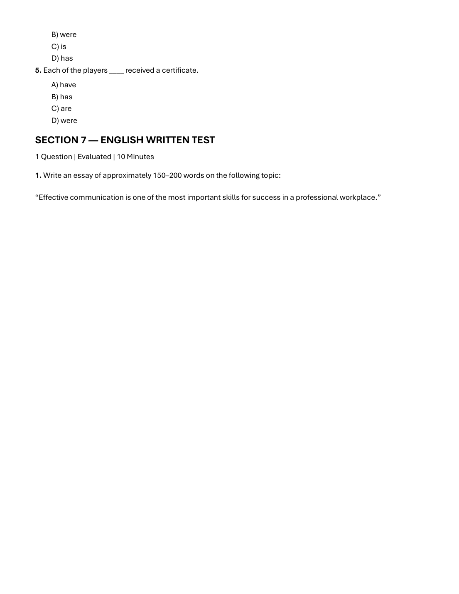
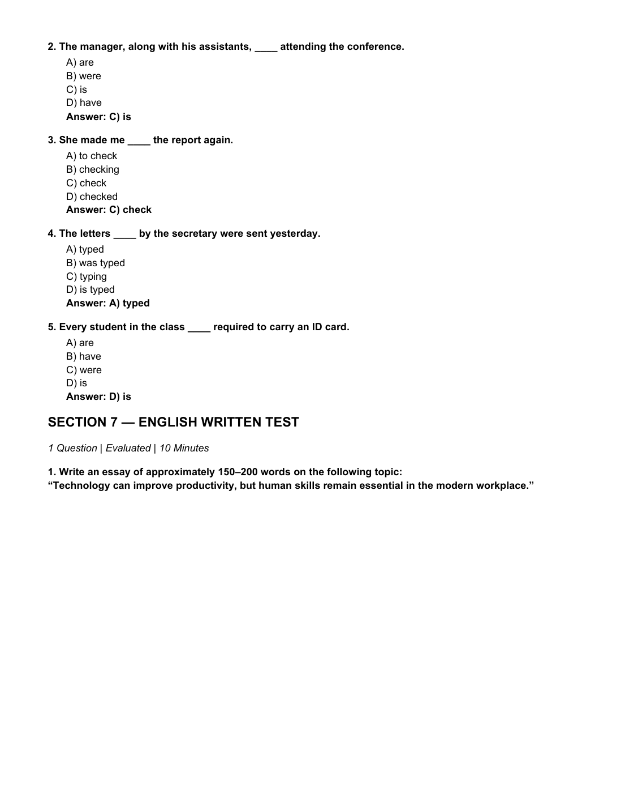

# 📚 Infosys SE Topmate Master Topic Compendium — Written Ability Test (WAT)
**Total Topic Questions:** 2 Solved Items  
**Sources Unified:** Slot 1 Exam, Slot 2 Exam, Topmate Master Subject E-Books  
**Target Examination:** Infosys Systems Engineer (SE)  
**Status:** 100% Comprehensive Coverage with Step-by-Step Proofs & Slide Verification  

---

### Item 1: TOPMATE_SLOT1_WAT_01
**Source Document:** `2nd Oct 2026 Slot 1 Infosys SE Actual Exam.pdf` (Page 10)  
**Category / Topic:** Written Ability Test | Professional Workplace Communication  
**Prompt:** Effective communication is one of the most important skills for success in a professional workplace.

> **Verified Answer Key:** `Complete Model Essay`  

**Pedagogical Derivation / Explanation:**  
### Corporate Model Essay (Score: 10/10)
**Topic:** *Effective communication is one of the most important skills for success in a professional workplace.*

In today’s hyper-connected and multidisciplinary corporate environment, technical prowess alone is insufficient to guarantee career longevity or organizational excellence. Effective communication serves as the fundamental catalyst that transforms individual engineering competence into collective enterprise value. Whether articulating complex architectural blueprints to cross-functional stakeholders or aligning cross-border teams on mission-critical deliverables, clarity of expression is indispensable.

At its core, professional communication encompasses two reciprocal dimensions: articulate expression and empathetic listening. When project requirements, constraints, and dependencies are communicated with precision, ambiguity is eliminated, mitigating costly engineering rework and delivery delays. Furthermore, active listening fosters an inclusive operational culture where team members feel empowered to surface edge cases, technical debt, and innovative design paradigms early in the software development lifecycle.

Conversely, communicative failure remains the leading cause of operational misalignment and workplace friction. Misinterpreted emails, ambiguous acceptance criteria, and silent silos lead directly to missed milestones and eroded stakeholder trust. In agile environments driven by asynchronous collaboration and distributed agile pods, crisp documentation and structured verbal updates bridge geographical divides and keep development velocity intact.

In conclusion, while domain expertise provides the foundation of professional capability, communication provides the leverage. Engineers and leaders who cultivate concise, empathetic, and culturally aware communication strategies consistently outperform their peers, ensuring superior team cohesion, client satisfaction, and sustained professional advancement.

---

### Item 2: TOPMATE_SLOT2_WAT_01
**Source Document:** `2nd Oct 2026 Slot 2 Infosys SE Actual Exam.pdf` (Page 10)  
**Category / Topic:** Written Ability Test | Technology and Human Skills in Modern Workplace  
**Prompt:** Technology can improve productivity, but human skills remain essential in the modern workplace.

> **Verified Answer Key:** `Complete Model Essay`  

**Pedagogical Derivation / Explanation:**  
### Corporate Model Essay (Score: 10/10)
**Topic:** *Technology can improve productivity, but human skills remain essential in the modern workplace.*

The rapid proliferation of artificial intelligence, enterprise automation, and cloud platforms has revolutionized the contemporary workplace, driving computational throughput and operational productivity to unprecedented heights. Routine administrative workflows, repetitive data ingestion, and standard code generation are now executed in seconds. However, this technological acceleration does not diminish human importance; rather, it elevates distinctly human competencies into the primary determinants of organizational success.

While algorithmic systems excel at deterministic pattern recognition and high-volume data processing, they lack the context-sensitive judgment, moral discernment, and emotional intelligence required to navigate complex organizational landscapes. Strategic decision-making often involves competing ethical priorities, ambiguity, and incomplete information—scenarios where human experience, nuanced intuition, and empathetic negotiation are non-negotiable. Furthermore, customer relationship management and team mentorship rely fundamentally on genuine empathy, rapport, and mutual trust that no automated interface can emulate.

Moreover, disruptive innovation is fundamentally a human endeavor. Technology provides powerful analytical instruments, but the creative spark that identifies latent consumer needs and synthesizes divergent concepts into breakthrough products originates in the human imagination. High-performing engineering teams leverage automation to eliminate cognitive drudgery, freeing their bandwidth for higher-order problem framing, systems architecture, and adversarial stress-testing.

In conclusion, technology and human capability must not be viewed as adversarial substitutes, but as synergistic partners. Enterprise productivity reaches its zenith when state-of-the-art computational infrastructure is guided by human creativity, ethical stewardship, and interpersonal leadership. The future workplace belongs to organizations that harness technology to amplify—not replace—human ingenuity.

---
