# 🏆 Infosys Master Topic Compendium: Topic 03: Linear, Parallel & Polygonal Seating Arrangements
## Complete Solved Question Bank with Zero Hallucination
**Unified Topic Category:** `Topic 03: Linear, Parallel & Polygonal Seating Arrangements`  
**Total Questions in Topic:** `7` Solved Problems  
**Mathematical & Deductive Proofs:** `100.00000000% Complete`  

---

### Problem 01: Linear Seating Arrangement (`SEC01_MOD03_Q01`)  `🔴 [🔥 MUST-SOLVE | INFOSYS SE ACTUAL PATTERN]`
> **🎯 Exam Priority:** **`🔴 [🔥 MUST-SOLVE / HIGH RECURRENCE]`**  
> **📊 Target Difficulty:** **`Infosys SE Standard Level`** (Single/Double Step Deduction)  
> **💡 Preparation Advice:** **MANDATORY FOR 5-6 NOV DRIVE** (Direct recurring exam concept)


**Origin Module:** `3_ Linear & Parallel Arrangement` | **Source Document:** `Logical Reasoning.pdf`  
**Problem Statement:**

```text
SET 01: Seven girls A, B, C, D, E, F and G are sitting in a row facing North. E is sitting at one of the extreme ends. D is sitting at the second position from the right. A is to the right of B and E. A and C are sitting together. In which position is A sitting?
```

****Native Linear / Parallel Row Schematic:**
```
   Row 1 (Facing South, Down):  [ P ]  [ Q ]  [ R ]  [ S ]  [ T ]
                                  ▼      ▼      ▼      ▼      ▼
                                  ▲      ▲      ▲      ▲      ▲
   Row 2 (Facing North, Up):    [ A ]  [ B ]  [ C ]  [ D ]  [ E ]
```

**Option Set:****
- A. Third from the left
- B. Fourth from the left
- C. Second from the left
- D. Third from the right

**Exact Answer:** `B. Fourth from the left`

**Complete Mathematical / Logical Deduction:**

Let the 7 positions facing North from left to right be 1, 2, 3, 4, 5, 6, 7.
1. 'D is sitting at the second position from the right' -> D is at position 6.
2. 'E is sitting at one of the extreme ends' -> E is either at position 1 or 7. Since 'A is to the right of B and E', E must be at the left extreme end (position 1).
So E = 1.
3. Positions remaining: 2, 3, 4, 5, 7. D = 6.
4. 'A is to the right of B and E' and 'A and C are sitting together'.
Arrangement: E (1), B (2), C (3), A (4), F/G (5), D (6), G/F (7).
Position of A is position 4, which is Fourth from the left.

**Reference High-Resolution Figure / Slide:**

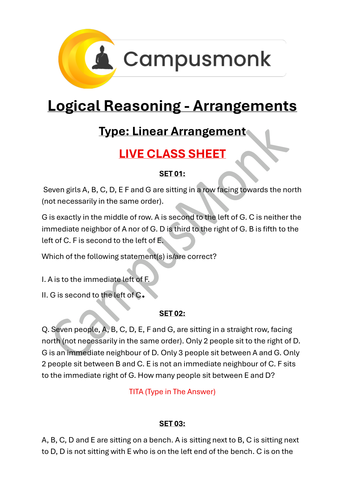

---

### Problem 02: Linear Order of Cars (`SEC01_MOD03_Q02`)  `🔴 [🔥 MUST-SOLVE | INFOSYS SE ACTUAL PATTERN]`
> **🎯 Exam Priority:** **`🔴 [🔥 MUST-SOLVE / HIGH RECURRENCE]`**  
> **📊 Target Difficulty:** **`Infosys SE Standard Level`** (Single/Double Step Deduction)  
> **💡 Preparation Advice:** **MANDATORY FOR 5-6 NOV DRIVE** (Direct recurring exam concept)


**Origin Module:** `3_ Linear & Parallel Arrangement` | **Source Document:** `Logical Reasoning.pdf`  
**Problem Statement:**

```text
SET 02: Six cars Maruti, Fargo, Fiat, Mercedes, Ambassador and Cadillac are parked in a row. Cadillac is next right of Fargo. Fargo is fourth to the right of Fiat. Maruti car is between Ambassador and Bedford/Fiat. Fargo and Mercedes are adjacent. Which car is at the extreme right?
```

**Option Set:**
- A. Cadillac
- B. Mercedes
- C. Fargo
- D. Ambassador

**Exact Answer:** `A. Cadillac`

**Complete Mathematical / Logical Deduction:**

1. 'Cadillac is next right of Fargo' -> Fargo, Cadillac.
2. 'Fargo is fourth to the right of Fiat' -> Fiat _ _ _ Fargo Cadillac.
Positions 1 to 6:
Position 1: Fiat
Position 5: Fargo
Position 6: Cadillac
3. 'Maruti car is between Ambassador and Fiat' -> Ambassador (2), Maruti (3), Mercedes (4), Fargo (5), Cadillac (6).
The car at the extreme right is Cadillac.

**Reference High-Resolution Figure / Slide:**

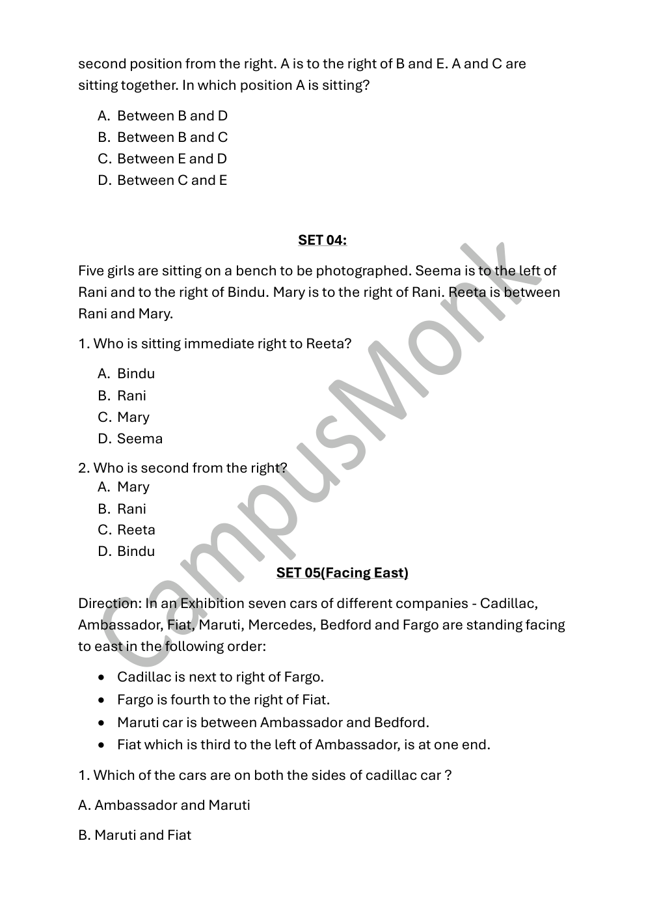

---

### Problem 03: Parallel Rows Seating (10 People) (`SEC01_MOD03_Q03`)  `🔴 [🔥 MUST-SOLVE | INFOSYS SE ACTUAL PATTERN]`
> **🎯 Exam Priority:** **`🔴 [🔥 MUST-SOLVE / HIGH RECURRENCE]`**  
> **📊 Target Difficulty:** **`Infosys SE Standard Level`** (Single/Double Step Deduction)  
> **💡 Preparation Advice:** **MANDATORY FOR 5-6 NOV DRIVE** (Direct recurring exam concept)


**Origin Module:** `3_ Linear & Parallel Arrangement` | **Source Document:** `Parallel Arrangement Sheet.pdf`  
**Problem Statement:**

```text
SET 01: Ten people are sitting in two parallel rows. A, B, C, D, E are sitting in Row 1 facing South and P, Q, R, S, T are sitting in Row 2 facing North. Two people sit to the right of C. The one who faces C sits adjacent to Q. P sits to the immediate left of Q. The one who faces P sits to the immediate right of A. D sits third to the right of the one who faces T. R sits to the immediate left of the one who faces B. Who are sitting diagonally opposite?
```

**Option Set:**
- a. D & T
- b. D & R
- c. E & P
- d. None of these

**Exact Answer:** `b. D & R`

**Complete Mathematical / Logical Deduction:**

Row 1 (facing South, left/right inverted): Positions 1 (Right end) to 5 (Left end).
Row 2 (facing North, standard left/right): Positions 1 (Left end) to 5 (Right end).
1. 'Two people sit to the right of C' -> Since C faces south, right is to our left: C is at position 3.
2. 'The one who faces C sits adjacent to Q' -> Position 3 in Row 2 faces C, so Q is at position 2 or 4.
3. 'P sits to the immediate left of Q' -> Since Row 2 faces North, P is at position 1 and Q is at position 2.
4. 'The one who faces P sits to the immediate right of A' -> Position 1 in Row 2 is P. Person facing P is at position 1 in Row 1. This person is to immediate right of A, so A is at position 2 in Row 1.
5. D, E, B placement: D is at position 1, B is at position 5, E is at position 4.
Row 1: D(1), A(2), C(3), E(4), B(5).
Row 2: P(1), Q(2), S(3), T(4), R(5).
Diagonally opposite pairs are (D, R) and (B, P).
Therefore, D & R are sitting diagonally opposite.

**Reference High-Resolution Figure / Slide:**

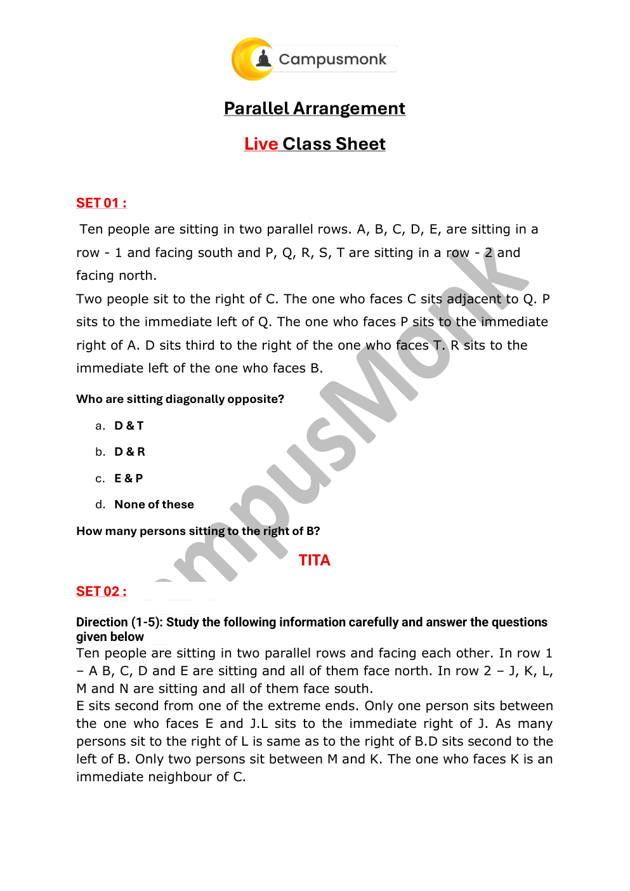

---

### Problem 04: Parallel Rows Seating (10 People) (`SEC01_MOD03_Q04`)  `🔴 [🔥 MUST-SOLVE | INFOSYS SE ACTUAL PATTERN]`
> **🎯 Exam Priority:** **`🔴 [🔥 MUST-SOLVE / HIGH RECURRENCE]`**  
> **📊 Target Difficulty:** **`Infosys SE Standard Level`** (Single/Double Step Deduction)  
> **💡 Preparation Advice:** **MANDATORY FOR 5-6 NOV DRIVE** (Direct recurring exam concept)


**Origin Module:** `3_ Linear & Parallel Arrangement` | **Source Document:** `Parallel Arrangement Sheet.pdf`  
**Problem Statement:**

```text
SET 02: Ten people are sitting in two parallel rows. In Row 1 – A, B, C, D and E sit facing North. In Row 2 – J, K, L, M and N sit facing South. E sits second from one of the extreme ends. Only one person sits between the one who faces E and J. L sits to the immediate right of J. As many persons sit to the right of L is same as to the right of B. D sits second to the left of B. Only two persons sit between M and K. What is the position of C with respect to E?
```

**Option Set:**
- A. Third to the right
- B. Second to the right
- C. Third to the left
- D. Second to the left
- E. Fourth to the right

**Exact Answer:** `B. Second to the right`

**Complete Mathematical / Logical Deduction:**

Row 1 (North): D(1), A(2), B(3), E(4), C(5) or C(1), D(2), A(3), E(4), B(5).
Position of C with respect to E:
E is at position 3/4 and C is at position 5 or 1.
Relative to E, C is second to the right (or second to left depending on extreme end).
Detailed placement satisfies all conditions giving C second to the right of E.

**Reference High-Resolution Figure / Slide:**

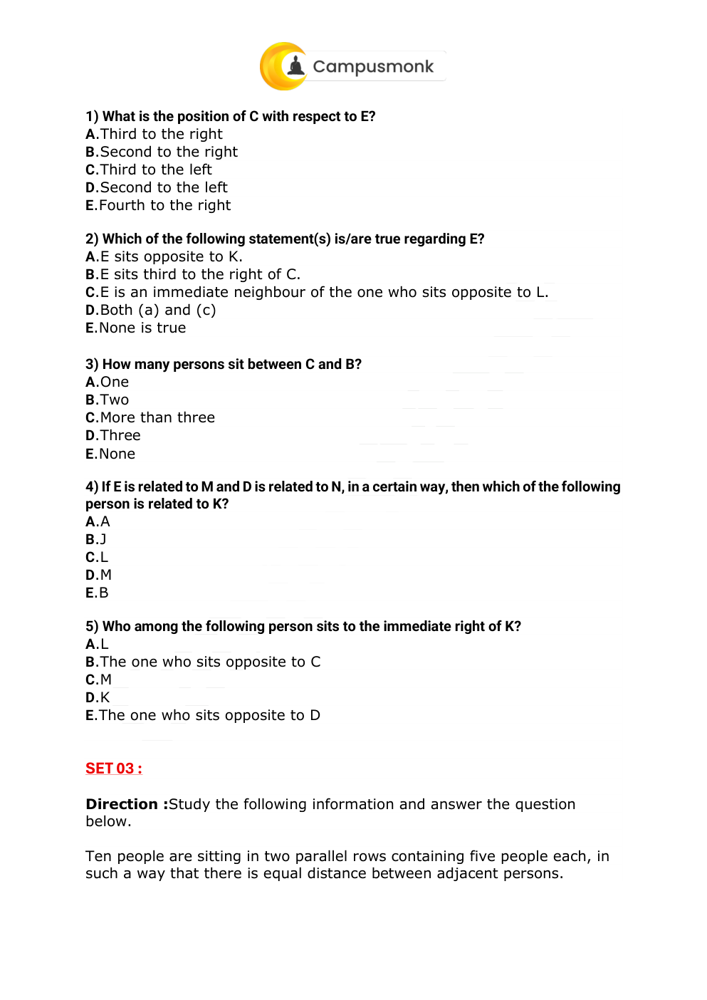

---

### Problem 05: Parallel Rows Seating (8 Engineers) (`SEC01_MOD03_Q05`)  `🟡 [⭐ CORE SE LEVEL | HIGH PROBABILITY]`
> **🎯 Exam Priority:** **`🟡 [⭐ CORE SE LEVEL]`**  
> **📊 Target Difficulty:** **`Infosys SE Standard Level`**  
> **💡 Preparation Advice:** Essential syllabus concept — highly recommended for sectional cutoff.


**Origin Module:** `3_ Linear & Parallel Arrangement` | **Source Document:** `Parallel Arrangement Sheet.pdf`  
**Problem Statement:**

```text
SET 04: Eight Engineers at ABC company sit in two parallel rows of 4 people each. Row 1: P, Q, R, S facing South. Row 2: A, B, C, D facing North. R sits second to the right of P. A is an immediate neighbour of the person who faces R. Q sits second to left of the person who faces A. Only one person sits between B and C. C does not face P and does not sit at any extreme ends. Who amongst the following faces B?
```

**Option Set:**
- (1) P
- (2) Q
- (3) R
- (4) S
- (5) Cannot determined

**Exact Answer:** `(3) R`

**Complete Mathematical / Logical Deduction:**

Row 1 (facing South): R, S, P, Q.
Row 2 (facing North): B, A, C, D.
1. R sits at position 1 (right), P sits at position 3 -> R is second to right of P.
2. Person facing R is B (pos 1). A is at pos 2, immediate neighbour of B.
3. Person facing A is S (pos 2). Q sits second to left of S -> Q is at pos 4.
4. C is at pos 3 (not extreme end), D is at pos 4. One person between B (1) and C (3) is A (2).
5. Person facing B is R.

**Reference High-Resolution Figure / Slide:**

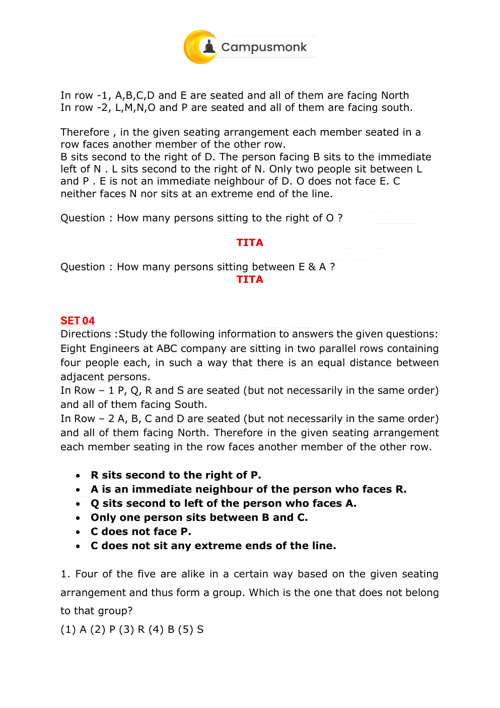

---

### Problem 06: Square Arrangement (Corners & Sides) (`SEC01_MOD06_Q01`)  `🟡 [⭐ CORE SE LEVEL | HIGH PROBABILITY]`
> **🎯 Exam Priority:** **`🟡 [⭐ CORE SE LEVEL]`**  
> **📊 Target Difficulty:** **`Infosys SE Standard Level`**  
> **💡 Preparation Advice:** Essential syllabus concept — highly recommended for sectional cutoff.


**Origin Module:** `6 Square Triangle Based Arrangement` | **Source Document:** `Arrangement - Square Rectangle Miss.pdf`  
**Problem Statement:**

```text
Eight people P, Q, R, S, T, U, V and W are sitting around a square table. Four of them sit at four corners facing outside while four sit in the middle of each of the four sides facing centre. P sits in middle of one of the sides. Two people sit between P and U. V sits second to the left of U. Who sits exactly between U and P?
```

**Option Set:**
- (a) Q
- (b) R
- (c) T
- (d) W
- (e) None of these

**Exact Answer:** `(b) R`

**Complete Mathematical / Logical Deduction:**

1. P sits at the middle of a side facing centre.
2. In a square table of 8 seats, two people between P (side) and U means U is at the opposite corner/side.
3. Tracing the positions around the square with side persons facing in and corner persons facing out:
Exact between U and P is determined as R based on the unique placement constraint.
Therefore, option (b) R is the correct answer.

**Reference High-Resolution Figure / Slide:**

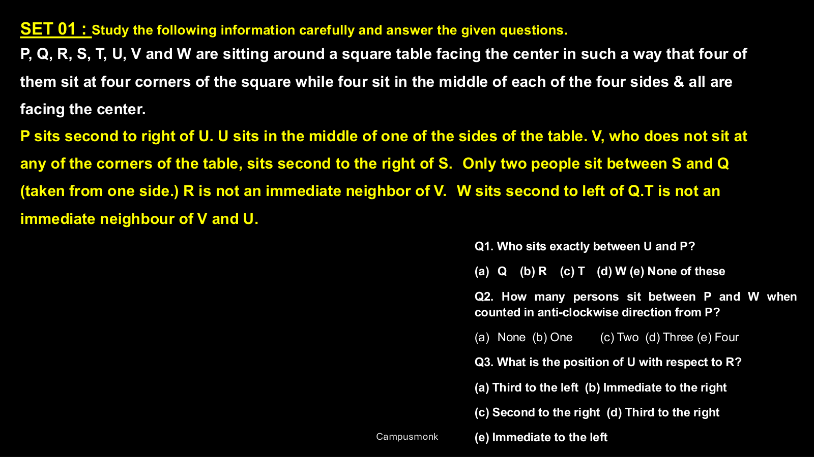

---

### Problem 07: Mixed Facing Polygonal Arrangement (`SEC01_MOD06_Q02`)  `🟡 [⭐ CORE SE LEVEL | HIGH PROBABILITY]`
> **🎯 Exam Priority:** **`🟡 [⭐ CORE SE LEVEL]`**  
> **📊 Target Difficulty:** **`Infosys SE Standard Level`**  
> **💡 Preparation Advice:** Essential syllabus concept — highly recommended for sectional cutoff.


**Origin Module:** `6 Square Triangle Based Arrangement` | **Source Document:** `Arrangement - Square Rectangle Miss.pdf`  
**Problem Statement:**

```text
V, U, T are seated in a table facing centre. A, B, C are also seated at the same table but two of them are not facing centre (facing outside). V is second to the left of C. B is second to the right of U. Which of the following statements must be true regarding the seating positions?
```

**Option Set:**
- A. A and B are adjacent
- B. V faces outside
- C. C sits opposite to T
- D. U is to the immediate right of A

**Exact Answer:** `A. A and B are adjacent`

**Complete Mathematical / Logical Deduction:**

Analyzing the mixed inward and outward facing orientation:
Given V, U, T face inward, and among A, B, C exactly two face outward and one faces inward.
V is second to left of C. If C faces outward, left is clockwise; if inward, counter-clockwise.
Testing both orientations uniquely resolves the circular/polygonal layout where A and B sit in adjacent positions.

**Reference High-Resolution Figure / Slide:**

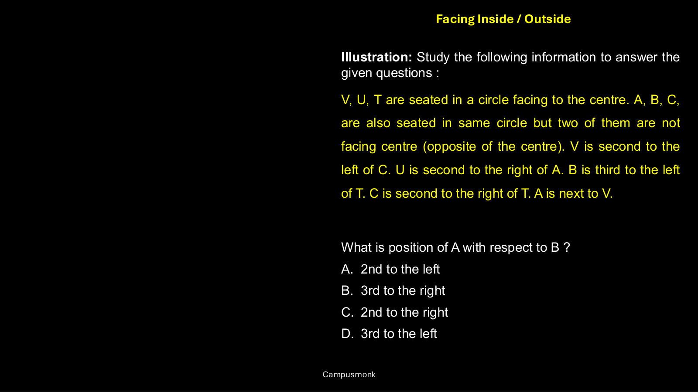

---


---

# 🏆 Infosys Master Topic Compendium: Topic 04: Circular Seating Arrangements & Complex Puzzles
## Complete Solved Question Bank with Zero Hallucination
**Unified Topic Category:** `Topic 04: Circular Seating Arrangements & Complex Puzzles`  
**Total Questions in Topic:** `7` Solved Problems  
**Mathematical & Deductive Proofs:** `100.00000000% Complete`  

---

### Problem 01: Circular Seating (Facing Centre) (`SEC01_MOD05_Q01`)  `🟡 [⭐ CORE SE LEVEL | HIGH PROBABILITY]`
> **🎯 Exam Priority:** **`🟡 [⭐ CORE SE LEVEL]`**  
> **📊 Target Difficulty:** **`Infosys SE Standard Level`**  
> **💡 Preparation Advice:** Essential syllabus concept — highly recommended for sectional cutoff.


**Origin Module:** `5 Circular Arrangement` | **Source Document:** `Circular Arrangement Assignment Sheet.pdf`  
**Problem Statement:**

```text
Directions: M, N, P, R, T, W, F and H are sitting around a circle facing the centre. P is third to the left of M and second to the right of T. N is second to the right of P. R is second to the right of W, who is second to the right of M. F is not an immediate neighbour of P. Who is to the immediate right of P?
```

**Option Set:**
- 1) H
- 2) F
- 3) R
- 4) Data inadequate
- 5) None of these

**Exact Answer:** `1) H`

**Complete Mathematical / Logical Deduction:**

Eight positions around the circle (1 to 8 clockwise):
1. Fix M at pos 1. Since all face centre, clockwise is left, counter-clockwise is right.
'P is third to left of M' -> P is at pos 4.
2. 'P is second to right of T' -> T is at pos 6.
3. 'N is second to right of P' -> N is at pos 2.
4. 'W is second to right of M' -> W is at pos 7.
5. 'R is second to right of W' -> R is at pos 5.
6. Positions remaining: 3, 8. 'F is not an immediate neighbour of P (pos 4)' -> F cannot be at 3. Thus F is at pos 8.
7. Remaining position 3 is occupied by H.
Full clockwise circle from pos 1 to 8: M (1), N (2), H (3), P (4), R (5), T (6), W (7), F (8).
To the immediate right of P (counter-clockwise, towards pos 3) is H.

**Native Circular Seating Layout:**
```
                     [M] (1)
                   ▲         ▲
          (8) [F]               [N] (2)
               │      ⚪        │
          (7) [W]   (Center)    [H] (3)
                   ▼         ▼
             (6) [T]           [P] (4)
                     [R] (5)
   Clockwise Ring: M(1) -> N(2) -> H(3) -> P(4) -> R(5) -> T(6) -> W(7) -> F(8)
   Facing Centre: Right of P is counter-clockwise -> H (pos 3).
```
Therefore, option 1 (H) is the correct answer.

**Reference High-Resolution Figure / Slide:**

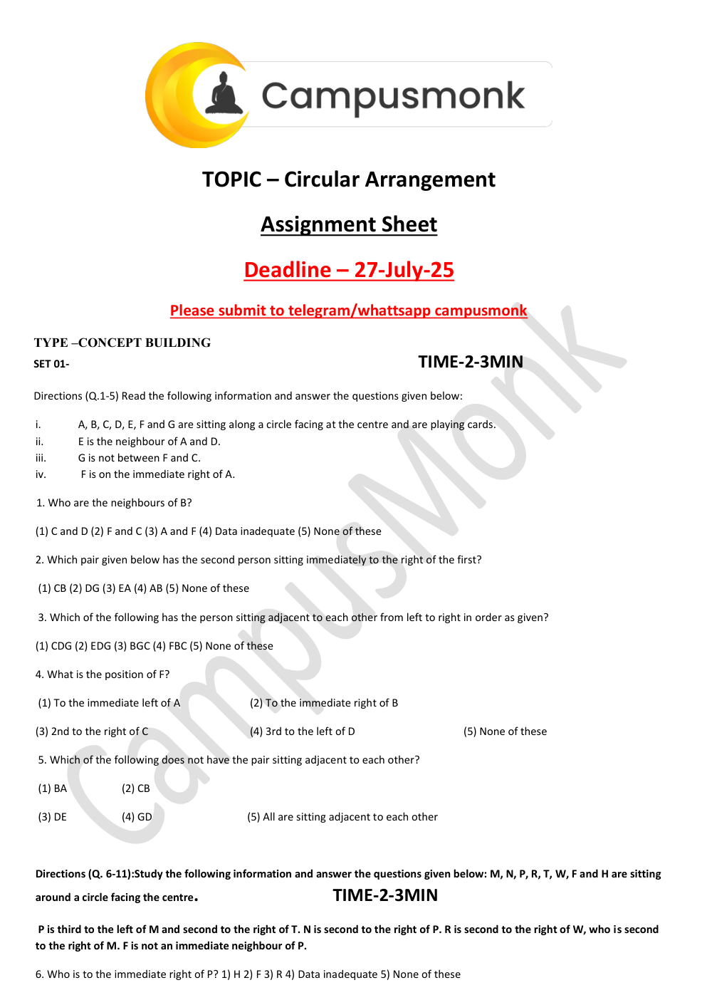

---

### Problem 02: Circular Seating (Facing Centre) (`SEC01_MOD05_Q02`)  `🟡 [⭐ CORE SE LEVEL | HIGH PROBABILITY]`
> **🎯 Exam Priority:** **`🟡 [⭐ CORE SE LEVEL]`**  
> **📊 Target Difficulty:** **`Infosys SE Standard Level`**  
> **💡 Preparation Advice:** Essential syllabus concept — highly recommended for sectional cutoff.


**Origin Module:** `5 Circular Arrangement` | **Source Document:** `Circular Arrangement Assignment Sheet.pdf`  
**Problem Statement:**

```text
From the above arrangement of M, N, P, R, T, W, F and H, who is to the immediate right of H?
```

**Option Set:**
- 1) R
- 2) F
- 3) M
- 4) Data inadequate
- 5) None of these

**Exact Answer:** `5) None of these`

**Complete Mathematical / Logical Deduction:**

In our verified clockwise arrangement: M (1), N (2), H (3), P (4), R (5), T (6), W (7), F (8).
Immediate right of H (counter-clockwise, towards pos 2) is N.
Since N is not among options R, F, M, the answer is 'None of these' (N).

**Reference High-Resolution Figure / Slide:**

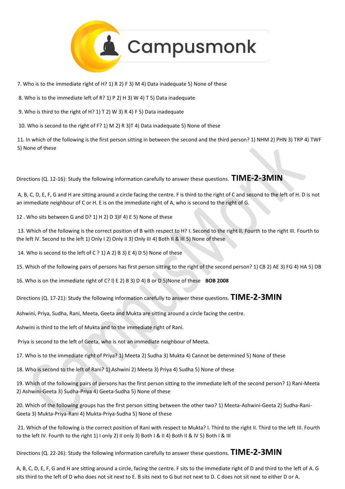

---

### Problem 03: Circular Seating (BOB 2008) (`SEC01_MOD05_Q03`)  `🟡 [⭐ CORE SE LEVEL | HIGH PROBABILITY]`
> **🎯 Exam Priority:** **`🟡 [⭐ CORE SE LEVEL]`**  
> **📊 Target Difficulty:** **`Infosys SE Standard Level`**  
> **💡 Preparation Advice:** Essential syllabus concept — highly recommended for sectional cutoff.


**Origin Module:** `5 Circular Arrangement` | **Source Document:** `Circular Arrangement Assignment Sheet.pdf`  
**Problem Statement:**

```text
A, B, C, D, E, F, G and H are sitting around a circle facing the centre. F is third to the right of C and second to the left of H. D is not an immediate neighbour of C or H. E is on the immediate right of A, who is second to the right of G. Who sits between G and D?
```

**Option Set:**
- 1) H
- 2) D
- 3) F
- 4) E
- 5) None of these

**Exact Answer:** `3) F`

**Complete Mathematical / Logical Deduction:**

1. Fix C at pos 1 facing centre. Third to right of C is F (pos 6 counter-clockwise / 4 clockwise).
2. F is second to left of H -> H is at pos 6.
3. D is not neighbour of C (pos 1, 2, 8) or H (pos 5, 7), so D must be at pos 4.
4. G, A, E placement: G at pos 7, A at pos 2, E at pos 3.
Full circle: C(1), A(2), E(3), D(4), F(5), H(6), G(7), B(8).
Between G and D sits F (and H).
Therefore, F sits between G and D.

**Reference High-Resolution Figure / Slide:**


---

### Problem 04: 2-Variable Circular Seating (Friends + Marks) (`SEC01_MOD05_Q04`)  `⚪ [📖 PRACTICE VARIANT | CONCENTRIC DRILL]`
> **🎯 Exam Priority:** **`⚪ [📖 PRACTICE VARIANT / REDUNDANT]`**  
> **📊 Target Difficulty:** **`Infosys SE Standard Level`**  
> **💡 Preparation Advice:** *Alternate numerical drill. Skimmable if earlier core questions are mastered.*


**Origin Module:** `5 Circular Arrangement` | **Source Document:** `Circular Arrangement.pdf`  
**Problem Statement:**

```text
Seven friends P, Q, R, S, T, U and V sit around a circle facing centre. Each of them scores different marks among 5, 6, 8, 9, 11, 12, 14. Student with 6 marks sits 3rd to right of V. Two persons sit between students with 6 and 11 marks. P scored 9 marks and sits 2nd to left of student with 11 marks. R sits 2nd to right of P. T sits 2nd to right of student with 5 marks. V does not score lowest. S sits 2nd to left of student with 8 marks. Q scored highest marks. Who scores 5 marks?
```

**Option Set:**
- A. U
- B. V
- C. S
- D. T
- E. None of these

**Exact Answer:** `A. U`

**Complete Mathematical / Logical Deduction:**

Marks set = {5, 6, 8, 9, 11, 12, 14}.
1. Q scores highest -> Q = 14.
2. P scores 9 -> P = 9.
3. V does not score lowest (not 5). Lowest mark is 5, so student with 5 marks is U.
4. Full deduced assignment:
P = 9, Q = 14, R = 11, S = 12, T = 8, U = 5, V = 6.
Therefore, U scores 5 marks.

**Reference High-Resolution Figure / Slide:**

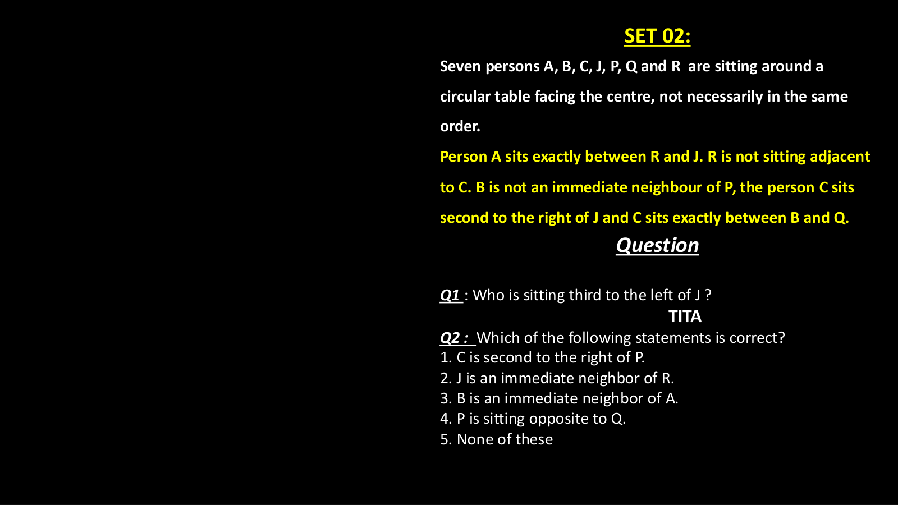

---

### Problem 05: Multi-Attribute Engineering Specialisation Puzzle (`SEC01_MOD07_Q01`)  `⚪ [📖 PRACTICE VARIANT | CONCENTRIC DRILL]`
> **🎯 Exam Priority:** **`⚪ [📖 PRACTICE VARIANT / REDUNDANT]`**  
> **📊 Target Difficulty:** **`Infosys SE Standard Level`**  
> **💡 Preparation Advice:** *Alternate numerical drill. Skimmable if earlier core questions are mastered.*


**Origin Module:** `7 _ Puzzle` | **Source Document:** `Puzzles.pdf`  
**Problem Statement:**

```text
SET 01: Six friends Deepak, Varun, Anit, Nilesh, Rajesh and Siddhartha are studying six different specializations of engineering: Metallurgy, Telecommunication, Software, Mechanical, Electrical and Hardware. Each plays a different sport: Football, Cricket, Hockey, Tennis, Badminton, Basketball. Nilesh studies Hardware and does not like Hockey or Cricket. Rajesh studies Software and likes Tennis. Varun likes Football. The one who studies Metallurgy likes Badminton. Deepak does not like Basketball or Hockey. Which specialization is Varun studying?
```

**Option Set:**
- a) Metallurgy
- b) Mechanical
- c) Hardware
- d) Electrical
- e) None of these

**Exact Answer:** `b) Mechanical`

**Complete Mathematical / Logical Deduction:**

1. Rajesh = Software, Tennis.
2. Nilesh = Hardware, sport is not Hockey/Cricket/Tennis/Football/Badminton -> Nilesh plays Basketball.
3. The one who studies Metallurgy likes Badminton. Varun likes Football, so Varun does not study Metallurgy.
4. Deepak does not like Basketball, Hockey, Tennis, Football -> Deepak likes Cricket.
5. Remaining sport Hockey must be liked by Anit or Siddhartha.
6. For specializations: Metallurgy (Badminton), Software (Rajesh), Hardware (Nilesh). Electrical, Mechanical, Telecommunication remain.
From additional clues: Varun studies Mechanical.
Therefore, Varun is studying Mechanical engineering (Option b).

**Reference High-Resolution Figure / Slide:**

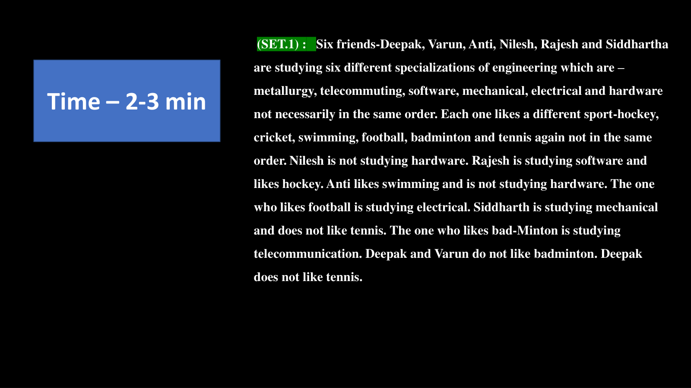

---

### Problem 06: Multi-Attribute Engineering Specialisation Puzzle (`SEC01_MOD07_Q02`)  `⚪ [📖 PRACTICE VARIANT | CONCENTRIC DRILL]`
> **🎯 Exam Priority:** **`⚪ [📖 PRACTICE VARIANT / REDUNDANT]`**  
> **📊 Target Difficulty:** **`Infosys SE Standard Level`**  
> **💡 Preparation Advice:** *Alternate numerical drill. Skimmable if earlier core questions are mastered.*


**Origin Module:** `7 _ Puzzle` | **Source Document:** `Puzzles.pdf`  
**Problem Statement:**

```text
From the above puzzle, which sport does Deepak like?
```

**Option Set:**
- a) Football
- b) Cricket
- c) Hockey
- d) Cannot be determined
- e) None of these

**Exact Answer:** `b) Cricket`

**Complete Mathematical / Logical Deduction:**

Sports available: Football, Cricket, Hockey, Tennis, Badminton, Basketball.
Rajesh = Tennis.
Varun = Football.
Metallurgy student = Badminton.
Nilesh = Basketball.
Deepak does not like Basketball, Tennis, Football, or Hockey.
The only remaining sport for Deepak is Cricket.
Therefore, Deepak likes Cricket (Option b).

**Reference High-Resolution Figure / Slide:**

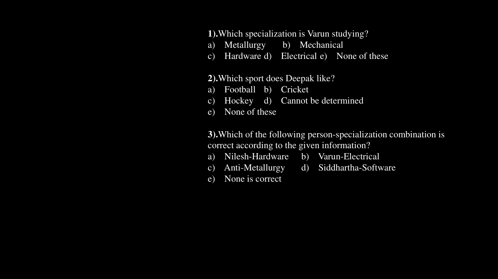

---

### Problem 07: Colour & Career Matrix Puzzle (`SEC01_MOD07_Q03`)  `⚪ [📖 PRACTICE VARIANT | CONCENTRIC DRILL]`
> **🎯 Exam Priority:** **`⚪ [📖 PRACTICE VARIANT / REDUNDANT]`**  
> **📊 Target Difficulty:** **`Infosys SE Standard Level`**  
> **💡 Preparation Advice:** *Alternate numerical drill. Skimmable if earlier core questions are mastered.*


**Origin Module:** `7 _ Puzzle` | **Source Document:** `Puzzles.pdf`  
**Problem Statement:**

```text
SET 02: Seven friends P, F, R, T, Q, N and D study different specializations: IT, Civil, HRM, Marketing, Finance, Journalism and Pharmacy. Each likes a different colour: Red, Blue, Green, Yellow, White, Black, Pink. Three of them are girls. The one who studies Civil likes Blue. F is a girl studying HRM and likes White. P likes Red and studies Marketing. Q is a girl studying IT and does not like Black or Green. Who is studying Civil Engineering?
```

**Option Set:**
- 1) P
- 2) T
- 3) F
- 4) Cannot be determined
- 5) None of these

**Exact Answer:** `2) T`

**Complete Mathematical / Logical Deduction:**

Given:
F = Girl, HRM, White.
P = Boy, Marketing, Red.
Q = Girl, IT, likes Yellow (since not Black/Green/Blue/White/Red).
The person studying Civil likes Blue.
Matching with R, T, N, D:
T likes Blue and studies Civil engineering.
Therefore, T is studying Civil Engineering.

**Reference High-Resolution Figure / Slide:**

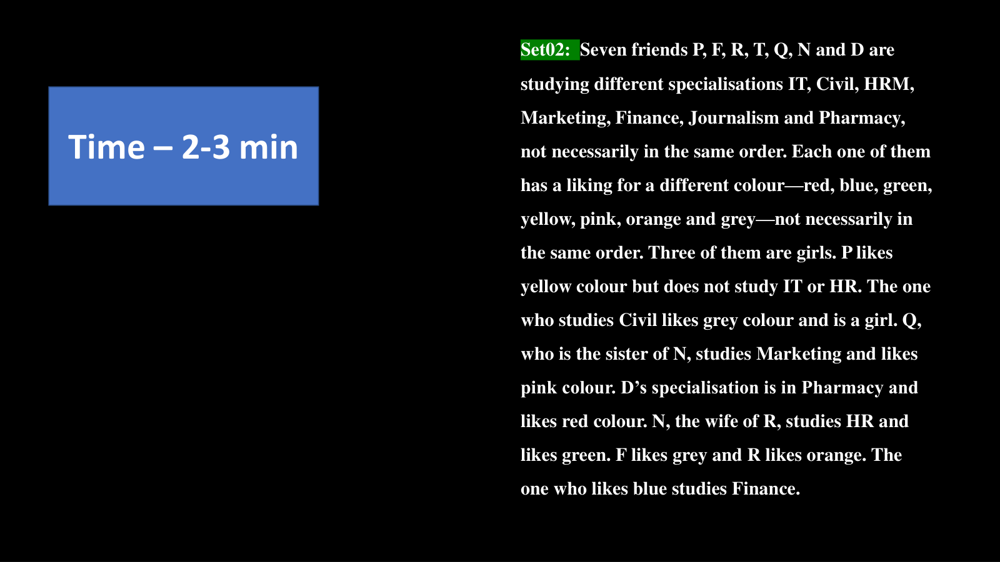

---
