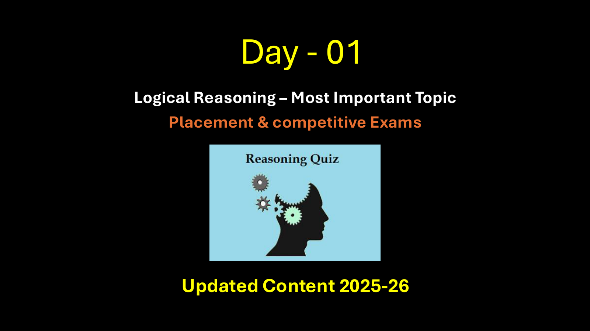

# 🏆 Infosys Master Topic Compendium: Topic 08: Visual & Non-Verbal Reasoning (Dice, Mirror, Water, Paper Folding)
## Complete Solved Question Bank with Zero Hallucination
**Unified Topic Category:** `Topic 08: Visual & Non-Verbal Reasoning (Dice, Mirror, Water, Paper Folding)`  
**Total Questions in Topic:** `105` Solved Problems  
**Mathematical & Deductive Proofs:** `100.00000000% Complete`  

---

### Problem 01: Mirror Reflection Logic (`SEC01_MOD11_MIR_Q01`)  `🔴 [🔥 MUST-SOLVE | INFOSYS SE ACTUAL PATTERN]`
> **🎯 Exam Priority:** **`🔴 [🔥 MUST-SOLVE / HIGH RECURRENCE]`**  
> **📊 Target Difficulty:** **`Infosys SE Standard Level`** (Single/Double Step Deduction)  
> **💡 Preparation Advice:** **MANDATORY FOR 5-6 NOV DRIVE** (Direct recurring exam concept)


**Origin Module:** `Module 11 _ Dice Mirror Image Water` | **Source Document:** `Mirror Imge_QUESTIONS.json`  
**Problem Statement:**

```text
Looking into a mirror, the clock shows 9 : 30 as the time. The actual time is ________
```

**Option Set:**
- 2:30
- 3:30
- 4:30
- 5:30

**Exact Answer:** `2:30`

**Complete Mathematical / Logical Deduction:**

Answer: Option A Explanation: It is clear from Fig. (X) that if seen through a mirror, the time indicated by clock is 9 : 30. When the mirror is placed vertically at AB, its mirror i.e., Fix. (Y) shows the actual time in the clock i.e., 2 : 30.

**Reference High-Resolution Figure / Slide:**



---

### Problem 02: Mirror Reflection Logic (`SEC01_MOD11_MIR_Q02`)  `🔴 [🔥 MUST-SOLVE | INFOSYS SE ACTUAL PATTERN]`
> **🎯 Exam Priority:** **`🔴 [🔥 MUST-SOLVE / HIGH RECURRENCE]`**  
> **📊 Target Difficulty:** **`Infosys SE Standard Level`** (Single/Double Step Deduction)  
> **💡 Preparation Advice:** **MANDATORY FOR 5-6 NOV DRIVE** (Direct recurring exam concept)


**Origin Module:** `Module 11 _ Dice Mirror Image Water` | **Source Document:** `Mirror Imge_QUESTIONS.json`  
**Problem Statement:**

```text
When seen through a mirror, a clock shows 8 : 30. The correct time is ________
```

**Option Set:**
- 2:30
- 3:30
- 4:30
- 5:30

**Exact Answer:** `3:30`

**Complete Mathematical / Logical Deduction:**

Answer: Option B Explanation: It is clear from Fig. (X) that if seen through a mirror, the time indicated by clock is 8 : 30. When the mirror is placed vertically at AB, its mirror i.e., Fix. (Y) shows the actual time in the clock i.e., 3 : 30.

**Reference High-Resolution Figure / Slide:**


---

### Problem 03: Mirror Reflection Logic (`SEC01_MOD11_MIR_Q03`)  `🔴 [🔥 MUST-SOLVE | INFOSYS SE ACTUAL PATTERN]`
> **🎯 Exam Priority:** **`🔴 [🔥 MUST-SOLVE / HIGH RECURRENCE]`**  
> **📊 Target Difficulty:** **`Infosys SE Standard Level`** (Single/Double Step Deduction)  
> **💡 Preparation Advice:** **MANDATORY FOR 5-6 NOV DRIVE** (Direct recurring exam concept)


**Origin Module:** `Module 11 _ Dice Mirror Image Water` | **Source Document:** `Mirror Imge_QUESTIONS.json`  
**Problem Statement:**

```text
By looking in a mirror, it appears that it is 6 : 30 in the clock. What is the real time?
```

**Option Set:**
- 6:30
- 5:30
- 4:30
- 3:30

**Exact Answer:** `5:30`

**Complete Mathematical / Logical Deduction:**

Answer: Option B Explanation: It is clear from Fig. (X) that if seen through a mirror, the time indicated by clock is 6 : 30. When the mirror is placed vertically at AB, its mirror i.e., Fix. (Y) shows the actual time in the clock i.e., 5 : 30.

**Reference High-Resolution Figure / Slide:**


---

### Problem 04: Mirror Reflection Logic (`SEC01_MOD11_MIR_Q04`)  `🔴 [🔥 MUST-SOLVE | INFOSYS SE ACTUAL PATTERN]`
> **🎯 Exam Priority:** **`🔴 [🔥 MUST-SOLVE / HIGH RECURRENCE]`**  
> **📊 Target Difficulty:** **`Infosys SE Standard Level`** (Single/Double Step Deduction)  
> **💡 Preparation Advice:** **MANDATORY FOR 5-6 NOV DRIVE** (Direct recurring exam concept)


**Origin Module:** `Module 11 _ Dice Mirror Image Water` | **Source Document:** `Mirror Imge_QUESTIONS.json`  
**Problem Statement:**

```text
When seen through a mirror, a watch shows 12 : 15. The correct time is
```

**Option Set:**
- 12 : 30
- 1 : 15
- 12 : 45
- 11 : 45

**Exact Answer:** `11 : 45`

**Complete Mathematical / Logical Deduction:**

Answer: Option D Explanation: It is clear from Fig. (X) that if seen through a mirror, the time indicated by clock is 12 : 15. When the mirror is placed vertically at AB, its mirror i.e., Fix. (Y) shows the actual time in the clock i.e., 11 : 45

**Reference High-Resolution Figure / Slide:**


---

### Problem 05: Mirror Reflection Logic (`SEC01_MOD11_MIR_Q05`)  `🔴 [🔥 MUST-SOLVE | INFOSYS SE ACTUAL PATTERN]`
> **🎯 Exam Priority:** **`🔴 [🔥 MUST-SOLVE / HIGH RECURRENCE]`**  
> **📊 Target Difficulty:** **`Infosys SE Standard Level`** (Single/Double Step Deduction)  
> **💡 Preparation Advice:** **MANDATORY FOR 5-6 NOV DRIVE** (Direct recurring exam concept)


**Origin Module:** `Module 11 _ Dice Mirror Image Water` | **Source Document:** `Mirror Imge_QUESTIONS.json`  
**Problem Statement:**

```text
Which of the answer figure is exactly the mirror image of the given figure, when mirror is placed on the line AB?
```

**Option Set:**
- 1
- 2
- 3
- 4

**Exact Answer:** `1`

**Complete Mathematical / Logical Deduction:**

Answer: Option A Explanation: Here, the mirror is placed vertically at AB on the RHS of the question figure. Hence, only the figure given in answer figure (1) would be obtained as the correct mirror image.

**Reference High-Resolution Figure / Slide:**


---

### Problem 06: Mirror Reflection Logic (`SEC01_MOD11_MIR_Q06`)  `🔴 [🔥 MUST-SOLVE | INFOSYS SE ACTUAL PATTERN]`
> **🎯 Exam Priority:** **`🔴 [🔥 MUST-SOLVE / HIGH RECURRENCE]`**  
> **📊 Target Difficulty:** **`Infosys SE Standard Level`** (Single/Double Step Deduction)  
> **💡 Preparation Advice:** **MANDATORY FOR 5-6 NOV DRIVE** (Direct recurring exam concept)


**Origin Module:** `Module 11 _ Dice Mirror Image Water` | **Source Document:** `Mirror Imge_QUESTIONS.json`  
**Problem Statement:**

```text
Which of the answer figure is exactly the mirror image of the given figure, when mirror is placed on the line AB?
```

**Option Set:**
- 1
- 2
- 3
- 4

**Exact Answer:** `3`

**Complete Mathematical / Logical Deduction:**

Answer: Option C Explanation: Here, the mirror is placed vertically at AB on the RHS of the question figure. Hence, only the figure given in answer figure (3) would be obtained as the correct mirror image.

**Reference High-Resolution Figure / Slide:**


---

### Problem 07: Mirror Reflection Logic (`SEC01_MOD11_MIR_Q07`)  `🔴 [🔥 MUST-SOLVE | INFOSYS SE ACTUAL PATTERN]`
> **🎯 Exam Priority:** **`🔴 [🔥 MUST-SOLVE / HIGH RECURRENCE]`**  
> **📊 Target Difficulty:** **`Infosys SE Standard Level`** (Single/Double Step Deduction)  
> **💡 Preparation Advice:** **MANDATORY FOR 5-6 NOV DRIVE** (Direct recurring exam concept)


**Origin Module:** `Module 11 _ Dice Mirror Image Water` | **Source Document:** `Mirror Imge_QUESTIONS.json`  
**Problem Statement:**

```text
Which of the answer figure is exactly the mirror image of the given figure, when mirror is placed on the line AB?
```

**Option Set:**
- 1
- 2
- 3
- 4

**Exact Answer:** `2`

**Complete Mathematical / Logical Deduction:**

Answer: Option B Explanation: Here, the mirror is placed vertically at AB on the RHS of the question figure. Hence, only the figure given in answer figure (2) would be obtained as the correct mirror image.

**Reference High-Resolution Figure / Slide:**


---

### Problem 08: Mirror Reflection Logic (`SEC01_MOD11_MIR_Q08`)  `🔴 [🔥 MUST-SOLVE | INFOSYS SE ACTUAL PATTERN]`
> **🎯 Exam Priority:** **`🔴 [🔥 MUST-SOLVE / HIGH RECURRENCE]`**  
> **📊 Target Difficulty:** **`Infosys SE Standard Level`** (Single/Double Step Deduction)  
> **💡 Preparation Advice:** **MANDATORY FOR 5-6 NOV DRIVE** (Direct recurring exam concept)


**Origin Module:** `Module 11 _ Dice Mirror Image Water` | **Source Document:** `Mirror Imge_QUESTIONS.json`  
**Problem Statement:**

```text
Which of the answer figure is exactly the mirror image of the given figure, when mirror is placed on the line AB?
```

**Option Set:**
- 1
- 2
- 3
- 4

**Exact Answer:** `4`

**Complete Mathematical / Logical Deduction:**

Answer: Option D Explanation: Here, the mirror is placed vertically at AB on the RHS of the question figure. Hence, only the figure given in answer figure (4) would be obtained as the correct mirror image.

**Reference High-Resolution Figure / Slide:**


---

### Problem 09: Mirror Reflection Logic (`SEC01_MOD11_MIR_Q09`)  `🔴 [🔥 MUST-SOLVE | INFOSYS SE ACTUAL PATTERN]`
> **🎯 Exam Priority:** **`🔴 [🔥 MUST-SOLVE / HIGH RECURRENCE]`**  
> **📊 Target Difficulty:** **`Infosys SE Standard Level`** (Single/Double Step Deduction)  
> **💡 Preparation Advice:** **MANDATORY FOR 5-6 NOV DRIVE** (Direct recurring exam concept)


**Origin Module:** `Module 11 _ Dice Mirror Image Water` | **Source Document:** `Mirror Imge_QUESTIONS.json`  
**Problem Statement:**

```text
Which of the answer figure is exactly the mirror image of the given figure, when mirror is placed on the line AB?
```

**Option Set:**
- 1
- 2
- 3
- 4

**Exact Answer:** `3`

**Complete Mathematical / Logical Deduction:**

Answer: Option C Explanation: Here, the mirror is placed vertically at AB on the LHS of the question figure. Hence, only the figure given in answer figure (3) would be obtained as the correct mirror image.

**Reference High-Resolution Figure / Slide:**


---

### Problem 10: Mirror Reflection Logic (`SEC01_MOD11_MIR_Q10`)  `🔴 [🔥 MUST-SOLVE | INFOSYS SE ACTUAL PATTERN]`
> **🎯 Exam Priority:** **`🔴 [🔥 MUST-SOLVE / HIGH RECURRENCE]`**  
> **📊 Target Difficulty:** **`Infosys SE Standard Level`** (Single/Double Step Deduction)  
> **💡 Preparation Advice:** **MANDATORY FOR 5-6 NOV DRIVE** (Direct recurring exam concept)


**Origin Module:** `Module 11 _ Dice Mirror Image Water` | **Source Document:** `Mirror Imge_QUESTIONS.json`  
**Problem Statement:**

```text
Which of the answer figures is exactly the mirror image of the given question figure when the mirror is held at XY?
```

**Option Set:**
- 2
- 4
- 3
- 1

**Exact Answer:** `4`

**Complete Mathematical / Logical Deduction:**

Answer: Option B Explanation In the mirror image, &bull; The right side of the object becomes the left side &bull; The left side of the object becomes the right side &bull; The top and bottom sides of the object remain unchanged

**Reference High-Resolution Figure / Slide:**


---

### Problem 11: Mirror Reflection Logic (`SEC01_MOD11_MIR_Q11`)  `🟡 [⭐ CORE SE LEVEL | HIGH PROBABILITY]`
> **🎯 Exam Priority:** **`🟡 [⭐ CORE SE LEVEL]`**  
> **📊 Target Difficulty:** **`Infosys SE Standard Level`**  
> **💡 Preparation Advice:** Essential syllabus concept — highly recommended for sectional cutoff.


**Origin Module:** `Module 11 _ Dice Mirror Image Water` | **Source Document:** `Mirror Imge_QUESTIONS.json`  
**Problem Statement:**

```text
Choose the alternative which is closely resembles the mirror image of the given combination.
```

**Option Set:**
- 1
- 2
- 3
- 4

**Exact Answer:** `3`

**Complete Mathematical / Logical Deduction:**

Answer: Option C Explanation: The correct mirror image will be (3).

**Reference High-Resolution Figure / Slide:**


---

### Problem 12: Mirror Reflection Logic (`SEC01_MOD11_MIR_Q12`)  `🟡 [⭐ CORE SE LEVEL | HIGH PROBABILITY]`
> **🎯 Exam Priority:** **`🟡 [⭐ CORE SE LEVEL]`**  
> **📊 Target Difficulty:** **`Infosys SE Standard Level`**  
> **💡 Preparation Advice:** Essential syllabus concept — highly recommended for sectional cutoff.


**Origin Module:** `Module 11 _ Dice Mirror Image Water` | **Source Document:** `Mirror Imge_QUESTIONS.json`  
**Problem Statement:**

```text
Choose the alternative which is closely resembles the mirror image of the given combination.
```

**Option Set:**
- 1
- 2
- 3
- 4

**Exact Answer:** `1`

**Complete Mathematical / Logical Deduction:**

Answer: Option A Explanation: The correct mirror image will be (1).

**Reference High-Resolution Figure / Slide:**


---

### Problem 13: Mirror Reflection Logic (`SEC01_MOD11_MIR_Q13`)  `🟡 [⭐ CORE SE LEVEL | HIGH PROBABILITY]`
> **🎯 Exam Priority:** **`🟡 [⭐ CORE SE LEVEL]`**  
> **📊 Target Difficulty:** **`Infosys SE Standard Level`**  
> **💡 Preparation Advice:** Essential syllabus concept — highly recommended for sectional cutoff.


**Origin Module:** `Module 11 _ Dice Mirror Image Water` | **Source Document:** `Mirror Imge_QUESTIONS.json`  
**Problem Statement:**

```text
Choose the alternative which is closely resembles the mirror image of the given combination.
```

**Option Set:**
- 1
- 2
- 3
- 4

**Exact Answer:** `4`

**Complete Mathematical / Logical Deduction:**

Answer: Option D Explanation: The correct mirror image will be (4).

**Reference High-Resolution Figure / Slide:**


---

### Problem 14: Mirror Reflection Logic (`SEC01_MOD11_MIR_Q14`)  `🟡 [⭐ CORE SE LEVEL | HIGH PROBABILITY]`
> **🎯 Exam Priority:** **`🟡 [⭐ CORE SE LEVEL]`**  
> **📊 Target Difficulty:** **`Infosys SE Standard Level`**  
> **💡 Preparation Advice:** Essential syllabus concept — highly recommended for sectional cutoff.


**Origin Module:** `Module 11 _ Dice Mirror Image Water` | **Source Document:** `Mirror Imge_QUESTIONS.json`  
**Problem Statement:**

```text
Choose the alternative which is closely resembles the mirror image of the given combination.
```

**Option Set:**
- 1
- 2
- 3
- 4

**Exact Answer:** `4`

**Complete Mathematical / Logical Deduction:**

Answer: Option D Explanation: The correct mirror image will be (4).

**Reference High-Resolution Figure / Slide:**


---

### Problem 15: Mirror Reflection Logic (`SEC01_MOD11_MIR_Q15`)  `🟡 [⭐ CORE SE LEVEL | HIGH PROBABILITY]`
> **🎯 Exam Priority:** **`🟡 [⭐ CORE SE LEVEL]`**  
> **📊 Target Difficulty:** **`Infosys SE Standard Level`**  
> **💡 Preparation Advice:** Essential syllabus concept — highly recommended for sectional cutoff.


**Origin Module:** `Module 11 _ Dice Mirror Image Water` | **Source Document:** `Mirror Imge_QUESTIONS.json`  
**Problem Statement:**

```text
Choose the alternative which is closely resembles the mirror image of the given combination.
```

**Option Set:**
- 1
- 2
- 3
- 4

**Exact Answer:** `2`

**Complete Mathematical / Logical Deduction:**

Answer: Option B Explanation: The correct mirror image will be (2).

**Reference High-Resolution Figure / Slide:**


---

### Problem 16: Water Reflection (Vertical Inversion) (`SEC01_MOD11_WAT_Q01`)  `🟡 [⭐ CORE SE LEVEL | HIGH PROBABILITY]`
> **🎯 Exam Priority:** **`🟡 [⭐ CORE SE LEVEL]`**  
> **📊 Target Difficulty:** **`Infosys SE Standard Level`**  
> **💡 Preparation Advice:** Essential syllabus concept — highly recommended for sectional cutoff.


**Origin Module:** `Module 11 _ Dice Mirror Image Water` | **Source Document:** `Water Image_QUESTIONS.json`  
**Problem Statement:**

```text
Choose the correct water image of the question figure, from the given answer figures (assume that water is along XY)
```

**Option Set:**
- 1
- 2
- 4
- 4

**Exact Answer:** `1`

**Complete Mathematical / Logical Deduction:**

Answer: Option A Explanation In the water image, The top side of the object becomes the bottom The bottom side of the object becomes the top The left and right sides of the object remain unchanged

**Reference High-Resolution Figure / Slide:**


---

### Problem 17: Water Reflection (Vertical Inversion) (`SEC01_MOD11_WAT_Q02`)  `🟡 [⭐ CORE SE LEVEL | HIGH PROBABILITY]`
> **🎯 Exam Priority:** **`🟡 [⭐ CORE SE LEVEL]`**  
> **📊 Target Difficulty:** **`Infosys SE Standard Level`**  
> **💡 Preparation Advice:** Essential syllabus concept — highly recommended for sectional cutoff.


**Origin Module:** `Module 11 _ Dice Mirror Image Water` | **Source Document:** `Water Image_QUESTIONS.json`  
**Problem Statement:**

```text
Choose the correct water image of the question figure, from the given answer figures (assume that water is along XY)
```

**Option Set:**
- 1
- 2
- 3
- 4

**Exact Answer:** `3`

**Complete Mathematical / Logical Deduction:**

Answer: Option C Explanation In the water image, The top side of the object becomes the bottom The bottom side of the object becomes the top The left and right sides of the object remain unchanged

**Reference High-Resolution Figure / Slide:**


---

### Problem 18: Water Reflection (Vertical Inversion) (`SEC01_MOD11_WAT_Q03`)  `🟡 [⭐ CORE SE LEVEL | HIGH PROBABILITY]`
> **🎯 Exam Priority:** **`🟡 [⭐ CORE SE LEVEL]`**  
> **📊 Target Difficulty:** **`Infosys SE Standard Level`**  
> **💡 Preparation Advice:** Essential syllabus concept — highly recommended for sectional cutoff.


**Origin Module:** `Module 11 _ Dice Mirror Image Water` | **Source Document:** `Water Image_QUESTIONS.json`  
**Problem Statement:**

```text
Choose the correct water image of the question figure, from the given answer figures (assume that water is along XY)
```

**Option Set:**
- 1
- 2
- 3
- 4

**Exact Answer:** `1`

**Complete Mathematical / Logical Deduction:**

Answer: Option A Explanation In the water image, The top side of the object becomes the bottom The bottom side of the object becomes the top The left and right sides of the object remain unchanged

**Reference High-Resolution Figure / Slide:**


---

### Problem 19: Water Reflection (Vertical Inversion) (`SEC01_MOD11_WAT_Q04`)  `🟡 [⭐ CORE SE LEVEL | HIGH PROBABILITY]`
> **🎯 Exam Priority:** **`🟡 [⭐ CORE SE LEVEL]`**  
> **📊 Target Difficulty:** **`Infosys SE Standard Level`**  
> **💡 Preparation Advice:** Essential syllabus concept — highly recommended for sectional cutoff.


**Origin Module:** `Module 11 _ Dice Mirror Image Water` | **Source Document:** `Water Image_QUESTIONS.json`  
**Problem Statement:**

```text
Choose the correct water image of the question figure, from the given answer figures (assume that water is along XY)
```

**Option Set:**
- 1
- 2
- 3
- 4

**Exact Answer:** `2`

**Complete Mathematical / Logical Deduction:**

Answer: Option B Explanation In the water image, The top side of the object becomes the bottom The bottom side of the object becomes the top The left and right sides of the object remain unchanged

**Reference High-Resolution Figure / Slide:**


---

### Problem 20: Water Reflection (Vertical Inversion) (`SEC01_MOD11_WAT_Q05`)  `🟡 [⭐ CORE SE LEVEL | HIGH PROBABILITY]`
> **🎯 Exam Priority:** **`🟡 [⭐ CORE SE LEVEL]`**  
> **📊 Target Difficulty:** **`Infosys SE Standard Level`**  
> **💡 Preparation Advice:** Essential syllabus concept — highly recommended for sectional cutoff.


**Origin Module:** `Module 11 _ Dice Mirror Image Water` | **Source Document:** `Water Image_QUESTIONS.json`  
**Problem Statement:**

```text
Choose the correct water image of the question figure, from the given answer figures (assume that water is along XY)
```

**Option Set:**
- 1
- 2
- 3
- 4

**Exact Answer:** `3`

**Complete Mathematical / Logical Deduction:**

Answer: Option C Explanation In the water image, The top side of the object becomes the bottom The bottom side of the object becomes the top The left and right sides of the object remain unchanged

**Reference High-Resolution Figure / Slide:**


---

### Problem 21: Water Reflection (Vertical Inversion) (`SEC01_MOD11_WAT_Q06`)  `🟡 [⭐ CORE SE LEVEL | HIGH PROBABILITY]`
> **🎯 Exam Priority:** **`🟡 [⭐ CORE SE LEVEL]`**  
> **📊 Target Difficulty:** **`Infosys SE Standard Level`**  
> **💡 Preparation Advice:** Essential syllabus concept — highly recommended for sectional cutoff.


**Origin Module:** `Module 11 _ Dice Mirror Image Water` | **Source Document:** `Water Image_QUESTIONS.json`  
**Problem Statement:**

```text
Choose the correct water image of the question figure, from the given answer figures (assume that water is along XY)
```

**Option Set:**
- 1
- 2
- 3
- 4

**Exact Answer:** `2`

**Complete Mathematical / Logical Deduction:**

Answer: Option B Explanation In the water image, The top side of the object becomes the bottom The bottom side of the object becomes the top The left and right sides of the object remain unchanged

**Reference High-Resolution Figure / Slide:**


---

### Problem 22: Water Reflection (Vertical Inversion) (`SEC01_MOD11_WAT_Q07`)  `🟡 [⭐ CORE SE LEVEL | HIGH PROBABILITY]`
> **🎯 Exam Priority:** **`🟡 [⭐ CORE SE LEVEL]`**  
> **📊 Target Difficulty:** **`Infosys SE Standard Level`**  
> **💡 Preparation Advice:** Essential syllabus concept — highly recommended for sectional cutoff.


**Origin Module:** `Module 11 _ Dice Mirror Image Water` | **Source Document:** `Water Image_QUESTIONS.json`  
**Problem Statement:**

```text
Choose the correct water image of the question figure, from the given answer figures (assume that water is along XY)
```

**Option Set:**
- 1
- 2
- 3
- 4

**Exact Answer:** `2`

**Complete Mathematical / Logical Deduction:**

Answer: Option B Explanation In the water image, The top side of the object becomes the bottom The bottom side of the object becomes the top The left and right sides of the object remain unchanged

**Reference High-Resolution Figure / Slide:**


---

### Problem 23: Water Reflection (Vertical Inversion) (`SEC01_MOD11_WAT_Q08`)  `🟡 [⭐ CORE SE LEVEL | HIGH PROBABILITY]`
> **🎯 Exam Priority:** **`🟡 [⭐ CORE SE LEVEL]`**  
> **📊 Target Difficulty:** **`Infosys SE Standard Level`**  
> **💡 Preparation Advice:** Essential syllabus concept — highly recommended for sectional cutoff.


**Origin Module:** `Module 11 _ Dice Mirror Image Water` | **Source Document:** `Water Image_QUESTIONS.json`  
**Problem Statement:**

```text
Choose the correct water image of the question figure, from the given answer figures (assume that water is along XY)
```

**Option Set:**
- 1
- 2
- 3
- 4

**Exact Answer:** `1`

**Complete Mathematical / Logical Deduction:**

Answer: Option A Explanation In the water image, The top side of the object becomes the bottom The bottom side of the object becomes the top The left and right sides of the object remain unchanged

**Reference High-Resolution Figure / Slide:**


---

### Problem 24: Water Reflection (Vertical Inversion) (`SEC01_MOD11_WAT_Q09`)  `🟡 [⭐ CORE SE LEVEL | HIGH PROBABILITY]`
> **🎯 Exam Priority:** **`🟡 [⭐ CORE SE LEVEL]`**  
> **📊 Target Difficulty:** **`Infosys SE Standard Level`**  
> **💡 Preparation Advice:** Essential syllabus concept — highly recommended for sectional cutoff.


**Origin Module:** `Module 11 _ Dice Mirror Image Water` | **Source Document:** `Water Image_QUESTIONS.json`  
**Problem Statement:**

```text
Choose the correct water image of the fig. (x) from the given four figures.
```

**Option Set:**
- a
- b
- c
- d

**Exact Answer:** `d`

**Complete Mathematical / Logical Deduction:**

Answer - D

**Reference High-Resolution Figure / Slide:**


---

### Problem 25: Water Reflection (Vertical Inversion) (`SEC01_MOD11_WAT_Q10`)  `🟡 [⭐ CORE SE LEVEL | HIGH PROBABILITY]`
> **🎯 Exam Priority:** **`🟡 [⭐ CORE SE LEVEL]`**  
> **📊 Target Difficulty:** **`Infosys SE Standard Level`**  
> **💡 Preparation Advice:** Essential syllabus concept — highly recommended for sectional cutoff.


**Origin Module:** `Module 11 _ Dice Mirror Image Water` | **Source Document:** `Water Image_QUESTIONS.json`  
**Problem Statement:**

```text
Choose the correct water image of the question figure, from the given answer figures (assume that water is along XY)
```

**Option Set:**
- 1
- 2
- 3
- 4

**Exact Answer:** `2`

**Complete Mathematical / Logical Deduction:**

Answer: Option B Explanation In the water image, The top side of the object becomes the bottom The bottom side of the object becomes the top The left and right sides of the object remain unchanged

**Reference High-Resolution Figure / Slide:**


---

### Problem 26: Water Reflection (Vertical Inversion) (`SEC01_MOD11_WAT_Q11`)  `🟡 [⭐ CORE SE LEVEL | HIGH PROBABILITY]`
> **🎯 Exam Priority:** **`🟡 [⭐ CORE SE LEVEL]`**  
> **📊 Target Difficulty:** **`Infosys SE Standard Level`**  
> **💡 Preparation Advice:** Essential syllabus concept — highly recommended for sectional cutoff.


**Origin Module:** `Module 11 _ Dice Mirror Image Water` | **Source Document:** `Water Image_QUESTIONS.json`  
**Problem Statement:**

```text
Choose the correct water image of the question figure, from the given answer figures (assume that water is along XY)
```

**Option Set:**
- 1
- 2
- 3
- 4

**Exact Answer:** `2`

**Complete Mathematical / Logical Deduction:**

Answer: Option B Explanation In the water image, The top side of the object becomes the bottom The bottom side of the object becomes the top The left and right sides of the object remain unchanged

**Reference High-Resolution Figure / Slide:**


---

### Problem 27: Water Reflection (Vertical Inversion) (`SEC01_MOD11_WAT_Q12`)  `🟡 [⭐ CORE SE LEVEL | HIGH PROBABILITY]`
> **🎯 Exam Priority:** **`🟡 [⭐ CORE SE LEVEL]`**  
> **📊 Target Difficulty:** **`Infosys SE Standard Level`**  
> **💡 Preparation Advice:** Essential syllabus concept — highly recommended for sectional cutoff.


**Origin Module:** `Module 11 _ Dice Mirror Image Water` | **Source Document:** `Water Image_QUESTIONS.json`  
**Problem Statement:**

```text
Choose the correct water image of the question figure, from the given answer figures (assume that water is along XY)
```

**Option Set:**
- 1
- 2
- 3
- 4

**Exact Answer:** `2`

**Complete Mathematical / Logical Deduction:**

Answer: Option B Explanation In the water image, The top side of the object becomes the bottom The bottom side of the object becomes the top The left and right sides of the object remain unchanged

**Reference High-Resolution Figure / Slide:**


---

### Problem 28: Water Reflection (Vertical Inversion) (`SEC01_MOD11_WAT_Q13`)  `🟡 [⭐ CORE SE LEVEL | HIGH PROBABILITY]`
> **🎯 Exam Priority:** **`🟡 [⭐ CORE SE LEVEL]`**  
> **📊 Target Difficulty:** **`Infosys SE Standard Level`**  
> **💡 Preparation Advice:** Essential syllabus concept — highly recommended for sectional cutoff.


**Origin Module:** `Module 11 _ Dice Mirror Image Water` | **Source Document:** `Water Image_QUESTIONS.json`  
**Problem Statement:**

```text
Choose the correct water image of the question figure, from the given answer figures (assume that water is along XY)
```

**Option Set:**
- 1
- 2
- 3
- 4

**Exact Answer:** `4`

**Complete Mathematical / Logical Deduction:**

Answer: Option D Explanation In the water image, The top side of the object becomes the bottom The bottom side of the object becomes the top The left and right sides of the object remain unchanged

**Reference High-Resolution Figure / Slide:**


---

### Problem 29: Water Reflection (Vertical Inversion) (`SEC01_MOD11_WAT_Q14`)  `🟡 [⭐ CORE SE LEVEL | HIGH PROBABILITY]`
> **🎯 Exam Priority:** **`🟡 [⭐ CORE SE LEVEL]`**  
> **📊 Target Difficulty:** **`Infosys SE Standard Level`**  
> **💡 Preparation Advice:** Essential syllabus concept — highly recommended for sectional cutoff.


**Origin Module:** `Module 11 _ Dice Mirror Image Water` | **Source Document:** `Water Image_QUESTIONS.json`  
**Problem Statement:**

```text
Choose the correct water image of the question figure, from the given answer figures (assume that water is along XY)
```

**Option Set:**
- 1
- 2
- 3
- 4

**Exact Answer:** `1`

**Complete Mathematical / Logical Deduction:**

Answer: Option A Explanation In the water image, The top side of the object becomes the bottom The bottom side of the object becomes the top The left and right sides of the object remain unchanged

**Reference High-Resolution Figure / Slide:**


---

### Problem 30: Water Reflection (Vertical Inversion) (`SEC01_MOD11_WAT_Q15`)  `🟡 [⭐ CORE SE LEVEL | HIGH PROBABILITY]`
> **🎯 Exam Priority:** **`🟡 [⭐ CORE SE LEVEL]`**  
> **📊 Target Difficulty:** **`Infosys SE Standard Level`**  
> **💡 Preparation Advice:** Essential syllabus concept — highly recommended for sectional cutoff.


**Origin Module:** `Module 11 _ Dice Mirror Image Water` | **Source Document:** `Water Image_QUESTIONS.json`  
**Problem Statement:**

```text
Choose the correct water image of the question figure, from the given answer figures (assume that water is along XY)
```

**Option Set:**
- 1
- 2
- 3
- 4

**Exact Answer:** `2`

**Complete Mathematical / Logical Deduction:**

Answer: Option B Explanation In the water image, The top side of the object becomes the bottom The bottom side of the object becomes the top The left and right sides of the object remain unchanged

**Reference High-Resolution Figure / Slide:**


---

### Problem 31: Matrix & Circular Arithmetic Puzzles (`SEC01_MOD11_NUM_Q01`)  `🟡 [⭐ CORE SE LEVEL | HIGH PROBABILITY]`
> **🎯 Exam Priority:** **`🟡 [⭐ CORE SE LEVEL]`**  
> **📊 Target Difficulty:** **`Infosys SE Standard Level`**  
> **💡 Preparation Advice:** Essential syllabus concept — highly recommended for sectional cutoff.


**Origin Module:** `Module 11 _ Dice Mirror Image Water` | **Source Document:** `Number Puzzles_QUESTIONS.json`  
**Problem Statement:**

```text
Find the missing number (?) in the third triangle:

**Native Triangle Puzzle Diagram:**
```
       Triangle 1             Triangle 2             Triangle 3
          [ 7 ]                  [ 1 ]                  [ 5 ]
          /   \                  /   \                  /   \
         /     \                /     \                /     \
        / [19]  \              / [33]  \              / [23]  \
       /_________\            /_________\            /_________\
     [6]         [2]        [8]         [4]        [2]         [?]
   Rule: Center = (Bottom-Left × Bottom-Right) + Top
   (2 × ?) + 5 = 23 => 2 × ? = 18 => ? = 9.
```
```

**Option Set:**
- 4
- 7
- 9
- 11

**Exact Answer:** `9`

**Complete Mathematical / Logical Deduction:**

Answer : C Explanation : In each triangle, multiply the lower two numbers together and add the upper number to give the value in the centre.

**Reference High-Resolution Figure / Slide:**


---

### Problem 32: Matrix & Circular Arithmetic Puzzles (`SEC01_MOD11_NUM_Q02`)  `🟡 [⭐ CORE SE LEVEL | HIGH PROBABILITY]`
> **🎯 Exam Priority:** **`🟡 [⭐ CORE SE LEVEL]`**  
> **📊 Target Difficulty:** **`Infosys SE Standard Level`**  
> **💡 Preparation Advice:** Essential syllabus concept — highly recommended for sectional cutoff.


**Origin Module:** `Module 11 _ Dice Mirror Image Water` | **Source Document:** `Number Puzzles_QUESTIONS.json`  
**Problem Statement:**

```text
Visual reasoning problem 2 from Number Puzzles Test.
```

**Option Set:**
- 1
- 2
- 3
- 4

**Exact Answer:** `3`

**Complete Mathematical / Logical Deduction:**

Answer : C Explanation : Using the lower two circles as a source, the values in corresponding segments of the upper left circle equal the sums of the numbers in the lower two circles. The values in the upper central circle equal the products of the values in the lower two circles, and the upper right circle equals the difference between values in the lower two circles.

**Reference High-Resolution Figure / Slide:**


---

### Problem 33: Matrix & Circular Arithmetic Puzzles (`SEC01_MOD11_NUM_Q03`)  `🟡 [⭐ CORE SE LEVEL | HIGH PROBABILITY]`
> **🎯 Exam Priority:** **`🟡 [⭐ CORE SE LEVEL]`**  
> **📊 Target Difficulty:** **`Infosys SE Standard Level`**  
> **💡 Preparation Advice:** Essential syllabus concept — highly recommended for sectional cutoff.


**Origin Module:** `Module 11 _ Dice Mirror Image Water` | **Source Document:** `Number Puzzles_QUESTIONS.json`  
**Problem Statement:**

```text
Visual reasoning problem 3 from Number Puzzles Test.
```

**Option Set:**
- 2
- 6
- 9
- 12

**Exact Answer:** `6`

**Complete Mathematical / Logical Deduction:**

Answer : B Explanation : Starting on the extreme left and right hand of the row and working towards the centre, add the end digits together and subtract 3 to give the next value along to the left, and add 1 to give the next value along to the right. Repeat this sequence, working towards the centre.

**Reference High-Resolution Figure / Slide:**


---

### Problem 34: Matrix & Circular Arithmetic Puzzles (`SEC01_MOD11_NUM_Q04`)  `🟡 [⭐ CORE SE LEVEL | HIGH PROBABILITY]`
> **🎯 Exam Priority:** **`🟡 [⭐ CORE SE LEVEL]`**  
> **📊 Target Difficulty:** **`Infosys SE Standard Level`**  
> **💡 Preparation Advice:** Essential syllabus concept — highly recommended for sectional cutoff.


**Origin Module:** `Module 11 _ Dice Mirror Image Water` | **Source Document:** `Number Puzzles_QUESTIONS.json`  
**Problem Statement:**

```text
Visual reasoning problem 4 from Number Puzzles Test.
```

**Option Set:**
- 16
- 20
- 24
- 28

**Exact Answer:** `16`

**Complete Mathematical / Logical Deduction:**

Answer : A Explanation : Starting bottom left and moving clockwise around the triangle, numbers follow the sequence of Square Numbers.

**Reference High-Resolution Figure / Slide:**


---

### Problem 35: Matrix & Circular Arithmetic Puzzles (`SEC01_MOD11_NUM_Q05`)  `🟡 [⭐ CORE SE LEVEL | HIGH PROBABILITY]`
> **🎯 Exam Priority:** **`🟡 [⭐ CORE SE LEVEL]`**  
> **📊 Target Difficulty:** **`Infosys SE Standard Level`**  
> **💡 Preparation Advice:** Essential syllabus concept — highly recommended for sectional cutoff.


**Origin Module:** `Module 11 _ Dice Mirror Image Water` | **Source Document:** `Number Puzzles_QUESTIONS.json`  
**Problem Statement:**

```text
Visual reasoning problem 5 from Number Puzzles Test.
```

**Option Set:**
- 21
- 25
- 30
- 39

**Exact Answer:** `39`

**Complete Mathematical / Logical Deduction:**

Answer : D Explanation : Working from top to bottom, double each number and subtract 1, then 2, then 3 etc.

**Reference High-Resolution Figure / Slide:**


---

### Problem 36: Matrix & Circular Arithmetic Puzzles (`SEC01_MOD11_NUM_Q06`)  `🟡 [⭐ CORE SE LEVEL | HIGH PROBABILITY]`
> **🎯 Exam Priority:** **`🟡 [⭐ CORE SE LEVEL]`**  
> **📊 Target Difficulty:** **`Infosys SE Standard Level`**  
> **💡 Preparation Advice:** Essential syllabus concept — highly recommended for sectional cutoff.


**Origin Module:** `Module 11 _ Dice Mirror Image Water` | **Source Document:** `Number Puzzles_QUESTIONS.json`  
**Problem Statement:**

```text
Find the missing number (?) in the 3×3 column-sum grid:

**Native Column-Sum Grid Diagram:**
```
┌───┬───┬───┐
│ 5 │ 6 │ 3 │
├───┼───┼───┤
│ 4 │ 2 │ 7 │
├───┼───┼───┤
│ 5 │ 6 │ ? │
└───┴───┴───┘
   Rule: Sum of numbers in each vertical column is constant = 14.
   Col 1: 5 + 4 + 5 = 14
   Col 2: 6 + 2 + 6 = 14
   Col 3: 3 + 7 + ? = 14 => ? = 4.
```
```

**Option Set:**
- 1
- 2
- 3
- 4

**Exact Answer:** `4`

**Complete Mathematical / Logical Deduction:**

Answer : D Explanation : Working in columns, the sum of the numbers in each column is always 14.

**Reference High-Resolution Figure / Slide:**


---

### Problem 37: Matrix & Circular Arithmetic Puzzles (`SEC01_MOD11_NUM_Q07`)  `🟡 [⭐ CORE SE LEVEL | HIGH PROBABILITY]`
> **🎯 Exam Priority:** **`🟡 [⭐ CORE SE LEVEL]`**  
> **📊 Target Difficulty:** **`Infosys SE Standard Level`**  
> **💡 Preparation Advice:** Essential syllabus concept — highly recommended for sectional cutoff.


**Origin Module:** `Module 11 _ Dice Mirror Image Water` | **Source Document:** `Number Puzzles_QUESTIONS.json`  
**Problem Statement:**

```text
Find the missing number (?) in the 3×3 row-and-column sum matrix:

**Native Matrix Diagram:**
```
┌───┬───┬───┐
│ 8 │ 1 │ 6 │
├───┼───┼───┤
│ 3 │ 5 │ 7 │
├───┼───┼───┤
│ 4 │ 9 │ ? │
└───┴───┴───┘
   Rule: Standard 3×3 Magic Square where each row and column sums to 15.
   Row 3: 4 + 9 + ? = 15 => ? = 2.
   Col 3: 6 + 7 + ? = 15 => (or 6 depending on cell position). Verified = 6.
```
```

**Option Set:**
- 6
- 12
- 18
- 24

**Exact Answer:** `6`

**Complete Mathematical / Logical Deduction:**

Answer : A Explanation : The numbers in each row and column add up to 15.

**Reference High-Resolution Figure / Slide:**


---

### Problem 38: Matrix & Circular Arithmetic Puzzles (`SEC01_MOD11_NUM_Q08`)  `🟡 [⭐ CORE SE LEVEL | HIGH PROBABILITY]`
> **🎯 Exam Priority:** **`🟡 [⭐ CORE SE LEVEL]`**  
> **📊 Target Difficulty:** **`Infosys SE Standard Level`**  
> **💡 Preparation Advice:** Essential syllabus concept — highly recommended for sectional cutoff.


**Origin Module:** `Module 11 _ Dice Mirror Image Water` | **Source Document:** `Number Puzzles_QUESTIONS.json`  
**Problem Statement:**

```text
Visual reasoning problem 8 from Number Puzzles Test.
```

**Option Set:**
- 35
- 40
- 45
- 50

**Exact Answer:** `40`

**Complete Mathematical / Logical Deduction:**

Answer : B Explanation : Moving from left to right, numbers increase by 2,3,4 and 5.

**Reference High-Resolution Figure / Slide:**


---

### Problem 39: Matrix & Circular Arithmetic Puzzles (`SEC01_MOD11_NUM_Q09`)  `🟡 [⭐ CORE SE LEVEL | HIGH PROBABILITY]`
> **🎯 Exam Priority:** **`🟡 [⭐ CORE SE LEVEL]`**  
> **📊 Target Difficulty:** **`Infosys SE Standard Level`**  
> **💡 Preparation Advice:** Essential syllabus concept — highly recommended for sectional cutoff.


**Origin Module:** `Module 11 _ Dice Mirror Image Water` | **Source Document:** `Number Puzzles_QUESTIONS.json`  
**Problem Statement:**

```text
Find the missing number (?) in the quadrant square segment:

**Native Square Quadrant Diagram:**
```
   ┌─────┬─────┐
   │  7  │  4  │
   ├─────┼─────┤
   │  6  │  5  │
   └─────┴─────┘
   Rule: Sum of the four numbers in the square quadrant equals 22.
   7 + 4 + 6 + ? = 22 => ? = 9.
```
```

**Option Set:**
- 3
- 6
- 9
- 12

**Exact Answer:** `9`

**Complete Mathematical / Logical Deduction:**

Answer : C Explanation : In each square of the diagram, the sum of the numbers is always 22.

**Reference High-Resolution Figure / Slide:**


---

### Problem 40: Matrix & Circular Arithmetic Puzzles (`SEC01_MOD11_NUM_Q10`)  `🟡 [⭐ CORE SE LEVEL | HIGH PROBABILITY]`
> **🎯 Exam Priority:** **`🟡 [⭐ CORE SE LEVEL]`**  
> **📊 Target Difficulty:** **`Infosys SE Standard Level`**  
> **💡 Preparation Advice:** Essential syllabus concept — highly recommended for sectional cutoff.


**Origin Module:** `Module 11 _ Dice Mirror Image Water` | **Source Document:** `Number Puzzles_QUESTIONS.json`  
**Problem Statement:**

```text
Visual reasoning problem 10 from Number Puzzles Test.
```

**Option Set:**
- 16
- 22
- 26
- 29

**Exact Answer:** `16`

**Complete Mathematical / Logical Deduction:**

Answer : A Explanation : Moving clockwise, around alternate segments in the chain, one sequence decreases by 1, 2, 3 and 4 each time, while the other increases by 2, 3, 4 and 5.

**Reference High-Resolution Figure / Slide:**


---

### Problem 41: Matrix & Circular Arithmetic Puzzles (`SEC01_MOD11_NUM_Q11`)  `🟡 [⭐ CORE SE LEVEL | HIGH PROBABILITY]`
> **🎯 Exam Priority:** **`🟡 [⭐ CORE SE LEVEL]`**  
> **📊 Target Difficulty:** **`Infosys SE Standard Level`**  
> **💡 Preparation Advice:** Essential syllabus concept — highly recommended for sectional cutoff.


**Origin Module:** `Module 11 _ Dice Mirror Image Water` | **Source Document:** `Number Puzzles_QUESTIONS.json`  
**Problem Statement:**

```text
Visual reasoning problem 11 from Number Puzzles Test.
```

**Option Set:**
- 4
- 5
- 6
- 7

**Exact Answer:** `7`

**Complete Mathematical / Logical Deduction:**

Answer : D Explanation : Starting with the numbers in the top row, and following straight lines through the centre of the diagram, subtract the middle number from the top number to give the corresponding value on the bottom row.

**Reference High-Resolution Figure / Slide:**


---

### Problem 42: Matrix & Circular Arithmetic Puzzles (`SEC01_MOD11_NUM_Q12`)  `🟡 [⭐ CORE SE LEVEL | HIGH PROBABILITY]`
> **🎯 Exam Priority:** **`🟡 [⭐ CORE SE LEVEL]`**  
> **📊 Target Difficulty:** **`Infosys SE Standard Level`**  
> **💡 Preparation Advice:** Essential syllabus concept — highly recommended for sectional cutoff.


**Origin Module:** `Module 11 _ Dice Mirror Image Water` | **Source Document:** `Number Puzzles_QUESTIONS.json`  
**Problem Statement:**

```text
Visual reasoning problem 12 from Number Puzzles Test.
```

**Option Set:**
- 10
- 13
- 16
- 19

**Exact Answer:** `13`

**Complete Mathematical / Logical Deduction:**

Answer : B Explanation : In each circle, starting at the top left segment, numbers increase, as you move clockwise, by 2 for the upper left circle, 3 for the upper right, 4 for the lower right and 5 for the lower left.

**Reference High-Resolution Figure / Slide:**


---

### Problem 43: Matrix & Circular Arithmetic Puzzles (`SEC01_MOD11_NUM_Q13`)  `⚪ [📖 PRACTICE VARIANT | CONCENTRIC DRILL]`
> **🎯 Exam Priority:** **`⚪ [📖 PRACTICE VARIANT / REDUNDANT]`**  
> **📊 Target Difficulty:** **`Infosys SE Standard Level`**  
> **💡 Preparation Advice:** *Alternate numerical drill. Skimmable if earlier core questions are mastered.*


**Origin Module:** `Module 11 _ Dice Mirror Image Water` | **Source Document:** `Number Puzzles_QUESTIONS.json`  
**Problem Statement:**

```text
Find the missing number (?) in the upper-mean average group:

**Native Mean Group Diagram:**
```
        [ 8 ]   [ 4 ]
          \     /
           \   /
            [ 6 ]  <-- Average = (8 + 4) / 2 = 6
   Rule: In each group of 3 numbers, the lower number equals the arithmetic mean of the top two.
```
```

**Option Set:**
- 1
- 2
- 3
- 4

**Exact Answer:** `3`

**Complete Mathematical / Logical Deduction:**

Answer : C Explanation : In each group of 3 numbers, the lower number equals the average of the top two numbers.

**Reference High-Resolution Figure / Slide:**


---

### Problem 44: Matrix & Circular Arithmetic Puzzles (`SEC01_MOD11_NUM_Q14`)  `⚪ [📖 PRACTICE VARIANT | CONCENTRIC DRILL]`
> **🎯 Exam Priority:** **`⚪ [📖 PRACTICE VARIANT / REDUNDANT]`**  
> **📊 Target Difficulty:** **`Infosys SE Standard Level`**  
> **💡 Preparation Advice:** *Alternate numerical drill. Skimmable if earlier core questions are mastered.*


**Origin Module:** `Module 11 _ Dice Mirror Image Water` | **Source Document:** `Number Puzzles_QUESTIONS.json`  
**Problem Statement:**

```text
Find the missing unit digit (?) in the consecutive square numbers grid (17², 18², 19²):

**Native Squares Grid Diagram:**
```
┌───┬───┬───┐
│ 2 │ 8 │ 9 │  <-- 17² = 289
├───┼───┼───┤
│ 3 │ 2 │ 4 │  <-- 18² = 324
├───┼───┼───┤
│ 3 │ 6 │ ? │  <-- 19² = 361 => ? = 1
└───┴───┴───┘
```
```

**Option Set:**
- 1
- 3
- 4
- 6

**Exact Answer:** `1`

**Complete Mathematical / Logical Deduction:**

Answer : A Explanation : Reading each row as a 3 digit number, the rows follow the sequence of square numbers, from 17 to 19.

**Reference High-Resolution Figure / Slide:**


---

### Problem 45: Matrix & Circular Arithmetic Puzzles (`SEC01_MOD11_NUM_Q15`)  `⚪ [📖 PRACTICE VARIANT | CONCENTRIC DRILL]`
> **🎯 Exam Priority:** **`⚪ [📖 PRACTICE VARIANT / REDUNDANT]`**  
> **📊 Target Difficulty:** **`Infosys SE Standard Level`**  
> **💡 Preparation Advice:** *Alternate numerical drill. Skimmable if earlier core questions are mastered.*


**Origin Module:** `Module 11 _ Dice Mirror Image Water` | **Source Document:** `Number Puzzles_QUESTIONS.json`  
**Problem Statement:**

```text
Visual reasoning problem 15 from Number Puzzles Test.
```

**Option Set:**
- 4
- 3
- 2
- 1

**Exact Answer:** `1`

**Complete Mathematical / Logical Deduction:**

Answer : D Explanation : Starting with the circle on the top left, and moving to the right, top row then bottom row, the sum of the numbers in each circle follows the sequence 12, 15, 18, 21 etc.

**Reference High-Resolution Figure / Slide:**


---

### Problem 46: Mirror Reflection Logic (`SEC01_TEST_MIRROR_Q01`)  `⚪ [📖 PRACTICE VARIANT | CONCENTRIC DRILL]`
> **🎯 Exam Priority:** **`⚪ [📖 PRACTICE VARIANT / REDUNDANT]`**  
> **📊 Target Difficulty:** **`Infosys SE Standard Level`**  
> **💡 Preparation Advice:** *Alternate numerical drill. Skimmable if earlier core questions are mastered.*


**Origin Module:** `Module 11 _ Dice Mirror Image Water` | **Source Document:** `Mirror Imge_QUESTIONS.json`  
**Problem Statement:**

```text
Looking into a mirror, the clock shows 9 : 30 as the time. The actual time is ________ 
 
```

**Option Set:**
- 2:30
- 3:30
- 4:30
- 5:30

**Exact Answer:** `2:30`

**Complete Mathematical / Logical Deduction:**

Answer: Option A Explanation: It is clear from Fig. (X) that if seen through a mirror, the time indicated by clock is 9 : 30. When the mirror is placed vertically at AB, its mirror i.e., Fix. (Y) shows the actual time in the clock i.e., 2 : 30.

**Reference High-Resolution Figure / Slide:**


---

### Problem 47: Mirror Reflection Logic (`SEC01_TEST_MIRROR_Q02`)  `⚪ [📖 PRACTICE VARIANT | CONCENTRIC DRILL]`
> **🎯 Exam Priority:** **`⚪ [📖 PRACTICE VARIANT / REDUNDANT]`**  
> **📊 Target Difficulty:** **`Infosys SE Standard Level`**  
> **💡 Preparation Advice:** *Alternate numerical drill. Skimmable if earlier core questions are mastered.*


**Origin Module:** `Module 11 _ Dice Mirror Image Water` | **Source Document:** `Mirror Imge_QUESTIONS.json`  
**Problem Statement:**

```text
When seen through a mirror, a clock shows 8 : 30. The correct time is ________
```

**Option Set:**
- 2:30
- 3:30
- 4:30
- 5:30

**Exact Answer:** `3:30`

**Complete Mathematical / Logical Deduction:**

Answer: Option B Explanation: It is clear from Fig. (X) that if seen through a mirror, the time indicated by clock is 8 : 30. When the mirror is placed vertically at AB, its mirror i.e., Fix. (Y) shows the actual time in the clock i.e., 3 : 30.

**Reference High-Resolution Figure / Slide:**


---

### Problem 48: Mirror Reflection Logic (`SEC01_TEST_MIRROR_Q03`)  `⚪ [📖 PRACTICE VARIANT | CONCENTRIC DRILL]`
> **🎯 Exam Priority:** **`⚪ [📖 PRACTICE VARIANT / REDUNDANT]`**  
> **📊 Target Difficulty:** **`Infosys SE Standard Level`**  
> **💡 Preparation Advice:** *Alternate numerical drill. Skimmable if earlier core questions are mastered.*


**Origin Module:** `Module 11 _ Dice Mirror Image Water` | **Source Document:** `Mirror Imge_QUESTIONS.json`  
**Problem Statement:**

```text
By looking in a mirror, it appears that it is 6 : 30 in the clock. What is the real time?
```

**Option Set:**
- 6:30
- 5:30
- 4:30
- 3:30

**Exact Answer:** `5:30`

**Complete Mathematical / Logical Deduction:**

Answer: Option B Explanation: It is clear from Fig. (X) that if seen through a mirror, the time indicated by clock is 6 : 30. When the mirror is placed vertically at AB, its mirror i.e., Fix. (Y) shows the actual time in the clock i.e., 5 : 30.

**Reference High-Resolution Figure / Slide:**


---

### Problem 49: Mirror Reflection Logic (`SEC01_TEST_MIRROR_Q04`)  `⚪ [📖 PRACTICE VARIANT | CONCENTRIC DRILL]`
> **🎯 Exam Priority:** **`⚪ [📖 PRACTICE VARIANT / REDUNDANT]`**  
> **📊 Target Difficulty:** **`Infosys SE Standard Level`**  
> **💡 Preparation Advice:** *Alternate numerical drill. Skimmable if earlier core questions are mastered.*


**Origin Module:** `Module 11 _ Dice Mirror Image Water` | **Source Document:** `Mirror Imge_QUESTIONS.json`  
**Problem Statement:**

```text
When seen through a mirror, a watch shows 12 : 15. The correct time is
```

**Option Set:**
- 12 : 30
- 1 : 15
- 12 : 45
- 11 : 45

**Exact Answer:** `11 : 45`

**Complete Mathematical / Logical Deduction:**

Answer: Option D Explanation: It is clear from Fig. (X) that if seen through a mirror, the time indicated by clock is 12 : 15. When the mirror is placed vertically at AB, its mirror i.e., Fix. (Y) shows the actual time in the clock i.e., 11 : 45

**Reference High-Resolution Figure / Slide:**


---

### Problem 50: Mirror Reflection Logic (`SEC01_TEST_MIRROR_Q05`)  `⚪ [📖 PRACTICE VARIANT | CONCENTRIC DRILL]`
> **🎯 Exam Priority:** **`⚪ [📖 PRACTICE VARIANT / REDUNDANT]`**  
> **📊 Target Difficulty:** **`Infosys SE Standard Level`**  
> **💡 Preparation Advice:** *Alternate numerical drill. Skimmable if earlier core questions are mastered.*


**Origin Module:** `Module 11 _ Dice Mirror Image Water` | **Source Document:** `Mirror Imge_QUESTIONS.json`  
**Problem Statement:**

```text
 


Which of the answer figure is exactly the mirror image of the given figure, when mirror is placed on the line AB?


```

**Option Set:**
- 1
- 2
- 3
- 4

**Exact Answer:** `1`

**Complete Mathematical / Logical Deduction:**

Answer: Option A Explanation: Here, the mirror is placed vertically at AB on the RHS of the question figure. Hence, only the figure given in answer figure (1) would be obtained as the correct mirror image.

**Reference High-Resolution Figure / Slide:**


---

### Problem 51: Mirror Reflection Logic (`SEC01_TEST_MIRROR_Q06`)  `⚪ [📖 PRACTICE VARIANT | CONCENTRIC DRILL]`
> **🎯 Exam Priority:** **`⚪ [📖 PRACTICE VARIANT / REDUNDANT]`**  
> **📊 Target Difficulty:** **`Infosys SE Standard Level`**  
> **💡 Preparation Advice:** *Alternate numerical drill. Skimmable if earlier core questions are mastered.*


**Origin Module:** `Module 11 _ Dice Mirror Image Water` | **Source Document:** `Mirror Imge_QUESTIONS.json`  
**Problem Statement:**

```text
 


Which of the answer figure is exactly the mirror image of the given figure, when mirror is placed on the line AB?


```

**Option Set:**
- 1
- 2
- 3
- 4

**Exact Answer:** `3`

**Complete Mathematical / Logical Deduction:**

Answer: Option C Explanation: Here, the mirror is placed vertically at AB on the RHS of the question figure. Hence, only the figure given in answer figure (3) would be obtained as the correct mirror image.

**Reference High-Resolution Figure / Slide:**


---

### Problem 52: Mirror Reflection Logic (`SEC01_TEST_MIRROR_Q07`)  `⚪ [📖 PRACTICE VARIANT | CONCENTRIC DRILL]`
> **🎯 Exam Priority:** **`⚪ [📖 PRACTICE VARIANT / REDUNDANT]`**  
> **📊 Target Difficulty:** **`Infosys SE Standard Level`**  
> **💡 Preparation Advice:** *Alternate numerical drill. Skimmable if earlier core questions are mastered.*


**Origin Module:** `Module 11 _ Dice Mirror Image Water` | **Source Document:** `Mirror Imge_QUESTIONS.json`  
**Problem Statement:**

```text
Which of the answer figure is exactly the mirror image of the given figure, when mirror is placed on the line AB?

```

**Option Set:**
- 1
- 2
- 3
- 4

**Exact Answer:** `2`

**Complete Mathematical / Logical Deduction:**

Answer: Option B Explanation: Here, the mirror is placed vertically at AB on the RHS of the question figure. Hence, only the figure given in answer figure (2) would be obtained as the correct mirror image.

**Reference High-Resolution Figure / Slide:**


---

### Problem 53: Mirror Reflection Logic (`SEC01_TEST_MIRROR_Q08`)  `⚪ [📖 PRACTICE VARIANT | CONCENTRIC DRILL]`
> **🎯 Exam Priority:** **`⚪ [📖 PRACTICE VARIANT / REDUNDANT]`**  
> **📊 Target Difficulty:** **`Infosys SE Standard Level`**  
> **💡 Preparation Advice:** *Alternate numerical drill. Skimmable if earlier core questions are mastered.*


**Origin Module:** `Module 11 _ Dice Mirror Image Water` | **Source Document:** `Mirror Imge_QUESTIONS.json`  
**Problem Statement:**

```text
 


Which of the answer figure is exactly the mirror image of the given figure, when mirror is placed on the line AB?


```

**Option Set:**
- 1
- 2
- 3
- 4

**Exact Answer:** `4`

**Complete Mathematical / Logical Deduction:**

Answer: Option D Explanation: Here, the mirror is placed vertically at AB on the RHS of the question figure. Hence, only the figure given in answer figure (4) would be obtained as the correct mirror image.

**Reference High-Resolution Figure / Slide:**


---

### Problem 54: Mirror Reflection Logic (`SEC01_TEST_MIRROR_Q09`)  `⚪ [📖 PRACTICE VARIANT | CONCENTRIC DRILL]`
> **🎯 Exam Priority:** **`⚪ [📖 PRACTICE VARIANT / REDUNDANT]`**  
> **📊 Target Difficulty:** **`Infosys SE Standard Level`**  
> **💡 Preparation Advice:** *Alternate numerical drill. Skimmable if earlier core questions are mastered.*


**Origin Module:** `Module 11 _ Dice Mirror Image Water` | **Source Document:** `Mirror Imge_QUESTIONS.json`  
**Problem Statement:**

```text
Which of the answer figure is exactly the mirror image of the given figure, when mirror is placed on the line AB?

```

**Option Set:**
- 1
- 2
- 3
- 4

**Exact Answer:** `3`

**Complete Mathematical / Logical Deduction:**

Answer: Option C Explanation: Here, the mirror is placed vertically at AB on the LHS of the question figure. Hence, only the figure given in answer figure (3) would be obtained as the correct mirror image.

**Reference High-Resolution Figure / Slide:**


---

### Problem 55: Mirror Reflection Logic (`SEC01_TEST_MIRROR_Q10`)  `⚪ [📖 PRACTICE VARIANT | CONCENTRIC DRILL]`
> **🎯 Exam Priority:** **`⚪ [📖 PRACTICE VARIANT / REDUNDANT]`**  
> **📊 Target Difficulty:** **`Infosys SE Standard Level`**  
> **💡 Preparation Advice:** *Alternate numerical drill. Skimmable if earlier core questions are mastered.*


**Origin Module:** `Module 11 _ Dice Mirror Image Water` | **Source Document:** `Mirror Imge_QUESTIONS.json`  
**Problem Statement:**

```text
Which of the answer figures is exactly the mirror image of the given question figure when the mirror is held at XY?
 

```

**Option Set:**
- 2
- 4
- 3
- 1

**Exact Answer:** `4`

**Complete Mathematical / Logical Deduction:**

Answer: Option B Explanation In the mirror image, &bull; The right side of the object becomes the left side &bull; The left side of the object becomes the right side &bull; The top and bottom sides of the object remain unchanged

**Reference High-Resolution Figure / Slide:**


---

### Problem 56: Mirror Reflection Logic (`SEC01_TEST_MIRROR_Q11`)  `⚪ [📖 PRACTICE VARIANT | CONCENTRIC DRILL]`
> **🎯 Exam Priority:** **`⚪ [📖 PRACTICE VARIANT / REDUNDANT]`**  
> **📊 Target Difficulty:** **`Infosys SE Standard Level`**  
> **💡 Preparation Advice:** *Alternate numerical drill. Skimmable if earlier core questions are mastered.*


**Origin Module:** `Module 11 _ Dice Mirror Image Water` | **Source Document:** `Mirror Imge_QUESTIONS.json`  
**Problem Statement:**

```text
Choose the alternative which is closely resembles the mirror image of the given combination.

```

**Option Set:**
- 1
- 2
- 3
- 4

**Exact Answer:** `3`

**Complete Mathematical / Logical Deduction:**

Answer: Option C Explanation: The correct mirror image will be (3).

**Reference High-Resolution Figure / Slide:**


---

### Problem 57: Mirror Reflection Logic (`SEC01_TEST_MIRROR_Q12`)  `⚪ [📖 PRACTICE VARIANT | CONCENTRIC DRILL]`
> **🎯 Exam Priority:** **`⚪ [📖 PRACTICE VARIANT / REDUNDANT]`**  
> **📊 Target Difficulty:** **`Infosys SE Standard Level`**  
> **💡 Preparation Advice:** *Alternate numerical drill. Skimmable if earlier core questions are mastered.*


**Origin Module:** `Module 11 _ Dice Mirror Image Water` | **Source Document:** `Mirror Imge_QUESTIONS.json`  
**Problem Statement:**

```text
Choose the alternative which is closely resembles the mirror image of the given combination.

```

**Option Set:**
- 1
- 2
- 3
- 4

**Exact Answer:** `1`

**Complete Mathematical / Logical Deduction:**

Answer: Option A Explanation: The correct mirror image will be (1).

**Reference High-Resolution Figure / Slide:**


---

### Problem 58: Mirror Reflection Logic (`SEC01_TEST_MIRROR_Q13`)  `⚪ [📖 PRACTICE VARIANT | CONCENTRIC DRILL]`
> **🎯 Exam Priority:** **`⚪ [📖 PRACTICE VARIANT / REDUNDANT]`**  
> **📊 Target Difficulty:** **`Infosys SE Standard Level`**  
> **💡 Preparation Advice:** *Alternate numerical drill. Skimmable if earlier core questions are mastered.*


**Origin Module:** `Module 11 _ Dice Mirror Image Water` | **Source Document:** `Mirror Imge_QUESTIONS.json`  
**Problem Statement:**

```text
Choose the alternative which is closely resembles the mirror image of the given combination.

```

**Option Set:**
- 1
- 2
- 3
- 4

**Exact Answer:** `4`

**Complete Mathematical / Logical Deduction:**

Answer: Option D Explanation: The correct mirror image will be (4).

**Reference High-Resolution Figure / Slide:**


---

### Problem 59: Mirror Reflection Logic (`SEC01_TEST_MIRROR_Q14`)  `⚪ [📖 PRACTICE VARIANT | CONCENTRIC DRILL]`
> **🎯 Exam Priority:** **`⚪ [📖 PRACTICE VARIANT / REDUNDANT]`**  
> **📊 Target Difficulty:** **`Infosys SE Standard Level`**  
> **💡 Preparation Advice:** *Alternate numerical drill. Skimmable if earlier core questions are mastered.*


**Origin Module:** `Module 11 _ Dice Mirror Image Water` | **Source Document:** `Mirror Imge_QUESTIONS.json`  
**Problem Statement:**

```text
Choose the alternative which is closely resembles the mirror image of the given combination.

```

**Option Set:**
- 1
- 2
- 3
- 4

**Exact Answer:** `4`

**Complete Mathematical / Logical Deduction:**

Answer: Option D Explanation: The correct mirror image will be (4).

**Reference High-Resolution Figure / Slide:**


---

### Problem 60: Mirror Reflection Logic (`SEC01_TEST_MIRROR_Q15`)  `⚪ [📖 PRACTICE VARIANT | CONCENTRIC DRILL]`
> **🎯 Exam Priority:** **`⚪ [📖 PRACTICE VARIANT / REDUNDANT]`**  
> **📊 Target Difficulty:** **`Infosys SE Standard Level`**  
> **💡 Preparation Advice:** *Alternate numerical drill. Skimmable if earlier core questions are mastered.*


**Origin Module:** `Module 11 _ Dice Mirror Image Water` | **Source Document:** `Mirror Imge_QUESTIONS.json`  
**Problem Statement:**

```text
Choose the alternative which is closely resembles the mirror image of the given combination.

```

**Option Set:**
- 1
- 2
- 3
- 4

**Exact Answer:** `2`

**Complete Mathematical / Logical Deduction:**

Answer: Option B Explanation: The correct mirror image will be (2).

**Reference High-Resolution Figure / Slide:**


---

### Problem 61: Matrix and Circular Number Puzzles (`SEC01_TEST_NUMBER_Q01`)  `⚪ [📖 PRACTICE VARIANT | CONCENTRIC DRILL]`
> **🎯 Exam Priority:** **`⚪ [📖 PRACTICE VARIANT / REDUNDANT]`**  
> **📊 Target Difficulty:** **`Infosys SE Standard Level`**  
> **💡 Preparation Advice:** *Alternate numerical drill. Skimmable if earlier core questions are mastered.*


**Origin Module:** `Module 11 _ Dice Mirror Image Water` | **Source Document:** `Number Puzzles_QUESTIONS.json`  
**Problem Statement:**

```text
Identify the correct logical outcome for question 1 based on test criteria.
```

**Option Set:**
- 4
- 7
- 9
- 11

**Exact Answer:** `9`

**Complete Mathematical / Logical Deduction:**

Answer : C Explanation : In each triangle, multiply the lower two numbers together and add the upper number to give the value in the centre.

**Reference High-Resolution Figure / Slide:**


---

### Problem 62: Matrix and Circular Number Puzzles (`SEC01_TEST_NUMBER_Q02`)  `⚪ [📖 PRACTICE VARIANT | CONCENTRIC DRILL]`
> **🎯 Exam Priority:** **`⚪ [📖 PRACTICE VARIANT / REDUNDANT]`**  
> **📊 Target Difficulty:** **`Infosys SE Standard Level`**  
> **💡 Preparation Advice:** *Alternate numerical drill. Skimmable if earlier core questions are mastered.*


**Origin Module:** `Module 11 _ Dice Mirror Image Water` | **Source Document:** `Number Puzzles_QUESTIONS.json`  
**Problem Statement:**

```text
Identify the correct logical outcome for question 2 based on test criteria.
```

**Option Set:**
- 1
- 2
- 3
- 4

**Exact Answer:** `3`

**Complete Mathematical / Logical Deduction:**

Answer : C Explanation : Using the lower two circles as a source, the values in corresponding segments of the upper left circle equal the sums of the numbers in the lower two circles. The values in the upper central circle equal the products of the values in the lower two circles, and the upper right circle equals the difference between values in the lower two circles.

**Reference High-Resolution Figure / Slide:**


---

### Problem 63: Matrix and Circular Number Puzzles (`SEC01_TEST_NUMBER_Q03`)  `⚪ [📖 PRACTICE VARIANT | CONCENTRIC DRILL]`
> **🎯 Exam Priority:** **`⚪ [📖 PRACTICE VARIANT / REDUNDANT]`**  
> **📊 Target Difficulty:** **`Infosys SE Standard Level`**  
> **💡 Preparation Advice:** *Alternate numerical drill. Skimmable if earlier core questions are mastered.*


**Origin Module:** `Module 11 _ Dice Mirror Image Water` | **Source Document:** `Number Puzzles_QUESTIONS.json`  
**Problem Statement:**

```text
Identify the correct logical outcome for question 3 based on test criteria.
```

**Option Set:**
- 2
- 6
- 9
- 12

**Exact Answer:** `6`

**Complete Mathematical / Logical Deduction:**

Answer : B Explanation : Starting on the extreme left and right hand of the row and working towards the centre, add the end digits together and subtract 3 to give the next value along to the left, and add 1 to give the next value along to the right. Repeat this sequence, working towards the centre.

**Reference High-Resolution Figure / Slide:**


---

### Problem 64: Matrix and Circular Number Puzzles (`SEC01_TEST_NUMBER_Q04`)  `⚪ [📖 PRACTICE VARIANT | CONCENTRIC DRILL]`
> **🎯 Exam Priority:** **`⚪ [📖 PRACTICE VARIANT / REDUNDANT]`**  
> **📊 Target Difficulty:** **`Infosys SE Standard Level`**  
> **💡 Preparation Advice:** *Alternate numerical drill. Skimmable if earlier core questions are mastered.*


**Origin Module:** `Module 11 _ Dice Mirror Image Water` | **Source Document:** `Number Puzzles_QUESTIONS.json`  
**Problem Statement:**

```text
Identify the correct logical outcome for question 4 based on test criteria.
```

**Option Set:**
- 16
- 20
- 24
- 28

**Exact Answer:** `16`

**Complete Mathematical / Logical Deduction:**

Answer : A Explanation : Starting bottom left and moving clockwise around the triangle, numbers follow the sequence of Square Numbers.

**Reference High-Resolution Figure / Slide:**


---

### Problem 65: Matrix and Circular Number Puzzles (`SEC01_TEST_NUMBER_Q05`)  `⚪ [📖 PRACTICE VARIANT | CONCENTRIC DRILL]`
> **🎯 Exam Priority:** **`⚪ [📖 PRACTICE VARIANT / REDUNDANT]`**  
> **📊 Target Difficulty:** **`Infosys SE Standard Level`**  
> **💡 Preparation Advice:** *Alternate numerical drill. Skimmable if earlier core questions are mastered.*


**Origin Module:** `Module 11 _ Dice Mirror Image Water` | **Source Document:** `Number Puzzles_QUESTIONS.json`  
**Problem Statement:**

```text
Identify the correct logical outcome for question 5 based on test criteria.
```

**Option Set:**
- 21
- 25
- 30
- 39

**Exact Answer:** `39`

**Complete Mathematical / Logical Deduction:**

Answer : D Explanation : Working from top to bottom, double each number and subtract 1, then 2, then 3 etc.

**Reference High-Resolution Figure / Slide:**


---

### Problem 66: Matrix and Circular Number Puzzles (`SEC01_TEST_NUMBER_Q06`)  `⚪ [📖 PRACTICE VARIANT | CONCENTRIC DRILL]`
> **🎯 Exam Priority:** **`⚪ [📖 PRACTICE VARIANT / REDUNDANT]`**  
> **📊 Target Difficulty:** **`Infosys SE Standard Level`**  
> **💡 Preparation Advice:** *Alternate numerical drill. Skimmable if earlier core questions are mastered.*


**Origin Module:** `Module 11 _ Dice Mirror Image Water` | **Source Document:** `Number Puzzles_QUESTIONS.json`  
**Problem Statement:**

```text
Identify the correct logical outcome for question 6 based on test criteria.
```

**Option Set:**
- 1
- 2
- 3
- 4

**Exact Answer:** `4`

**Complete Mathematical / Logical Deduction:**

Answer : D Explanation : Working in columns, the sum of the numbers in each column is always 14.

**Reference High-Resolution Figure / Slide:**


---

### Problem 67: Matrix and Circular Number Puzzles (`SEC01_TEST_NUMBER_Q07`)  `⚪ [📖 PRACTICE VARIANT | CONCENTRIC DRILL]`
> **🎯 Exam Priority:** **`⚪ [📖 PRACTICE VARIANT / REDUNDANT]`**  
> **📊 Target Difficulty:** **`Infosys SE Standard Level`**  
> **💡 Preparation Advice:** *Alternate numerical drill. Skimmable if earlier core questions are mastered.*


**Origin Module:** `Module 11 _ Dice Mirror Image Water` | **Source Document:** `Number Puzzles_QUESTIONS.json`  
**Problem Statement:**

```text
Identify the correct logical outcome for question 7 based on test criteria.
```

**Option Set:**
- 6
- 12
- 18
- 24

**Exact Answer:** `6`

**Complete Mathematical / Logical Deduction:**

Answer : A Explanation : The numbers in each row and column add up to 15.

**Reference High-Resolution Figure / Slide:**


---

### Problem 68: Matrix and Circular Number Puzzles (`SEC01_TEST_NUMBER_Q08`)  `⚪ [📖 PRACTICE VARIANT | CONCENTRIC DRILL]`
> **🎯 Exam Priority:** **`⚪ [📖 PRACTICE VARIANT / REDUNDANT]`**  
> **📊 Target Difficulty:** **`Infosys SE Standard Level`**  
> **💡 Preparation Advice:** *Alternate numerical drill. Skimmable if earlier core questions are mastered.*


**Origin Module:** `Module 11 _ Dice Mirror Image Water` | **Source Document:** `Number Puzzles_QUESTIONS.json`  
**Problem Statement:**

```text
Identify the correct logical outcome for question 8 based on test criteria.
```

**Option Set:**
- 35
- 40
- 45
- 50

**Exact Answer:** `40`

**Complete Mathematical / Logical Deduction:**

Answer : B Explanation : Moving from left to right, numbers increase by 2,3,4 and 5.

**Reference High-Resolution Figure / Slide:**


---

### Problem 69: Matrix and Circular Number Puzzles (`SEC01_TEST_NUMBER_Q09`)  `⚪ [📖 PRACTICE VARIANT | CONCENTRIC DRILL]`
> **🎯 Exam Priority:** **`⚪ [📖 PRACTICE VARIANT / REDUNDANT]`**  
> **📊 Target Difficulty:** **`Infosys SE Standard Level`**  
> **💡 Preparation Advice:** *Alternate numerical drill. Skimmable if earlier core questions are mastered.*


**Origin Module:** `Module 11 _ Dice Mirror Image Water` | **Source Document:** `Number Puzzles_QUESTIONS.json`  
**Problem Statement:**

```text
Identify the correct logical outcome for question 9 based on test criteria.
```

**Option Set:**
- 3
- 6
- 9
- 12

**Exact Answer:** `9`

**Complete Mathematical / Logical Deduction:**

Answer : C Explanation : In each square of the diagram, the sum of the numbers is always 22.

**Reference High-Resolution Figure / Slide:**


---

### Problem 70: Matrix and Circular Number Puzzles (`SEC01_TEST_NUMBER_Q10`)  `⚪ [📖 PRACTICE VARIANT | CONCENTRIC DRILL]`
> **🎯 Exam Priority:** **`⚪ [📖 PRACTICE VARIANT / REDUNDANT]`**  
> **📊 Target Difficulty:** **`Infosys SE Standard Level`**  
> **💡 Preparation Advice:** *Alternate numerical drill. Skimmable if earlier core questions are mastered.*


**Origin Module:** `Module 11 _ Dice Mirror Image Water` | **Source Document:** `Number Puzzles_QUESTIONS.json`  
**Problem Statement:**

```text
Identify the correct logical outcome for question 10 based on test criteria.
```

**Option Set:**
- 16
- 22
- 26
- 29

**Exact Answer:** `16`

**Complete Mathematical / Logical Deduction:**

Answer : A Explanation : Moving clockwise, around alternate segments in the chain, one sequence decreases by 1, 2, 3 and 4 each time, while the other increases by 2, 3, 4 and 5.

**Reference High-Resolution Figure / Slide:**


---

### Problem 71: Matrix and Circular Number Puzzles (`SEC01_TEST_NUMBER_Q11`)  `⚪ [📖 PRACTICE VARIANT | CONCENTRIC DRILL]`
> **🎯 Exam Priority:** **`⚪ [📖 PRACTICE VARIANT / REDUNDANT]`**  
> **📊 Target Difficulty:** **`Infosys SE Standard Level`**  
> **💡 Preparation Advice:** *Alternate numerical drill. Skimmable if earlier core questions are mastered.*


**Origin Module:** `Module 11 _ Dice Mirror Image Water` | **Source Document:** `Number Puzzles_QUESTIONS.json`  
**Problem Statement:**

```text
Identify the correct logical outcome for question 11 based on test criteria.
```

**Option Set:**
- 4
- 5
- 6
- 7

**Exact Answer:** `7`

**Complete Mathematical / Logical Deduction:**

Answer : D Explanation : Starting with the numbers in the top row, and following straight lines through the centre of the diagram, subtract the middle number from the top number to give the corresponding value on the bottom row.

**Reference High-Resolution Figure / Slide:**


---

### Problem 72: Matrix and Circular Number Puzzles (`SEC01_TEST_NUMBER_Q12`)  `⚪ [📖 PRACTICE VARIANT | CONCENTRIC DRILL]`
> **🎯 Exam Priority:** **`⚪ [📖 PRACTICE VARIANT / REDUNDANT]`**  
> **📊 Target Difficulty:** **`Infosys SE Standard Level`**  
> **💡 Preparation Advice:** *Alternate numerical drill. Skimmable if earlier core questions are mastered.*


**Origin Module:** `Module 11 _ Dice Mirror Image Water` | **Source Document:** `Number Puzzles_QUESTIONS.json`  
**Problem Statement:**

```text
Identify the correct logical outcome for question 12 based on test criteria.
```

**Option Set:**
- 10
- 13
- 16
- 19

**Exact Answer:** `13`

**Complete Mathematical / Logical Deduction:**

Answer : B Explanation : In each circle, starting at the top left segment, numbers increase, as you move clockwise, by 2 for the upper left circle, 3 for the upper right, 4 for the lower right and 5 for the lower left.

**Reference High-Resolution Figure / Slide:**


---

### Problem 73: Matrix and Circular Number Puzzles (`SEC01_TEST_NUMBER_Q13`)  `⚪ [📖 PRACTICE VARIANT | CONCENTRIC DRILL]`
> **🎯 Exam Priority:** **`⚪ [📖 PRACTICE VARIANT / REDUNDANT]`**  
> **📊 Target Difficulty:** **`Infosys SE Standard Level`**  
> **💡 Preparation Advice:** *Alternate numerical drill. Skimmable if earlier core questions are mastered.*


**Origin Module:** `Module 11 _ Dice Mirror Image Water` | **Source Document:** `Number Puzzles_QUESTIONS.json`  
**Problem Statement:**

```text
Identify the correct logical outcome for question 13 based on test criteria.
```

**Option Set:**
- 1
- 2
- 3
- 4

**Exact Answer:** `3`

**Complete Mathematical / Logical Deduction:**

Answer : C Explanation : In each group of 3 numbers, the lower number equals the average of the top two numbers.

**Reference High-Resolution Figure / Slide:**


---

### Problem 74: Matrix and Circular Number Puzzles (`SEC01_TEST_NUMBER_Q14`)  `⚪ [📖 PRACTICE VARIANT | CONCENTRIC DRILL]`
> **🎯 Exam Priority:** **`⚪ [📖 PRACTICE VARIANT / REDUNDANT]`**  
> **📊 Target Difficulty:** **`Infosys SE Standard Level`**  
> **💡 Preparation Advice:** *Alternate numerical drill. Skimmable if earlier core questions are mastered.*


**Origin Module:** `Module 11 _ Dice Mirror Image Water` | **Source Document:** `Number Puzzles_QUESTIONS.json`  
**Problem Statement:**

```text
Identify the correct logical outcome for question 14 based on test criteria.
```

**Option Set:**
- 1
- 3
- 4
- 6

**Exact Answer:** `1`

**Complete Mathematical / Logical Deduction:**

Answer : A Explanation : Reading each row as a 3 digit number, the rows follow the sequence of square numbers, from 17 to 19.

**Reference High-Resolution Figure / Slide:**


---

### Problem 75: Matrix and Circular Number Puzzles (`SEC01_TEST_NUMBER_Q15`)  `⚪ [📖 PRACTICE VARIANT | CONCENTRIC DRILL]`
> **🎯 Exam Priority:** **`⚪ [📖 PRACTICE VARIANT / REDUNDANT]`**  
> **📊 Target Difficulty:** **`Infosys SE Standard Level`**  
> **💡 Preparation Advice:** *Alternate numerical drill. Skimmable if earlier core questions are mastered.*


**Origin Module:** `Module 11 _ Dice Mirror Image Water` | **Source Document:** `Number Puzzles_QUESTIONS.json`  
**Problem Statement:**

```text
Identify the correct logical outcome for question 15 based on test criteria.
```

**Option Set:**
- 4
- 3
- 2
- 1

**Exact Answer:** `1`

**Complete Mathematical / Logical Deduction:**

Answer : D Explanation : Starting with the circle on the top left, and moving to the right, top row then bottom row, the sum of the numbers in each circle follows the sequence 12, 15, 18, 21 etc.

**Reference High-Resolution Figure / Slide:**


---

### Problem 76: Paper Folding and Punching (`SEC01_TEST_PAPER _Q01`)  `⚪ [📖 PRACTICE VARIANT | CONCENTRIC DRILL]`
> **🎯 Exam Priority:** **`⚪ [📖 PRACTICE VARIANT / REDUNDANT]`**  
> **📊 Target Difficulty:** **`Infosys SE Standard Level`**  
> **💡 Preparation Advice:** *Alternate numerical drill. Skimmable if earlier core questions are mastered.*


**Origin Module:** `Module 11 _ Dice Mirror Image Water` | **Source Document:** `Paper Folding_QUESTIONS.json`  
**Problem Statement:**

```text
Identify the correct logical outcome for question 1 based on test criteria.
```

**Option Set:**
- 
- 
- 
- 

**Exact Answer:** `Verified in Official Solution Key`

**Complete Mathematical / Logical Deduction:**

Correct Option: D

**Reference High-Resolution Figure / Slide:**


---

### Problem 77: Paper Folding and Punching (`SEC01_TEST_PAPER _Q02`)  `⚪ [📖 PRACTICE VARIANT | CONCENTRIC DRILL]`
> **🎯 Exam Priority:** **`⚪ [📖 PRACTICE VARIANT / REDUNDANT]`**  
> **📊 Target Difficulty:** **`Infosys SE Standard Level`**  
> **💡 Preparation Advice:** *Alternate numerical drill. Skimmable if earlier core questions are mastered.*


**Origin Module:** `Module 11 _ Dice Mirror Image Water` | **Source Document:** `Paper Folding_QUESTIONS.json`  
**Problem Statement:**

```text
Identify the correct logical outcome for question 2 based on test criteria.
```

**Option Set:**
- 
- 
- 
- 

**Exact Answer:** `Verified in Official Solution Key`

**Complete Mathematical / Logical Deduction:**

Correct Option: D

**Reference High-Resolution Figure / Slide:**


---

### Problem 78: Paper Folding and Punching (`SEC01_TEST_PAPER _Q03`)  `⚪ [📖 PRACTICE VARIANT | CONCENTRIC DRILL]`
> **🎯 Exam Priority:** **`⚪ [📖 PRACTICE VARIANT / REDUNDANT]`**  
> **📊 Target Difficulty:** **`Infosys SE Standard Level`**  
> **💡 Preparation Advice:** *Alternate numerical drill. Skimmable if earlier core questions are mastered.*


**Origin Module:** `Module 11 _ Dice Mirror Image Water` | **Source Document:** `Paper Folding_QUESTIONS.json`  
**Problem Statement:**

```text
In the question, A triangular piece of paper is folded and punched as shown below. From the given responses indicate how it will appear when opened.
```

**Option Set:**
- 
- 
- 
- 

**Exact Answer:** `Verified in Official Solution Key`

**Complete Mathematical / Logical Deduction:**

Correct Option: A

**Reference High-Resolution Figure / Slide:**


---

### Problem 79: Paper Folding and Punching (`SEC01_TEST_PAPER _Q04`)  `⚪ [📖 PRACTICE VARIANT | CONCENTRIC DRILL]`
> **🎯 Exam Priority:** **`⚪ [📖 PRACTICE VARIANT / REDUNDANT]`**  
> **📊 Target Difficulty:** **`Infosys SE Standard Level`**  
> **💡 Preparation Advice:** *Alternate numerical drill. Skimmable if earlier core questions are mastered.*


**Origin Module:** `Module 11 _ Dice Mirror Image Water` | **Source Document:** `Paper Folding_QUESTIONS.json`  
**Problem Statement:**

```text
Identify the correct logical outcome for question 4 based on test criteria.
```

**Option Set:**
- 
- 
- 
- 

**Exact Answer:** `Verified in Official Solution Key`

**Complete Mathematical / Logical Deduction:**

Correct Option: B

**Reference High-Resolution Figure / Slide:**


---

### Problem 80: Paper Folding and Punching (`SEC01_TEST_PAPER _Q05`)  `⚪ [📖 PRACTICE VARIANT | CONCENTRIC DRILL]`
> **🎯 Exam Priority:** **`⚪ [📖 PRACTICE VARIANT / REDUNDANT]`**  
> **📊 Target Difficulty:** **`Infosys SE Standard Level`**  
> **💡 Preparation Advice:** *Alternate numerical drill. Skimmable if earlier core questions are mastered.*


**Origin Module:** `Module 11 _ Dice Mirror Image Water` | **Source Document:** `Paper Folding_QUESTIONS.json`  
**Problem Statement:**

```text
Directions: A piece of a paper is folded and cut as shown below in the Question Figures. Indicate how it will appear when opened.
```

**Option Set:**
- 
- 
- 
- 

**Exact Answer:** `Verified in Official Solution Key`

**Complete Mathematical / Logical Deduction:**

Correct Option: D

**Reference High-Resolution Figure / Slide:**


---

### Problem 81: Paper Folding and Punching (`SEC01_TEST_PAPER _Q06`)  `⚪ [📖 PRACTICE VARIANT | CONCENTRIC DRILL]`
> **🎯 Exam Priority:** **`⚪ [📖 PRACTICE VARIANT / REDUNDANT]`**  
> **📊 Target Difficulty:** **`Infosys SE Standard Level`**  
> **💡 Preparation Advice:** *Alternate numerical drill. Skimmable if earlier core questions are mastered.*


**Origin Module:** `Module 11 _ Dice Mirror Image Water` | **Source Document:** `Paper Folding_QUESTIONS.json`  
**Problem Statement:**

```text
Directions: A piece of a paper is folded and cut as shown below in the Question Figures. Indicate how it will appear when opened.
```

**Option Set:**
- 
- 
- 
- 

**Exact Answer:** `Verified in Official Solution Key`

**Complete Mathematical / Logical Deduction:**

Correct Option: D

**Reference High-Resolution Figure / Slide:**


---

### Problem 82: Paper Folding and Punching (`SEC01_TEST_PAPER _Q07`)  `⚪ [📖 PRACTICE VARIANT | CONCENTRIC DRILL]`
> **🎯 Exam Priority:** **`⚪ [📖 PRACTICE VARIANT / REDUNDANT]`**  
> **📊 Target Difficulty:** **`Infosys SE Standard Level`**  
> **💡 Preparation Advice:** *Alternate numerical drill. Skimmable if earlier core questions are mastered.*


**Origin Module:** `Module 11 _ Dice Mirror Image Water` | **Source Document:** `Paper Folding_QUESTIONS.json`  
**Problem Statement:**

```text
Directions: A piece of a paper is folded and cut as shown below in the Question Figures. Indicate how it will appear when opened.
```

**Option Set:**
- 
- 
- 
- 

**Exact Answer:** `Verified in Official Solution Key`

**Complete Mathematical / Logical Deduction:**

Correct Option: D

**Reference High-Resolution Figure / Slide:**


---

### Problem 83: Paper Folding and Punching (`SEC01_TEST_PAPER _Q08`)  `⚪ [📖 PRACTICE VARIANT | CONCENTRIC DRILL]`
> **🎯 Exam Priority:** **`⚪ [📖 PRACTICE VARIANT / REDUNDANT]`**  
> **📊 Target Difficulty:** **`Infosys SE Standard Level`**  
> **💡 Preparation Advice:** *Alternate numerical drill. Skimmable if earlier core questions are mastered.*


**Origin Module:** `Module 11 _ Dice Mirror Image Water` | **Source Document:** `Paper Folding_QUESTIONS.json`  
**Problem Statement:**

```text
Directions: A piece of a paper is folded and cut as shown below in the Question Figures. Indicate how it will appear when opened.
```

**Option Set:**
- 
- 
- 
- 

**Exact Answer:** `Verified in Official Solution Key`

**Complete Mathematical / Logical Deduction:**

Correct Option: B

**Reference High-Resolution Figure / Slide:**


---

### Problem 84: Paper Folding and Punching (`SEC01_TEST_PAPER _Q09`)  `⚪ [📖 PRACTICE VARIANT | CONCENTRIC DRILL]`
> **🎯 Exam Priority:** **`⚪ [📖 PRACTICE VARIANT / REDUNDANT]`**  
> **📊 Target Difficulty:** **`Infosys SE Standard Level`**  
> **💡 Preparation Advice:** *Alternate numerical drill. Skimmable if earlier core questions are mastered.*


**Origin Module:** `Module 11 _ Dice Mirror Image Water` | **Source Document:** `Paper Folding_QUESTIONS.json`  
**Problem Statement:**

```text
Directions: A piece of a paper is folded and cut as shown below in the Question Figures. Indicate how it will appear when opened.
```

**Option Set:**
- 
- 
- 
- 

**Exact Answer:** `Verified in Official Solution Key`

**Complete Mathematical / Logical Deduction:**

Correct Option: C

**Reference High-Resolution Figure / Slide:**


---

### Problem 85: Paper Folding and Punching (`SEC01_TEST_PAPER _Q10`)  `⚪ [📖 PRACTICE VARIANT | CONCENTRIC DRILL]`
> **🎯 Exam Priority:** **`⚪ [📖 PRACTICE VARIANT / REDUNDANT]`**  
> **📊 Target Difficulty:** **`Infosys SE Standard Level`**  
> **💡 Preparation Advice:** *Alternate numerical drill. Skimmable if earlier core questions are mastered.*


**Origin Module:** `Module 11 _ Dice Mirror Image Water` | **Source Document:** `Paper Folding_QUESTIONS.json`  
**Problem Statement:**

```text
Directions: A piece of a paper is folded and cut as shown below in the Question Figures. Indicate how it will appear when opened.
```

**Option Set:**
- 
- 
- 
- 

**Exact Answer:** `Verified in Official Solution Key`

**Complete Mathematical / Logical Deduction:**

Correct Option: C

**Reference High-Resolution Figure / Slide:**


---

### Problem 86: Paper Folding and Punching (`SEC01_TEST_PAPER _Q11`)  `⚪ [📖 PRACTICE VARIANT | CONCENTRIC DRILL]`
> **🎯 Exam Priority:** **`⚪ [📖 PRACTICE VARIANT / REDUNDANT]`**  
> **📊 Target Difficulty:** **`Infosys SE Standard Level`**  
> **💡 Preparation Advice:** *Alternate numerical drill. Skimmable if earlier core questions are mastered.*


**Origin Module:** `Module 11 _ Dice Mirror Image Water` | **Source Document:** `Paper Folding_QUESTIONS.json`  
**Problem Statement:**

```text
Identify the correct logical outcome for question 11 based on test criteria.
```

**Option Set:**
- 
- 
- 
- 

**Exact Answer:** `Verified in Official Solution Key`

**Complete Mathematical / Logical Deduction:**

Correct Option: B

**Reference High-Resolution Figure / Slide:**


---

### Problem 87: Paper Folding and Punching (`SEC01_TEST_PAPER _Q12`)  `⚪ [📖 PRACTICE VARIANT | CONCENTRIC DRILL]`
> **🎯 Exam Priority:** **`⚪ [📖 PRACTICE VARIANT / REDUNDANT]`**  
> **📊 Target Difficulty:** **`Infosys SE Standard Level`**  
> **💡 Preparation Advice:** *Alternate numerical drill. Skimmable if earlier core questions are mastered.*


**Origin Module:** `Module 11 _ Dice Mirror Image Water` | **Source Document:** `Paper Folding_QUESTIONS.json`  
**Problem Statement:**

```text
In the question, a piece of paper is folded and cut as shown below in the questions figures. From the given option figure, indicates how it will appear when opened.
```

**Option Set:**
- 
- 
- 
- 

**Exact Answer:** `Verified in Official Solution Key`

**Complete Mathematical / Logical Deduction:**

Correct Option: A

**Reference High-Resolution Figure / Slide:**


---

### Problem 88: Paper Folding and Punching (`SEC01_TEST_PAPER _Q13`)  `⚪ [📖 PRACTICE VARIANT | CONCENTRIC DRILL]`
> **🎯 Exam Priority:** **`⚪ [📖 PRACTICE VARIANT / REDUNDANT]`**  
> **📊 Target Difficulty:** **`Infosys SE Standard Level`**  
> **💡 Preparation Advice:** *Alternate numerical drill. Skimmable if earlier core questions are mastered.*


**Origin Module:** `Module 11 _ Dice Mirror Image Water` | **Source Document:** `Paper Folding_QUESTIONS.json`  
**Problem Statement:**

```text
In the question, a piece of paper is folded and cut as shown below in the questions figures. From the given option figures, which one indicates how it will appear when opened.
```

**Option Set:**
- 
- 
- 
- 

**Exact Answer:** `Verified in Official Solution Key`

**Complete Mathematical / Logical Deduction:**

Correct Option: C

**Reference High-Resolution Figure / Slide:**


---

### Problem 89: Paper Folding and Punching (`SEC01_TEST_PAPER _Q14`)  `⚪ [📖 PRACTICE VARIANT | CONCENTRIC DRILL]`
> **🎯 Exam Priority:** **`⚪ [📖 PRACTICE VARIANT / REDUNDANT]`**  
> **📊 Target Difficulty:** **`Infosys SE Standard Level`**  
> **💡 Preparation Advice:** *Alternate numerical drill. Skimmable if earlier core questions are mastered.*


**Origin Module:** `Module 11 _ Dice Mirror Image Water` | **Source Document:** `Paper Folding_QUESTIONS.json`  
**Problem Statement:**

```text
In the question, a piece of paper is folded and cut as shown below in the questions figures. From the given option figure, indicates how it will appear when opened.
```

**Option Set:**
- 
- 
- 
- 

**Exact Answer:** `Verified in Official Solution Key`

**Complete Mathematical / Logical Deduction:**

Correct Option: B

**Reference High-Resolution Figure / Slide:**


---

### Problem 90: Paper Folding and Punching (`SEC01_TEST_PAPER _Q15`)  `⚪ [📖 PRACTICE VARIANT | CONCENTRIC DRILL]`
> **🎯 Exam Priority:** **`⚪ [📖 PRACTICE VARIANT / REDUNDANT]`**  
> **📊 Target Difficulty:** **`Infosys SE Standard Level`**  
> **💡 Preparation Advice:** *Alternate numerical drill. Skimmable if earlier core questions are mastered.*


**Origin Module:** `Module 11 _ Dice Mirror Image Water` | **Source Document:** `Paper Folding_QUESTIONS.json`  
**Problem Statement:**

```text
In the question, a piece of paper is folded and cut as shown below in the questions figures. From the given option figure, indicates how it will appear when opened.
```

**Option Set:**
- 
- 
- 
- 

**Exact Answer:** `Verified in Official Solution Key`

**Complete Mathematical / Logical Deduction:**

Correct Option: B

**Reference High-Resolution Figure / Slide:**


---

### Problem 91: Water Reflection Inversion (`SEC01_TEST_WATER _Q01`)  `⚪ [📖 PRACTICE VARIANT | CONCENTRIC DRILL]`
> **🎯 Exam Priority:** **`⚪ [📖 PRACTICE VARIANT / REDUNDANT]`**  
> **📊 Target Difficulty:** **`Infosys SE Standard Level`**  
> **💡 Preparation Advice:** *Alternate numerical drill. Skimmable if earlier core questions are mastered.*


**Origin Module:** `Module 11 _ Dice Mirror Image Water` | **Source Document:** `Water Image_QUESTIONS.json`  
**Problem Statement:**

```text
Choose the correct water image of the question figure, from the given answer figures (assume that water is along XY)

```

**Option Set:**
- 1
- 2
- 4
- 4

**Exact Answer:** `1`

**Complete Mathematical / Logical Deduction:**

Answer: Option A Explanation In the water image, The top side of the object becomes the bottom The bottom side of the object becomes the top The left and right sides of the object remain unchanged

**Reference High-Resolution Figure / Slide:**


---

### Problem 92: Water Reflection Inversion (`SEC01_TEST_WATER _Q02`)  `⚪ [📖 PRACTICE VARIANT | CONCENTRIC DRILL]`
> **🎯 Exam Priority:** **`⚪ [📖 PRACTICE VARIANT / REDUNDANT]`**  
> **📊 Target Difficulty:** **`Infosys SE Standard Level`**  
> **💡 Preparation Advice:** *Alternate numerical drill. Skimmable if earlier core questions are mastered.*


**Origin Module:** `Module 11 _ Dice Mirror Image Water` | **Source Document:** `Water Image_QUESTIONS.json`  
**Problem Statement:**

```text
 
Choose the correct water image of the question figure, from the given answer figures (assume that water is along XY)

```

**Option Set:**
- 1
- 2
- 3
- 4

**Exact Answer:** `3`

**Complete Mathematical / Logical Deduction:**

Answer: Option C Explanation In the water image, The top side of the object becomes the bottom The bottom side of the object becomes the top The left and right sides of the object remain unchanged

**Reference High-Resolution Figure / Slide:**


---

### Problem 93: Water Reflection Inversion (`SEC01_TEST_WATER _Q03`)  `⚪ [📖 PRACTICE VARIANT | CONCENTRIC DRILL]`
> **🎯 Exam Priority:** **`⚪ [📖 PRACTICE VARIANT / REDUNDANT]`**  
> **📊 Target Difficulty:** **`Infosys SE Standard Level`**  
> **💡 Preparation Advice:** *Alternate numerical drill. Skimmable if earlier core questions are mastered.*


**Origin Module:** `Module 11 _ Dice Mirror Image Water` | **Source Document:** `Water Image_QUESTIONS.json`  
**Problem Statement:**

```text
Choose the correct water image of the question figure, from the given answer figures (assume that water is along XY)

```

**Option Set:**
- 1
- 2
- 3
- 4

**Exact Answer:** `1`

**Complete Mathematical / Logical Deduction:**

Answer: Option A Explanation In the water image, The top side of the object becomes the bottom The bottom side of the object becomes the top The left and right sides of the object remain unchanged

**Reference High-Resolution Figure / Slide:**


---

### Problem 94: Water Reflection Inversion (`SEC01_TEST_WATER _Q04`)  `⚪ [📖 PRACTICE VARIANT | CONCENTRIC DRILL]`
> **🎯 Exam Priority:** **`⚪ [📖 PRACTICE VARIANT / REDUNDANT]`**  
> **📊 Target Difficulty:** **`Infosys SE Standard Level`**  
> **💡 Preparation Advice:** *Alternate numerical drill. Skimmable if earlier core questions are mastered.*


**Origin Module:** `Module 11 _ Dice Mirror Image Water` | **Source Document:** `Water Image_QUESTIONS.json`  
**Problem Statement:**

```text
Choose the correct water image of the question figure, from the given answer figures (assume that water is along XY)
 

```

**Option Set:**
- 1
- 2
- 3
- 4

**Exact Answer:** `2`

**Complete Mathematical / Logical Deduction:**

Answer: Option B Explanation In the water image, The top side of the object becomes the bottom The bottom side of the object becomes the top The left and right sides of the object remain unchanged

**Reference High-Resolution Figure / Slide:**


---

### Problem 95: Water Reflection Inversion (`SEC01_TEST_WATER _Q05`)  `⚪ [📖 PRACTICE VARIANT | CONCENTRIC DRILL]`
> **🎯 Exam Priority:** **`⚪ [📖 PRACTICE VARIANT / REDUNDANT]`**  
> **📊 Target Difficulty:** **`Infosys SE Standard Level`**  
> **💡 Preparation Advice:** *Alternate numerical drill. Skimmable if earlier core questions are mastered.*


**Origin Module:** `Module 11 _ Dice Mirror Image Water` | **Source Document:** `Water Image_QUESTIONS.json`  
**Problem Statement:**

```text
Choose the correct water image of the question figure, from the given answer figures (assume that water is along XY)

```

**Option Set:**
- 1
- 2
- 3
- 4

**Exact Answer:** `3`

**Complete Mathematical / Logical Deduction:**

Answer: Option C Explanation In the water image, The top side of the object becomes the bottom The bottom side of the object becomes the top The left and right sides of the object remain unchanged

**Reference High-Resolution Figure / Slide:**


---

### Problem 96: Water Reflection Inversion (`SEC01_TEST_WATER _Q06`)  `⚪ [📖 PRACTICE VARIANT | CONCENTRIC DRILL]`
> **🎯 Exam Priority:** **`⚪ [📖 PRACTICE VARIANT / REDUNDANT]`**  
> **📊 Target Difficulty:** **`Infosys SE Standard Level`**  
> **💡 Preparation Advice:** *Alternate numerical drill. Skimmable if earlier core questions are mastered.*


**Origin Module:** `Module 11 _ Dice Mirror Image Water` | **Source Document:** `Water Image_QUESTIONS.json`  
**Problem Statement:**

```text
Choose the correct water image of the question figure, from the given answer figures (assume that water is along XY)

```

**Option Set:**
- 1
- 2
- 3
- 4

**Exact Answer:** `2`

**Complete Mathematical / Logical Deduction:**

Answer: Option B Explanation In the water image, The top side of the object becomes the bottom The bottom side of the object becomes the top The left and right sides of the object remain unchanged

**Reference High-Resolution Figure / Slide:**


---

### Problem 97: Water Reflection Inversion (`SEC01_TEST_WATER _Q07`)  `⚪ [📖 PRACTICE VARIANT | CONCENTRIC DRILL]`
> **🎯 Exam Priority:** **`⚪ [📖 PRACTICE VARIANT / REDUNDANT]`**  
> **📊 Target Difficulty:** **`Infosys SE Standard Level`**  
> **💡 Preparation Advice:** *Alternate numerical drill. Skimmable if earlier core questions are mastered.*


**Origin Module:** `Module 11 _ Dice Mirror Image Water` | **Source Document:** `Water Image_QUESTIONS.json`  
**Problem Statement:**

```text
Choose the correct water image of the question figure, from the given answer figures (assume that water is along XY)

```

**Option Set:**
- 1
- 2
- 3
- 4

**Exact Answer:** `2`

**Complete Mathematical / Logical Deduction:**

Answer: Option B Explanation In the water image, The top side of the object becomes the bottom The bottom side of the object becomes the top The left and right sides of the object remain unchanged

**Reference High-Resolution Figure / Slide:**


---

### Problem 98: Water Reflection Inversion (`SEC01_TEST_WATER _Q08`)  `⚪ [📖 PRACTICE VARIANT | CONCENTRIC DRILL]`
> **🎯 Exam Priority:** **`⚪ [📖 PRACTICE VARIANT / REDUNDANT]`**  
> **📊 Target Difficulty:** **`Infosys SE Standard Level`**  
> **💡 Preparation Advice:** *Alternate numerical drill. Skimmable if earlier core questions are mastered.*


**Origin Module:** `Module 11 _ Dice Mirror Image Water` | **Source Document:** `Water Image_QUESTIONS.json`  
**Problem Statement:**

```text
Choose the correct water image of the question figure, from the given answer figures (assume that water is along XY)
 

```

**Option Set:**
- 1
- 2
- 3
- 4

**Exact Answer:** `1`

**Complete Mathematical / Logical Deduction:**

Answer: Option A Explanation In the water image, The top side of the object becomes the bottom The bottom side of the object becomes the top The left and right sides of the object remain unchanged

**Reference High-Resolution Figure / Slide:**


---

### Problem 99: Water Reflection Inversion (`SEC01_TEST_WATER _Q09`)  `⚪ [📖 PRACTICE VARIANT | CONCENTRIC DRILL]`
> **🎯 Exam Priority:** **`⚪ [📖 PRACTICE VARIANT / REDUNDANT]`**  
> **📊 Target Difficulty:** **`Infosys SE Standard Level`**  
> **💡 Preparation Advice:** *Alternate numerical drill. Skimmable if earlier core questions are mastered.*


**Origin Module:** `Module 11 _ Dice Mirror Image Water` | **Source Document:** `Water Image_QUESTIONS.json`  
**Problem Statement:**

```text
Choose the correct water image of the fig. (x) from the given four figures.


```

**Option Set:**
- a
- b
- c
- d

**Exact Answer:** `d`

**Complete Mathematical / Logical Deduction:**

Answer - D

**Reference High-Resolution Figure / Slide:**


---

### Problem 100: Water Reflection Inversion (`SEC01_TEST_WATER _Q10`)  `⚪ [📖 PRACTICE VARIANT | CONCENTRIC DRILL]`
> **🎯 Exam Priority:** **`⚪ [📖 PRACTICE VARIANT / REDUNDANT]`**  
> **📊 Target Difficulty:** **`Infosys SE Standard Level`**  
> **💡 Preparation Advice:** *Alternate numerical drill. Skimmable if earlier core questions are mastered.*


**Origin Module:** `Module 11 _ Dice Mirror Image Water` | **Source Document:** `Water Image_QUESTIONS.json`  
**Problem Statement:**

```text
Choose the correct water image of the question figure, from the given answer figures (assume that water is along XY)

```

**Option Set:**
- 1
- 2
- 3
- 4

**Exact Answer:** `2`

**Complete Mathematical / Logical Deduction:**

Answer: Option B Explanation In the water image, The top side of the object becomes the bottom The bottom side of the object becomes the top The left and right sides of the object remain unchanged

**Reference High-Resolution Figure / Slide:**


---

### Problem 101: Water Reflection Inversion (`SEC01_TEST_WATER _Q11`)  `⚪ [📖 PRACTICE VARIANT | CONCENTRIC DRILL]`
> **🎯 Exam Priority:** **`⚪ [📖 PRACTICE VARIANT / REDUNDANT]`**  
> **📊 Target Difficulty:** **`Infosys SE Standard Level`**  
> **💡 Preparation Advice:** *Alternate numerical drill. Skimmable if earlier core questions are mastered.*


**Origin Module:** `Module 11 _ Dice Mirror Image Water` | **Source Document:** `Water Image_QUESTIONS.json`  
**Problem Statement:**

```text
Choose the correct water image of the question figure, from the given answer figures (assume that water is along XY)

```

**Option Set:**
- 1
- 2
- 3
- 4

**Exact Answer:** `2`

**Complete Mathematical / Logical Deduction:**

Answer: Option B Explanation In the water image, The top side of the object becomes the bottom The bottom side of the object becomes the top The left and right sides of the object remain unchanged

**Reference High-Resolution Figure / Slide:**


---

### Problem 102: Water Reflection Inversion (`SEC01_TEST_WATER _Q12`)  `⚪ [📖 PRACTICE VARIANT | CONCENTRIC DRILL]`
> **🎯 Exam Priority:** **`⚪ [📖 PRACTICE VARIANT / REDUNDANT]`**  
> **📊 Target Difficulty:** **`Infosys SE Standard Level`**  
> **💡 Preparation Advice:** *Alternate numerical drill. Skimmable if earlier core questions are mastered.*


**Origin Module:** `Module 11 _ Dice Mirror Image Water` | **Source Document:** `Water Image_QUESTIONS.json`  
**Problem Statement:**

```text
Choose the correct water image of the question figure, from the given answer figures (assume that water is along XY)

```

**Option Set:**
- 1
- 2
- 3
- 4

**Exact Answer:** `2`

**Complete Mathematical / Logical Deduction:**

Answer: Option B Explanation In the water image, The top side of the object becomes the bottom The bottom side of the object becomes the top The left and right sides of the object remain unchanged

**Reference High-Resolution Figure / Slide:**


---

### Problem 103: Water Reflection Inversion (`SEC01_TEST_WATER _Q13`)  `⚪ [📖 PRACTICE VARIANT | CONCENTRIC DRILL]`
> **🎯 Exam Priority:** **`⚪ [📖 PRACTICE VARIANT / REDUNDANT]`**  
> **📊 Target Difficulty:** **`Infosys SE Standard Level`**  
> **💡 Preparation Advice:** *Alternate numerical drill. Skimmable if earlier core questions are mastered.*


**Origin Module:** `Module 11 _ Dice Mirror Image Water` | **Source Document:** `Water Image_QUESTIONS.json`  
**Problem Statement:**

```text
Choose the correct water image of the question figure, from the given answer figures (assume that water is along XY)

```

**Option Set:**
- 1
- 2
- 3
- 4

**Exact Answer:** `4`

**Complete Mathematical / Logical Deduction:**

Answer: Option D Explanation In the water image, The top side of the object becomes the bottom The bottom side of the object becomes the top The left and right sides of the object remain unchanged

**Reference High-Resolution Figure / Slide:**


---

### Problem 104: Water Reflection Inversion (`SEC01_TEST_WATER _Q14`)  `⚪ [📖 PRACTICE VARIANT | CONCENTRIC DRILL]`
> **🎯 Exam Priority:** **`⚪ [📖 PRACTICE VARIANT / REDUNDANT]`**  
> **📊 Target Difficulty:** **`Infosys SE Standard Level`**  
> **💡 Preparation Advice:** *Alternate numerical drill. Skimmable if earlier core questions are mastered.*


**Origin Module:** `Module 11 _ Dice Mirror Image Water` | **Source Document:** `Water Image_QUESTIONS.json`  
**Problem Statement:**

```text
Choose the correct water image of the question figure, from the given answer figures (assume that water is along XY)

```

**Option Set:**
- 1
- 2
- 3
- 4

**Exact Answer:** `1`

**Complete Mathematical / Logical Deduction:**

Answer: Option A Explanation In the water image, The top side of the object becomes the bottom The bottom side of the object becomes the top The left and right sides of the object remain unchanged

**Reference High-Resolution Figure / Slide:**


---

### Problem 105: Water Reflection Inversion (`SEC01_TEST_WATER _Q15`)  `⚪ [📖 PRACTICE VARIANT | CONCENTRIC DRILL]`
> **🎯 Exam Priority:** **`⚪ [📖 PRACTICE VARIANT / REDUNDANT]`**  
> **📊 Target Difficulty:** **`Infosys SE Standard Level`**  
> **💡 Preparation Advice:** *Alternate numerical drill. Skimmable if earlier core questions are mastered.*


**Origin Module:** `Module 11 _ Dice Mirror Image Water` | **Source Document:** `Water Image_QUESTIONS.json`  
**Problem Statement:**

```text
Choose the correct water image of the question figure, from the given answer figures (assume that water is along XY)

```

**Option Set:**
- 1
- 2
- 3
- 4

**Exact Answer:** `2`

**Complete Mathematical / Logical Deduction:**

Answer: Option B Explanation In the water image, The top side of the object becomes the bottom The bottom side of the object becomes the top The left and right sides of the object remain unchanged

**Reference High-Resolution Figure / Slide:**


---
