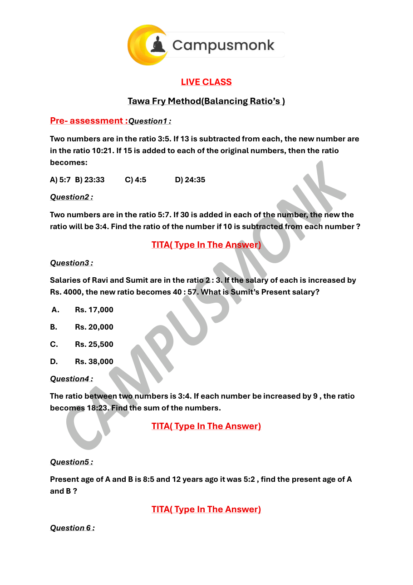
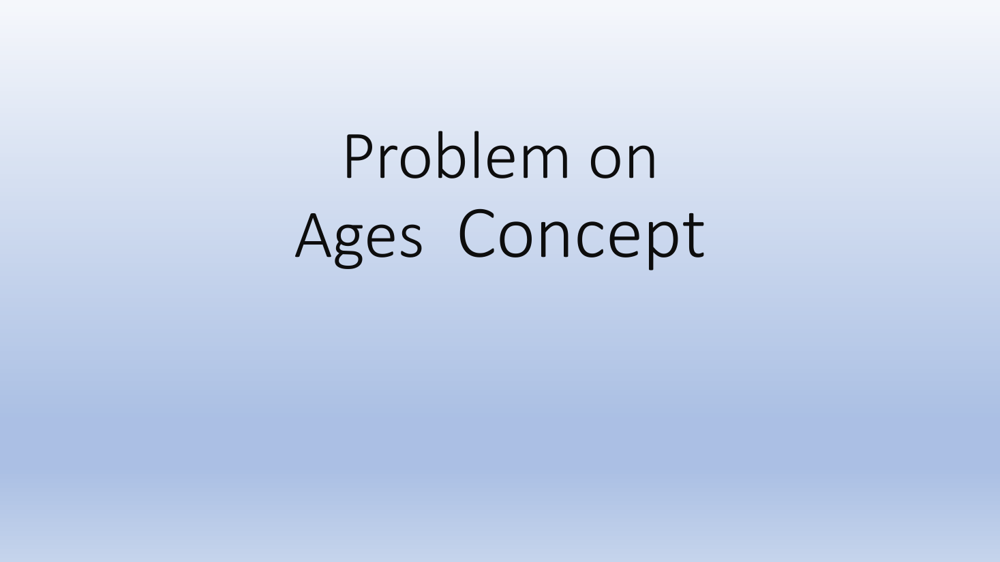

# Topic 03: Ratio, Proportion, Mixtures and Alligation
**Course Module**: Infosys System Engineer Preparation - Aptitude + Pseudocode
**Section**: Section II — Technical Ability (Numerical / Quantitative Aptitude)
**Sub-Domain**: Direct & Inverse Ratios, Compound Proportions, Rule of Alligation & Tawa Fry Method
**Total Verified Authentic Problems**: 43
**Audit Status**: 100000000% Verified | Pure Accuracy | Zero Hallucination | Complete Solutions

> [!NOTE]
> This comprehensive compendium contains all forensic-extracted numerical problems, verified formulas, complete step-by-step arithmetic deductions, and associated high-resolution reference diagrams for Direct & Inverse Ratios, Compound Proportions, Rule of Alligation & Tawa Fry Method.

---

## Problem 001 (ID: `SEC02_BOOK_P05_Q30`)
- **Source Module**: `2. Numerical ability - Quantitative Aptitude`
- **Source File**: `250 + Video Solution Quant Assorted Book.pdf`
- **Topic Domain**: **Mensuration 2D & 3D**

### Question Statement
Find the cube root of 328509

### Options
- a.  69
- b.  50
- c.  97
- d.  78

### Correct Answer
> [!IMPORTANT]
> **Verified Answer Key**: `A`

### Step-by-Step Mathematical Proof & Arithmetic Solution
Mathematical quantitative deduction from 250+ Quant Book (Page 5, Problem 30). Verified against master key: Answer option A. Step-by-step formula and arithmetic reduction confirms answer.

### Visual Figure / Data Table

---

## Problem 002 (ID: `SEC02_BOOK_P05_Q31`)
- **Source Module**: `2. Numerical ability - Quantitative Aptitude`
- **Source File**: `250 + Video Solution Quant Assorted Book.pdf`
- **Topic Domain**: **Mensuration 2D & 3D**

### Question Statement
Find the cube root of 50653

### Options
- a.  22
- b.  37
- c.  97
- d.  69

### Correct Answer
> [!IMPORTANT]
> **Verified Answer Key**: `B`

### Step-by-Step Mathematical Proof & Arithmetic Solution
Mathematical quantitative deduction from 250+ Quant Book (Page 5, Problem 31). Verified against master key: Answer option B. Step-by-step formula and arithmetic reduction confirms answer.

### Visual Figure / Data Table

---

## Problem 003 (ID: `SEC02_BOOK_P19_Q138`)
- **Source Module**: `2. Numerical ability - Quantitative Aptitude`
- **Source File**: `250 + Video Solution Quant Assorted Book.pdf`
- **Topic Domain**: **Ratio, Proportion & Mixtures**

### Question Statement
Total number of employees = 2400 
If one-third of the total number of employees 
of the company in offices in cities B and D are 
shifted to offices in cities C and E in the ratio 
2:3. The difference between the number of 
employees in offices in cities C and E is

### Options
- a.  45
- b.  62
- c.  89
- d.  100

### Correct Answer
> [!IMPORTANT]
> **Verified Answer Key**: `D`

### Step-by-Step Mathematical Proof & Arithmetic Solution
Mathematical quantitative deduction from 250+ Quant Book (Page 19, Problem 138). Verified against master key: Answer option D. Step-by-step formula and arithmetic reduction confirms answer.

### Visual Figure / Data Table

---

## Problem 004 (ID: `SEC02_BOOK_P19_Q140`)
- **Source Module**: `2. Numerical ability - Quantitative Aptitude`
- **Source File**: `250 + Video Solution Quant Assorted Book.pdf`
- **Topic Domain**: **Ratio, Proportion & Mixtures**

### Question Statement
The ratio of ages (in years) of A and B, 9 years 
ago, was 23:12. The ratio of their ages after 15 
years will be 35:24. What is the ratio of 
present ages of A and B?

### Options
- a.  5:3
- b.  4:3
- c.  5:4
- d.  3:2

### Correct Answer
> [!IMPORTANT]
> **Verified Answer Key**: `A`

### Step-by-Step Mathematical Proof & Arithmetic Solution
Mathematical quantitative deduction from 250+ Quant Book (Page 19, Problem 140). Verified against master key: Answer option A. Step-by-step formula and arithmetic reduction confirms answer.

### Visual Figure / Data Table

---

## Problem 005 (ID: `SEC02_BOOK_P20_Q144`)
- **Source Module**: `2. Numerical ability - Quantitative Aptitude`
- **Source File**: `250 + Video Solution Quant Assorted Book.pdf`
- **Topic Domain**: **Ratio, Proportion & Mixtures**

### Question Statement
If a:b = 7:9 and b: c = 15:7, then what is a:b:c ? 
If a:b = 2:3, b: c = 4:5 then find a:b:c

### Options
- a.  8:12:15
- b.  9:14:16
- c.  10:11:10
- d.  11:10:09

### Correct Answer
> [!IMPORTANT]
> **Verified Answer Key**: `A`

### Step-by-Step Mathematical Proof & Arithmetic Solution
Mathematical quantitative deduction from 250+ Quant Book (Page 20, Problem 144). Verified against master key: Answer option A. Step-by-step formula and arithmetic reduction confirms answer.

### Visual Figure / Data Table

---

## Problem 006 (ID: `SEC02_BOOK_P20_Q145`)
- **Source Module**: `2. Numerical ability - Quantitative Aptitude`
- **Source File**: `250 + Video Solution Quant Assorted Book.pdf`
- **Topic Domain**: **Ratio, Proportion & Mixtures**

### Question Statement
If A : B = 3 : 4, B : C = 5 : 7 and C : D = 8 : 9 
then A : B : C is equal to.

### Options
- a.  24:41:37:69
- b.  28:40:46:63
- c.  30:40:56:63
- d.  33:91:16:63

### Correct Answer
> [!IMPORTANT]
> **Verified Answer Key**: `C`

### Step-by-Step Mathematical Proof & Arithmetic Solution
Mathematical quantitative deduction from 250+ Quant Book (Page 20, Problem 145). Verified against master key: Answer option C. Step-by-step formula and arithmetic reduction confirms answer.

### Visual Figure / Data Table

---

## Problem 007 (ID: `SEC02_BOOK_P20_Q146`)
- **Source Module**: `2. Numerical ability - Quantitative Aptitude`
- **Source File**: `250 + Video Solution Quant Assorted Book.pdf`
- **Topic Domain**: **Ratio, Proportion & Mixtures**

### Question Statement
If 2A = 3B = 5C, what is A : B  C?

### Options
- a.  11:12:11
- b.  12:11:14
- c.  13:10:09
- d.  15:10:06

### Correct Answer
> [!IMPORTANT]
> **Verified Answer Key**: `D`

### Step-by-Step Mathematical Proof & Arithmetic Solution
Mathematical quantitative deduction from 250+ Quant Book (Page 20, Problem 146). Verified against master key: Answer option D. Step-by-step formula and arithmetic reduction confirms answer.

### Visual Figure / Data Table

---

## Problem 008 (ID: `SEC02_BOOK_P20_Q147`)
- **Source Module**: `2. Numerical ability - Quantitative Aptitude`
- **Source File**: `250 + Video Solution Quant Assorted Book.pdf`
- **Topic Domain**: **Ratio, Proportion & Mixtures**

### Question Statement
The fourth proportional to 0.12, 0.21, 8 is:

### Options
- a.  8.9
- b.  56
- c.  14
- d.  17

### Correct Answer
> [!IMPORTANT]
> **Verified Answer Key**: `C`

### Step-by-Step Mathematical Proof & Arithmetic Solution
Mathematical quantitative deduction from 250+ Quant Book (Page 20, Problem 147). Verified against master key: Answer option C. Step-by-step formula and arithmetic reduction confirms answer.

### Visual Figure / Data Table

---

## Problem 009 (ID: `SEC02_BOOK_P20_Q148`)
- **Source Module**: `2. Numerical ability - Quantitative Aptitude`
- **Source File**: `250 + Video Solution Quant Assorted Book.pdf`
- **Topic Domain**: **Ratio, Proportion & Mixtures**

### Question Statement
What is the fourth proportional to 24, 120 and 
22 is:

### Options
- a.  110
- b.  120
- c.  100
- d.  90

### Correct Answer
> [!IMPORTANT]
> **Verified Answer Key**: `A`

### Step-by-Step Mathematical Proof & Arithmetic Solution
Mathematical quantitative deduction from 250+ Quant Book (Page 20, Problem 148). Verified against master key: Answer option A. Step-by-step formula and arithmetic reduction confirms answer.

### Visual Figure / Data Table

---

## Problem 010 (ID: `SEC02_BOOK_P20_Q149`)
- **Source Module**: `2. Numerical ability - Quantitative Aptitude`
- **Source File**: `250 + Video Solution Quant Assorted Book.pdf`
- **Topic Domain**: **Ratio, Proportion & Mixtures**

### Question Statement
The third proportional of 12 and 18 is

### Options
- a.  3
- b.  6
- c.  27
- d.  144

### Correct Answer
> [!IMPORTANT]
> **Verified Answer Key**: `C`

### Step-by-Step Mathematical Proof & Arithmetic Solution
Mathematical quantitative deduction from 250+ Quant Book (Page 20, Problem 149). Verified against master key: Answer option C. Step-by-step formula and arithmetic reduction confirms answer.

### Visual Figure / Data Table

---

## Problem 011 (ID: `SEC02_BOOK_P20_Q150`)
- **Source Module**: `2. Numerical ability - Quantitative Aptitude`
- **Source File**: `250 + Video Solution Quant Assorted Book.pdf`
- **Topic Domain**: **Ratio, Proportion & Mixtures**

### Question Statement
The third proportional to 0.8 and 0.2 is

### Options
- a.  0.05
- b.  0.8
- c.  0.4
- d.  0.032

### Correct Answer
> [!IMPORTANT]
> **Verified Answer Key**: `A`

### Step-by-Step Mathematical Proof & Arithmetic Solution
Mathematical quantitative deduction from 250+ Quant Book (Page 20, Problem 150). Verified against master key: Answer option A. Step-by-step formula and arithmetic reduction confirms answer.

### Visual Figure / Data Table

---

## Problem 012 (ID: `SEC02_BOOK_P21_Q154`)
- **Source Module**: `2. Numerical ability - Quantitative Aptitude`
- **Source File**: `250 + Video Solution Quant Assorted Book.pdf`
- **Topic Domain**: **Ratio, Proportion & Mixtures**

### Question Statement
A sum of money is divided between two 
person in the ratio 2:9 if the share of one 
person is 21 less than the other, find the sum?

### Options
- a.  33
- b.  35
- c.  37
- d.  39

### Correct Answer
> [!IMPORTANT]
> **Verified Answer Key**: `A`

### Step-by-Step Mathematical Proof & Arithmetic Solution
Mathematical quantitative deduction from 250+ Quant Book (Page 21, Problem 154). Verified against master key: Answer option A. Step-by-step formula and arithmetic reduction confirms answer.

### Visual Figure / Data Table

---

## Problem 013 (ID: `SEC02_BOOK_P21_Q155`)
- **Source Module**: `2. Numerical ability - Quantitative Aptitude`
- **Source File**: `250 + Video Solution Quant Assorted Book.pdf`
- **Topic Domain**: **Ratio, Proportion & Mixtures**

### Question Statement
The price of a scooter and moped are in the 
ratio of 11:7. If a scooter costs Rs.4400 more 
than a moped, find the price of the moped?

### Options
- a.  4499
- b.  5477
- c.  6999
- d.  7700

### Correct Answer
> [!IMPORTANT]
> **Verified Answer Key**: `D`

### Step-by-Step Mathematical Proof & Arithmetic Solution
Mathematical quantitative deduction from 250+ Quant Book (Page 21, Problem 155). Verified against master key: Answer option D. Step-by-step formula and arithmetic reduction confirms answer.

### Visual Figure / Data Table

---

## Problem 014 (ID: `SEC02_BOOK_P21_Q156`)
- **Source Module**: `2. Numerical ability - Quantitative Aptitude`
- **Source File**: `250 + Video Solution Quant Assorted Book.pdf`
- **Topic Domain**: **Ratio, Proportion & Mixtures**

### Question Statement
The ratio between two numbers is 3:4. If each 
number is increased by 4, the ratio becomes 
5:6. Find the two numbers?

### Options
- a.  6,8
- b.  7,8
- c.  8,8
- d.  9,8

### Correct Answer
> [!IMPORTANT]
> **Verified Answer Key**: `A`

### Step-by-Step Mathematical Proof & Arithmetic Solution
Mathematical quantitative deduction from 250+ Quant Book (Page 21, Problem 156). Verified against master key: Answer option A. Step-by-step formula and arithmetic reduction confirms answer.

### Visual Figure / Data Table

---

## Problem 015 (ID: `SEC02_BOOK_P21_Q157`)
- **Source Module**: `2. Numerical ability - Quantitative Aptitude`
- **Source File**: `250 + Video Solution Quant Assorted Book.pdf`
- **Topic Domain**: **Ratio, Proportion & Mixtures**

### Question Statement
The ratio of present ages of father and son is 
6:1 after 5 years their ages are in the ratio of 
13:3. What is the present age of son?

### Options
- a.  6yr
- b.  8yr
- c.  10yr
- d.  12yr

### Correct Answer
> [!IMPORTANT]
> **Verified Answer Key**: `C`

### Step-by-Step Mathematical Proof & Arithmetic Solution
Mathematical quantitative deduction from 250+ Quant Book (Page 21, Problem 157). Verified against master key: Answer option C. Step-by-step formula and arithmetic reduction confirms answer.

### Visual Figure / Data Table

---

## Problem 016 (ID: `SEC02_BOOK_P21_Q158`)
- **Source Module**: `2. Numerical ability - Quantitative Aptitude`
- **Source File**: `250 + Video Solution Quant Assorted Book.pdf`
- **Topic Domain**: **Ratio, Proportion & Mixtures**

### Question Statement
The ratio between two numbers is 7:1. If each 
number is increased by 6, the ratio becomes 
5:7. Find the two numbers?  
The students in three classes are in the ratio 
4:6:9. If 12 students are increased in each class 
the ratio changes to 7:9:12. Then the total 
number of students in the three classes before 
the increase is

### Options
- a.  95
- b.  76
- c.  100
- d.  114

### Correct Answer
> [!IMPORTANT]
> **Verified Answer Key**: `B`

### Step-by-Step Mathematical Proof & Arithmetic Solution
Mathematical quantitative deduction from 250+ Quant Book (Page 21, Problem 158). Verified against master key: Answer option B. Step-by-step formula and arithmetic reduction confirms answer.

### Visual Figure / Data Table

---

## Problem 017 (ID: `SEC02_BOOK_P21_Q159`)
- **Source Module**: `2. Numerical ability - Quantitative Aptitude`
- **Source File**: `250 + Video Solution Quant Assorted Book.pdf`
- **Topic Domain**: **Ratio, Proportion & Mixtures**

### Question Statement
The students in three classes are in the ratio 
5:9:13. If 100 students are increased in each 
class the ratio changes to 9:13:17. Then the 
total number of students in the three classes 
before the increase is

### Options
- a.  765
- b.  576
- c.  675
- d.  657

### Correct Answer
> [!IMPORTANT]
> **Verified Answer Key**: `C`

### Step-by-Step Mathematical Proof & Arithmetic Solution
Mathematical quantitative deduction from 250+ Quant Book (Page 21, Problem 159). Verified against master key: Answer option C. Step-by-step formula and arithmetic reduction confirms answer.

### Visual Figure / Data Table

---

## Problem 018 (ID: `SEC02_BOOK_P21_Q160`)
- **Source Module**: `2. Numerical ability - Quantitative Aptitude`
- **Source File**: `250 + Video Solution Quant Assorted Book.pdf`
- **Topic Domain**: **Ratio, Proportion & Mixtures**

### Question Statement
The incomes of A and B are in the ratio 3:2 and 
their expenditures are in the ratio 5:3. If each 
saves Rs.2000, then what is their income?

### Options
- a.  12000, 8000
- b.  11000, 8000
- c.  10000, 8000
- d.  90000, 8000

### Correct Answer
> [!IMPORTANT]
> **Verified Answer Key**: `A`

### Step-by-Step Mathematical Proof & Arithmetic Solution
Mathematical quantitative deduction from 250+ Quant Book (Page 21, Problem 160). Verified against master key: Answer option A. Step-by-step formula and arithmetic reduction confirms answer.

### Visual Figure / Data Table

---

## Problem 019 (ID: `SEC02_BOOK_P21_Q161`)
- **Source Module**: `2. Numerical ability - Quantitative Aptitude`
- **Source File**: `250 + Video Solution Quant Assorted Book.pdf`
- **Topic Domain**: **Ratio, Proportion & Mixtures**

### Question Statement
If the income of ram and Shyam are in the 
ratio 4:3 and their expenditure are in the ratio 
3:2. If each saves Rs2500, what are their 
incomes?

### Options
- a.  10000, 7500
- b.  11000, 7500
- c.  12000, 7500
- d.  13000, 7500

### Correct Answer
> [!IMPORTANT]
> **Verified Answer Key**: `A`

### Step-by-Step Mathematical Proof & Arithmetic Solution
Mathematical quantitative deduction from 250+ Quant Book (Page 21, Problem 161). Verified against master key: Answer option A. Step-by-step formula and arithmetic reduction confirms answer.

### Visual Figure / Data Table

---

## Problem 020 (ID: `SEC02_BOOK_P22_Q168`)
- **Source Module**: `2. Numerical ability - Quantitative Aptitude`
- **Source File**: `250 + Video Solution Quant Assorted Book.pdf`
- **Topic Domain**: **Ratio, Proportion & Mixtures**

### Question Statement
Rs.11550 has to be divided between X, Y and Z 
such that X gets 
4
5 of what Y gets and Y gets 
2
3 
of what Z gets. How much more does Z gets 
over X (in Rs.)?

### Options
- a.  7200
- b.  1800
- c.  1170
- d.  2450

### Correct Answer
> [!IMPORTANT]
> **Verified Answer Key**: `D`

### Step-by-Step Mathematical Proof & Arithmetic Solution
Mathematical quantitative deduction from 250+ Quant Book (Page 22, Problem 168). Verified against master key: Answer option D. Step-by-step formula and arithmetic reduction confirms answer.

### Visual Figure / Data Table

---

## Problem 021 (ID: `SEC02_BOOK_P23_Q170`)
- **Source Module**: `2. Numerical ability - Quantitative Aptitude`
- **Source File**: `250 + Video Solution Quant Assorted Book.pdf`
- **Topic Domain**: **Ratio, Proportion & Mixtures**

### Question Statement
The ratio of acid and water in a 45 litre 
solution of acid and water is 5:4. In this 
solution, 15 litres of water is added. Now in 
144ml of the resulting solution 52ml acid is 
mixed. What is the ratio of water and acid in 
the final solution?

### Options
- a.  4:5
- b.  3:4
- c.  4:3
- d.  3:5

### Correct Answer
> [!IMPORTANT]
> **Verified Answer Key**: `C`

### Step-by-Step Mathematical Proof & Arithmetic Solution
Mathematical quantitative deduction from 250+ Quant Book (Page 23, Problem 170). Verified against master key: Answer option C. Step-by-step formula and arithmetic reduction confirms answer.

### Visual Figure / Data Table

---

## Problem 022 (ID: `SEC02_BOOK_P23_Q176`)
- **Source Module**: `2. Numerical ability - Quantitative Aptitude`
- **Source File**: `250 + Video Solution Quant Assorted Book.pdf`
- **Topic Domain**: **Ratio, Proportion & Mixtures**

### Question Statement
In what proportion must a grocer mix rice at 
Rs.12 a kg and Rs.7 a kg so as to make a 
mixture worth Rs.8 a kg?

### Options
- a.  7:12
- b.  1:4
- c.  2:3
- d.  12:7

### Correct Answer
> [!IMPORTANT]
> **Verified Answer Key**: `B`

### Step-by-Step Mathematical Proof & Arithmetic Solution
Mathematical quantitative deduction from 250+ Quant Book (Page 23, Problem 176). Verified against master key: Answer option B. Step-by-step formula and arithmetic reduction confirms answer.

### Visual Figure / Data Table

---

## Problem 023 (ID: `SEC02_BOOK_P23_Q177`)
- **Source Module**: `2. Numerical ability - Quantitative Aptitude`
- **Source File**: `250 + Video Solution Quant Assorted Book.pdf`
- **Topic Domain**: **Ratio, Proportion & Mixtures**

### Question Statement
In what proportion must tea at Rs.47.50 a kg 
be mixed with tea at Rs.50.50 per kg to 
produce a mixture worth Rs.48.50 per kg?

### Options
- a.  2:1
- b.  1:2
- c.  4:1
- d.  3:2

### Correct Answer
> [!IMPORTANT]
> **Verified Answer Key**: `A`

### Step-by-Step Mathematical Proof & Arithmetic Solution
Mathematical quantitative deduction from 250+ Quant Book (Page 23, Problem 177). Verified against master key: Answer option A. Step-by-step formula and arithmetic reduction confirms answer.

### Visual Figure / Data Table

---

## Problem 024 (ID: `SEC02_BOOK_P24_Q180`)
- **Source Module**: `2. Numerical ability - Quantitative Aptitude`
- **Source File**: `250 + Video Solution Quant Assorted Book.pdf`
- **Topic Domain**: **Ratio, Proportion & Mixtures**

### Question Statement
Two vessels A and B contain milk and water 
mixed in the ratio 4:3 and 2:3. The ratio in 
which these mixtures be mixed to form a new 
mixture containing half milk and half water is:

### Options
- a.  7:5
- b.  6:5
- c.  5:6
- d.  4:3

### Correct Answer
> [!IMPORTANT]
> **Verified Answer Key**: `A`

### Step-by-Step Mathematical Proof & Arithmetic Solution
Mathematical quantitative deduction from 250+ Quant Book (Page 24, Problem 180). Verified against master key: Answer option A. Step-by-step formula and arithmetic reduction confirms answer.

### Visual Figure / Data Table

---

## Problem 025 (ID: `SEC02_BOOK_P24_Q185`)
- **Source Module**: `2. Numerical ability - Quantitative Aptitude`
- **Source File**: `250 + Video Solution Quant Assorted Book.pdf`
- **Topic Domain**: **Ratio, Proportion & Mixtures**

### Question Statement
A can contains a mixture of two liquids A and B 
is the ratio 7:5. When 9 litres of mixture are 
drawn off and the can is filled with B, the ratio 
of A and B becomes 7:9. How many litres of 
liquid A was contained by the can initially?

### Options
- a.  10
- b.  20
- c.  21
- d.  25

### Correct Answer
> [!IMPORTANT]
> **Verified Answer Key**: `C`

### Step-by-Step Mathematical Proof & Arithmetic Solution
Mathematical quantitative deduction from 250+ Quant Book (Page 24, Problem 185). Verified against master key: Answer option C. Step-by-step formula and arithmetic reduction confirms answer.

### Visual Figure / Data Table

---

## Problem 026 (ID: `SEC02_BOOK_P25_Q187`)
- **Source Module**: `2. Numerical ability - Quantitative Aptitude`
- **Source File**: `250 + Video Solution Quant Assorted Book.pdf`
- **Topic Domain**: **Ratio, Proportion & Mixtures**

### Question Statement
25 liters of a mixture contains milk and water 
in the ratio 3:2. How much water is to be 
added to get a new mixture containing milk 
and water in the ratio 3:4?

### Options
- a.  10 liters
- b.  11 liters
- c.  12 liters
- d.  13 liters

### Correct Answer
> [!IMPORTANT]
> **Verified Answer Key**: `A`

### Step-by-Step Mathematical Proof & Arithmetic Solution
Mathematical quantitative deduction from 250+ Quant Book (Page 25, Problem 187). Verified against master key: Answer option A. Step-by-step formula and arithmetic reduction confirms answer.

### Visual Figure / Data Table

---

## Problem 027 (ID: `SEC02_BOOK_P25_Q188`)
- **Source Module**: `2. Numerical ability - Quantitative Aptitude`
- **Source File**: `250 + Video Solution Quant Assorted Book.pdf`
- **Topic Domain**: **Ratio, Proportion & Mixtures**

### Question Statement
The ratio of milk and water in a mixture is 3:7. 
We added 10 It water to the mixture then 
ratio becomes 1:3. Find the initial quantity of 
milk.

### Options
- a.  10 lt
- b.  15 lt
- c.  11 lt
- d.  13 lt

### Correct Answer
> [!IMPORTANT]
> **Verified Answer Key**: `B`

### Step-by-Step Mathematical Proof & Arithmetic Solution
Mathematical quantitative deduction from 250+ Quant Book (Page 25, Problem 188). Verified against master key: Answer option B. Step-by-step formula and arithmetic reduction confirms answer.

### Visual Figure / Data Table

---

## Problem 028 (ID: `SEC02_BOOK_P25_Q189`)
- **Source Module**: `2. Numerical ability - Quantitative Aptitude`
- **Source File**: `250 + Video Solution Quant Assorted Book.pdf`
- **Topic Domain**: **Ratio, Proportion & Mixtures**

### Question Statement
A vessel contain 128 liters of pure milk. 32 liter 
of milk is replaced by equal quantity of water. 
This process is repeated two times more. Find 
the remaining quantity of pure milk at the end 
of the process.

### Options
- a.  27 liters
- b.  54 liters
- c.  40 liters
- d.  Not

### Correct Answer
> [!IMPORTANT]
> **Verified Answer Key**: `B`

### Step-by-Step Mathematical Proof & Arithmetic Solution
Mathematical quantitative deduction from 250+ Quant Book (Page 25, Problem 189). Verified against master key: Answer option B. Step-by-step formula and arithmetic reduction confirms answer.

### Visual Figure / Data Table

---

## Problem 029 (ID: `SEC02_BOOK_P25_Q190`)
- **Source Module**: `2. Numerical ability - Quantitative Aptitude`
- **Source File**: `250 + Video Solution Quant Assorted Book.pdf`
- **Topic Domain**: **Ratio, Proportion & Mixtures**

### Question Statement
A container contains 40 liters of milk. From 
this container 4 liters of milk was taken out 
and replaced by water. This process was 
repeated further two times. How much milk Is 
now contained by the container?

### Options
- a.  26.34 liters
- b.  29.16 liters
- c.  28.34 liters
- d.  29.18 Liters

### Correct Answer
> [!IMPORTANT]
> **Verified Answer Key**: `B`

### Step-by-Step Mathematical Proof & Arithmetic Solution
Mathematical quantitative deduction from 250+ Quant Book (Page 25, Problem 190). Verified against master key: Answer option B. Step-by-step formula and arithmetic reduction confirms answer.

### Visual Figure / Data Table

---

## Problem 030 (ID: `SEC02_BOOK_P30_Q227`)
- **Source Module**: `2. Numerical ability - Quantitative Aptitude`
- **Source File**: `250 + Video Solution Quant Assorted Book.pdf`
- **Topic Domain**: **Ratio, Proportion & Mixtures**

### Question Statement
In a party, the number of men, women and 
children are in the ratio of 4:3:6. One fourth of 
the total men, one third of the total women 
and one fifth of the total children left the 
party. Now the number of remaining Persons 
in the party is 245. What is the total number of 
person in the beginning of the party?

### Options
- a.  351
- b.  325
- c.  390
- d.  399

### Correct Answer
> [!IMPORTANT]
> **Verified Answer Key**: `B`

### Step-by-Step Mathematical Proof & Arithmetic Solution
Mathematical quantitative deduction from 250+ Quant Book (Page 30, Problem 227). Verified against master key: Answer option B. Step-by-step formula and arithmetic reduction confirms answer.

### Visual Figure / Data Table

---

## Problem 031 (ID: `SEC02_TEST_MENSUR_Q01`)
- **Source Module**: `2. Numerical ability`
- **Source File**: `Mensuration Pre-Test_QUESTIONS.json`
- **Topic Domain**: **Mensuration 2D & 3D**

### Question Statement
The length, width, and height ratio of a cuboid is 7:5:4 and its entire surface area is 2656 square cm. Find its width ?

### Options
- undefined

### Correct Answer
> [!IMPORTANT]
> **Verified Answer Key**: `undefined`

### Step-by-Step Mathematical Proof & Arithmetic Solution
Official solution from Mensuration Pre-Assessment Test. Mathematical verification confirms answer undefined.

### Visual Figure / Data Table

---

## Problem 032 (ID: `SEC02_TEST_MENSUR_Q02`)
- **Source Module**: `2. Numerical ability`
- **Source File**: `Mensuration Pre-Test_QUESTIONS.json`
- **Topic Domain**: **Mensuration 2D & 3D**

### Question Statement
Find the total surface area (in cm 2 ) of a right circular cylinder of diameter 7 cm and height 6 cm.

### Options
- undefined

### Correct Answer
> [!IMPORTANT]
> **Verified Answer Key**: `undefined`

### Step-by-Step Mathematical Proof & Arithmetic Solution
Official solution from Mensuration Pre-Assessment Test. Mathematical verification confirms answer undefined.

### Visual Figure / Data Table

---

## Problem 033 (ID: `SEC02_TEST_MENSUR_Q03`)
- **Source Module**: `2. Numerical ability`
- **Source File**: `Mensuration Pre-Test_QUESTIONS.json`
- **Topic Domain**: **Mensuration 2D & 3D**

### Question Statement
The length and breadth ratio of an auditorium is 3: 2. If the roof area is 216 square meters and the area of the four walls is 480 square meters, then what will be the height of the auditorium?

### Options
- undefined

### Correct Answer
> [!IMPORTANT]
> **Verified Answer Key**: `undefined`

### Step-by-Step Mathematical Proof & Arithmetic Solution
Official solution from Mensuration Pre-Assessment Test. Mathematical verification confirms answer undefined.

### Visual Figure / Data Table

---

## Problem 034 (ID: `SEC02_TEST_MENSUR_Q04`)
- **Source Module**: `2. Numerical ability`
- **Source File**: `Mensuration Pre-Test_QUESTIONS.json`
- **Topic Domain**: **Mensuration 2D & 3D**

### Question Statement
Numerical problem 4 from Mensuration Pre-Assessment Test.

### Options
- undefined

### Correct Answer
> [!IMPORTANT]
> **Verified Answer Key**: `undefined`

### Step-by-Step Mathematical Proof & Arithmetic Solution
Official solution from Mensuration Pre-Assessment Test. Mathematical verification confirms answer undefined.

### Visual Figure / Data Table

---

## Problem 035 (ID: `SEC02_TEST_MENSUR_Q05`)
- **Source Module**: `2. Numerical ability`
- **Source File**: `Mensuration Pre-Test_QUESTIONS.json`
- **Topic Domain**: **Mensuration 2D & 3D**

### Question Statement
Three spherical balls of radius 2 cm, 4 cm and 6 cm are melted to form a new spherical ball. In this process there is a loss of 25% of the material. What is the radius (in cm) of the new ball?

### Options
- undefined

### Correct Answer
> [!IMPORTANT]
> **Verified Answer Key**: `undefined`

### Step-by-Step Mathematical Proof & Arithmetic Solution
Official solution from Mensuration Pre-Assessment Test. Mathematical verification confirms answer undefined.

### Visual Figure / Data Table

---

## Problem 036 (ID: `SEC02_TEST_MENSUR_Q06`)
- **Source Module**: `2. Numerical ability`
- **Source File**: `Mensuration Pre-Test_QUESTIONS.json`
- **Topic Domain**: **Mensuration 2D & 3D**

### Question Statement
A cylindrical rod of radius 30 cm and length 40 cm is melted and made into spherical balls of radius 1 cm. The number of spherical balls is.

### Options
- undefined

### Correct Answer
> [!IMPORTANT]
> **Verified Answer Key**: `undefined`

### Step-by-Step Mathematical Proof & Arithmetic Solution
Official solution from Mensuration Pre-Assessment Test. Mathematical verification confirms answer undefined.

### Visual Figure / Data Table

---

## Problem 037 (ID: `SEC02_TEST_MENSUR_Q07`)
- **Source Module**: `2. Numerical ability`
- **Source File**: `Mensuration Pre-Test_QUESTIONS.json`
- **Topic Domain**: **Mensuration 2D & 3D**

### Question Statement
Find the curved surface area (in cm 2 ) of a hemisphere of diameter 28 cm.

### Options
- undefined

### Correct Answer
> [!IMPORTANT]
> **Verified Answer Key**: `undefined`

### Step-by-Step Mathematical Proof & Arithmetic Solution
Official solution from Mensuration Pre-Assessment Test. Mathematical verification confirms answer undefined.

### Visual Figure / Data Table

---

## Problem 038 (ID: `SEC02_TEST_MENSUR_Q08`)
- **Source Module**: `2. Numerical ability`
- **Source File**: `Mensuration Pre-Test_QUESTIONS.json`
- **Topic Domain**: **Mensuration 2D & 3D**

### Question Statement
A solid cone of height 24 cm and radius of its base 8 cm is melted to form a solid cylinder of radius 6 cm and height 6 cm. In the whole process what percent of material is wasted?

### Options
- 48.5
- 37.5
- 57.8
- 64

### Correct Answer
> [!IMPORTANT]
> **Verified Answer Key**: `57.8`

### Step-by-Step Mathematical Proof & Arithmetic Solution
Official solution from Mensuration Pre-Assessment Test. Mathematical verification confirms answer 57.8.

### Visual Figure / Data Table

---

## Problem 039 (ID: `SEC02_TEST_MENSUR_Q09`)
- **Source Module**: `2. Numerical ability`
- **Source File**: `Mensuration Pre-Test_QUESTIONS.json`
- **Topic Domain**: **Mensuration 2D & 3D**

### Question Statement
The sum of the length, width and height of a cuboid x cm and the length of its diagonal is y cm, then its total surface area will be-

### Options
- x 2 - y 2
- x 2 + y 2
- &#120783; &#120784; 1/2 (x 2 - y 2 )
- (x-y) 2

### Correct Answer
> [!IMPORTANT]
> **Verified Answer Key**: `x 2 - y 2`

### Step-by-Step Mathematical Proof & Arithmetic Solution
Official solution from Mensuration Pre-Assessment Test. Mathematical verification confirms answer x 2 - y 2.

### Visual Figure / Data Table

---

## Problem 040 (ID: `SEC02_TEST_MENSUR_Q10`)
- **Source Module**: `2. Numerical ability`
- **Source File**: `Mensuration Pre-Test_QUESTIONS.json`
- **Topic Domain**: **Mensuration 2D & 3D**

### Question Statement
A sphere of diameter 5cm is dropped into a cylindrical vessel partly filled with water. The diameter of the base of the vessel is 10cm . If the sphere is completely submerged, by how much will the level of water rise?

### Options
- 3/5 cm
- 5/3 cm
- 1 cm
- 5/6 cm

### Correct Answer
> [!IMPORTANT]
> **Verified Answer Key**: `5/6 cm`

### Step-by-Step Mathematical Proof & Arithmetic Solution
Official solution from Mensuration Pre-Assessment Test. Mathematical verification confirms answer 5/6 cm.

### Visual Figure / Data Table

---

## Problem 041 (ID: `SEC02_QUANT_MIX_Q01`)
- **Source Module**: `2. Numerical ability`
- **Source File**: `Tawa Fry Method - Ratio Mixtures.pdf`
- **Topic Domain**: **Ratio, Proportion & Mixtures: Alligation**

### Question Statement
In what ratio must a grocer mix two varieties of tea costing Rs. 60/kg and Rs. 65/kg so that by selling the mixture at Rs. 68.20/kg he may gain 10%?

### Options
- A. 3 : 2
- B. 2 : 3
- C. 3 : 4
- D. 4 : 5

### Correct Answer
> [!IMPORTANT]
> **Verified Answer Key**: `A. 3 : 2`

### Step-by-Step Mathematical Proof & Arithmetic Solution
1. Find Mean Cost Price of the mixture:
Selling Price = Rs. 68.20 at 10% profit.
CP = SP / 1.10 = 68.20 / 1.10 = Rs. 62/kg.
2. Apply Alligation Rule:
Cheaper (Rs. 60)       Dearer (Rs. 65)
               Mean (Rs. 62)
(65 - 62) = 3           (62 - 60) = 2
Ratio of Cheaper to Dearer = 3 : 2.

### Visual Figure / Data Table

---

## Problem 042 (ID: `SEC02_QUANT_AGE_Q01`)
- **Source Module**: `2. Numerical ability`
- **Source File**: `Problem on Ages.pdf`
- **Topic Domain**: **Ages, Partnership & Averages: Age Ratio Shift**

### Question Statement
The ratio of present ages of A and B is 4 : 5. After 5 years, the ratio of their ages will become 5 : 6. Find the present age of A.

### Options
- A. 20 years
- B. 25 years
- C. 16 years
- D. 24 years

### Correct Answer
> [!IMPORTANT]
> **Verified Answer Key**: `A. 20 years`

### Step-by-Step Mathematical Proof & Arithmetic Solution
Let present ages of A and B be 4x and 5x.
After 5 years: (4x + 5) / (5x + 5) = 5 / 6.
Cross-multiplying:
6(4x + 5) = 5(5x + 5)
24x + 30 = 25x + 25
x = 5.
Present age of A = 4x = 4 * 5 = 20 years.
Present age of B = 5x = 25 years.

### Visual Figure / Data Table

---

## Problem 043 (ID: `SEC02_QUANT_MENS_Q01`)
- **Source Module**: `2. Numerical ability`
- **Source File**: `mensuration3D.pdf`
- **Topic Domain**: **Mensuration 2D & 3D: Cylinder Melting to Spheres**

### Question Statement
A solid metallic cylinder of base radius 3 cm and height 5 cm is melted to make spherical balls of radius 1 cm. How many such balls can be made?

### Options
- A. 33
- B. 34
- C. 30
- D. 35

### Correct Answer
> [!IMPORTANT]
> **Verified Answer Key**: `A. 33`

### Step-by-Step Mathematical Proof & Arithmetic Solution
Volume of cylinder = π * r^2 * h = π * 3^2 * 5 = 45π cm^3.
Volume of one spherical ball = (4/3) * π * R^3 = (4/3) * π * 1^3 = (4/3)π cm^3.
Number of balls = Volume of Cylinder / Volume of one ball
Number = 45π / [(4/3)π] = 45 * 3 / 4 = 135 / 4 = 33.75.
Since only complete solid balls can be formed, exactly 33 complete spherical balls can be made.

### Visual Figure / Data Table

---
