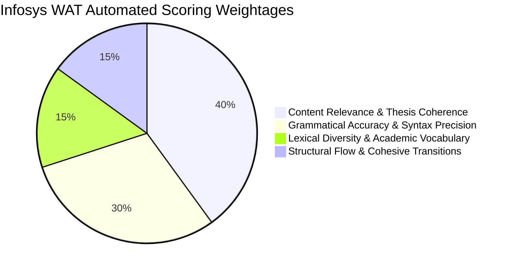
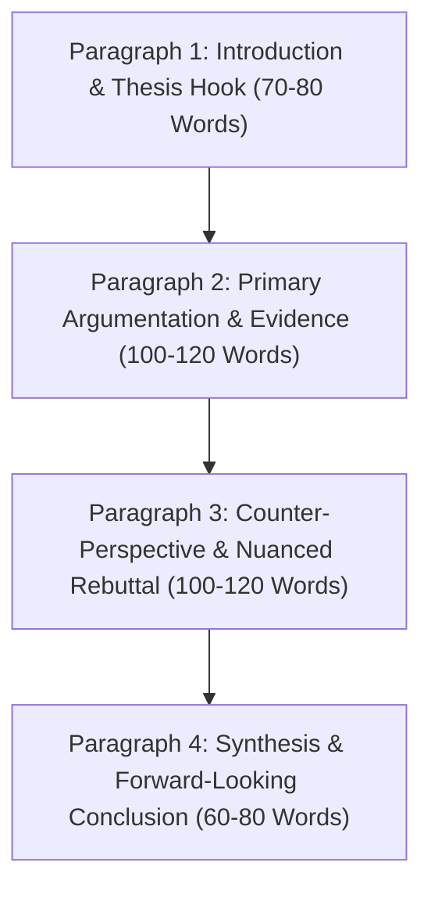

# 01 Infosys Written Ability Test (WAT) Guidelines & Scoring Rubric
**Examination**: Infosys System Engineer (SE) & Specialist Programmer (SP/DSE)  
**Section**: Section 6 Written Ability Test (Descriptive English)  
**Format**: 1 Descriptive Essay / Email Prompt | Time Limit: 30 Minutes | Target Word Count: 300 - 400 Words  
**Evaluation Standard**: Automated Natural Language Processing (NLP) Scoring Engine + Human Expert Audit  

---

## 1. Official Examination Specifications & Structural Constraints
In the Infosys recruitment process, the Written Ability Test assesses an engineer's capability to express complex logical arguments, structural thoughts, and technical implications in clear, grammatically flawless, and professionally structured English.

### Examination Parameters
| Evaluation Metric | Official Specification | Strategic Target |
| :--- | :--- | :--- |
| **Duration** | 30 Minutes | Complete drafting in 22 mins, proofread in 8 mins |
| **Word Count Minimum** | 250 Words | Fatal penalty if word count < 250 words |
| **Word Count Optimal** | 300 - 400 Words | Optimal score band (9.0 - 9.8 / 10.0) |
| **Word Count Maximum** | 450 Words | Automated penalty if word count > 500 words |
| **Input Interface** | Plain Text Terminal Box | Spell-check, grammar-check, and copy-paste are disabled |

---

## 2. The 4-Dimension NLP Scoring Rubric
Infosys employs an automated NLP-based assessment tool calibrated across four distinct analytical criteria:

### 1. Content Relevance & Thesis Coherence (40%)
- **Prompt Adherence**: Direct engagement with the core thematic prompt without digressing into tangential topics.
- **Thesis Statement**: A clearly articulated perspective stated in the opening paragraph that governs the entire essay.
- **Depth of Reasoning**: Use of empirical examples, socio-economic evidence, technological case studies, and logical counter-perspectives.

### 2. Grammatical Accuracy & Syntactic Precision (30%)
- **Zero Tolerance for Fundamental Errors**: Subject-verb agreement violations, run-on sentences, comma splices, and sentence fragments incur severe mathematical penalties.
- **Syntactic Variety**: Interweaving simple, compound, and complex sentences with appropriate subordinating conjunctions (*whereas, while, although, provided that*).
- **Punctuation & Mechanics**: Correct deployment of semicolons, colons, hyphens, and apostrophes.

### 3. Lexical Diversity & Vocabulary Range (15%)
- **Avoidance of Repetitive Monotony**: Utilizing contextual synonyms rather than repeating basic words (*e.g., 'augment, cultivate, bolster' instead of repeatedly using 'increase'*).
- **Domain-Appropriate Terminology**: Accurate application of socio-technological and economic diction (*e.g., paradigm shift, ethical ramifications, algorithmic bias, socioeconomic disparity*).
- **Spelling Precision**: Automated spell-check flags even single-character typographical errors.

### 4. Structural Flow & Cohesive Transitions (15%)
- **Logical Paragraphing**: A strict, uncompromised 4-paragraph architecture.
- **Discourse Connectors**: Seamless transitional signposts connecting paragraph to paragraph and sentence to sentence.

---

## 3. The 4-Paragraph Golden Architecture

### Paragraph 1: The Introductory Blueprint (70 - 80 Words)
1. **The Universal Hook (Sentence 1)**: Introduce the broader context of the topic without clichéd openings (*Avoid: "Since the dawn of mankind..."*).
2. **Contextual Expansion (Sentence 2)**: Frame the contemporary relevance or societal tension inherent in the prompt.
3. **The Unambiguous Thesis Statement (Sentence 3-4)**: Explicitly declare your position, providing a two-pronged preview of the core arguments to be elaborated.

### Paragraph 2: Primary Argumentation & Empirical Proof (100 - 120 Words)
1. **Topic Sentence**: Clearly announce the primary pillar supporting your thesis.
2. **Elaboration & Causal Mechanism**: Explain *how* and *why* this phenomenon occurs.
3. **Concrete Exemplification**: Cite a real-world technological, economic, or historical precedent (*e.g., automated manufacturing, cloud infrastructure, public health initiatives*).
4. **Concluding Synthesis**: Reconnect the empirical evidence back to the thesis.

### Paragraph 3: Counter-Perspective, Nuance & Rebuttal (100 - 120 Words)
1. **Acknowledgement of Counter-Argument**: Introduce the valid concerns, ethical dilemmas, or challenges raised by critics (*"Critics legitimately contend that..."*).
2. **Analytical Evaluation**: Objective appraisal of why this counter-perspective exists.
3. **Decisive Rebuttal / Mitigation Strategy**: Demonstrate how proactive regulation, technological safeguards, or balanced governance resolve these concerns.

### Paragraph 4: Synthesis & Strategic Horizon (60 - 80 Words)
1. **Restatement of Thesis (New Diction)**: Reassert your fundamental stance using fresh, elevated vocabulary.
2. **Synthesizing Summary**: Harmonize the affirmative arguments and mitigated challenges into a unified insight.
3. **Actionable Forward-Looking Call to Action / Climax**: Conclude with a visionary, memorable statement on the future trajectory of the issue.

---

## 4. Master Transition & Discourse Signposting Bank
To maximize the Coherence & Cohesion score, deploy the following curated transitions:

| Structural Purpose | High-Impact Academic Connectors |
| :--- | :--- |
| **Introducing Contrast** | *Conversely, Nonetheless, On the contrary, Notwithstanding, In stark contrast to* |
| **Adding Reinforcement** | *Furthermore, Moreover, In tandem with, In addition to, Substantively* |
| **Establishing Causality** | *Consequently, Hence, Inevitably, Precipitated by, As a corollary* |
| **Providing Exemplification** | *To substantiate this premise, A salient illustration is, As evidenced by* |
| **Synthesizing & Concluding** | *In summation, Ultimately, Taking an integrative perspective, It is manifest that* |

---

## 5. Critical Antipatterns & Fatal Pitfalls to Avoid
- **Never Use Bullet Points or Numbered Lists**: Infosys WAT evaluates continuous, discursive prose. Bullet points trigger an immediate structural disqualification.
- **Never Use Slang or Colloquialisms**: Phrases such as *"gonna", "wanna", "kids", "lots of", "stuff"* degrade the lexical score.
- **Never Write a Single Monolithic Paragraph**: Unbroken blocks of text indicate poor structural organization.
- **Never Memorize and Force Unrelated Templates**: Ensure the essay directly and explicitly addresses the specific nuance of the assigned prompt.
