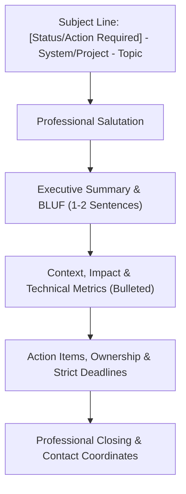

# 03 Corporate Email Writing Simulations & Professional Templates
**Examination / Role Track**: Infosys System Engineer (SE) & Specialist Programmer (SP/DSE)  
**Domain**: Written Descriptive Communication & Corporate Readiness  
**Target Scenarios**: High-Frequency Engineering & Enterprise Scenarios  
**Standard**: 100% Comprehensive | Real-World Workplace Contexts | Professional Etiquette | Zero Placeholders  

---

## 1. Professional Email Architecture for Software Engineers
At Infosys, clear, concise, and context-aware email communication is an indispensable core competency. Whether escalating a mission-critical production issue, negotiating sprint deliverables with product managers, or updating enterprise clients, your emails must exhibit:
1. **Subject Line Precision**: Clear, scannable, and actionable within 60 characters.
2. **Professional Salutation**: Context-appropriate greeting (*Dear Mr. Davis, Hi Team, Dear Steering Committee*).
3. **The BLUF Principle (Bottom Line Up Front)**: Stating the core objective or decision in the opening sentence.
4. **Actionable Bullet Points**: Breaking technical details, blockers, or next steps into concise bullets rather than dense prose blocks.
5. **Clear Call-to-Action (CTA) & Ownership**: Specifying exactly *who* owns *what* action by *when*.
6. **Professional Sign-off**: Courteous closing with full corporate designation.

---

## 2. Master Corporate Email Writing Simulations

### Simulation 01: Critical Production Incident Escalation & Immediate Mitigation
- **Workplace Scenario**: The primary payment gateway microservice in the production environment is experiencing 504 Gateway Timeouts, impacting 35% of user checkout transactions during peak business hours.
- **Target Audience**: Vice President of Engineering, Delivery Manager, and On-Call DevOps Squad.

#### Email Draft
**Subject**: `[CRITICAL ESCALATION] - Payment Gateway 504 Timeouts in Production - P0 Incident`

Dear Engineering Leadership Team,

I am writing to apprise you of an ongoing P0 production incident affecting our payment gateway microservices. As of 14:15 IST today, our monitoring telemetry detected a sharp surge in HTTP 504 Gateway Timeouts, resulting in transaction failures for approximately 35% of concurrent checkout sessions.

**Immediate Impact Assessment:**
- **Affected Endpoints**: `/api/v2/checkout/process` and `/api/v2/payment/verify`.
- **Root Cause (Preliminary)**: Connection pool exhaustion on the primary relational database cluster following an abrupt 4x spike in read-write locks.
- **Current Severity**: High (Direct revenue and user experience impact).

**Mitigation Measures Underway:**
1. **Traffic Throttling**: Rate-limiting non-critical API requests via Cloudflare edge rules to relieve pressure on the connection pool.
2. **Read Replica Promotion**: Diverting all idempotent read traffic to secondary read replicas.
3. **Rollback Contingency**: The release squad has prepped a rollback to stable commit `f4b7a12` if latency metrics do not normalize within the next 15 minutes.

We have established a dedicated incident war room on Microsoft Teams (Bridge ID: #incident-war-room-payment). A follow-up Root Cause Analysis (RCA) and status briefing will be circulated at 15:30 IST.

Sincerely,  
**Rohan Sharma**  
Systems Engineer — Cloud Infrastructure & Reliability  
Infosys Enterprise Delivery Center, Bengaluru  

---

### Simulation 02: Sprint Deadline Renegotiation & Scope Adjustment
- **Workplace Scenario**: Unanticipated third-party API deprecation has introduced a major blocker in the sprint backlog. You must request a 3-day timeline extension or scope deselect from the Product Owner.
- **Target Audience**: Lead Product Manager & Scrum Master.

#### Email Draft
**Subject**: `Sprint 42 Scope Realignment Request: Payment Integration Dependency`

Dear Ananya,

I hope this email finds you well.

I am writing to formally propose a scope adjustment for Sprint 42 regarding User Story `#INF-8492: External KYC Verification Integration`. 

During our integration testing yesterday, the third-party compliance vendor notified us of an unscheduled deprecation of their v1 authentication protocols, requiring our squad to refactor our OAuth2 handshakes against their newer v2 endpoints.

To ensure strict compliance and comprehensive automated test coverage, we evaluated two tactical alternatives:
- **Option A (Recommended)**: Retain the full KYC scope and extend the sprint delivery milestone by 3 business days, shifting target deployment from Thursday, Oct 22 to Tuesday, Oct 27.
- **Option B**: Deliver the core user profile modules on the original Thursday deadline while decoupling the KYC verification feature into Sprint 43.

Given that regulatory compliance is paramount, our engineering squad strongly advocates for Option A. Please let us know your preferred trajectory by 17:00 IST today so we can realign our sprint burn-down metrics accordingly.

Warm regards,  
**Priya Venkatesh**  
Systems Engineer — Agile Core Squad  
Infosys Digital Delivery Unit  

---

### Simulation 03: Milestone Completion & Client Delivery Sign-Off
- **Workplace Scenario**: Successful completion of User Acceptance Testing (UAT) for Phase 1 of a retail analytics dashboard for a global Fortune 500 client.
- **Target Audience**: Client Technical Director and External Project Steering Committee.

#### Email Draft
**Subject**: `Milestone Update: Phase 1 Retail Analytics Platform - UAT Sign-Off Complete`

Dear Mr. Henderson and Steering Committee Members,

We are delighted to announce that Phase 1 of the Enterprise Retail Analytics Platform has successfully concluded User Acceptance Testing (UAT) with zero open critical or high-severity defects.

**Key Milestone Achievements:**
- **Performance Benchmarks**: Successfully sustained 15,000 requests/sec with p99 response times below 180 milliseconds, surpassing the contractual target of 250 milliseconds.
- **Data Pipeline Verification**: Ingested and processed historical transactional datasets spanning 12 million records across 4 global regional nodes.
- **Security Audit**: Cleared external penetration testing and SAIF security compliance checks with full sign-off.

We have attached the formal UAT Acceptance Certificate and the Final Deliverables Matrix for your executive review. Kindly review and append your digital signature by Friday, October 24, to enable our seamless transition into Phase 2 deployment.

Thank you for your sustained partnership and invaluable collaboration.

Best regards,  
**Vikram Malhotra**  
Technical Lead & Delivery Consultant  
Infosys Americas Delivery Practice  

---

### Simulation 04: Resolving Inter-Team Architectural Dependency Blockers
- **Workplace Scenario**: Your squad's feature release is blocked because the Data Engineering team has not published the promised Kafka event schema.
- **Target Audience**: Data Engineering Lead and Project Manager.

#### Email Draft
**Subject**: `Blocker: Awaiting Schema Registry Definition for Kafka Topic 'user-activity-stream'`

Dear Rajesh,

I am writing to request urgent assistance regarding the schema definition for Kafka topic `user-activity-stream` (Ticket `#DATA-3104`).

Our feature development for the real-time activity recommender is currently 100% code-complete; however, our end-to-end integration tests are blocked pending the finalized Avro schema definitions in the development schema registry. This dependency directly affects our sprint release schedule, which is slated for staging release on Wednesday.

Could we schedule a brief 15-minute sync today at 11:30 IST to resolve the schema contract, or alternatively, could your team publish the staging mock schema by 14:00 IST?

Your swift intervention is greatly appreciated to prevent any spillover into the subsequent sprint.

Warm regards,  
**Sneha Patel**  
Systems Engineer — Consumer Tech Platform  
Infosys Mysore Campus  

---

### Simulation 05: Comprehensive Knowledge Transfer (KT) & Handover Protocol
- **Workplace Scenario**: You are transitioning off a project to another business unit and must document and communicate a thorough handover protocol to the incoming engineer.
- **Target Audience**: Incoming Systems Engineer, Team Lead, and Delivery Manager.

#### Email Draft
**Subject**: `Knowledge Transfer & Operational Handover: Automated CI/CD Pipeline Module`

Dear Kartik,

As discussed during our transition planning sync, please find below the formal operational handover plan for the Cloud CI/CD Automation Pipeline, effective Monday, October 26.

**Repository & Documentation Links:**
- **Core Repository**: `https://git.internal.infosys.com/devops/cicd-core-pipeline`
- **Architecture & Runbook Wiki**: `https://wiki.internal.infosys.com/display/DEVOPS/Runbook+v3.2`
- **Secrets Management**: AWS KMS parameter store keys are documented under corporate vault `#VAULT-SEC-990`.

**Scheduled KT Sessions:**
1. **Session 1 (Tuesday, Oct 20 | 10:00 - 11:30 IST)**: Architecture deep dive, container registry workflows, and Jenkins declarative pipelines.
2. **Session 2 (Wednesday, Oct 21 | 14:00 - 15:30 IST)**: Incident triage, canary deployment rollback procedures, and observability dashboards.
3. **Session 3 (Friday, Oct 23 | 11:00 - 12:00 IST)**: Reverse-KT session where you will execute a simulated staging deployment under my observation.

Please review the attached runbook ahead of our first session tomorrow. Let me know if you encounter any access permission issues on the repository.

Best regards,  
**Arjun Nambiar**  
Senior Systems Engineer — Enterprise DevOps  
Infosys Pune Development Center  

---

*End of 03 Corporate Email Writing Simulations & Professional Templates.*
