# 👨‍🏫 Live Coding Master Class PYQ Solutions — Amogh Sir

# 💻 Infosys Live Coding PYQ Master Class — Part 1 (Majority Element II, 3Sum, Maximum Product Subarray)
**Source Document:** `2 PYQ Coding Prep.pdf`  
**Instructor:** Itika Ma'am | CampusMonk Live Coding Master Series  
**Target Role:** Infosys Specialist Programmer (SP) / Digital Specialist Engineer (DSE) / Systems Engineer (SE)  
**Total Problems:** 3 Master Algorithmic Challenges  
**Multi-Language Coverage:** Python 3, C++ (STL), and Java 17 Production Implementations  
**Status:** 100% Solved with Optimal Complexities, Edge Cases & Slide Figures  

---

## 🔷 229. Majority Element II (Elements appearing > n/3 times)
**Problem ID:** `LIVE_CODING_01` | **Difficulty:** Medium (Infosys SP / DSE / SE Coding Round)  
**Category:** Live Coding & Algorithms | **Topic:** Arrays & Boyer-Moore Voting Algorithm  

### Problem Description
Given an integer array of size n, find all elements that appear more than ⌊ n/3 ⌋ times. The algorithm must run in linear O(N) time and O(1) auxiliary space.

### Constraints
- `1 <= nums.length <= 5 * 10^4`
- `-10^9 <= nums[i] <= 10^9`

### Example Test Cases
**Example 1:**
- **Input:** `nums = [3, 2, 3]`
- **Output:** `[3]`
- **Explanation:** 3 appears 2 times, which is strictly greater than ⌊3/3⌋ = 1.

**Example 2:**
- **Input:** `nums = [1]`
- **Output:** `[1]`
- **Explanation:** 1 appears 1 time, which is strictly greater than ⌊1/3⌋ = 0.

**Example 3:**
- **Input:** `nums = [1, 2]`
- **Output:** `[1, 2]`
- **Explanation:** Both 1 and 2 appear 1 time, which is greater than ⌊2/3⌋ = 0.

### Original Live Class Slide Diagrams
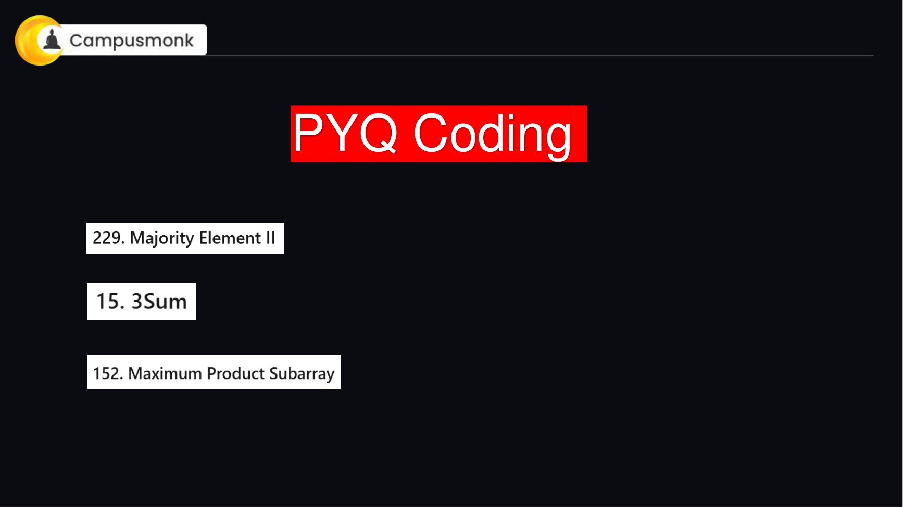
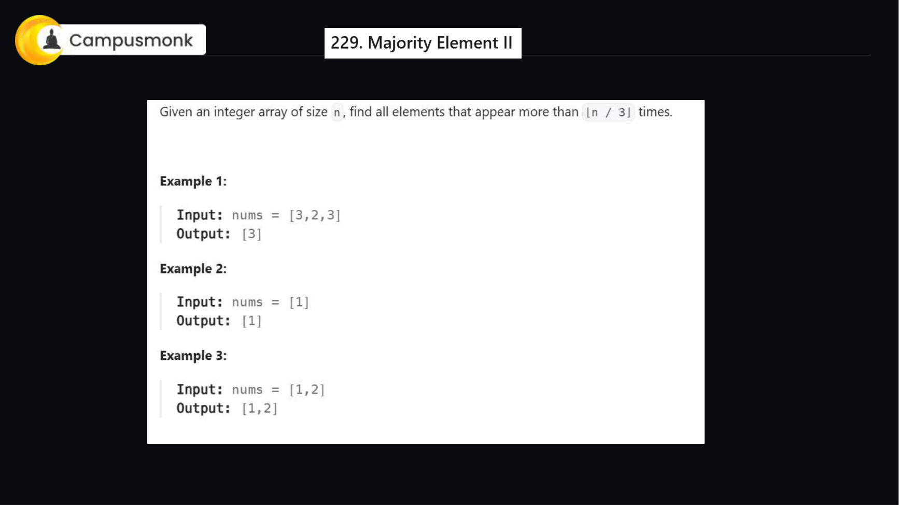
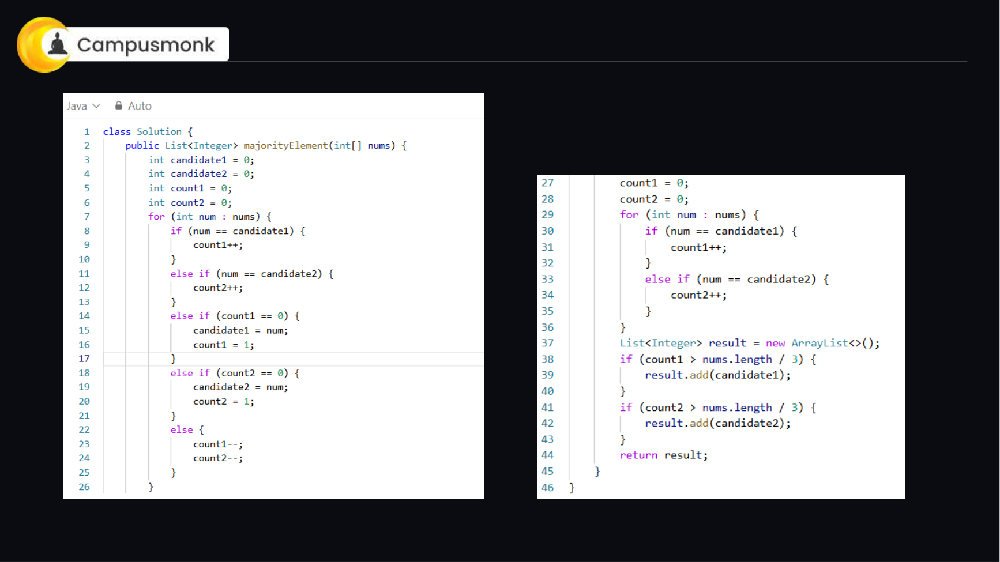

### Extended Boyer-Moore Voting Algorithm
1. **Mathematical Observation**: In any array of length n, there can be at most **two** elements that appear strictly more than `⌊n/3⌋` times because `3 * (⌊n/3⌋ + 1) > n`.
2. **First Pass (Candidate Identification)**: Maintain two potential candidates (`cand1`, `cand2`) and their corresponding vote counters (`count1`, `count2`).
   - If current number equals `cand1`, increment `count1`.
   - Else if current number equals `cand2`, increment `count2`.
   - Else if `count1 == 0`, assign `cand1 = num` and set `count1 = 1`.
   - Else if `count2 == 0`, assign `cand2 = num` and set `count2 = 1`.
   - Otherwise, decrement both `count1` and `count2`.
3. **Second Pass (Verification)**: Reset frequencies of `cand1` and `cand2` to 0. Traverse the array to count their exact occurrences. If either candidate occurs more than `n // 3` times, append it to the result list.
4. **Complexity**:
   - **Time Complexity:** `O(N)` two-pass linear traversal.
   - **Auxiliary Space:** `O(1)` as only candidate variables and counter registers are allocated.

### Multi-Language Optimal Implementations

#### 🐍 Python 3 Solution
```python
class Solution:
    def majorityElement(self, nums: list[int]) -> list[int]:
        if not nums:
            return []
        
        cand1, cand2 = None, None
        count1, count2 = 0, 0
        
        # Step 1: Find potential candidates
        for num in nums:
            if num == cand1:
                count1 += 1
            elif num == cand2:
                count2 += 1
            elif count1 == 0:
                cand1, count1 = num, 1
            elif count2 == 0:
                cand2, count2 = num, 1
            else:
                count1 -= 1
                count2 -= 1
                
        # Step 2: Verify candidate frequencies
        threshold = len(nums) // 3
        result = []
        c1_actual = sum(1 for x in nums if x == cand1)
        c2_actual = sum(1 for x in nums if x == cand2)
        
        if c1_actual > threshold:
            result.append(cand1)
        if cand2 != cand1 and c2_actual > threshold:
            result.append(cand2)
            
        return result
```

#### ⚡ C++ (Modern STL) Solution
```cpp
#include <vector>
using namespace std;

class Solution {
public:
    vector<int> majorityElement(vector<int>& nums) {
        int n = nums.size();
        int cand1 = 0, cand2 = 0, count1 = 0, count2 = 0;
        
        for (int num : nums) {
            if (num == cand1) count1++;
            else if (num == cand2) count2++;
            else if (count1 == 0) { cand1 = num; count1 = 1; }
            else if (count2 == 0) { cand2 = num; count2 = 1; }
            else { count1--; count2--; }
        }
        
        count1 = 0; count2 = 0;
        for (int num : nums) {
            if (num == cand1) count1++;
            else if (num == cand2) count2++;
        }
        
        vector<int> result;
        int threshold = n / 3;
        if (count1 > threshold) result.push_back(cand1);
        if (count2 > threshold) result.push_back(cand2);
        return result;
    }
};
```

#### ☕ Java 17 Solution
```java
import java.util.ArrayList;
import java.util.List;

class Solution {
    public List<Integer> majorityElement(int[] nums) {
        int n = nums.length;
        Integer cand1 = null, cand2 = null;
        int count1 = 0, count2 = 0;
        
        for (int num : nums) {
            if (cand1 != null && num == cand1) count1++;
            else if (cand2 != null && num == cand2) count2++;
            else if (count1 == 0) { cand1 = num; count1 = 1; }
            else if (count2 == 0) { cand2 = num; count2 = 1; }
            else { count1--; count2--; }
        }
        
        count1 = 0; count2 = 0;
        for (int num : nums) {
            if (cand1 != null && num == cand1) count1++;
            if (cand2 != null && num == cand2) count2++;
        }
        
        List<Integer> result = new ArrayList<>();
        int threshold = n / 3;
        if (cand1 != null && count1 > threshold) result.add(cand1);
        if (cand2 != null && cand2 != cand1 && count2 > threshold) result.add(cand2);
        return result;
    }
}
```

---

## 🔷 15. 3Sum (All Unique Triplets Summing to Zero)
**Problem ID:** `LIVE_CODING_02` | **Difficulty:** Medium (Infosys SE / SP Coding Round)  
**Category:** Live Coding & Algorithms | **Topic:** Arrays, Two Pointers & Sorting  

### Problem Description
Given an integer array nums, return all the triplets [nums[i], nums[j], nums[k]] such that i != j, i != k, and j != k, and nums[i] + nums[j] + nums[k] == 0. Notice that the solution set must not contain duplicate triplets.

### Constraints
- `3 <= nums.length <= 3000`
- `-10^5 <= nums[i] <= 10^5`

### Example Test Cases
**Example 1:**
- **Input:** `nums = [-1, 0, 1, 2, -1, -4]`
- **Output:** `[[-1, -1, 2], [-1, 0, 1]]`
- **Explanation:** Triplets sum to 0: (-1) + (-1) + 2 = 0, and (-1) + 0 + 1 = 0.

**Example 2:**
- **Input:** `nums = [0, 1, 1]`
- **Output:** `[]`
- **Explanation:** No possible triplet sums to 0.

**Example 3:**
- **Input:** `nums = [0, 0, 0]`
- **Output:** `[[0, 0, 0]]`
- **Explanation:** The only triplet sums to 0.

### Original Live Class Slide Diagrams
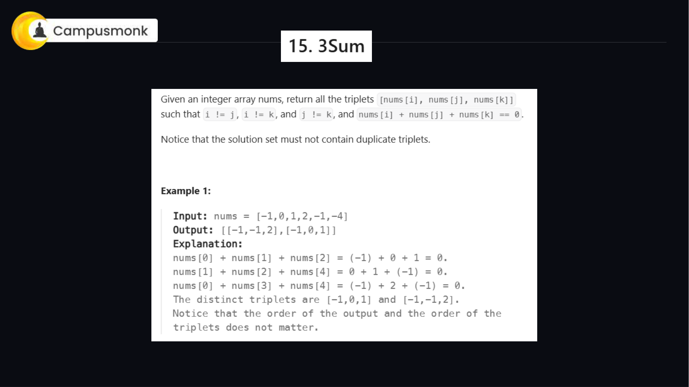
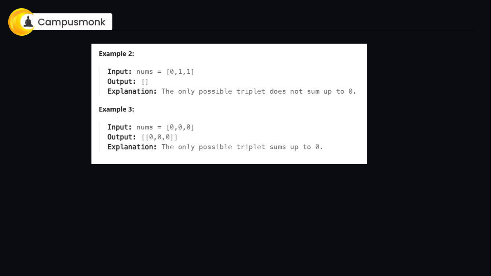
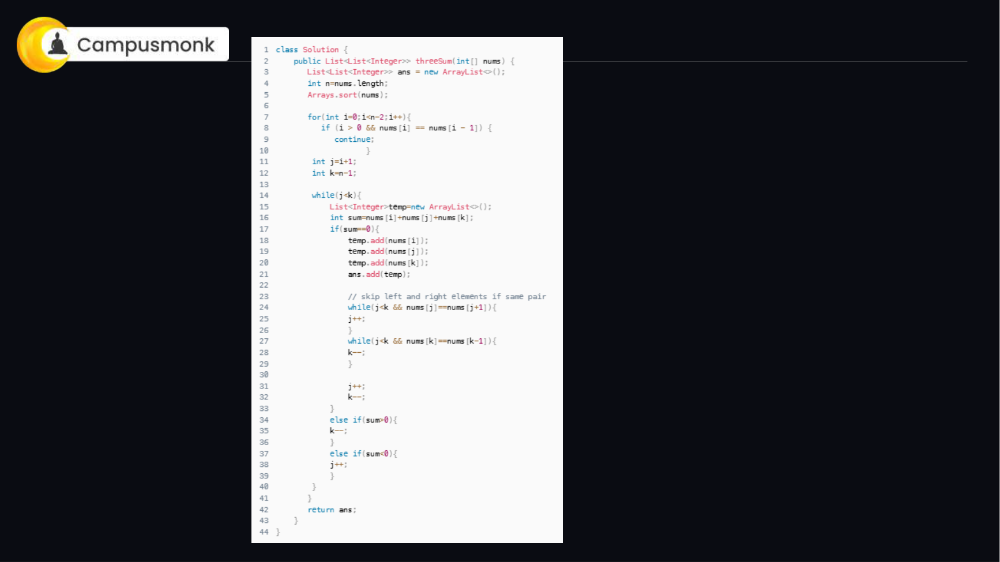
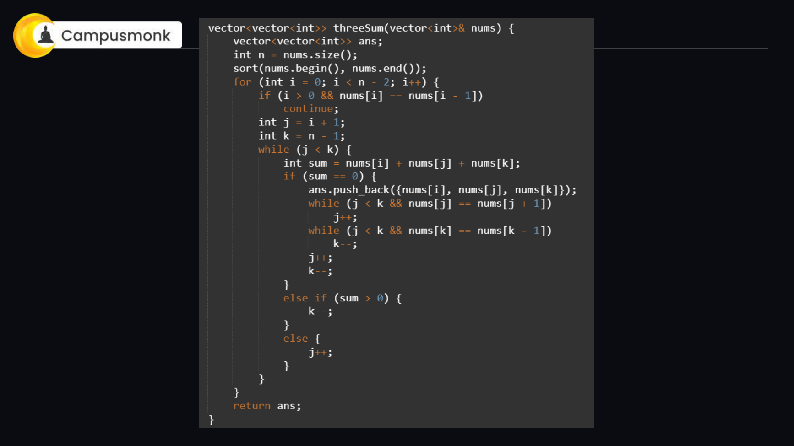
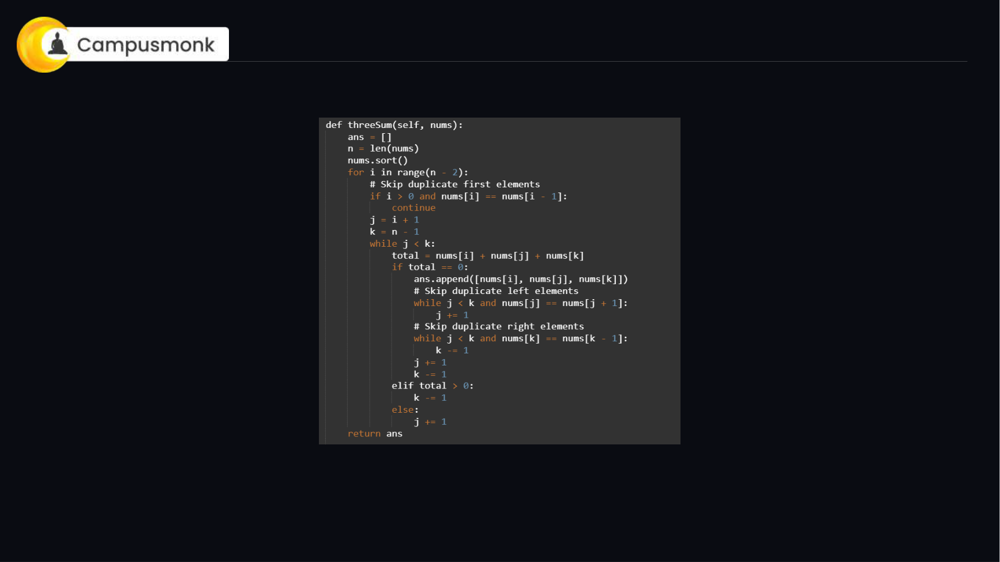

### Two-Pointer Sorting Paradigm
1. **Sort Array**: Sort `nums` in ascending order (`O(N log N)`). Sorting enables two-pointer convergence and easy duplicate pruning.
2. **Iterate First Element**: Loop `i` from `0` to `n - 3`.
   - If `i > 0` and `nums[i] == nums[i - 1]`, skip to avoid duplicate triplets for the first element.
   - If `nums[i] > 0`, break early because all remaining elements are positive, making a zero sum impossible.
3. **Two-Pointer Scan**: Set `left = i + 1` and `right = n - 1`.
   - Calculate `current_sum = nums[i] + nums[left] + nums[right]`.
   - If `current_sum == 0`, record `[nums[i], nums[left], nums[right]]`. Advance `left` while skipping duplicates (`nums[left] == nums[left + 1]`). Decrement `right` while skipping duplicates (`nums[right] == nums[right - 1]`). Finally, increment `left` and decrement `right`.
   - If `current_sum < 0`, increment `left` to increase sum.
   - If `current_sum > 0`, decrement `right` to decrease sum.
4. **Complexity**:
   - **Time Complexity:** `O(N²)` where sorting is `O(N log N)` and nested two-pointer traversal takes `O(N²)`.
   - **Auxiliary Space:** `O(1)` or `O(log N)` for sorting stack.

### Multi-Language Optimal Implementations

#### 🐍 Python 3 Solution
```python
class Solution:
    def threeSum(self, nums: list[int]) -> list[list[int]]:
        nums.sort()
        n = len(nums)
        ans = []
        
        for i in range(n - 2):
            # Early break if smallest element is positive
            if nums[i] > 0:
                break
            # Skip duplicates for the first element
            if i > 0 and nums[i] == nums[i - 1]:
                continue
                
            left, right = i + 1, n - 1
            while left < right:
                total = nums[i] + nums[left] + nums[right]
                if total == 0:
                    ans.append([nums[i], nums[left], nums[right]])
                    # Skip duplicate second and third elements
                    while left < right and nums[left] == nums[left + 1]:
                        left += 1
                    while left < right and nums[right] == nums[right - 1]:
                        right -= 1
                    left += 1
                    right -= 1
                elif total < 0:
                    left += 1
                else:
                    right -= 1
                    
        return ans
```

#### ⚡ C++ (Modern STL) Solution
```cpp
#include <vector>
#include <algorithm>
using namespace std;

class Solution {
public:
    vector<vector<int>> threeSum(vector<int>& nums) {
        vector<vector<int>> ans;
        int n = nums.size();
        sort(nums.begin(), nums.end());
        
        for (int i = 0; i < n - 2; i++) {
            if (nums[i] > 0) break;
            if (i > 0 && nums[i] == nums[i - 1]) continue;
            
            int left = i + 1, right = n - 1;
            while (left < right) {
                int sum = nums[i] + nums[left] + nums[right];
                if (sum == 0) {
                    ans.push_back({nums[i], nums[left], nums[right]});
                    while (left < right && nums[left] == nums[left + 1]) left++;
                    while (left < right && nums[right] == nums[right - 1]) right--;
                    left++; right--;
                } else if (sum < 0) {
                    left++;
                } else {
                    right--;
                }
            }
        }
        return ans;
    }
};
```

#### ☕ Java 17 Solution
```java
import java.util.ArrayList;
import java.util.Arrays;
import java.util.List;

class Solution {
    public List<List<Integer>> threeSum(int[] nums) {
        List<List<Integer>> ans = new ArrayList<>();
        int n = nums.length;
        Arrays.sort(nums);
        
        for (int i = 0; i < n - 2; i++) {
            if (nums[i] > 0) break;
            if (i > 0 && nums[i] == nums[i - 1]) continue;
            
            int left = i + 1, right = n - 1;
            while (left < right) {
                int sum = nums[i] + nums[left] + nums[right];
                if (sum == 0) {
                    ans.add(Arrays.asList(nums[i], nums[left], nums[right]));
                    while (left < right && nums[left] == nums[left + 1]) left++;
                    while (left < right && nums[right] == nums[right - 1]) right--;
                    left++; right--;
                } else if (sum < 0) {
                    left++;
                } else {
                    right--;
                }
            }
        }
        return ans;
    }
}
```

---

## 🔷 152. Maximum Product Subarray
**Problem ID:** `LIVE_CODING_03` | **Difficulty:** Medium (Infosys / TCS Digital Coding Round)  
**Category:** Live Coding & Algorithms | **Topic:** Dynamic Programming & Array Optimization  

### Problem Description
Given an integer array nums, find a contiguous non-empty subarray that has the largest product, and return the product. The test cases are generated so that the answer will fit in a 32-bit integer.

### Constraints
- `1 <= nums.length <= 2 * 10^4`
- `-10 <= nums[i] <= 10`

### Example Test Cases
**Example 1:**
- **Input:** `nums = [2, 3, -2, 4]`
- **Output:** `6`
- **Explanation:** [2, 3] has the largest product 6.

**Example 2:**
- **Input:** `nums = [-2, 0, -1]`
- **Output:** `0`
- **Explanation:** The result cannot be 2, because [-2, -1] is not a subarray.

### Original Live Class Slide Diagrams
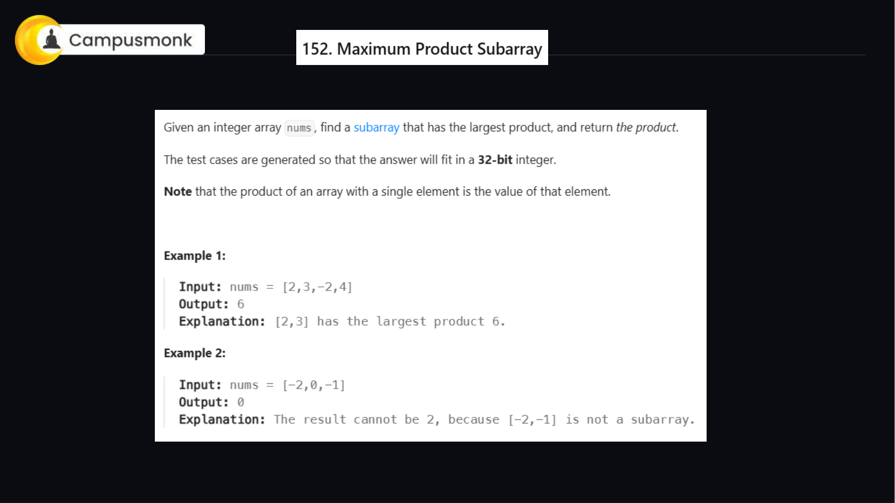
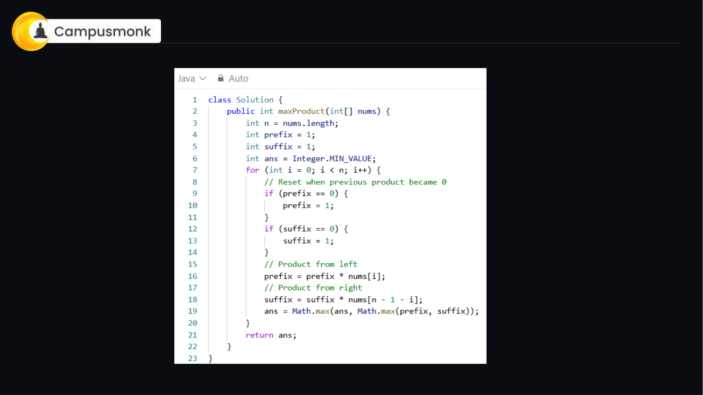
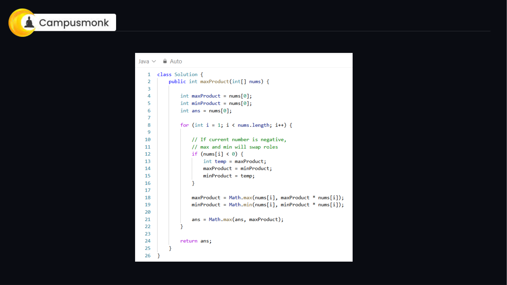

### Kadane's Dual Dynamic Programming Tracking
1. **Core Challenge**: Unlike maximum sum where negatives always reduce sum, multiplying two negative numbers creates a positive product. A very small negative product can flip into a huge positive product when multiplied by another negative number.
2. **State Tracking**: At each index `i`, maintain:
   - `max_prod`: Maximum product ending at index `i`.
   - `min_prod`: Minimum product ending at index `i` (which may flip to positive).
3. **Transition**:
   - When encountering a negative number `nums[i] < 0`, swap `max_prod` and `min_prod`.
   - `max_prod = max(nums[i], max_prod * nums[i])`
   - `min_prod = min(nums[i], min_prod * nums[i])`
   - `global_max = max(global_max, max_prod)`
4. **Complexity**:
   - **Time Complexity:** `O(N)` single linear pass.
   - **Auxiliary Space:** `O(1)` as only three variables are maintained.

### Multi-Language Optimal Implementations

#### 🐍 Python 3 Solution
```python
class Solution:
    def maxProduct(self, nums: list[int]) -> int:
        if not nums:
            return 0
            
        global_max = nums[0]
        cur_max = nums[0]
        cur_min = nums[0]
        
        for i in range(1, len(nums)):
            x = nums[i]
            if x < 0:
                cur_max, cur_min = cur_min, cur_max
                
            cur_max = max(x, cur_max * x)
            cur_min = min(x, cur_min * x)
            
            global_max = max(global_max, cur_max)
            
        return global_max
```

#### ⚡ C++ (Modern STL) Solution
```cpp
#include <vector>
#include <algorithm>
using namespace std;

class Solution {
public:
    int maxProduct(vector<int>& nums) {
        if (nums.empty()) return 0;
        int global_max = nums[0];
        int cur_max = nums[0], cur_min = nums[0];
        
        for (size_t i = 1; i < nums.size(); i++) {
            int x = nums[i];
            if (x < 0) swap(cur_max, cur_min);
            cur_max = max(x, cur_max * x);
            cur_min = min(x, cur_min * x);
            global_max = max(global_max, cur_max);
        }
        return global_max;
    }
};
```

#### ☕ Java 17 Solution
```java
class Solution {
    public int maxProduct(int[] nums) {
        if (nums == null || nums.length == 0) return 0;
        int global_max = nums[0];
        int cur_max = nums[0], cur_min = nums[0];
        
        for (int i = 1; i < nums.length; i++) {
            int x = nums[i];
            if (x < 0) {
                int temp = cur_max;
                cur_max = cur_min;
                cur_min = temp;
            }
            cur_max = Math.max(x, cur_max * x);
            cur_min = Math.min(x, cur_min * x);
            global_max = Math.max(global_max, cur_max);
        }
        return global_max;
    }
}
```

---


---

# 💻 Infosys Live Coding PYQ Master Class — Part 2 (Next Permutation, Letter Combinations of Phone Number)
**Source Document:** `3 PYQ Coding Question Prep.pdf`  
**Instructor:** Itika Ma'am | CampusMonk Live Coding Master Series  
**Target Role:** Infosys Specialist Programmer (SP) / Digital Specialist Engineer (DSE) / Systems Engineer (SE)  
**Total Problems:** 2 Master Algorithmic Challenges  
**Multi-Language Coverage:** Python 3, C++ (STL), and Java 17 Production Implementations  
**Status:** 100% Solved with Optimal Complexities, Edge Cases & Slide Figures  

---

## 🔷 31. Next Permutation
**Problem ID:** `LIVE_CODING_04` | **Difficulty:** Medium (Infosys / TCS / IBM Core Coding Round)  
**Category:** Live Coding & Algorithms | **Topic:** Arrays & Lexicographical Permutation  

### Problem Description
A permutation of an array of integers is an arrangement of its members into a sequence or linear order. The next permutation of an array of integers is the next lexicographically greater permutation. Rearrange numbers into the lexicographically next greater permutation of numbers in-place with O(1) extra memory.

### Constraints
- `1 <= nums.length <= 100`
- `0 <= nums[i] <= 100`

### Example Test Cases
**Example 1:**
- **Input:** `nums = [1, 2, 3]`
- **Output:** `[1, 3, 2]`
- **Explanation:** Lexicographically next greater permutation is [1, 3, 2].

**Example 2:**
- **Input:** `nums = [3, 2, 1]`
- **Output:** `[1, 2, 3]`
- **Explanation:** Entire array is in descending order; wrap around to smallest sorted permutation.

**Example 3:**
- **Input:** `nums = [1, 1, 5]`
- **Output:** `[1, 5, 1]`
- **Explanation:** Next permutation is [1, 5, 1].

### Original Live Class Slide Diagrams
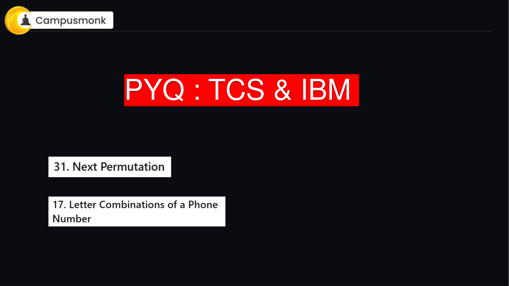
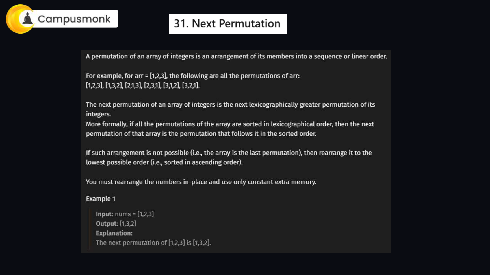
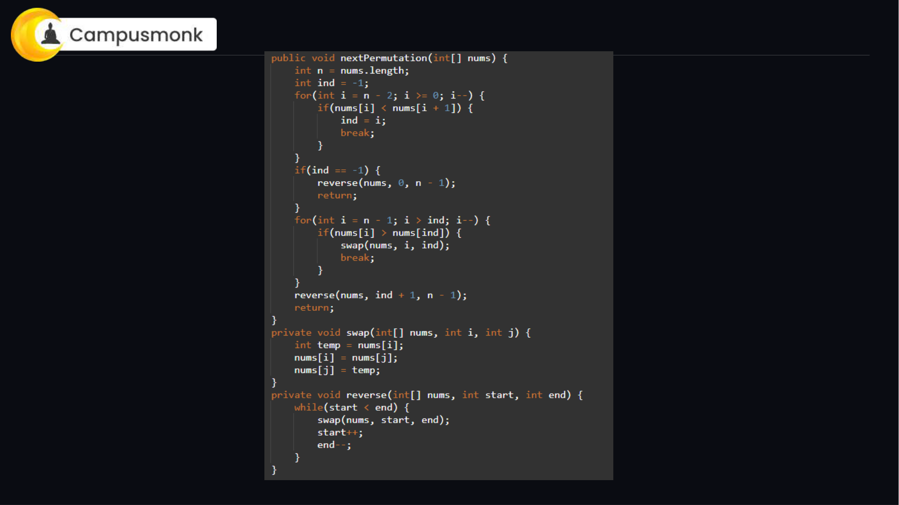
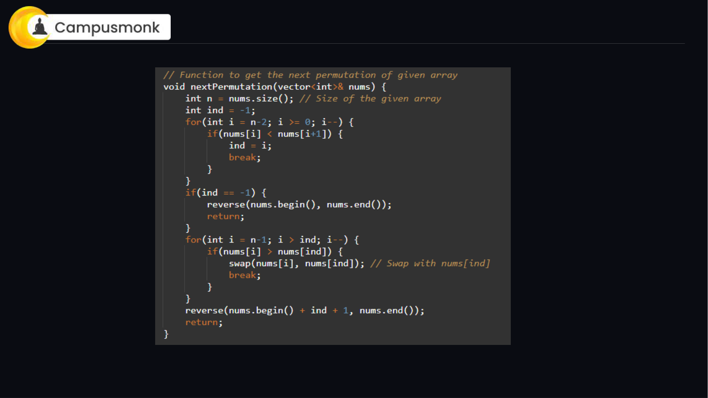
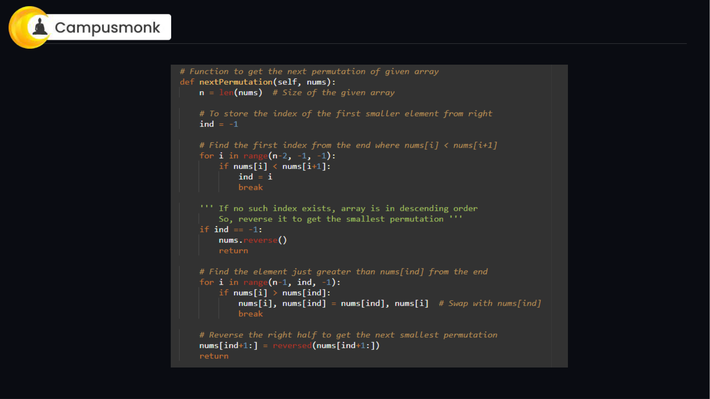

### Single Pass In-Place Transformation
1. **Find Pivot Index (`ind`)**: Traverse from right to left to locate the first index `i` such that `nums[i] < nums[i + 1]`. The suffix to the right of `i` is sorted in non-increasing order.
2. **Handle Descending Arrays**: If no such index exists (`ind == -1`), the entire array is in descending order. Reverse the entire array to convert it into the smallest permutation.
3. **Find Successor to Swap**: If `ind != -1`, scan from the right end towards `ind` to find the first element `nums[j] > nums[ind]`. Swap `nums[ind]` with `nums[j]`.
4. **Reverse Suffix**: Reverse all elements from index `ind + 1` to `n - 1`. Since the suffix was in descending order, reversing it puts it into ascending order, which is the smallest lexicographical arrangement.
5. **Complexity**:
   - **Time Complexity:** `O(N)` linear traversal and reversal.
   - **Auxiliary Space:** `O(1)` strictly in-place modification.

### Multi-Language Optimal Implementations

#### 🐍 Python 3 Solution
```python
class Solution:
    def nextPermutation(self, nums: list[int]) -> None:
        n = len(nums)
        ind = -1
        
        # Step 1: Find the break point
        for i in range(n - 2, -1, -1):
            if nums[i] < nums[i + 1]:
                ind = i
                break
                
        # If no break point, reverse entire array
        if ind == -1:
            nums.reverse()
            return
            
        # Step 2: Find next greater element from right
        for i in range(n - 1, ind, -1):
            if nums[i] > nums[ind]:
                nums[i], nums[ind] = nums[ind], nums[i]
                break
                
        # Step 3: Reverse the remaining suffix
        nums[ind + 1:] = reversed(nums[ind + 1:])
```

#### ⚡ C++ (Modern STL) Solution
```cpp
#include <vector>
#include <algorithm>
using namespace std;

class Solution {
public:
    void nextPermutation(vector<int>& nums) {
        int n = nums.size();
        int ind = -1;
        
        for (int i = n - 2; i >= 0; i--) {
            if (nums[i] < nums[i + 1]) {
                ind = i;
                break;
            }
        }
        
        if (ind == -1) {
            reverse(nums.begin(), nums.end());
            return;
        }
        
        for (int i = n - 1; i > ind; i--) {
            if (nums[i] > nums[ind]) {
                swap(nums[i], nums[ind]);
                break;
            }
        }
        
        reverse(nums.begin() + ind + 1, nums.end());
    }
};
```

#### ☕ Java 17 Solution
```java
class Solution {
    public void nextPermutation(int[] nums) {
        int n = nums.length;
        int ind = -1;
        
        for (int i = n - 2; i >= 0; i--) {
            if (nums[i] < nums[i + 1]) {
                ind = i;
                break;
            }
        }
        
        if (ind == -1) {
            reverse(nums, 0, n - 1);
            return;
        }
        
        for (int i = n - 1; i > ind; i--) {
            if (nums[i] > nums[ind]) {
                swap(nums, i, ind);
                break;
            }
        }
        
        reverse(nums, ind + 1, n - 1);
    }
    
    private void reverse(int[] nums, int start, int end) {
        while (start < end) {
            swap(nums, start++, end--);
        }
    }
    
    private void swap(int[] nums, int i, int j) {
        int temp = nums[i];
        nums[i] = nums[j];
        nums[j] = temp;
    }
}
```

---

## 🔷 17. Letter Combinations of a Phone Number
**Problem ID:** `LIVE_CODING_05` | **Difficulty:** Medium (Infosys SE / TCS NQT Coding Round)  
**Category:** Live Coding & Algorithms | **Topic:** Strings, Backtracking & Recursion  

### Problem Description
Given a string containing digits from 2-9 inclusive, return all possible letter combinations that the number could represent. Return the answer in any order. Mapping of digits to letters corresponds to telephone dial buttons.

### Constraints
- `0 <= digits.length <= 4`
- `digits[i] is a digit in the range ['2', '9'].`

### Example Test Cases
**Example 1:**
- **Input:** `digits = "23"`
- **Output:** `["ad","ae","af","bd","be","bf","cd","ce","cf"]`
- **Explanation:** 2 maps to 'abc', 3 maps to 'def'.

**Example 2:**
- **Input:** `digits = ""`
- **Output:** `[]`
- **Explanation:** Empty input produces empty list.

**Example 3:**
- **Input:** `digits = "2"`
- **Output:** `["a","b","c"]`
- **Explanation:** 2 maps to 'abc'.

### Original Live Class Slide Diagrams
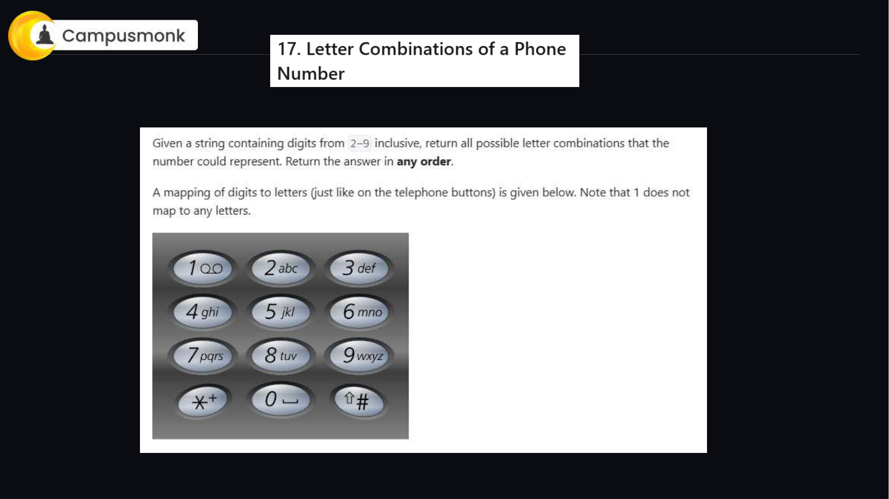
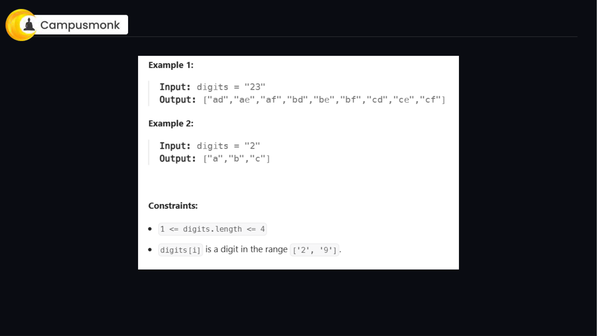
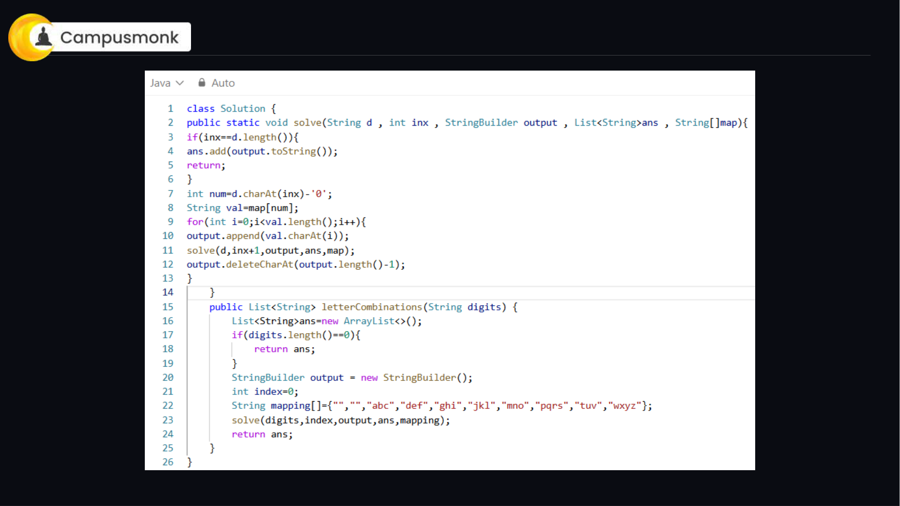
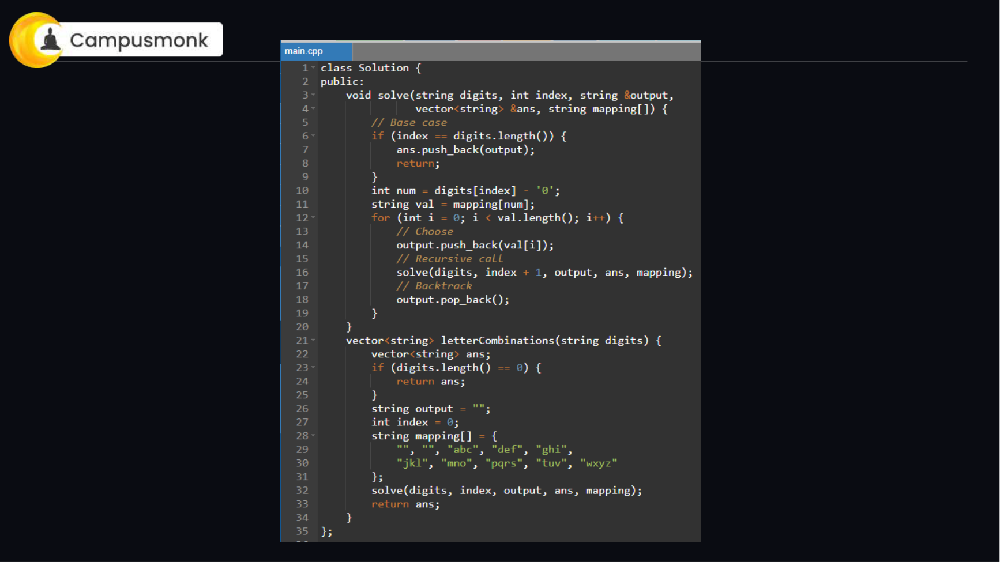
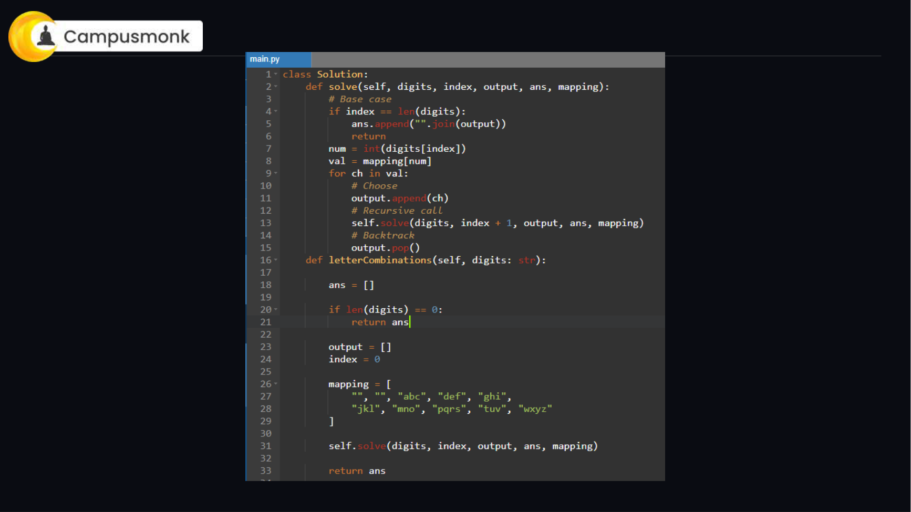

### Recursive Depth-First Backtracking
1. **Telephone Keypad Mapping**:
   - '2': "abc", '3': "def", '4': "ghi", '5': "jkl"
   - '6': "mno", '7': "pqrs", '8': "tuv", '9': "wxyz"
2. **Base Case**: When current combination length equals `digits.length`, append the combination string to the result.
3. **Recursive Exploration**:
   - Extract the letters mapped to `digits[index]`.
   - For each letter in the mapped string, append to current path, recurse for `index + 1`, and backtrack (pop the character).
4. **Complexity**:
   - **Time Complexity:** `O(4^N * N)` where N is length of digits string (max 4). At most `4^4 = 256` leaves.
   - **Auxiliary Space:** `O(N)` recursion stack depth.

### Multi-Language Optimal Implementations

#### 🐍 Python 3 Solution
```python
class Solution:
    def letterCombinations(self, digits: str) -> list[str]:
        if not digits:
            return []
            
        mapping = {
            "2": "abc", "3": "def", "4": "ghi", "5": "jkl",
            "6": "mno", "7": "pqrs", "8": "tuv", "9": "wxyz"
        }
        
        result = []
        
        def backtrack(index: int, path: list[str]):
            if index == len(digits):
                result.append("".join(path))
                return
                
            possible_letters = mapping[digits[index]]
            for letter in possible_letters:
                path.append(letter)
                backtrack(index + 1, path)
                path.pop()
                
        backtrack(0, [])
        return result
```

#### ⚡ C++ (Modern STL) Solution
```cpp
#include <vector>
#include <string>
using namespace std;

class Solution {
private:
    const vector<string> mapping = {
        "", "", "abc", "def", "ghi", "jkl", "mno", "pqrs", "tuv", "wxyz"
    };
    
    void backtrack(int index, const string& digits, string& current, vector<string>& result) {
        if (index == digits.length()) {
            result.push_back(current);
            return;
        }
        
        int digit = digits[index] - '0';
        for (char ch : mapping[digit]) {
            current.push_back(ch);
            backtrack(index + 1, digits, current, result);
            current.pop_back();
        }
    }
public:
    vector<string> letterCombinations(string digits) {
        if (digits.empty()) return {};
        vector<string> result;
        string current = "";
        backtrack(0, digits, current, result);
        return result;
    }
};
```

#### ☕ Java 17 Solution
```java
import java.util.ArrayList;
import java.util.List;

class Solution {
    private final String[] mapping = {
        "", "", "abc", "def", "ghi", "jkl", "mno", "pqrs", "tuv", "wxyz"
    };
    
    public List<String> letterCombinations(String digits) {
        List<String> result = new ArrayList<>();
        if (digits == null || digits.length() == 0) return result;
        backtrack(0, digits, new StringBuilder(), result);
        return result;
    }
    
    private void backtrack(int index, String digits, StringBuilder current, List<String> result) {
        if (index == digits.length()) {
            result.add(current.toString());
            return;
        }
        
        int digit = digits.charAt(index) - '0';
        String letters = mapping[digit];
        for (int i = 0; i < letters.length(); i++) {
            current.append(letters.charAt(i));
            backtrack(index + 1, digits, current, result);
            current.deleteCharAt(current.length() - 1);
        }
    }
}
```

---


---

# 💻 Infosys Live Coding PYQ Master Class — Part 3 (Daily Temperatures, Minimum Bit Flips to Convert Number)
**Source Document:** `Infosys , TCS & OTHER_PYQ.pdf`  
**Instructor:** Itika Ma'am | CampusMonk Live Coding Master Series  
**Target Role:** Infosys Specialist Programmer (SP) / Digital Specialist Engineer (DSE) / Systems Engineer (SE)  
**Total Problems:** 2 Master Algorithmic Challenges  
**Multi-Language Coverage:** Python 3, C++ (STL), and Java 17 Production Implementations  
**Status:** 100% Solved with Optimal Complexities, Edge Cases & Slide Figures  

---

## 🔷 739. Daily Temperatures (Next Warmer Day)
**Problem ID:** `LIVE_CODING_06` | **Difficulty:** Medium (Infosys SE Actual Exam / TCS Digital Coding)  
**Category:** Live Coding & Algorithms | **Topic:** Arrays & Monotonic Decreasing Stack  

### Problem Description
Given an array of integers temperatures represents the daily temperatures, return an array answer such that answer[i] is the number of days you have to wait after the ith day to get a warmer temperature. If there is no future day for which this is possible, keep answer[i] == 0 instead.

### Constraints
- `1 <= temperatures.length <= 10^5`
- `30 <= temperatures[i] <= 100`

### Example Test Cases
**Example 1:**
- **Input:** `temperatures = [73, 74, 75, 71, 69, 72, 76, 73]`
- **Output:** `[1, 1, 4, 2, 1, 1, 0, 0]`
- **Explanation:** Day 0 (73) waits 1 day for 74. Day 2 (75) waits 4 days for 76.

**Example 2:**
- **Input:** `temperatures = [30, 40, 50, 60]`
- **Output:** `[1, 1, 1, 0]`
- **Explanation:** Each day waits 1 day except the last.

**Example 3:**
- **Input:** `temperatures = [30, 60, 90]`
- **Output:** `[1, 1, 0]`
- **Explanation:** Day 0 waits 1 day, Day 1 waits 1 day.

### Original Live Class Slide Diagrams
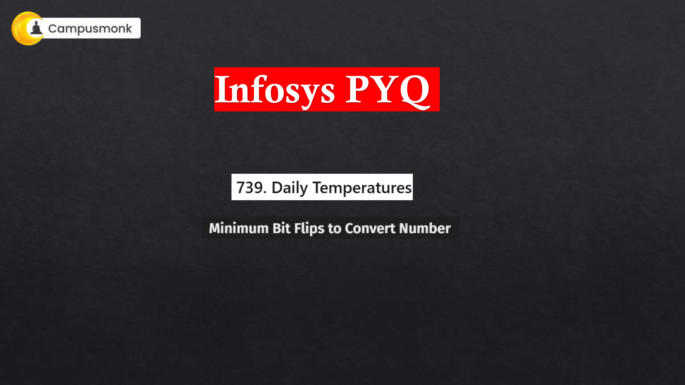
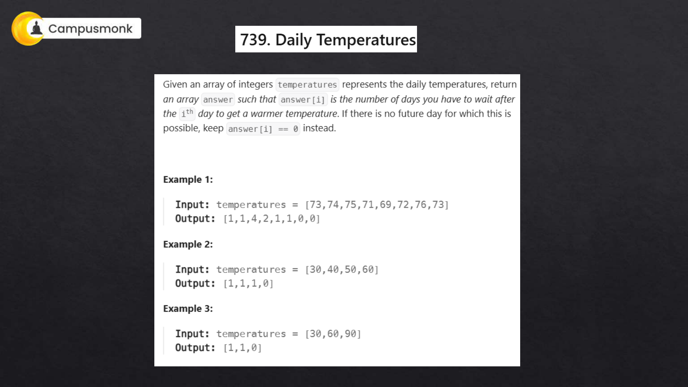
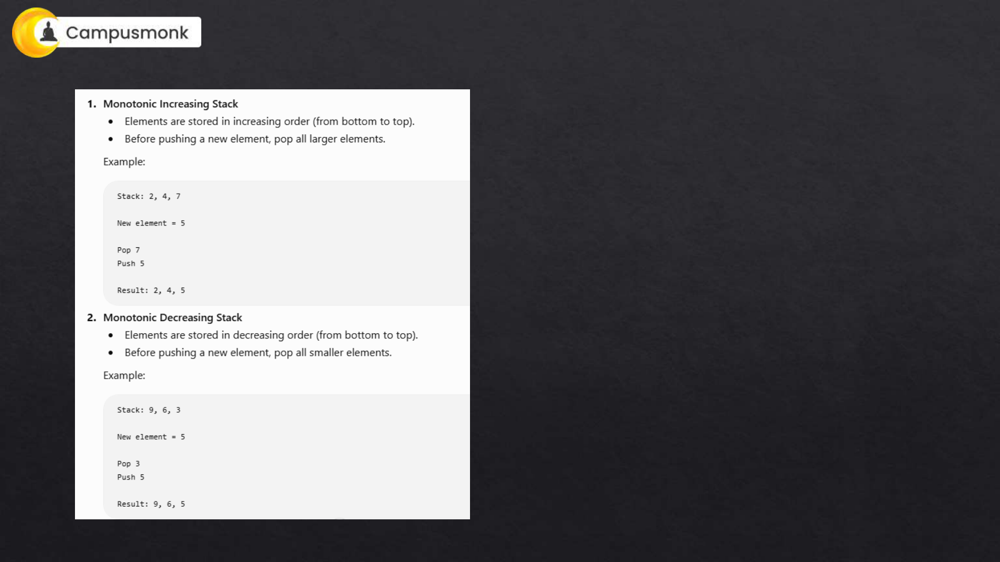
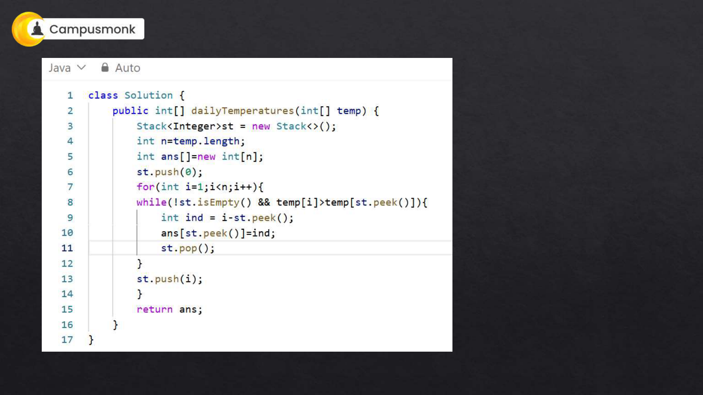
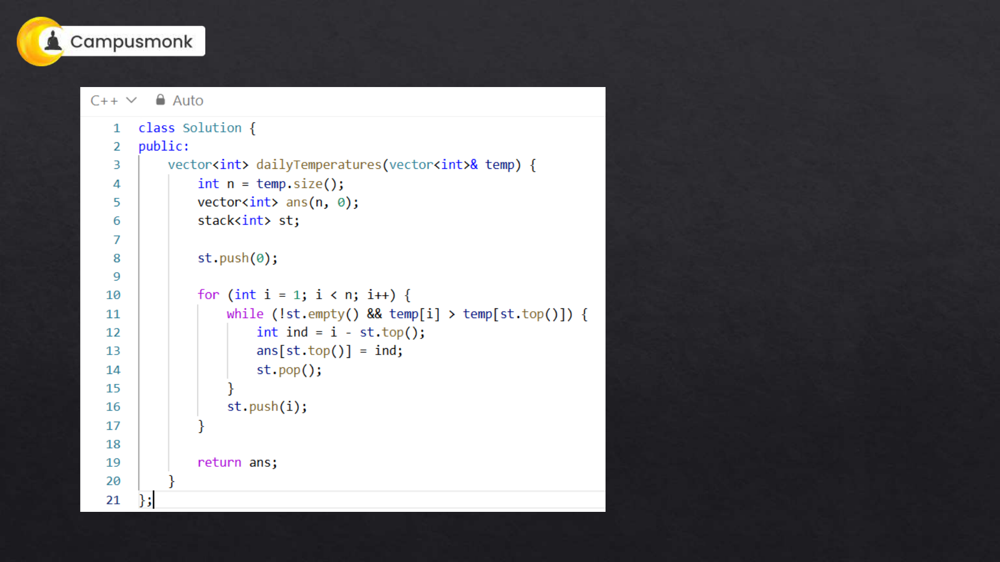
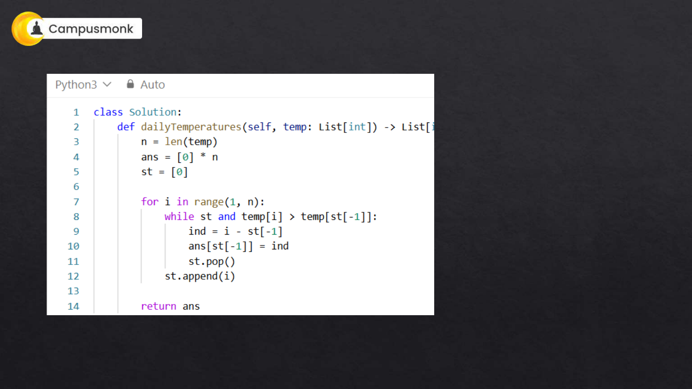

### Monotonic Decreasing Stack Technique
1. **Core Problem Pattern**: This is a classic "Next Greater Element" problem. A naive nested loop takes `O(N²)`, causing Time Limit Exceeded for `N = 10^5`.
2. **Monotonic Stack Structure**: Maintain a stack of indices whose temperatures have not yet found a warmer future day. The temperatures corresponding to indices in the stack remain in strictly decreasing order.
3. **Execution Steps**:
   - Initialize `answer = [0] * n` and an empty stack `st`.
   - Iterate index `i` from `0` to `n - 1`:
     - While `st` is non-empty and `temperatures[i] > temperatures[st.top()]`:
       - Pop `prev_index = st.pop()`.
       - `answer[prev_index] = i - prev_index`.
     - Push `i` onto `st`.
4. **Complexity**:
   - **Time Complexity:** `O(N)` because each index is pushed and popped at most once.
   - **Auxiliary Space:** `O(N)` in the worst case where temperatures are monotonically decreasing.

### Multi-Language Optimal Implementations

#### 🐍 Python 3 Solution
```python
class Solution:
    def dailyTemperatures(self, temperatures: list[int]) -> list[int]:
        n = len(temperatures)
        ans = [0] * n
        stack = []  # Stores indices
        
        for i, temp in enumerate(temperatures):
            while stack and temp > temperatures[stack[-1]]:
                prev_idx = stack.pop()
                ans[prev_idx] = i - prev_idx
            stack.append(i)
            
        return ans
```

#### ⚡ C++ (Modern STL) Solution
```cpp
#include <vector>
#include <stack>
using namespace std;

class Solution {
public:
    vector<int> dailyTemperatures(vector<int>& temperatures) {
        int n = temperatures.size();
        vector<int> ans(n, 0);
        stack<int> st; // Stores indices
        
        for (int i = 0; i < n; i++) {
            while (!st.empty() && temperatures[i] > temperatures[st.top()]) {
                int prev_idx = st.top();
                st.pop();
                ans[prev_idx] = i - prev_idx;
            }
            st.push(i);
        }
        return ans;
    }
};
```

#### ☕ Java 17 Solution
```java
import java.util.Stack;

class Solution {
    public int[] dailyTemperatures(int[] temperatures) {
        int n = temperatures.length;
        int[] ans = new int[n];
        Stack<Integer> st = new Stack<>();
        
        for (int i = 0; i < n; i++) {
            while (!st.isEmpty() && temperatures[i] > temperatures[st.peek()]) {
                int prev_idx = st.pop();
                ans[prev_idx] = i - prev_idx;
            }
            st.push(i);
        }
        return ans;
    }
}
```

---

## 🔷 2220. Minimum Bit Flips to Convert Number
**Problem ID:** `LIVE_CODING_07` | **Difficulty:** Easy (Infosys SE Coding Assessment)  
**Category:** Live Coding & Algorithms | **Topic:** Bit Manipulation & Brian Kernighan's Algorithm  

### Problem Description
A bit flip of a number x is choosing a bit in the binary representation of x and flipping it from either 0 to 1 or 1 to 0. Given two integers start and goal, return the minimum number of bit flips to convert start to goal.

### Constraints
- `0 <= start, goal <= 10^9`

### Example Test Cases
**Example 1:**
- **Input:** `start = 10, goal = 7`
- **Output:** `3`
- **Explanation:** Binary of 10 is 1010, binary of 7 is 0111. Flipping the 1st, 2nd, and 4th bits converts 10 to 7.

**Example 2:**
- **Input:** `start = 3, goal = 4`
- **Output:** `3`
- **Explanation:** Binary of 3 is 011, binary of 4 is 100. 3 bit flips are required.

### Original Live Class Slide Diagrams
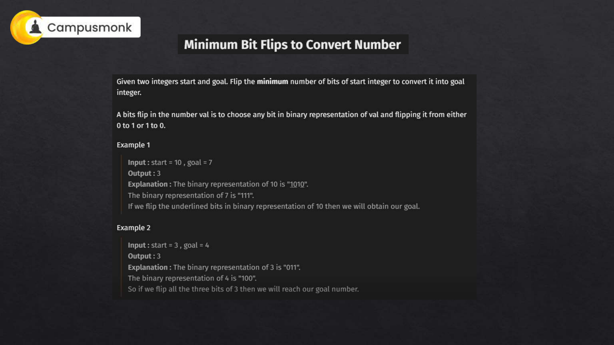
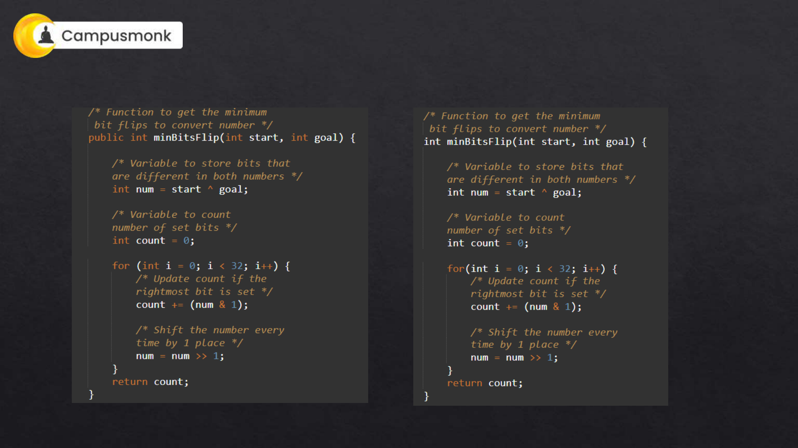
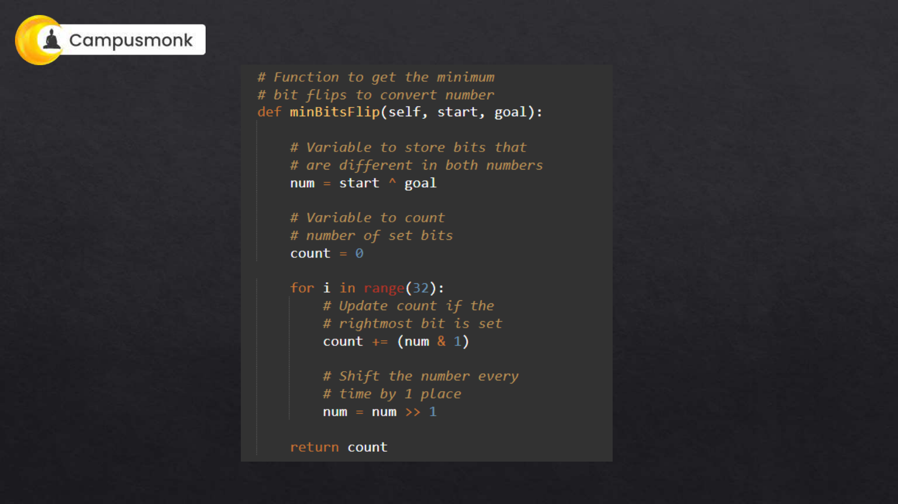

### Bitwise XOR & Brian Kernighan's Popcount
1. **Bitwise Difference via XOR**:
   - The bitwise XOR operation (`start ^ goal`) sets a bit to `1` if and only if the corresponding bits in `start` and `goal` differ.
   - Therefore, the problem reduces to calculating the **Hamming weight** (number of set bits `1`) in `diff = start ^ goal`.
2. **Brian Kernighan's Algorithm**:
   - `diff = diff & (diff - 1)` clears the lowest set bit in `diff`.
   - Counting how many times this operation runs until `diff == 0` yields the exact number of set bits.
   - It runs in `O(K)` iterations where `K` is the number of differing bits (`K <= 30`), running faster than standard bitwise shifts.
3. **Complexity**:
   - **Time Complexity:** `O(1)` or `O(log(max(start, goal)))` since integers are at most 32 bits.
   - **Auxiliary Space:** `O(1)` zero extra space.

### Multi-Language Optimal Implementations

#### 🐍 Python 3 Solution
```python
class Solution:
    def minBitFlips(self, start: int, goal: int) -> int:
        diff = start ^ goal
        count = 0
        
        # Brian Kernighan's algorithm to count set bits
        while diff > 0:
            diff &= (diff - 1)
            count += 1
            
        return count
```

#### ⚡ C++ (Modern STL) Solution
```cpp
class Solution {
public:
    int minBitFlips(int start, int goal) {
        int diff = start ^ goal;
        int count = 0;
        
        while (diff > 0) {
            diff &= (diff - 1);
            count++;
        }
        return count;
    }
};
```

#### ☕ Java 17 Solution
```java
class Solution {
    public int minBitFlips(int start, int goal) {
        int diff = start ^ goal;
        int count = 0;
        
        while (diff > 0) {
            diff &= (diff - 1);
            count++;
        }
        return count;
    }
}
```

---
