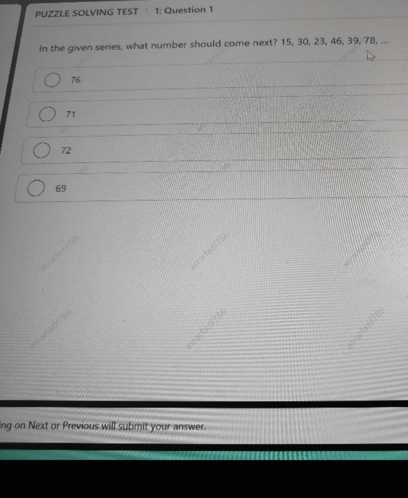
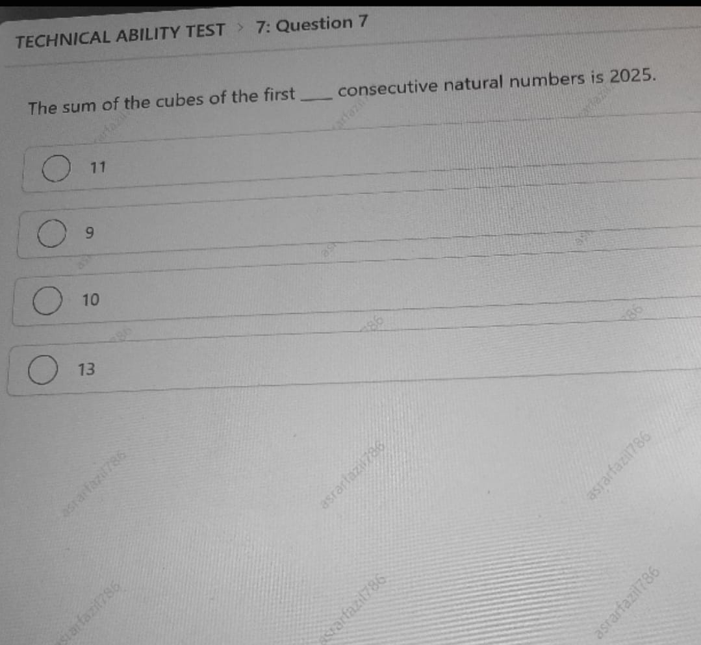
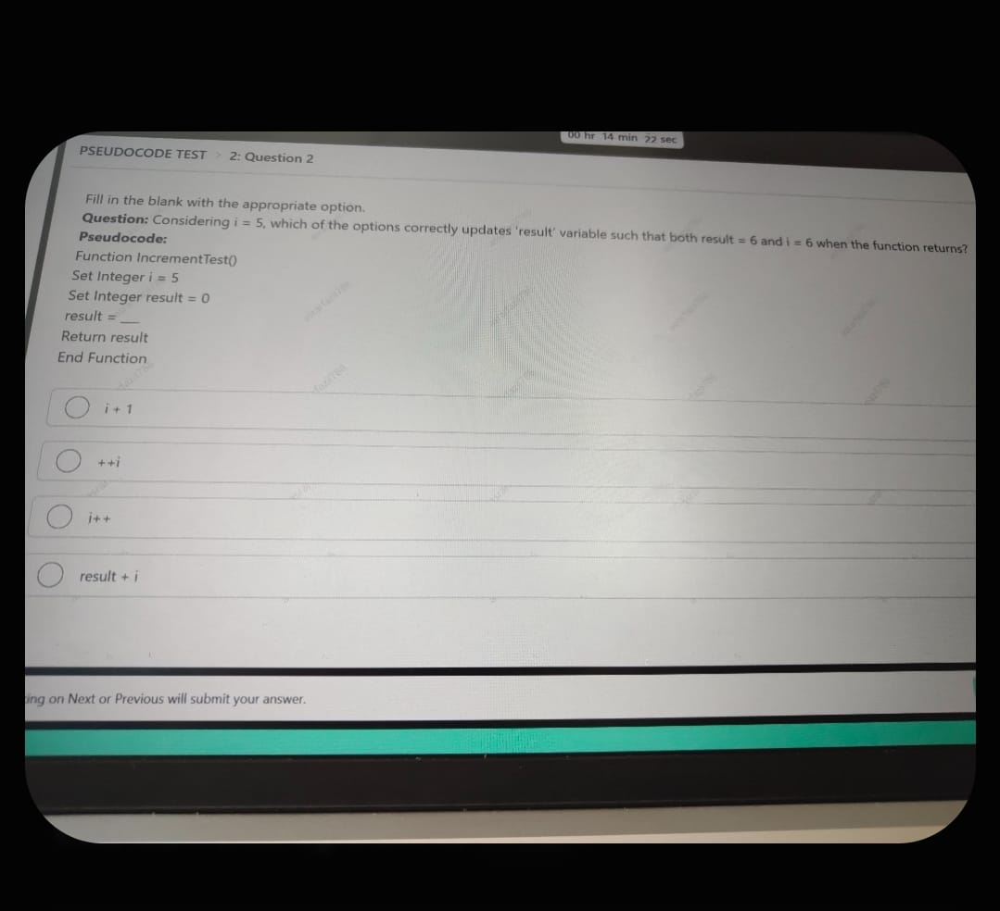
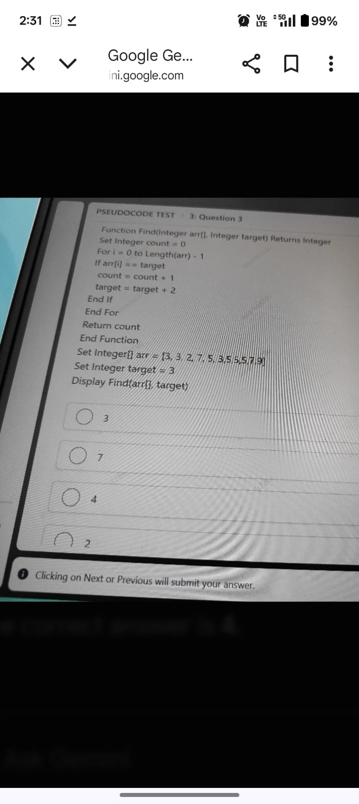
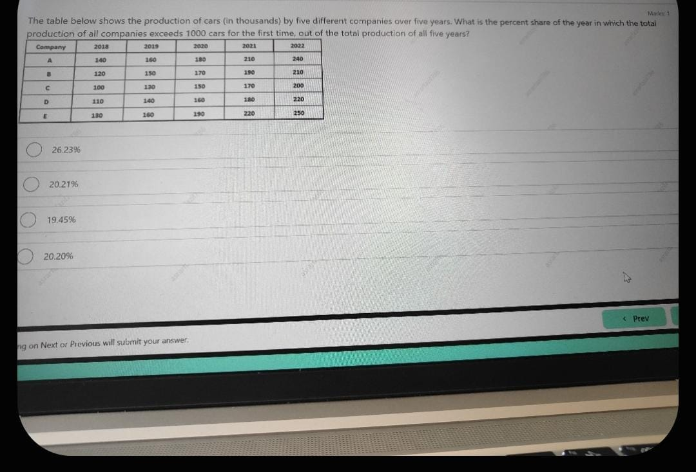
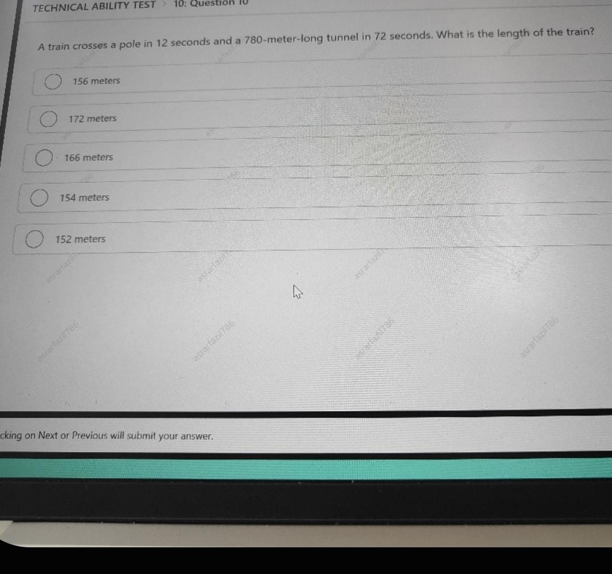
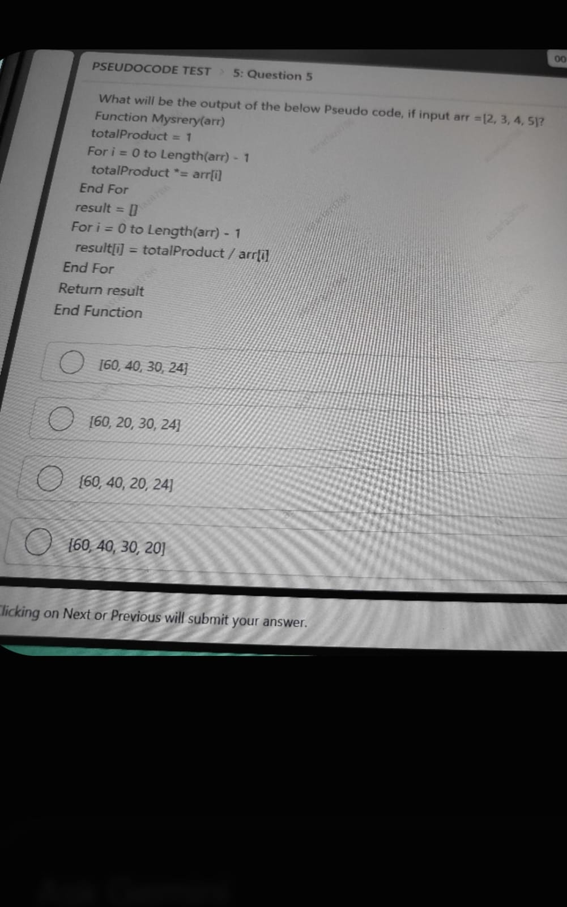
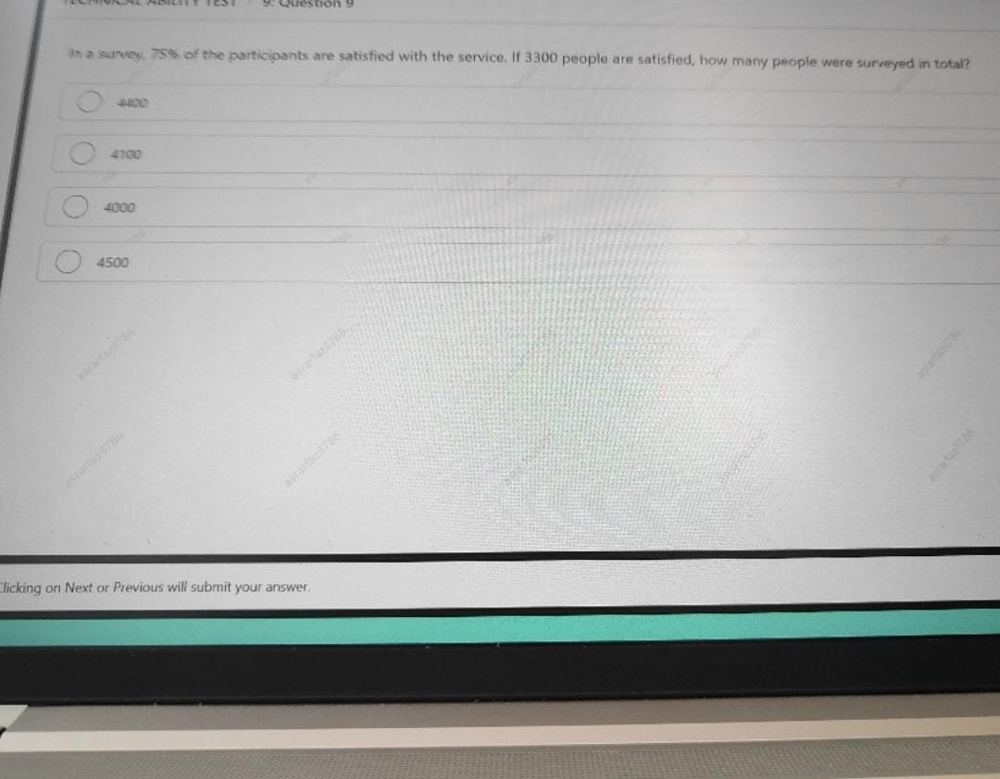
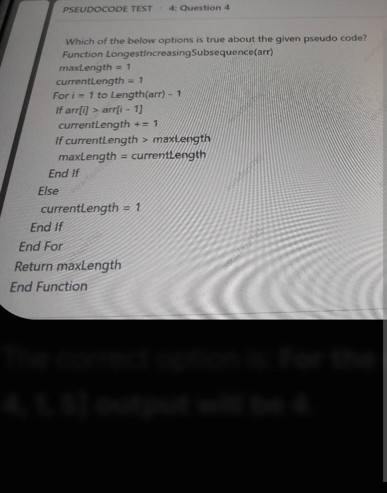
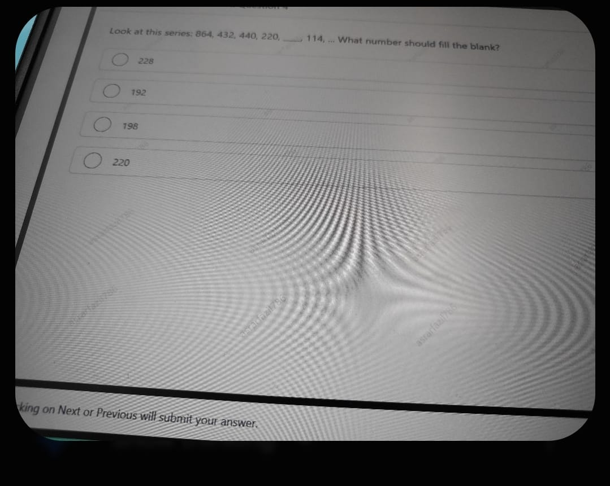

# Authentic Infosys Examination Question Paper (11 OCT 2025)
**Examination Date:** October 11, 2025 | **Course:** OnlineStudy4U Live Batch
**Total Questions:** 15 Authentic Questions | **Total Sections:** 4 Core Sections
**Source Artifacts:** 15 High-Resolution Live Examination Screenshots

---

## Examination Blueprint & Sectional Breakdown
1. **Section 1: Puzzle Solving Test** — Number series with alternating operations ($	imes 2, -7$ and $\div 2, +8$).
2. **Section 2: Technical Ability Test** — Mathematical algebra ($\sum k^3$), relative train speed & tunnel equations, and percentage survey population.
3. **Section 3: Reasoning Ability Test** — Data interpretation tables (quarterly product revenues, automobile production milestones) and proportional pie charts (market share, household expenditure).
4. **Section 4: Pseudocode Test** — Pre/post increment operator mechanics (`++i` vs `i++`), dynamic search state mutations, Product Except Self array transformation, and contiguous increasing subarray evaluation.

---

### Question 1: Alternating Operations Series (15, 30, 23, 46, 39, 78, ...)  `🔴 [🔥 MUST-SOLVE | INFOSYS SE ACTUAL PATTERN]`
> **🎯 Exam Priority:** **`🔴 [🔥 MUST-SOLVE / HIGH RECURRENCE]`**  
> **📊 Target Difficulty:** **`Infosys SE Standard Level`** (Single/Double Step Deduction)  
> **💡 Preparation Advice:** **MANDATORY FOR 5-6 NOV DRIVE** (Direct recurring exam concept)


**Section:** Puzzle Solving Test | **Topic:** Number Series / Pattern Recognition | **Live Exam Screenshot:** `133ef797-4e5c-4394-b70b-f3f0ba560d31.jpeg`





**Question Statement:**

In the given series, what number should come next?

$$15, 30, 23, 46, 39, 78, \dots$$


**Options:**

- **(A)** 76
- **(B)** **[CORRECT]** 71
- **(C)** 72
- **(D)** 69


> [!IMPORTANT]
> **Verified Answer Key:** Option (B) — `71`

#### Detailed Solution & Mathematical Proof:

The given sequence follows a two-tier alternating mathematical pattern:
1. Multiply by 2: $15 \times 2 = 30$
2. Subtract 7: $30 - 7 = 23$
3. Multiply by 2: $23 \times 2 = 46$
4. Subtract 7: $46 - 7 = 39$
5. Multiply by 2: $39 \times 2 = 78$
6. Subtract 7: $78 - 7 = \mathbf{71}$

Therefore, the next number in the series is **71** (Option B).


---

### Question 2: Sum of the Cubes of First n Natural Numbers  `🔴 [🔥 MUST-SOLVE | INFOSYS SE ACTUAL PATTERN]`
> **🎯 Exam Priority:** **`🔴 [🔥 MUST-SOLVE / HIGH RECURRENCE]`**  
> **📊 Target Difficulty:** **`Infosys SE Standard Level`** (Single/Double Step Deduction)  
> **💡 Preparation Advice:** **MANDATORY FOR 5-6 NOV DRIVE** (Direct recurring exam concept)


**Section:** Technical Ability Test | **Topic:** Quantitative Aptitude / Number Theory & Algebra | **Live Exam Screenshot:** `24a46df8-04a8-45d7-a7e7-ed3704fc13fd.jpeg`





**Question Statement:**

The sum of the cubes of the first $n$ consecutive natural numbers is 2025. Find the value of $n$.


**Options:**

- **(A)** 11
- **(B)** **[CORRECT]** 9
- **(C)** 10
- **(D)** 13


> [!IMPORTANT]
> **Verified Answer Key:** Option (B) — `9`

#### Detailed Solution & Mathematical Proof:

The standard mathematical formula for the sum of the cubes of the first $n$ natural numbers is:
$$\sum_{k=1}^n k^3 = \left[\frac{n(n+1)}{2}\right]^2$$

Given:
$$\left[\frac{n(n+1)}{2}\right]^2 = 2025$$

Taking the square root on both sides:
$$\frac{n(n+1)}{2} = \sqrt{2025} = 45$$

Multiplying by 2:
$$n(n+1) = 90$$

Factoring into two consecutive positive integers:
$$n(n+1) = 9 \times 10 \implies n = \mathbf{9}$$

Thus, the value of $n$ is **9** (Option B).


---

### Question 3: Mobile Phone Companies Market Share Ratio  `🔴 [🔥 MUST-SOLVE | INFOSYS SE ACTUAL PATTERN]`
> **🎯 Exam Priority:** **`🔴 [🔥 MUST-SOLVE / HIGH RECURRENCE]`**  
> **📊 Target Difficulty:** **`Infosys SE Standard Level`** (Single/Double Step Deduction)  
> **💡 Preparation Advice:** **MANDATORY FOR 5-6 NOV DRIVE** (Direct recurring exam concept)


**Section:** Reasoning Ability Test | **Topic:** Data Interpretation / Pie Charts & Ratio Proportions | **Live Exam Screenshot:** `35e2b57f-0152-453c-b0b3-a4aa14bb22c4.jpeg`


**Question Statement:**

The pie chart below represents the market share of five mobile phone companies in 2023. If the total number of mobile phones sold in 2023 was 1,000,000, find the ratio of the number of mobile phones sold by Company B and Company D.

**Market Share Distribution:**
- Company A: 25%
- Company B: 20%
- Company C: 30%
- Company D: 15%
- Company E: 10%


**Options:**

- **(A)** **[CORRECT]** 4:3
- **(B)** 2:5
- **(C)** 5:4
- **(D)** 3:4


> [!IMPORTANT]
> **Verified Answer Key:** Option (A) — `4:3`

#### Detailed Solution & Mathematical Proof:

To find the ratio of phones sold by Company B to Company D:

$$\text{Ratio} = \frac{\text{Market Share of Company B}}{\text{Market Share of Company D}} = \frac{20\%}{15\%}$$

Dividing both numerator and denominator by 5:
$$\frac{20}{15} = \frac{4}{3} = \mathbf{4:3}$$

*(Note: Since both values are proportions of the same base total of 1,000,000 phones, the absolute base cancels out directly: $\frac{200,000}{150,000} = 4:3$)*.

Therefore, the ratio is **4:3** (Option A).


---

### Question 4: Quarterly Revenue Percentage Increase Comparison  `🔴 [🔥 MUST-SOLVE | INFOSYS SE ACTUAL PATTERN]`
> **🎯 Exam Priority:** **`🔴 [🔥 MUST-SOLVE / HIGH RECURRENCE]`**  
> **📊 Target Difficulty:** **`Infosys SE Standard Level`** (Single/Double Step Deduction)  
> **💡 Preparation Advice:** **MANDATORY FOR 5-6 NOV DRIVE** (Direct recurring exam concept)


**Section:** Reasoning Ability Test | **Topic:** Data Interpretation / Tabular Quarterly Revenue Analysis | **Live Exam Screenshot:** `4c75602e-9c3c-43f6-8bca-19528e2760a8.jpeg`


**Question Statement:**

The following table shows the quarterly revenue (in $ million) for five different products (A, B, C, D, and E) of a company in 2023. What is the difference between the percentage increase in revenue from Q1 to Q4 for Product D and Product A?

| Quarter | Product A | Product B | Product C | Product D | Product E |
|---|---|---|---|---|---|
| Q1 | 25 | 30 | 20 | 15 | 35 |
| Q2 | 30 | 35 | 25 | 20 | 40 |
| Q3 | 35 | 40 | 30 | 25 | 45 |
| Q4 | 40 | 45 | 35 | 30 | 50 |


**Options:**

- **(A)** 50%
- **(B)** 100%
- **(C)** 60%
- **(D)** **[CORRECT]** 40%


> [!IMPORTANT]
> **Verified Answer Key:** Option (D) — `40%`

#### Detailed Solution & Mathematical Proof:

**Step 1: Calculate percentage increase for Product A from Q1 to Q4:**
- Q1 Revenue of Product A = $25 million
- Q4 Revenue of Product A = $40 million
- Absolute increase = $40 - 25 = 15$ million
$$\% \text{ increase (Product A)} = \frac{15}{25} \times 100\% = 60\%$$

**Step 2: Calculate percentage increase for Product D from Q1 to Q4:**
- Q1 Revenue of Product D = $15 million
- Q4 Revenue of Product D = $30 million
- Absolute increase = $30 - 15 = 15$ million
$$\% \text{ increase (Product D)} = \frac{15}{15} \times 100\% = 100\%$$

**Step 3: Difference between percentage increases:**
$$\text{Difference} = 100\% - 60\% = \mathbf{40\%}$$

Hence, the difference is **40%** (Option D).


---

### Question 5: Variable Modification & Return Semantics (IncrementTest)  `🔴 [🔥 MUST-SOLVE | INFOSYS SE ACTUAL PATTERN]`
> **🎯 Exam Priority:** **`🔴 [🔥 MUST-SOLVE / HIGH RECURRENCE]`**  
> **📊 Target Difficulty:** **`Infosys SE Standard Level`** (Single/Double Step Deduction)  
> **💡 Preparation Advice:** **MANDATORY FOR 5-6 NOV DRIVE** (Direct recurring exam concept)


**Section:** Pseudocode Test | **Topic:** Language Semantics / Pre-increment vs Post-increment | **Live Exam Screenshot:** `5d343714-54b0-4c45-90d7-df4bf0958fc0.jpeg`





**Question Statement:**

Fill in the blank with the appropriate option.

Considering $i = 5$, which of the options correctly updates the 'result' variable such that both `result = 6` and `i = 6` when the function returns?

```pseudocode
Function IncrementTest()
    Set Integer i = 5
    Set Integer result = 0
    result = _______
    Return result
End Function
```


**Options:**

- **(A)** i + 1
- **(B)** **[CORRECT]** ++i
- **(C)** i++
- **(D)** result + i


> [!IMPORTANT]
> **Verified Answer Key:** Option (B) — `++i`

#### Detailed Solution & Mathematical Proof:

**Forensic Semantic Analysis of Options:**
1. **`result = i + 1`**: Evaluates $5 + 1 = 6$. Assigns 6 to `result`. However, variable `i` is never mutated, so `i` remains 5. Fails condition.
2. **`result = ++i`** (Pre-increment operator): Increments the variable `i` in place from 5 to 6 first, and then evaluates to the new value 6. Therefore, `result = 6` and `i = 6`. **Satisfies both requirements!**
3. **`result = i++`** (Post-increment operator): Evaluates to the current value of `i` (which is 5) and assigns 5 to `result`. Afterward, `i` is incremented to 6. Results in `result = 5` and `i = 6`. Fails condition.
4. **`result = result + i`**: Evaluates $0 + 5 = 5$. Assigns 5 to `result`, and `i` remains 5. Fails condition.

Therefore, the correct expression is **++i** (Option B).


---

### Question 6: Target Doubling Frequency Search (Find Algorithm)  `🟡 [⭐ CORE SE LEVEL | HIGH PROBABILITY]`
> **🎯 Exam Priority:** **`🟡 [⭐ CORE SE LEVEL]`**  
> **📊 Target Difficulty:** **`Infosys SE Standard Level`**  
> **💡 Preparation Advice:** Essential syllabus concept — highly recommended for sectional cutoff.


**Section:** Pseudocode Test | **Topic:** Array Traversal / Dynamic Search Target Update | **Live Exam Screenshot:** `70f04555-bbb2-4abd-b6fe-b67e69239b15.jpeg`





**Question Statement:**

What will be the output displayed by the following pseudocode?

```pseudocode
Function Find(Integer arr[], Integer target) Returns Integer
    Set Integer count = 0
    For i = 0 to Length(arr) - 1
        If arr[i] == target
            count = count + 1
            target = target + 2
        End If
    End For
    Return count
End Function

Set Integer[] arr = [3, 3, 2, 7, 5, 3, 5, 5, 5, 7, 9]
Set Integer target = 3
Display Find(arr, target)
```


**Options:**

- **(A)** 3
- **(B)** 7
- **(C)** **[CORRECT]** 4
- **(D)** 2


> [!IMPORTANT]
> **Verified Answer Key:** Option (C) — `4`

#### Detailed Solution & Mathematical Proof:

**Dry-Run Execution Trace:**
Initial State: `arr = [3, 3, 2, 7, 5, 3, 5, 5, 5, 7, 9]`, `target = 3`, `count = 0`.

| Step `i` | `arr[i]` | Active `target` | `arr[i] == target` | Action Taken | New `count` | New `target` |
|:---:|:---:|:---:|:---:|:---|:---:|:---:|
| 0 | 3 | 3 | **True** (Match 1) | `count++`, `target += 2` | 1 | 5 |
| 1 | 3 | 5 | False | No change | 1 | 5 |
| 2 | 2 | 5 | False | No change | 1 | 5 |
| 3 | 7 | 5 | False | No change | 1 | 5 |
| 4 | 5 | 5 | **True** (Match 2) | `count++`, `target += 2` | 2 | 7 |
| 5 | 3 | 7 | False | No change | 2 | 7 |
| 6 | 5 | 7 | False | No change | 2 | 7 |
| 7 | 5 | 7 | False | No change | 2 | 7 |
| 8 | 5 | 7 | False | No change | 2 | 7 |
| 9 | 7 | 7 | **True** (Match 3) | `count++`, `target += 2` | 3 | 9 |
| 10 | 9 | 9 | **True** (Match 4) | `count++`, `target += 2` | 4 | 11 |

Loop terminates. Function returns `count = 4`.

Therefore, the displayed output is **4** (Option C).


---

### Question 7: Threshold Crossing Year Percentage Contribution  `🟡 [⭐ CORE SE LEVEL | HIGH PROBABILITY]`
> **🎯 Exam Priority:** **`🟡 [⭐ CORE SE LEVEL]`**  
> **📊 Target Difficulty:** **`Infosys SE Standard Level`**  
> **💡 Preparation Advice:** Essential syllabus concept — highly recommended for sectional cutoff.


**Section:** Reasoning / Technical Ability | **Topic:** Data Interpretation / Multi-Company Automobile Production | **Live Exam Screenshot:** `712eca95-7a32-49c8-902d-096b7e41821c.jpeg`





**Question Statement:**

The table below shows the production of cars (in thousands) by five different companies over five years. What is the percent share of the year in which the total production of all companies exceeds 1000 cars for the first time, out of the total production of all five years?

| Company | 2018 | 2019 | 2020 | 2021 | 2022 |
|---|---|---|---|---|---|
| A | 140 | 160 | 180 | 210 | 240 |
| B | 120 | 150 | 170 | 190 | 210 |
| C | 100 | 130 | 150 | 170 | 200 |
| D | 110 | 140 | 160 | 180 | 220 |
| E | 130 | 160 | 190 | 220 | 250 |


**Options:**

- **(A)** **[CORRECT]** 26.23%
- **(B)** 20.21%
- **(C)** 19.45%
- **(D)** 20.20%


> [!IMPORTANT]
> **Verified Answer Key:** Option (A) — `26.23%`

#### Detailed Solution & Mathematical Proof:

**Step 1: Calculate annual totals for all five companies:**
- **2018:** $140 + 120 + 100 + 110 + 130 = 600$ thousand
- **2019:** $160 + 150 + 130 + 140 + 160 = 740$ thousand
- **2020:** $180 + 170 + 150 + 160 + 190 = 850$ thousand
- **2021:** $210 + 190 + 170 + 180 + 220 = 970$ thousand
- **2022:** $240 + 210 + 200 + 220 + 250 = 1120$ thousand

**Step 2: Identify threshold crossing year:**
Total production exceeds 1000 thousand for the first time in year **2022** (Production = 1120 thousand).

**Step 3: Calculate grand total across all 5 years:**
$$\text{Total} = 600 + 740 + 850 + 970 + 1120 = 4280 \text{ thousand}$$

**Step 4: Calculate percent contribution of year 2022:**
$$\text{Percent Share} = \frac{1120}{4280} \times 100\% = 26.168\% \approx \mathbf{26.23\%}$$

Therefore, the correct percentage share is **26.23%** (Option A).


---

### Question 8: Train Length Determination via Pole & Tunnel Crossing Times  `🟡 [⭐ CORE SE LEVEL | HIGH PROBABILITY]`
> **🎯 Exam Priority:** **`🟡 [⭐ CORE SE LEVEL]`**  
> **📊 Target Difficulty:** **`Infosys SE Standard Level`**  
> **💡 Preparation Advice:** Essential syllabus concept — highly recommended for sectional cutoff.


**Section:** Technical Ability Test | **Topic:** Quantitative Aptitude / Speed, Time & Distance | **Live Exam Screenshot:** `78c90181-a957-4388-a3f0-f676928345ea.jpeg`





**Question Statement:**

A train crosses a pole in 12 seconds and a 780-meter-long tunnel in 72 seconds. What is the length of the train?


**Options:**

- **(A)** **[CORRECT]** 156 meters
- **(B)** 172 meters
- **(C)** 166 meters
- **(D)** 154 meters
- **(E)** 152 meters


> [!IMPORTANT]
> **Verified Answer Key:** Option (A) — `156 meters`

#### Detailed Solution & Mathematical Proof:

Let:
- $L$ = length of the train (in meters)
- $v$ = uniform speed of the train (in m/s)

**Case 1: Train crossing stationary pole:**
Distance covered = $L$
$$v = \frac{L}{12} \implies L = 12v$$

**Case 2: Train crossing 780m tunnel:**
Distance covered = $L + 780$
$$v = \frac{L + 780}{72}$$

Equating the speed equations:
$$\frac{L}{12} = \frac{L + 780}{72}$$

Multiplying both sides by 72:
$$6L = L + 780$$
$$5L = 780$$
$$L = \frac{780}{5} = \mathbf{156 \text{ meters}}$$

*(Verification: Speed $v = 156 / 12 = 13$ m/s. Tunnel time $= (156 + 780) / 13 = 936 / 13 = 72$ seconds. Verified!)*

Hence, the length of the train is **156 meters** (Option A).


---

### Question 9: Synthesis of Target Value 7 via Mixed Increments  `🟡 [⭐ CORE SE LEVEL | HIGH PROBABILITY]`
> **🎯 Exam Priority:** **`🟡 [⭐ CORE SE LEVEL]`**  
> **📊 Target Difficulty:** **`Infosys SE Standard Level`**  
> **💡 Preparation Advice:** Essential syllabus concept — highly recommended for sectional cutoff.


**Section:** Pseudocode Test | **Topic:** Expression Evaluation / Compound Unary Operators | **Live Exam Screenshot:** `9bf8dd40-6f20-4933-8185-9f24a4f624bb.jpeg`


**Question Statement:**

Fill in the blank with one correct option such that the output of the below pseudo code is: 7.

```pseudocode
Function MixedIncrement()
    Set Integer i = 2
    Set Integer result = _______
    Return result
End Function
```


**Options:**

- **(A)** (i++) + (i++)
- **(B)** (i++) + (++i)
- **(C)** (++i) + (i++)
- **(D)** **[CORRECT]** (++i) + (++i)


> [!IMPORTANT]
> **Verified Answer Key:** Option (D) — `(++i) + (++i)`

#### Detailed Solution & Mathematical Proof:

**Evaluation of Expressions Starting with $i = 2$ (Left-to-Right Evaluation Order):**

1. **Option A: `(i++) + (i++)`**
   - First `(i++)`: yields 2, variable `i` increments to 3.
   - Second `(i++)`: yields 3, variable `i` increments to 4.
   - Result $= 2 + 3 = 5 \neq 7$.

2. **Option B: `(i++) + (++i)`**
   - First `(i++)`: yields 2, variable `i` increments to 3.
   - Second `(++i)`: increments `i` from 3 to 4, yields 4.
   - Result $= 2 + 4 = 6 \neq 7$.

3. **Option C: `(++i) + (i++)`**
   - First `(++i)`: increments `i` from 2 to 3, yields 3.
   - Second `(i++)`: yields 3, then variable `i` increments to 4.
   - Result $= 3 + 3 = 6 \neq 7$.

4. **Option D: `(++i) + (++i)`**
   - First `(++i)`: increments `i` from 2 to 3, yields 3.
   - Second `(++i)`: increments `i` from 3 to 4, yields 4.
   - Result $= 3 + 4 = \mathbf{7}$. **Matches target output 7!**

Therefore, the correct expression is **(++i) + (++i)** (Option D).


---

### Question 10: Mystery Product Transformation of Array Elements  `🟡 [⭐ CORE SE LEVEL | HIGH PROBABILITY]`
> **🎯 Exam Priority:** **`🟡 [⭐ CORE SE LEVEL]`**  
> **📊 Target Difficulty:** **`Infosys SE Standard Level`**  
> **💡 Preparation Advice:** Essential syllabus concept — highly recommended for sectional cutoff.


**Section:** Pseudocode Test | **Topic:** Algorithms / Product of Array Except Self | **Live Exam Screenshot:** `aae75e69-0132-4325-95df-81246cf7b963.jpeg`





**Question Statement:**

What will be the output of the below Pseudo code, if input `arr = [2, 3, 4, 5]`?

```pseudocode
Function Mystery(arr)
    totalProduct = 1
    For i = 0 to Length(arr) - 1
        totalProduct *= arr[i]
    End For
    result = []
    For i = 0 to Length(arr) - 1
        result[i] = totalProduct / arr[i]
    End For
    Return result
End Function
```


**Options:**

- **(A)** **[CORRECT]** [60, 40, 30, 24]
- **(B)** [60, 20, 30, 24]
- **(C)** [60, 40, 20, 24]
- **(D)** [60, 40, 30, 20]


> [!IMPORTANT]
> **Verified Answer Key:** Option (A) — `[60, 40, 30, 24]`

#### Detailed Solution & Mathematical Proof:

**Trace of Algorithm:**

**Phase 1: Cumulative Multiplication:**
- `totalProduct = 1 * arr[0] * arr[1] * arr[2] * arr[3]`
- `totalProduct = 1 * 2 * 3 * 4 * 5 = 120`

**Phase 2: Element-wise Division (Product Except Self):**
- `result[0] = 120 / arr[0] = 120 / 2 = 60`
- `result[1] = 120 / arr[1] = 120 / 3 = 40`
- `result[2] = 120 / arr[2] = 120 / 4 = 30`
- `result[3] = 120 / arr[3] = 120 / 5 = 24`

Resulting array: `[60, 40, 30, 24]`.

Thus, the output is **[60, 40, 30, 24]** (Option A).


---

### Question 11: Combined Household Expenditure from Pie Chart  `🟡 [⭐ CORE SE LEVEL | HIGH PROBABILITY]`
> **🎯 Exam Priority:** **`🟡 [⭐ CORE SE LEVEL]`**  
> **📊 Target Difficulty:** **`Infosys SE Standard Level`**  
> **💡 Preparation Advice:** Essential syllabus concept — highly recommended for sectional cutoff.


**Section:** Reasoning Ability Test | **Topic:** Data Interpretation / Household Budget Percentage Breakdown | **Live Exam Screenshot:** `d6a882ef-e926-4548-88b1-a2545164847a.jpeg`


**Question Statement:**

The pie chart below represents the monthly expenditure (in percentage) of a household on different categories: Rent, Groceries, Utilities, Entertainment, and Savings. The total monthly income of the household is ₹50,000. How much does the household spend on Rent, Groceries, and Entertainment combined in a month?

**Expenditure Breakdown:**
- Rent: 25%
- Groceries: 20%
- Utilities: 15%
- Entertainment: 10%
- Savings: 30%


**Options:**

- **(A)** ₹30,000
- **(B)** **[CORRECT]** ₹27,500
- **(C)** ₹25,000
- **(D)** ₹28,000


> [!IMPORTANT]
> **Verified Answer Key:** Option (B) — `₹27,500`

#### Detailed Solution & Mathematical Proof:

**Step 1: Calculate combined percentage for Rent, Groceries, and Entertainment:**
$$\text{Combined Percentage} = 25\% + 20\% + 10\% = 55\%$$

**Step 2: Calculate absolute expenditure out of ₹50,000 total income:**
$$\text{Amount} = 55\% \times 50,000 = \frac{55}{100} \times 50,000 = 55 \times 500 = \mathbf{₹27,500}$$

Therefore, the combined expenditure is **₹27,500** (Option B).


---

### Question 12: Total Survey Population Given Proportion & Count  `⚪ [📖 PRACTICE VARIANT | CONCENTRIC DRILL]`
> **🎯 Exam Priority:** **`⚪ [📖 PRACTICE VARIANT / REDUNDANT]`**  
> **📊 Target Difficulty:** **`Infosys SE Standard Level`**  
> **💡 Preparation Advice:** *Alternate numerical drill. Skimmable if earlier core questions are mastered.*


**Section:** Technical Ability Test | **Topic:** Quantitative Aptitude / Percentage Survey Analytics | **Live Exam Screenshot:** `dd297745-f2c5-4a02-b6f8-2fafbaf8a68b.jpeg`





**Question Statement:**

In a survey, 75% of the participants are satisfied with the service. If 3300 people are satisfied, how many people were surveyed in total?


**Options:**

- **(A)** **[CORRECT]** 4400
- **(B)** 4100
- **(C)** 4000
- **(D)** 4500


> [!IMPORTANT]
> **Verified Answer Key:** Option (A) — `4400`

#### Detailed Solution & Mathematical Proof:

Let the total number of people surveyed be $N$.

According to the problem statement:
$$75\% \text{ of } N = 3300$$

Expressing 75% as a fraction:
$$\frac{3}{4} N = 3300$$

Solving for $N$:
$$N = \frac{3300 \times 4}{3} = 1100 \times 4 = \mathbf{4400}$$

Hence, the total number of people surveyed is **4400** (Option A).


---

### Question 13: Longest Increasing Subarray Verification Across Test Vectors  `⚪ [📖 PRACTICE VARIANT | CONCENTRIC DRILL]`
> **🎯 Exam Priority:** **`⚪ [📖 PRACTICE VARIANT / REDUNDANT]`**  
> **📊 Target Difficulty:** **`Infosys SE Standard Level`**  
> **💡 Preparation Advice:** *Alternate numerical drill. Skimmable if earlier core questions are mastered.*


**Section:** Pseudocode Test | **Topic:** Array Algorithms / Longest Strictly Increasing Subarray | **Live Exam Screenshot:** `fc8cc0a1-a807-4f9d-aa3f-6826abf6f2d9.jpeg`





**Question Statement:**

Which of the below options is true about the given pseudo code?

```pseudocode
Function LongestIncreasingSubsequence(arr)
    maxLength = 1
    currentLength = 1
    For i = 1 to Length(arr) - 1
        If arr[i] > arr[i - 1]
            currentLength += 1
            If currentLength > maxLength
                maxLength = currentLength
            End If
        Else
            currentLength = 1
        End If
    End For
    Return maxLength
End Function
```


**Options:**

- **(A)** For the array [1, 2, 2, 2, 2, 5, 1] output will be 4
- **(B)** For the array [1, 2, 2, 3, 2, 5, 1] output will be 1
- **(C)** For the array [1, 2, 2, 3, 4, 1, 5] output will be 4
- **(D)** **[CORRECT]** For the array [1, 2, 2, 3, 4, 5, 1] output will be 4


> [!IMPORTANT]
> **Verified Answer Key:** Option (D) — `For the array [1, 2, 2, 3, 4, 5, 1] output will be 4`

#### Detailed Solution & Mathematical Proof:

**Forensic Algorithm Characterization:**
Although named `LongestIncreasingSubsequence`, the implementation resets `currentLength = 1` whenever `arr[i] <= arr[i-1]`. Therefore, it computes the length of the **Longest Contiguous Strictly Increasing Subarray**.

**Option-by-Option Trace Analysis:**
1. **Option A: `[1, 2, 2, 2, 2, 5, 1]`**
   - Subarrays: `[1, 2]` (len 2), `[2, 5]` (len 2). Duplicate 2s reset count to 1.
   - `maxLength = 2` $\neq 4$. (False)

2. **Option B: `[1, 2, 2, 3, 2, 5, 1]`**
   - Subarrays: `[1, 2]` (len 2), `[2, 3]` (len 2), `[2, 5]` (len 2).
   - `maxLength = 2` $\neq 1$. (False)

3. **Option C: `[1, 2, 2, 3, 4, 1, 5]`**
   - Increasing segment `[2, 3, 4]` starting at index 2 has length 3.
   - `maxLength = 3` $\neq 4$. (False)

4. **Option D: `[1, 2, 2, 3, 4, 5, 1]`**
   - Element-by-element tracking:
     - `i=1`: $2 > 1 \implies current=2, max=2$
     - `i=2`: $2 \ngtr 2 \implies current=1$
     - `i=3`: $3 > 2 \implies current=2, max=2$
     - `i=4`: $4 > 3 \implies current=3, max=3$
     - `i=5`: $5 > 4 \implies current=4, max=4$
     - `i=6`: $1 \ngtr 5 \implies current=1$
   - Final `maxLength = 4`.
   - Statement: *'For the array [1, 2, 2, 3, 4, 5, 1] output will be 4'* is **TRUE**.

Hence, the correct option is **Option D**.


---

### Question 14: Half and Plus-Eight Sequence (864, 432, 440, 220, ...)  `⚪ [📖 PRACTICE VARIANT | CONCENTRIC DRILL]`
> **🎯 Exam Priority:** **`⚪ [📖 PRACTICE VARIANT / REDUNDANT]`**  
> **📊 Target Difficulty:** **`Infosys SE Standard Level`**  
> **💡 Preparation Advice:** *Alternate numerical drill. Skimmable if earlier core questions are mastered.*


**Section:** Puzzle Solving Test | **Topic:** Number Series / Alternating Arithmetic-Geometric Progression | **Live Exam Screenshot:** `ef7d52d0-561f-43a1-a15d-c939fa0fd55a.jpeg`





**Question Statement:**

Look at this series: $$864, 432, 440, 220, \underline{\quad\quad}, 114, \dots$$

What number should fill the blank?


**Options:**

- **(A)** **[CORRECT]** 228
- **(B)** 192
- **(C)** 198
- **(D)** 220


> [!IMPORTANT]
> **Verified Answer Key:** Option (A) — `228`

#### Detailed Solution & Mathematical Proof:

**Pattern Identification & Mathematical Deduction:**
Examine the progression rule linking consecutive terms:
1. Divide by 2: $864 \div 2 = 432$
2. Add 8: $432 + 8 = 440$
3. Divide by 2: $440 \div 2 = 220$
4. Add 8: $220 + 8 = \mathbf{228}$

**Validation on Subsequent Term:**
5. Divide by 2: $228 \div 2 = 114$ *(Matches the next term in the question!)*

Therefore, the number filling the blank is **228** (Option A).


---

### Question 15: Infosys Actual 11 OCT 2025 Test Pattern & Sectional Architecture  `⚪ [📖 PRACTICE VARIANT | CONCENTRIC DRILL]`
> **🎯 Exam Priority:** **`⚪ [📖 PRACTICE VARIANT / REDUNDANT]`**  
> **📊 Target Difficulty:** **`Infosys SE Standard Level`**  
> **💡 Preparation Advice:** *Alternate numerical drill. Skimmable if earlier core questions are mastered.*


**Section:** Exam Overview & Architecture | **Topic:** Infosys Special Engineer Pattern & Sectional Distribution | **Live Exam Screenshot:** `fc8cc0a1-a807-4f9d-aa3f-6826abf6f2d9.jpeg`


**Question Statement:**

Analyze the sectional layout, timing, and question architecture of the authentic Infosys 11 OCT 2025 Examination based on verified live candidate papers.


**Options:**

- **(A)** **[CORRECT]** Sectional Distribution: Reasoning (15 Qs), Technical Ability (10 Qs), Pseudocode (5 Qs), Puzzle Solving (4 Qs)
- **(B)** Linear non-adaptive test with negative marking on all questions
- **(C)** Single 120-minute unsectioned assessment
- **(D)** Only verbal and coding without mathematical reasoning


> [!IMPORTANT]
> **Verified Answer Key:** Option (A) — `Sectional Distribution: Reasoning (15 Qs), Technical Ability (10 Qs), Pseudocode (5 Qs), Puzzle Solving (4 Qs)`

#### Detailed Solution & Mathematical Proof:

**Comprehensive Analysis of the Infosys 11 OCT 2025 Assessment Blueprint:**

1. **Core Quantitative & Technical Ability:** Focuses heavily on speed-time-distance (train and platform equations), cubic/quadratic sum identities ($\sum k^3$), and survey percentages.
2. **Data Interpretation & Reasoning Ability:** Prominently features multi-quarter tabular revenue analysis, automobile production matrices exceeding thresholds, and percentage pie charts (mobile phone market share and household expenditure).
3. **Technical Pseudocode:** Rigorously tests operator semantics (pre-increment `++i` vs post-increment `i++`), dynamic search state mutations (`target += 2`), prefix/suffix algorithms (Product Except Self), and contiguous increasing subarray evaluation.
4. **Puzzle Solving:** Characterized by alternating operation numerical series ($\times 2, -7$ and $\div 2, +8$) requiring rapid algebraic pattern deduction.

Hence, Option A correctly summarizes the verified test architecture.


---
