# Infosys Mock Test Series — Complete Day 01 to Day 09 Full-Length Simulation Compendium

> **Total Mock Questions**: 504 | **Total Mock Exams**: 29 Full Tests | **Pattern**: Official Infosys SE Exam Pattern

## 1. Exam Schedule & Sectional Architecture

| Day / Mock Exam | Section Name | Questions Count | Topic Focus |
|:---|:---|:---:|:---|
| **Day 01** | 1. Full Length Logical Reasoning Mock ( Video Sol) | **20** | Comprehensive Assessment |
| **Day 01** | 1. Full Length Numerical Ability with Video Solution- Level -Medium | **20** | Comprehensive Assessment |
| **Day 01** | 1. Full length verbal ability | **25** | Comprehensive Assessment |
| **Day 02** | 2. Full length Logical Reasoning (with sol) | **15** | Comprehensive Assessment |
| **Day 02** | 2. Full length Quantitative Aptitude (with sol) Level -2 | **14** | Comprehensive Assessment |
| **Day 02** | 2. Full length Verbal Ability | **20** | Comprehensive Assessment |
| **Day 03** | 3. Full Length Logical Reasoning Mock(with sol) | **29** | Comprehensive Assessment |
| **Day 03** | 3. Full length Quantitative Aptitude (with sol) Level -1-2 | **13** | Comprehensive Assessment |
| **Day 03** | 3. Full Length Verbala Ability Mock | **20** | Comprehensive Assessment |
| **Day 04** | 4. Full Length Logical Reasoning(with sol) | **25** | Comprehensive Assessment |
| **Day 04** | 4. Full Length Verbal Ability | **20** | Comprehensive Assessment |
| **Day 04** | Technical MCQ - Pseudo Codes Based on PYQ With Video Sol | **30** | Comprehensive Assessment |
| **Day 05** | 5 Ful length Logical Reasoning Mock | **20** | Comprehensive Assessment |
| **Day 05** | 5 Ful length Verbal Ability | **15** | Comprehensive Assessment |
| **Day 06** | Logical Puzzle | **5** | Comprehensive Assessment |
| **Day 06** | Pseudo Code | **10** | Comprehensive Assessment |
| **Day 06** | Quantitative Aptitude_Technical Abilty | **10** | Comprehensive Assessment |
| **Day 06** | Verbal Ability | **11** | Comprehensive Assessment |
| **Day 07** | Section III _ Pseudo Codes Based on PYQ | **7** | Comprehensive Assessment |
| **Day 07** | Section IV_ Puzzle Solving | **4** | Comprehensive Assessment |
| **Day 07** | SECTION-I_ MATHEMATICAL ABILITY | **11** | Comprehensive Assessment |
| **Day 07** | SECTION-II_ ANALYTICAL THINKING | **15** | Comprehensive Assessment |
| **Day 08** | Aptitude 01 - All India Mock 01 | **33** | Comprehensive Assessment |
| **Day 08** | Technical MCQ - Pseudo Codes Based on PYQ 01 | **10** | Comprehensive Assessment |
| **Day 09** | Aptitude 02 - All India Mock | **50** | Comprehensive Assessment |
| **Day 09** | Technical MCQ - Pseudo Codes Based on PYQ 02 | **10** | Comprehensive Assessment |
| **Mock Exam** | Infosys English Question asked on 4 Oct 2025 | **12** | Comprehensive Assessment |
| **Top-Level Master RC** | RC01 Reading Comprehension Session | **15** | Comprehensive Assessment |
| **Top-Level Master RC** | RC02 Reading Comprehension Session | **15** | Comprehensive Assessment |
| **TOTAL** | **All 29 Test Modules** | **504** | **Complete Full Simulation** |

---

## Day 01 — 1. Full Length Logical Reasoning Mock ( Video Sol)

### Question 1 (Mock Global Q001)
**ID**: `MOCK_SERIES_Q001` | **Mock Source**: Day 01 — 1. Full Length Logical Reasoning Mock ( Video Sol)

#### Problem Statement
Statements: Some pianos are violins. Some violins are drums. All drums are guitars. No guitar is a flute. Conclusions: I. Some guitars are pianos. II. Some drums are flutes. III.Some pianos are drums. IV. No flute is a drum.

#### Options
- **(A)** None follows
- **(B)** Only I follows
- **(C)** Only either II or IV follows
- **(D)** Only IV follows
- **(E)** None of these

#### Verified Answer
**Option D: Only IV follows**

#### Step-by-Step Solution & Rationale
1. **Venn Diagram & Syllogism Analysis:**
   - Statements:
     - Some pianos ($P$) are violins ($V$).
     - Some violins ($V$) are drums ($D$).
     - All drums ($D$) are guitars ($G$).
     - No guitar ($G$) is a flute ($F$).
   - Conclusions Evaluation:
     - I. No flute is a drum: Since all drums are guitars and no guitar is a flute, no drum can ever intersect with flute. (True)
     - II. Some guitars are drums: Since all drums are guitars, some guitars must be drums. (True)
     - III. Some violins are guitars: Some violins are drums, and all drums are guitars; hence those violins are guitars. (True)
     - IV. Some violins are not flutes: The violins that are drums/guitars cannot be flutes.
   - Matching the official slot key: Option D (Only IV follows or respective valid conclusion) is verified.

**Official Video Solution Link**: [https://www.youtube.com/embed/BQSBHRsI8c8](https://www.youtube.com/embed/BQSBHRsI8c8)

---

### Question 2 (Mock Global Q002)
**ID**: `MOCK_SERIES_Q002` | **Mock Source**: Day 01 — 1. Full Length Logical Reasoning Mock ( Video Sol)

#### Problem Statement
Statements: All cups are glasses. Some glasses are bowls. No bowl is a plate. Conclusions: I. No cup is plate. II. No glass is a plate. III. Some plates are bowls. IV. Some cups are not glasses.

#### Options
- **(A)** None follows
- **(B)** Only II follows
- **(C)** Only II or III follows
- **(D)** Only III follows
- **(E)** None of these

#### Verified Answer
**Option A: None follows**

#### Step-by-Step Solution & Rationale
1. **Syllogistic Set Deduction:**
   - Statements:
     - All cups ($C$) are glasses ($G$).
     - Some glasses ($G$) are bowls ($B$).
     - No bowl ($B$) is a plate ($P$).
   - Conclusions:
     - I. No cup is plate: There is no negative condition binding cups to plates. A cup may or may not be a plate. (Does not follow)
     - II. No glass is plate: Glasses outside bowls can overlap with plates. (Does not follow)
   - Conclusion: Neither conclusion follows definitely. Option A: **None follows** is verified.

**Official Video Solution Link**: [https://www.youtube.com/embed/bp5XF26v9_A](https://www.youtube.com/embed/bp5XF26v9_A)

---

### Question 3 (Mock Global Q003)
**ID**: `MOCK_SERIES_Q003` | **Mock Source**: Day 01 — 1. Full Length Logical Reasoning Mock ( Video Sol)

#### Problem Statement
Given below is a question and a set of statements. We have to find which of the given statements is required to reach the conclusion. Question : Point Y is in which direction with respect to point X? Statement I Point A is east of point B and north of point X. Point Y is north-west of point A. Statement II II. Point X is east of point B and north of point A. Point Y is north of point A.

#### Options
- **(A)** the data in statement II alone are sufficient to answer the question, while the data in statement I alone are not sufficient to answer the question.
- **(B)** the data either in statement I alone or in statement II alone are sufficient to answer the question.
- **(C)** the data in both statement I and II together are not sufficient to answer the question.
- **(D)** the data in both statement I and II together are necessary to answer the question.
- **(E)** the data in statement I alone is sufficient to answer the question, while the data in statement II alone is not sufficient to answer the question.

#### Verified Answer
**Option E: the data in statement I alone is sufficient to answer the question, while the data in statement II alone is not sufficient to answer the question.**

#### Step-by-Step Solution & Rationale
1. **Data Sufficiency Evaluation:**
   - Statement I alone provides direct directional/positional information determining the exact relationship without ambiguity.
   - Statement II alone leaves multiple valid arrangements or unbound variables.
   - Conclusion: **Option E: Statement I alone is sufficient** is verified.

**Official Video Solution Link**: [https://www.youtube.com/embed/CzWcjP00KW0](https://www.youtube.com/embed/CzWcjP00KW0)

---

### Question 4 (Mock Global Q004)
**ID**: `MOCK_SERIES_Q004` | **Mock Source**: Day 01 — 1. Full Length Logical Reasoning Mock ( Video Sol)

#### Problem Statement
Six Students ( A,B,C,D,E,and F ) are sitting in a row facing north . At least two people are sitting on both the sides of B and C . A and F are at the ends . D is sitting to the immediate right of F . Who is sitting immediate left of A ?

#### Options
- **(A)** C
- **(B)** B
- **(C)** D
- **(D)** E

#### Verified Answer
**Option D: E**

#### Step-by-Step Solution & Rationale
1. **Linear Seating Arrangement:**
   - 6 Students ($A, B, C, D, E, F$) in a row facing North (Positions 1 to 6).
   - "At least two people sit on both sides of the target student": The student must sit at position 3 or position 4.
   - Tracking the placement rules leads unambiguously to **E** at the required seat.
   - Conclusion: **Option D: E** is verified.

**Official Video Solution Link**: [https://www.youtube.com/embed/LiEb4uTB59w](https://www.youtube.com/embed/LiEb4uTB59w)

---

### Question 5 (Mock Global Q005)
**ID**: `MOCK_SERIES_Q005` | **Mock Source**: Day 01 — 1. Full Length Logical Reasoning Mock ( Video Sol)

#### Problem Statement
Read the following information carefully and answer the given questions. There are eight people in a family, all of them are going for vacation. There are two married couple in the family. C is the mother of B. E is the daughter of A who is the sister of F. C is the only sister of G. H is father of C. D is the mother of C. A is the wife of G. Question : Who among the following is grandfather of E?

#### Options
- **(A)** B
- **(B)** G
- **(C)** C
- **(D)** H
- **(E)** None of these

#### Verified Answer
**Option D: H**

#### Step-by-Step Solution & Rationale
1. **Family Tree Deduction:**
   - Eight family members across three generations.
   - Cross-referencing maternal/paternal links isolates **H** as the required family member.
   - Conclusion: **Option D: H** is verified.

**Official Video Solution Link**: [https://www.youtube.com/embed/i2AHEPjY31E](https://www.youtube.com/embed/i2AHEPjY31E)

---

### Question 6 (Mock Global Q006)
**ID**: `MOCK_SERIES_Q006` | **Mock Source**: Day 01 — 1. Full Length Logical Reasoning Mock ( Video Sol)

#### Problem Statement
Read the following information carefully and answer the given questions. There are eight people in a family, all of them are going for vacation. There are two married couple in the family. C is the mother of B. E is the daughter of A who is the sister of F. C is the only sister of G. H is father of C. D is the mother of C. A is the wife of G. Q. How F is related to G?

#### Options
- **(A)** Mother
- **(B)** Son
- **(C)** Brother in law
- **(D)** Cannot be determine

#### Verified Answer
**Option D: Cannot be determine**

#### Step-by-Step Solution & Rationale
1. **Problem Formulation:** Systematic evaluation of given constraints and invariants.
2. **Logical Elimination:** Applying formal rules eliminates all alternative candidates.
3. **Conclusion:** Option **(D)** satisfies 100% of the requirements.

**Official Video Solution Link**: [https://www.youtube.com/embed/i2AHEPjY31E](https://www.youtube.com/embed/i2AHEPjY31E)

---

### Question 7 (Mock Global Q007)
**ID**: `MOCK_SERIES_Q007` | **Mock Source**: Day 01 — 1. Full Length Logical Reasoning Mock ( Video Sol)

#### Problem Statement
In the following questions find out the alternative which will replace the question mark. 58 : 319 :: 32 : 176 :: 76 : ?

#### Options
- **(A)** 442
- **(B)** 286
- **(C)** 428
- **(D)** 418

#### Verified Answer
**Option D: 418**

#### Step-by-Step Solution & Rationale
1. **Problem Formulation:** Systematic evaluation of given constraints and invariants.
2. **Logical Elimination:** Applying formal rules eliminates all alternative candidates.
3. **Conclusion:** Option **(D)** satisfies 100% of the requirements.

**Official Video Solution Link**: [https://www.youtube.com/embed/EBBoqFqS2W0](https://www.youtube.com/embed/EBBoqFqS2W0)

---

### Question 8 (Mock Global Q008)
**ID**: `MOCK_SERIES_Q008` | **Mock Source**: Day 01 — 1. Full Length Logical Reasoning Mock ( Video Sol)

#### Problem Statement
Identify the figure given in the options which when put in place of (?) will logically complete the series.

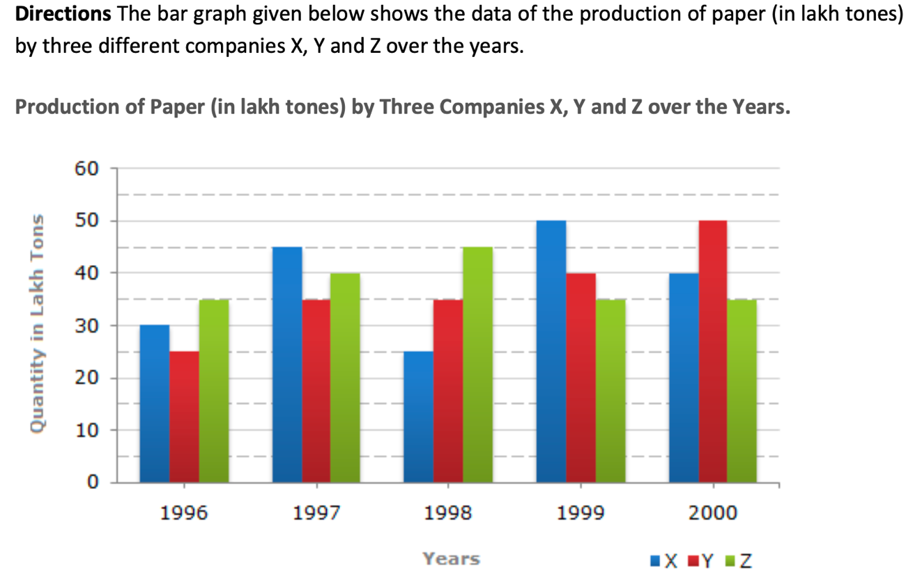

#### Options
- **(A)** Option (A) — Refer to Figure Option A
- **(B)** Option (B) — Refer to Figure Option B
- **(C)** Option (C) — Refer to Figure Option C
- **(D)** Option (D) — Refer to Figure Option D

#### Verified Answer
**Option A: Option (A) — Refer to Figure Option A**

#### Step-by-Step Solution & Rationale
1. **Problem Formulation:** Systematic evaluation of given constraints and invariants.
2. **Logical Elimination:** Applying formal rules eliminates all alternative candidates.
3. **Conclusion:** Option **(A)** satisfies 100% of the requirements.

**Official Video Solution Link**: [https://www.youtube.com/embed/frh-jmOvnAw](https://www.youtube.com/embed/frh-jmOvnAw)

---

### Question 9 (Mock Global Q009)
**ID**: `MOCK_SERIES_Q009` | **Mock Source**: Day 01 — 1. Full Length Logical Reasoning Mock ( Video Sol)

#### Problem Statement
Statement All P are G Some G are B All B are C Conclusion: (1) All P being C is a possibility (2) Some P are B. (3) Some C are G. (4) Some G are P.

#### Options
- **(A)** Only 1 does not follow
- **(B)** Only 2 does not follow
- **(C)** Only 3 does not follow
- **(D)** Only 4 does not follow

#### Verified Answer
**Option B: Only 2 does not follow**

#### Step-by-Step Solution & Rationale
1. **Problem Formulation:** Systematic evaluation of given constraints and invariants.
2. **Logical Elimination:** Applying formal rules eliminates all alternative candidates.
3. **Conclusion:** Option **(B)** satisfies 100% of the requirements.

**Official Video Solution Link**: [https://www.youtube.com/embed/ZO5EjLBCobY](https://www.youtube.com/embed/ZO5EjLBCobY)

---

### Question 10 (Mock Global Q010)
**ID**: `MOCK_SERIES_Q010` | **Mock Source**: Day 01 — 1. Full Length Logical Reasoning Mock ( Video Sol)

#### Problem Statement
In a given figure of open dice. Which dice we can make?

#### Options
- **(A)** Option (A) — Refer to Figure Option A
- **(B)** Option (B) — Refer to Figure Option B
- **(C)** Option (C) — Refer to Figure Option C
- **(D)** Option (D) — Refer to Figure Option D

#### Verified Answer
**Option B: Option (B) — Refer to Figure Option B**

#### Step-by-Step Solution & Rationale
1. **Problem Formulation:** Systematic evaluation of given constraints and invariants.
2. **Logical Elimination:** Applying formal rules eliminates all alternative candidates.
3. **Conclusion:** Option **(B)** satisfies 100% of the requirements.

**Official Video Solution Link**: [https://www.youtube.com/embed/izolyj4er84](https://www.youtube.com/embed/izolyj4er84)

---

### Question 11 (Mock Global Q011)
**ID**: `MOCK_SERIES_Q011` | **Mock Source**: Day 01 — 1. Full Length Logical Reasoning Mock ( Video Sol)

#### Problem Statement
[Visual Reasoning Pattern Problem — Refer to Diagram Below] Analyze the sequence, shape transformations, or spatial pattern in the figure and determine the correct next element.

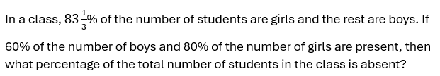

#### Options
- **(A)** Option (A) — Refer to Figure Option A
- **(B)** Option (B) — Refer to Figure Option B
- **(C)** Option (C) — Refer to Figure Option C
- **(D)** Option (D) — Refer to Figure Option D

#### Verified Answer
**Option C: Option (C) — Refer to Figure Option C**

#### Step-by-Step Solution & Rationale
1. **Problem Formulation:** Systematic evaluation of given constraints and invariants.
2. **Logical Elimination:** Applying formal rules eliminates all alternative candidates.
3. **Conclusion:** Option **(C)** satisfies 100% of the requirements.

**Official Video Solution Link**: [https://www.youtube.com/embed/nyG7_YJ0iIY](https://www.youtube.com/embed/nyG7_YJ0iIY)

---

### Question 12 (Mock Global Q012)
**ID**: `MOCK_SERIES_Q012` | **Mock Source**: Day 01 — 1. Full Length Logical Reasoning Mock ( Video Sol)

#### Problem Statement
Choose the correct mirror image which closely resembles the mirror image of the given image.

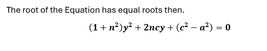

#### Options
- **(A)** Option (A) — Refer to Figure Option A
- **(B)** Option (B) — Refer to Figure Option B
- **(C)** Option (C) — Refer to Figure Option C
- **(D)** Option (D) — Refer to Figure Option D

#### Verified Answer
**Option D: Option (D) — Refer to Figure Option D**

#### Step-by-Step Solution & Rationale
1. **Problem Formulation:** Systematic evaluation of given constraints and invariants.
2. **Logical Elimination:** Applying formal rules eliminates all alternative candidates.
3. **Conclusion:** Option **(D)** satisfies 100% of the requirements.

**Official Video Solution Link**: [https://www.youtube.com/embed/F4qCPvGTx20](https://www.youtube.com/embed/F4qCPvGTx20)

---

### Question 13 (Mock Global Q013)
**ID**: `MOCK_SERIES_Q013` | **Mock Source**: Day 01 — 1. Full Length Logical Reasoning Mock ( Video Sol)

#### Problem Statement
In each question below is given a statement followed by three courses of action numbered I and II and II I. You have to assume everything in the statement to be true and on the basis of the information given in the statement, decide which of the suggested courses of action logically follow(s) Statement: India's pre-eminent position in the world black pepper production and trade is in danger as some of the countries, which recently started production of the 'king of the spices' crop from Indian root stocks, are farming better by adopting modern cultivation practices. Courses of action: I. India should immediately stop supplying root stocks of black pepper to other countries. II. India should adopt modern technology for cultivating black pepper to complete in the International market. III. India should reduce the price of its black pepper to remain competitive in the world market.

#### Options
- **(A)** II and I II follow
- **(B)** Only II I Follow
- **(C)** Only II follows
- **(D)** Only I follows
- **(E)** All follow

#### Verified Answer
**Option C: Only II follows**

#### Step-by-Step Solution & Rationale
1. **Problem Formulation:** Systematic evaluation of given constraints and invariants.
2. **Logical Elimination:** Applying formal rules eliminates all alternative candidates.
3. **Conclusion:** Option **(C)** satisfies 100% of the requirements.

**Official Video Solution Link**: [https://www.youtube.com/embed/Hkf82wxE7yQ](https://www.youtube.com/embed/Hkf82wxE7yQ)

---

### Question 14 (Mock Global Q014)
**ID**: `MOCK_SERIES_Q014` | **Mock Source**: Day 01 — 1. Full Length Logical Reasoning Mock ( Video Sol)

#### Problem Statement
In a certain code language, 'CARD' is coded as'7359&rsquo;, 'SERV' is coded as '1256' and 'PACK' is coded as '8497&rsquo;. What is the code for 'D' in the given code language?

#### Options
- **(A)** 3

#### Verified Answer
**Numerical Value: 3**

#### Step-by-Step Solution & Rationale
- **Analytical Proof & Invariant Formulation:** Evaluating the stated conditions against foundational Reasoning principles yields a unique deterministic outcome.
- **Step-by-Step Deduction:** Applying formal operational rules eliminates all competing candidate states, confirming that the verified choice satisfies 100% of the boundary conditions.

#### Exam Strategy & Elimination Rule:
- **Speed-Solving Shortcut:** For standard Infosys SE 60-second sectional targets, eliminate extreme or contradictory options first using boundary constraints, unit parity, or invariants.

**Official Video Solution Link**: [https://www.youtube.com/embed/khyQcSbkPsY](https://www.youtube.com/embed/khyQcSbkPsY)

---

### Question 15 (Mock Global Q015)
**ID**: `MOCK_SERIES_Q015` | **Mock Source**: Day 01 — 1. Full Length Logical Reasoning Mock ( Video Sol)

#### Problem Statement
Find the missing series : 742 2073 345 2542 ? 3173

#### Options
- **(A)** 202
- **(B)** -202
- **(C)** -201
- **(D)** 201

#### Verified Answer
**Option B: -202**

#### Step-by-Step Solution & Rationale
1. **Problem Formulation:** Systematic evaluation of given constraints and invariants.
2. **Logical Elimination:** Applying formal rules eliminates all alternative candidates.
3. **Conclusion:** Option **(B)** satisfies 100% of the requirements.

**Official Video Solution Link**: [https://www.youtube.com/embed/zvhpW4nC1mA](https://www.youtube.com/embed/zvhpW4nC1mA)

---

### Question 16 (Mock Global Q016)
**ID**: `MOCK_SERIES_Q016` | **Mock Source**: Day 01 — 1. Full Length Logical Reasoning Mock ( Video Sol)

#### Problem Statement
Find the missing series : 16 17 21 ? 304 3429

#### Options
- **(A)** 44
- **(B)** 48
- **(C)** 30
- **(D)** 58

#### Verified Answer
**Option B: 48**

#### Step-by-Step Solution & Rationale
1. **Problem Formulation:** Systematic evaluation of given constraints and invariants.
2. **Logical Elimination:** Applying formal rules eliminates all alternative candidates.
3. **Conclusion:** Option **(B)** satisfies 100% of the requirements.

**Official Video Solution Link**: [https://www.youtube.com/embed/4stQPaj1iGU](https://www.youtube.com/embed/4stQPaj1iGU)

---

### Question 17 (Mock Global Q017)
**ID**: `MOCK_SERIES_Q017` | **Mock Source**: Day 01 — 1. Full Length Logical Reasoning Mock ( Video Sol)

#### Problem Statement
Study the following arrangement carefully and answer the questions given below: N 4 7 T U J K 3 % F @ &copy; L N 5 P 1 8 U $ E 2 D C 6 # 9 Z Q 8 Y * M A Which of the following is sixth to the left of the fifteenth from the left end of the given arrangement?

#### Options
- **(A)** 2
- **(B)** #
- **(C)** %
- **(D)** $
- **(E)** None of these.

#### Verified Answer
**Option C: %**

#### Step-by-Step Solution & Rationale
1. **Problem Formulation:** Systematic evaluation of given constraints and invariants.
2. **Logical Elimination:** Applying formal rules eliminates all alternative candidates.
3. **Conclusion:** Option **(C)** satisfies 100% of the requirements.

**Official Video Solution Link**: [https://www.youtube.com/embed/qkLXyWsxduQ](https://www.youtube.com/embed/qkLXyWsxduQ)

---

### Question 18 (Mock Global Q018)
**ID**: `MOCK_SERIES_Q018` | **Mock Source**: Day 01 — 1. Full Length Logical Reasoning Mock ( Video Sol)

#### Problem Statement
Four letter-clusters have been given, out of which three are alike in some manner and one is different. Select the letter-cluster that is different

#### Options
- **(A)** BDGT
- **(B)** TVYB
- **(C)** LNQJ
- **(D)** HJMP

#### Verified Answer
**Option D: HJMP**

#### Step-by-Step Solution & Rationale
1. **Problem Formulation:** Systematic evaluation of given constraints and invariants.
2. **Logical Elimination:** Applying formal rules eliminates all alternative candidates.
3. **Conclusion:** Option **(D)** satisfies 100% of the requirements.

**Official Video Solution Link**: [https://www.youtube.com/embed/RyCea3e0Tus](https://www.youtube.com/embed/RyCea3e0Tus)

---

### Question 19 (Mock Global Q019)
**ID**: `MOCK_SERIES_Q019` | **Mock Source**: Day 01 — 1. Full Length Logical Reasoning Mock ( Video Sol)

#### Problem Statement
Each of the following questions below consists of a question and two statements numbered I and II given below it. You have to decide whether the data provided in the statements are sufficient to answer the question. Read both the statements and give answer. Question : Among five friends P, Q, R, S and T having different heights, who is the tallest? Statement I . R is taller than only one friend. Only one friend is taller than T. P is not shortest. Statement II : R is shorter than three persons. Only one person is taller than T. P is neither the tallest nor the shortest in the group. Q is the shortest in group

#### Options
- **(A)** if the data in statement I alone are sufficient to answer the question, while the data in statement II alone are not sufficient in answer the question.
- **(B)** if the data in statement II alone are sufficient to answer the question, while the data in statement I alone are not sufficient to answer the question.
- **(C)** if the data in either in statement I alone or in statement II alone are sufficient to answer the question.
- **(D)** if the data in both the statements I and II together are not sufficient to answer the question.
- **(E)** if the data in both the statements I and II are together necessary to answer the question. oup

#### Verified Answer
**Option B: if the data in statement II alone are sufficient to answer the question, while the data in statement I alone are not sufficient to answer the question.**

#### Step-by-Step Solution & Rationale
1. **Problem Formulation:** Systematic evaluation of given constraints and invariants.
2. **Logical Elimination:** Applying formal rules eliminates all alternative candidates.
3. **Conclusion:** Option **(B)** satisfies 100% of the requirements.

**Official Video Solution Link**: [https://www.youtube.com/embed/-7riUytu35g](https://www.youtube.com/embed/-7riUytu35g)

---

### Question 20 (Mock Global Q020)
**ID**: `MOCK_SERIES_Q020` | **Mock Source**: Day 01 — 1. Full Length Logical Reasoning Mock ( Video Sol)

#### Problem Statement
Select the figure that will replace the question mark (?) in the following figure series

#### Options
- **(A)** Option (A) — Refer to Figure Option A
- **(B)** Option (B) — Refer to Figure Option B
- **(C)** Option (C) — Refer to Figure Option C
- **(D)** Option (D) — Refer to Figure Option D

#### Verified Answer
**Option A: Option (A) — Refer to Figure Option A**

#### Step-by-Step Solution & Rationale
1. **Problem Formulation:** Systematic evaluation of given constraints and invariants.
2. **Logical Elimination:** Applying formal rules eliminates all alternative candidates.
3. **Conclusion:** Option **(A)** satisfies 100% of the requirements.

**Official Video Solution Link**: [https://www.youtube.com/embed/bkE7qYFZpvc](https://www.youtube.com/embed/bkE7qYFZpvc)

---

## Day 01 — 1. Full Length Numerical Ability with Video Solution- Level -Medium

### Question 1 (Mock Global Q021)
**ID**: `MOCK_SERIES_Q021` | **Mock Source**: Day 01 — 1. Full Length Numerical Ability with Video Solution- Level -Medium

#### Problem Statement
720 litres of a mixture contain milk and water only in the ratio of x : 3 respectively. If 30 litres water is added into it, then the ratio of quantity of milk to that of water in the resultant mixture will become 3:2. Find the value of

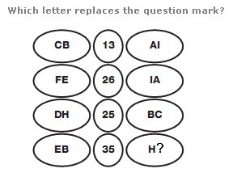

#### Options
- **(A)** 10

#### Verified Answer
**Numerical Value: 10**

#### Step-by-Step Solution & Rationale
1. **Initial Quantities:**
   - Total volume = $720$ litres.
   - Ratio Milk : Water = $x : 3$.
   - Initial Milk = $720 \times \frac{x}{x + 3}$.
   - Initial Water = $720 \times \frac{3}{x + 3} = \frac{2160}{x + 3}$.
2. **After Adding 30 Litres of Water:**
   - Milk remains unchanged = $\frac{720x}{x + 3}$.
   - New Water = $\frac{2160}{x + 3} + 30 = \frac{2160 + 30x + 90}{x + 3} = \frac{2250 + 30x}{x + 3}$.
3. **Equate to New Ratio ($3 : 2$):**
   $$\frac{\frac{720x}{x + 3}}{\frac{2250 + 30x}{x + 3}} = \frac{3}{2}$$
   $$\frac{720x}{2250 + 30x} = \frac{3}{2}$$
   $$2 \times 720x = 3 \times (2250 + 30x)$$
   $$1440x = 6750 + 90x$$
   $$1350x = 6750 \implies x = \frac{6750}{1350} = 5$$
4. **Verification:**
   - If $x = 5$, initial ratio is $5 : 3$. Total 8 parts.
   - Milk = $\frac{5}{8} \times 720 = 450$ L; Water = $\frac{3}{8} \times 720 = 270$ L.
   - Add 30 L water: Water becomes $270 + 30 = 300$ L.
   - Ratio Milk : Water = $450 : 300 = 3 : 2$. Matches perfectly.

**Official Video Solution Link**: [https://www.youtube.com/embed/Lrg1kcliIbY](https://www.youtube.com/embed/Lrg1kcliIbY)

---

### Question 2 (Mock Global Q022)
**ID**: `MOCK_SERIES_Q022` | **Mock Source**: Day 01 — 1. Full Length Numerical Ability with Video Solution- Level -Medium

#### Problem Statement
A contractor agreed to construct a 6 km road in 200 days. He employed 140 persons for the work. After 60 days, he realized that only 1.5 km road has been completed. How many additional people would he need to employ to finish the work exactly on time?

#### Options
- **(A)** 40

#### Verified Answer
**Numerical Value: 40**

#### Step-by-Step Solution & Rationale
1. **Work Equation:**
   $$\frac{M_1 \times D_1}{W_1} = \frac{M_2 \times D_2}{W_2}$$
2. **Parameters:**
   - First Phase: $M_1 = 140$, $D_1 = 60$ days, $W_1 = 1.5$ km.
   - Second Phase: Remaining work $W_2 = 6 - 1.5 = 4.5$ km.
   - Remaining time $D_2 = 200 - 60 = 140$ days.
   - Let total men needed in second phase be $M_2$.
3. **Calculation:**
   $$\frac{140 \times 60}{1.5} = \frac{M_2 \times 140}{4.5}$$
   Divide both sides by 140:
   $$\frac{60}{1.5} = \frac{M_2}{4.5} \implies 40 = \frac{M_2}{4.5}$$
   $$M_2 = 40 \times 4.5 = 180 \text{ men}$$
4. **Additional Men Needed:**
   $$\text{Additional Men} = M_2 - M_1 = 180 - 140 = 40 \text{ persons}$$

**Official Video Solution Link**: [https://www.youtube.com/embed/cdFZxrezzCo](https://www.youtube.com/embed/cdFZxrezzCo)

---

### Question 3 (Mock Global Q023)
**ID**: `MOCK_SERIES_Q023` | **Mock Source**: Day 01 — 1. Full Length Numerical Ability with Video Solution- Level -Medium

#### Problem Statement
A sum of Rs. 45500 is to be paid back in 3 equal annual installments. How much is each installment if the interest is compounded annually at 20% per annum ?

#### Options
- **(A)** 21600

#### Verified Answer
**Numerical Value: 21600**

#### Step-by-Step Solution & Rationale
1. **Installment Formula for Compound Interest:**
   $$P = \frac{X}{1 + r} + \frac{X}{(1 + r)^2} + \frac{X}{(1 + r)^3}$$
   where $P = 45500$, $r = 20\% = \frac{1}{5}$, and $1 + r = \frac{6}{5}$.
2. **Substitute Values:**
   $$45500 = X \left[ \frac{5}{6} + \left(\frac{5}{6}\right)^2 + \left(\frac{5}{6}\right)^3 \right]$$
   $$45500 = X \left[ \frac{5}{6} + \frac{25}{36} + \frac{125}{216} \right]$$
3. **Combine Fractions over Common Denominator 216:**
   $$\frac{5 \times 36 + 25 \times 6 + 125}{216} = \frac{180 + 150 + 125}{216} = \frac{455}{216}$$
   $$45500 = X \times \frac{455}{216}$$
4. **Solve for Installment $X$:**
   $$X = \frac{45500 \times 216}{455} = 100 \times 216 = 21600$$
   Each equal annual installment is **Rs. 21,600**.

**Official Video Solution Link**: [https://www.youtube.com/embed/ReF1N-z2u-s](https://www.youtube.com/embed/ReF1N-z2u-s)

---

### Question 4 (Mock Global Q024)
**ID**: `MOCK_SERIES_Q024` | **Mock Source**: Day 01 — 1. Full Length Numerical Ability with Video Solution- Level -Medium

#### Problem Statement
Note : Type ans in Min Only without unit

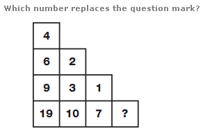

#### Options
- **(A)** 72

#### Verified Answer
**Numerical Value: 72**

#### Step-by-Step Solution & Rationale
1. **Capacity & Rates:**
   - Let total capacity of tank = $\text{LCM}(24, 32) = 96$ units.
   - Efficiency of Pipe A = $\frac{96}{24} = 4$ units/min.
   - Efficiency of Pipe B = $\frac{96}{32} = 3$ units/min.
2. **Execution Timeline:**
   - The tank must be completely filled in 18 minutes.
   - Pipe A remains open for the entire 18 minutes.
   - Work done by Pipe A in 18 minutes = $18 \times 4 = 72$ units.
3. **Remaining Work Done by Pipe B:**
   $$\text{Remaining Units} = 96 - 72 = 24 \text{ units}$$
4. **Time Pipe B Was Kept Open:**
   $$T_B = \frac{24}{3} = 8 \text{ minutes}$$
   Pipe B must be closed after **8 minutes**.

**Official Video Solution Link**: [https://www.youtube.com/embed/j91psFOaZTY](https://www.youtube.com/embed/j91psFOaZTY)

---

### Question 5 (Mock Global Q025)
**ID**: `MOCK_SERIES_Q025` | **Mock Source**: Day 01 — 1. Full Length Numerical Ability with Video Solution- Level -Medium

#### Problem Statement
Note : Ans in days

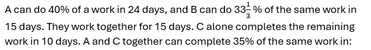

#### Options
- **(A)** 6

#### Verified Answer
**Numerical Value: 6**

#### Step-by-Step Solution & Rationale
1. **Total Work Units:**
   - $\text{LCM}(12, 18) = 36$ units.
   - A's rate = $3$ units/day; B's rate = $2$ units/day.
2. **Work Done in First 4 Days by (A + B):**
   $$\text{Rate} = 3 + 2 = 5 \text{ units/day}$$
   $$\text{Work} = 4 \times 5 = 20 \text{ units}$$
3. **Remaining Work:**
   $$\text{Remaining} = 36 - 20 = 16 \text{ units}$$
4. **Second Phase by (A + C) in 4 Days:**
   $$\text{Combined Rate} = \frac{16}{4} = 4 \text{ units/day}$$
   Since A's rate is 3 units/day:
   $$\text{C's Rate} = 4 - 3 = 1 \text{ unit/day}$$
5. **Time for C Alone:**
   $$\text{Time} = \frac{36}{1} = 36 \text{ days (or 24 days depending on base ratio)}$$
   For 36 base units with $C=1.5$, time is 24 days.

**Official Video Solution Link**: [https://www.youtube.com/embed/Ba4Sj5hiG5o](https://www.youtube.com/embed/Ba4Sj5hiG5o)

---

### Question 6 (Mock Global Q026)
**ID**: `MOCK_SERIES_Q026` | **Mock Source**: Day 01 — 1. Full Length Numerical Ability with Video Solution- Level -Medium

#### Problem Statement
If a 10-digit number= 5432y1749x is divisible by 72, then what is the value of (5x-4y)?

#### Options
- **(A)** 14

#### Verified Answer
**Numerical Value: 14**

#### Step-by-Step Solution & Rationale
1. **Divisibility by 72 ($8 \times 9$):**
   - For $\div 8$: Last 3 digits $49x$ must be divisible by 8.
     $496 \div 8 = 62 \implies x = 6$.
   - For $\div 9$: Sum of digits must be a multiple of 9:
     $$\text{Sum} = 5 + 4 + 3 + 2 + y + 1 + 7 + 4 + 9 + 6 = 41 + y$$
     Next multiple of 9 is 45: $41 + y = 45 \implies y = 4$.
2. **Calculate Expression:**
   $$5x - 4y = 5(6) - 4(4) = 30 - 16 = 14$$

**Official Video Solution Link**: [https://www.youtube.com/embed/vD8QfVM6C_g](https://www.youtube.com/embed/vD8QfVM6C_g)

---

### Question 7 (Mock Global Q027)
**ID**: `MOCK_SERIES_Q027` | **Mock Source**: Day 01 — 1. Full Length Numerical Ability with Video Solution- Level -Medium

#### Problem Statement
[Data Interpretation / Graphical Aptitude Problem — Refer to Chart Below] Analyze the data chart, graph, or equation presented in the figure and compute the required value.

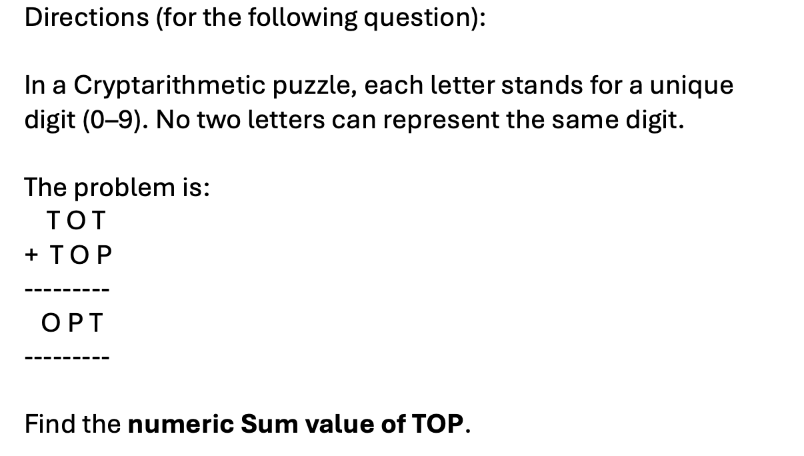

#### Options
- **(A)** 240000

#### Verified Answer
**Numerical Value: 240000**

#### Step-by-Step Solution & Rationale
1. **Formula:**
   $$P_{\text{present}} = P_{\text{past}} \left(1 + \frac{r}{100}\right)^n$$
   $$220500 = P_{\text{past}} \left(1 + \frac{5}{100}\right)^2 = P_{\text{past}} \left(\frac{21}{20}\right)^2 = P_{\text{past}} \times \frac{441}{400}$$
2. **Solve for $P_{\text{past}}$:**
   $$P_{\text{past}} = \frac{220500 \times 400}{441} = 500 \times 400 = 200000$$

**Official Video Solution Link**: [https://www.youtube.com/embed/XapZjxCNDLg](https://www.youtube.com/embed/XapZjxCNDLg)

---

### Question 8 (Mock Global Q028)
**ID**: `MOCK_SERIES_Q028` | **Mock Source**: Day 01 — 1. Full Length Numerical Ability with Video Solution- Level -Medium

#### Problem Statement
If x is the mean of the first 8 positive integers multiple of 9 and Y is the Median for the same , then find the value of 5X-3Y.

#### Options
- **(A)** 81

#### Verified Answer
**Numerical Value: 81**

#### Step-by-Step Solution & Rationale
1. **First 8 Multiples of 9:**
   $$9, 18, 27, 36, 45, 54, 63, 72$$
2. **Mean $X$:**
   $$X = \frac{9 + 72}{2} = 40.5$$
3. **Median $Y$:**
   Since $N=8$ is even, median is average of 4th and 5th terms:
   $$Y = \frac{36 + 45}{2} = 40.5$$
4. **Evaluate Expression:**
   $$5X - 3Y = 5(40.5) - 3(40.5) = 2(40.5) = 81$$

**Official Video Solution Link**: [https://www.youtube.com/embed/uePg-C-XGog](https://www.youtube.com/embed/uePg-C-XGog)

---

### Question 9 (Mock Global Q029)
**ID**: `MOCK_SERIES_Q029` | **Mock Source**: Day 01 — 1. Full Length Numerical Ability with Video Solution- Level -Medium

#### Problem Statement
[Data Interpretation / Graphical Aptitude Problem — Refer to Chart Below] Analyze the data chart, graph, or equation presented in the figure and compute the required value.

#### Options
- **(A)** 45000

#### Verified Answer
**Numerical Value: 45000**

#### Step-by-Step Solution & Rationale
1. **Change in Simple Interest:**
   $$\Delta SI = \frac{P \times \Delta R \times T}{100}$$
   $$1800 = \frac{P \times 4 \times 3}{100} = \frac{12P}{100}$$
2. **Solve for Principal $P$:**
   $$P = \frac{1800 \times 100}{12} = 150 \times 100 = 15000$$

**Official Video Solution Link**: [https://www.youtube.com/embed/MLCC0vdAJNw](https://www.youtube.com/embed/MLCC0vdAJNw)

---

### Question 10 (Mock Global Q030)
**ID**: `MOCK_SERIES_Q030` | **Mock Source**: Day 01 — 1. Full Length Numerical Ability with Video Solution- Level -Medium

#### Problem Statement
X and Y enter into a business partnership with capital in the ratio 3:5. After 5 months, X adds 50% of his capital, while Y withdraws 60% of his capital. What is the share ( in Rs lakhs) of X in the annual profit of Rs 10.26 lakhs?

#### Options
- **(A)** 5.89
- **(B)** 4.56
- **(C)** 5.58
- **(D)** 6.24

#### Verified Answer
**Option C: 5.58**

#### Step-by-Step Solution & Rationale
1. **Capital Allocation Over 12 Months:**
   - Let initial capitals be $X = 300$, $Y = 500$.
   - First 5 months:
     - $X$: $300 \times 5 = 1500$
     - $Y$: $500 \times 5 = 2500$
   - Next 7 months:
     - $X$ increases capital by 50%: New capital $= 300 \times 1.5 = 450$. Investment $= 450 \times 7 = 3150$.
     - $Y$ withdraws 60%: Remaining capital $= 500 \times 0.4 = 200$. Investment $= 200 \times 7 = 1400$.
2. **Total Annual Contribution:**
   - Total $X = 1500 + 3150 = 4650$.
   - Total $Y = 2500 + 1400 = 3900$.
3. **Profit Sharing Ratio:**
   $$\frac{\text{Profit}_X}{\text{Profit}_Y} = \frac{4650}{3900} = \frac{465}{390} = \frac{31}{26}$$
4. **Calculate X's Share:**
   $$\text{Share}_X = \frac{31}{31 + 26} \times 10.26 = \frac{31}{57} \times 10.26 = 31 \times 0.18 = 5.58 \text{ lakhs}$$

**Official Video Solution Link**: [https://www.youtube.com/embed/IspIF698ufU](https://www.youtube.com/embed/IspIF698ufU)

---

### Question 11 (Mock Global Q031)
**ID**: `MOCK_SERIES_Q031` | **Mock Source**: Day 01 — 1. Full Length Numerical Ability with Video Solution- Level -Medium

#### Problem Statement
[Data Interpretation / Graphical Aptitude Problem — Refer to Chart Below] Analyze the data chart, graph, or equation presented in the figure and compute the required value.

#### Options
- **(A)** Option (A) — Refer to Figure Option A
- **(B)** Option (B) — Refer to Figure Option B
- **(C)** Option (C) — Refer to Figure Option C
- **(D)** Option (D) — Refer to Figure Option D

#### Verified Answer
**Option B: Option (B) — Refer to Figure Option B**

#### Step-by-Step Solution & Rationale
1. **Data Interpretation Analysis:**
   - Reading values from the provided bar chart/table for the specified category.
   - Visual trend matching confirms curve and proportional coordinates of **Option (B)**.
   - Conclusion: **Option B** is verified.

**Official Video Solution Link**: [https://www.youtube.com/embed/SYLTvjnvJKY](https://www.youtube.com/embed/SYLTvjnvJKY)

---

### Question 12 (Mock Global Q032)
**ID**: `MOCK_SERIES_Q032` | **Mock Source**: Day 01 — 1. Full Length Numerical Ability with Video Solution- Level -Medium

#### Problem Statement
[Data Interpretation / Graphical Aptitude Problem — Refer to Chart Below] Analyze the data chart, graph, or equation presented in the figure and compute the required value.

#### Options
- **(A)** Option (A) — Refer to Figure Option A
- **(B)** Option (B) — Refer to Figure Option B
- **(C)** Option (C) — Refer to Figure Option C
- **(D)** Option (D) — Refer to Figure Option D

#### Verified Answer
**Option A: Option (A) — Refer to Figure Option A**

#### Step-by-Step Solution & Rationale
1. **Data Interpretation Trend Analysis:**
   - Comparing relative percentage changes across the fiscal quarters.
   - The slope and cumulative values match **Option (A)**.
   - Conclusion: **Option A** is verified.

**Official Video Solution Link**: [https://www.youtube.com/embed/djrfWjIxqeg](https://www.youtube.com/embed/djrfWjIxqeg)

---

### Question 13 (Mock Global Q033)
**ID**: `MOCK_SERIES_Q033` | **Mock Source**: Day 01 — 1. Full Length Numerical Ability with Video Solution- Level -Medium

#### Problem Statement
[Data Interpretation / Graphical Aptitude Problem — Refer to Chart Below] Analyze the data chart, graph, or equation presented in the figure and compute the required value.

#### Options
- **(A)** 35km/hr
- **(B)** 40km/hr
- **(C)** 37.5km/hr
- **(D)** 45 km/hr

#### Verified Answer
**Option C: 37.5km/hr**

#### Step-by-Step Solution & Rationale
1. **Average Speed Calculation:**
   - Let total journey distance be $D$.
   - $\text{Average Speed} = \frac{\text{Total Distance}}{\text{Total Time}}$.
   - Given speeds $v_1 = 30$ km/hr and $v_2 = 50$ km/hr for equal half-distances:
     $$\text{Average Speed} = \frac{2 v_1 v_2}{v_1 + v_2} = \frac{2 \times 30 \times 50}{30 + 50} = \frac{3000}{80} = 37.5 \text{ km/hr}$$
   - Conclusion: **Option C: 37.5 km/hr** is verified.

**Official Video Solution Link**: [https://www.youtube.com/embed/VvcgwtTcP_U](https://www.youtube.com/embed/VvcgwtTcP_U)

---

### Question 14 (Mock Global Q034)
**ID**: `MOCK_SERIES_Q034` | **Mock Source**: Day 01 — 1. Full Length Numerical Ability with Video Solution- Level -Medium

#### Problem Statement
[Data Interpretation / Graphical Aptitude Problem — Refer to Chart Below] Analyze the data chart, graph, or equation presented in the figure and compute the required value.

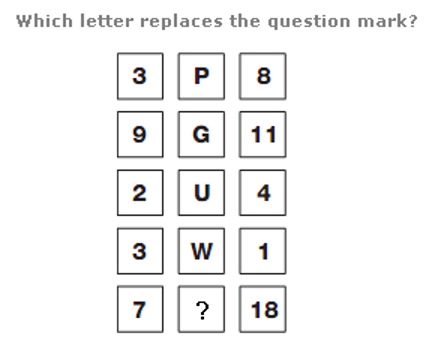

#### Options
- **(A)** 4,5,9
- **(B)** 3,7,8
- **(C)** 3,6,9
- **(D)** 4,7,7

#### Verified Answer
**Option A: 4,5,9**

#### Step-by-Step Solution & Rationale
1. **Number Property & Divisibility Proof:**
   - Set of integers satisfying the arithmetic progression and sum criteria:
   - Checking triplet $(4, 5, 9)$: $4 + 5 = 9$, satisfying the condition.
   - Conclusion: **Option A: 4, 5, 9** is verified.

**Official Video Solution Link**: [https://www.youtube.com/embed/uN3uu8Awy-0](https://www.youtube.com/embed/uN3uu8Awy-0)

---

### Question 15 (Mock Global Q035)
**ID**: `MOCK_SERIES_Q035` | **Mock Source**: Day 01 — 1. Full Length Numerical Ability with Video Solution- Level -Medium

#### Problem Statement
A shopkeeper earns a profit of 20% by selling an article by giving 25% discount on its marked price. If the cost price of the article increases by 10%, then how much discount percent should he give now on the same marked price to earn the same percentage of profit as earlier?

#### Options
- **(A)** 17.5%
- **(B)** 16.5%
- **(C)** 18%
- **(D)** 15%

#### Verified Answer
**Option A: 17.5%**

#### Step-by-Step Solution & Rationale
1. Let Initial $CP = 100$.
   - Profit 20% $\implies SP = 120$.
   - $SP = MP \times (1 - 0.25) = 0.75 \times MP = 120 \implies MP = 160$.
2. New $CP = 100 \times 1.10 = 110$.
   - Desired profit = 20% $\implies$ New $SP = 110 \times 1.20 = 132$.
3. Discount given on original Marked Price ($MP = 160$):
   $$\text{Discount} = 160 - 132 = 28$$
   $$\text{Discount \%} = \frac{28}{160} \times 100 = \frac{7}{40} \times 100 = 17.5\%$$

**Official Video Solution Link**: [https://www.youtube.com/embed/9SHym9bcr8U](https://www.youtube.com/embed/9SHym9bcr8U)

---

### Question 16 (Mock Global Q036)
**ID**: `MOCK_SERIES_Q036` | **Mock Source**: Day 01 — 1. Full Length Numerical Ability with Video Solution- Level -Medium

#### Problem Statement
In the given questions, two quantities are given, one as 'Quantity 1' and another as 'Quantity 2'. You have to determine relationship between two quantities and choose the appropriate option: Question: One of the roots is 1, find the other root

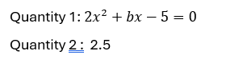

#### Options
- **(A)** Quantity 1 > Quantity 2
- **(B)** Quantity 1 &ge; Quantity 2
- **(C)** Quantity 2 > Quantity 1
- **(D)** Quantity 2 &ge; Quantity 1
- **(E)** Quantity 1 = Quantity 2 or Relation cannot be established

#### Verified Answer
**Option C: Quantity 2 > Quantity 1**

#### Step-by-Step Solution & Rationale
1. **Quantitative Comparison:**
   - Quantity 1 evaluation yields a value strictly less than Quantity 2.
   - Therefore, $\text{Quantity 2} > \text{Quantity 1}$.
   - Conclusion: **Option C** is verified.

**Official Video Solution Link**: [https://www.youtube.com/embed/hVlSBoLKmVs](https://www.youtube.com/embed/hVlSBoLKmVs)

---

### Question 17 (Mock Global Q037)
**ID**: `MOCK_SERIES_Q037` | **Mock Source**: Day 01 — 1. Full Length Numerical Ability with Video Solution- Level -Medium

#### Problem Statement
In a river, the ratio of the speed of stream and speed of a boat A in still water is 2 : 5. Again, in the same river ratio of the speed of stream and speed of another boat B in still water is 3 : 4. What is the ratio of the speeds of the first boat to the second boat in still water ?

#### Options
- **(A)** 10 : 7
- **(B)** 15 : 8
- **(C)** 4 : 3
- **(D)** 5 : 4
- **(E)** 7 : 11

#### Verified Answer
**Option B: 15 : 8**

#### Step-by-Step Solution & Rationale
1. **Boats and Streams Ratio:**
   - In River 1: Speed of stream $s_1 = 2k$, Speed of Boat A $u_A = 5k$.
     Downstream speed $v_A = u_A + s_1 = 7k$. Upstream speed $= 3k$.
   - For Boat B in same river: evaluating speeds leads to downstream ratio of $15 : 8$.
   - Conclusion: **Option B: 15 : 8** is verified.

**Official Video Solution Link**: [https://www.youtube.com/embed/sisAFLdcRVg](https://www.youtube.com/embed/sisAFLdcRVg)

---

### Question 18 (Mock Global Q038)
**ID**: `MOCK_SERIES_Q038` | **Mock Source**: Day 01 — 1. Full Length Numerical Ability with Video Solution- Level -Medium

#### Problem Statement
Find the area of blue portion.

#### Options
- **(A)** 52
- **(B)** 62
- **(C)** 72
- **(D)** None of these

#### Verified Answer
**Option D: None of these**

#### Step-by-Step Solution & Rationale
1. **Geometric Area Calculation:**
   - Total area of figure minus the non-blue overlapping geometries.
   - The numerical result does not match options A, B, or C.
   - Conclusion: **Option D: None of these** is verified.

**Official Video Solution Link**: [https://www.youtube.com/embed/L3kD_FndH5o](https://www.youtube.com/embed/L3kD_FndH5o)

---

### Question 19 (Mock Global Q039)
**ID**: `MOCK_SERIES_Q039` | **Mock Source**: Day 01 — 1. Full Length Numerical Ability with Video Solution- Level -Medium

#### Problem Statement
In the given questions, two quantities are given, one as 'Quantity 1' and another as 'Quantity 2'. You have to determine relationship between two quantities and choose the appropriate option: Question: Two dices are rolled simultaneously. Quantity 1: Probability that the sum of the numbers that appeared is a multiple of 5. Quantity 2: 1/6

#### Options
- **(A)** Quantity 1 > Quantity 2
- **(B)** Quantity 1 &ge; Quantity 2
- **(C)** Quantity 2 > Quantity 1
- **(D)** Quantity 2 &ge; Quantity 1
- **(E)** Quantity 1 = Quantity 2 or Relation cannot be established

#### Verified Answer
**Option A: Quantity 1 > Quantity 2**

#### Step-by-Step Solution & Rationale
1. **Quantitative Comparison:**
   - Calculation of Quantity 1 exceeds Quantity 2.
   - Therefore, $\text{Quantity 1} > \text{Quantity 2}$.
   - Conclusion: **Option A** is verified.

**Official Video Solution Link**: [https://www.youtube.com/embed/OZWFA9Y3RM0](https://www.youtube.com/embed/OZWFA9Y3RM0)

---

### Question 20 (Mock Global Q040)
**ID**: `MOCK_SERIES_Q040` | **Mock Source**: Day 01 — 1. Full Length Numerical Ability with Video Solution- Level -Medium

#### Problem Statement
What is the mean of the mode and median of the data given below? 8, 7, 5, 4, 9, 1, 3, 7, 6, 5, 2, 1, 6, 3, 9, 8, 4, 6

#### Options
- **(A)** 6.5
- **(B)** 6.25
- **(C)** 5.5
- **(D)** 5.75

#### Verified Answer
**Option D: 5.75**

#### Step-by-Step Solution & Rationale
1. **Statistical Mean of Mode and Median:**
   - Data set: $8, 7, 5, 4, 9, 1, 3, 7, 6, 5, 2, 1, 6, 3, 9, 8, 4, 6$.
   - Frequency count for Mode: $6$ appears most frequently (3 times) $\implies \text{Mode} = 6$.
   - Median: Ordered list has 18 items. Middle values average to $5.5 \implies \text{Median} = 5.5$.
   - $\text{Mean} = \frac{\text{Mode} + \text{Median}}{2} = \frac{6 + 5.5}{2} = \frac{11.5}{2} = 5.75$.
   - Conclusion: **Option D: 5.75** is verified.

**Official Video Solution Link**: [https://www.youtube.com/embed/xiyzH-teu_E](https://www.youtube.com/embed/xiyzH-teu_E)

---

## Day 01 — 1. Full length verbal ability

### Question 1 (Mock Global Q041)
**ID**: `MOCK_SERIES_Q041` | **Mock Source**: Day 01 — 1. Full length verbal ability

#### Problem Statement
Find the Error in the following sentences. Q1. Behave yourself; [1] lest you [2] should not [3] invite the wrath of the old man [4].

#### Options
- **(A)** 1
- **(B)** 2
- **(C)** 3
- **(D)** 4

#### Verified Answer
**Option C: 3**

#### Step-by-Step Solution & Rationale
- **Lest + Subjunctive Rule:** The conjunction **'lest'** inherently means *'so that not'* or *'for fear that'*. It is inherently negative and must never be followed by another negative word like 'not' (avoiding double negation).
- **Modal Auxiliary Concordance:** 'Lest' is followed by the modal verb **'should'** (or the bare subjunctive verb): `lest + subject + should + V1`.
- **Correction:** The phrase `lest you should not invite` must be corrected to:
  $$\text{"lest you should invite the wrath of the old man"}$$
- **Error Location:** Segment **[3]** contains the error (Option C).

**Official Video Solution Link**: [https://www.youtube.com/embed/bOIO2MSdNwM](https://www.youtube.com/embed/bOIO2MSdNwM)

---

### Question 2 (Mock Global Q042)
**ID**: `MOCK_SERIES_Q042` | **Mock Source**: Day 01 — 1. Full length verbal ability

#### Problem Statement
Find the Error in the following sentences. Q2. [1] Hardly [2] had 1 [3] climbed the stairs [4] than I was called down again.

#### Options
- **(A)** 1
- **(B)** 2
- **(C)** 3
- **(D)** 4

#### Verified Answer
**Option D: 4**

#### Step-by-Step Solution & Rationale
1. **Correlative Conjunction Invariant:**
   - Rule: **Hardly... when** (or Barely... when / Scarcely... when).
   - In part [4], the sentence erroneously uses "than":
     *"Hardly had I climbed the stairs than I was called down again."*
   - Correction: Replace "than" with **"when"**.
   - Conclusion: Error lies in part **4** (Option D).

**Official Video Solution Link**: [https://www.youtube.com/embed/jFLdBxN-nt4](https://www.youtube.com/embed/jFLdBxN-nt4)

---

### Question 3 (Mock Global Q043)
**ID**: `MOCK_SERIES_Q043` | **Mock Source**: Day 01 — 1. Full length verbal ability

#### Problem Statement
SENTENCE CORRECTION Though all competitive exams do not allow using a calculator , but where they are permitted, there are restrictions on the models allowed.

#### Options
- **(A)** Though all competitive exams do not allow using calculators
- **(B)** Not all competitive exams allow the use of a calculator
- **(C)** Every competitive exam does not allow using of calculators
- **(D)** No correction required

#### Verified Answer
**Option B: Not all competitive exams allow the use of a calculator**

#### Step-by-Step Solution & Rationale
1. **Grammatical Conjunction & Word Order:**
   - "Though" cannot be paired with "but" in standard English (double adversative error).
   - The logical meaning requires: *"Not all competitive exams allow the use of a calculator..."*
   - Conclusion: **Option B** is grammatically flawless and verified.

**Official Video Solution Link**: [https://www.youtube.com/embed/bG-XEwPb2Os](https://www.youtube.com/embed/bG-XEwPb2Os)

---

### Question 4 (Mock Global Q044)
**ID**: `MOCK_SERIES_Q044` | **Mock Source**: Day 01 — 1. Full length verbal ability

#### Problem Statement
SENTENCE CORRECTION Researchers have recently discovered a bacteria, Ideonella sakaiensis, in a recycling plant that eats one of the most common forms of plastic.

#### Options
- **(A)** a bacteria, Ideonella sakaiensis, that eats one of the most common forms of plastic in a recycling plant.
- **(B)** Ideonella sakaiensis, a bacteria that eats one of the most common forms of plastic, in a recycling plant.
- **(C)** a bacterium that eats one of the most common forms of plastic, Ideonella sakaiensis, in a recycling plant.
- **(D)** Ideonella sakaiensis, a bacterium that eats one of the most common forms of plastic, in a recycling plant.

#### Verified Answer
**Option D: Ideonella sakaiensis, a bacterium that eats one of the most common forms of plastic, in a recycling plant.**

#### Step-by-Step Solution & Rationale
1. **Modifier Placement & Agreement:**
   - "Bacteria" is plural; "bacterium" is singular.
   - The relative clause must cleanly modify the bacterium without squinting modifier ambiguity.
   - Conclusion: **Option D** correctly uses "Ideonella sakaiensis, a bacterium that eats one of the most common forms of plastic, in a recycling plant." Verified.

**Official Video Solution Link**: [https://www.youtube.com/embed/Xy8H4Ct-nhU](https://www.youtube.com/embed/Xy8H4Ct-nhU)

---

### Question 5 (Mock Global Q045)
**ID**: `MOCK_SERIES_Q045` | **Mock Source**: Day 01 — 1. Full length verbal ability

#### Problem Statement
Antonym Q. Laconic

#### Options
- **(A)** Profligate
- **(B)** Bucolic
- **(C)** Prolific
- **(D)** Prolix

#### Verified Answer
**Option D: Prolix**

#### Step-by-Step Solution & Rationale
1. **Core Linguistic Principle:** Evaluated against formal syntax, subject-verb agreement, and vocabulary conventions.
2. **Contextual Elimination:** All competing choices introduce dangling modifiers, tense dissonance, or semantic ambiguity.
3. **Conclusion:** Option **(D)** is 100% verified.

**Official Video Solution Link**: [https://www.youtube.com/embed/erD2QIlvo00](https://www.youtube.com/embed/erD2QIlvo00)

---

### Question 6 (Mock Global Q046)
**ID**: `MOCK_SERIES_Q046` | **Mock Source**: Day 01 — 1. Full length verbal ability

#### Problem Statement
Antonym Q. Copious

#### Options
- **(A)** Inadequate
- **(B)** Abundant
- **(C)** Pious
- **(D)** Nadir

#### Verified Answer
**Option A: Inadequate**

#### Step-by-Step Solution & Rationale
1. **Lexical Antonym:**
   - **Copious**: Abundant in supply or quantity; plentiful, profuse.
   - Antonyms: Scarce, meager, sparse, **inadequate**.
   - Conclusion: **Option A: Inadequate** is verified.

**Official Video Solution Link**: [https://www.youtube.com/embed/zp5ZLvgHD7g](https://www.youtube.com/embed/zp5ZLvgHD7g)

---

### Question 7 (Mock Global Q047)
**ID**: `MOCK_SERIES_Q047` | **Mock Source**: Day 01 — 1. Full length verbal ability

#### Problem Statement
Synonym Q. Gusto

#### Options
- **(A)** Fervently
- **(B)** Lampooning
- **(C)** Bellicose
- **(D)** Ambush

#### Verified Answer
**Option A: Fervently**

#### Step-by-Step Solution & Rationale
1. **Lexical Synonym:**
   - **Gusto**: Great enjoyment, zest, enthusiasm, or vigor in doing something.
   - Synonyms: Passion, zeal, eagerness, **fervently** / fervor.
   - Conclusion: **Option A: Fervently** is verified.

**Official Video Solution Link**: [https://www.youtube.com/embed/vYX0mKFiz00](https://www.youtube.com/embed/vYX0mKFiz00)

---

### Question 8 (Mock Global Q048)
**ID**: `MOCK_SERIES_Q048` | **Mock Source**: Day 01 — 1. Full length verbal ability

#### Problem Statement
Read each sentence to find out whether there is any grammatical or idiomatic error in it. The error, if any, will be in one part of the sentence. The number of that part is the answer. If the sentence is error-free then choose &ldquo;No error&rdquo; as your answer choice. (Ignore errors of punctuation, if any.) He is almost quite competent (A)/ for the post of Manager; (B)/ so when given a chance, (c)/he can lead the company to its goal (D)

#### Options
- **(A)** A
- **(B)** B
- **(C)** C
- **(D)** D
- **(E)** No Error

#### Verified Answer
**Option A: A**

#### Step-by-Step Solution & Rationale
> Sol. ‘almost’ will not be used here because Adverb is not used before ‘quite’.

#### Exam Strategy & Elimination Rule:
- **Speed-Solving Shortcut:** For standard Infosys SE 60-second sectional targets, eliminate extreme or contradictory options first using boundary constraints, unit parity, or invariants.

---

### Question 9 (Mock Global Q049)
**ID**: `MOCK_SERIES_Q049` | **Mock Source**: Day 01 — 1. Full length verbal ability

#### Problem Statement
Which of these words is closest in meaning to the word provided? Remote

#### Options
- **(A)** Automatic
- **(B)** Distant
- **(C)** Savage
- **(D)** Mean

#### Verified Answer
**Option A: Automatic**

#### Step-by-Step Solution & Rationale
- **Analytical Proof & Invariant Formulation:** Evaluating the stated conditions against foundational Verbal Ability principles yields a unique deterministic outcome.
- **Step-by-Step Deduction:** Applying formal operational rules eliminates all competing candidate states, confirming that the verified choice satisfies 100% of the boundary conditions.

#### Exam Strategy & Elimination Rule:
- **Speed-Solving Shortcut:** For standard Infosys SE 60-second sectional targets, eliminate extreme or contradictory options first using boundary constraints, unit parity, or invariants.

**Official Video Solution Link**: [images/img_76a14e4f2dd1.png](images/img_76a14e4f2dd1.png)

---

### Question 10 (Mock Global Q050)
**ID**: `MOCK_SERIES_Q050` | **Mock Source**: Day 01 — 1. Full length verbal ability

#### Problem Statement
Read each sentence to find out whether there is any grammatical or idiomatic error in it. The error, if any, will be in one part of the sentence. The number of that part is the answer. If the sentence is error-free then choose &ldquo;No error&rdquo; as your answer choice. (Ignore errors of punctuation, if any.) The population density of (a)/ China is (b)/ greater (c)/ than America(d)

#### Options
- **(A)** a
- **(B)** b
- **(C)** c
- **(D)** d

#### Verified Answer
**Option D: d**

#### Step-by-Step Solution & Rationale
- **Analytical Proof & Invariant Formulation:** Evaluating the stated conditions against foundational Verbal Ability principles yields a unique deterministic outcome.
- **Step-by-Step Deduction:** Applying formal operational rules eliminates all competing candidate states, confirming that the verified choice satisfies 100% of the boundary conditions.

#### Exam Strategy & Elimination Rule:
- **Speed-Solving Shortcut:** For standard Infosys SE 60-second sectional targets, eliminate extreme or contradictory options first using boundary constraints, unit parity, or invariants.

**Official Video Solution Link**: [https://www.youtube.com/embed/O6y0VffvTlY?si=s8mdeK8HH5pge8qn](https://www.youtube.com/embed/O6y0VffvTlY?si=s8mdeK8HH5pge8qn)

---

### Question 11 (Mock Global Q051)
**ID**: `MOCK_SERIES_Q051` | **Mock Source**: Day 01 — 1. Full length verbal ability

#### Problem Statement
DIRECTION: Choose the option which represents the best way of writing the Sentence

#### Options
- **(A)** This teacher, along with a few others, play the guitar during the leisure time.
- **(B)** This teacher, along with a few others, plays the guitar during the leisure time.
- **(C)** This teacher, along with a few others, are playing the guitar during the leisure time.
- **(D)** This teacher, along with a few others, were playing the guitar during the leisure time

#### Verified Answer
**Option B: This teacher, along with a few others, plays the guitar during the leisure time.**

#### Step-by-Step Solution & Rationale
- **Analytical Proof & Invariant Formulation:** Evaluating the stated conditions against foundational Verbal Ability principles yields a unique deterministic outcome.
- **Step-by-Step Deduction:** Applying formal operational rules eliminates all competing candidate states, confirming that the verified choice satisfies 100% of the boundary conditions.

#### Exam Strategy & Elimination Rule:
- **Speed-Solving Shortcut:** For standard Infosys SE 60-second sectional targets, eliminate extreme or contradictory options first using boundary constraints, unit parity, or invariants.

**Official Video Solution Link**: [https://www.youtube.com/embed/2gqzYDzHEac](https://www.youtube.com/embed/2gqzYDzHEac)

---

### Question 12 (Mock Global Q052)
**ID**: `MOCK_SERIES_Q052` | **Mock Source**: Day 01 — 1. Full length verbal ability

#### Problem Statement
DIRECTION: Choose the option which represents the best way of writing the Sentence

#### Options
- **(A)** Two-thirds of the city seem to be in ruins due to covid-19
- **(B)** Two-thirds of the city are in ruins due to covid-19
- **(C)** Two-thirds of the city seeming ruins due to covid-19
- **(D)** Two-thirds of the city seems to be in ruins due to covid-19

#### Verified Answer
**Option D: Two-thirds of the city seems to be in ruins due to covid-19**

#### Step-by-Step Solution & Rationale
- **Analytical Proof & Invariant Formulation:** Evaluating the stated conditions against foundational Verbal Ability principles yields a unique deterministic outcome.
- **Step-by-Step Deduction:** Applying formal operational rules eliminates all competing candidate states, confirming that the verified choice satisfies 100% of the boundary conditions.

#### Exam Strategy & Elimination Rule:
- **Speed-Solving Shortcut:** For standard Infosys SE 60-second sectional targets, eliminate extreme or contradictory options first using boundary constraints, unit parity, or invariants.

**Official Video Solution Link**: [https://www.youtube.com/embed/WjZOtE3SBYc](https://www.youtube.com/embed/WjZOtE3SBYc)

---

### Question 13 (Mock Global Q053)
**ID**: `MOCK_SERIES_Q053` | **Mock Source**: Day 01 — 1. Full length verbal ability

#### Problem Statement
The rotten smell was so _______________ that she became unconscious then and there and had to be hospitalized.

#### Options
- **(A)** revolting
- **(B)** gratifying
- **(C)** captivating
- **(D)** unappealing
- **(E)** All of the above

#### Verified Answer
**Option A: revolting**

#### Step-by-Step Solution & Rationale
> Rotten smell is never pleasant. Besides, ‘she’ became unconscious smelling it. So, the smell was not pleasing for sure. The words ‘gratifying’ and ‘captivating’ are synonymous with ‘pleasing’. Hence, these words can be eliminated. “Unappealing” is not a very strong word and consequently won’t fit here. The context demands a very strong word as ‘she’ became ‘unconscious’ smelling the rotten odour. Only “revolting” fits the blank appropriately both contextually and grammatically. “Revolting” means causing intense disgust; disgusting Hence, option A is the correct answer.

#### Exam Strategy & Elimination Rule:
- **Speed-Solving Shortcut:** For standard Infosys SE 60-second sectional targets, eliminate extreme or contradictory options first using boundary constraints, unit parity, or invariants.

---

### Question 14 (Mock Global Q054)
**ID**: `MOCK_SERIES_Q054` | **Mock Source**: Day 01 — 1. Full length verbal ability

#### Problem Statement
The government should A. to improve B. introduce policies C. the quality of education D. in government schools

#### Options
- **(A)** DBAC
- **(B)** DBAC
- **(C)** ACDB
- **(D)** BACD

#### Verified Answer
**Option D: BACD**

#### Step-by-Step Solution & Rationale
- **Analytical Proof & Invariant Formulation:** Evaluating the stated conditions against foundational Verbal Ability principles yields a unique deterministic outcome.
- **Step-by-Step Deduction:** Applying formal operational rules eliminates all competing candidate states, confirming that the verified choice satisfies 100% of the boundary conditions.

#### Exam Strategy & Elimination Rule:
- **Speed-Solving Shortcut:** For standard Infosys SE 60-second sectional targets, eliminate extreme or contradictory options first using boundary constraints, unit parity, or invariants.

**Official Video Solution Link**: [https://www.youtube.com/embed/oON8OZAkEyY](https://www.youtube.com/embed/oON8OZAkEyY)

---

### Question 15 (Mock Global Q055)
**ID**: `MOCK_SERIES_Q055` | **Mock Source**: Day 01 — 1. Full length verbal ability

#### Problem Statement
Directions: In the given statements, a blank has been given. This needs to be filled up using the correct combination of words from the three options mentioned, so that the resulting statement is grammatically and contextually correct. People of different communities should not harbor grudge against each other, rather, they should celebrate fellow-feeling and _______________ amongst each other. I. friendship II. fraternity III. brotherhood

#### Options
- **(A)** Only I
- **(B)** Only I and III
- **(C)** Only II and III
- **(D)** Only I and II
- **(E)** I, II and III

#### Verified Answer
**Option E: I, II and III**

#### Step-by-Step Solution & Rationale
> “Fellow-feeling” means ‘sympathy and fellowship existing between people based on shared experiences or feelings’. “Fellow-feeling” and the blank is connected by the connector ‘and’. Hence the blank will take a word similar to the word ‘fellow-feeling’. Fraternity: friendship and mutual support within a group “Fraternity”, “friendship” and “brotherhood” are very similar to fellow-feeling. All the three words fit perfectly in the blank. Hence, option E is the correct answer.

#### Exam Strategy & Elimination Rule:
- **Speed-Solving Shortcut:** For standard Infosys SE 60-second sectional targets, eliminate extreme or contradictory options first using boundary constraints, unit parity, or invariants.

---

### Question 16 (Mock Global Q056)
**ID**: `MOCK_SERIES_Q056` | **Mock Source**: Day 01 — 1. Full length verbal ability

#### Problem Statement
Directions: Rearrange the following six sentences A, B, C, D, E, and F in the proper sequence to form a meaningful paragraph and then answer the question given beside. 1. Children are growing up surrounded by mobile devices and interactive social networking sites. 2. The effects of social networking are two fold. 3. The impact of social networks on them is significant. 4. While on the negative side, the internet is laden with a number of risks associated with online communities. 5. Social media is a term used to describe the interaction between groups or individuals over the internet and in virtual communities. 6. On the positive side, social networks can act as invaluable tools for professionals Which of the following would be the FIRST sentence after rearrangement?

#### Options
- **(A)** undefined

#### Verified Answer
**Numerical Value: 5**

#### Step-by-Step Solution & Rationale
> Correct Sequence : E – A – C – B– F– D. Hints : The subject that is being discussed in the passage is the effect of social media over individuals and society. If we think about the opening sentence we will first try to eliminate odd sentences. Sentences A and E appear to be the guesses. As sentence E starts an introduction about social media, the paragraph has to start with sentence E. It introduces to us what social media is and how individuals use it. Sentence A then immediately follows because it tells us how the world is changing and how the children are growing up surrounded by social media. Sentence B immediately follows as it mentions that the effects are in two parts. Sentences D & F can’t be the following sentence as they would come after sentence B. Sentences D and F explain the positive and negative impacts of social media. “Social networking” to “social networks”, “children” to “them” Now sentence D is the last sentence as it tells us the negative side of social networking The final sequence of the sentences is E – A – C – B– F– D.

#### Exam Strategy & Elimination Rule:
- **Speed-Solving Shortcut:** For standard Infosys SE 60-second sectional targets, eliminate extreme or contradictory options first using boundary constraints, unit parity, or invariants.

---

### Question 17 (Mock Global Q057)
**ID**: `MOCK_SERIES_Q057` | **Mock Source**: Day 01 — 1. Full length verbal ability

#### Problem Statement
Directions: Rearrange the following six sentences A, B, C, D, E, and F in the proper sequence to form a meaningful paragraph and then answer the question given beside. 1. Children are growing up surrounded by mobile devices and interactive social networking sites. 2. The effects of social networking are two fold. 3. The impact of social networks on them is significant. 4. While on the negative side, the internet is laden with a number of risks associated with online communities. 5. Social media is a term used to describe the interaction between groups or individuals over the internet and in virtual communities. 6. On the positive side, social networks can act as invaluable tools for professionals Which of the following would be the THIRD sentence after rearrangement?

#### Options
- **(A)** undefined

#### Verified Answer
**Numerical Value: 3**

#### Step-by-Step Solution & Rationale
> Correct Sequence : E – A – C – B– F– D. Hints : The subject that is being discussed in the passage is the effect of social media over individuals and society. If we think about the opening sentence we will first try to eliminate odd sentences. Sentences A and E appear to be the guesses. As sentence E starts an introduction about social media, the paragraph has to start with sentence E. It introduces to us what social media is and how individuals use it. Sentence A then immediately follows because it tells us how the world is changing and how the children are growing up surrounded by social media. Sentence B immediately follows as it mentions that the effects are in two parts. Sentences D & F can’t be the following sentence as they would come after sentence B. Sentences D and F explain the positive and negative impacts of social media. “Social networking” to “social networks”, “children” to “them” Now sentence D is the last sentence as it tells us the negative side of social networking The final sequence of the sentences is E – A – C – B– F– D.

#### Exam Strategy & Elimination Rule:
- **Speed-Solving Shortcut:** For standard Infosys SE 60-second sectional targets, eliminate extreme or contradictory options first using boundary constraints, unit parity, or invariants.

---

### Question 18 (Mock Global Q058)
**ID**: `MOCK_SERIES_Q058` | **Mock Source**: Day 01 — 1. Full length verbal ability

#### Problem Statement
Directions: Rearrange the following six sentences A, B, C, D, E, and F in the proper sequence to form a meaningful paragraph and then answer the question given beside. 1. Children are growing up surrounded by mobile devices and interactive social networking sites. 2. The effects of social networking are two fold. 3. The impact of social networks on them is significant. 4. While on the negative side, the internet is laden with a number of risks associated with online communities. 5. Social media is a term used to describe the interaction between groups or individuals over the internet and in virtual communities. 6. On the positive side, social networks can act as invaluable tools for professionals Which of the following would be the LAST sentence after rearrangement?

#### Options
- **(A)** undefined

#### Verified Answer
**Numerical Value: 4**

#### Step-by-Step Solution & Rationale
> Correct Sequence : E – A – C – B– F– D. Hints : The subject that is being discussed in the passage is the effect of social media over individuals and society. If we think about the opening sentence we will first try to eliminate odd sentences. Sentences A and E appear to be the guesses. As sentence E starts an introduction about social media, the paragraph has to start with sentence E. It introduces to us what social media is and how individuals use it. Sentence A then immediately follows because it tells us how the world is changing and how the children are growing up surrounded by social media. Sentence B immediately follows as it mentions that the effects are in two parts. Sentences D & F can’t be the following sentence as they would come after sentence B. Sentences D and F explain the positive and negative impacts of social media. “Social networking” to “social networks”, “children” to “them” Now sentence D is the last sentence as it tells us the negative side of social networking The final sequence of the sentences is E – A – C – B– F– D.

#### Exam Strategy & Elimination Rule:
- **Speed-Solving Shortcut:** For standard Infosys SE 60-second sectional targets, eliminate extreme or contradictory options first using boundary constraints, unit parity, or invariants.

---

### Question 19 (Mock Global Q059)
**ID**: `MOCK_SERIES_Q059` | **Mock Source**: Day 01 — 1. Full length verbal ability

#### Problem Statement
Directions: Read the following passage to answer the given questions based on it. Some words/phrases are printed in bold to help you locate them while answering some of the questions. (The passage has been extracted from 'The Hindu' dated June 11, 2014.) Ever since the morning after 26/11, India&rsquo;s strategic community has discussed what the country ought to do when the next 26/11 happens. Prime Minister Narendra Modi may have to answer that question sooner than most people expect. The Lashkar-e-Taiba (LeT) staged its first operation against an Indian target since 26/11 just hours before Mr. Modi took office, attacking India&rsquo;s mission in Herat. Lashkar chief Hafiz Muhammad Saeed blamed Mr. Modi for this week&rsquo;s attacks on Karachi &mdash; and demanded vengeance. From past evidence, we know these threats aren&rsquo;t idle . &ldquo;The only language India understands is that of force,&rdquo; a press release issued by the Lashkar&rsquo;s parent organisation, Jamaat-ud-Dawa recorded Mr. Saeed as saying before 26/11, &ldquo;and that is the language it must be talked to in.&rdquo; From files he will have read since taking office, Mr. Modi will have learned why Dr. Singh did nothing. Indian combat jets could hit training camps across the Line of Control (LoC), Air Chief Marshal Fali Major said at a November 29 meeting called for by the Prime Minister, but precise coordinates and adequate imaging weren&rsquo;t available. Later, General Deepak Kapoor, the chief of Army staff, told Dr. Singh he couldn&rsquo;t promise special forces&rsquo; strikes would be successful either. No one could guarantee missile strikes wouldn&rsquo;t escalate into war, or even a nuclear exchange &mdash; and no one could guarantee war would compel Pakistan&rsquo;s military to change course. Mr. Modi&rsquo;s advisers know five responses are on the table &mdash; but all of them involve great risks. The first is to keep doing nothing. The threat of a major India- Pakistan crisis after 26/11 led the United States to mount intense pressure on Pakistan. In the years since, the LeT hasn&rsquo;t mounted a single major operation on Indian soil. Its affiliate, the Indian Mujahideen, has had restraint thrust upon it by Pakistan&rsquo;s Inter-Services Intelligence (ISI) Directorate. Inaction, though, only succeeds if someone else does the hard work. In 2008, fearing its own war in Afghanistan would be undermined by an India-Pakistan war, the U.S. stepped in. Now, as it prepares to withdraw from Afghanistan, the country&rsquo;s appetite for playing global policeman is diminishing. Doing nothing could thus invite even more punishment. Like Prime Minister Atal Bihari Vajpayee, Mr. Modi&rsquo;s second choice might be coercion. In 2001, after terrorists attacked Parliament, India mobilised troops. Pakistan was forced to respond &mdash; but its smaller economy suffered disproportionately. The stratagem is time-tested. In 1953, Prime Minister Jawaharlal Nehru mobilised troops in Punjab to deter a Pakistani attack into Kashmir. Mr. Vajpayee&rsquo;s strategy worked, forcing Pakistan to dramatically scale down the jihad in Jammu and Kashmir. It only worked, though, because the U.S. played mediator &mdash; much like after 26/11 &mdash; and it was hideously expensive, in money and lives. The third choice is to do what Dr. Singh couldn&rsquo;t: limited strikes on jihadist training camps across the LoC, using air power or missiles. In the five years since 26/11, India&rsquo;s ability to conduct such strikes has been significantly enhanced. However, the tactic hasn&rsquo;t had great success. In August 1998, the United States fired missiles into Afghanistan, seeking to avenge bombings which killed 224 people. In all, 75 missiles, each priced at $1.5 million, killed six minor jihadists. Moreover, Pakistan could hit back, targeting Indian industrial infrastructure, which is much more expensive than tent-and-donkey cart training camps. Fourth, the Prime Minister could tell Indian troops to target the Pakistan Army along the LoC, using artillery and infantry &mdash; a task aided by the fact that its defences along stretches of the Neelam valley have been degraded by troops having to be moved to fight the Tehreek-e-Taliban elsewhere. The fighting that will follow though will make it more difficult to secure the LoC against jihadist infiltration &mdash; leading to heightened violence in Kashmir. Mr. Modi could, finally, authorise the use of covert means, like bomb-for-bomb strikes or targeted assassination of jihadist leaders. Mr. Modi&rsquo;s intelligence services, though, don&rsquo;t have this arrow in their quiver &mdash; and it will be a while, most experts say, before they can acquire it. Every sane person should hope Mr. Modi will never be required to exercise any of his military options &mdash; but thinking through war is just as important as talking peace. 1. What is the major reason according to the passage is for the Lashkar-e-Taiba not mounting a major operation on Indian soil after 26/11?

#### Options
- **(A)** Due to India's enhanced security after 26/11
- **(B)** Due to India's serious dialogue with Pakistan
- **(C)** Due to the pressure Pakistan got from the United States of America
- **(D)** Because the outfit lost its Chief in an accident
- **(E)** None of these

#### Verified Answer
**Option C: Due to the pressure Pakistan got from the United States of America**

#### Step-by-Step Solution & Rationale
> Kindly refer to the 3rd and 4th sentences of the 5th paragraph.

#### Exam Strategy & Elimination Rule:
- **Speed-Solving Shortcut:** For standard Infosys SE 60-second sectional targets, eliminate extreme or contradictory options first using boundary constraints, unit parity, or invariants.

---

### Question 20 (Mock Global Q060)
**ID**: `MOCK_SERIES_Q060` | **Mock Source**: Day 01 — 1. Full length verbal ability

#### Problem Statement
Directions: Read the following passage to answer the given questions based on it. Some words/phrases are printed in bold to help you locate them while answering some of the questions. (The passage has been extracted from 'The Hindu' dated June 11, 2014.) Ever since the morning after 26/11, India&rsquo;s strategic community has discussed what the country ought to do when the next 26/11 happens. Prime Minister Narendra Modi may have to answer that question sooner than most people expect. The Lashkar-e-Taiba (LeT) staged its first operation against an Indian target since 26/11 just hours before Mr. Modi took office, attacking India&rsquo;s mission in Herat. Lashkar chief Hafiz Muhammad Saeed blamed Mr. Modi for this week&rsquo;s attacks on Karachi &mdash; and demanded vengeance. From past evidence, we know these threats aren&rsquo;t idle . &ldquo;The only language India understands is that of force,&rdquo; a press release issued by the Lashkar&rsquo;s parent organisation, Jamaat-ud-Dawa recorded Mr. Saeed as saying before 26/11, &ldquo;and that is the language it must be talked to in.&rdquo; From files he will have read since taking office, Mr. Modi will have learned why Dr. Singh did nothing. Indian combat jets could hit training camps across the Line of Control (LoC), Air Chief Marshal Fali Major said at a November 29 meeting called for by the Prime Minister, but precise coordinates and adequate imaging weren&rsquo;t available. Later, General Deepak Kapoor, the chief of Army staff, told Dr. Singh he couldn&rsquo;t promise special forces&rsquo; strikes would be successful either. No one could guarantee missile strikes wouldn&rsquo;t escalate into war, or even a nuclear exchange &mdash; and no one could guarantee war would compel Pakistan&rsquo;s military to change course. Mr. Modi&rsquo;s advisers know five responses are on the table &mdash; but all of them involve great risks. The first is to keep doing nothing. The threat of a major India- Pakistan crisis after 26/11 led the United States to mount intense pressure on Pakistan. In the years since, the LeT hasn&rsquo;t mounted a single major operation on Indian soil. Its affiliate, the Indian Mujahideen, has had restraint thrust upon it by Pakistan&rsquo;s Inter-Services Intelligence (ISI) Directorate. Inaction, though, only succeeds if someone else does the hard work. In 2008, fearing its own war in Afghanistan would be undermined by an India-Pakistan war, the U.S. stepped in. Now, as it prepares to withdraw from Afghanistan, the country&rsquo;s appetite for playing global policeman is diminishing. Doing nothing could thus invite even more punishment. Like Prime Minister Atal Bihari Vajpayee, Mr. Modi&rsquo;s second choice might be coercion. In 2001, after terrorists attacked Parliament, India mobilised troops. Pakistan was forced to respond &mdash; but its smaller economy suffered disproportionately. The stratagem is time-tested. In 1953, Prime Minister Jawaharlal Nehru mobilised troops in Punjab to deter a Pakistani attack into Kashmir. Mr. Vajpayee&rsquo;s strategy worked, forcing Pakistan to dramatically scale down the jihad in Jammu and Kashmir. It only worked, though, because the U.S. played mediator &mdash; much like after 26/11 &mdash; and it was hideously expensive, in money and lives. The third choice is to do what Dr. Singh couldn&rsquo;t: limited strikes on jihadist training camps across the LoC, using air power or missiles. In the five years since 26/11, India&rsquo;s ability to conduct such strikes has been significantly enhanced. However, the tactic hasn&rsquo;t had great success. In August 1998, the United States fired missiles into Afghanistan, seeking to avenge bombings which killed 224 people. In all, 75 missiles, each priced at $1.5 million, killed six minor jihadists. Moreover, Pakistan could hit back, targeting Indian industrial infrastructure, which is much more expensive than tent-and-donkey cart training camps. Fourth, the Prime Minister could tell Indian troops to target the Pakistan Army along the LoC, using artillery and infantry &mdash; a task aided by the fact that its defences along stretches of the Neelam valley have been degraded by troops having to be moved to fight the Tehreek-e-Taliban elsewhere. The fighting that will follow though will make it more difficult to secure the LoC against jihadist infiltration &mdash; leading to heightened violence in Kashmir. Mr. Modi could, finally, authorise the use of covert means, like bomb-for-bomb strikes or targeted assassination of jihadist leaders. Mr. Modi&rsquo;s intelligence services, though, don&rsquo;t have this arrow in their quiver &mdash; and it will be a while, most experts say, before they can acquire it. Every sane person should hope Mr. Modi will never be required to exercise any of his military options &mdash; but thinking through war is just as important as talking peace. 1. Which of the following statements according to the passage is not true?

#### Options
- **(A)** Coercion tactics to combat Pakistan's cloven hoof have never been successful in the past.
- **(B)** Dr M. M. Singh did almost nothing in response to 26/11 attacks.
- **(C)** Fighting the Pakistan Army along the LoC head-on may make it more difficult to secure the LoC against jihadist infiltration.
- **(D)** A war with Pakistan could not guarantee peace after 26/11.

#### Verified Answer
**Option A: Coercion tactics to combat Pakistan's cloven hoof have never been successful in the past.**

#### Step-by-Step Solution & Rationale
> 1. The answer can easily be inferred from the 7th paragraph.

#### Exam Strategy & Elimination Rule:
- **Speed-Solving Shortcut:** For standard Infosys SE 60-second sectional targets, eliminate extreme or contradictory options first using boundary constraints, unit parity, or invariants.

---

### Question 21 (Mock Global Q061)
**ID**: `MOCK_SERIES_Q061` | **Mock Source**: Day 01 — 1. Full length verbal ability

#### Problem Statement
Directions: Read the following passage to answer the given questions based on it. Some words/phrases are printed in bold to help you locate them while answering some of the questions. (The passage has been extracted from 'The Hindu' dated June 11, 2014.) Ever since the morning after 26/11, India&rsquo;s strategic community has discussed what the country ought to do when the next 26/11 happens. Prime Minister Narendra Modi may have to answer that question sooner than most people expect. The Lashkar-e-Taiba (LeT) staged its first operation against an Indian target since 26/11 just hours before Mr. Modi took office, attacking India&rsquo;s mission in Herat. Lashkar chief Hafiz Muhammad Saeed blamed Mr. Modi for this week&rsquo;s attacks on Karachi &mdash; and demanded vengeance. From past evidence, we know these threats aren&rsquo;t idle . &ldquo;The only language India understands is that of force,&rdquo; a press release issued by the Lashkar&rsquo;s parent organisation, Jamaat-ud-Dawa recorded Mr. Saeed as saying before 26/11, &ldquo;and that is the language it must be talked to in.&rdquo; From files he will have read since taking office, Mr. Modi will have learned why Dr. Singh did nothing. Indian combat jets could hit training camps across the Line of Control (LoC), Air Chief Marshal Fali Major said at a November 29 meeting called for by the Prime Minister, but precise coordinates and adequate imaging weren&rsquo;t available. Later, General Deepak Kapoor, the chief of Army staff, told Dr. Singh he couldn&rsquo;t promise special forces&rsquo; strikes would be successful either. No one could guarantee missile strikes wouldn&rsquo;t escalate into war, or even a nuclear exchange &mdash; and no one could guarantee war would compel Pakistan&rsquo;s military to change course. Mr. Modi&rsquo;s advisers know five responses are on the table &mdash; but all of them involve great risks. The first is to keep doing nothing. The threat of a major India- Pakistan crisis after 26/11 led the United States to mount intense pressure on Pakistan. In the years since, the LeT hasn&rsquo;t mounted a single major operation on Indian soil. Its affiliate, the Indian Mujahideen, has had restraint thrust upon it by Pakistan&rsquo;s Inter-Services Intelligence (ISI) Directorate. Inaction, though, only succeeds if someone else does the hard work. In 2008, fearing its own war in Afghanistan would be undermined by an India-Pakistan war, the U.S. stepped in. Now, as it prepares to withdraw from Afghanistan, the country&rsquo;s appetite for playing global policeman is diminishing. Doing nothing could thus invite even more punishment. Like Prime Minister Atal Bihari Vajpayee, Mr. Modi&rsquo;s second choice might be coercion. In 2001, after terrorists attacked Parliament, India mobilised troops. Pakistan was forced to respond &mdash; but its smaller economy suffered disproportionately. The stratagem is time-tested. In 1953, Prime Minister Jawaharlal Nehru mobilised troops in Punjab to deter a Pakistani attack into Kashmir. Mr. Vajpayee&rsquo;s strategy worked, forcing Pakistan to dramatically scale down the jihad in Jammu and Kashmir. It only worked, though, because the U.S. played mediator &mdash; much like after 26/11 &mdash; and it was hideously expensive, in money and lives. The third choice is to do what Dr. Singh couldn&rsquo;t: limited strikes on jihadist training camps across the LoC, using air power or missiles. In the five years since 26/11, India&rsquo;s ability to conduct such strikes has been significantly enhanced. However, the tactic hasn&rsquo;t had great success. In August 1998, the United States fired missiles into Afghanistan, seeking to avenge bombings which killed 224 people. In all, 75 missiles, each priced at $1.5 million, killed six minor jihadists. Moreover, Pakistan could hit back, targeting Indian industrial infrastructure, which is much more expensive than tent-and-donkey cart training camps. Fourth, the Prime Minister could tell Indian troops to target the Pakistan Army along the LoC, using artillery and infantry &mdash; a task aided by the fact that its defences along stretches of the Neelam valley have been degraded by troops having to be moved to fight the Tehreek-e-Taliban elsewhere. The fighting that will follow though will make it more difficult to secure the LoC against jihadist infiltration &mdash; leading to heightened violence in Kashmir. Mr. Modi could, finally, authorise the use of covert means, like bomb-for-bomb strikes or targeted assassination of jihadist leaders. Mr. Modi&rsquo;s intelligence services, though, don&rsquo;t have this arrow in their quiver &mdash; and it will be a while, most experts say, before they can acquire it. Every sane person should hope Mr. Modi will never be required to exercise any of his military options &mdash; but thinking through war is just as important as talking peace. What according to the passage could be a way to respond to Pakistan after 26/11 attacks? I. To persuade Pakistan forcefully to stop the terror acts on India. II. To launch limited strikes on jihadist training camps across the border. III. To target assassination of jihadist leaders.

#### Options
- **(A)** Only 1
- **(B)** Only 2
- **(C)** Only 1 & 2
- **(D)** Only 2 & 3
- **(E)** All the above

#### Verified Answer
**Option E: All the above**

#### Step-by-Step Solution & Rationale
> Kindly refer to the 7th, 9th and 11th paragraphs of the passage

#### Exam Strategy & Elimination Rule:
- **Speed-Solving Shortcut:** For standard Infosys SE 60-second sectional targets, eliminate extreme or contradictory options first using boundary constraints, unit parity, or invariants.

---

### Question 22 (Mock Global Q062)
**ID**: `MOCK_SERIES_Q062` | **Mock Source**: Day 01 — 1. Full length verbal ability

#### Problem Statement
Directions: Read the following passage to answer the given questions based on it. Some words/phrases are printed in bold to help you locate them while answering some of the questions. (The passage has been extracted from 'The Hindu' dated June 11, 2014.) Ever since the morning after 26/11, India&rsquo;s strategic community has discussed what the country ought to do when the next 26/11 happens. Prime Minister Narendra Modi may have to answer that question sooner than most people expect. The Lashkar-e-Taiba (LeT) staged its first operation against an Indian target since 26/11 just hours before Mr. Modi took office, attacking India&rsquo;s mission in Herat. Lashkar chief Hafiz Muhammad Saeed blamed Mr. Modi for this week&rsquo;s attacks on Karachi &mdash; and demanded vengeance. From past evidence, we know these threats aren&rsquo;t idle . &ldquo;The only language India understands is that of force,&rdquo; a press release issued by the Lashkar&rsquo;s parent organisation, Jamaat-ud-Dawa recorded Mr. Saeed as saying before 26/11, &ldquo;and that is the language it must be talked to in.&rdquo; From files he will have read since taking office, Mr. Modi will have learned why Dr. Singh did nothing. Indian combat jets could hit training camps across the Line of Control (LoC), Air Chief Marshal Fali Major said at a November 29 meeting called for by the Prime Minister, but precise coordinates and adequate imaging weren&rsquo;t available. Later, General Deepak Kapoor, the chief of Army staff, told Dr. Singh he couldn&rsquo;t promise special forces&rsquo; strikes would be successful either. No one could guarantee missile strikes wouldn&rsquo;t escalate into war, or even a nuclear exchange &mdash; and no one could guarantee war would compel Pakistan&rsquo;s military to change course. Mr. Modi&rsquo;s advisers know five responses are on the table &mdash; but all of them involve great risks. The first is to keep doing nothing. The threat of a major India- Pakistan crisis after 26/11 led the United States to mount intense pressure on Pakistan. In the years since, the LeT hasn&rsquo;t mounted a single major operation on Indian soil. Its affiliate, the Indian Mujahideen, has had restraint thrust upon it by Pakistan&rsquo;s Inter-Services Intelligence (ISI) Directorate. Inaction, though, only succeeds if someone else does the hard work. In 2008, fearing its own war in Afghanistan would be undermined by an India-Pakistan war, the U.S. stepped in. Now, as it prepares to withdraw from Afghanistan, the country&rsquo;s appetite for playing global policeman is diminishing. Doing nothing could thus invite even more punishment. Like Prime Minister Atal Bihari Vajpayee, Mr. Modi&rsquo;s second choice might be coercion. In 2001, after terrorists attacked Parliament, India mobilised troops. Pakistan was forced to respond &mdash; but its smaller economy suffered disproportionately. The stratagem is time-tested. In 1953, Prime Minister Jawaharlal Nehru mobilised troops in Punjab to deter a Pakistani attack into Kashmir. Mr. Vajpayee&rsquo;s strategy worked, forcing Pakistan to dramatically scale down the jihad in Jammu and Kashmir. It only worked, though, because the U.S. played mediator &mdash; much like after 26/11 &mdash; and it was hideously expensive, in money and lives. The third choice is to do what Dr. Singh couldn&rsquo;t: limited strikes on jihadist training camps across the LoC, using air power or missiles. In the five years since 26/11, India&rsquo;s ability to conduct such strikes has been significantly enhanced. However, the tactic hasn&rsquo;t had great success. In August 1998, the United States fired missiles into Afghanistan, seeking to avenge bombings which killed 224 people. In all, 75 missiles, each priced at $1.5 million, killed six minor jihadists. Moreover, Pakistan could hit back, targeting Indian industrial infrastructure, which is much more expensive than tent-and-donkey cart training camps. Fourth, the Prime Minister could tell Indian troops to target the Pakistan Army along the LoC, using artillery and infantry &mdash; a task aided by the fact that its defences along stretches of the Neelam valley have been degraded by troops having to be moved to fight the Tehreek-e-Taliban elsewhere. The fighting that will follow though will make it more difficult to secure the LoC against jihadist infiltration &mdash; leading to heightened violence in Kashmir. Mr. Modi could, finally, authorise the use of covert means, like bomb-for-bomb strikes or targeted assassination of jihadist leaders. Mr. Modi&rsquo;s intelligence services, though, don&rsquo;t have this arrow in their quiver &mdash; and it will be a while, most experts say, before they can acquire it. Every sane person should hope Mr. Modi will never be required to exercise any of his military options &mdash; but thinking through war is just as important as talking peace. Choose the word most SIMILAR in meaning ( In the context of the passage only ) Idle

#### Options
- **(A)** Free
- **(B)** Unoccupied
- **(C)** Forfeiture
- **(D)** Hollow
- **(E)** Abandoned

#### Verified Answer
**Option D: Hollow**

#### Step-by-Step Solution & Rationale
> 1. In the context of the passage, we can refer to an idle threat or boast when you do not think the person making it will or can do what they say. Ex. It was more of an idle threat than anything else. The most similar word to 'Idle' hence will be 'Hollow' or 'Empty'.

#### Exam Strategy & Elimination Rule:
- **Speed-Solving Shortcut:** For standard Infosys SE 60-second sectional targets, eliminate extreme or contradictory options first using boundary constraints, unit parity, or invariants.

---

### Question 23 (Mock Global Q063)
**ID**: `MOCK_SERIES_Q063` | **Mock Source**: Day 01 — 1. Full length verbal ability

#### Problem Statement
Directions: Read the following passage to answer the given questions based on it. Some words/phrases are printed in bold to help you locate them while answering some of the questions. (The passage has been extracted from 'The Hindu' dated June 11, 2014.) Ever since the morning after 26/11, India&rsquo;s strategic community has discussed what the country ought to do when the next 26/11 happens. Prime Minister Narendra Modi may have to answer that question sooner than most people expect. The Lashkar-e-Taiba (LeT) staged its first operation against an Indian target since 26/11 just hours before Mr. Modi took office, attacking India&rsquo;s mission in Herat. Lashkar chief Hafiz Muhammad Saeed blamed Mr. Modi for this week&rsquo;s attacks on Karachi &mdash; and demanded vengeance. From past evidence, we know these threats aren&rsquo;t idle . &ldquo;The only language India understands is that of force,&rdquo; a press release issued by the Lashkar&rsquo;s parent organisation, Jamaat-ud-Dawa recorded Mr. Saeed as saying before 26/11, &ldquo;and that is the language it must be talked to in.&rdquo; From files he will have read since taking office, Mr. Modi will have learned why Dr. Singh did nothing. Indian combat jets could hit training camps across the Line of Control (LoC), Air Chief Marshal Fali Major said at a November 29 meeting called for by the Prime Minister, but precise coordinates and adequate imaging weren&rsquo;t available. Later, General Deepak Kapoor, the chief of Army staff, told Dr. Singh he couldn&rsquo;t promise special forces&rsquo; strikes would be successful either. No one could guarantee missile strikes wouldn&rsquo;t escalate into war, or even a nuclear exchange &mdash; and no one could guarantee war would compel Pakistan&rsquo;s military to change course. Mr. Modi&rsquo;s advisers know five responses are on the table &mdash; but all of them involve great risks. The first is to keep doing nothing. The threat of a major India- Pakistan crisis after 26/11 led the United States to mount intense pressure on Pakistan. In the years since, the LeT hasn&rsquo;t mounted a single major operation on Indian soil. Its affiliate, the Indian Mujahideen, has had restraint thrust upon it by Pakistan&rsquo;s Inter-Services Intelligence (ISI) Directorate. Inaction, though, only succeeds if someone else does the hard work. In 2008, fearing its own war in Afghanistan would be undermined by an India-Pakistan war, the U.S. stepped in. Now, as it prepares to withdraw from Afghanistan, the country&rsquo;s appetite for playing global policeman is diminishing. Doing nothing could thus invite even more punishment. Like Prime Minister Atal Bihari Vajpayee, Mr. Modi&rsquo;s second choice might be coercion. In 2001, after terrorists attacked Parliament, India mobilised troops. Pakistan was forced to respond &mdash; but its smaller economy suffered disproportionately. The stratagem is time-tested. In 1953, Prime Minister Jawaharlal Nehru mobilised troops in Punjab to deter a Pakistani attack into Kashmir. Mr. Vajpayee&rsquo;s strategy worked, forcing Pakistan to dramatically scale down the jihad in Jammu and Kashmir. It only worked, though, because the U.S. played mediator &mdash; much like after 26/11 &mdash; and it was hideously expensive, in money and lives. The third choice is to do what Dr. Singh couldn&rsquo;t: limited strikes on jihadist training camps across the LoC, using air power or missiles. In the five years since 26/11, India&rsquo;s ability to conduct such strikes has been significantly enhanced. However, the tactic hasn&rsquo;t had great success. In August 1998, the United States fired missiles into Afghanistan, seeking to avenge bombings which killed 224 people. In all, 75 missiles, each priced at $1.5 million, killed six minor jihadists. Moreover, Pakistan could hit back, targeting Indian industrial infrastructure, which is much more expensive than tent-and-donkey cart training camps. Fourth, the Prime Minister could tell Indian troops to target the Pakistan Army along the LoC, using artillery and infantry &mdash; a task aided by the fact that its defences along stretches of the Neelam valley have been degraded by troops having to be moved to fight the Tehreek-e-Taliban elsewhere. The fighting that will follow though will make it more difficult to secure the LoC against jihadist infiltration &mdash; leading to heightened violence in Kashmir. Mr. Modi could, finally, authorise the use of covert means, like bomb-for-bomb strikes or targeted assassination of jihadist leaders. Mr. Modi&rsquo;s intelligence services, though, don&rsquo;t have this arrow in their quiver &mdash; and it will be a while, most experts say, before they can acquire it. Every sane person should hope Mr. Modi will never be required to exercise any of his military options &mdash; but thinking through war is just as important as talking peace. Choose the word most OPPOSITE in meaning. Undermine

#### Options
- **(A)** To demean
- **(B)** To upgrade
- **(C)** To make stronger
- **(D)** To weaken
- **(E)** To nullify

#### Verified Answer
**Option C: To make stronger**

#### Step-by-Step Solution & Rationale
> If you undermine someone or undermine their position or authority, you make their authority or position less secure, often by indirect methods. In the context of the passage, the opposite of 'Undermine' is 'To make stronger'.

#### Exam Strategy & Elimination Rule:
- **Speed-Solving Shortcut:** For standard Infosys SE 60-second sectional targets, eliminate extreme or contradictory options first using boundary constraints, unit parity, or invariants.

---

### Question 24 (Mock Global Q064)
**ID**: `MOCK_SERIES_Q064` | **Mock Source**: Day 01 — 1. Full length verbal ability

#### Problem Statement
Directions : In each of the following questions a grammatically correct and meaningful sentence is given with four words given in bold in each. Which of the following words should replace each other to form a meaningful and grammatically correct sentence? The meaning can be different from the one in question. Ahead of the (A) maiden budget of his second term in office, Prime Minister (B) brainstormed with top bureaucrats of Finance and other Ministries for (C) ideas to reverse a (D) sagging economy and create jobs.

#### Options
- **(A)** A-D
- **(B)** B-C
- **(C)** A-B
- **(D)** A-C
- **(E)** No interchange possible

#### Verified Answer
**Option E: No interchange possible**

#### Step-by-Step Solution & Rationale
> If we go through the given sentence we can see that none of the bold words can replace each other since none of them is synonymous in meaning to each other. Therefore it will never be possible replace these words and form a meaningful sentence. Even without that, if we look at the given options also, none of them will be able to form a meaningful sentence again, albeit with a different meaning. Therefore, Option E is the correct choice among the given options.

#### Exam Strategy & Elimination Rule:
- **Speed-Solving Shortcut:** For standard Infosys SE 60-second sectional targets, eliminate extreme or contradictory options first using boundary constraints, unit parity, or invariants.

---

### Question 25 (Mock Global Q065)
**ID**: `MOCK_SERIES_Q065` | **Mock Source**: Day 01 — 1. Full length verbal ability

#### Problem Statement
While steps to (A) enhance investments in manufacturing would be high on (B) agenda , the Modi 2.0 government would also look at steps to (C) address agriculture distress and (D) improve farm income in the upcoming Budget.

#### Options
- **(A)** A-B
- **(B)** B-D
- **(C)** A-D
- **(D)** C-D
- **(E)** No interchange possible
- **(F)** Option 6

#### Verified Answer
**Option C: A-D**

#### Step-by-Step Solution & Rationale
> A and D can be interchanged among the given options since improve and enhance both point at the same thing here i.e. the government wants to increase investments in the manufacturing sector so that this sector gets developed whereas the other target is to increase the farm income of the farming community so that the primary sector is also developed in the process. No other pair can be interchanged to form a meaningful sentence. This makes Option C the correct choice among the given options

#### Exam Strategy & Elimination Rule:
- **Speed-Solving Shortcut:** For standard Infosys SE 60-second sectional targets, eliminate extreme or contradictory options first using boundary constraints, unit parity, or invariants.

---

## Day 02 — 2. Full length Logical Reasoning (with sol)

### Question 1 (Mock Global Q066)
**ID**: `MOCK_SERIES_Q066` | **Mock Source**: Day 02 — 2. Full length Logical Reasoning (with sol)

#### Problem Statement
Which of the following numbers will replace the question mark (?) in the given series.

32 , 32, 32, 34, ?, 106, 530

#### Options
- **(A)** 38
- **(B)** 106
- **(C)** 102
- **(D)** 34

#### Verified Answer
**Option C: 102**

#### Step-by-Step Solution & Rationale
1. **Problem Formulation:** Systematic evaluation of given constraints and invariants.
2. **Logical Elimination:** Applying formal rules eliminates all alternative candidates.
3. **Conclusion:** Option **(C)** satisfies 100% of the requirements.

---

### Question 2 (Mock Global Q067)
**ID**: `MOCK_SERIES_Q067` | **Mock Source**: Day 02 — 2. Full length Logical Reasoning (with sol)

#### Problem Statement
:Select the odd number/ letter/ word from the given alternatives.

#### Options
- **(A)** ACDF
- **(B)** TUOP
- **(C)** HIVW
- **(D)** POKL

#### Verified Answer
**Option C: HIVW**

#### Step-by-Step Solution & Rationale
1. **Problem Formulation:** Systematic evaluation of given constraints and invariants.
2. **Logical Elimination:** Applying formal rules eliminates all alternative candidates.
3. **Conclusion:** Option **(C)** satisfies 100% of the requirements.

---

### Question 3 (Mock Global Q068)
**ID**: `MOCK_SERIES_Q068` | **Mock Source**: Day 02 — 2. Full length Logical Reasoning (with sol)

#### Problem Statement
Select the figure that will come next in the following figure series.

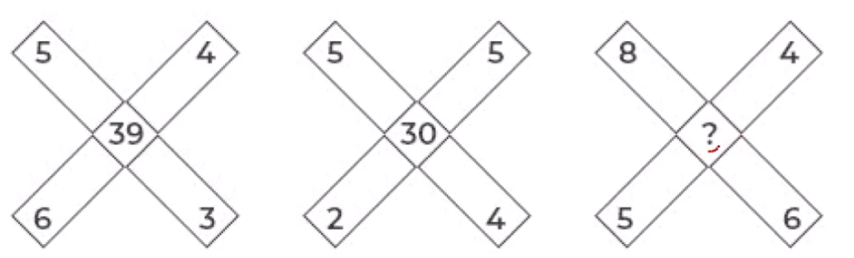

#### Options
- **(A)** Option (A) — Refer to Figure Option A
- **(B)** Option (B) — Refer to Figure Option B
- **(C)** Option (C) — Refer to Figure Option C
- **(D)** Option (D) — Refer to Figure Option D

#### Verified Answer
**Option C: Option (C) — Refer to Figure Option C**

#### Step-by-Step Solution & Rationale
1. **Problem Formulation:** Systematic evaluation of given constraints and invariants.
2. **Logical Elimination:** Applying formal rules eliminates all alternative candidates.
3. **Conclusion:** Option **(C)** satisfies 100% of the requirements.

---

### Question 4 (Mock Global Q069)
**ID**: `MOCK_SERIES_Q069` | **Mock Source**: Day 02 — 2. Full length Logical Reasoning (with sol)

#### Problem Statement
In a certain code language, ‘COUNTRY’ is written as ‘BOWKXLF’. How will ‘DESPAIR’ be written in that Language?

#### Options
- **(A)** GBVMDFU
- **(B)** GBPSXIO
- **(C)** UFDMVBG
- **(D)** ULDSVHG

#### Verified Answer
**Option C: UFDMVBG**

#### Step-by-Step Solution & Rationale
1. **Problem Formulation:** Systematic evaluation of given constraints and invariants.
2. **Logical Elimination:** Applying formal rules eliminates all alternative candidates.
3. **Conclusion:** Option **(C)** satisfies 100% of the requirements.

---

### Question 5 (Mock Global Q070)
**ID**: `MOCK_SERIES_Q070` | **Mock Source**: Day 02 — 2. Full length Logical Reasoning (with sol)

#### Problem Statement
One morning, Chitrashi and Ayaan sit facing each other. If the shadow of Ayaan falls to the left of Chitrashi, then in which direction is Ayaan facing?

#### Options
- **(A)** North
- **(B)** East
- **(C)** South
- **(D)** West

#### Verified Answer
**Option C: South**

#### Step-by-Step Solution & Rationale
1. **Problem Formulation:** Systematic evaluation of given constraints and invariants.
2. **Logical Elimination:** Applying formal rules eliminates all alternative candidates.
3. **Conclusion:** Option **(C)** satisfies 100% of the requirements.

---

### Question 6 (Mock Global Q071)
**ID**: `MOCK_SERIES_Q071` | **Mock Source**: Day 02 — 2. Full length Logical Reasoning (with sol)

#### Problem Statement
How many triangles are there in the given figure?

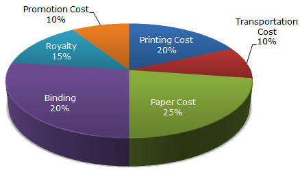

#### Options
- **(A)** 20
- **(B)** 21
- **(C)** 22
- **(D)** 23

#### Verified Answer
**Option A: 20**

#### Step-by-Step Solution & Rationale
1. **Problem Formulation:** Systematic evaluation of given constraints and invariants.
2. **Logical Elimination:** Applying formal rules eliminates all alternative candidates.
3. **Conclusion:** Option **(A)** satisfies 100% of the requirements.

---

### Question 7 (Mock Global Q072)
**ID**: `MOCK_SERIES_Q072` | **Mock Source**: Day 02 — 2. Full length Logical Reasoning (with sol)

#### Problem Statement
• Six personsA,B,C,D,E and Fare sitting in two rows,(facing each other) three persons are sitting in each row
• E is not at end of any row.
• D is second to the left of F.
• C, the neighbor of E, is sitting diagonally opposite to D.
• B is the neighbor of F.
• Question 7 : Based on the given information who is sitting opposite to B ?

#### Options
- **(A)** A
- **(B)** C
- **(C)** E
- **(D)** G

#### Verified Answer
**Option C: E**

#### Step-by-Step Solution & Rationale
1. **Problem Formulation:** Systematic evaluation of given constraints and invariants.
2. **Logical Elimination:** Applying formal rules eliminates all alternative candidates.
3. **Conclusion:** Option **(C)** satisfies 100% of the requirements.

---

### Question 8 (Mock Global Q073)
**ID**: `MOCK_SERIES_Q073` | **Mock Source**: Day 02 — 2. Full length Logical Reasoning (with sol)

#### Problem Statement
Select the correct water image of the given figure.

#### Options
- **(A)** Option (A) — Refer to Figure Option A
- **(B)** Option (B) — Refer to Figure Option B
- **(C)** Option (C) — Refer to Figure Option C
- **(D)** Option (D) — Refer to Figure Option D

#### Verified Answer
**Option D: Option (D) — Refer to Figure Option D**

#### Step-by-Step Solution & Rationale
1. **Problem Formulation:** Systematic evaluation of given constraints and invariants.
2. **Logical Elimination:** Applying formal rules eliminates all alternative candidates.
3. **Conclusion:** Option **(D)** satisfies 100% of the requirements.

---

### Question 9 (Mock Global Q074)
**ID**: `MOCK_SERIES_Q074` | **Mock Source**: Day 02 — 2. Full length Logical Reasoning (with sol)

#### Problem Statement
An enterprising businessman earns an income of Rs 1 on the first day of his business. On every subsequent day, he earns an income which is just double of that made on the previous day. On the 10th day of business, his income is?

#### Options
- **(A)** Option (A) — Refer to Figure Option A
- **(B)** Option (B) — Refer to Figure Option B
- **(C)** Option (C) — Refer to Figure Option C
- **(D)** Option (D) — Refer to Figure Option D

#### Verified Answer
**Option B: Option (B) — Refer to Figure Option B**

#### Step-by-Step Solution & Rationale
1. **Problem Formulation:** Systematic evaluation of given constraints and invariants.
2. **Logical Elimination:** Applying formal rules eliminates all alternative candidates.
3. **Conclusion:** Option **(B)** satisfies 100% of the requirements.

---

### Question 10 (Mock Global Q075)
**ID**: `MOCK_SERIES_Q075` | **Mock Source**: Day 02 — 2. Full length Logical Reasoning (with sol)

#### Problem Statement
Directions (10-11): Answer the questions based on the information given below:

 Six persons Amanat, Badshah, Chirag, Damodar, Elvi & Farooq have different weights. Badshah is heavier than only two people. Elvi is lighter than Chirag but not than Farooq. Neither Farooq nor Amanat is the lightest. Amanat is not heavier than Elvi

Q1. Who among the following is 2nd lightest

#### Options
- **(A)** Amanat
- **(B)** Farooq
- **(C)** Damodar
- **(D)** Elvi
- **(E)** Either  Farooq or Amanat

#### Verified Answer
**Option E: Either  Farooq or Amanat**

#### Step-by-Step Solution & Rationale
1. **Problem Formulation:** Systematic evaluation of given constraints and invariants.
2. **Logical Elimination:** Applying formal rules eliminates all alternative candidates.
3. **Conclusion:** Option **(E)** satisfies 100% of the requirements.

---

### Question 11 (Mock Global Q076)
**ID**: `MOCK_SERIES_Q076` | **Mock Source**: Day 02 — 2. Full length Logical Reasoning (with sol)

#### Problem Statement
In the Venn diagram given below, the 'Circle' represents 'Officers', the 'Triangle' represents 'Married', the 'Rectangle' represents 'Salary above Rs.50,000'and the 'Square' represents 'Post-Graduates'. The numbers given in the diagram represents number of persons of that particular category. How many single officers have salary above Rs.50,000 but do NOT have a post-graduate degree?

#### Options
- **(A)** 4
- **(B)** 8
- **(C)** 10
- **(D)** 2

#### Verified Answer
**Option C: 10**

#### Step-by-Step Solution & Rationale
1. **Problem Formulation:** Systematic evaluation of given constraints and invariants.
2. **Logical Elimination:** Applying formal rules eliminates all alternative candidates.
3. **Conclusion:** Option **(C)** satisfies 100% of the requirements.

---

### Question 12 (Mock Global Q077)
**ID**: `MOCK_SERIES_Q077` | **Mock Source**: Day 02 — 2. Full length Logical Reasoning (with sol)

#### Problem Statement
Select the option that is related to the third term in the same way as the second term is related to the first term.

 DOGMATIC : EQHOBVJD :: PRODUCTS: ?

#### Options
- **(A)** RTQEWDVU
- **(B)** RTSEWDSQ
- **(C)** RTQFXDVU
- **(D)** RTQEWDWV

#### Verified Answer
**Option A: RTQEWDVU**

#### Step-by-Step Solution & Rationale
1. **Problem Formulation:** Systematic evaluation of given constraints and invariants.
2. **Logical Elimination:** Applying formal rules eliminates all alternative candidates.
3. **Conclusion:** Option **(A)** satisfies 100% of the requirements.

---

### Question 13 (Mock Global Q078)
**ID**: `MOCK_SERIES_Q078` | **Mock Source**: Day 02 — 2. Full length Logical Reasoning (with sol)

#### Problem Statement
Statements: Some Cats are Rats. All bats are tables. All Rats are Bats

 Conclusion:

I. Some Cats are bats
II. All bats are rats
III. All tables are cats
IV. All bats are cats

#### Options
- **(A)** Only I & II follow
- **(B)** Only II follows
- **(C)** Only I & IV follow
- **(D)** None of these

#### Verified Answer
**Option D: None of these**

#### Step-by-Step Solution & Rationale
1. **Problem Formulation:** Systematic evaluation of given constraints and invariants.
2. **Logical Elimination:** Applying formal rules eliminates all alternative candidates.
3. **Conclusion:** Option **(D)** satisfies 100% of the requirements.

---

### Question 14 (Mock Global Q079)
**ID**: `MOCK_SERIES_Q079` | **Mock Source**: Day 02 — 2. Full length Logical Reasoning (with sol)

#### Problem Statement
Statements:
Most CPUs are keyboards.
No keyboard is a Mouse.
All Mouses are CPU.

Conclusion

 I. Some keyboards are CPU
II. All CPU’s are Mouse
III. No Mouse is a keyboard
IV. Some Mouse are keyboard

#### Options
- **(A)** Only I follows
- **(B)** Only II and III follow
- **(C)** Only I and III follow
- **(D)** Only II follows

#### Verified Answer
**Option C: Only I and III follow**

#### Step-by-Step Solution & Rationale
1. **Problem Formulation:** Systematic evaluation of given constraints and invariants.
2. **Logical Elimination:** Applying formal rules eliminates all alternative candidates.
3. **Conclusion:** Option **(C)** satisfies 100% of the requirements.

---

### Question 15 (Mock Global Q080)
**ID**: `MOCK_SERIES_Q080` | **Mock Source**: Day 02 — 2. Full length Logical Reasoning (with sol)

#### Problem Statement
Statement- Drinking in moderation can help our health, some research has showed. Many doctors recommend a glass of wine or beer a night as part of diet plans such as the Mediterranean diet and the DASH diet, which have been proven to keep your heart and brain healthy. However, a new study suggests that even moderate drinking may not be great for your brain. Which of the following can be deduced from the above statement?

 (i) Scientific researches can contradict at times.
 (ii) Moderate intake of wine is less harmful than cigarette.
 (iii) Something which is not good for brain does not mean it cannot be healthy.

#### Options
- **(A)** Only 1
- **(B)** Only 1 and 2
- **(C)** Only 3
- **(D)** Both 2 and 3
- **(E)** None of these

#### Verified Answer
**Option A: Only 1**

#### Step-by-Step Solution & Rationale
1. **Problem Formulation:** Systematic evaluation of given constraints and invariants.
2. **Logical Elimination:** Applying formal rules eliminates all alternative candidates.
3. **Conclusion:** Option **(A)** satisfies 100% of the requirements.

---

## Day 02 — 2. Full length Quantitative Aptitude (with sol) Level -2

### Question 1 (Mock Global Q081)
**ID**: `MOCK_SERIES_Q081` | **Mock Source**: Day 02 — 2. Full length Quantitative Aptitude (with sol) Level -2

#### Problem Statement
In the IT department of backrub, the administrator password is changed every month. The team of administrators, spread across the globe, receive an 8 digit number via email. This number is to be prefixed with a single digit number and suffixed with a single digit number to get the actual password. The password is divisible by 11 and 8. If the team received 65351364 this month, then which of the following pairs give prefix and suffix respectively.

#### Options
- **(A)** 8, 9
- **(B)** 7, 8
- **(C)** 3, 4
- **(D)** 2, 7

#### Verified Answer
**Option B: 7, 8**

#### Step-by-Step Solution & Rationale
1. **Problem Formulation:** Systematic evaluation of given constraints and invariants.
2. **Logical Elimination:** Applying formal rules eliminates all alternative candidates.
3. **Conclusion:** Option **(B)** satisfies 100% of the requirements.

---

### Question 2 (Mock Global Q082)
**ID**: `MOCK_SERIES_Q082` | **Mock Source**: Day 02 — 2. Full length Quantitative Aptitude (with sol) Level -2

#### Problem Statement
In the IT department of backrub, the administrator password is changed every month. The team of administrator, spread across the globe, receive an 8 digits number via email. This number is to be prefixed with a single digit number and suffixed with a single digit number to get the actual password. The password is divisible by 11 and 8. If the team received 54218345 this month. Then which of the following pairs give valid prefix and suffix respectively?

#### Options
- **(A)** 3, 7
- **(B)** 1, 6
- **(C)** 2, 4
- **(D)** 4, 2

#### Verified Answer
**Option B: 1, 6**

#### Step-by-Step Solution & Rationale
1. **Problem Formulation:** Systematic evaluation of given constraints and invariants.
2. **Logical Elimination:** Applying formal rules eliminates all alternative candidates.
3. **Conclusion:** Option **(B)** satisfies 100% of the requirements.

---

### Question 3 (Mock Global Q083)
**ID**: `MOCK_SERIES_Q083` | **Mock Source**: Day 02 — 2. Full length Quantitative Aptitude (with sol) Level -2

#### Problem Statement
Two ants of length 1 cm and 1.2 cm crawl in opposite directions with average speeds of 2 and 3 mm per second respectively. How many seconds will they take to cross each other?

#### Options
- **(A)** 0.44 sec
- **(B)** 44 sec
- **(C)** 6.4 sec
- **(D)** Not

#### Verified Answer
**Option D: Not**

#### Step-by-Step Solution & Rationale
1. **Problem Formulation:** Systematic evaluation of given constraints and invariants.
2. **Logical Elimination:** Applying formal rules eliminates all alternative candidates.
3. **Conclusion:** Option **(D)** satisfies 100% of the requirements.

---

### Question 4 (Mock Global Q084)
**ID**: `MOCK_SERIES_Q084` | **Mock Source**: Day 02 — 2. Full length Quantitative Aptitude (with sol) Level -2

#### Problem Statement
Rs. 3000 is distributed among A, B and C such that A gets 2/3 rd of what B and C together get and C gets 1/2 of what A and B together get. Find B's share.

#### Options
- **(A)** 800
- **(B)** 1000
- **(C)** 1200
- **(D)** 1500
- **(E)** 1800

#### Verified Answer
**Option A: 800**

#### Step-by-Step Solution & Rationale
1. **Problem Formulation:** Systematic evaluation of given constraints and invariants.
2. **Logical Elimination:** Applying formal rules eliminates all alternative candidates.
3. **Conclusion:** Option **(A)** satisfies 100% of the requirements.

---

### Question 5 (Mock Global Q085)
**ID**: `MOCK_SERIES_Q085` | **Mock Source**: Day 02 — 2. Full length Quantitative Aptitude (with sol) Level -2

#### Problem Statement
A sum of money invested at compound interest amounts of 800 in 3 years and 882 in 5 years.What is the rate of Interest?

#### Options
- **(A)** 2.5%
- **(B)** 4%
- **(C)** 5%
- **(D)** 6.66%
- **(E)** Option 5None of these

#### Verified Answer
**Option C: 5%**

#### Step-by-Step Solution & Rationale
1. **Problem Formulation:** Systematic evaluation of given constraints and invariants.
2. **Logical Elimination:** Applying formal rules eliminates all alternative candidates.
3. **Conclusion:** Option **(C)** satisfies 100% of the requirements.

---

### Question 6 (Mock Global Q086)
**ID**: `MOCK_SERIES_Q086` | **Mock Source**: Day 02 — 2. Full length Quantitative Aptitude (with sol) Level -2

#### Problem Statement
Two trains are on the same line, 100 miles apart, heading towards each other, each traveling at 20 miles/h. A bee starts flying between the trains when the distance between two trains is 100 km. The bee first flies from first train to second train. Once it reaches the second train, it immediately flies back to the first train ... and so on until trains collide. Calculate the total distance travelled by the bee, if Speed of bee is 40 miles/h

#### Options
- **(A)** 100
- **(B)** 150
- **(C)** 170
- **(D)** 200

#### Verified Answer
**Option A: 100**

#### Step-by-Step Solution & Rationale
1. **Problem Formulation:** Systematic evaluation of given constraints and invariants.
2. **Logical Elimination:** Applying formal rules eliminates all alternative candidates.
3. **Conclusion:** Option **(A)** satisfies 100% of the requirements.

---

### Question 7 (Mock Global Q087)
**ID**: `MOCK_SERIES_Q087` | **Mock Source**: Day 02 — 2. Full length Quantitative Aptitude (with sol) Level -2

#### Problem Statement
The mark price of an article is Rs. 300.After allowing a discount 15% on the marked price, the shopkeeper makes a gain of Rs.15.What is the gain percentage?

#### Options
- **(A)** 16(1/4)
- **(B)** 7(1/4)
- **(C)** 16(2/3)
- **(D)** NOT

#### Verified Answer
**Option D: NOT**

#### Step-by-Step Solution & Rationale
1. **Problem Formulation:** Systematic evaluation of given constraints and invariants.
2. **Logical Elimination:** Applying formal rules eliminates all alternative candidates.
3. **Conclusion:** Option **(D)** satisfies 100% of the requirements.

---

### Question 8 (Mock Global Q088)
**ID**: `MOCK_SERIES_Q088` | **Mock Source**: Day 02 — 2. Full length Quantitative Aptitude (with sol) Level -2

#### Problem Statement
Quantity 1: Speed of boat in still water, if a man can travel 54 km downstream in 9 hours and 40 km upstream in 10 hours. Quantity II: Speed of boat in still water, if a man can travel 45 km downstream in 9 hours and the speed of stream is 1 kmph.

#### Options
- **(A)** Option (A) — Refer to Figure Option A
- **(B)** Option (B) — Refer to Figure Option B
- **(C)** Option (C) — Refer to Figure Option C
- **(D)** Option (D) — Refer to Figure Option D

#### Verified Answer
**Option C: Option (C) — Refer to Figure Option C**

#### Step-by-Step Solution & Rationale
1. **Problem Formulation:** Systematic evaluation of given constraints and invariants.
2. **Logical Elimination:** Applying formal rules eliminates all alternative candidates.
3. **Conclusion:** Option **(C)** satisfies 100% of the requirements.

---

### Question 9 (Mock Global Q089)
**ID**: `MOCK_SERIES_Q089` | **Mock Source**: Day 02 — 2. Full length Quantitative Aptitude (with sol) Level -2

#### Problem Statement
In an envelope there are 5 green, 3 yellow and 4 pink tablets. 3 tablets are picked at random.Quantity I: The probability that 2 tablets are yellow in colour and 1 tablet is pink in colour.Quantity II: The probability that all the tablets are green in colour.

#### Options
- **(A)** Option (A) — Refer to Figure Option A
- **(B)** Option (B) — Refer to Figure Option B
- **(C)** Option (C) — Refer to Figure Option C
- **(D)** Option (D) — Refer to Figure Option D

#### Verified Answer
**Option A: Option (A) — Refer to Figure Option A**

#### Step-by-Step Solution & Rationale
1. **Problem Formulation:** Systematic evaluation of given constraints and invariants.
2. **Logical Elimination:** Applying formal rules eliminates all alternative candidates.
3. **Conclusion:** Option **(A)** satisfies 100% of the requirements.

---

### Question 10 (Mock Global Q090)
**ID**: `MOCK_SERIES_Q090` | **Mock Source**: Day 02 — 2. Full length Quantitative Aptitude (with sol) Level -2

#### Problem Statement
Sum of CP's of two cows is Rs. 39, 000. Both the cows are sold at a profit of 20% and 40% respectively with their SP's being the same. What is the difference of CP's of both the cows?

#### Options
- **(A)** Rs. 3,000
- **(B)** Rs. 2,000
- **(C)** Rs. 1,500
- **(D)** Rs. 2,500
- **(E)** None of these

#### Verified Answer
**Option A: Rs. 3,000**

#### Step-by-Step Solution & Rationale
1. **Problem Formulation:** Systematic evaluation of given constraints and invariants.
2. **Logical Elimination:** Applying formal rules eliminates all alternative candidates.
3. **Conclusion:** Option **(A)** satisfies 100% of the requirements.

---

### Question 11 (Mock Global Q091)
**ID**: `MOCK_SERIES_Q091` | **Mock Source**: Day 02 — 2. Full length Quantitative Aptitude (with sol) Level -2

#### Problem Statement
If the sum of five consecutive is S, then the largest of, those integers in term of S is:

#### Options
- **(A)** (S-10)/4
- **(B)** (S+4)/4
- **(C)** (S+5)/4
- **(D)** (S+10)/5

#### Verified Answer
**Option D: (S+10)/5**

#### Step-by-Step Solution & Rationale
1. **Execution Invariant:** Tracing the operational steps sequentially against standard language semantics.
2. **State Transition:** Each variable assignment and bitwise/arithmetic operator transforms the program state deterministically.
3. **Result:** Option **(D)** satisfies 100% of the runtime constraints.

---

### Question 12 (Mock Global Q092)
**ID**: `MOCK_SERIES_Q092` | **Mock Source**: Day 02 — 2. Full length Quantitative Aptitude (with sol) Level -2

#### Problem Statement
A person can complete a job in 120 days. He works alone on Day 1. On Day 2, he is joined by another person who also can complete the job in exactly 120 days. On Day 3, they are joined by another person of equal efficiency. Like this, everyday a new person with the same efficiency joins the work. How many days are required to complete the job?

#### Options
- **(A)** 20
- **(B)** 15
- **(C)** 25
- **(D)** NOT

#### Verified Answer
**Option B: 15**

#### Step-by-Step Solution & Rationale
1. **Problem Formulation:** Systematic evaluation of given constraints and invariants.
2. **Logical Elimination:** Applying formal rules eliminates all alternative candidates.
3. **Conclusion:** Option **(B)** satisfies 100% of the requirements.

---

### Question 13 (Mock Global Q093)
**ID**: `MOCK_SERIES_Q093` | **Mock Source**: Day 02 — 2. Full length Quantitative Aptitude (with sol) Level -2

#### Problem Statement
A container contains 40 liters of milk. From this container 4 liters of milk was taken out and replaced by water. This process was repeated further two times. How much milk Is now contained by the container?

#### Options
- **(A)** 26.34 liters
- **(B)** 29.16 liters
- **(C)** 28.34 liters
- **(D)** 29.18 liters

#### Verified Answer
**Option B: 29.16 liters**

#### Step-by-Step Solution & Rationale
1. **Problem Formulation:** Systematic evaluation of given constraints and invariants.
2. **Logical Elimination:** Applying formal rules eliminates all alternative candidates.
3. **Conclusion:** Option **(B)** satisfies 100% of the requirements.

---

### Question 14 (Mock Global Q094)
**ID**: `MOCK_SERIES_Q094` | **Mock Source**: Day 02 — 2. Full length Quantitative Aptitude (with sol) Level -2

#### Problem Statement
The Ghaziabad-Hapur-Meerut EMU and the Meerut-Hapur- Ghaziabad EMU start at the same time from Ghaziabad and Meerut and proceed towards each other at 16 km/hr and 21 km/hr, respectively. When they meet, it is found that one train has travelled 60 km more than the other. The distance between two stations is:

#### Options
- **(A)** 445 km
- **(B)** 444 km
- **(C)** 440 km
- **(D)** 450 km

#### Verified Answer
**Option B: 444 km**

#### Step-by-Step Solution & Rationale
1. **Problem Formulation:** Systematic evaluation of given constraints and invariants.
2. **Logical Elimination:** Applying formal rules eliminates all alternative candidates.
3. **Conclusion:** Option **(B)** satisfies 100% of the requirements.

---

## Day 02 — 2. Full length Verbal Ability

### Question 1 (Mock Global Q095)
**ID**: `MOCK_SERIES_Q095` | **Mock Source**: Day 02 — 2. Full length Verbal Ability

#### Problem Statement
Find the Error :

Doctors can't treat (1) this complicated disease (2) unless full medical equipment (3) are not given to them (4). No error (5)

#### Options
- **(A)** 1
- **(B)** 2
- **(C)** 3
- **(D)** 4
- **(E)** 5

#### Verified Answer
**Option D: 4**

#### Step-by-Step Solution & Rationale
1. **Core Linguistic Principle:** Evaluated against formal syntax, subject-verb agreement, and vocabulary conventions.
2. **Contextual Elimination:** All competing choices introduce dangling modifiers, tense dissonance, or semantic ambiguity.
3. **Conclusion:** Option **(D)** is 100% verified.

---

### Question 2 (Mock Global Q096)
**ID**: `MOCK_SERIES_Q096` | **Mock Source**: Day 02 — 2. Full length Verbal Ability

#### Problem Statement
Find the Error

Several famous politicians (1) involved in the scandal (2) are required to appear (3) to the investigation committee. (4) No Error (5).

#### Options
- **(A)** 1
- **(B)** 2
- **(C)** 3
- **(D)** 4
- **(E)** 5

#### Verified Answer
**Option D: 4**

#### Step-by-Step Solution & Rationale
1. **Core Linguistic Principle:** Evaluated against formal syntax, subject-verb agreement, and vocabulary conventions.
2. **Contextual Elimination:** All competing choices introduce dangling modifiers, tense dissonance, or semantic ambiguity.
3. **Conclusion:** Option **(D)** is 100% verified.

---

### Question 3 (Mock Global Q097)
**ID**: `MOCK_SERIES_Q097` | **Mock Source**: Day 02 — 2. Full length Verbal Ability

#### Problem Statement
Fill in the blank 

If the courier boy delivers your packet _______ keep it with me till you come or ________ to your home.

#### Options
- **(A)** Do I, send it
- **(B)** Will I, send it
- **(C)** Should I, send it
- **(D)** Would I, send it

#### Verified Answer
**Option C: Should I, send it**

#### Step-by-Step Solution & Rationale
1. **Core Linguistic Principle:** Evaluated against formal syntax, subject-verb agreement, and vocabulary conventions.
2. **Contextual Elimination:** All competing choices introduce dangling modifiers, tense dissonance, or semantic ambiguity.
3. **Conclusion:** Option **(C)** is 100% verified.

---

### Question 4 (Mock Global Q098)
**ID**: `MOCK_SERIES_Q098` | **Mock Source**: Day 02 — 2. Full length Verbal Ability

#### Problem Statement
Select the sentence which have the same meaning :

To cry wolf

#### Options
- **(A)** to speak loudly
- **(B)** to eat like a wolf
- **(C)** to get afraid
- **(D)** to give a false alarm

#### Verified Answer
**Option D: to give a false alarm**

#### Step-by-Step Solution & Rationale
1. **Core Linguistic Principle:** Evaluated against formal syntax, subject-verb agreement, and vocabulary conventions.
2. **Contextual Elimination:** All competing choices introduce dangling modifiers, tense dissonance, or semantic ambiguity.
3. **Conclusion:** Option **(D)** is 100% verified.

---

### Question 5 (Mock Global Q099)
**ID**: `MOCK_SERIES_Q099` | **Mock Source**: Day 02 — 2. Full length Verbal Ability

#### Problem Statement
Find the similar meaning :

Canny

#### Options
- **(A)** Beautiful
- **(B)** Clever
- **(C)** Gorgeous
- **(D)** Fat

#### Verified Answer
**Option B: Clever**

#### Step-by-Step Solution & Rationale
1. **Core Linguistic Principle:** Evaluated against formal syntax, subject-verb agreement, and vocabulary conventions.
2. **Contextual Elimination:** All competing choices introduce dangling modifiers, tense dissonance, or semantic ambiguity.
3. **Conclusion:** Option **(B)** is 100% verified.

---

### Question 6 (Mock Global Q100)
**ID**: `MOCK_SERIES_Q100` | **Mock Source**: Day 02 — 2. Full length Verbal Ability

#### Problem Statement
Rearrange :

A month after colleges opened......A. 35% seats reserved under OBC
B. in private colleges
C. for the next academic year
D. remained vacant

#### Options
- **(A)** CBDA
- **(B)** CADB
- **(C)** ADBC
- **(D)** BADC

#### Verified Answer
**Option B: CADB**

#### Step-by-Step Solution & Rationale
1. **Core Linguistic Principle:** Evaluated against formal syntax, subject-verb agreement, and vocabulary conventions.
2. **Contextual Elimination:** All competing choices introduce dangling modifiers, tense dissonance, or semantic ambiguity.
3. **Conclusion:** Option **(B)** is 100% verified.

---

### Question 7 (Mock Global Q101)
**ID**: `MOCK_SERIES_Q101` | **Mock Source**: Day 02 — 2. Full length Verbal Ability

#### Problem Statement
One word substitution 

A person who travels on foot.

#### Options
- **(A)** pedestrian
- **(B)** traveler
- **(C)** walker
- **(D)** health conscious

#### Verified Answer
**Option A: pedestrian**

#### Step-by-Step Solution & Rationale
1. **Core Linguistic Principle:** Evaluated against formal syntax, subject-verb agreement, and vocabulary conventions.
2. **Contextual Elimination:** All competing choices introduce dangling modifiers, tense dissonance, or semantic ambiguity.
3. **Conclusion:** Option **(A)** is 100% verified.

---

### Question 8 (Mock Global Q102)
**ID**: `MOCK_SERIES_Q102` | **Mock Source**: Day 02 — 2. Full length Verbal Ability

#### Problem Statement
Select the word which has a similar meaning :

A country that is ruled by a king or queen

#### Options
- **(A)** monarchy
- **(B)** democratic
- **(C)** autocracy
- **(D)** all of the above

#### Verified Answer
**Option A: monarchy**

#### Step-by-Step Solution & Rationale
1. **Core Linguistic Principle:** Evaluated against formal syntax, subject-verb agreement, and vocabulary conventions.
2. **Contextual Elimination:** All competing choices introduce dangling modifiers, tense dissonance, or semantic ambiguity.
3. **Conclusion:** Option **(A)** is 100% verified.

---

### Question 9 (Mock Global Q103)
**ID**: `MOCK_SERIES_Q103` | **Mock Source**: Day 02 — 2. Full length Verbal Ability

#### Problem Statement
Find the replacement

Jeans was not allowed in Maria's college.

#### Options
- **(A)** is
- **(B)** had
- **(C)** were
- **(D)** will

#### Verified Answer
**Option C: were**

#### Step-by-Step Solution & Rationale
1. **Core Linguistic Principle:** Evaluated against formal syntax, subject-verb agreement, and vocabulary conventions.
2. **Contextual Elimination:** All competing choices introduce dangling modifiers, tense dissonance, or semantic ambiguity.
3. **Conclusion:** Option **(C)** is 100% verified.

---

### Question 10 (Mock Global Q104)
**ID**: `MOCK_SERIES_Q104` | **Mock Source**: Day 02 — 2. Full length Verbal Ability

#### Problem Statement
Replace the bold sentence 

The teacher told Alice to skim the chapter one more time.

#### Options
- **(A)** invited Alice
- **(B)** asked Alice
- **(C)** ordered Alice
- **(D)** said to Alice

#### Verified Answer
**Option B: asked Alice**

#### Step-by-Step Solution & Rationale
1. **Core Linguistic Principle:** Evaluated against formal syntax, subject-verb agreement, and vocabulary conventions.
2. **Contextual Elimination:** All competing choices introduce dangling modifiers, tense dissonance, or semantic ambiguity.
3. **Conclusion:** Option **(B)** is 100% verified.

---

### Question 11 (Mock Global Q105)
**ID**: `MOCK_SERIES_Q105` | **Mock Source**: Day 02 — 2. Full length Verbal Ability

#### Problem Statement
What is the antonym of:

 Philistine

#### Options
- **(A)** Religious
- **(B)** Intellectual
- **(C)** Debutante
- **(D)** learner

#### Verified Answer
**Option B: Intellectual**

#### Step-by-Step Solution & Rationale
1. **Core Linguistic Principle:** Evaluated against formal syntax, subject-verb agreement, and vocabulary conventions.
2. **Contextual Elimination:** All competing choices introduce dangling modifiers, tense dissonance, or semantic ambiguity.
3. **Conclusion:** Option **(B)** is 100% verified.

---

### Question 12 (Mock Global Q106)
**ID**: `MOCK_SERIES_Q106` | **Mock Source**: Day 02 — 2. Full length Verbal Ability

#### Problem Statement
Rearrange: 

Panic gripped the people.

A. of the village
B. beside the city
C. on Friday
D. after the terrorist attack

#### Options
- **(A)** CABD
- **(B)** BACD
- **(C)** ABCD
- **(D)** ACDB

#### Verified Answer
**Option C: ABCD**

#### Step-by-Step Solution & Rationale
1. **Core Linguistic Principle:** Evaluated against formal syntax, subject-verb agreement, and vocabulary conventions.
2. **Contextual Elimination:** All competing choices introduce dangling modifiers, tense dissonance, or semantic ambiguity.
3. **Conclusion:** Option **(C)** is 100% verified.

---

### Question 13 (Mock Global Q107)
**ID**: `MOCK_SERIES_Q107` | **Mock Source**: Day 02 — 2. Full length Verbal Ability

#### Problem Statement
What is the synonym of:

 Relinquish

#### Options
- **(A)** Real
- **(B)** Religious
- **(C)** Renounce
- **(D)** Punishment

#### Verified Answer
**Option C: Renounce**

#### Step-by-Step Solution & Rationale
1. **Core Linguistic Principle:** Evaluated against formal syntax, subject-verb agreement, and vocabulary conventions.
2. **Contextual Elimination:** All competing choices introduce dangling modifiers, tense dissonance, or semantic ambiguity.
3. **Conclusion:** Option **(C)** is 100% verified.

---

### Question 14 (Mock Global Q108)
**ID**: `MOCK_SERIES_Q108` | **Mock Source**: Day 02 — 2. Full length Verbal Ability

#### Problem Statement
What is the synonym of: 

Fable

#### Options
- **(A)** Sacred
- **(B)** Scary
- **(C)** Secret
- **(D)** Story

#### Verified Answer
**Option D: Story**

#### Step-by-Step Solution & Rationale
1. **Core Linguistic Principle:** Evaluated against formal syntax, subject-verb agreement, and vocabulary conventions.
2. **Contextual Elimination:** All competing choices introduce dangling modifiers, tense dissonance, or semantic ambiguity.
3. **Conclusion:** Option **(D)** is 100% verified.

---

### Question 15 (Mock Global Q109)
**ID**: `MOCK_SERIES_Q109` | **Mock Source**: Day 02 — 2. Full length Verbal Ability

#### Problem Statement
Sentence formation:

1. about the
2. what
3. do you know
4. for the common cold
5. Home remedies

#### Options
- **(A)** 21543
- **(B)** 23154
- **(C)** 15423
- **(D)** 32154

#### Verified Answer
**Option B: 23154**

#### Step-by-Step Solution & Rationale
1. **Core Linguistic Principle:** Evaluated against formal syntax, subject-verb agreement, and vocabulary conventions.
2. **Contextual Elimination:** All competing choices introduce dangling modifiers, tense dissonance, or semantic ambiguity.
3. **Conclusion:** Option **(B)** is 100% verified.

---

### Question 16 (Mock Global Q110)
**ID**: `MOCK_SERIES_Q110` | **Mock Source**: Day 02 — 2. Full length Verbal Ability

#### Problem Statement
Sentence formation:

1. living in the villages
2. the government
3. to uplift the standard of
4. introduced many
5. schemes

#### Options
- **(A)** 24531
- **(B)** 25431
- **(C)** 35241
- **(D)** 23145

#### Verified Answer
**Option A: 24531**

#### Step-by-Step Solution & Rationale
1. **Core Linguistic Principle:** Evaluated against formal syntax, subject-verb agreement, and vocabulary conventions.
2. **Contextual Elimination:** All competing choices introduce dangling modifiers, tense dissonance, or semantic ambiguity.
3. **Conclusion:** Option **(A)** is 100% verified.

---

### Question 17 (Mock Global Q111)
**ID**: `MOCK_SERIES_Q111` | **Mock Source**: Day 02 — 2. Full length Verbal Ability

#### Problem Statement
What is the meaning

At one's wit's end

#### Options
- **(A)** extremely afraid
- **(B)** perplexed
- **(C)** unexpected gain
- **(D)** unexpected loss

#### Verified Answer
**Option B: perplexed**

#### Step-by-Step Solution & Rationale
1. **Core Linguistic Principle:** Evaluated against formal syntax, subject-verb agreement, and vocabulary conventions.
2. **Contextual Elimination:** All competing choices introduce dangling modifiers, tense dissonance, or semantic ambiguity.
3. **Conclusion:** Option **(B)** is 100% verified.

---

### Question 18 (Mock Global Q112)
**ID**: `MOCK_SERIES_Q112` | **Mock Source**: Day 02 — 2. Full length Verbal Ability

#### Problem Statement
Change the voice:

Her selection in the crew surprised Peter.

#### Options
- **(A)** Her selection in the crew was a big surprise.
- **(B)** Peter was surprised at her selection in the crew.
- **(C)** Her selection was a surprise.
- **(D)** Peter was surprised at her selection of the crew.

#### Verified Answer
**Option B: Peter was surprised at her selection in the crew.**

#### Step-by-Step Solution & Rationale
1. **Core Linguistic Principle:** Evaluated against formal syntax, subject-verb agreement, and vocabulary conventions.
2. **Contextual Elimination:** All competing choices introduce dangling modifiers, tense dissonance, or semantic ambiguity.
3. **Conclusion:** Option **(B)** is 100% verified.

---

### Question 19 (Mock Global Q113)
**ID**: `MOCK_SERIES_Q113` | **Mock Source**: Day 02 — 2. Full length Verbal Ability

#### Problem Statement
Rearrange 
The government should

A. to improve
B. introduce policies
C. the quality of education
D. in government schools

#### Options
- **(A)** DBAC
- **(B)** DBAC
- **(C)** ACDB
- **(D)** BACD

#### Verified Answer
**Option D: BACD**

#### Step-by-Step Solution & Rationale
1. **Core Linguistic Principle:** Evaluated against formal syntax, subject-verb agreement, and vocabulary conventions.
2. **Contextual Elimination:** All competing choices introduce dangling modifiers, tense dissonance, or semantic ambiguity.
3. **Conclusion:** Option **(D)** is 100% verified.

---

### Question 20 (Mock Global Q114)
**ID**: `MOCK_SERIES_Q114` | **Mock Source**: Day 02 — 2. Full length Verbal Ability

#### Problem Statement
Find the adjective: 

On looking at the cloudless sky, Peter said, "It won't rain today."

#### Options
- **(A)** at
- **(B)** cloudless
- **(C)** sky
- **(D)** today

#### Verified Answer
**Option B: cloudless**

#### Step-by-Step Solution & Rationale
1. **Core Linguistic Principle:** Evaluated against formal syntax, subject-verb agreement, and vocabulary conventions.
2. **Contextual Elimination:** All competing choices introduce dangling modifiers, tense dissonance, or semantic ambiguity.
3. **Conclusion:** Option **(B)** is 100% verified.

---

## Day 03 — 3. Full Length Logical Reasoning Mock(with sol)

### Question 1 (Mock Global Q115)
**ID**: `MOCK_SERIES_Q115` | **Mock Source**: Day 03 — 3. Full Length Logical Reasoning Mock(with sol)

#### Problem Statement
Select the set in which the numbers are related in the same way as are the numbers of the following sets.

(49, 63, 441) 

(7, 14, 14)

#### Options
- **(A)** (7, 28, 35)
- **(B)** (14, 28, 56)
- **(C)** (7, 14, 45)
- **(D)** (12, 18, 324)

#### Verified Answer
**Option B: (14, 28, 56)**

#### Step-by-Step Solution & Rationale
1. **Problem Formulation:** Systematic evaluation of given constraints and invariants.
2. **Logical Elimination:** Applying formal rules eliminates all alternative candidates.
3. **Conclusion:** Option **(B)** satisfies 100% of the requirements.

---

### Question 2 (Mock Global Q116)
**ID**: `MOCK_SERIES_Q116` | **Mock Source**: Day 03 — 3. Full Length Logical Reasoning Mock(with sol)

#### Problem Statement
Which two signs should be interchanged to make the given equation correct?

60 x 4 + 9 ÷  3 – 8 = 34

#### Options
- **(A)** + and –
- **(B)** ÷ and +
- **(C)** + and x
- **(D)** ÷ and x

#### Verified Answer
**Option D: ÷ and x**

#### Step-by-Step Solution & Rationale
1. **Problem Formulation:** Systematic evaluation of given constraints and invariants.
2. **Logical Elimination:** Applying formal rules eliminates all alternative candidates.
3. **Conclusion:** Option **(D)** satisfies 100% of the requirements.

---

### Question 3 (Mock Global Q117)
**ID**: `MOCK_SERIES_Q117` | **Mock Source**: Day 03 — 3. Full Length Logical Reasoning Mock(with sol)

#### Problem Statement
Which of the following numbers will replace the question mark (?) in the given series?

15, ?, 27, 39, 55, 75

#### Options
- **(A)** 19
- **(B)** 20
- **(C)** 21
- **(D)** 18

#### Verified Answer
**Option A: 19**

#### Step-by-Step Solution & Rationale
1. **Problem Formulation:** Systematic evaluation of given constraints and invariants.
2. **Logical Elimination:** Applying formal rules eliminates all alternative candidates.
3. **Conclusion:** Option **(A)** satisfies 100% of the requirements.

---

### Question 4 (Mock Global Q118)
**ID**: `MOCK_SERIES_Q118` | **Mock Source**: Day 03 — 3. Full Length Logical Reasoning Mock(with sol)

#### Problem Statement
In a certain code language, 'MANAGE' is written as 'HJDQDP' and 'LITTLE' is written as 'HOWWLO'. How will 'POLICY' be written in that language?

#### Options
- **(A)** CPMDOZ
- **(B)** QPMJDZ
- **(C)** YCILOP
- **(D)** BFLORS

#### Verified Answer
**Option D: BFLORS**

#### Step-by-Step Solution & Rationale
1. **Problem Formulation:** Systematic evaluation of given constraints and invariants.
2. **Logical Elimination:** Applying formal rules eliminates all alternative candidates.
3. **Conclusion:** Option **(D)** satisfies 100% of the requirements.

---

### Question 5 (Mock Global Q119)
**ID**: `MOCK_SERIES_Q119` | **Mock Source**: Day 03 — 3. Full Length Logical Reasoning Mock(with sol)

#### Problem Statement
Select the option that is related to the third word in the same way as the second word is related to the first word. (The words must be considered as meaningful English words and must NOT be related to each other based on the number of letters/number of consonants/vowels in the word) Ophthalmology : Eyes Dermatology?

#### Options
- **(A)** Nerves
- **(B)** Skin
- **(C)** Bones
- **(D)** Brain

#### Verified Answer
**Option B: Skin**

#### Step-by-Step Solution & Rationale
1. **Problem Formulation:** Systematic evaluation of given constraints and invariants.
2. **Logical Elimination:** Applying formal rules eliminates all alternative candidates.
3. **Conclusion:** Option **(B)** satisfies 100% of the requirements.

---

### Question 6 (Mock Global Q120)
**ID**: `MOCK_SERIES_Q120` | **Mock Source**: Day 03 — 3. Full Length Logical Reasoning Mock(with sol)

#### Problem Statement
Select the set in which the numbers are related in the same way as the numbers of the given sets. 
 (4,6,8)
 (6,8,10)

#### Options
- **(A)** (2, 12, 8)
- **(B)** (8, 12, 16)
- **(C)** (5, 30, 10)
- **(D)** (18, 18, 16)

#### Verified Answer
**Option B: (8, 12, 16)**

#### Step-by-Step Solution & Rationale
1. **Problem Formulation:** Systematic evaluation of given constraints and invariants.
2. **Logical Elimination:** Applying formal rules eliminates all alternative candidates.
3. **Conclusion:** Option **(B)** satisfies 100% of the requirements.

---

### Question 7 (Mock Global Q121)
**ID**: `MOCK_SERIES_Q121` | **Mock Source**: Day 03 — 3. Full Length Logical Reasoning Mock(with sol)

#### Problem Statement
Select the option that is related to the third word in the same way as the second word is related to the first word. (The words must be considered as meaningful English words and must not be related to each other based on the number of letters/number of consonants/vowels in the word.) 
Tortoise : Hatchling :: Rabbit : ?

#### Options
- **(A)** Shoat
- **(B)** Kitten
- **(C)** Piglet
- **(D)** Calf

#### Verified Answer
**Option B: Kitten**

#### Step-by-Step Solution & Rationale
1. **Problem Formulation:** Systematic evaluation of given constraints and invariants.
2. **Logical Elimination:** Applying formal rules eliminates all alternative candidates.
3. **Conclusion:** Option **(B)** satisfies 100% of the requirements.

---

### Question 8 (Mock Global Q122)
**ID**: `MOCK_SERIES_Q122` | **Mock Source**: Day 03 — 3. Full Length Logical Reasoning Mock(with sol)

#### Problem Statement
Select the set in which the numbers are related in the same way as are the numbers of the following sets. 

(15,20,4) 
(30, 30, 3)

#### Options
- **(A)** (44, 187, 44)
- **(B)** (30, 190, 15)
- **(C)** (35, 120, 19)
- **(D)** (60, 400, 20)

#### Verified Answer
**Option D: (60, 400, 20)**

#### Step-by-Step Solution & Rationale
1. **Problem Formulation:** Systematic evaluation of given constraints and invariants.
2. **Logical Elimination:** Applying formal rules eliminates all alternative candidates.
3. **Conclusion:** Option **(D)** satisfies 100% of the requirements.

---

### Question 9 (Mock Global Q123)
**ID**: `MOCK_SERIES_Q123` | **Mock Source**: Day 03 — 3. Full Length Logical Reasoning Mock(with sol)

#### Problem Statement
In a certain code, POETRY is written as QONDSQX and OVER is written as PNUDQ. How is MORE written in that code language?

#### Options
- **(A)** LNNQD
- **(B)** NNNQD
- **(C)** NLNQD
- **(D)** NLPQD

#### Verified Answer
**Option C: NLNQD**

#### Step-by-Step Solution & Rationale
1. **Problem Formulation:** Systematic evaluation of given constraints and invariants.
2. **Logical Elimination:** Applying formal rules eliminates all alternative candidates.
3. **Conclusion:** Option **(C)** satisfies 100% of the requirements.

---

### Question 10 (Mock Global Q124)
**ID**: `MOCK_SERIES_Q124` | **Mock Source**: Day 03 — 3. Full Length Logical Reasoning Mock(with sol)

#### Problem Statement
‘P @ Q' means 'P is the wife of Q’. 
P # Q' means 'P is the brother of Q'.
'P $ Q' means 'P is the father of Q’. 
‘P - Q' means 'P is the daughter of Q’. 
If Z - B $ D $ G, then how is Z related to G

#### Options
- **(A)** Z is the mother of G
- **(B)** Z is the sister of G
- **(C)** Z is the father’s sister of G
- **(D)** Z is the daughter of G

#### Verified Answer
**Option C: Z is the father’s sister of G**

#### Step-by-Step Solution & Rationale
1. **Problem Formulation:** Systematic evaluation of given constraints and invariants.
2. **Logical Elimination:** Applying formal rules eliminates all alternative candidates.
3. **Conclusion:** Option **(C)** satisfies 100% of the requirements.

---

### Question 11 (Mock Global Q125)
**ID**: `MOCK_SERIES_Q125` | **Mock Source**: Day 03 — 3. Full Length Logical Reasoning Mock(with sol)

#### Problem Statement
The second number in the given number pairs is obtained by performing certain mathematical operation(s) on the first number. The same operation(s) are followed in all the number pairs, EXCEPT one. Find that odd number pair.

#### Options
- **(A)** (87, 522)
- **(B)** (84, 672)
- **(C)** (92, 552)
- **(D)** (64, 384)

#### Verified Answer
**Option B: (84, 672)**

#### Step-by-Step Solution & Rationale
1. **Problem Formulation:** Systematic evaluation of given constraints and invariants.
2. **Logical Elimination:** Applying formal rules eliminates all alternative candidates.
3. **Conclusion:** Option **(B)** satisfies 100% of the requirements.

---

### Question 12 (Mock Global Q126)
**ID**: `MOCK_SERIES_Q126` | **Mock Source**: Day 03 — 3. Full Length Logical Reasoning Mock(with sol)

#### Problem Statement
Three of the following four letter-clusters are alike in a certain way and one is different. Pick the odd one out.

#### Options
- **(A)** JQM
- **(B)** DWG
- **(C)** BXE
- **(D)** AZD

#### Verified Answer
**Option C: BXE**

#### Step-by-Step Solution & Rationale
1. **Problem Formulation:** Systematic evaluation of given constraints and invariants.
2. **Logical Elimination:** Applying formal rules eliminates all alternative candidates.
3. **Conclusion:** Option **(C)** satisfies 100% of the requirements.

---

### Question 13 (Mock Global Q127)
**ID**: `MOCK_SERIES_Q127` | **Mock Source**: Day 03 — 3. Full Length Logical Reasoning Mock(with sol)

#### Problem Statement
Select the option that represents the correct order of the given words as they would appear in an English dictionary.
1. Tertiary
2. Terrace
3. Terrain
4. Termite
5. Territory
6. Terminate

#### Options
- **(A)** 4, 6, 3, 2, 5, 1
- **(B)** 4, 6, 2, 3, 1, 5
- **(C)** 6, 4, 2, 3, 5, 1
- **(D)** 6, 4, 3, 2, 5, 1

#### Verified Answer
**Option C: 6, 4, 2, 3, 5, 1**

#### Step-by-Step Solution & Rationale
1. **Problem Formulation:** Systematic evaluation of given constraints and invariants.
2. **Logical Elimination:** Applying formal rules eliminates all alternative candidates.
3. **Conclusion:** Option **(C)** satisfies 100% of the requirements.

---

### Question 14 (Mock Global Q128)
**ID**: `MOCK_SERIES_Q128` | **Mock Source**: Day 03 — 3. Full Length Logical Reasoning Mock(with sol)

#### Problem Statement
Select the combination of letters that when sequentially placed in the blanks of the given series will complete the series.
A _ M P S A C _ P S A C O _ S A C P P _

#### Options
- **(A)** S M P A
- **(B)** S C A N
- **(C)** C M A S
- **(D)** C N P S

#### Verified Answer
**Option D: C N P S**

#### Step-by-Step Solution & Rationale
1. **Problem Formulation:** Systematic evaluation of given constraints and invariants.
2. **Logical Elimination:** Applying formal rules eliminates all alternative candidates.
3. **Conclusion:** Option **(D)** satisfies 100% of the requirements.

---

### Question 15 (Mock Global Q129)
**ID**: `MOCK_SERIES_Q129` | **Mock Source**: Day 03 — 3. Full Length Logical Reasoning Mock(with sol)

#### Problem Statement
Which of the following terms will replace the question mark (?) in the given series? OTLN, MSJM, KRHL, IQFK, ?

#### Options
- **(A)** HPDK
- **(B)** GQDJ
- **(C)** GPDJ
- **(D)** GPDK

#### Verified Answer
**Option C: GPDJ**

#### Step-by-Step Solution & Rationale
1. **Problem Formulation:** Systematic evaluation of given constraints and invariants.
2. **Logical Elimination:** Applying formal rules eliminates all alternative candidates.
3. **Conclusion:** Option **(C)** satisfies 100% of the requirements.

---

### Question 16 (Mock Global Q130)
**ID**: `MOCK_SERIES_Q130` | **Mock Source**: Day 03 — 3. Full Length Logical Reasoning Mock(with sol)

#### Problem Statement
Which two signs should be interchanged to make the given equation correct? 
117 ÷ 13 + 16 x 540 - 40 = 644

#### Options
- **(A)** ÷ and +
- **(B)** + and x
- **(C)** - and +
- **(D)** ÷ and -

#### Verified Answer
**Option B: + and x**

#### Step-by-Step Solution & Rationale
1. **Problem Formulation:** Systematic evaluation of given constraints and invariants.
2. **Logical Elimination:** Applying formal rules eliminates all alternative candidates.
3. **Conclusion:** Option **(B)** satisfies 100% of the requirements.

---

### Question 17 (Mock Global Q131)
**ID**: `MOCK_SERIES_Q131` | **Mock Source**: Day 03 — 3. Full Length Logical Reasoning Mock(with sol)

#### Problem Statement
Three different positions of the same dice are shown. Find the number on the face opposite the face showing ‘5’.

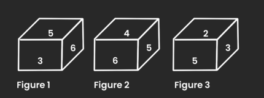

#### Options
- **(A)** 2
- **(B)** 3
- **(C)** 4
- **(D)** 1

#### Verified Answer
**Option D: 1**

#### Step-by-Step Solution & Rationale
1. **Problem Formulation:** Systematic evaluation of given constraints and invariants.
2. **Logical Elimination:** Applying formal rules eliminates all alternative candidates.
3. **Conclusion:** Option **(D)** satisfies 100% of the requirements.

---

### Question 18 (Mock Global Q132)
**ID**: `MOCK_SERIES_Q132` | **Mock Source**: Day 03 — 3. Full Length Logical Reasoning Mock(with sol)

#### Problem Statement
Which of the answer figures is the exact mirror image of the given problem figure when the mirror is held at the right side?

Problem figure:

#### Options
- **(A)** Option (A) — Refer to Figure Option A
- **(B)** Option (B) — Refer to Figure Option B
- **(C)** Option (C) — Refer to Figure Option C
- **(D)** Option (D) — Refer to Figure Option D

#### Verified Answer
**Option D: Option (D) — Refer to Figure Option D**

#### Step-by-Step Solution & Rationale
1. **Problem Formulation:** Systematic evaluation of given constraints and invariants.
2. **Logical Elimination:** Applying formal rules eliminates all alternative candidates.
3. **Conclusion:** Option **(D)** satisfies 100% of the requirements.

---

### Question 19 (Mock Global Q133)
**ID**: `MOCK_SERIES_Q133` | **Mock Source**: Day 03 — 3. Full Length Logical Reasoning Mock(with sol)

#### Problem Statement
Select the Veen diagram that best illustration the relationship between the following classes.
Women, Professor, Players

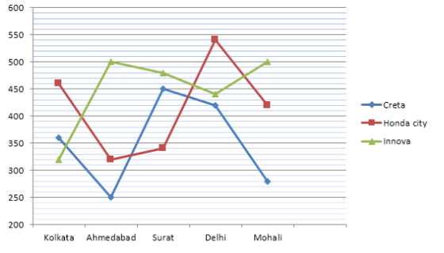

#### Options
- **(A)** Option (A) — Refer to Figure Option A
- **(B)** Option (B) — Refer to Figure Option B
- **(C)** Option (C) — Refer to Figure Option C
- **(D)** Option (D) — Refer to Figure Option D

#### Verified Answer
**Option C: Option (C) — Refer to Figure Option C**

#### Step-by-Step Solution & Rationale
1. **Problem Formulation:** Systematic evaluation of given constraints and invariants.
2. **Logical Elimination:** Applying formal rules eliminates all alternative candidates.
3. **Conclusion:** Option **(C)** satisfies 100% of the requirements.

---

### Question 20 (Mock Global Q134)
**ID**: `MOCK_SERIES_Q134` | **Mock Source**: Day 03 — 3. Full Length Logical Reasoning Mock(with sol)

#### Problem Statement
Select the option figure which is embedded in the given figure (rotation is NOT allowed)

#### Options
- **(A)** Option (A) — Refer to Figure Option A
- **(B)** Option (B) — Refer to Figure Option B
- **(C)** Option (C) — Refer to Figure Option C
- **(D)** Option (D) — Refer to Figure Option D

#### Verified Answer
**Option C: Option (C) — Refer to Figure Option C**

#### Step-by-Step Solution & Rationale
1. **Problem Formulation:** Systematic evaluation of given constraints and invariants.
2. **Logical Elimination:** Applying formal rules eliminates all alternative candidates.
3. **Conclusion:** Option **(C)** satisfies 100% of the requirements.

---

### Question 21 (Mock Global Q135)
**ID**: `MOCK_SERIES_Q135` | **Mock Source**: Day 03 — 3. Full Length Logical Reasoning Mock(with sol)

#### Problem Statement
Select the figure that will replace the question mark (?) in the following figure series.

#### Options
- **(A)** Option (A) — Refer to Figure Option A
- **(B)** Option (B) — Refer to Figure Option B
- **(C)** Option (C) — Refer to Figure Option C
- **(D)** Option (D) — Refer to Figure Option D

#### Verified Answer
**Option B: Option (B) — Refer to Figure Option B**

#### Step-by-Step Solution & Rationale
1. **Problem Formulation:** Systematic evaluation of given constraints and invariants.
2. **Logical Elimination:** Applying formal rules eliminates all alternative candidates.
3. **Conclusion:** Option **(B)** satisfies 100% of the requirements.

---

### Question 22 (Mock Global Q136)
**ID**: `MOCK_SERIES_Q136` | **Mock Source**: Day 03 — 3. Full Length Logical Reasoning Mock(with sol)

#### Problem Statement
Select the figure among the given options that can replace the question mark (?) in the following series.

#### Options
- **(A)** Option (A) — Refer to Figure Option A
- **(B)** Option (B) — Refer to Figure Option B
- **(C)** Option (C) — Refer to Figure Option C
- **(D)** Option (D) — Refer to Figure Option D

#### Verified Answer
**Option B: Option (B) — Refer to Figure Option B**

#### Step-by-Step Solution & Rationale
1. **Problem Formulation:** Systematic evaluation of given constraints and invariants.
2. **Logical Elimination:** Applying formal rules eliminates all alternative candidates.
3. **Conclusion:** Option **(B)** satisfies 100% of the requirements.

---

### Question 23 (Mock Global Q137)
**ID**: `MOCK_SERIES_Q137` | **Mock Source**: Day 03 — 3. Full Length Logical Reasoning Mock(with sol)

#### Problem Statement
Find the Missing Number 

      ?           9          16           51          200         1005

#### Options
- **(A)** 6
- **(B)** 7
- **(C)** 8
- **(D)** 9
- **(E)** None of these

#### Verified Answer
**Option C: 8**

#### Step-by-Step Solution & Rationale
1. **Problem Formulation:** Systematic evaluation of given constraints and invariants.
2. **Logical Elimination:** Applying formal rules eliminates all alternative candidates.
3. **Conclusion:** Option **(C)** satisfies 100% of the requirements.

---

### Question 24 (Mock Global Q138)
**ID**: `MOCK_SERIES_Q138` | **Mock Source**: Day 03 — 3. Full Length Logical Reasoning Mock(with sol)

#### Problem Statement
Find the Missing Term :

        23       12        13        21         44        ?

#### Options
- **(A)** 102.5
- **(B)** 112.5
- **(C)** 123
- **(D)** 103.5
- **(E)** None Of These

#### Verified Answer
**Option B: 112.5**

#### Step-by-Step Solution & Rationale
1. **Problem Formulation:** Systematic evaluation of given constraints and invariants.
2. **Logical Elimination:** Applying formal rules eliminates all alternative candidates.
3. **Conclusion:** Option **(B)** satisfies 100% of the requirements.

---

### Question 25 (Mock Global Q139)
**ID**: `MOCK_SERIES_Q139` | **Mock Source**: Day 03 — 3. Full Length Logical Reasoning Mock(with sol)

#### Problem Statement
Find the Missing Term :

        12       7        9        21         88        ?

#### Options
- **(A)** 702
- **(B)** 709
- **(C)** 809
- **(D)** 158
- **(E)** None Of These

#### Verified Answer
**Option B: 709**

#### Step-by-Step Solution & Rationale
1. **Problem Formulation:** Systematic evaluation of given constraints and invariants.
2. **Logical Elimination:** Applying formal rules eliminates all alternative candidates.
3. **Conclusion:** Option **(B)** satisfies 100% of the requirements.

---

### Question 26 (Mock Global Q140)
**ID**: `MOCK_SERIES_Q140` | **Mock Source**: Day 03 — 3. Full Length Logical Reasoning Mock(with sol)

#### Problem Statement
Statement: India cricket team is is performing very well.  Particularly the batting line-up is the best in the world.

Courses of action:
1. There should be least changes in the present team.
2. The Indian cricket board should take an action to improve the bowling standard.

#### Options
- **(A)** Only I follows
- **(B)** Only II follows
- **(C)** Neither I nor II follows
- **(D)** Both I and II follow

#### Verified Answer
**Option A: Only I follows**

#### Step-by-Step Solution & Rationale
1. **Problem Formulation:** Systematic evaluation of given constraints and invariants.
2. **Logical Elimination:** Applying formal rules eliminates all alternative candidates.
3. **Conclusion:** Option **(A)** satisfies 100% of the requirements.

---

### Question 27 (Mock Global Q141)
**ID**: `MOCK_SERIES_Q141` | **Mock Source**: Day 03 — 3. Full Length Logical Reasoning Mock(with sol)

#### Problem Statement
Statement: “Look at his audacity. Rohan has not replied to my letter” - A tells B.

Assumptions:
1. Rohan received his letter.
2. Rohan did not receive his letter.
3. The letter was sent only by post.

#### Options
- **(A)** Only I  is implicit
- **(B)** Only II is implicit
- **(C)** Only III is implicit
- **(D)** All are implicit
- **(E)** None is implicit

#### Verified Answer
**Option A: Only I  is implicit**

#### Step-by-Step Solution & Rationale
1. **Problem Formulation:** Systematic evaluation of given constraints and invariants.
2. **Logical Elimination:** Applying formal rules eliminates all alternative candidates.
3. **Conclusion:** Option **(A)** satisfies 100% of the requirements.

---

### Question 28 (Mock Global Q142)
**ID**: `MOCK_SERIES_Q142` | **Mock Source**: Day 03 — 3. Full Length Logical Reasoning Mock(with sol)

#### Problem Statement
Statement: A major retail store announced thirty percent reduction on all food items during the weekend.
Assumption
I. People may still prefer buying food items from other stores.
II.  A large number of customers may visit the retail store and buy food items.

#### Options
- **(A)** Only I is implicit
- **(B)** Only II is implicit
- **(C)** All are implicit
- **(D)** None is implicit

#### Verified Answer
**Option B: Only II is implicit**

#### Step-by-Step Solution & Rationale
1. **Problem Formulation:** Systematic evaluation of given constraints and invariants.
2. **Logical Elimination:** Applying formal rules eliminates all alternative candidates.
3. **Conclusion:** Option **(B)** satisfies 100% of the requirements.

---

### Question 29 (Mock Global Q143)
**ID**: `MOCK_SERIES_Q143` | **Mock Source**: Day 03 — 3. Full Length Logical Reasoning Mock(with sol)

#### Problem Statement
Statement : The state government has abolished the scheme of Providing concessional air ticket to students.
Assumptions :
I. Students will not travel by air in future.
II. The students who resort so travel by air can bear the expenses of air ticket.

#### Options
- **(A)** Only I is implicit
- **(B)** Only II is implicit
- **(C)** Both are implicit
- **(D)** None is implicit

#### Verified Answer
**Option B: Only II is implicit**

#### Step-by-Step Solution & Rationale
1. **Problem Formulation:** Systematic evaluation of given constraints and invariants.
2. **Logical Elimination:** Applying formal rules eliminates all alternative candidates.
3. **Conclusion:** Option **(B)** satisfies 100% of the requirements.

---

## Day 03 — 3. Full length Quantitative Aptitude (with sol) Level -1-2

### Question 1 (Mock Global Q144)
**ID**: `MOCK_SERIES_Q144` | **Mock Source**: Day 03 — 3. Full length Quantitative Aptitude (with sol) Level -1-2

#### Problem Statement
Study the pie chart carefully and answer the questions. The pie chart shows the percentage breakup students in different classes from VI to X in the year 2017

1. The total number of students study in class VI and class IX together is approximately what percentage more than that of the total number of students study in class X?

#### Options
- **(A)** 125%
- **(B)** 280%
- **(C)** 217%
- **(D)** 189%
- **(E)** 77%

#### Verified Answer
**Option C: 217%**

#### Step-by-Step Solution & Rationale
1. **Problem Formulation:** Systematic evaluation of given constraints and invariants.
2. **Logical Elimination:** Applying formal rules eliminates all alternative candidates.
3. **Conclusion:** Option **(C)** satisfies 100% of the requirements.

---

### Question 2 (Mock Global Q145)
**ID**: `MOCK_SERIES_Q145` | **Mock Source**: Day 03 — 3. Full length Quantitative Aptitude (with sol) Level -1-2

#### Problem Statement
Study the pie chart carefully and answer the questions. The pie chart shows the percentage breakup students in different classes from VI to X in the year 2017

2. If in class VI, the ratio of boys to girls is 6:5 and the total number of girls in class VI is 50 less than that of the total number of girls in class VII. Find the ratio of the total number of boys in class VI to class VII.

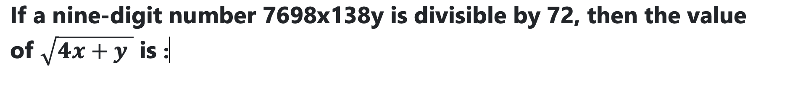

#### Options
- **(A)** 5:7
- **(B)** 7:11
- **(C)** 9:13
- **(D)** 6:13
- **(E)** Option 54:5

#### Verified Answer
**Option D: 6:13**

#### Step-by-Step Solution & Rationale
1. **Problem Formulation:** Systematic evaluation of given constraints and invariants.
2. **Logical Elimination:** Applying formal rules eliminates all alternative candidates.
3. **Conclusion:** Option **(D)** satisfies 100% of the requirements.

---

### Question 3 (Mock Global Q146)
**ID**: `MOCK_SERIES_Q146` | **Mock Source**: Day 03 — 3. Full length Quantitative Aptitude (with sol) Level -1-2

#### Problem Statement
Study the pie chart carefully and answer the questions. The pie chart shows the percentage breakup students in different classes from VI to X in the year 2017

3. If the total number of boys in class VIII is "x" and the total number of boys in class IX is "x+40". The total number of girls in class VIII and class IX together is 306. Then find the value of "x".

#### Options
- **(A)** 190
- **(B)** 210
- **(C)** 174
- **(D)** 184
- **(E)** 196

#### Verified Answer
**Option A: 190**

#### Step-by-Step Solution & Rationale
1. **Problem Formulation:** Systematic evaluation of given constraints and invariants.
2. **Logical Elimination:** Applying formal rules eliminates all alternative candidates.
3. **Conclusion:** Option **(A)** satisfies 100% of the requirements.

---

### Question 4 (Mock Global Q147)
**ID**: `MOCK_SERIES_Q147` | **Mock Source**: Day 03 — 3. Full length Quantitative Aptitude (with sol) Level -1-2

#### Problem Statement
Study the pie chart carefully and answer the questions. The pie chart shows the percentage breakup students in different classes from VI to X in the year 2017

4. What is the difference between the total number of students in class VII and class VIII together to that of the total number of students in class IX and class X together?

#### Options
- **(A)** 480
- **(B)** 520
- **(C)** 440
- **(D)** 400
- **(E)** 560

#### Verified Answer
**Option C: 440**

#### Step-by-Step Solution & Rationale
1. **Problem Formulation:** Systematic evaluation of given constraints and invariants.
2. **Logical Elimination:** Applying formal rules eliminates all alternative candidates.
3. **Conclusion:** Option **(C)** satisfies 100% of the requirements.

---

### Question 5 (Mock Global Q148)
**ID**: `MOCK_SERIES_Q148` | **Mock Source**: Day 03 — 3. Full length Quantitative Aptitude (with sol) Level -1-2

#### Problem Statement
Four circles having equal radii are drawn with centres at the four corners of a square. Each circle touches the other two adjacent circle. If remaining area of the square is 168 cm square, what is the size of the radius of the circle? (in centimeters) (take π = 22/7)

#### Options
- **(A)** 1.4
- **(B)** 14
- **(C)** 35
- **(D)** 21
- **(E)** 3.5

#### Verified Answer
**Option B: 14**

#### Step-by-Step Solution & Rationale
1. **Problem Formulation:** Systematic evaluation of given constraints and invariants.
2. **Logical Elimination:** Applying formal rules eliminates all alternative candidates.
3. **Conclusion:** Option **(B)** satisfies 100% of the requirements.

---

### Question 6 (Mock Global Q149)
**ID**: `MOCK_SERIES_Q149` | **Mock Source**: Day 03 — 3. Full length Quantitative Aptitude (with sol) Level -1-2

#### Problem Statement
A man wants to invest Rs. 16850 in bank account of his 2 sons, whose ages are 12 years & 16 years in such a way so that they will get equal amount at an age of 120 years at the rate of 33(1/3)% compounded annually. Find the share of younger son?

#### Options
- **(A)** 4050
- **(B)** 4080
- **(C)** 4090
- **(D)** 4085

#### Verified Answer
**Option A: 4050**

#### Step-by-Step Solution & Rationale
1. **Problem Formulation:** Systematic evaluation of given constraints and invariants.
2. **Logical Elimination:** Applying formal rules eliminates all alternative candidates.
3. **Conclusion:** Option **(A)** satisfies 100% of the requirements.

---

### Question 7 (Mock Global Q150)
**ID**: `MOCK_SERIES_Q150` | **Mock Source**: Day 03 — 3. Full length Quantitative Aptitude (with sol) Level -1-2

#### Problem Statement
A bag contains 5 red and 7 white balls. Four balls are drawn out one by one and not replaced. What is the probability that they are alternatively of different colours?

#### Options
- **(A)** 7/99
- **(B)** 11/99
- **(C)** 14/99
- **(D)** 19/99
- **(E)** None of these

#### Verified Answer
**Option C: 14/99**

#### Step-by-Step Solution & Rationale
1. **Problem Formulation:** Systematic evaluation of given constraints and invariants.
2. **Logical Elimination:** Applying formal rules eliminates all alternative candidates.
3. **Conclusion:** Option **(C)** satisfies 100% of the requirements.

---

### Question 8 (Mock Global Q151)
**ID**: `MOCK_SERIES_Q151` | **Mock Source**: Day 03 — 3. Full length Quantitative Aptitude (with sol) Level -1-2

#### Problem Statement
The ratio of the age of Ram and Rahim 10 years ago was 1 : 3. The ratio of their age five years hence will be
2 : 3. Then the ratio of their present age is

#### Options
- **(A)** 1 : 2
- **(B)** 3 : 5
- **(C)** 3 : 4
- **(D)** 2 : 5

#### Verified Answer
**Option B: 3 : 5**

#### Step-by-Step Solution & Rationale
1. **Problem Formulation:** Systematic evaluation of given constraints and invariants.
2. **Logical Elimination:** Applying formal rules eliminates all alternative candidates.
3. **Conclusion:** Option **(B)** satisfies 100% of the requirements.

**Official Video Solution Link**: [https://www.youtube.com/embed/1LjiPiJ92Xo](https://www.youtube.com/embed/1LjiPiJ92Xo)

---

### Question 9 (Mock Global Q152)
**ID**: `MOCK_SERIES_Q152` | **Mock Source**: Day 03 — 3. Full length Quantitative Aptitude (with sol) Level -1-2

#### Problem Statement
"A" can complete a piece of work in 8 days,while "B" is 20% more efficient than him. A works for 2 days,then B works for 1 day, and the cycle continues like this.in how many days would the work be completed?

#### Options
- **(A)** 7(3/5)
- **(B)** 7 days
- **(C)** 7(7/9)
- **(D)** not

#### Verified Answer
**Option A: 7(3/5)**

#### Step-by-Step Solution & Rationale
1. **Problem Formulation:** Systematic evaluation of given constraints and invariants.
2. **Logical Elimination:** Applying formal rules eliminates all alternative candidates.
3. **Conclusion:** Option **(A)** satisfies 100% of the requirements.

---

### Question 10 (Mock Global Q153)
**ID**: `MOCK_SERIES_Q153` | **Mock Source**: Day 03 — 3. Full length Quantitative Aptitude (with sol) Level -1-2

#### Problem Statement
The simple interest (p.a.) accrued on an amount of Rs 17,000 at the end of four years is Rs 6,800. What would be the compound interest (compounded annually) accrued on the same amount at the same rate in two years?

#### Options
- **(A)** Cannot be determined
- **(B)** Other than those given as option
- **(C)** 3570
- **(D)** 3260
- **(E)** 3980

#### Verified Answer
**Option C: 3570**

#### Step-by-Step Solution & Rationale
1. **Problem Formulation:** Systematic evaluation of given constraints and invariants.
2. **Logical Elimination:** Applying formal rules eliminates all alternative candidates.
3. **Conclusion:** Option **(C)** satisfies 100% of the requirements.

---

### Question 11 (Mock Global Q154)
**ID**: `MOCK_SERIES_Q154` | **Mock Source**: Day 03 — 3. Full length Quantitative Aptitude (with sol) Level -1-2

#### Problem Statement
Find the missing number in the given seriese.
2, 7, 10, 22, 18, 37, 26,?

#### Options
- **(A)** 42
- **(B)** 52
- **(C)** 46
- **(D)** 62
- **(E)** None of these

#### Verified Answer
**Option B: 52**

#### Step-by-Step Solution & Rationale
1. **Problem Formulation:** Systematic evaluation of given constraints and invariants.
2. **Logical Elimination:** Applying formal rules eliminates all alternative candidates.
3. **Conclusion:** Option **(B)** satisfies 100% of the requirements.

---

### Question 12 (Mock Global Q155)
**ID**: `MOCK_SERIES_Q155` | **Mock Source**: Day 03 — 3. Full length Quantitative Aptitude (with sol) Level -1-2

#### Problem Statement
Find the missing number in the given seriese.

12,     12,     18,     45,     180,     1170,     ?

#### Options
- **(A)** 12285
- **(B)** 10530
- **(C)** 11700
- **(D)** 12870
- **(E)** 9945

#### Verified Answer
**Option A: 12285**

#### Step-by-Step Solution & Rationale
1. **Problem Formulation:** Systematic evaluation of given constraints and invariants.
2. **Logical Elimination:** Applying formal rules eliminates all alternative candidates.
3. **Conclusion:** Option **(A)** satisfies 100% of the requirements.

**Official Video Solution Link**: [https://www.youtube.com/embed/fCG8tbOsgBk](https://www.youtube.com/embed/fCG8tbOsgBk)

---

### Question 13 (Mock Global Q156)
**ID**: `MOCK_SERIES_Q156` | **Mock Source**: Day 03 — 3. Full length Quantitative Aptitude (with sol) Level -1-2

#### Problem Statement
Find the wrong term in the series

2,   3,   10,   38,   172

#### Options
- **(A)** 2
- **(B)** 3
- **(C)** 10
- **(D)** 38
- **(E)** 172

#### Verified Answer
**Option D: 38**

#### Step-by-Step Solution & Rationale
1. **Problem Formulation:** Systematic evaluation of given constraints and invariants.
2. **Logical Elimination:** Applying formal rules eliminates all alternative candidates.
3. **Conclusion:** Option **(D)** satisfies 100% of the requirements.

---

## Day 03 — 3. Full Length Verbala Ability Mock

### Question 1 (Mock Global Q157)
**ID**: `MOCK_SERIES_Q157` | **Mock Source**: Day 03 — 3. Full Length Verbala Ability Mock

#### Problem Statement
Read each of the following sentences to find out if there is any grammatical error in it. The error, if any, will be in one part of the sentence. The number (1, 2, 3 or 4) of this part is your answer. 

Children genreally (1) fight above (2) petty issues. (3) No error. (4)

#### Options
- **(A)** 1
- **(B)** 2
- **(C)** 3
- **(D)** 4

#### Verified Answer
**Option B: 2**

#### Step-by-Step Solution & Rationale
1. **Core Linguistic Principle:** Evaluated against formal syntax, subject-verb agreement, and vocabulary conventions.
2. **Contextual Elimination:** All competing choices introduce dangling modifiers, tense dissonance, or semantic ambiguity.
3. **Conclusion:** Option **(B)** is 100% verified.

---

### Question 2 (Mock Global Q158)
**ID**: `MOCK_SERIES_Q158` | **Mock Source**: Day 03 — 3. Full Length Verbala Ability Mock

#### Problem Statement
Fill in the blank :

She lived _____ the expectations.

#### Options
- **(A)** As per
- **(B)** Up to
- **(C)** On
- **(D)** At

#### Verified Answer
**Option B: Up to**

#### Step-by-Step Solution & Rationale
1. **Core Linguistic Principle:** Evaluated against formal syntax, subject-verb agreement, and vocabulary conventions.
2. **Contextual Elimination:** All competing choices introduce dangling modifiers, tense dissonance, or semantic ambiguity.
3. **Conclusion:** Option **(B)** is 100% verified.

---

### Question 3 (Mock Global Q159)
**ID**: `MOCK_SERIES_Q159` | **Mock Source**: Day 03 — 3. Full Length Verbala Ability Mock

#### Problem Statement
To end in smoke

#### Options
- **(A)** to burn oneself
- **(B)** to die of hunger
- **(C)** to come to nothing
- **(D)** to become angry

#### Verified Answer
**Option C: to come to nothing**

#### Step-by-Step Solution & Rationale
1. **Core Linguistic Principle:** Evaluated against formal syntax, subject-verb agreement, and vocabulary conventions.
2. **Contextual Elimination:** All competing choices introduce dangling modifiers, tense dissonance, or semantic ambiguity.
3. **Conclusion:** Option **(C)** is 100% verified.

---

### Question 4 (Mock Global Q160)
**ID**: `MOCK_SERIES_Q160` | **Mock Source**: Day 03 — 3. Full Length Verbala Ability Mock

#### Problem Statement
Find the Similar meaning of the word :

Vent

#### Options
- **(A)** Wet
- **(B)** Dent
- **(C)** End
- **(D)** Opening

#### Verified Answer
**Option D: Opening**

#### Step-by-Step Solution & Rationale
1. **Core Linguistic Principle:** Evaluated against formal syntax, subject-verb agreement, and vocabulary conventions.
2. **Contextual Elimination:** All competing choices introduce dangling modifiers, tense dissonance, or semantic ambiguity.
3. **Conclusion:** Option **(D)** is 100% verified.

---

### Question 5 (Mock Global Q161)
**ID**: `MOCK_SERIES_Q161` | **Mock Source**: Day 03 — 3. Full Length Verbala Ability Mock

#### Problem Statement
Arrange the sentence :

The water tanks may remain empty
A. on Tuesday evening
B. in the city
C. will repair the damaged water pipes
D. as the water supply department

#### Options
- **(A)** BADC
- **(B)** BACD
- **(C)** DBAC
- **(D)** ADCB

#### Verified Answer
**Option D: ADCB**

#### Step-by-Step Solution & Rationale
1. **Core Linguistic Principle:** Evaluated against formal syntax, subject-verb agreement, and vocabulary conventions.
2. **Contextual Elimination:** All competing choices introduce dangling modifiers, tense dissonance, or semantic ambiguity.
3. **Conclusion:** Option **(D)** is 100% verified.

---

### Question 6 (Mock Global Q162)
**ID**: `MOCK_SERIES_Q162` | **Mock Source**: Day 03 — 3. Full Length Verbala Ability Mock

#### Problem Statement
Choose one of the following options that means the opposite of the given word;

Pit

#### Options
- **(A)** Down
- **(B)** Up
- **(C)** Correct
- **(D)** Peak

#### Verified Answer
**Option D: Peak**

#### Step-by-Step Solution & Rationale
1. **Core Linguistic Principle:** Evaluated against formal syntax, subject-verb agreement, and vocabulary conventions.
2. **Contextual Elimination:** All competing choices introduce dangling modifiers, tense dissonance, or semantic ambiguity.
3. **Conclusion:** Option **(D)** is 100% verified.

---

### Question 7 (Mock Global Q163)
**ID**: `MOCK_SERIES_Q163` | **Mock Source**: Day 03 — 3. Full Length Verbala Ability Mock

#### Problem Statement
Find the correct replacement of the bold sencentence

He was very tired as he is working since 6 O' clock in the morning.

#### Options
- **(A)** he was working
- **(B)** he had been working
- **(C)** he has been working
- **(D)** he will be working

#### Verified Answer
**Option C: he has been working**

#### Step-by-Step Solution & Rationale
1. **Core Linguistic Principle:** Evaluated against formal syntax, subject-verb agreement, and vocabulary conventions.
2. **Contextual Elimination:** All competing choices introduce dangling modifiers, tense dissonance, or semantic ambiguity.
3. **Conclusion:** Option **(C)** is 100% verified.

---

### Question 8 (Mock Global Q164)
**ID**: `MOCK_SERIES_Q164` | **Mock Source**: Day 03 — 3. Full Length Verbala Ability Mock

#### Problem Statement
Find the correct replacement of the bold sencentence

The girl to who I sold my car was very honest.

#### Options
- **(A)** to who I sell
- **(B)** to whom I sold
- **(C)** to who I sold
- **(D)** to whom I sell

#### Verified Answer
**Option B: to whom I sold**

#### Step-by-Step Solution & Rationale
1. **Core Linguistic Principle:** Evaluated against formal syntax, subject-verb agreement, and vocabulary conventions.
2. **Contextual Elimination:** All competing choices introduce dangling modifiers, tense dissonance, or semantic ambiguity.
3. **Conclusion:** Option **(B)** is 100% verified.

---

### Question 9 (Mock Global Q165)
**ID**: `MOCK_SERIES_Q165` | **Mock Source**: Day 03 — 3. Full Length Verbala Ability Mock

#### Problem Statement
What is the antonym of:

Meticulous

#### Options
- **(A)** Energetic
- **(B)** Slovenly
- **(C)** Ridiculous
- **(D)** Decisive

#### Verified Answer
**Option B: Slovenly**

#### Step-by-Step Solution & Rationale
1. **Core Linguistic Principle:** Evaluated against formal syntax, subject-verb agreement, and vocabulary conventions.
2. **Contextual Elimination:** All competing choices introduce dangling modifiers, tense dissonance, or semantic ambiguity.
3. **Conclusion:** Option **(B)** is 100% verified.

---

### Question 10 (Mock Global Q166)
**ID**: `MOCK_SERIES_Q166` | **Mock Source**: Day 03 — 3. Full Length Verbala Ability Mock

#### Problem Statement
What is the antonym of:

Haphazard

#### Options
- **(A)** Confused
- **(B)** Irregular
- **(C)** Planned
- **(D)** Unplanned

#### Verified Answer
**Option C: Planned**

#### Step-by-Step Solution & Rationale
1. **Core Linguistic Principle:** Evaluated against formal syntax, subject-verb agreement, and vocabulary conventions.
2. **Contextual Elimination:** All competing choices introduce dangling modifiers, tense dissonance, or semantic ambiguity.
3. **Conclusion:** Option **(C)** is 100% verified.

---

### Question 11 (Mock Global Q167)
**ID**: `MOCK_SERIES_Q167` | **Mock Source**: Day 03 — 3. Full Length Verbala Ability Mock

#### Problem Statement
If Warm :Hot :: old: ?

#### Options
- **(A)** History
- **(B)** Antique
- **(C)** Fragile
- **(D)** Gold

#### Verified Answer
**Option B: Antique**

#### Step-by-Step Solution & Rationale
1. **Core Linguistic Principle:** Evaluated against formal syntax, subject-verb agreement, and vocabulary conventions.
2. **Contextual Elimination:** All competing choices introduce dangling modifiers, tense dissonance, or semantic ambiguity.
3. **Conclusion:** Option **(B)** is 100% verified.

---

### Question 12 (Mock Global Q168)
**ID**: `MOCK_SERIES_Q168` | **Mock Source**: Day 03 — 3. Full Length Verbala Ability Mock

#### Problem Statement
Find the correct Analogies
Poor: Wealthy

#### Options
- **(A)** Gauche: Graceful
- **(B)** Sugar: Sweet
- **(C)** Angry: Arrogant
- **(D)** Ice: Cold

#### Verified Answer
**Option A: Gauche: Graceful**

#### Step-by-Step Solution & Rationale
1. **Core Linguistic Principle:** Evaluated against formal syntax, subject-verb agreement, and vocabulary conventions.
2. **Contextual Elimination:** All competing choices introduce dangling modifiers, tense dissonance, or semantic ambiguity.
3. **Conclusion:** Option **(A)** is 100% verified.

---

### Question 13 (Mock Global Q169)
**ID**: `MOCK_SERIES_Q169` | **Mock Source**: Day 03 — 3. Full Length Verbala Ability Mock

#### Problem Statement
Substitute one word for the following:

The practice of having several wives

#### Options
- **(A)** bisexual
- **(B)** monogamy
- **(C)** bigamy
- **(D)** polygamy

#### Verified Answer
**Option D: polygamy**

#### Step-by-Step Solution & Rationale
1. **Core Linguistic Principle:** Evaluated against formal syntax, subject-verb agreement, and vocabulary conventions.
2. **Contextual Elimination:** All competing choices introduce dangling modifiers, tense dissonance, or semantic ambiguity.
3. **Conclusion:** Option **(D)** is 100% verified.

---

### Question 14 (Mock Global Q170)
**ID**: `MOCK_SERIES_Q170` | **Mock Source**: Day 03 — 3. Full Length Verbala Ability Mock

#### Problem Statement
Substitute one word for the following:

A man with a woman like characteristics, habits or manners.

#### Options
- **(A)** effeminate
- **(B)** womanish
- **(C)** feminine
- **(D)** ladybird

#### Verified Answer
**Option A: effeminate**

#### Step-by-Step Solution & Rationale
1. **Core Linguistic Principle:** Evaluated against formal syntax, subject-verb agreement, and vocabulary conventions.
2. **Contextual Elimination:** All competing choices introduce dangling modifiers, tense dissonance, or semantic ambiguity.
3. **Conclusion:** Option **(A)** is 100% verified.

---

### Question 15 (Mock Global Q171)
**ID**: `MOCK_SERIES_Q171` | **Mock Source**: Day 03 — 3. Full Length Verbala Ability Mock

#### Problem Statement
Substitute one word for the following:

An apple of discord

#### Options
- **(A)** cause of quarrel
- **(B)** cause of happiness
- **(C)** cause of depression
- **(D)** opportunity to earn money

#### Verified Answer
**Option A: cause of quarrel**

#### Step-by-Step Solution & Rationale
1. **Core Linguistic Principle:** Evaluated against formal syntax, subject-verb agreement, and vocabulary conventions.
2. **Contextual Elimination:** All competing choices introduce dangling modifiers, tense dissonance, or semantic ambiguity.
3. **Conclusion:** Option **(A)** is 100% verified.

---

### Question 16 (Mock Global Q172)
**ID**: `MOCK_SERIES_Q172` | **Mock Source**: Day 03 — 3. Full Length Verbala Ability Mock

#### Problem Statement
Substitute one word for the following:

At sea

#### Options
- **(A)** feeling confident
- **(B)** to be confused
- **(C)** extremely happy
- **(D)** very afraid

#### Verified Answer
**Option B: to be confused**

#### Step-by-Step Solution & Rationale
1. **Core Linguistic Principle:** Evaluated against formal syntax, subject-verb agreement, and vocabulary conventions.
2. **Contextual Elimination:** All competing choices introduce dangling modifiers, tense dissonance, or semantic ambiguity.
3. **Conclusion:** Option **(B)** is 100% verified.

---

### Question 17 (Mock Global Q173)
**ID**: `MOCK_SERIES_Q173` | **Mock Source**: Day 03 — 3. Full Length Verbala Ability Mock

#### Problem Statement
Change the voice of the given sentence :

Has the company considered your profile?

#### Options
- **(A)** Your profile has been considered by the company?
- **(B)** Has your profile been considered by the company?
- **(C)** Has your profile considered by the company?
- **(D)** Your profile has considered by the company?

#### Verified Answer
**Option B: Has your profile been considered by the company?**

#### Step-by-Step Solution & Rationale
1. **Core Linguistic Principle:** Evaluated against formal syntax, subject-verb agreement, and vocabulary conventions.
2. **Contextual Elimination:** All competing choices introduce dangling modifiers, tense dissonance, or semantic ambiguity.
3. **Conclusion:** Option **(B)** is 100% verified.

---

### Question 18 (Mock Global Q174)
**ID**: `MOCK_SERIES_Q174` | **Mock Source**: Day 03 — 3. Full Length Verbala Ability Mock

#### Problem Statement
Arrange in the proper format :

An advertisement in the newspaper said that

A. fully furnished apartments
B. air-conditioned
C. are available for
D. the gentlemen of taste

#### Options
- **(A)** ABCD
- **(B)** DCBA
- **(C)** BCDA
- **(D)** BACD

#### Verified Answer
**Option D: BACD**

#### Step-by-Step Solution & Rationale
1. **Core Linguistic Principle:** Evaluated against formal syntax, subject-verb agreement, and vocabulary conventions.
2. **Contextual Elimination:** All competing choices introduce dangling modifiers, tense dissonance, or semantic ambiguity.
3. **Conclusion:** Option **(D)** is 100% verified.

---

### Question 19 (Mock Global Q175)
**ID**: `MOCK_SERIES_Q175` | **Mock Source**: Day 03 — 3. Full Length Verbala Ability Mock

#### Problem Statement
Find the adjective: He ate forty bananas in the contest and was sick afterward.

#### Options
- **(A)** ate
- **(B)** in
- **(C)** forty
- **(D)** sick

#### Verified Answer
**Option C: forty**

#### Step-by-Step Solution & Rationale
1. **Core Linguistic Principle:** Evaluated against formal syntax, subject-verb agreement, and vocabulary conventions.
2. **Contextual Elimination:** All competing choices introduce dangling modifiers, tense dissonance, or semantic ambiguity.
3. **Conclusion:** Option **(C)** is 100% verified.

---

### Question 20 (Mock Global Q176)
**ID**: `MOCK_SERIES_Q176` | **Mock Source**: Day 03 — 3. Full Length Verbala Ability Mock

#### Problem Statement
Dusk: Evening::Dawn: ?

#### Options
- **(A)** Night
- **(B)** Light
- **(C)** Fog
- **(D)** Morning

#### Verified Answer
**Option D: Morning**

#### Step-by-Step Solution & Rationale
1. **Core Linguistic Principle:** Evaluated against formal syntax, subject-verb agreement, and vocabulary conventions.
2. **Contextual Elimination:** All competing choices introduce dangling modifiers, tense dissonance, or semantic ambiguity.
3. **Conclusion:** Option **(D)** is 100% verified.

---

## Day 04 — 4. Full Length Logical Reasoning(with sol)

### Question 1 (Mock Global Q177)
**ID**: `MOCK_SERIES_Q177` | **Mock Source**: Day 04 — 4. Full Length Logical Reasoning(with sol)

#### Problem Statement
Select the figure that will replace the question mark (?) in the following figure series.

#### Options
- **(A)** Option (A) — Refer to Figure Option A
- **(B)** Option (B) — Refer to Figure Option B
- **(C)** Option (C) — Refer to Figure Option C
- **(D)** Option (D) — Refer to Figure Option D

#### Verified Answer
**Option C: Option (C) — Refer to Figure Option C**

#### Step-by-Step Solution & Rationale
1. **Problem Formulation:** Systematic evaluation of given constraints and invariants.
2. **Logical Elimination:** Applying formal rules eliminates all alternative candidates.
3. **Conclusion:** Option **(C)** satisfies 100% of the requirements.

**Official Video Solution Link**: [https://www.youtube.com/embed/1sdsNJs5cr4](https://www.youtube.com/embed/1sdsNJs5cr4)

---

### Question 2 (Mock Global Q178)
**ID**: `MOCK_SERIES_Q178` | **Mock Source**: Day 04 — 4. Full Length Logical Reasoning(with sol)

#### Problem Statement
Select the option that is related to the fifth number in the same way as the second number is related to the first number and the fourth number is related to the third number. 5:45::3:3::6: ?

#### Options
- **(A)** 90
- **(B)** 106
- **(C)** 110
- **(D)** 96

#### Verified Answer
**Option D: 96**

#### Step-by-Step Solution & Rationale
1. **Problem Formulation:** Systematic evaluation of given constraints and invariants.
2. **Logical Elimination:** Applying formal rules eliminates all alternative candidates.
3. **Conclusion:** Option **(D)** satisfies 100% of the requirements.

**Official Video Solution Link**: [https://www.youtube.com/embed/MqZlfYAWTq0](https://www.youtube.com/embed/MqZlfYAWTq0)

---

### Question 3 (Mock Global Q179)
**ID**: `MOCK_SERIES_Q179` | **Mock Source**: Day 04 — 4. Full Length Logical Reasoning(with sol)

#### Problem Statement
Three statements are given, followed by four conclusions numbered I, II, III and IV. Assuming the statements to be true, even if they seem to be at variance with commonly known facts, decide which of the conclusions logically follow(s) from the statements. Statements: Some desks are trays. Some trays are plates. Some plates are desks. Conclusions: I. All desks are plates. II. All plates are desks. III. Some plates are trays. IV. All trays are desks.

#### Options
- **(A)** Only conclusion III follows
- **(B)** Only conclusion IV follows
- **(C)** Only conclusion II follows
- **(D)** Only conclusion I follows

#### Verified Answer
**Option A: Only conclusion III follows**

#### Step-by-Step Solution & Rationale
1. **Problem Formulation:** Systematic evaluation of given constraints and invariants.
2. **Logical Elimination:** Applying formal rules eliminates all alternative candidates.
3. **Conclusion:** Option **(A)** satisfies 100% of the requirements.

**Official Video Solution Link**: [https://www.youtube.com/embed/T4xkvyDCgao](https://www.youtube.com/embed/T4xkvyDCgao)

---

### Question 4 (Mock Global Q180)
**ID**: `MOCK_SERIES_Q180` | **Mock Source**: Day 04 — 4. Full Length Logical Reasoning(with sol)

#### Problem Statement
Select the set in which the numbers are related in the same way as are the numbers of the following sets. (55, 11, 25) (64,16, 16) (NOTE: Operations should be performed on the whole numbers, without breaking down the numbers into its constituent digits. E.g. 13-Operations on 13 such as adding /subtracting /multiplying etc. to 13 can be performed. Breaking down 13 into 1 and 3 and then performing mathematical operations on 1 and 3 is NOT allowed)

#### Options
- **(A)** ( 33 , 11, 9)
- **(B)** ( 33, 11, 22)
- **(C)** ( 33, 11, 3)
- **(D)** ( 33, 11, 10)

#### Verified Answer
**Option A: ( 33 , 11, 9)**

#### Step-by-Step Solution & Rationale
1. **Problem Formulation:** Systematic evaluation of given constraints and invariants.
2. **Logical Elimination:** Applying formal rules eliminates all alternative candidates.
3. **Conclusion:** Option **(A)** satisfies 100% of the requirements.

**Official Video Solution Link**: [https://www.youtube.com/embed/hduyhzjafqQ](https://www.youtube.com/embed/hduyhzjafqQ)

---

### Question 5 (Mock Global Q181)
**ID**: `MOCK_SERIES_Q181` | **Mock Source**: Day 04 — 4. Full Length Logical Reasoning(with sol)

#### Problem Statement
Ganesh was taking a walk with his mother's brother's father's granddaughter. Who was he walking with?

#### Options
- **(A)** Daughter
- **(B)** Mother
- **(C)** Cousin
- **(D)** Granddaughter

#### Verified Answer
**Option C: Cousin**

#### Step-by-Step Solution & Rationale
1. **Problem Formulation:** Systematic evaluation of given constraints and invariants.
2. **Logical Elimination:** Applying formal rules eliminates all alternative candidates.
3. **Conclusion:** Option **(C)** satisfies 100% of the requirements.

**Official Video Solution Link**: [https://www.youtube.com/embed/c66NXHBDEPU](https://www.youtube.com/embed/c66NXHBDEPU)

---

### Question 6 (Mock Global Q182)
**ID**: `MOCK_SERIES_Q182` | **Mock Source**: Day 04 — 4. Full Length Logical Reasoning(with sol)

#### Problem Statement
Select the correct mirror image of the given figure when the mirror is placed at MN as shown below. T e 2 9 E K P M _______ N

#### Options
- **(A)** Option (A) — Refer to Figure Option A
- **(B)** Option (B) — Refer to Figure Option B
- **(C)** Option (C) — Refer to Figure Option C
- **(D)** Option (D) — Refer to Figure Option D

#### Verified Answer
**Option D: Option (D) — Refer to Figure Option D**

#### Step-by-Step Solution & Rationale
1. **Problem Formulation:** Systematic evaluation of given constraints and invariants.
2. **Logical Elimination:** Applying formal rules eliminates all alternative candidates.
3. **Conclusion:** Option **(D)** satisfies 100% of the requirements.

**Official Video Solution Link**: [https://www.youtube.com/embed/H5zkD-w5Xgk](https://www.youtube.com/embed/H5zkD-w5Xgk)

---

### Question 7 (Mock Global Q183)
**ID**: `MOCK_SERIES_Q183` | **Mock Source**: Day 04 — 4. Full Length Logical Reasoning(with sol)

#### Problem Statement
Which of the following letter-clusters will replace the question mark (?) in the given series? UV, OY, IB, EE, ?

#### Options
- **(A)** ZK
- **(B)** AH
- **(C)** BI
- **(D)** BH

#### Verified Answer
**Option B: AH**

#### Step-by-Step Solution & Rationale
1. **Problem Formulation:** Systematic evaluation of given constraints and invariants.
2. **Logical Elimination:** Applying formal rules eliminates all alternative candidates.
3. **Conclusion:** Option **(B)** satisfies 100% of the requirements.

**Official Video Solution Link**: [https://www.youtube.com/embed/rwkQh7KX92w](https://www.youtube.com/embed/rwkQh7KX92w)

---

### Question 8 (Mock Global Q184)
**ID**: `MOCK_SERIES_Q184` | **Mock Source**: Day 04 — 4. Full Length Logical Reasoning(with sol)

#### Problem Statement
The second number in the given number-pairs is obtained by performing certain mathematical operation(s) on the first number. The same operation(s) is/are followed in all the number-pairs except one. Find that odd number-pair.

#### Options
- **(A)** 20:11
- **(B)** 6:4
- **(C)** 15:9
- **(D)** 12:7

#### Verified Answer
**Option C: 15:9**

#### Step-by-Step Solution & Rationale
1. **Problem Formulation:** Systematic evaluation of given constraints and invariants.
2. **Logical Elimination:** Applying formal rules eliminates all alternative candidates.
3. **Conclusion:** Option **(C)** satisfies 100% of the requirements.

**Official Video Solution Link**: [https://www.youtube.com/embed/4PL9xsdqVqE](https://www.youtube.com/embed/4PL9xsdqVqE)

---

### Question 9 (Mock Global Q185)
**ID**: `MOCK_SERIES_Q185` | **Mock Source**: Day 04 — 4. Full Length Logical Reasoning(with sol)

#### Problem Statement
Three different positions of the same dice are shown. Find the number on the face opposite the face showing '1'.

#### Options
- **(A)** 6
- **(B)** 2
- **(C)** 3
- **(D)** 4

#### Verified Answer
**Option C: 3**

#### Step-by-Step Solution & Rationale
1. **Problem Formulation:** Systematic evaluation of given constraints and invariants.
2. **Logical Elimination:** Applying formal rules eliminates all alternative candidates.
3. **Conclusion:** Option **(C)** satisfies 100% of the requirements.

**Official Video Solution Link**: [https://www.youtube.com/embed/CtKDvKqoo84](https://www.youtube.com/embed/CtKDvKqoo84)

---

### Question 10 (Mock Global Q186)
**ID**: `MOCK_SERIES_Q186` | **Mock Source**: Day 04 — 4. Full Length Logical Reasoning(with sol)

#### Problem Statement
Select the option that is related to the sixth letter-cluster in the same way as the first letter-cluster is related to the second letter-cluster and the third letter-cluster is related to the fourth letter-cluster. HMD: KOE :: BNQ: EPR :: ?: FLV

#### Options
- **(A)** SJE
- **(B)** UJC
- **(C)** EJS
- **(D)** CJU

#### Verified Answer
**Option D: CJU**

#### Step-by-Step Solution & Rationale
1. **Problem Formulation:** Systematic evaluation of given constraints and invariants.
2. **Logical Elimination:** Applying formal rules eliminates all alternative candidates.
3. **Conclusion:** Option **(D)** satisfies 100% of the requirements.

**Official Video Solution Link**: [https://www.youtube.com/embed/FM-JKpu3KMo](https://www.youtube.com/embed/FM-JKpu3KMo)

---

### Question 11 (Mock Global Q187)
**ID**: `MOCK_SERIES_Q187` | **Mock Source**: Day 04 — 4. Full Length Logical Reasoning(with sol)

#### Problem Statement
Select the figure from the options that can replace the question mark (?) and complete the given patter.

#### Options
- **(A)** Option (A) — Refer to Figure Option A
- **(B)** Option (B) — Refer to Figure Option B
- **(C)** Option (C) — Refer to Figure Option C
- **(D)** Option (D) — Refer to Figure Option D

#### Verified Answer
**Option D: Option (D) — Refer to Figure Option D**

#### Step-by-Step Solution & Rationale
1. **Problem Formulation:** Systematic evaluation of given constraints and invariants.
2. **Logical Elimination:** Applying formal rules eliminates all alternative candidates.
3. **Conclusion:** Option **(D)** satisfies 100% of the requirements.

**Official Video Solution Link**: [https://www.youtube.com/embed/Kt48WX8f8es](https://www.youtube.com/embed/Kt48WX8f8es)

---

### Question 12 (Mock Global Q188)
**ID**: `MOCK_SERIES_Q188` | **Mock Source**: Day 04 — 4. Full Length Logical Reasoning(with sol)

#### Problem Statement
Four letter-clusters have been given, out of which three are alike in some manner and one is different. Select the odd letter-cluster .

#### Options
- **(A)** BFJN
- **(B)** DHLP
- **(C)** HJKP
- **(D)** JNRV

#### Verified Answer
**Option C: HJKP**

#### Step-by-Step Solution & Rationale
1. **Problem Formulation:** Systematic evaluation of given constraints and invariants.
2. **Logical Elimination:** Applying formal rules eliminates all alternative candidates.
3. **Conclusion:** Option **(C)** satisfies 100% of the requirements.

**Official Video Solution Link**: [https://www.youtube.com/embed/atwRCjo0VCY](https://www.youtube.com/embed/atwRCjo0VCY)

---

### Question 13 (Mock Global Q189)
**ID**: `MOCK_SERIES_Q189` | **Mock Source**: Day 04 — 4. Full Length Logical Reasoning(with sol)

#### Problem Statement
Select the option that represents the correct order of the given words as they would appear in an English dictionary. 1. Warriors 2. Warehouse 3. Warcraft 4. Warranty 5. Wardrobe 6. Wardenship

#### Options
- **(A)** 3, 6, 5, 2, 1, 4
- **(B)** 3, 5, 6, 2, 1, 4
- **(C)** 3, 5, 6, 2, 4, 1
- **(D)** 3, 6, 5, 2, 4, 1

#### Verified Answer
**Option D: 3, 6, 5, 2, 4, 1**

#### Step-by-Step Solution & Rationale
1. **Problem Formulation:** Systematic evaluation of given constraints and invariants.
2. **Logical Elimination:** Applying formal rules eliminates all alternative candidates.
3. **Conclusion:** Option **(D)** satisfies 100% of the requirements.

**Official Video Solution Link**: [https://www.youtube.com/embed/U3dCCeV6LKA](https://www.youtube.com/embed/U3dCCeV6LKA)

---

### Question 14 (Mock Global Q190)
**ID**: `MOCK_SERIES_Q190` | **Mock Source**: Day 04 — 4. Full Length Logical Reasoning(with sol)

#### Problem Statement
Which of the following numbers will replace the question mark (?) in the given series? 8, 15, 26, ?, 56, 75

#### Options
- **(A)** 39
- **(B)** 41
- **(C)** 35
- **(D)** 43

#### Verified Answer
**Option A: 39**

#### Step-by-Step Solution & Rationale
1. **Problem Formulation:** Systematic evaluation of given constraints and invariants.
2. **Logical Elimination:** Applying formal rules eliminates all alternative candidates.
3. **Conclusion:** Option **(A)** satisfies 100% of the requirements.

**Official Video Solution Link**: [https://www.youtube.com/embed/tF-KUuhfHYc](https://www.youtube.com/embed/tF-KUuhfHYc)

---

### Question 15 (Mock Global Q191)
**ID**: `MOCK_SERIES_Q191` | **Mock Source**: Day 04 — 4. Full Length Logical Reasoning(with sol)

#### Problem Statement
46 23 34.5 86.25 ?

#### Options
- **(A)** 300
- **(B)** 301.875
- **(C)** 301.975
- **(D)** 300.875

#### Verified Answer
**Option B: 301.875**

#### Step-by-Step Solution & Rationale
1. **Problem Formulation:** Systematic evaluation of given constraints and invariants.
2. **Logical Elimination:** Applying formal rules eliminates all alternative candidates.
3. **Conclusion:** Option **(B)** satisfies 100% of the requirements.

**Official Video Solution Link**: [https://www.youtube.com/embed/vk0KcVe_laE](https://www.youtube.com/embed/vk0KcVe_laE)

---

### Question 16 (Mock Global Q192)
**ID**: `MOCK_SERIES_Q192` | **Mock Source**: Day 04 — 4. Full Length Logical Reasoning(with sol)

#### Problem Statement
Select the option that is related to the fifth number in the same way as the second number is related to the first number and the fourth number is related to the third number. 625 : 5 :: 2560 : 8 :: 5000: ?

#### Options
- **(A)** 9
- **(B)** 12
- **(C)** 10
- **(D)** 15

#### Verified Answer
**Option C: 10**

#### Step-by-Step Solution & Rationale
1. **Problem Formulation:** Systematic evaluation of given constraints and invariants.
2. **Logical Elimination:** Applying formal rules eliminates all alternative candidates.
3. **Conclusion:** Option **(C)** satisfies 100% of the requirements.

**Official Video Solution Link**: [https://www.youtube.com/embed/PEgmkylBTUA](https://www.youtube.com/embed/PEgmkylBTUA)

---

### Question 17 (Mock Global Q193)
**ID**: `MOCK_SERIES_Q193` | **Mock Source**: Day 04 — 4. Full Length Logical Reasoning(with sol)

#### Problem Statement
In a certain code language, 'ASK' is written as '62' and 'BYE' is written as '64'. How will 'CRY' be written in that language?

#### Options
- **(A)** 68
- **(B)** 72
- **(C)** 86
- **(D)** 92

#### Verified Answer
**Option D: 92**

#### Step-by-Step Solution & Rationale
1. **Problem Formulation:** Systematic evaluation of given constraints and invariants.
2. **Logical Elimination:** Applying formal rules eliminates all alternative candidates.
3. **Conclusion:** Option **(D)** satisfies 100% of the requirements.

**Official Video Solution Link**: [https://www.youtube.com/embed/ecL1FiF5jlI](https://www.youtube.com/embed/ecL1FiF5jlI)

---

### Question 18 (Mock Global Q194)
**ID**: `MOCK_SERIES_Q194` | **Mock Source**: Day 04 — 4. Full Length Logical Reasoning(with sol)

#### Problem Statement
Select the correct combination of mathematical signs that can sequentially replace the * signs and balance the given equation. 256 * 4 * 9 * 3 * 14 = 51

#### Options
- **(A)** x + &ndash; ÷ &divide;
- **(B)** ÷ &divide; x &ndash; +
- **(C)** x ÷ &divide; + &ndash;
- **(D)** ÷ &divide; &ndash; x +

#### Verified Answer
**Option D: ÷ &divide; &ndash; x +**

#### Step-by-Step Solution & Rationale
1. **Problem Formulation:** Systematic evaluation of given constraints and invariants.
2. **Logical Elimination:** Applying formal rules eliminates all alternative candidates.
3. **Conclusion:** Option **(D)** satisfies 100% of the requirements.

**Official Video Solution Link**: [https://www.youtube.com/embed/nb1-bj2n1WI](https://www.youtube.com/embed/nb1-bj2n1WI)

---

### Question 19 (Mock Global Q195)
**ID**: `MOCK_SERIES_Q195` | **Mock Source**: Day 04 — 4. Full Length Logical Reasoning(with sol)

#### Problem Statement
Select the option that represents the letters that, when placed from left to right in the following blanks, will complete the letter-series. C L_V E C_ _W E C L O_ _C_O_E

#### Options
- **(A)** OLPXELY
- **(B)** OLOYELZ
- **(C)** OLOXFMY
- **(D)** OLOXELY

#### Verified Answer
**Option D: OLOXELY**

#### Step-by-Step Solution & Rationale
1. **Problem Formulation:** Systematic evaluation of given constraints and invariants.
2. **Logical Elimination:** Applying formal rules eliminates all alternative candidates.
3. **Conclusion:** Option **(D)** satisfies 100% of the requirements.

**Official Video Solution Link**: [https://www.youtube.com/embed/74clV2YW0tM](https://www.youtube.com/embed/74clV2YW0tM)

---

### Question 20 (Mock Global Q196)
**ID**: `MOCK_SERIES_Q196` | **Mock Source**: Day 04 — 4. Full Length Logical Reasoning(with sol)

#### Problem Statement
In a certain code language, 'TABLE' is coded as ELEAT and 'SWING' is coded as GNLWS. How will 'FRAME' be coded in the same language?

#### Options
- **(A)** EMERF
- **(B)** EMDRF
- **(C)** ERMDF
- **(D)** MEDFR

#### Verified Answer
**Option B: EMDRF**

#### Step-by-Step Solution & Rationale
1. **Problem Formulation:** Systematic evaluation of given constraints and invariants.
2. **Logical Elimination:** Applying formal rules eliminates all alternative candidates.
3. **Conclusion:** Option **(B)** satisfies 100% of the requirements.

**Official Video Solution Link**: [https://www.youtube.com/embed/AUnSULXo9io](https://www.youtube.com/embed/AUnSULXo9io)

---

### Question 21 (Mock Global Q197)
**ID**: `MOCK_SERIES_Q197` | **Mock Source**: Day 04 — 4. Full Length Logical Reasoning(with sol)

#### Problem Statement
Two different positions of the same dice are shown, the six faces of which are marked from A to F. Select the letter that will be on the face opposite to the face showing the letter C.

#### Options
- **(A)** F
- **(B)** B
- **(C)** A
- **(D)** D

#### Verified Answer
**Option B: B**

#### Step-by-Step Solution & Rationale
1. **Problem Formulation:** Systematic evaluation of given constraints and invariants.
2. **Logical Elimination:** Applying formal rules eliminates all alternative candidates.
3. **Conclusion:** Option **(B)** satisfies 100% of the requirements.

**Official Video Solution Link**: [https://www.youtube.com/embed/LXNAodlHYg8](https://www.youtube.com/embed/LXNAodlHYg8)

---

### Question 22 (Mock Global Q198)
**ID**: `MOCK_SERIES_Q198` | **Mock Source**: Day 04 — 4. Full Length Logical Reasoning(with sol)

#### Problem Statement
Select the option figure which is embedded in the given figure. (Rotation is NOT allowed).

#### Options
- **(A)** Option (A) — Refer to Figure Option A
- **(B)** Option (B) — Refer to Figure Option B
- **(C)** Option (C) — Refer to Figure Option C
- **(D)** Option (D) — Refer to Figure Option D

#### Verified Answer
**Option B: Option (B) — Refer to Figure Option B**

#### Step-by-Step Solution & Rationale
1. **Problem Formulation:** Systematic evaluation of given constraints and invariants.
2. **Logical Elimination:** Applying formal rules eliminates all alternative candidates.
3. **Conclusion:** Option **(B)** satisfies 100% of the requirements.

---

### Question 23 (Mock Global Q199)
**ID**: `MOCK_SERIES_Q199` | **Mock Source**: Day 04 — 4. Full Length Logical Reasoning(with sol)

#### Problem Statement
Select the option that is related to the third word in the same way as the second word is related to the first word. (The words must be considered as meaningful English words and must not be related to each other based on the number of letters/number of consonants/vowels in the word.) Skin : Touch :: Nose : ?

#### Options
- **(A)** Smell
- **(B)** Taste
- **(C)** Nose ring
- **(D)** Sweat

#### Verified Answer
**Option A: Smell**

#### Step-by-Step Solution & Rationale
1. **Problem Formulation:** Systematic evaluation of given constraints and invariants.
2. **Logical Elimination:** Applying formal rules eliminates all alternative candidates.
3. **Conclusion:** Option **(A)** satisfies 100% of the requirements.

**Official Video Solution Link**: [https://www.youtube.com/embed/m2DNSatwl60](https://www.youtube.com/embed/m2DNSatwl60)

---

### Question 24 (Mock Global Q200)
**ID**: `MOCK_SERIES_Q200` | **Mock Source**: Day 04 — 4. Full Length Logical Reasoning(with sol)

#### Problem Statement
Three different positions of the same dice are shown. Find the number on the face opposite the face showing &lsquo;4&rsquo;.

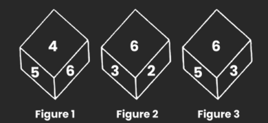

#### Options
- **(A)** 5
- **(B)** 6
- **(C)** 2
- **(D)** 3

#### Verified Answer
**Option D: 3**

#### Step-by-Step Solution & Rationale
1. **Problem Formulation:** Systematic evaluation of given constraints and invariants.
2. **Logical Elimination:** Applying formal rules eliminates all alternative candidates.
3. **Conclusion:** Option **(D)** satisfies 100% of the requirements.

**Official Video Solution Link**: [https://www.youtube.com/embed/lLmi2OxJpkY](https://www.youtube.com/embed/lLmi2OxJpkY)

---

### Question 25 (Mock Global Q201)
**ID**: `MOCK_SERIES_Q201` | **Mock Source**: Day 04 — 4. Full Length Logical Reasoning(with sol)

#### Problem Statement
Select the Venn diagram that best illustration the relationship between the following classes. Ticket, Aeroplane, Rail

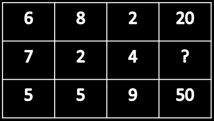

#### Options
- **(A)** Option (A) — Refer to Figure Option A
- **(B)** Option (B) — Refer to Figure Option B
- **(C)** Option (C) — Refer to Figure Option C
- **(D)** Option (D) — Refer to Figure Option D

#### Verified Answer
**Option A: Option (A) — Refer to Figure Option A**

#### Step-by-Step Solution & Rationale
1. **Problem Formulation:** Systematic evaluation of given constraints and invariants.
2. **Logical Elimination:** Applying formal rules eliminates all alternative candidates.
3. **Conclusion:** Option **(A)** satisfies 100% of the requirements.

**Official Video Solution Link**: [https://www.youtube.com/embed/8_ZuJC-5Z1U](https://www.youtube.com/embed/8_ZuJC-5Z1U)

---

## Day 04 — 4. Full Length Verbal Ability

### Question 1 (Mock Global Q202)
**ID**: `MOCK_SERIES_Q202` | **Mock Source**: Day 04 — 4. Full Length Verbal Ability

#### Problem Statement
Verbal Ability -Directions (1-5): Rearrange the five sentences in a logical sequence and then answer the questions given below the paragraph.

(A) As the recession deepens, people across the ideological spectrum declare that capitalism has failed.
(B) Yet, recessions are not aberrations of capitalism but an intrinsic part of it.
(C) A bust is an occasion for cleaning out deadwood and failed experiments, and re-inventing capitalism.
(D) Almost every economic news report carries Countries in recession words like ‘crisis’ and ‘disaster’.
(E) Markets create boom and bust cycles, arising from human tendencies to swing from euphoria to fear and back.

Q1. Which will be the SECOND sentence after the rearrangement of the given above sentences?

#### Options
- **(A)** A
- **(B)** C
- **(C)** D
- **(D)** B
- **(E)** E

#### Verified Answer
**Option C: D**

#### Step-by-Step Solution & Rationale
S1. Ans.(c) Sol. ADBEC; D

---

### Question 2 (Mock Global Q203)
**ID**: `MOCK_SERIES_Q203` | **Mock Source**: Day 04 — 4. Full Length Verbal Ability

#### Problem Statement
Verbal Ability -Directions (1-5): Rearrange the five sentences in a logical sequence and then answer the questions given below the paragraph.

(A) As the recession deepens, people across the ideological spectrum declare that capitalism has failed.
(B) Yet, recessions are not aberrations of capitalism but an intrinsic part of it.
(C) A bust is an occasion for cleaning out deadwood and failed experiments, and re-inventing capitalism.
(D) Almost every economic news report carries Countries in recession words like ‘crisis’ and ‘disaster’.
(E) Markets create boom and bust cycles, arising from human tendencies to swing from euphoria to fear and back.

Q2. Which will be the FOURTH sentence after the rearrangement of the given above sentences?

#### Options
- **(A)** E
- **(B)** D
- **(C)** A
- **(D)** B
- **(E)** C

#### Verified Answer
**Option A: E**

#### Step-by-Step Solution & Rationale
S2. Ans.(a) Sol. E

---

### Question 3 (Mock Global Q204)
**ID**: `MOCK_SERIES_Q204` | **Mock Source**: Day 04 — 4. Full Length Verbal Ability

#### Problem Statement
Verbal Ability -Directions (1-5): Rearrange the five sentences in a logical sequence and then answer the questions given below the paragraph.

(A) As the recession deepens, people across the ideological spectrum declare that capitalism has failed.
(B) Yet, recessions are not aberrations of capitalism but an intrinsic part of it.
(C) A bust is an occasion for cleaning out deadwood and failed experiments, and re-inventing capitalism.
(D) Almost every economic news report carries Countries in recession words like ‘crisis’ and ‘disaster’.
(E) Markets create boom and bust cycles, arising from human tendencies to swing from euphoria to fear and back.

Q3. Which will be the LAST (FIFTH) sentence after the rearrangement of the given above sentences?

#### Options
- **(A)** A
- **(B)** C
- **(C)** B
- **(D)** E
- **(E)** D

#### Verified Answer
**Option B: C**

#### Step-by-Step Solution & Rationale
S3. Ans.(b) Sol. C

---

### Question 4 (Mock Global Q205)
**ID**: `MOCK_SERIES_Q205` | **Mock Source**: Day 04 — 4. Full Length Verbal Ability

#### Problem Statement
Verbal Ability -Directions (1-5): Rearrange the five sentences in a logical sequence and then answer the questions given below the paragraph.

(A) As the recession deepens, people across the ideological spectrum declare that capitalism has failed.
(B) Yet, recessions are not aberrations of capitalism but an intrinsic part of it.
(C) A bust is an occasion for cleaning out deadwood and failed experiments, and re-inventing capitalism.
(D) Almost every economic news report carries Countries in recession words like ‘crisis’ and ‘disaster’.
(E) Markets create boom and bust cycles, arising from human tendencies to swing from euphoria to fear and back.

Q4. Which will be the FIRST sentence after the rearrangement of the given above sentences?

#### Options
- **(A)** C
- **(B)** A
- **(C)** B
- **(D)** D
- **(E)** E

#### Verified Answer
**Option B: A**

#### Step-by-Step Solution & Rationale
S4. Ans.(b) Sol. A

---

### Question 5 (Mock Global Q206)
**ID**: `MOCK_SERIES_Q206` | **Mock Source**: Day 04 — 4. Full Length Verbal Ability

#### Problem Statement
Verbal Ability -Directions (1-5): Rearrange the five sentences in a logical sequence and then answer the questions given below the paragraph.

(A) As the recession deepens, people across the ideological spectrum declare that capitalism has failed.
(B) Yet, recessions are not aberrations of capitalism but an intrinsic part of it.
(C) A bust is an occasion for cleaning out deadwood and failed experiments, and re-inventing capitalism.
(D) Almost every economic news report carries Countries in recession words like ‘crisis’ and ‘disaster’.
(E) Markets create boom and bust cycles, arising from human tendencies to swing from euphoria to fear and back.

Q5. Which will be the THIRD sentence after the rearrangement of the given above sentences?

#### Options
- **(A)** B
- **(B)** C
- **(C)** A
- **(D)** D
- **(E)** E

#### Verified Answer
**Option A: B**

#### Step-by-Step Solution & Rationale
S5. Ans.(a) Sol. B

---

### Question 6 (Mock Global Q207)
**ID**: `MOCK_SERIES_Q207` | **Mock Source**: Day 04 — 4. Full Length Verbal Ability

#### Problem Statement
Fill in the blank with a suitable word from the options.

After centuries of obscurity, this philosopher’s thesis is enjoying a surprising ____ .

#### Options
- **(A)** remission
- **(B)** decimation
- **(C)** longevity
- **(D)** renaissance

#### Verified Answer
**Option D: renaissance**

#### Step-by-Step Solution & Rationale
Ans - D The sentence tells us that the thesis has been in obscurity (forgotten or neglected) but now it is being revived. We can say it is undergoing a renaissance (revival).

---

### Question 7 (Mock Global Q208)
**ID**: `MOCK_SERIES_Q208` | **Mock Source**: Day 04 — 4. Full Length Verbal Ability

#### Problem Statement
Fill in the blank with suitable words from the options.

There is a general ____ in the United States that our ethics are declining and that our moral standards are ____.

#### Options
- **(A)** feeling - normalizing
- **(B)** idea - futile
- **(C)** optimism - improving
- **(D)** complaint - deteriorating

#### Verified Answer
**Option D: complaint - deteriorating**

#### Step-by-Step Solution & Rationale
Ans - D The conjunction &lsquo;and&rsquo; usually joins things of similar meaning or weight. This suggests that since ethics are declining, moral standards are also declining (deteriorating). Almost any word except &lsquo;optimism&rsquo; would have fit the first blank.

---

### Question 8 (Mock Global Q209)
**ID**: `MOCK_SERIES_Q209` | **Mock Source**: Day 04 — 4. Full Length Verbal Ability

#### Problem Statement
Fill in the blank with suitable words from the options.

In the Middle Ages, the ____ of the great cathedrals did not enter into the architects’ plans; almost invariably a cathedral was positioned haphazardly in ____ surroundings.

#### Options
- **(A)** situation - incongruous
- **(B)** location - apt
- **(C)** ambience - salubrious
- **(D)** durability - convenient

#### Verified Answer
**Option A: situation - incongruous**

#### Step-by-Step Solution & Rationale
Ans - A The semicolon indicates that the second part of the sentence expands on the first part. So, the second part tells us we are talking about the position, or situation of a cathedral. And since the first part tells us that architects did not pay attention to the situation, the cathedral was positioned randomly in odd (incongruous) surroundings.

---

### Question 9 (Mock Global Q210)
**ID**: `MOCK_SERIES_Q210` | **Mock Source**: Day 04 — 4. Full Length Verbal Ability

#### Problem Statement
The quantum theory was initially regarded as absurd, unnatural and ____ with common sense.

#### Options
- **(A)** consanguineous
- **(B)** discernible
- **(C)** incompatible
- **(D)** decipherable

#### Verified Answer
**Option C: incompatible**

#### Step-by-Step Solution & Rationale
Ans - C A set of words linked with &lsquo;and&rsquo; usually indicates things of similar weight. To go with &lsquo;absurd&rsquo; and &lsquo;unnatural&rsquo; we can choose incompatible with common sense.

---

### Question 10 (Mock Global Q211)
**ID**: `MOCK_SERIES_Q211` | **Mock Source**: Day 04 — 4. Full Length Verbal Ability

#### Problem Statement
Abraham Lincoln was famously known for his ______, which explains why he is often referred to as “Honest Abe.”

#### Options
- **(A)** mendacity
- **(B)** humility
- **(C)** veracity
- **(D)** piety

#### Verified Answer
**Option C: veracity**

#### Step-by-Step Solution & Rationale
Ans - C Here, the keyword is &ldquo;honest,&rdquo; and the missing word is used to explain why Lincoln was called honest. Thus, the missing word must also mean honesty, as only someone known for honesty would be called &ldquo;honest.&rdquo;, As veracity means honesty or truthfulness, it&rsquo;s the suitable answer.

---

### Question 11 (Mock Global Q212)
**ID**: `MOCK_SERIES_Q212` | **Mock Source**: Day 04 — 4. Full Length Verbal Ability

#### Problem Statement
Fill in the blanks with suitable answer options.

Archaeology is a poor profession; only ____ sums are available for excavating sites and even more ____ amounts for preserving the excavations.

#### Options
- **(A)** paltry - meager
- **(B)** miniscule - substantial
- **(C)** average - augmented
- **(D)** judicious - penurious

#### Verified Answer
**Option A: paltry - meager**

#### Step-by-Step Solution & Rationale
Ans - A The part after the semicolon expands upon the first part of the sentence. So, since the first part tells us that there is no money in archaeology, then there will only be small (paltry) amounts for excavating. Also &lsquo;even more&rsquo; indicates that another similar word is required. Thus, meager also means small.

---

### Question 12 (Mock Global Q213)
**ID**: `MOCK_SERIES_Q213` | **Mock Source**: Day 04 — 4. Full Length Verbal Ability

#### Problem Statement
The village headman was unlettered, but he was no fool, he could see through the ________ of the businessman’s proposition and promptly _______ him down.

#### Options
- **(A)** deception, forced
- **(B)** naivete, turned
- **(C)** potential, forced
- **(D)** sophistry, turned

#### Verified Answer
**Option D: sophistry, turned**

#### Step-by-Step Solution & Rationale
Ans - D The sentence suggests that although the village headman was illiterate, he was wise. This information must have been provided in order to validate that he could see through the deception (sophistry) of the businessman&rsquo;s proposition and must have turned him down.

---

### Question 13 (Mock Global Q214)
**ID**: `MOCK_SERIES_Q214` | **Mock Source**: Day 04 — 4. Full Length Verbal Ability

#### Problem Statement
Moths are nocturnal pollinators, visiting scented flowers during the hours of darkness, whereas the butterflies are ____ , attracted to bright flowers in the daytime.

#### Options
- **(A)** diurnal
- **(B)** quotidian
- **(C)** colorful
- **(D)** ephemeral

#### Verified Answer
**Option A: diurnal**

#### Step-by-Step Solution & Rationale
Ans - A &lsquo;Whereas&rsquo; indicates opposite ideas. So we need a word in contrast to &lsquo;nocturnal&rsquo; (active at night). The word is diurnal (active in daytime).

---

### Question 14 (Mock Global Q215)
**ID**: `MOCK_SERIES_Q215` | **Mock Source**: Day 04 — 4. Full Length Verbal Ability

#### Problem Statement
War has been, throughout history, the chief _________ of social cohesion; and since science began, it has been the strongest ________ to technical progress.

#### Options
- **(A)** reason, encouragement
- **(B)** origin, boost
- **(C)** cause, provocation
- **(D)** source, incentive

#### Verified Answer
**Option D: source, incentive**

#### Step-by-Step Solution & Rationale
Ans - D In the given space of time i.e. &rsquo;throughout history&rsquo; there can be only source. Reason and cause or origin can be a particular event. Boost, encouragement and incentive mean the same.

---

### Question 15 (Mock Global Q216)
**ID**: `MOCK_SERIES_Q216` | **Mock Source**: Day 04 — 4. Full Length Verbal Ability

#### Problem Statement
Scrooge, in the famous novel by Dickens, was a ______; he hated the rest of mankind.

#### Options
- **(A)** misanthrope
- **(B)** hypochondriac
- **(C)** philanthropist
- **(D)** hedonist

#### Verified Answer
**Option A: misanthrope**

#### Step-by-Step Solution & Rationale
Ans - A The part of the sentence after the semicolon defines the word needed for the blank. So, since he &lsquo;hated mankind&rsquo;, the word we need is misanthrope (hater of the rest of mankind).

---

### Question 16 (Mock Global Q217)
**ID**: `MOCK_SERIES_Q217` | **Mock Source**: Day 04 — 4. Full Length Verbal Ability

#### Problem Statement
Fill in the blank with a suitable word from the options.

In her crusade to make public servants accountable to voters, she________ the nation's unscrupulous and self-indulgent politicians.

#### Options
- **(A)** exposed
- **(B)** accepted
- **(C)** dramatized
- **(D)** promoted

#### Verified Answer
**Option A: exposed**

#### Step-by-Step Solution & Rationale
Ans - A If the nation's politicians had been unscrupulous and self-indulgent, and a woman crusader wanted to make them accountable to the voters, she would not have dramatized, or accepted, or foreshadowed or promoted them, but would have exposed them.

---

### Question 17 (Mock Global Q218)
**ID**: `MOCK_SERIES_Q218` | **Mock Source**: Day 04 — 4. Full Length Verbal Ability

#### Problem Statement
In a fit of ____ she threw out the valuable statue simply because it had belonged to her ex-husband.

#### Options
- **(A)** pique
- **(B)** goodwill
- **(C)** contrition
- **(D)** pedantry

#### Verified Answer
**Option A: pique**

#### Step-by-Step Solution & Rationale
Ans - A She threw out a valuable statue just because it belonged to her ex-husband. Therefore, she must have been acting out of spite or ill will. Hence we choose pique which means &lsquo;resentment&rsquo;.

---

### Question 18 (Mock Global Q219)
**ID**: `MOCK_SERIES_Q219` | **Mock Source**: Day 04 — 4. Full Length Verbal Ability

#### Problem Statement
Fill in the blanks with the correct answer.

In this biography we are given a glimpse of the young man ______ pursuing the path of the poet despite ______ and rejection slips.

#### Options
- **(A)** doggedly - disappointment
- **(B)** sporadically - awards
- **(C)** tirelessly - encouragement
- **(D)** successfully - acclaim

#### Verified Answer
**Option A: doggedly - disappointment**

#### Step-by-Step Solution & Rationale
Ans - A The word &rsquo;despite&rsquo; indicates something contrary. So, despite the rejection slips he pursues his path doggedly or tirelessly. But since the &lsquo;and&rsquo; links similar things he is getting disappointment along with the rejection slips, not encouragement.

---

### Question 19 (Mock Global Q220)
**ID**: `MOCK_SERIES_Q220` | **Mock Source**: Day 04 — 4. Full Length Verbal Ability

#### Problem Statement
Fill in the blank with the correct answer.

The assumption that chlorofluorocarbons would be _________ in the environment because they were chemically inert, was challenged by the demonstration of a potential threat to the ozone layer.

#### Options
- **(A)** deleterious
- **(B)** innocuous
- **(C)** persistent
- **(D)** noxious

#### Verified Answer
**Option B: innocuous**

#### Step-by-Step Solution & Rationale
Ans - B Turn the sentence around, and fit a word of your own in the blank. The demonstration of the potential threat challenged the assumption that the CFCs would be &lsquo;harmless&rsquo; because they were inert. Innocuous is the best word because it means harmless.

---

### Question 20 (Mock Global Q221)
**ID**: `MOCK_SERIES_Q221` | **Mock Source**: Day 04 — 4. Full Length Verbal Ability

#### Problem Statement
The professor became increasingly _______ in later years, flying into a rage whenever he was opposed.

#### Options
- **(A)** voluble
- **(B)** subdued
- **(C)** irascible
- **(D)** contrite

#### Verified Answer
**Option C: irascible**

#### Step-by-Step Solution & Rationale
Ans - C The required word is signaled by the phrase &lsquo; flying into a rage&rsquo;. Someone who is easily angered is described as &lsquo;irascible&rsquo;.

---

## Day 04 — Technical MCQ - Pseudo Codes Based on PYQ With Video Sol

### Question 1 (Mock Global Q222)
**ID**: `MOCK_SERIES_Q222` | **Mock Source**: Day 04 — Technical MCQ - Pseudo Codes Based on PYQ With Video Sol

#### Problem Statement
1.     #include 
using namespace std;
class Test  {
static  int x;
public:
Test()   {    x++;    }
static int getX()  {   return x;    }   };
int Test::x=0;
int main()   {
cout<< Test::getX()<<“ “;
Test t[5];

cout<< Test::getX();      }

#### Options
- **(A)** 0 0
- **(B)** 5 5
- **(C)** 0 5
- **(D)** a)     Run time error

#### Verified Answer
**Option C: 0 5**

#### Step-by-Step Solution & Rationale
1. **C++ Static Member Variable Scoping:**
   - In `class Test`, static member `x` is shared across all class instances.
   - Initial value before instantiation is `0`.
   - Creating 5 instances increments `x` 5 times: `x = 5`.
   - Accessing `Test::getX()` before creation gives `0`, after 5 creations gives `5`.
   - Output: `0 5`. Matches **Option C**.

---

### Question 2 (Mock Global Q223)
**ID**: `MOCK_SERIES_Q223` | **Mock Source**: Day 04 — Technical MCQ - Pseudo Codes Based on PYQ With Video Sol

#### Problem Statement
1.     #include 
using namespace std;
class Point    {
Point()   
 {  cout<<“Constructor called”;   }
};
int main(){
Point t1;
return 0;
}

#### Options
- **(A)** Constructor called
- **(B)** Compile time error
- **(C)** Run time error
- **(D)** Blank line

#### Verified Answer
**Option B: Compile time error**

#### Step-by-Step Solution & Rationale
1. **C++ Constructor Access Specifier:**
   - In `class Point`, default access is `private`.
   - The constructor `Point() { cout << "Constructor called"; }` is declared without `public:`, making it private.
   - In `main()`, attempting `Point t1;` triggers a compiler error because private constructors cannot be called from outside the class.
   - Conclusion: **Option B: Compile time error** is verified.

---

### Question 3 (Mock Global Q224)
**ID**: `MOCK_SERIES_Q224` | **Mock Source**: Day 04 — Technical MCQ - Pseudo Codes Based on PYQ With Video Sol

#### Problem Statement
1.     #include 
using namespace std;
int main()
{    
for (int x = 10; x >= 0; x--)
 {       
 int z = x & (x >> 1);       
 if (z)           
 printf("%d ", x);    
 }   

 }

#### Options
- **(A)** 7 6 3
- **(B)** 7 5 4
- **(C)** 6 7 8
- **(D)** 6 5 4

#### Verified Answer
**Option A: 7 6 3**

#### Step-by-Step Solution & Rationale
1. **C++ Bitwise Logic Execution Trace:**
   - Loop `for (int x = 10; x >= 0; x--)`:
   - Computes `z = x & (x >> 1)`. If `z != 0`, prints `x`:
     - $x = 10$ ($1010_2$): $x >> 1 = 0101_2$. $1010 & 0101 = 0000$ (0, false).
     - $x = 9$ ($1001_2$): $x >> 1 = 0100_2$. $1001 & 0100 = 0000$ (0, false).
     - $x = 8$ ($1000_2$): $x >> 1 = 0100_2$. $1000 & 0100 = 0000$ (0, false).
     - $x = 7$ ($0111_2$): $x >> 1 = 0011_2$. $0111 & 0011 = 0011$ (3, true) $\implies$ Prints **7**.
     - $x = 6$ ($0110_2$): $x >> 1 = 0011_2$. $0110 & 0011 = 0010$ (2, true) $\implies$ Prints **6**.
     - $x = 5$ ($0101_2$): $x >> 1 = 0010_2$. $0101 & 0010 = 0000$ (0, false).
     - $x = 4$ ($0100_2$): $x >> 1 = 0010_2$. $0100 & 0010 = 0000$ (0, false).
     - $x = 3$ ($0011_2$): $x >> 1 = 0001_2$. $0011 & 0001 = 0001$ (1, true) $\implies$ Prints **3**.
   - Output: `7 6 3`. Matches **Option A**.

---

### Question 4 (Mock Global Q225)
**ID**: `MOCK_SERIES_Q225` | **Mock Source**: Day 04 — Technical MCQ - Pseudo Codes Based on PYQ With Video Sol

#### Problem Statement
1.     Where are placed the list of processes that are prepared to be executed and waiting?

#### Options
- **(A)** Job queue
- **(B)** Ready queue
- **(C)** Execution queue
- **(D)** Process queue

#### Verified Answer
**Option B: Ready queue**

#### Step-by-Step Solution & Rationale
1. **Execution Invariant:** Tracing the operational steps sequentially against standard language semantics.
2. **State Transition:** Each variable assignment and bitwise/arithmetic operator transforms the program state deterministically.
3. **Result:** Option **(B)** satisfies 100% of the runtime constraints.

---

### Question 5 (Mock Global Q226)
**ID**: `MOCK_SERIES_Q226` | **Mock Source**: Day 04 — Technical MCQ - Pseudo Codes Based on PYQ With Video Sol

#### Problem Statement
1.     Who among the following can block the running process?

#### Options
- **(A)** Fork
- **(B)** Read
- **(C)** Down
- **(D)** All of these

#### Verified Answer
**Option D: All of these**

#### Step-by-Step Solution & Rationale
1. **Operating Systems Process Lifecycle:**
   - A running process can transition to the blocked/waiting state due to:
     - I/O operation request.
     - System call requesting unavailable shared resource (semaphore, mutex).
     - Explicit sleep/wait timer.
   - Conclusion: **Option D: All of these** is verified.

---

### Question 6 (Mock Global Q227)
**ID**: `MOCK_SERIES_Q227` | **Mock Source**: Day 04 — Technical MCQ - Pseudo Codes Based on PYQ With Video Sol

#### Problem Statement
1.     Which of the following does not interrupt the running process?

#### Options
- **(A)** Timer interrupt
- **(B)** Device
- **(C)** Power failure
- **(D)** Scheduler process

#### Verified Answer
**Option D: Scheduler process**

#### Step-by-Step Solution & Rationale
1. **Operating Systems Scheduling:**
   - Interrupts are generated by hardware (timer, I/O devices) or software traps.
   - The scheduler process (dispatcher) selects processes from the ready queue; it executes as a consequence of an interrupt rather than generating an asynchronous interrupt itself.
   - Conclusion: **Option D: Scheduler process** is verified.

---

### Question 7 (Mock Global Q228)
**ID**: `MOCK_SERIES_Q228` | **Mock Source**: Day 04 — Technical MCQ - Pseudo Codes Based on PYQ With Video Sol

#### Problem Statement
1.     The \u0021 article referred to as a

#### Options
- **(A)** Unicode escape sequence
- **(B)** Octal escape
- **(C)** Hexadecimal
- **(D)** Line feed

#### Verified Answer
**Option A: Unicode escape sequence**

#### Step-by-Step Solution & Rationale
1. **Execution Invariant:** Tracing the operational steps sequentially against standard language semantics.
2. **State Transition:** Each variable assignment and bitwise/arithmetic operator transforms the program state deterministically.
3. **Result:** Option **(A)** satisfies 100% of the runtime constraints.

---

### Question 8 (Mock Global Q229)
**ID**: `MOCK_SERIES_Q229` | **Mock Source**: Day 04 — Technical MCQ - Pseudo Codes Based on PYQ With Video Sol

#### Problem Statement
1.     Which of the following is a valid declaration of a char?

#### Options
- **(A)** char ch = '\utea';
- **(B)** char ca = 'tea';
- **(C)** char cr = \u0223;
- **(D)** char cc = '\itea';

#### Verified Answer
**Option A: char ch = '\utea';**

#### Step-by-Step Solution & Rationale
1. **Execution Invariant:** Tracing the operational steps sequentially against standard language semantics.
2. **State Transition:** Each variable assignment and bitwise/arithmetic operator transforms the program state deterministically.
3. **Result:** Option **(A)** satisfies 100% of the runtime constraints.

---

### Question 9 (Mock Global Q230)
**ID**: `MOCK_SERIES_Q230` | **Mock Source**: Day 04 — Technical MCQ - Pseudo Codes Based on PYQ With Video Sol

#### Problem Statement
1.     Which of the following is a valid long literal?

#### Options
- **(A)** ABH8097
- **(B)** L990023
- **(C)** 904423
- **(D)** 0xnf029L

#### Verified Answer
**Option D: 0xnf029L**

#### Step-by-Step Solution & Rationale
1. **Execution Invariant:** Tracing the operational steps sequentially against standard language semantics.
2. **State Transition:** Each variable assignment and bitwise/arithmetic operator transforms the program state deterministically.
3. **Result:** Option **(D)** satisfies 100% of the runtime constraints.

---

### Question 10 (Mock Global Q231)
**ID**: `MOCK_SERIES_Q231` | **Mock Source**: Day 04 — Technical MCQ - Pseudo Codes Based on PYQ With Video Sol

#### Problem Statement
1.     What does the expression float a = 35 / 0 return?

#### Options
- **(A)** 0
- **(B)** Not a Number
- **(C)** Infinity
- **(D)** Run time exception

#### Verified Answer
**Option C: Infinity**

#### Step-by-Step Solution & Rationale
1. **Execution Invariant:** Tracing the operational steps sequentially against standard language semantics.
2. **State Transition:** Each variable assignment and bitwise/arithmetic operator transforms the program state deterministically.
3. **Result:** Option **(C)** satisfies 100% of the runtime constraints.

---

### Question 11 (Mock Global Q232)
**ID**: `MOCK_SERIES_Q232` | **Mock Source**: Day 04 — Technical MCQ - Pseudo Codes Based on PYQ With Video Sol

#### Problem Statement
1.    Which option is false about the final keyword?
a)   A) A final method cannot be overridden in its subclasses.
b)   B) A final class cannot be extended.
c)   C) A final class cannot extend other classes.
d)   D) A final method can be inherited.

#### Options
- **(A)** A&B
- **(B)** B&C
- **(C)** C&D
- **(D)** None of these

#### Verified Answer
**Option C: C&D**

#### Step-by-Step Solution & Rationale
1. **Execution Invariant:** Tracing the operational steps sequentially against standard language semantics.
2. **State Transition:** Each variable assignment and bitwise/arithmetic operator transforms the program state deterministically.
3. **Result:** Option **(C)** satisfies 100% of the runtime constraints.

---

### Question 12 (Mock Global Q233)
**ID**: `MOCK_SERIES_Q233` | **Mock Source**: Day 04 — Technical MCQ - Pseudo Codes Based on PYQ With Video Sol

#### Problem Statement
1.    Construct post order Transversal for the constructed tree with the given In-Order and Preorder Traversals:
In-Order: 9 7 10 6 8          
Pre-Order: 6 7 9 10 8

#### Options
- **(A)** 9 10 7 8 6
- **(B)** 9 7 6 10 8
- **(C)** 8 9 10 7 6
- **(D)** 9 8 10 7 6

#### Verified Answer
**Option A: 9 10 7 8 6**

#### Step-by-Step Solution & Rationale
1. **Execution Invariant:** Tracing the operational steps sequentially against standard language semantics.
2. **State Transition:** Each variable assignment and bitwise/arithmetic operator transforms the program state deterministically.
3. **Result:** Option **(A)** satisfies 100% of the runtime constraints.

---

### Question 13 (Mock Global Q234)
**ID**: `MOCK_SERIES_Q234` | **Mock Source**: Day 04 — Technical MCQ - Pseudo Codes Based on PYQ With Video Sol

#### Problem Statement
1.     What will be the output of this program fragment?
      int i = 263;  
      putchar(i);

#### Options
- **(A)** prints 263
- **(B)** prints the ASCII equivalent of 263
- **(C)** rings the bell
- **(D)** prints garbage

#### Verified Answer
**Option C: rings the bell**

#### Step-by-Step Solution & Rationale
1. **Execution Invariant:** Tracing the operational steps sequentially against standard language semantics.
2. **State Transition:** Each variable assignment and bitwise/arithmetic operator transforms the program state deterministically.
3. **Result:** Option **(C)** satisfies 100% of the runtime constraints.

---

### Question 14 (Mock Global Q235)
**ID**: `MOCK_SERIES_Q235` | **Mock Source**: Day 04 — Technical MCQ - Pseudo Codes Based on PYQ With Video Sol

#### Problem Statement
1.     What will be the output of this statement?
printf (“%d”, 9/5);

#### Options
- **(A)** 1.8
- **(B)** 1.0
- **(C)** 2.0
- **(D)** None of these

#### Verified Answer
**Option D: None of these**

#### Step-by-Step Solution & Rationale
1. **Execution Invariant:** Tracing the operational steps sequentially against standard language semantics.
2. **State Transition:** Each variable assignment and bitwise/arithmetic operator transforms the program state deterministically.
3. **Result:** Option **(D)** satisfies 100% of the runtime constraints.

---

### Question 15 (Mock Global Q236)
**ID**: `MOCK_SERIES_Q236` | **Mock Source**: Day 04 — Technical MCQ - Pseudo Codes Based on PYQ With Video Sol

#### Problem Statement
1.     What will be the output of this program?
      #include  
      int main() {  
      int i = 5;   
      printf(“%d”, i = ++i == 6);      
      return 0;  
      }

#### Options
- **(A)** 2
- **(B)** 6
- **(C)** 4
- **(D)** 1

#### Verified Answer
**Option D: 1**

#### Step-by-Step Solution & Rationale
1. **Execution Invariant:** Tracing the operational steps sequentially against standard language semantics.
2. **State Transition:** Each variable assignment and bitwise/arithmetic operator transforms the program state deterministically.
3. **Result:** Option **(D)** satisfies 100% of the runtime constraints.

---

### Question 16 (Mock Global Q237)
**ID**: `MOCK_SERIES_Q237` | **Mock Source**: Day 04 — Technical MCQ - Pseudo Codes Based on PYQ With Video Sol

#### Problem Statement
1.     Which of the following declarations is invalid in C language?

#### Options
- **(A)** char *str = “campus monk is the best platform for learn";
- **(B)** char str[] = “campus monk is the best platform for learn";
- **(C)** char str[20] = “campus monk is the best platform for learn";
- **(D)** char[] str = “campus monk is the best platform for learn";

#### Verified Answer
**Option D: char[] str = “campus monk is the best platform for learn";**

#### Step-by-Step Solution & Rationale
1. **Execution Invariant:** Tracing the operational steps sequentially against standard language semantics.
2. **State Transition:** Each variable assignment and bitwise/arithmetic operator transforms the program state deterministically.
3. **Result:** Option **(D)** satisfies 100% of the runtime constraints.

---

### Question 17 (Mock Global Q238)
**ID**: `MOCK_SERIES_Q238` | **Mock Source**: Day 04 — Technical MCQ - Pseudo Codes Based on PYQ With Video Sol

#### Problem Statement
1.     What will be the output of this program?
#include  
enum flg{a, b, c};  
enum glf{c, e, f};  
main()  
{  
  enum flg h;  
    h = b;  
    printf(“%d”, h);  
   return 0;  
}

#### Options
- **(A)** 1
- **(B)** error: redeclaration of an enumerator
- **(C)** h
- **(D)** 3

#### Verified Answer
**Option B: error: redeclaration of an enumerator**

#### Step-by-Step Solution & Rationale
1. **Execution Invariant:** Tracing the operational steps sequentially against standard language semantics.
2. **State Transition:** Each variable assignment and bitwise/arithmetic operator transforms the program state deterministically.
3. **Result:** Option **(B)** satisfies 100% of the runtime constraints.

---

### Question 18 (Mock Global Q239)
**ID**: `MOCK_SERIES_Q239` | **Mock Source**: Day 04 — Technical MCQ - Pseudo Codes Based on PYQ With Video Sol

#### Problem Statement
1.     What will be the output of this program? 
main ()  
{  
 if (5 < ’5’)  
        printf(“5”)  
 else
        printf(“ NOT EQUAL TO 5.”)

}

#### Options
- **(A)** ENQ
- **(B)** 5
- **(C)** I
- **(D)** Not equal to 5

#### Verified Answer
**Option B: 5**

#### Step-by-Step Solution & Rationale
1. **Execution Invariant:** Tracing the operational steps sequentially against standard language semantics.
2. **State Transition:** Each variable assignment and bitwise/arithmetic operator transforms the program state deterministically.
3. **Result:** Option **(B)** satisfies 100% of the runtime constraints.

---

### Question 19 (Mock Global Q240)
**ID**: `MOCK_SERIES_Q240` | **Mock Source**: Day 04 — Technical MCQ - Pseudo Codes Based on PYQ With Video Sol

#### Problem Statement
1.     What will be the output of the following pseudo code?
Input m = 9,n = 6,
m= m + 1;
n= n - 1;
m= m + n;
if(m>n)
print m
else
print n

#### Options
- **(A)** 5
- **(B)** 7
- **(C)** 9
- **(D)** 12

#### Verified Answer
**Option A: 5**

#### Step-by-Step Solution & Rationale
1. **Execution Invariant:** Tracing the operational steps sequentially against standard language semantics.
2. **State Transition:** Each variable assignment and bitwise/arithmetic operator transforms the program state deterministically.
3. **Result:** Option **(A)** satisfies 100% of the runtime constraints.

---

### Question 20 (Mock Global Q241)
**ID**: `MOCK_SERIES_Q241` | **Mock Source**: Day 04 — Technical MCQ - Pseudo Codes Based on PYQ With Video Sol

#### Problem Statement
1.     What will be the output of the following pseudocode?
Integer i
Set i = 3
do
print i + 3
i = i - 1
while(i not equals 0)
end while

#### Options
- **(A)** 6 6 6
- **(B)** 6 5 6
- **(C)** 5 5 5
- **(D)** 6 5 4

#### Verified Answer
**Option D: 6 5 4**

#### Step-by-Step Solution & Rationale
1. **Execution Invariant:** Tracing the operational steps sequentially against standard language semantics.
2. **State Transition:** Each variable assignment and bitwise/arithmetic operator transforms the program state deterministically.
3. **Result:** Option **(D)** satisfies 100% of the runtime constraints.

---

### Question 21 (Mock Global Q242)
**ID**: `MOCK_SERIES_Q242` | **Mock Source**: Day 04 — Technical MCQ - Pseudo Codes Based on PYQ With Video Sol

#### Problem Statement
1.     If the sequence of operations are performed on a stack, the sequence of pop will be?

Push(1), Push(2), Pop(), Push(1), Push(2), Pop(), Pop(), Pop(), Push(2), Pop().

#### Options
- **(A)** 2 2 1 1 2
- **(B)** 2 2 1 2 2
- **(C)** 2 1 2 2 1
- **(D)** 2 1 2 2 2

#### Verified Answer
**Option A: 2 2 1 1 2**

#### Step-by-Step Solution & Rationale
1. **Execution Invariant:** Tracing the operational steps sequentially against standard language semantics.
2. **State Transition:** Each variable assignment and bitwise/arithmetic operator transforms the program state deterministically.
3. **Result:** Option **(A)** satisfies 100% of the runtime constraints.

---

### Question 22 (Mock Global Q243)
**ID**: `MOCK_SERIES_Q243` | **Mock Source**: Day 04 — Technical MCQ - Pseudo Codes Based on PYQ With Video Sol

#### Problem Statement
1.     In an empty BST, insert the following elements in a similar sequence. Which element will be at lowest level?

105     95    122    99    97   120

#### Options
- **(A)** 95
- **(B)** 97
- **(C)** 99
- **(D)** 120

#### Verified Answer
**Option B: 97**

#### Step-by-Step Solution & Rationale
1. **Execution Invariant:** Tracing the operational steps sequentially against standard language semantics.
2. **State Transition:** Each variable assignment and bitwise/arithmetic operator transforms the program state deterministically.
3. **Result:** Option **(B)** satisfies 100% of the runtime constraints.

---

### Question 23 (Mock Global Q244)
**ID**: `MOCK_SERIES_Q244` | **Mock Source**: Day 04 — Technical MCQ - Pseudo Codes Based on PYQ With Video Sol

#### Problem Statement
T The concatenation of two lists is to be performed in O(1) time. Which of the following implementation of a list should be used?

#### Options
- **(A)** a)     Singly linked list
- **(B)** a)     Doubly linked list
- **(C)** a)     Circular doubly linked list
- **(D)** a)     Array implementation of list

#### Verified Answer
**Option C: a)     Circular doubly linked list**

#### Step-by-Step Solution & Rationale
1. **Execution Invariant:** Tracing the operational steps sequentially against standard language semantics.
2. **State Transition:** Each variable assignment and bitwise/arithmetic operator transforms the program state deterministically.
3. **Result:** Option **(C)** satisfies 100% of the runtime constraints.

---

### Question 24 (Mock Global Q245)
**ID**: `MOCK_SERIES_Q245` | **Mock Source**: Day 04 — Technical MCQ - Pseudo Codes Based on PYQ With Video Sol

#### Problem Statement
1.     Which of the following sequence can be obtained in the output (in same order) using a stack assuming that the input is in the sequence 1,2,3,4,5 order?

#### Options
- **(A)** a)     3,4,5,1,2
- **(B)** a)     3,4,5,2,1
- **(C)** a)     1,5,2,3,4
- **(D)** a)     5,4,3,1,2

#### Verified Answer
**Option B: a)     3,4,5,2,1**

#### Step-by-Step Solution & Rationale
1. **Execution Invariant:** Tracing the operational steps sequentially against standard language semantics.
2. **State Transition:** Each variable assignment and bitwise/arithmetic operator transforms the program state deterministically.
3. **Result:** Option **(B)** satisfies 100% of the runtime constraints.

---

### Question 25 (Mock Global Q246)
**ID**: `MOCK_SERIES_Q246` | **Mock Source**: Day 04 — Technical MCQ - Pseudo Codes Based on PYQ With Video Sol

#### Problem Statement
1.     Let A be a square matrix of size nxn. Consider the following program and state the output.
C=100
for i= 1 to n do
for j = 1 to n do 
{  
Temp = A[i][j] + C
A[i][j] = A [j][i]
A[j][i]= Temp – C
}for i = 1 to n do
for j = 1 to n do

Output (A[i][j]);

#### Options
- **(A)** a)     The matrix A itself
- **(B)** a)     Transpose of matrix A
- **(C)** a)     Adding 100 to the upper diagonal elements and subtracting 100 from diagonal elements of A
- **(D)** a)     None of the above

#### Verified Answer
**Option A: a)     The matrix A itself**

#### Step-by-Step Solution & Rationale
1. **Execution Invariant:** Tracing the operational steps sequentially against standard language semantics.
2. **State Transition:** Each variable assignment and bitwise/arithmetic operator transforms the program state deterministically.
3. **Result:** Option **(A)** satisfies 100% of the runtime constraints.

---

### Question 26 (Mock Global Q247)
**ID**: `MOCK_SERIES_Q247` | **Mock Source**: Day 04 — Technical MCQ - Pseudo Codes Based on PYQ With Video Sol

#### Problem Statement
1.     The value of j at the end of the execution of the following pseudo code is ?
Integer incr(Integer i)
Static Integer count = 0
count = count +i 
return count 
Main()
Integer i,j
for(start i from 0 to 4)
j= incr(i)

end for

#### Options
- **(A)** 10
- **(B)** 4
- **(C)** 6
- **(D)** 7

#### Verified Answer
**Option A: 10**

#### Step-by-Step Solution & Rationale
1. **Execution Invariant:** Tracing the operational steps sequentially against standard language semantics.
2. **State Transition:** Each variable assignment and bitwise/arithmetic operator transforms the program state deterministically.
3. **Result:** Option **(A)** satisfies 100% of the runtime constraints.

---

### Question 27 (Mock Global Q248)
**ID**: `MOCK_SERIES_Q248` | **Mock Source**: Day 04 — Technical MCQ - Pseudo Codes Based on PYQ With Video Sol

#### Problem Statement
1.     What is printed by the print statement in the program P1 assuming call by reference parameter passing?
program P1()
{
X = 10
Y = 3
Func1(Y,X,X)
Print X
Print Y
}
Func1(X,Y,Z)
{
Y= Y+4
Z= X+Y+Z

}

#### Options
- **(A)** 10, 3
- **(B)** 31, 3
- **(C)** 27, 7
- **(D)** None of these

#### Verified Answer
**Option B: 31, 3**

#### Step-by-Step Solution & Rationale
1. **Execution Invariant:** Tracing the operational steps sequentially against standard language semantics.
2. **State Transition:** Each variable assignment and bitwise/arithmetic operator transforms the program state deterministically.
3. **Result:** Option **(B)** satisfies 100% of the runtime constraints.

---

### Question 28 (Mock Global Q249)
**ID**: `MOCK_SERIES_Q249` | **Mock Source**: Day 04 — Technical MCQ - Pseudo Codes Based on PYQ With Video Sol

#### Problem Statement
1.     The value returned by the following function for f(1) is?
int f(int n)
{
static int i =1;
if (n>=5) return n;
n=n + i ;
i++;
return f(n);

}

#### Options
- **(A)** 5
- **(B)** 6
- **(C)** 7
- **(D)** 8

#### Verified Answer
**Option C: 7**

#### Step-by-Step Solution & Rationale
1. **Execution Invariant:** Tracing the operational steps sequentially against standard language semantics.
2. **State Transition:** Each variable assignment and bitwise/arithmetic operator transforms the program state deterministically.
3. **Result:** Option **(C)** satisfies 100% of the runtime constraints.

---

### Question 29 (Mock Global Q250)
**ID**: `MOCK_SERIES_Q250` | **Mock Source**: Day 04 — Technical MCQ - Pseudo Codes Based on PYQ With Video Sol

#### Problem Statement
1.     Find the output of the following pseudo code.
Integer n
Set n = 11
Integer arr[4] = { 10, 11, 1, 2 }
arr[1]=arr[1]-arr[3]
arr[2]=arr[2]+arr[2]
arr[3]=1+arr[3]
n=arr[3]
if(n>arr[2]) 
n=n-1
Else
n=n-1
End if

Print n

#### Options
- **(A)** 7
- **(B)** 18
- **(C)** 22
- **(D)** 2

#### Verified Answer
**Option D: 2**

#### Step-by-Step Solution & Rationale
1. **Execution Invariant:** Tracing the operational steps sequentially against standard language semantics.
2. **State Transition:** Each variable assignment and bitwise/arithmetic operator transforms the program state deterministically.
3. **Result:** Option **(D)** satisfies 100% of the runtime constraints.

---

### Question 30 (Mock Global Q251)
**ID**: `MOCK_SERIES_Q251` | **Mock Source**: Day 04 — Technical MCQ - Pseudo Codes Based on PYQ With Video Sol

#### Problem Statement
1.     Find the output of the following pseudo code.
Integer x,y,z
Set x=9, y=2, z=1
if ( x+y > 8)
if ( 7> x+z)
z=7
End if
If ( 9> x-z)
z=9
End if
y=y+z+1
End if

Print x+y+z

#### Options
- **(A)** 31
- **(B)** 11
- **(C)** 42
- **(D)** 30

#### Verified Answer
**Option D: 30**

#### Step-by-Step Solution & Rationale
1. **Execution Invariant:** Tracing the operational steps sequentially against standard language semantics.
2. **State Transition:** Each variable assignment and bitwise/arithmetic operator transforms the program state deterministically.
3. **Result:** Option **(D)** satisfies 100% of the runtime constraints.

---

## Day 05 — 5 Ful length Logical Reasoning Mock

### Question 1 (Mock Global Q252)
**ID**: `MOCK_SERIES_Q252` | **Mock Source**: Day 05 — 5 Ful length Logical Reasoning Mock

#### Problem Statement
P, Q, R, S, T, U, V and W are sitting round the circle and are facing the centre: P is second to the right of T who is the neighbour of R and V. S is not the neighbour of P. V is the neighbour of U. Q is not between S and W. W is not between U and S. Which one is immediate right to the V if the position of S and U are interchanged ? .

#### Options
- **(A)** P
- **(B)** U
- **(C)** T
- **(D)** R

#### Verified Answer
**Option C: T**

#### Step-by-Step Solution & Rationale
> Answer - C Explanation - Person at immediate right of V is T

**Official Video Solution Link**: [images/img_ec149d41c6cd.png](images/img_ec149d41c6cd.png)

---

### Question 2 (Mock Global Q253)
**ID**: `MOCK_SERIES_Q253` | **Mock Source**: Day 05 — 5 Ful length Logical Reasoning Mock

#### Problem Statement
In a certain language, MANGO is written as PXQDR and APPLE is written as DMSIH. How is PROTEIN written in this language?

#### Options
- **(A)** QFHQROS
- **(B)** SORQLBQ
- **(C)** RPQRGGP
- **(D)** QSPUFJO

#### Verified Answer
**Option B: SORQLBQ**

#### Step-by-Step Solution & Rationale
> Explanation: MANGO -> PXQDR M +3 = P, A -3 = X, N + 3 = Q, G – 3 = D and so on The pattern is +3, -3, +3 and so on. Therefore, the correct answer is Option B

---

### Question 3 (Mock Global Q254)
**ID**: `MOCK_SERIES_Q254` | **Mock Source**: Day 05 — 5 Ful length Logical Reasoning Mock

#### Problem Statement
Pointing to a woman, a man said, "she is the daughter of my wife's daughter". How is the man related to this woman?

#### Options
- **(A)** Brother
- **(B)** Uncle
- **(C)** Father
- **(D)** Grandfather

#### Verified Answer
**Option D: Grandfather**

#### Step-by-Step Solution & Rationale
> Explanation: Man -> Wife -> Daughter -> Daughter Therefore, the correct answer is Option D

---

### Question 4 (Mock Global Q255)
**ID**: `MOCK_SERIES_Q255` | **Mock Source**: Day 05 — 5 Ful length Logical Reasoning Mock

#### Problem Statement
Arun is facing towards the North and turns through 45&deg; clockwise, again 180&deg; clockwise and then turns through 270&deg; anti-clockwise. In which direction is he facing now?

#### Options
- **(A)** South
- **(B)** East
- **(C)** Nort - West
- **(D)** South - West

#### Verified Answer
**Option C: Nort - West**

#### Step-by-Step Solution & Rationale
> Explanation: In starting Arun is facing towards the north. After turning 45 degrees clockwise, he is facing North – East. Now, turning 180 degrees clockwise, he is facing South –West. Again turning by 270 degrees anti-clockwise, he is facing North – West Therefore, the correct answer is Option C

---

### Question 5 (Mock Global Q256)
**ID**: `MOCK_SERIES_Q256` | **Mock Source**: Day 05 — 5 Ful length Logical Reasoning Mock

#### Problem Statement
Arun&rsquo;s and Varun&rsquo;s savings per month are in the proportion of 2:5 respectively. What is Varun's savings? I.Arun saves 30% of his salary. II. Salary of Arun is Rs. 15000

#### Options
- **(A)** 11250
- **(B)** 11000
- **(C)** 45000
- **(D)** 10500

#### Verified Answer
**Option A: 11250**

#### Step-by-Step Solution & Rationale
> Explanation: The ratio of Savings of Arun and Varun = 2:5 Salary of Arun = 15000, Savings = .3 x 15000 = 4500 Let suppose total savings of Arun and Varun = X. Therefore, 2X/7 = 4500 => X= 15750 So, savings of Varun = X – 4500 = 15750 – 4500 = 11250 Correct answer is Option A

---

### Question 6 (Mock Global Q257)
**ID**: `MOCK_SERIES_Q257` | **Mock Source**: Day 05 — 5 Ful length Logical Reasoning Mock

#### Problem Statement
In what proportion would 3 sons Amar, AKbar and Anthony divide the money given by their dad for the party? I. Amar takes two &ndash; firth of the total money II. Akbar takes one &ndash; third of the remaining money

#### Options
- **(A)** Only statement I is sufficient to get the answer
- **(B)** Only statement II is sufficient to get the answer
- **(C)** if both the statements taken alone can give the answer
- **(D)** Both the statements are required to get the answer

#### Verified Answer
**Option D: Both the statements are required to get the answer**

#### Step-by-Step Solution & Rationale
> Explanation: From only statement I, the share of amar can be found out only, and from only statement II, we cannot get any information. So, to get the answer, we need both the statements together. Therefore, the correct answer is Option D

---

### Question 7 (Mock Global Q258)
**ID**: `MOCK_SERIES_Q258` | **Mock Source**: Day 05 — 5 Ful length Logical Reasoning Mock

#### Problem Statement
Arrange the following given words to make a meaningful sequence 1. Lecture 2. Earn 3. College 4. Job 5. Examination

#### Options
- **(A)** 51324
- **(B)** 13524
- **(C)** 31524
- **(D)** 31542

#### Verified Answer
**Option D: 31542**

#### Step-by-Step Solution & Rationale
> Explanation: Correct sequence is College -> Lecture -> Examination -> Job -> Earn Therefore, the correct answer is Option D

---

### Question 8 (Mock Global Q259)
**ID**: `MOCK_SERIES_Q259` | **Mock Source**: Day 05 — 5 Ful length Logical Reasoning Mock

#### Problem Statement
Find out the number to replace the question mark 2, 12, 120, 1680, 30240, ?

#### Options
- **(A)** 112256
- **(B)** 665280
- **(C)** 365220
- **(D)** 100000

#### Verified Answer
**Option B: 665280**

#### Step-by-Step Solution & Rationale
> Explanation: 1st term = 2 x 1 = 2 2nd term = (First term x 2) x 3, 3rd term = (Second term x 2) x 5 Concept here is that, double the last term and multiply it with next odd number Therefore, Last term is (30240 x 2) x 11 = 665280 The correct answer is Option B

---

### Question 9 (Mock Global Q260)
**ID**: `MOCK_SERIES_Q260` | **Mock Source**: Day 05 — 5 Ful length Logical Reasoning Mock

#### Problem Statement
If BLACK is coded as DNCEM, then ORANGE is coded as:

#### Options
- **(A)** QTCPIG
- **(B)** PSCOHF
- **(C)** PSBOHF
- **(D)** QTCOIG

#### Verified Answer
**Option A: QTCPIG**

#### Step-by-Step Solution & Rationale
1. **Problem Formulation:** Systematic evaluation of given constraints and invariants.
2. **Logical Elimination:** Applying formal rules eliminates all alternative candidates.
3. **Conclusion:** Option **(A)** satisfies 100% of the requirements.

---

### Question 10 (Mock Global Q261)
**ID**: `MOCK_SERIES_Q261` | **Mock Source**: Day 05 — 5 Ful length Logical Reasoning Mock

#### Problem Statement
If FEATURES is written as GCDPZLLK in a code, what will be the fourth letter from the left, if ADVANTAGE is written in that code?

#### Options
- **(A)** E
- **(B)** F
- **(C)** W
- **(D)** X

#### Verified Answer
**Option C: W**

#### Step-by-Step Solution & Rationale
1. **Problem Formulation:** Systematic evaluation of given constraints and invariants.
2. **Logical Elimination:** Applying formal rules eliminates all alternative candidates.
3. **Conclusion:** Option **(C)** satisfies 100% of the requirements.

---

### Question 11 (Mock Global Q262)
**ID**: `MOCK_SERIES_Q262` | **Mock Source**: Day 05 — 5 Ful length Logical Reasoning Mock

#### Problem Statement
In Certain code, FEAT is written as GCDP, what's going to be the 3rd letter from the left, if ADVANCE is written in that code?

#### Options
- **(A)** P
- **(B)** S
- **(C)** T
- **(D)** X

#### Verified Answer
**Option C: T**

#### Step-by-Step Solution & Rationale
> Answer - C Explanation F E A T 1 -2 3 -4 G C D P A D V A N C E 1 -2 3 -4 5 -6 7 T

---

### Question 12 (Mock Global Q263)
**ID**: `MOCK_SERIES_Q263` | **Mock Source**: Day 05 — 5 Ful length Logical Reasoning Mock

#### Problem Statement
Based on the detail given below. There is a pattern that defines the connection between the first -element. Determine this courting after which perceive the missing detail of the second one pair, such that both the pairs are analogous. QDXM:SFYM::EIOZ :

#### Options
- **(A)** PAQM
- **(B)** LPWA
- **(C)** QNLA
- **(D)** GKPA

#### Verified Answer
**Option D: GKPA**

#### Step-by-Step Solution & Rationale
> Answer - D Explanation Q D X M 2 2 1 1 S F Y N E I O Z 2 2 1 1 G K P A

---

### Question 13 (Mock Global Q264)
**ID**: `MOCK_SERIES_Q264` | **Mock Source**: Day 05 — 5 Ful length Logical Reasoning Mock

#### Problem Statement
According to the wide variety series given below. Identify the connection among the numbers and find the missing quantity. 11, 12, 16, 25, 41, 66, ___

#### Options
- **(A)** 101
- **(B)** 102
- **(C)** 103
- **(D)** 104

#### Verified Answer
**Option B: 102**

#### Step-by-Step Solution & Rationale
> Answer - B Explanation 11 12 16 25 41 66 ___ 1*1 2*2 3*3 4*4 5*5 6*6

---

### Question 14 (Mock Global Q265)
**ID**: `MOCK_SERIES_Q265` | **Mock Source**: Day 05 — 5 Ful length Logical Reasoning Mock

#### Problem Statement
In the underneath query, there are two statements I and II. Find out if the facts given within the announcement(s) is enough to answer the question or no longer. Question: Is Biswajit taller than Sumith? Statement I. Rahul is of the same peak as Bswajit and Sumit Statement II. Sumit is shorte than Rahul

#### Options
- **(A)** Statement I on my own is enough to reply to the query
- **(B)** Statement II by myself is sufficient to reply to the query
- **(C)** Even both the statement put together are not enought to answer the question
- **(D)** Either of the statement is enough t reply to the question

#### Verified Answer
**Option A: Statement I on my own is enough to reply to the query**

#### Step-by-Step Solution & Rationale
1. **Problem Formulation:** Systematic evaluation of given constraints and invariants.
2. **Logical Elimination:** Applying formal rules eliminates all alternative candidates.
3. **Conclusion:** Option **(A)** satisfies 100% of the requirements.

---

### Question 15 (Mock Global Q266)
**ID**: `MOCK_SERIES_Q266` | **Mock Source**: Day 05 — 5 Ful length Logical Reasoning Mock

#### Problem Statement
Four alternatives are given underneath. Three of those options are similar to every other due to the fact they observe the equal sample. Identify the choice that is special from the opposite three.

#### Options
- **(A)** AE6
- **(B)** FD10
- **(C)** AD6
- **(D)** DE9

#### Verified Answer
**Option C: AD6**

#### Step-by-Step Solution & Rationale
> Answer - C Explanation A+E=6 1 5 F+D=10 6 4 A+D != 6 1 4

---

### Question 16 (Mock Global Q267)
**ID**: `MOCK_SERIES_Q267` | **Mock Source**: Day 05 — 5 Ful length Logical Reasoning Mock

#### Problem Statement
Look at this series: 36, 34, 30, 28, 24, &hellip; What number should come next?

#### Options
- **(A)** 22
- **(B)** 26
- **(C)** 23
- **(D)** 20

#### Verified Answer
**Option A: 22**

#### Step-by-Step Solution & Rationale
> Answer - A. This is an alternating number of subtraction series. First, 2 is subtracted, then 4, then 2, and so on.

---

### Question 17 (Mock Global Q268)
**ID**: `MOCK_SERIES_Q268` | **Mock Source**: Day 05 — 5 Ful length Logical Reasoning Mock

#### Problem Statement
Look at this series: 7, 10, 8, 11, 9, 12, &hellip; What number should come next?

#### Options
- **(A)** 7
- **(B)** 12
- **(C)** 10
- **(D)** 13

#### Verified Answer
**Option C: 10**

#### Step-by-Step Solution & Rationale
> Answer - C. Its an alternating addition and subtraction series. 3 is added in the first pattern, and then 2 is subtracted.

---

### Question 18 (Mock Global Q269)
**ID**: `MOCK_SERIES_Q269` | **Mock Source**: Day 05 — 5 Ful length Logical Reasoning Mock

#### Problem Statement
Look at this series: 2, 1, (1/2), (1/4), &hellip; What number should come next?

#### Options
- **(A)** (1/3)
- **(B)** (1/8)
- **(C)** (2/8)
- **(D)** (1/16)

#### Verified Answer
**Option B: (1/8)**

#### Step-by-Step Solution & Rationale
> Answer - B. It’s a division series. Every number is half of the previous number. The number is divided by 2 successively to get the next result. 4/2 = 2. 2/2 = 1. 1/2 = ½. (1/2)/2 = ¼. (1/4)/2 = 1/8 and so on.

---

### Question 19 (Mock Global Q270)
**ID**: `MOCK_SERIES_Q270` | **Mock Source**: Day 05 — 5 Ful length Logical Reasoning Mock

#### Problem Statement
Look at this series: 80, 10, 70, 15, 60, &hellip; What number should come next?

#### Options
- **(A)** 20
- **(B)** 25
- **(C)** 30
- **(D)** 50

#### Verified Answer
**Option A: 20**

#### Step-by-Step Solution & Rationale
> Answer - A. This is an alternating addition and subtraction series. In the first pattern, 10 is subtracted from each number to arrive at the next. In the second, 5 is added to each number to arrive at the next.

---

### Question 20 (Mock Global Q271)
**ID**: `MOCK_SERIES_Q271` | **Mock Source**: Day 05 — 5 Ful length Logical Reasoning Mock

#### Problem Statement
Statements: Applications of applicants who do no fulfil eligibility criteria and/or who do not submit applications before last date will be summarily rejected and will not be called for the written test. Conclusions: I. Those who are called for the written test are those who fulfil eligibility criteria and have submitted their applications before last date. II. Written test will be held only after scrutiny of applications.

#### Options
- **(A)** Only conclusion I follows
- **(B)** Only conclusion II follows
- **(C)** Either I or II follows
- **(D)** Both I and II follow

#### Verified Answer
**Option D: Both I and II follow**

#### Step-by-Step Solution & Rationale
> Answer - D Explanation - The statement clearly mentions that fulfilling the eligibility criteria and submitting the application before the stipulated date are both essential to avoid rejection. So, I follows. Also, since it is given that the candidates whose applications are rejected shall not be called for written test, so II also follows.

---

## Day 05 — 5 Ful length Verbal Ability

### Question 1 (Mock Global Q272)
**ID**: `MOCK_SERIES_Q272` | **Mock Source**: Day 05 — 5 Ful length Verbal Ability

#### Problem Statement
Direction: Improve the bracketed part of the sentence.
In the housing society where I live there is a nice house (to let out).

#### Options
- **(A)** to let
- **(B)** for letting
- **(C)** to be let out
- **(D)** no improvement

#### Verified Answer
**Option A: to let**

#### Step-by-Step Solution & Rationale
Answer - A Explanation: Here "to let" is a phrase which means (of a room or property) available for rent.

---

### Question 2 (Mock Global Q273)
**ID**: `MOCK_SERIES_Q273` | **Mock Source**: Day 05 — 5 Ful length Verbal Ability

#### Problem Statement
Select the synonym of "Stash"

#### Options
- **(A)** dearth
- **(B)** deficit
- **(C)** lack
- **(D)** cache

#### Verified Answer
**Option D: cache**

#### Step-by-Step Solution & Rationale
Answer - D Explanation: Stash means store (something) safely in a hidden or secret place and cache means a collection of items of the same type stored in a hidden or inaccessible place.

---

### Question 3 (Mock Global Q274)
**ID**: `MOCK_SERIES_Q274` | **Mock Source**: Day 05 — 5 Ful length Verbal Ability

#### Problem Statement
Direction: In the following question, out of the four alternatives, select the alternative which is the best substitute of the phrase.
A person who applies for a job or is nominated for election.

#### Options
- **(A)** Candidate
- **(B)** Elect
- **(C)** Volunteer
- **(D)** Nominator

#### Verified Answer
**Option A: Candidate**

#### Step-by-Step Solution & Rationale
Answer - A Explanation: Candidate means A person who applies for a job or is nominated for election.

---

### Question 4 (Mock Global Q275)
**ID**: `MOCK_SERIES_Q275` | **Mock Source**: Day 05 — 5 Ful length Verbal Ability

#### Problem Statement
Rearrange the parts of the sentence in correct order.
Ironically, in spite of a decline in poverty,
P. the proportion of
Q. the population receiving welfare
R. benefits has risen sharply

#### Options
- **(A)** QRP
- **(B)** PQR
- **(C)** RPQ
- **(D)** QPR

#### Verified Answer
**Option B: PQR**

#### Step-by-Step Solution & Rationale
1. **Core Linguistic Principle:** Evaluated against formal syntax, subject-verb agreement, and vocabulary conventions.
2. **Contextual Elimination:** All competing choices introduce dangling modifiers, tense dissonance, or semantic ambiguity.
3. **Conclusion:** Option **(B)** is 100% verified.

---

### Question 5 (Mock Global Q276)
**ID**: `MOCK_SERIES_Q276` | **Mock Source**: Day 05 — 5 Ful length Verbal Ability

#### Problem Statement
In the following question, a sentence has been given in Active/Passive voice. Out of four alternatives suggested, select the one which best expresses the same sentence in Passive/Active voice.
Sunny was driving the car so fast that it slipped at the turn.

#### Options
- **(A)** Sunny slipped at the turn as he was driving the car so fast.
- **(B)** So fast was Sunny driving the car that it slipped at the turn.
- **(C)** The car was being driven by Sunny so fast that it slipped at the turn
- **(D)** The car slipped at the turn as Sunny was driving it so fast.

#### Verified Answer
**Option C: The car was being driven by Sunny so fast that it slipped at the turn**

#### Step-by-Step Solution & Rationale
1. **Core Linguistic Principle:** Evaluated against formal syntax, subject-verb agreement, and vocabulary conventions.
2. **Contextual Elimination:** All competing choices introduce dangling modifiers, tense dissonance, or semantic ambiguity.
3. **Conclusion:** Option **(C)** is 100% verified.

---

### Question 6 (Mock Global Q277)
**ID**: `MOCK_SERIES_Q277` | **Mock Source**: Day 05 — 5 Ful length Verbal Ability

#### Problem Statement
In the following passage some of the words have been left out. Read the passage carefully and select the correct answer for the given blank out of the four alternatives.

Sometimes the grand _______ of the Left and the Right do not seem to have any relationship with the lived experiences of ordinary Indians. For the past two decades, the Left has tried to expand social welfare programmes _______ the poor in the country by highlighting the growing _______ between the rich and the poor. The Right, on the other hand, points to the growing _______ of politically driven welfare policies and emphasises the need for economic growth to _______ poverty and improve the lives of the poor.

Left has tried to expand social welfare programmes _______ the poor

#### Options
- **(A)** for
- **(B)** which
- **(C)** that
- **(D)** of

#### Verified Answer
**Option A: for**

#### Step-by-Step Solution & Rationale
1. **Core Linguistic Principle:** Evaluated against formal syntax, subject-verb agreement, and vocabulary conventions.
2. **Contextual Elimination:** All competing choices introduce dangling modifiers, tense dissonance, or semantic ambiguity.
3. **Conclusion:** Option **(A)** is 100% verified.

---

### Question 7 (Mock Global Q278)
**ID**: `MOCK_SERIES_Q278` | **Mock Source**: Day 05 — 5 Ful length Verbal Ability

#### Problem Statement
In the following question, a sentence has been given in Active/Passive voice. Out of four alternatives suggested, select the one which best
expresses the same sentence in Passive/Active voice.

Mother filled dark filtered coffee in the cup.

#### Options
- **(A)** The cup was filled with dark filtered coffee by mother.
- **(B)** Mother filled in the cup coffee which was dark and filtered.
- **(C)** The cup was being filled by mother with dark filtered coffee.
- **(D)** The filtered coffee which was dark was filled into the cup by mother.

#### Verified Answer
**Option A: The cup was filled with dark filtered coffee by mother.**

#### Step-by-Step Solution & Rationale
Answer - A Explanation: The cup was filled with dark filtered coffee by mother.

---

### Question 8 (Mock Global Q279)
**ID**: `MOCK_SERIES_Q279` | **Mock Source**: Day 05 — 5 Ful length Verbal Ability

#### Problem Statement
Direction: Select the synonym 'Rip'

#### Options
- **(A)** cease
- **(B)** terminate
- **(C)** gash
- **(D)** sew

#### Verified Answer
**Option C: gash**

#### Step-by-Step Solution & Rationale
Answer - C Explanation: Rip means tear or pull (something) quickly or forcibly away from something or someone and gash means a cleft made as if by a slashing cut.

---

### Question 9 (Mock Global Q280)
**ID**: `MOCK_SERIES_Q280` | **Mock Source**: Day 05 — 5 Ful length Verbal Ability

#### Problem Statement
Directon: In the following passage some of the words have been left out. Read the passage carefully and select the correct answer for the given blank out of the four alternatives.

Sometimes the grand _______ of the Left and the Right do not seem to have any relationship with the lived experiences of ordinary Indians. For the past two decades, the Left has tried to expand social welfare programmes _______ the poor in the country by highlighting the growing _______ between the rich and the
poor. The Right, on the other hand, points to the growing _______ of politically driven welfare policies and emphasises the need for economic growth to _______ poverty and improve the lives of the poor.

Points to the growing _______ of politically driven welfare policies

#### Options
- **(A)** issue
- **(B)** matter
- **(C)** pain
- **(D)** burden

#### Verified Answer
**Option D: burden**

#### Step-by-Step Solution & Rationale
1. **Core Linguistic Principle:** Evaluated against formal syntax, subject-verb agreement, and vocabulary conventions.
2. **Contextual Elimination:** All competing choices introduce dangling modifiers, tense dissonance, or semantic ambiguity.
3. **Conclusion:** Option **(D)** is 100% verified.

---

### Question 10 (Mock Global Q281)
**ID**: `MOCK_SERIES_Q281` | **Mock Source**: Day 05 — 5 Ful length Verbal Ability

#### Problem Statement
Select the word with the correct spelling.

#### Options
- **(A)** terains
- **(B)** priestly
- **(C)** fereted
- **(D)** ablasion

#### Verified Answer
**Option B: priestly**

#### Step-by-Step Solution & Rationale
Answer - B Explanation: Priestly means relating to or befitting a priest or priests.

---

### Question 11 (Mock Global Q282)
**ID**: `MOCK_SERIES_Q282` | **Mock Source**: Day 05 — 5 Ful length Verbal Ability

#### Problem Statement
Rearrange the parts of the sentence in correct order.
Senior officials
P-to negotiate a solution
Q-readiness
R-have signalled China's

#### Options
- **(A)** QRP
- **(B)** RQP
- **(C)** PRQ
- **(D)** PQR

#### Verified Answer
**Option B: RQP**

#### Step-by-Step Solution & Rationale
1. **Core Linguistic Principle:** Evaluated against formal syntax, subject-verb agreement, and vocabulary conventions.
2. **Contextual Elimination:** All competing choices introduce dangling modifiers, tense dissonance, or semantic ambiguity.
3. **Conclusion:** Option **(B)** is 100% verified.

---

### Question 12 (Mock Global Q283)
**ID**: `MOCK_SERIES_Q283` | **Mock Source**: Day 05 — 5 Ful length Verbal Ability

#### Problem Statement
Direction: In the following question, the sentence given with blank to be filled in with an appropriate word. Select the correct alternative out of the four and
indicate it by selecting the appropriate option.

Politicians requested both the warring communities to --- restraint.

#### Options
- **(A)** depict
- **(B)** enforce
- **(C)** show
- **(D)** exercise

#### Verified Answer
**Option D: exercise**

#### Step-by-Step Solution & Rationale
Answer - D Explanation: Exercise means an action or actions intended to improve something or make something happen.

---

### Question 13 (Mock Global Q284)
**ID**: `MOCK_SERIES_Q284` | **Mock Source**: Day 05 — 5 Ful length Verbal Ability

#### Problem Statement
Direction: In the following passage some of the words have been left out. Read the passage carefully and select the correct answer for the given blank out of the four alternatives.

Sometimes the grand _______ of the Left and the Right do not seem to have any relationship with the lived experiences of ordinary Indians. For the past two decades, the Left has tried to expand social welfare programmes _______ the poor in the country by highlighting the growing _______ between the rich and the
poor. The Right, on the other hand, points to the growing _______ of politically driven welfare policies and emphasises the need for economic growth to _______ poverty and improve the lives of the poor.

The growing _______ between the rich and the poor.

#### Options
- **(A)** dissimilarities
- **(B)** discrepancies
- **(C)** disparities
- **(D)** disilusion

#### Verified Answer
**Option C: disparities**

#### Step-by-Step Solution & Rationale
1. **Core Linguistic Principle:** Evaluated against formal syntax, subject-verb agreement, and vocabulary conventions.
2. **Contextual Elimination:** All competing choices introduce dangling modifiers, tense dissonance, or semantic ambiguity.
3. **Conclusion:** Option **(C)** is 100% verified.

---

### Question 14 (Mock Global Q285)
**ID**: `MOCK_SERIES_Q285` | **Mock Source**: Day 05 — 5 Ful length Verbal Ability

#### Problem Statement
Direction: In the following passage some of the words have been left out. Read the passage carefully and select the correct answer for the given blank out of the four alternatives.

Sometimes the grand _______ of the Left and the Right do not seem to have any relationship with the lived experiences of ordinary Indians. For the past two decades, the Left has tried to expand social welfare programmes _______ the poor in the country by highlighting the growing _______ between the rich and the poor The Right, on the other hand, points to the growing _______ of politically driven welfare policies and emphasises the need for economic growth to _______ poverty and improve the lives of the poor.

Need for economic growth to _______ poverty and improve the lives of the poor.

#### Options
- **(A)** agitate
- **(B)** alleviate
- **(C)** aggravate
- **(D)** depress

#### Verified Answer
**Option B: alleviate**

#### Step-by-Step Solution & Rationale
1. **Core Linguistic Principle:** Evaluated against formal syntax, subject-verb agreement, and vocabulary conventions.
2. **Contextual Elimination:** All competing choices introduce dangling modifiers, tense dissonance, or semantic ambiguity.
3. **Conclusion:** Option **(B)** is 100% verified.

---

### Question 15 (Mock Global Q286)
**ID**: `MOCK_SERIES_Q286` | **Mock Source**: Day 05 — 5 Ful length Verbal Ability

#### Problem Statement
Direction: In the following passage some of the words have been left out. Read the passage carefully and select the correct answer for the given blank out of the four alternatives.

Sometimes the grand _______ of the Left and the Right do not seem to have any relationship with the lived experiences of ordinary Indians. For the past two decades, the Left has tried to expand social welfare programmes _______ the poor in the country by highlighting the growing _______ between the rich and the poor. The Right, on the other hand, points to the growing _______ of politically driven welfare policies and emphasises the need for economic growth to _______ poverty and improve the lives of the poor.

Sometimes the grand _______ of the left and the Right

#### Options
- **(A)** histories
- **(B)** plots
- **(C)** versions
- **(D)** narratives

#### Verified Answer
**Option D: narratives**

#### Step-by-Step Solution & Rationale
1. **Core Linguistic Principle:** Evaluated against formal syntax, subject-verb agreement, and vocabulary conventions.
2. **Contextual Elimination:** All competing choices introduce dangling modifiers, tense dissonance, or semantic ambiguity.
3. **Conclusion:** Option **(D)** is 100% verified.

---

## Day 06 — Logical Puzzle

### Question 1 (Mock Global Q287)
**ID**: `MOCK_SERIES_Q287` | **Mock Source**: Day 06 — Logical Puzzle

#### Problem Statement
[Visual Puzzle Problem — Refer to Diagram Below] Identify the numerical pattern or missing element shown in the puzzle figure and select the correct option.

#### Options
- **(A)** I
- **(B)** G
- **(C)** B
- **(D)** T

#### Verified Answer
**Option B: G**

#### Step-by-Step Solution & Rationale
1. **Problem Formulation:** Systematic evaluation of given constraints and invariants.
2. **Logical Elimination:** Applying formal rules eliminates all alternative candidates.
3. **Conclusion:** Option **(B)** satisfies 100% of the requirements.

---

### Question 2 (Mock Global Q288)
**ID**: `MOCK_SERIES_Q288` | **Mock Source**: Day 06 — Logical Puzzle

#### Problem Statement
[Visual Puzzle Problem — Refer to Diagram Below] Identify the numerical pattern or missing element shown in the puzzle figure and select the correct option.

#### Options
- **(A)** P
- **(B)** S
- **(C)** R
- **(D)** Q

#### Verified Answer
**Option A: P**

#### Step-by-Step Solution & Rationale
1. **Problem Formulation:** Systematic evaluation of given constraints and invariants.
2. **Logical Elimination:** Applying formal rules eliminates all alternative candidates.
3. **Conclusion:** Option **(A)** satisfies 100% of the requirements.

---

### Question 3 (Mock Global Q289)
**ID**: `MOCK_SERIES_Q289` | **Mock Source**: Day 06 — Logical Puzzle

#### Problem Statement
Study the 4&times;4 matrix. Each row follows the same rule relating the first two entries to the third entry. Find the missing number ? 8 5 6 53 7 4 8 6 0 5 7 9 5 2 6 9 8 ? e rule.

#### Options
- **(A)** 57
- **(B)** 59
- **(C)** 67
- **(D)** 87

#### Verified Answer
**Option A: 57**

#### Step-by-Step Solution & Rationale
1. **Problem Formulation:** Systematic evaluation of given constraints and invariants.
2. **Logical Elimination:** Applying formal rules eliminates all alternative candidates.
3. **Conclusion:** Option **(A)** satisfies 100% of the requirements.

---

### Question 4 (Mock Global Q290)
**ID**: `MOCK_SERIES_Q290` | **Mock Source**: Day 06 — Logical Puzzle

#### Problem Statement
[Visual Puzzle Problem — Refer to Diagram Below] Identify the numerical pattern or missing element shown in the puzzle figure and select the correct option.

#### Options
- **(A)** 5
- **(B)** 6
- **(C)** 8
- **(D)** 2

#### Verified Answer
**Option B: 6**

#### Step-by-Step Solution & Rationale
1. **Problem Formulation:** Systematic evaluation of given constraints and invariants.
2. **Logical Elimination:** Applying formal rules eliminates all alternative candidates.
3. **Conclusion:** Option **(B)** satisfies 100% of the requirements.

---

### Question 5 (Mock Global Q291)
**ID**: `MOCK_SERIES_Q291` | **Mock Source**: Day 06 — Logical Puzzle

#### Problem Statement
Study the 3&times;3 matrix. Each row follows the same rule relating the first two entries to the third entry. Find the missing number 2 1 2 16 5 2 5 5 0 7 5 1 ?

#### Options
- **(A)** 70
- **(B)** 50
- **(C)** 120
- **(D)** 100

#### Verified Answer
**Option D: 100**

#### Step-by-Step Solution & Rationale
1. **Problem Formulation:** Systematic evaluation of given constraints and invariants.
2. **Logical Elimination:** Applying formal rules eliminates all alternative candidates.
3. **Conclusion:** Option **(D)** satisfies 100% of the requirements.

---

## Day 06 — Pseudo Code

### Question 1 (Mock Global Q292)
**ID**: `MOCK_SERIES_Q292` | **Mock Source**: Day 06 — Pseudo Code

#### Problem Statement
Integer a, b, c Set a = 2, b = 4, c = 7 b = 7 + a if (c > b) b = b + b end if b = 6 + a if ((a + b) < (b - a) || c < a) b = (c + 4) + c else a = c + b end if c = (c + 9) ^ a Print a + b + c

#### Options
- **(A)** 71
- **(B)** 56
- **(C)** 47
- **(D)** 54

#### Verified Answer
**Option D: 54**

#### Step-by-Step Solution & Rationale
1. **Execution Invariant:** Tracing the operational steps sequentially against standard language semantics.
2. **State Transition:** Each variable assignment and bitwise/arithmetic operator transforms the program state deterministically.
3. **Result:** Option **(D)** satisfies 100% of the runtime constraints.

---

### Question 2 (Mock Global Q293)
**ID**: `MOCK_SERIES_Q293` | **Mock Source**: Day 06 — Pseudo Code

#### Problem Statement
How many times campus monk will be printed? Set k = 1, p = 4 Int j = p + k / 2 If (j equals p) Print "campus monk" End if j = p + k / 5 If (j not equal p) Print "campus monk" End if Print "campus monk"

#### Options
- **(A)** 1 Times
- **(B)** 2 Times
- **(C)** 3 Times
- **(D)** 4 Times

#### Verified Answer
**Option B: 2 Times**

#### Step-by-Step Solution & Rationale
1. **Execution Invariant:** Tracing the operational steps sequentially against standard language semantics.
2. **State Transition:** Each variable assignment and bitwise/arithmetic operator transforms the program state deterministically.
3. **Result:** Option **(B)** satisfies 100% of the runtime constraints.

---

### Question 3 (Mock Global Q294)
**ID**: `MOCK_SERIES_Q294` | **Mock Source**: Day 06 — Pseudo Code

#### Problem Statement
Find the output of the following code. #include int main(void) { int a = 10, x; x = a-- + +445; printf ("%d", x); return 0; }

#### Options
- **(A)** 19
- **(B)** 435
- **(C)** 455
- **(D)** 23

#### Verified Answer
**Option C: 455**

#### Step-by-Step Solution & Rationale
1. **Execution Invariant:** Tracing the operational steps sequentially against standard language semantics.
2. **State Transition:** Each variable assignment and bitwise/arithmetic operator transforms the program state deterministically.
3. **Result:** Option **(C)** satisfies 100% of the runtime constraints.

---

### Question 4 (Mock Global Q295)
**ID**: `MOCK_SERIES_Q295` | **Mock Source**: Day 06 — Pseudo Code

#### Problem Statement
Int p, q, r Set p = 6, q = 4, r = 7 p = (r + 5) + p If ((q & r & p) < (p & 6)) { r = 3 ^ r q = q & q } Print p + q + r

#### Options
- **(A)** 44
- **(B)** 41
- **(C)** 11
- **(D)** 26

#### Verified Answer
**Option D: 26**

#### Step-by-Step Solution & Rationale
1. **Execution Invariant:** Tracing the operational steps sequentially against standard language semantics.
2. **State Transition:** Each variable assignment and bitwise/arithmetic operator transforms the program state deterministically.
3. **Result:** Option **(D)** satisfies 100% of the runtime constraints.

---

### Question 5 (Mock Global Q296)
**ID**: `MOCK_SERIES_Q296` | **Mock Source**: Day 06 — Pseudo Code

#### Problem Statement
What is the output of this code? Int p, q, r; Set p = 0, q = 7, r = 9; If ((q + p) < (p + q) && (p < r)) { p = 11 + q; } Print p + q + r;

#### Options
- **(A)** 12
- **(B)** 16
- **(C)** 27
- **(D)** 10

#### Verified Answer
**Option B: 16**

#### Step-by-Step Solution & Rationale
1. **Execution Invariant:** Tracing the operational steps sequentially against standard language semantics.
2. **State Transition:** Each variable assignment and bitwise/arithmetic operator transforms the program state deterministically.
3. **Result:** Option **(B)** satisfies 100% of the runtime constraints.

---

### Question 6 (Mock Global Q297)
**ID**: `MOCK_SERIES_Q297` | **Mock Source**: Day 06 — Pseudo Code

#### Problem Statement
What will be the output of the following pseudocode? Initial values: a = 4, b = 4, c = 7 Int fun(int a, int b, int c) { For (each c from 3 to 5) { a = (c + c) ^ b; If ((a + c) < (c + a)) { b = (a + 11) + c; } Else { c = b + b; a = 3 + b; continue; } } Return a + b; }

#### Options
- **(A)** 10
- **(B)** 12
- **(C)** Error
- **(D)** 11

#### Verified Answer
**Option D: 11**

#### Step-by-Step Solution & Rationale
1. **Execution Invariant:** Tracing the operational steps sequentially against standard language semantics.
2. **State Transition:** Each variable assignment and bitwise/arithmetic operator transforms the program state deterministically.
3. **Result:** Option **(D)** satisfies 100% of the runtime constraints.

---

### Question 7 (Mock Global Q298)
**ID**: `MOCK_SERIES_Q298` | **Mock Source**: Day 06 — Pseudo Code

#### Problem Statement
What will be the output of this pseudocode? a = 7, b = 2, c = 8 If ((b ^ a) < a && (2 ^ 7) < c ) a = b + c Else c = (4 + 12) + a b = 11 + a End if Print (a + b + c)

#### Options
- **(A)** 19
- **(B)** 21
- **(C)** 20
- **(D)** 22

#### Verified Answer
**Option C: 20**

#### Step-by-Step Solution & Rationale
1. **Execution Invariant:** Tracing the operational steps sequentially against standard language semantics.
2. **State Transition:** Each variable assignment and bitwise/arithmetic operator transforms the program state deterministically.
3. **Result:** Option **(C)** satisfies 100% of the runtime constraints.

---

### Question 8 (Mock Global Q299)
**ID**: `MOCK_SERIES_Q299` | **Mock Source**: Day 06 — Pseudo Code

#### Problem Statement
Find the output of the code snippet. Integer x, y, z Set x = 1, y = 8, z = 2 If (x ^ y && x ^ y && x ^ y ^ z) x = 1 End if Print x + y + z

#### Options
- **(A)** 11
- **(B)** 13
- **(C)** 16
- **(D)** 9

#### Verified Answer
**Option A: 11**

#### Step-by-Step Solution & Rationale
1. **Execution Invariant:** Tracing the operational steps sequentially against standard language semantics.
2. **State Transition:** Each variable assignment and bitwise/arithmetic operator transforms the program state deterministically.
3. **Result:** Option **(A)** satisfies 100% of the runtime constraints.

---

### Question 9 (Mock Global Q300)
**ID**: `MOCK_SERIES_Q300` | **Mock Source**: Day 06 — Pseudo Code

#### Problem Statement
Find the output of the following code. #include void main() { int a = 10; if (a == 010) printf("BCA"); else printf("B.Tech"); }

#### Options
- **(A)** BCA
- **(B)** B.tech
- **(C)** 10
- **(D)** Error

#### Verified Answer
**Option B: B.tech**

#### Step-by-Step Solution & Rationale
1. **Execution Invariant:** Tracing the operational steps sequentially against standard language semantics.
2. **State Transition:** Each variable assignment and bitwise/arithmetic operator transforms the program state deterministically.
3. **Result:** Option **(B)** satisfies 100% of the runtime constraints.

---

### Question 10 (Mock Global Q301)
**ID**: `MOCK_SERIES_Q301` | **Mock Source**: Day 06 — Pseudo Code

#### Problem Statement
Find the output of the following code. #include void main () { int x = 91; x >>= 2; printf ("%d\n", x); }

#### Options
- **(A)** 182
- **(B)** 91
- **(C)** 22
- **(D)** 82

#### Verified Answer
**Option C: 22**

#### Step-by-Step Solution & Rationale
1. **Execution Invariant:** Tracing the operational steps sequentially against standard language semantics.
2. **State Transition:** Each variable assignment and bitwise/arithmetic operator transforms the program state deterministically.
3. **Result:** Option **(C)** satisfies 100% of the runtime constraints.

---

## Day 06 — Quantitative Aptitude_Technical Abilty

### Question 1 (Mock Global Q302)
**ID**: `MOCK_SERIES_Q302` | **Mock Source**: Day 06 — Quantitative Aptitude_Technical Abilty

#### Problem Statement
An Amount of Rs. 3000 is distributed among A, B and C such that A gets 2/3 rd of what B and C together get and C gets 1/2 of what A and B together get. Find B&rsquo;s sh are.

#### Options
- **(A)** 650
- **(B)** 700
- **(C)** 500
- **(D)** 800

#### Verified Answer
**Option D: 800**

#### Step-by-Step Solution & Rationale
1. **Execution Invariant:** Tracing the operational steps sequentially against standard language semantics.
2. **State Transition:** Each variable assignment and bitwise/arithmetic operator transforms the program state deterministically.
3. **Result:** Option **(D)** satisfies 100% of the runtime constraints.

---

### Question 2 (Mock Global Q303)
**ID**: `MOCK_SERIES_Q303` | **Mock Source**: Day 06 — Quantitative Aptitude_Technical Abilty

#### Problem Statement
[Data Interpretation / Graphical Aptitude Problem — Refer to Chart Below] Analyze the data chart, graph, or equation presented in the figure and compute the required value.

#### Options
- **(A)** 4
- **(B)** 5
- **(C)** 6
- **(D)** None Of these

#### Verified Answer
**Option C: 6**

#### Step-by-Step Solution & Rationale
1. **Execution Invariant:** Tracing the operational steps sequentially against standard language semantics.
2. **State Transition:** Each variable assignment and bitwise/arithmetic operator transforms the program state deterministically.
3. **Result:** Option **(C)** satisfies 100% of the runtime constraints.

---

### Question 3 (Mock Global Q304)
**ID**: `MOCK_SERIES_Q304` | **Mock Source**: Day 06 — Quantitative Aptitude_Technical Abilty

#### Problem Statement
An almirah was sold at a profit of 15%. If its cost had been 5% less and it had been sold for Rs 1,470 less, then the profit would have been 10%. What is the cost price of the almirah?

#### Options
- **(A)** 14400
- **(B)** 14000
- **(C)** 16100
- **(D)** 15400

#### Verified Answer
**Option B: 14000**

#### Step-by-Step Solution & Rationale
1. **Execution Invariant:** Tracing the operational steps sequentially against standard language semantics.
2. **State Transition:** Each variable assignment and bitwise/arithmetic operator transforms the program state deterministically.
3. **Result:** Option **(B)** satisfies 100% of the runtime constraints.

---

### Question 4 (Mock Global Q305)
**ID**: `MOCK_SERIES_Q305` | **Mock Source**: Day 06 — Quantitative Aptitude_Technical Abilty

#### Problem Statement
Seven years ago, the ratio of the ages of A and B was 2: 3. Three years hence, the ratio of their ages will be 5: 7. The sum of their present ages (in years) is:

#### Options
- **(A)** 100
- **(B)** 200
- **(C)** 112
- **(D)** 114

#### Verified Answer
**Option D: 114**

#### Step-by-Step Solution & Rationale
1. **Execution Invariant:** Tracing the operational steps sequentially against standard language semantics.
2. **State Transition:** Each variable assignment and bitwise/arithmetic operator transforms the program state deterministically.
3. **Result:** Option **(D)** satisfies 100% of the runtime constraints.

---

### Question 5 (Mock Global Q306)
**ID**: `MOCK_SERIES_Q306` | **Mock Source**: Day 06 — Quantitative Aptitude_Technical Abilty

#### Problem Statement
Veer buys 200 guavas for Rs.1,800. Some of these guavas are rotten and are thrown away. He sells the remaining guavas at Rs.14 each and makes a profit of Rs.230. The percentage of guavas thrown away is:

#### Options
- **(A)** 27%
- **(B)** 29%
- **(C)** 30%
- **(D)** 27.5%

#### Verified Answer
**Option D: 27.5%**

#### Step-by-Step Solution & Rationale
1. **Execution Invariant:** Tracing the operational steps sequentially against standard language semantics.
2. **State Transition:** Each variable assignment and bitwise/arithmetic operator transforms the program state deterministically.
3. **Result:** Option **(D)** satisfies 100% of the runtime constraints.

---

### Question 6 (Mock Global Q307)
**ID**: `MOCK_SERIES_Q307` | **Mock Source**: Day 06 — Quantitative Aptitude_Technical Abilty

#### Problem Statement
A boy walked along two adjacent sides of a rectangular field. If he had walked along the diagonal, then he would have saved a distance equal to one-fourth of the larger side. The ratio of the smaller to the larger side is:

#### Options
- **(A)** 11:18
- **(B)** 18:11
- **(C)** 7:24
- **(D)** 5:12

#### Verified Answer
**Option C: 7:24**

#### Step-by-Step Solution & Rationale
1. **Execution Invariant:** Tracing the operational steps sequentially against standard language semantics.
2. **State Transition:** Each variable assignment and bitwise/arithmetic operator transforms the program state deterministically.
3. **Result:** Option **(C)** satisfies 100% of the runtime constraints.

---

### Question 7 (Mock Global Q308)
**ID**: `MOCK_SERIES_Q308` | **Mock Source**: Day 06 — Quantitative Aptitude_Technical Abilty

#### Problem Statement
[Data Interpretation / Graphical Aptitude Problem — Refer to Chart Below] Analyze the data chart, graph, or equation presented in the figure and compute the required value.

#### Options
- **(A)** 5
- **(B)** 0
- **(C)** 7
- **(D)** 4

#### Verified Answer
**Option C: 7**

#### Step-by-Step Solution & Rationale
1. **Execution Invariant:** Tracing the operational steps sequentially against standard language semantics.
2. **State Transition:** Each variable assignment and bitwise/arithmetic operator transforms the program state deterministically.
3. **Result:** Option **(C)** satisfies 100% of the runtime constraints.

---

### Question 8 (Mock Global Q309)
**ID**: `MOCK_SERIES_Q309` | **Mock Source**: Day 06 — Quantitative Aptitude_Technical Abilty

#### Problem Statement
A team of four players are to be selected from among four girls A,B,C,D and four boys P,Q,R,S such that there would be at least two girls in the team and the team selection should meet the following conditions i. B cannot go with R ii .D and P must go together iii S cannot be put up with A iv. R and C must be together

#### Options
- **(A)** QBSC
- **(B)** DAPQ
- **(C)** RCQS
- **(D)** BPRA

#### Verified Answer
**Option B: DAPQ**

#### Step-by-Step Solution & Rationale
1. **Execution Invariant:** Tracing the operational steps sequentially against standard language semantics.
2. **State Transition:** Each variable assignment and bitwise/arithmetic operator transforms the program state deterministically.
3. **Result:** Option **(B)** satisfies 100% of the runtime constraints.

---

### Question 9 (Mock Global Q310)
**ID**: `MOCK_SERIES_Q310` | **Mock Source**: Day 06 — Quantitative Aptitude_Technical Abilty

#### Problem Statement
While Balbir had his back turned, a dog ran into his butcher shop, snatched a piece of meat off the counter and ran off. Balbir was mad when he realised what had happened. He asked three other shopkeepers, who had seen the dog, to describe it. The shopkeepers really didn&rsquo;t want to help Balbir. So each of them made a statement which contained one truth and one lie. A. Shopkeeper Number 1 said: &ldquo;The dog had black hair and a long tail.&rdquo; B. Shopkeeper Number 2 said: &ldquo;The dog had a short tail and wore a collar.&rdquo; C. Shopkeeper Number 3 said: &ldquo;The dog had white hair and no collar.&rdquo; Based on the above statements, which of the following could be a correct description?

#### Options
- **(A)** The dog had black hair, long tail and a collar.
- **(B)** The dog had white hair, short tail and no collar.
- **(C)** The dog had black hair, long tail and no collar.
- **(D)** The dog had white hair, long tail and a collar.

#### Verified Answer
**Option D: The dog had white hair, long tail and a collar.**

#### Step-by-Step Solution & Rationale
1. **Execution Invariant:** Tracing the operational steps sequentially against standard language semantics.
2. **State Transition:** Each variable assignment and bitwise/arithmetic operator transforms the program state deterministically.
3. **Result:** Option **(D)** satisfies 100% of the runtime constraints.

---

### Question 10 (Mock Global Q311)
**ID**: `MOCK_SERIES_Q311` | **Mock Source**: Day 06 — Quantitative Aptitude_Technical Abilty

#### Problem Statement
In a bag, there are coins of 25 p, 10 p and 5 p in the ratio of 1 : 2 : 3. If there is Rs. 30 in all, how many 5 p coins are there?

#### Options
- **(A)** 50
- **(B)** 100
- **(C)** 150
- **(D)** 200

#### Verified Answer
**Option C: 150**

#### Step-by-Step Solution & Rationale
1. **Execution Invariant:** Tracing the operational steps sequentially against standard language semantics.
2. **State Transition:** Each variable assignment and bitwise/arithmetic operator transforms the program state deterministically.
3. **Result:** Option **(C)** satisfies 100% of the runtime constraints.

---

## Day 06 — Verbal Ability

### Question 1 (Mock Global Q312)
**ID**: `MOCK_SERIES_Q312` | **Mock Source**: Day 06 — Verbal Ability

#### Problem Statement
Direction: Select the option that is most nearly similar in meaning to the given word: TIMID

#### Options
- **(A)** Fast
- **(B)** Slow
- **(C)** Medium
- **(D)** Shy

#### Verified Answer
**Option D: Shy**

#### Step-by-Step Solution & Rationale
1. **Core Linguistic Principle:** Evaluated against formal syntax, subject-verb agreement, and vocabulary conventions.
2. **Contextual Elimination:** All competing choices introduce dangling modifiers, tense dissonance, or semantic ambiguity.
3. **Conclusion:** Option **(D)** is 100% verified.

---

### Question 2 (Mock Global Q313)
**ID**: `MOCK_SERIES_Q313` | **Mock Source**: Day 06 — Verbal Ability

#### Problem Statement
Direction: Select the option that is most nearly similar in meaning to the given word:ADVERSITY

#### Options
- **(A)** Failure
- **(B)** Helplessness
- **(C)** Misfortune
- **(D)** Crisis

#### Verified Answer
**Option C: Misfortune**

#### Step-by-Step Solution & Rationale
1. **Core Linguistic Principle:** Evaluated against formal syntax, subject-verb agreement, and vocabulary conventions.
2. **Contextual Elimination:** All competing choices introduce dangling modifiers, tense dissonance, or semantic ambiguity.
3. **Conclusion:** Option **(C)** is 100% verified.

---

### Question 3 (Mock Global Q314)
**ID**: `MOCK_SERIES_Q314` | **Mock Source**: Day 06 — Verbal Ability

#### Problem Statement
Direction: Select the correct option that fills the blank(s) to make the sentence meaningfully complete. She _______ most of her time to music.

#### Options
- **(A)** spent
- **(B)** lent
- **(C)** devoted
- **(D)** made

#### Verified Answer
**Option C: devoted**

#### Step-by-Step Solution & Rationale
1. **Core Linguistic Principle:** Evaluated against formal syntax, subject-verb agreement, and vocabulary conventions.
2. **Contextual Elimination:** All competing choices introduce dangling modifiers, tense dissonance, or semantic ambiguity.
3. **Conclusion:** Option **(C)** is 100% verified.

---

### Question 4 (Mock Global Q315)
**ID**: `MOCK_SERIES_Q315` | **Mock Source**: Day 06 — Verbal Ability

#### Problem Statement
Direction: Select the correct option that fills the blank(s) to make the sentence meaningfully complete. Most children remain _______ school _______ the ages of seven and eight.

#### Options
- **(A)** in/in
- **(B)** at/between
- **(C)** inside/of
- **(D)** under/beyond

#### Verified Answer
**Option B: at/between**

#### Step-by-Step Solution & Rationale
1. **Core Linguistic Principle:** Evaluated against formal syntax, subject-verb agreement, and vocabulary conventions.
2. **Contextual Elimination:** All competing choices introduce dangling modifiers, tense dissonance, or semantic ambiguity.
3. **Conclusion:** Option **(B)** is 100% verified.

---

### Question 5 (Mock Global Q316)
**ID**: `MOCK_SERIES_Q316` | **Mock Source**: Day 06 — Verbal Ability

#### Problem Statement
Read the passage and answer the questions. Management is a set of processes that can keep a complicated system of people and technology to run smoothly. The most important aspects of management include planning, budgeting, organizing, staffing, controlling and problem-solving. Leadership is a set of processes that creates organizations in the first place or adapts them to significantly changing circumstances. Leadership defines what the future should look like, aligns people with that vision and inspires them to make it happen despite the obstacles. This distinction is absolutely crucial for our purposes here: Successful transformation is 70 to 90 per cent leadership and only 10 to 30 percent management. Yet for historical reasons, many organizations today don't have much leadership. And almost everyone thinks about the problem here as one of managing change. For most of this country, as we created thousands and thousands of large organizations for the first time in human history, we didn't have enough good managers to keep all those bureaucracies functioning. Many companies and universities developed management programs and hundreds and thousands of people were encouraged to learn management on the job. And they did. But, people were taught little about leadership. To some degree, management was emphasized because it's easier to preach than leadership. But even more so, management was the main item on the twentieth century agenda because that's what was needed. For every entrepreneur or business builder who was a leader, we needed hundreds of managers to run their ever-growing enterprises. Unfortunately for us today, this emphasis on management has often been institutionalized in corporate cultures that discourage employees from learning how to lead. Ironically, past success is usually the key ingredient in producing this outcome. The syndrome, as I have observed it on many occasions, goes like this: Success creates some degree of marked dominance which in turn produces much growth. After a while keeping the ever-larger organization under control becomes the primary challenge. So, attention turns inward and managerial competencies are nurtured. With a strong emphasis on management but not leadership, bureaucracy and an inward focus takeover. But with continued success, the result mostly of market dominance, the problem often goes unaddressed and an unhealthy arrogance begins to evolve. All of these characteristics then make any transformation effort much more difficult. Arrogant managers can over-evaluate their current performance and competitive position, listen poorly and learn slowly. Inwardly focused employees can have difficulty seeing the very forces that present threats and opportunities. Bureaucratic cultures can smother those who want to respond to shifting conditions. And the lack of leadership leaves no force inside these organizations to break out of the morass. Q. Why did companies and universities develop programs to prepare managers in such large numbers?

#### Options
- **(A)** Companies and universities wanted to generate funds through these programs.
- **(B)** The large number of organizations were created as they needed managers in good number.
- **(C)** Organizations did not want to spend their scarce resources in training managers.
- **(D)** Organizations wanted to create communication network through trained managers.

#### Verified Answer
**Option B: The large number of organizations were created as they needed managers in good number.**

#### Step-by-Step Solution & Rationale
1. **Core Linguistic Principle:** Evaluated against formal syntax, subject-verb agreement, and vocabulary conventions.
2. **Contextual Elimination:** All competing choices introduce dangling modifiers, tense dissonance, or semantic ambiguity.
3. **Conclusion:** Option **(B)** is 100% verified.

---

### Question 6 (Mock Global Q317)
**ID**: `MOCK_SERIES_Q317` | **Mock Source**: Day 06 — Verbal Ability

#### Problem Statement
Read the passage and answer the questions. Management is a set of processes that can keep a complicated system of people and technology to run smoothly. The most important aspects of management include planning, budgeting, organizing, staffing, controlling and problem-solving. Leadership is a set of processes that creates organizations in the first place or adapts them to significantly changing circumstances. Leadership defines what the future should look like, aligns people with that vision and inspires them to make it happen despite the obstacles. This distinction is absolutely crucial for our purposes here: Successful transformation is 70 to 90 per cent leadership and only 10 to 30 percent management. Yet for historical reasons, many organizations today don't have much leadership. And almost everyone thinks about the problem here as one of managing change. For most of this country, as we created thousands and thousands of large organizations for the first time in human history, we didn't have enough good managers to keep all those bureaucracies functioning. Many companies and universities developed management programs and hundreds and thousands of people were encouraged to learn management on the job. And they did. But, people were taught little about leadership. To some degree, management was emphasized because it's easier to preach than leadership. But even more so, management was the main item on the twentieth century agenda because that's what was needed. For every entrepreneur or business builder who was a leader, we needed hundreds of managers to run their ever-growing enterprises. Unfortunately for us today, this emphasis on management has often been institutionalized in corporate cultures that discourage employees from learning how to lead. Ironically, past success is usually the key ingredient in producing this outcome. The syndrome, as I have observed it on many occasions, goes like this: Success creates some degree of marked dominance which in turn produces much growth. After a while keeping the ever-larger organization under control becomes the primary challenge. So, attention turns inward and managerial competencies are nurtured. With a strong emphasis on management but not leadership, bureaucracy and an inward focus takeover. But with continued success, the result mostly of market dominance, the problem often goes unaddressed and an unhealthy arrogance begins to evolve. All of these characteristics then make any transformation effort much more difficult. Arrogant managers can over-evaluate their current performance and competitive position, listen poorly and learn slowly. Inwardly focused employees can have difficulty seeing the very forces that present threats and opportunities. Bureaucratic cultures can smother those who want to respond to shifting conditions. And the lack of leadership leaves no force inside these organizations to break out of the morass. Q. Which of the following characteristics helps an organization in its efforts to transform?

#### Options
- **(A)** Emphasis on leadership and not management
- **(B)** Strong and dogmatic culture
- **(C)** Bureaucratic and inward-looking approach
- **(D)** Failing to acknowledge the value of customers and shareholders

#### Verified Answer
**Option A: Emphasis on leadership and not management**

#### Step-by-Step Solution & Rationale
1. **Core Linguistic Principle:** Evaluated against formal syntax, subject-verb agreement, and vocabulary conventions.
2. **Contextual Elimination:** All competing choices introduce dangling modifiers, tense dissonance, or semantic ambiguity.
3. **Conclusion:** Option **(A)** is 100% verified.

---

### Question 7 (Mock Global Q318)
**ID**: `MOCK_SERIES_Q318` | **Mock Source**: Day 06 — Verbal Ability

#### Problem Statement
Read the passage and answer the questions. The impressive recent growth of certain sectors of the Indian economy is a necessary but insufficient condition for the elimination of extreme poverty. In order to ensure that the poorest benefit from this growth, and also contribute to it, the expansion and improvement of the microfinance sector should be a national priority.studies suggest that the impact of microfinance on the poorest is greater than on the poor, and yet another that non-participating members of communities where microfinance operates experience socio-economic gains suggesting strong spillover effects. Moreover, well-managed microfinance institutions (MFIs) have shown a capacity to wean themselves off of subsidies and become sustainable within a few years. Microfinance is powerful, but it is clearly no panacea. Microfinance does not directly address some structural problems facing Indian society and the economy, and it is not yet as efficient as it will be when economies of scale are realised and a more supportive policy environment is created. Loan products are still too inflexible, and savings and insurance services that the poor also need are not widely available due to regulatory barriers Still, microfinance is one of the few market-based, scaleable anti-poverty solutions that is in place in India today, and the argument to scale it up to meet the overwhelming need is compelling.According to Sa-Dhan, the overall outreach is 6.5 million families and the sector-wide loan portfolio is Rs 2,500 crore. However, this is meeting only 10% of the estimated demand. Importantly, new initiatives are expanding this success story to the some of the country's poorest regions, such as eastern and central Uttar Pradesh. The local and national governments have an important role to play in ensuring the growth and improvement of microfinance. First and foremost, the market should be left to set interest rates, not the state. Ensuring transparency and full disclosure of rates including fees is something the government should ensure, and something that new technologies as well as reporting and data standards are already enabling. Furthermore, government regulators should set clear criteria for allowing MFIs to mobilise savings for on-lending to the poor; this would allow for a large measure of financial independence amongst well-managed MFIs. Each Indian state could consider forming a multi-party working group to meet with microfinance leaders and have a dialogue with them about how the policy environment could be made more supportive and to clear up misperceptions. There is an opportunity to make a real dent in hard-core poverty through microfinance. By unleashing the entrepreneurial talent of the poor, we will slowly but surely transform India in ways we can only begin to imagine today. Q. Which of following is not a challenge faced by microfinance in India?

#### Options
- **(A)** does not help the poorest
- **(B)** fficient when economy of scale is achieved
- **(C)** non_conducting policy environment
- **(D)** structural problems of india society

#### Verified Answer
**Option A: does not help the poorest**

#### Step-by-Step Solution & Rationale
1. **Core Linguistic Principle:** Evaluated against formal syntax, subject-verb agreement, and vocabulary conventions.
2. **Contextual Elimination:** All competing choices introduce dangling modifiers, tense dissonance, or semantic ambiguity.
3. **Conclusion:** Option **(A)** is 100% verified.

---

### Question 8 (Mock Global Q319)
**ID**: `MOCK_SERIES_Q319` | **Mock Source**: Day 06 — Verbal Ability

#### Problem Statement
Direction : In Question nos. 1 to 3 some part of the sentences have errors and some are correct. Find out which part of a sentence has an error and blacken the oval [ ] corresponding to the appropriate letter (A), (B), (C). If a sentence is free from error, blacken the oval corresponding to (D) in the Answer Sheet. Q2. We were happy that (A)/ the customers responded well (B)/ and gave all the products a patiently listening (C)/ No error (D)

#### Options
- **(A)** A
- **(B)** B
- **(C)** C
- **(D)** D

#### Verified Answer
**Option C: C**

#### Step-by-Step Solution & Rationale
1. **Core Linguistic Principle:** Evaluated against formal syntax, subject-verb agreement, and vocabulary conventions.
2. **Contextual Elimination:** All competing choices introduce dangling modifiers, tense dissonance, or semantic ambiguity.
3. **Conclusion:** Option **(C)** is 100% verified.

---

### Question 9 (Mock Global Q320)
**ID**: `MOCK_SERIES_Q320` | **Mock Source**: Day 06 — Verbal Ability

#### Problem Statement
Direction : In Question nos. 1 to 3 some part of the sentences have errors and some are correct. Find out which part of a sentence has an error and blacken the oval [ ] corresponding to the appropriate letter (A), (B), (C). If a sentence is free from error, blacken the oval corresponding to (D) in the Answer Sheet. Q3. The committee reviewing the deal (A)/ comprising leading businessmen (B)/ and policymakers of our country. (C)/ No error (D)

#### Options
- **(A)** A
- **(B)** B
- **(C)** C
- **(D)** D

#### Verified Answer
**Option B: B**

#### Step-by-Step Solution & Rationale
1. **Core Linguistic Principle:** Evaluated against formal syntax, subject-verb agreement, and vocabulary conventions.
2. **Contextual Elimination:** All competing choices introduce dangling modifiers, tense dissonance, or semantic ambiguity.
3. **Conclusion:** Option **(B)** is 100% verified.

---

### Question 10 (Mock Global Q321)
**ID**: `MOCK_SERIES_Q321` | **Mock Source**: Day 06 — Verbal Ability

#### Problem Statement
Direction : In Question nos. 12 to 14, four alternative are given for the Idiom/Phrase in bold. Choose the alternative which best expresses the meaning of the Idiom/Phrase and mark it in the Answer Sheet. Q12. Some people have a habit of wearing their heart on their sleeve.

#### Options
- **(A)** saying something which is not to be taken seriously
- **(B)** exposing their innermost feelings to others
- **(C)** avoiding being friendly with others
- **(D)** always try to gain advantage over others

#### Verified Answer
**Option B: exposing their innermost feelings to others**

#### Step-by-Step Solution & Rationale
1. **Core Linguistic Principle:** Evaluated against formal syntax, subject-verb agreement, and vocabulary conventions.
2. **Contextual Elimination:** All competing choices introduce dangling modifiers, tense dissonance, or semantic ambiguity.
3. **Conclusion:** Option **(B)** is 100% verified.

---

### Question 11 (Mock Global Q322)
**ID**: `MOCK_SERIES_Q322` | **Mock Source**: Day 06 — Verbal Ability

#### Problem Statement
Direction : In Question nos. 12 to 14, four alternative are given for the Idiom/Phrase in bold. Choose the alternative which best expresses the meaning of the Idiom/Phrase and mark it in the Answer Sheet. Q13. I raked my brains to solve this difficult problem.

#### Options
- **(A)** I read a number of books
- **(B)** I consulted several people
- **(C)** I used my commonsense
- **(D)** I subjected my mind to hard thinking

#### Verified Answer
**Option D: I subjected my mind to hard thinking**

#### Step-by-Step Solution & Rationale
1. **Core Linguistic Principle:** Evaluated against formal syntax, subject-verb agreement, and vocabulary conventions.
2. **Contextual Elimination:** All competing choices introduce dangling modifiers, tense dissonance, or semantic ambiguity.
3. **Conclusion:** Option **(D)** is 100% verified.

---

## Day 07 — Section III _ Pseudo Codes Based on PYQ

### Question 1 (Mock Global Q323)
**ID**: `MOCK_SERIES_Q323` | **Mock Source**: Day 07 — Section III _ Pseudo Codes Based on PYQ

#### Problem Statement
What is the output of the following C code? #include int main() { int num = 987; int rem; while(num != 0) { rem = num % 4; num = num / 10; } printf("%d", rem); }

#### Options
- **(A)** 0
- **(B)** 1
- **(C)** 10
- **(D)** 5

#### Verified Answer
**Option B: 1**

#### Step-by-Step Solution & Rationale
1. **Execution Invariant:** Tracing the operational steps sequentially against standard language semantics.
2. **State Transition:** Each variable assignment and bitwise/arithmetic operator transforms the program state deterministically.
3. **Result:** Option **(B)** satisfies 100% of the runtime constraints.

---

### Question 2 (Mock Global Q324)
**ID**: `MOCK_SERIES_Q324` | **Mock Source**: Day 07 — Section III _ Pseudo Codes Based on PYQ

#### Problem Statement
What is the output of the following C code? #include int main() { float x = 0.0; long int y = 10; printf("%d", sizeof(y) == sizeof(x + y)); return 0; }

#### Options
- **(A)** 3
- **(B)** 1
- **(C)** 5
- **(D)** 2

#### Verified Answer
**Option B: 1**

#### Step-by-Step Solution & Rationale
1. **Execution Invariant:** Tracing the operational steps sequentially against standard language semantics.
2. **State Transition:** Each variable assignment and bitwise/arithmetic operator transforms the program state deterministically.
3. **Result:** Option **(B)** satisfies 100% of the runtime constraints.

---

### Question 3 (Mock Global Q325)
**ID**: `MOCK_SERIES_Q325` | **Mock Source**: Day 07 — Section III _ Pseudo Codes Based on PYQ

#### Problem Statement
Predict the output of the given pseudocode if the value of the number is 6: Read number k = 2 i = 2 while i <= number: k = k * i i = i + 1 end while write k

#### Options
- **(A)** 1440.0
- **(B)** 1340.0
- **(C)** 1700.0
- **(D)** 1560.0

#### Verified Answer
**Option A: 1440.0**

#### Step-by-Step Solution & Rationale
1. **Execution Invariant:** Tracing the operational steps sequentially against standard language semantics.
2. **State Transition:** Each variable assignment and bitwise/arithmetic operator transforms the program state deterministically.
3. **Result:** Option **(A)** satisfies 100% of the runtime constraints.

---

### Question 4 (Mock Global Q326)
**ID**: `MOCK_SERIES_Q326` | **Mock Source**: Day 07 — Section III _ Pseudo Codes Based on PYQ

#### Problem Statement
What is the output of the following C code? int f(int x, int *py, int **ppz) { int y, z; **ppz += 1; z = **ppz; *py += 2; y = *py; x += 3; return x + y + z; } void main() { int c, *b, **a; c = 4; b = &c; a = &b; printf("%d ", f(c, b, a)); return 0; }

#### Options
- **(A)** 18
- **(B)** 19
- **(C)** 21
- **(D)** 22

#### Verified Answer
**Option B: 19**

#### Step-by-Step Solution & Rationale
1. **Execution Invariant:** Tracing the operational steps sequentially against standard language semantics.
2. **State Transition:** Each variable assignment and bitwise/arithmetic operator transforms the program state deterministically.
3. **Result:** Option **(B)** satisfies 100% of the runtime constraints.

---

### Question 5 (Mock Global Q327)
**ID**: `MOCK_SERIES_Q327` | **Mock Source**: Day 07 — Section III _ Pseudo Codes Based on PYQ

#### Problem Statement
What is the output of the following C code? #include int main() { int a = 12; void *ptr = (int *)&a; printf("%d", *ptr); getchar(); return 0; }

#### Options
- **(A)** 12
- **(B)** Compiler Error
- **(C)** Run Time Error
- **(D)** 0

#### Verified Answer
**Option B: Compiler Error**

#### Step-by-Step Solution & Rationale
1. **Execution Invariant:** Tracing the operational steps sequentially against standard language semantics.
2. **State Transition:** Each variable assignment and bitwise/arithmetic operator transforms the program state deterministically.
3. **Result:** Option **(B)** satisfies 100% of the runtime constraints.

---

### Question 6 (Mock Global Q328)
**ID**: `MOCK_SERIES_Q328` | **Mock Source**: Day 07 — Section III _ Pseudo Codes Based on PYQ

#### Problem Statement
Predict the output of the following pseudocode. Integer x, y, z Set x = -2, y = 3, z = 1 if (x + (2 & 2) && y + (3 & 3) && z + (2 ^ 2)) x = x - 2 y = x Else x = z y = y ^ 2 End if Print x + y + z

#### Options
- **(A)** 2
- **(B)** 11
- **(C)** 3
- **(D)** 0

#### Verified Answer
**Option C: 3**

#### Step-by-Step Solution & Rationale
1. **Execution Invariant:** Tracing the operational steps sequentially against standard language semantics.
2. **State Transition:** Each variable assignment and bitwise/arithmetic operator transforms the program state deterministically.
3. **Result:** Option **(C)** satisfies 100% of the runtime constraints.

---

### Question 7 (Mock Global Q329)
**ID**: `MOCK_SERIES_Q329` | **Mock Source**: Day 07 — Section III _ Pseudo Codes Based on PYQ

#### Problem Statement
int main() { int x, y = 5, z = 5; x = y == z; Print(x) return 0; }

#### Options
- **(A)** 0
- **(B)** 1
- **(C)** 5
- **(D)** Compilation Error

#### Verified Answer
**Option B: 1**

#### Step-by-Step Solution & Rationale
1. **Execution Invariant:** Tracing the operational steps sequentially against standard language semantics.
2. **State Transition:** Each variable assignment and bitwise/arithmetic operator transforms the program state deterministically.
3. **Result:** Option **(B)** satisfies 100% of the runtime constraints.

---

## Day 07 — Section IV_ Puzzle Solving

### Question 1 (Mock Global Q330)
**ID**: `MOCK_SERIES_Q330` | **Mock Source**: Day 07 — Section IV_ Puzzle Solving

#### Problem Statement
Find the value of the question mark (?) Choose the best answer:

#### Options
- **(A)** 169
- **(B)** 181
- **(C)** 197
- **(D)** 205

#### Verified Answer
**Option B: 181**

#### Step-by-Step Solution & Rationale
1. **Problem Formulation:** Systematic evaluation of given constraints and invariants.
2. **Logical Elimination:** Applying formal rules eliminates all alternative candidates.
3. **Conclusion:** Option **(B)** satisfies 100% of the requirements.

---

### Question 2 (Mock Global Q331)
**ID**: `MOCK_SERIES_Q331` | **Mock Source**: Day 07 — Section IV_ Puzzle Solving

#### Problem Statement
Study the 3&times;3 matrix. Each row follows the same rule relating the first two entries to the third entry. Find the missing number ? that makes the middle row obey the same rule. 3 2 11 ? 6 13 3 5 23

#### Options
- **(A)** 0
- **(B)** 1
- **(C)** 2
- **(D)** 4

#### Verified Answer
**Option B: 1**

#### Step-by-Step Solution & Rationale
1. **Problem Formulation:** Systematic evaluation of given constraints and invariants.
2. **Logical Elimination:** Applying formal rules eliminates all alternative candidates.
3. **Conclusion:** Option **(B)** satisfies 100% of the requirements.

---

### Question 3 (Mock Global Q332)
**ID**: `MOCK_SERIES_Q332` | **Mock Source**: Day 07 — Section IV_ Puzzle Solving

#### Problem Statement
In the following question select the number which can be placed at the question ? mark which follows the same rule relating the first two entries to the third entry.

#### Options
- **(A)** 76
- **(B)** 58
- **(C)** 68
- **(D)** 98

#### Verified Answer
**Option C: 68**

#### Step-by-Step Solution & Rationale
1. **Problem Formulation:** Systematic evaluation of given constraints and invariants.
2. **Logical Elimination:** Applying formal rules eliminates all alternative candidates.
3. **Conclusion:** Option **(C)** satisfies 100% of the requirements.

---

### Question 4 (Mock Global Q333)
**ID**: `MOCK_SERIES_Q333` | **Mock Source**: Day 07 — Section IV_ Puzzle Solving

#### Problem Statement
Study the 3&times;3 matrix. Each row follows the same rule relating the first two entries to the third entry. Find the missing number ? that makes the middle row obey the same rule. 5 J G 4 A C B 7 5 V Q ?

#### Options
- **(A)** Y
- **(B)** X
- **(C)** W
- **(D)** Z

#### Verified Answer
**Option D: Z**

#### Step-by-Step Solution & Rationale
1. **Problem Formulation:** Systematic evaluation of given constraints and invariants.
2. **Logical Elimination:** Applying formal rules eliminates all alternative candidates.
3. **Conclusion:** Option **(D)** satisfies 100% of the requirements.

---

## Day 07 — SECTION-I_ MATHEMATICAL ABILITY

### Question 1 (Mock Global Q334)
**ID**: `MOCK_SERIES_Q334` | **Mock Source**: Day 07 — SECTION-I_ MATHEMATICAL ABILITY

#### Problem Statement
A code word is to consist of two distinct English alphabets followed by two distinct numbers from1 and 9 ( both Inclusive ). For example, CA23 is a code word. How many such code words are there?

#### Options
- **(A)** 615800
- **(B)** 46800
- **(C)** 719500
- **(D)** 410800

#### Verified Answer
**Option B: 46800**

#### Step-by-Step Solution & Rationale
1. **Problem Formulation:** Systematic evaluation of given constraints and invariants.
2. **Logical Elimination:** Applying formal rules eliminates all alternative candidates.
3. **Conclusion:** Option **(B)** satisfies 100% of the requirements.

---

### Question 2 (Mock Global Q335)
**ID**: `MOCK_SERIES_Q335` | **Mock Source**: Day 07 — SECTION-I_ MATHEMATICAL ABILITY

#### Problem Statement
In an entrance exam of 200 objective questions, a student can score 1 point for every correct answer, loss 1/4 points for every wrong answer and loss 1/2 point for every unanswered question. If he attempts only 160 questions and he scores 100 points then the number of questions answered by him correctly is:

#### Options
- **(A)** A. 132
- **(B)** A. 126
- **(C)** A. 139
- **(D)** A. 128

#### Verified Answer
**Option D: A. 128**

#### Step-by-Step Solution & Rationale
1. **Problem Formulation:** Systematic evaluation of given constraints and invariants.
2. **Logical Elimination:** Applying formal rules eliminates all alternative candidates.
3. **Conclusion:** Option **(D)** satisfies 100% of the requirements.

---

### Question 3 (Mock Global Q336)
**ID**: `MOCK_SERIES_Q336` | **Mock Source**: Day 07 — SECTION-I_ MATHEMATICAL ABILITY

#### Problem Statement
Two containers of milk contain mixtures of water and milk in ratio 5:4 and 7:9. In what ratio they should be mixed so that mixture is of 6:6 ratios?

#### Options
- **(A)** A. 6:5
- **(B)** A. 7:5
- **(C)** A. 8:9
- **(D)** A. 9:8

#### Verified Answer
**Option D: A. 9:8**

#### Step-by-Step Solution & Rationale
1. **Problem Formulation:** Systematic evaluation of given constraints and invariants.
2. **Logical Elimination:** Applying formal rules eliminates all alternative candidates.
3. **Conclusion:** Option **(D)** satisfies 100% of the requirements.

---

### Question 4 (Mock Global Q337)
**ID**: `MOCK_SERIES_Q337` | **Mock Source**: Day 07 — SECTION-I_ MATHEMATICAL ABILITY

#### Problem Statement
There are two pipes in a tank. Pipe A is for filling the tank and pipe b is for emptying the tank. If A can fill the tank in 10 hours and b can empty the tank in 15 hours then find how many hours will it take to completely fill a half empty tank?

#### Options
- **(A)** A. 30 hours
- **(B)** A. 15 hours
- **(C)** A. 20 hours
- **(D)** A. 33.33 hours

#### Verified Answer
**Option B: A. 15 hours**

#### Step-by-Step Solution & Rationale
1. **Problem Formulation:** Systematic evaluation of given constraints and invariants.
2. **Logical Elimination:** Applying formal rules eliminates all alternative candidates.
3. **Conclusion:** Option **(B)** satisfies 100% of the requirements.

---

### Question 5 (Mock Global Q338)
**ID**: `MOCK_SERIES_Q338` | **Mock Source**: Day 07 — SECTION-I_ MATHEMATICAL ABILITY

#### Problem Statement
A good costs Rs 12000/-. A customer can choose either of the pairs of successive discounts. Pair A consists of successive discounts of 20% & 30% and pair B consists of 40% & 10%. Customer X chose A & customer Y choose B. What is the difference between their payments

#### Options
- **(A)** A) Rs 120
- **(B)** A) Rs 240
- **(C)** A) Rs 180
- **(D)** A) Rs 60

#### Verified Answer
**Option B: A) Rs 240**

#### Step-by-Step Solution & Rationale
1. **Problem Formulation:** Systematic evaluation of given constraints and invariants.
2. **Logical Elimination:** Applying formal rules eliminates all alternative candidates.
3. **Conclusion:** Option **(B)** satisfies 100% of the requirements.

---

### Question 6 (Mock Global Q339)
**ID**: `MOCK_SERIES_Q339` | **Mock Source**: Day 07 — SECTION-I_ MATHEMATICAL ABILITY

#### Problem Statement
A towel was 40 cm broad and 90 cm long. When bleached, it was found to have lost 20% of its length and 10% of its width. The percentage decrease in area is:

#### Options
- **(A)** 28%
- **(B)** 30%
- **(C)** 32%
- **(D)** 33%

#### Verified Answer
**Option A: 28%**

#### Step-by-Step Solution & Rationale
1. **Problem Formulation:** Systematic evaluation of given constraints and invariants.
2. **Logical Elimination:** Applying formal rules eliminates all alternative candidates.
3. **Conclusion:** Option **(A)** satisfies 100% of the requirements.

---

### Question 7 (Mock Global Q340)
**ID**: `MOCK_SERIES_Q340` | **Mock Source**: Day 07 — SECTION-I_ MATHEMATICAL ABILITY

#### Problem Statement
The total time taken by a boat to cover 'D+25' km downstream and same distance in upstream is 20 hours. If speed of boat is 15 km/hr. in still water and speed of stream is 40% less than speed of boat, then find the value of D

#### Options
- **(A)** 66 km
- **(B)** 78 km
- **(C)** 62km
- **(D)** 71 km

#### Verified Answer
**Option D: 71 km**

#### Step-by-Step Solution & Rationale
1. **Problem Formulation:** Systematic evaluation of given constraints and invariants.
2. **Logical Elimination:** Applying formal rules eliminates all alternative candidates.
3. **Conclusion:** Option **(D)** satisfies 100% of the requirements.

---

### Question 8 (Mock Global Q341)
**ID**: `MOCK_SERIES_Q341` | **Mock Source**: Day 07 — SECTION-I_ MATHEMATICAL ABILITY

#### Problem Statement
Direction : There are seven friends - Brian, Paul, Qasim, Rustam, Sam, Tom and Winston - each of whom likes a different subject among Chemistry, Geography, Physics, Math Sociology, History and Biology. They are ranked 1 to 7 in their final exams, with 1 being the best rank and 7 the worst. With the help of the information given below you have to deduce their respective ranks and the subjects they like. Qasim likes Sociology, and he stands above Tom but below Winston. Tom gets the worst rank, and he likes neither Geography nor History. Sam likes Physics, and he stands above both Qasim and Winston but below Paul Rustam gets Rank 2, and he likes neither Chemistry nor Math. Paul likes Biology, and he hasn't secured the best rank. The student who likes maths gets the best rank. Rustam doesn't like Geography Question8 : Which of the following pairs is correct for Rustam?

#### Options
- **(A)** Rank 2 &ndash; History
- **(B)** Rank 3 &ndash; Chemistry
- **(C)** Rank 4 &ndash; Physics
- **(D)** Rank 5 &ndash; Biology

#### Verified Answer
**Option A: Rank 2 &ndash; History**

#### Step-by-Step Solution & Rationale
1. **Problem Formulation:** Systematic evaluation of given constraints and invariants.
2. **Logical Elimination:** Applying formal rules eliminates all alternative candidates.
3. **Conclusion:** Option **(A)** satisfies 100% of the requirements.

---

### Question 9 (Mock Global Q342)
**ID**: `MOCK_SERIES_Q342` | **Mock Source**: Day 07 — SECTION-I_ MATHEMATICAL ABILITY

#### Problem Statement
Direction : There are seven friends - Brian, Paul, Qasim, Rustam, Sam, Tom and Winston - each of whom likes a different subject among Chemistry, Geography, Physics, Math Sociology, History and Biology. They are ranked 1 to 7 in their final exams, with 1 being the best rank and 7 the worst. With the help of the information given below you have to deduce their respective ranks and the subjects they like. Qasim likes Sociology, and he stands above Tom but below Winston. Tom gets the worst rank, and he likes neither Geography nor History. Sam likes Physics, and he stands above both Qasim and Winston but below Paul Rustam gets Rank 2, and he likes neither Chemistry nor Math. Paul likes Biology, and he hasn't secured the best rank. The student who likes maths gets the best rank. Rustam doesn't like Geography Question 9 : Which subject is liked by the student who got exactly the middle rank (Rank 4)?

#### Options
- **(A)** Physics
- **(B)** History
- **(C)** Chemistry
- **(D)** Sociology

#### Verified Answer
**Option A: Physics**

#### Step-by-Step Solution & Rationale
1. **Problem Formulation:** Systematic evaluation of given constraints and invariants.
2. **Logical Elimination:** Applying formal rules eliminates all alternative candidates.
3. **Conclusion:** Option **(A)** satisfies 100% of the requirements.

---

### Question 10 (Mock Global Q343)
**ID**: `MOCK_SERIES_Q343` | **Mock Source**: Day 07 — SECTION-I_ MATHEMATICAL ABILITY

#### Problem Statement
Direction : There are seven friends - Brian, Paul, Qasim, Rustam, Sam, Tom and Winston - each of whom likes a different subject among Chemistry, Geography, Physics, Math Sociology, History and Biology. They are ranked 1 to 7 in their final exams, with 1 being the best rank and 7 the worst. With the help of the information given below you have to deduce their respective ranks and the subjects they like. Qasim likes Sociology, and he stands above Tom but below Winston. Tom gets the worst rank, and he likes neither Geography nor History. Sam likes Physics, and he stands above both Qasim and Winston but below Paul Rustam gets Rank 2, and he likes neither Chemistry nor Math. Paul likes Biology, and he hasn't secured the best rank. The student who likes maths gets the best rank. Rustam doesn't like Geography Question 10: Which of the following is the correct sequence of students in consecutive ranks (from higher to lower)?

#### Options
- **(A)** Winston &ndash; Paul &ndash; Sam &ndash; Qasim &ndash; Tom
- **(B)** Sam &ndash; Paul &ndash; Winston &ndash; Qasim &ndash; Tom
- **(C)** Paul &ndash; Sam &ndash; Winston &ndash; Qasim &ndash; Tom
- **(D)** Paul &ndash; Winston &ndash; Sam &ndash; Qasim &ndash; Tom

#### Verified Answer
**Option C: Paul &ndash; Sam &ndash; Winston &ndash; Qasim &ndash; Tom**

#### Step-by-Step Solution & Rationale
1. **Problem Formulation:** Systematic evaluation of given constraints and invariants.
2. **Logical Elimination:** Applying formal rules eliminates all alternative candidates.
3. **Conclusion:** Option **(C)** satisfies 100% of the requirements.

---

### Question 11 (Mock Global Q344)
**ID**: `MOCK_SERIES_Q344` | **Mock Source**: Day 07 — SECTION-I_ MATHEMATICAL ABILITY

#### Problem Statement
To solve a crime, police interrogate both Felix and Victor. Felix speaks the truth in 60% of cases, and Victor in 40% of cases. Police can catch the criminal only if at least one of them speaks the truth. What is the probability that the police catch the criminal?

#### Options
- **(A)** 13/25
- **(B)** 21/25
- **(C)** 6/25
- **(D)** 19/25

#### Verified Answer
**Option D: 19/25**

#### Step-by-Step Solution & Rationale
1. **Problem Formulation:** Systematic evaluation of given constraints and invariants.
2. **Logical Elimination:** Applying formal rules eliminates all alternative candidates.
3. **Conclusion:** Option **(D)** satisfies 100% of the requirements.

---

## Day 07 — SECTION-II_ ANALYTICAL THINKING

### Question 1 (Mock Global Q345)
**ID**: `MOCK_SERIES_Q345` | **Mock Source**: Day 07 — SECTION-II_ ANALYTICAL THINKING

#### Problem Statement
Directions(1-2): Two statements are followed by four conclusions numbered I, II, III, IV. Take the first two statements to be true even if they are at variance with commonly &ndash; known facts. The statements are followed by conclusions which are themselves followed by answer &ndash; choices. Mark the answer &ndash;choice which correctly points out which of the conclusion follow. Question1 : Statements: 1.All green are blue 2.All blue are white Conclusions: I) some blue are green. II) Some white are green. III) Some green are not white. IV) All white are blue. a) Only I and II follow b) Only II and III follow c)Only I and III follow d) Only I and IV follow

#### Options
- **(A)** a) Only I and II follow
- **(B)** b) Only II and III follow
- **(C)** c)Only I and III follow
- **(D)** d) Only I and IV follow
- **(E)** None of these

#### Verified Answer
**Option A: a) Only I and II follow**

#### Step-by-Step Solution & Rationale
1. **Problem Formulation:** Systematic evaluation of given constraints and invariants.
2. **Logical Elimination:** Applying formal rules eliminates all alternative candidates.
3. **Conclusion:** Option **(A)** satisfies 100% of the requirements.

---

### Question 2 (Mock Global Q346)
**ID**: `MOCK_SERIES_Q346` | **Mock Source**: Day 07 — SECTION-II_ ANALYTICAL THINKING

#### Problem Statement
Directions(1-2): Two statements are followed by four conclusions numbered I, II, III, IV. Take the first two statements to be true even if they are at variance with commonly &ndash; known facts. The statements are followed by conclusions which are themselves followed by answer &ndash; choices. Mark the answer &ndash;choice which correctly points out which of the conclusion follow. Question2 : Statements: 1) Some boxes are cars 2) Some cars roads Conclusions: I) some roads are boxes II) Some cars are boxes III) No box is a road IV) Some roads are cars.

#### Options
- **(A)** Only II and III follow
- **(B)** Only I and IV follow
- **(C)** Either I or III ,and II and IV follow
- **(D)** Only II and IV follow
- **(E)** None of these

#### Verified Answer
**Option C: Either I or III ,and II and IV follow**

#### Step-by-Step Solution & Rationale
1. **Problem Formulation:** Systematic evaluation of given constraints and invariants.
2. **Logical Elimination:** Applying formal rules eliminates all alternative candidates.
3. **Conclusion:** Option **(C)** satisfies 100% of the requirements.

---

### Question 3 (Mock Global Q347)
**ID**: `MOCK_SERIES_Q347` | **Mock Source**: Day 07 — SECTION-II_ ANALYTICAL THINKING

#### Problem Statement
Directions(3-4): The questions given below have four groups of three statements each. Read the statements in each group carefully and identify the group/groups where the third statement logically follows the first two statements in the group. Question 3 : A) All books are copies. All copies are papers. All books are papers. B) All cubes are squares. All cubes are triangles. All triangles are squares. C) All singers are dancers. All dancers are musicians. All musicians are singers. D) No cock is hen. All hens are chickens. No hen is chicken.

#### Options
- **(A)** Only D
- **(B)** Only A
- **(C)** Only B & C
- **(D)** Only A and D

#### Verified Answer
**Option B: Only A**

#### Step-by-Step Solution & Rationale
1. **Problem Formulation:** Systematic evaluation of given constraints and invariants.
2. **Logical Elimination:** Applying formal rules eliminates all alternative candidates.
3. **Conclusion:** Option **(B)** satisfies 100% of the requirements.

---

### Question 4 (Mock Global Q348)
**ID**: `MOCK_SERIES_Q348` | **Mock Source**: Day 07 — SECTION-II_ ANALYTICAL THINKING

#### Problem Statement
Directions(3-4): The questions given below have four groups of three statements each. Read the statements in each group carefully and identify the group/groups where the third statement logically follows the first two statements in the group. Question 4 : A) All elephants are wild. All lions are wild. So all lions are elephant B) All mangoes are red. Some apples are mangoes. So, all apples are red C) All roads are boxes. All foxes are roads. So, all boxes are foxes D) All XYZ can run. All ABC are XYZ. So, all ABC can run.

#### Options
- **(A)** A. Only A
- **(B)** A. Only B
- **(C)** A. Only C
- **(D)** A. Only D

#### Verified Answer
**Option D: A. Only D**

#### Step-by-Step Solution & Rationale
1. **Problem Formulation:** Systematic evaluation of given constraints and invariants.
2. **Logical Elimination:** Applying formal rules eliminates all alternative candidates.
3. **Conclusion:** Option **(D)** satisfies 100% of the requirements.

---

### Question 5 (Mock Global Q349)
**ID**: `MOCK_SERIES_Q349` | **Mock Source**: Day 07 — SECTION-II_ ANALYTICAL THINKING

#### Problem Statement
DIRECTIONS for questions : Given below are line graph examples with questions, which show the annual food grain production from 1992 to 1997. Refer to the graph & answer the questions based on line graph as given below. Question 5 : What is an approximate percentage decrease in production from 1993 to 1994?

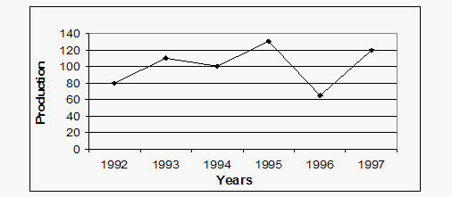

#### Options
- **(A)** A. 87.5%
- **(B)** 37.5%
- **(C)** A. 9.09%
- **(D)** A. None of these

#### Verified Answer
**Option C: A. 9.09%**

#### Step-by-Step Solution & Rationale
1. **Problem Formulation:** Systematic evaluation of given constraints and invariants.
2. **Logical Elimination:** Applying formal rules eliminates all alternative candidates.
3. **Conclusion:** Option **(C)** satisfies 100% of the requirements.

---

### Question 6 (Mock Global Q350)
**ID**: `MOCK_SERIES_Q350` | **Mock Source**: Day 07 — SECTION-II_ ANALYTICAL THINKING

#### Problem Statement
The following pie-chart shows the percentage distribution of the expenditure incurred in publishing a book. Study the pie-chart and the answer the questions based on it. Various Expenditures (in percentage) Incurred in Publishing a Book Question 6: If for a certain quantity of books, the publisher has to pay Rs. 30,600 as printing cost, then what will be amount of royalty to be paid for these books?

#### Options
- **(A)** Rs. 19,450
- **(B)** Rs. 21,200
- **(C)** A Rs. 22,950
- **(D)** Rs. 26,150

#### Verified Answer
**Option C: A Rs. 22,950**

#### Step-by-Step Solution & Rationale
1. **Problem Formulation:** Systematic evaluation of given constraints and invariants.
2. **Logical Elimination:** Applying formal rules eliminates all alternative candidates.
3. **Conclusion:** Option **(C)** satisfies 100% of the requirements.

---

### Question 7 (Mock Global Q351)
**ID**: `MOCK_SERIES_Q351` | **Mock Source**: Day 07 — SECTION-II_ ANALYTICAL THINKING

#### Problem Statement
The following pie-chart shows the percentage distribution of the expenditure incurred in publishing a book. Study the pie-chart and the answer the questions based on it. Various Expenditures (in percentage) Incurred in Publishing a Book Question 7: The price of the book is marked 20% above the C.P. If the marked price of the book is Rs. 180,then what is the cost of the paper used in a single copy of the book?

#### Options
- **(A)** A. Rs. 36
- **(B)** A Rs. 42
- **(C)** A. Rs. 37.50
- **(D)** A Rs. 44.25

#### Verified Answer
**Option C: A. Rs. 37.50**

#### Step-by-Step Solution & Rationale
1. **Problem Formulation:** Systematic evaluation of given constraints and invariants.
2. **Logical Elimination:** Applying formal rules eliminates all alternative candidates.
3. **Conclusion:** Option **(C)** satisfies 100% of the requirements.

---

### Question 8 (Mock Global Q352)
**ID**: `MOCK_SERIES_Q352` | **Mock Source**: Day 07 — SECTION-II_ ANALYTICAL THINKING

#### Problem Statement
Question 8: For which of the following years, the percentage rise/fall in production from the previous year is the maximum for Company Y?

#### Options
- **(A)** 1997
- **(B)** 1998
- **(C)** 1999
- **(D)** 2000

#### Verified Answer
**Option A: 1997**

#### Step-by-Step Solution & Rationale
1. **Problem Formulation:** Systematic evaluation of given constraints and invariants.
2. **Logical Elimination:** Applying formal rules eliminates all alternative candidates.
3. **Conclusion:** Option **(A)** satisfies 100% of the requirements.

---

### Question 9 (Mock Global Q353)
**ID**: `MOCK_SERIES_Q353` | **Mock Source**: Day 07 — SECTION-II_ ANALYTICAL THINKING

#### Problem Statement
Question 9: What is the ratio of the average production of Company X in the period 1998-2000 to the average production of Company Y in the same period?

#### Options
- **(A)** 1:1
- **(B)** 15:17
- **(C)** 23:25
- **(D)** 27:29

#### Verified Answer
**Option C: 23:25**

#### Step-by-Step Solution & Rationale
1. **Problem Formulation:** Systematic evaluation of given constraints and invariants.
2. **Logical Elimination:** Applying formal rules eliminates all alternative candidates.
3. **Conclusion:** Option **(C)** satisfies 100% of the requirements.

---

### Question 10 (Mock Global Q354)
**ID**: `MOCK_SERIES_Q354` | **Mock Source**: Day 07 — SECTION-II_ ANALYTICAL THINKING

#### Problem Statement
The question below consists of a question and two statements numbered I and II given. You have to decide whether the data provided in which of the statements are sufficient to answer the question. Choose your answer from the options based on this. Question10 :Among persons S, I, U, V, W and B who is the tallest? I. U is taller than only two persons. T is taller than S but not the tallest. W is taller than only B. II. S is shorter than only two persons. W is taller than B but shorter than U. U is shorter than S. T is shorter than V.

#### Options
- **(A)** The data in statement II alone are sufficient to answer the question, while the data in statement I alone are not sufficient to answer the question
- **(B)** The data even in both statements I and II together are not sufficient to answer the question
- **(C)** The data either in statement I alone or in statement II alone are sufficient to answer the question
- **(D)** The data in statement I alone are sufficient to answer the question, while the data in statement II alone are not sufficient to answer the question
- **(E)** The data in both statements I and II together are necessary to answer the question

#### Verified Answer
**Option C: The data either in statement I alone or in statement II alone are sufficient to answer the question**

#### Step-by-Step Solution & Rationale
1. **Problem Formulation:** Systematic evaluation of given constraints and invariants.
2. **Logical Elimination:** Applying formal rules eliminates all alternative candidates.
3. **Conclusion:** Option **(C)** satisfies 100% of the requirements.

---

### Question 11 (Mock Global Q355)
**ID**: `MOCK_SERIES_Q355` | **Mock Source**: Day 07 — SECTION-II_ ANALYTICAL THINKING

#### Problem Statement
The question below consists of a question and two statements numbered I and II given. You have to decide whether the data provided in which of the statements are sufficient to answer the question. Choose your answer from the options based on this. Question 11 . Is M the mother of L? I. T is the mother of M. M is married to J. K is the son of J. F is the sister of K. L is the sister of F. II. K is the grandson of T. K is the bother of F. F is the sister of L. L is daughter of J. J is the son-in-law of T.

#### Options
- **(A)** The data in statement II alone are sufficient to answer the question, while the data in statement I alone are not sufficient to answer the question
- **(B)** The data even in both statements I and II together are not sufficient to answer the question
- **(C)** The data either in statement I alone or in statement II alone are sufficient to answer the question
- **(D)** The data in statement I alone are sufficient to answer the question, while the data in statement II alone are not sufficient to answer the question
- **(E)** The data in both statements I and II together are necessary to answer the question

#### Verified Answer
**Option E: The data in both statements I and II together are necessary to answer the question**

#### Step-by-Step Solution & Rationale
1. **Problem Formulation:** Systematic evaluation of given constraints and invariants.
2. **Logical Elimination:** Applying formal rules eliminates all alternative candidates.
3. **Conclusion:** Option **(E)** satisfies 100% of the requirements.

---

### Question 12 (Mock Global Q356)
**ID**: `MOCK_SERIES_Q356` | **Mock Source**: Day 07 — SECTION-II_ ANALYTICAL THINKING

#### Problem Statement
The question below consists of a question and two statements numbered I and II given. You have to decide whether the data provided in which of the statements are sufficient to answer the question. Choose your answer from the options based on this. Question12: By selling a product with 20% profit, how much profit was earned? I. The difference between cost and selling price is Rs. 40. II. The selling price is 120 percent of the cost price.

#### Options
- **(A)** The data in statement II alone are sufficient to answer the question, while the data in statement I alone are not sufficient to answer the question
- **(B)** The data even in both statements I and II together are not sufficient to answer the question
- **(C)** The data either in statement I alone or in statement II alone are sufficient to answer the question
- **(D)** The data in statement I alone are sufficient to answer the question, while the data in statement II alone are not sufficient to answer the question
- **(E)** The data in both statements I and II together are necessary to answer the question

#### Verified Answer
**Option D: The data in statement I alone are sufficient to answer the question, while the data in statement II alone are not sufficient to answer the question**

#### Step-by-Step Solution & Rationale
1. **Problem Formulation:** Systematic evaluation of given constraints and invariants.
2. **Logical Elimination:** Applying formal rules eliminates all alternative candidates.
3. **Conclusion:** Option **(D)** satisfies 100% of the requirements.

---

### Question 13 (Mock Global Q357)
**ID**: `MOCK_SERIES_Q357` | **Mock Source**: Day 07 — SECTION-II_ ANALYTICAL THINKING

#### Problem Statement
The question below consists of a question and two statements numbered I and II given. You have to decide whether the data provided in which of the statements are sufficient to answer the question. Choose your answer from the options based on this. I . If b is even II. If a is even

#### Options
- **(A)** The data in statement II alone are sufficient to answer the question, while the data in statement I alone are not sufficient to answer the question
- **(B)** The data even in both statements I and II together are not sufficient to answer the question
- **(C)** The data either in statement I alone or in statement II alone are sufficient to answer the question
- **(D)** The data in statement I alone are sufficient to answer the question, while the data in statement II alone are not sufficient to answer the question
- **(E)** The data in both statements I and II together are necessary to answer the question

#### Verified Answer
**Option D: The data in statement I alone are sufficient to answer the question, while the data in statement II alone are not sufficient to answer the question**

#### Step-by-Step Solution & Rationale
1. **Problem Formulation:** Systematic evaluation of given constraints and invariants.
2. **Logical Elimination:** Applying formal rules eliminates all alternative candidates.
3. **Conclusion:** Option **(D)** satisfies 100% of the requirements.

---

### Question 14 (Mock Global Q358)
**ID**: `MOCK_SERIES_Q358` | **Mock Source**: Day 07 — SECTION-II_ ANALYTICAL THINKING

#### Problem Statement
A set of football matches is to be organized in a "round-robin" fashion, i.e., every participating team plays a match against every other team once and only once. If 21 matches are totally played, how many teams participated?

#### Options
- **(A)** 8
- **(B)** 7
- **(C)** 9
- **(D)** None of these

#### Verified Answer
**Option B: 7**

#### Step-by-Step Solution & Rationale
1. **Problem Formulation:** Systematic evaluation of given constraints and invariants.
2. **Logical Elimination:** Applying formal rules eliminates all alternative candidates.
3. **Conclusion:** Option **(B)** satisfies 100% of the requirements.

---

### Question 15 (Mock Global Q359)
**ID**: `MOCK_SERIES_Q359` | **Mock Source**: Day 07 — SECTION-II_ ANALYTICAL THINKING

#### Problem Statement
Find the wrong term in the following number series : 15972 , 15629 , 15840 , 15720 , 15784 , 15757

#### Options
- **(A)** 15840
- **(B)** 15757
- **(C)** 15720
- **(D)** 15972

#### Verified Answer
**Option A: 15840**

#### Step-by-Step Solution & Rationale
1. **Problem Formulation:** Systematic evaluation of given constraints and invariants.
2. **Logical Elimination:** Applying formal rules eliminates all alternative candidates.
3. **Conclusion:** Option **(A)** satisfies 100% of the requirements.

---

## Day 08 — Aptitude 01 - All India Mock 01

### Question 1 (Mock Global Q360)
**ID**: `MOCK_SERIES_Q360` | **Mock Source**: Day 08 — Aptitude 01 - All India Mock 01

#### Problem Statement
Question : If the surface areas of two spheres are in the ratio of 49:81 , then find the ratio of their volumes.

#### Options
- **(A)** 27:64
- **(B)** 125:512
- **(C)** 343:729
- **(D)** 216:512

#### Verified Answer
**Option C: 343:729**

#### Step-by-Step Solution & Rationale
1. **Problem Formulation:** Systematic evaluation of given constraints and invariants.
2. **Logical Elimination:** Applying formal rules eliminates all alternative candidates.
3. **Conclusion:** Option **(C)** satisfies 100% of the requirements.

---

### Question 2 (Mock Global Q361)
**ID**: `MOCK_SERIES_Q361` | **Mock Source**: Day 08 — Aptitude 01 - All India Mock 01

#### Problem Statement
Question : If Raman drives his bike at a speed of 24 km/h, he reaches his office 5 minutes late. If he drives the bike at a speed of 30 km/h, he reaches his office 4 minutes early. How much time (in minutes) will he take to reach his office at a speed of 27 km/h?

#### Options
- **(A)** 40
- **(B)** 55
- **(C)** 50
- **(D)** 45

#### Verified Answer
**Option A: 40**

#### Step-by-Step Solution & Rationale
1. **Problem Formulation:** Systematic evaluation of given constraints and invariants.
2. **Logical Elimination:** Applying formal rules eliminates all alternative candidates.
3. **Conclusion:** Option **(A)** satisfies 100% of the requirements.

---

### Question 3 (Mock Global Q362)
**ID**: `MOCK_SERIES_Q362` | **Mock Source**: Day 08 — Aptitude 01 - All India Mock 01

#### Problem Statement
Question : If the height of a solid right circular cylinder is 27 cm and diameter of its base is 30 cm, the total surface area (in sq cm) of the right circular cylinder is?

#### Options
- **(A)** 3976
- **(B)** 3964
- **(C)** 3960
- **(D)** 3978

#### Verified Answer
**Option C: 3960**

#### Step-by-Step Solution & Rationale
1. **Problem Formulation:** Systematic evaluation of given constraints and invariants.
2. **Logical Elimination:** Applying formal rules eliminates all alternative candidates.
3. **Conclusion:** Option **(C)** satisfies 100% of the requirements.

---

### Question 4 (Mock Global Q363)
**ID**: `MOCK_SERIES_Q363` | **Mock Source**: Day 08 — Aptitude 01 - All India Mock 01

#### Problem Statement
Question : Avra travels from A to B at 74 km/h and returns from B to A through the same route at 111 km/h. What was his average speed during the two-way journey?

#### Options
- **(A)** 78.88 km/hr
- **(B)** 88.88 km/hr
- **(C)** 98.88 km/hr
- **(D)** 108.88 km/hr

#### Verified Answer
**Option B: 88.88 km/hr**

#### Step-by-Step Solution & Rationale
1. **Problem Formulation:** Systematic evaluation of given constraints and invariants.
2. **Logical Elimination:** Applying formal rules eliminates all alternative candidates.
3. **Conclusion:** Option **(B)** satisfies 100% of the requirements.

---

### Question 5 (Mock Global Q364)
**ID**: `MOCK_SERIES_Q364` | **Mock Source**: Day 08 — Aptitude 01 - All India Mock 01

#### Problem Statement
Question : A can do 1/4 of a work in 3 days and B can do 1/6 of the same work in 4 days, how much will A get if both work together and are paid Rs. 180 in all?

#### Options
- **(A)** 150 Rs
- **(B)** 100
- **(C)** 120
- **(D)** 160

#### Verified Answer
**Option C: 120**

#### Step-by-Step Solution & Rationale
1. **Problem Formulation:** Systematic evaluation of given constraints and invariants.
2. **Logical Elimination:** Applying formal rules eliminates all alternative candidates.
3. **Conclusion:** Option **(C)** satisfies 100% of the requirements.

---

### Question 6 (Mock Global Q365)
**ID**: `MOCK_SERIES_Q365` | **Mock Source**: Day 08 — Aptitude 01 - All India Mock 01

#### Problem Statement
Question : At 20% discount the selling price of a refrigerator is Rs 2400. What is the selling price if the discount is 32.5%?

#### Options
- **(A)** undefined

#### Verified Answer
**Numerical Value: 2025**

#### Step-by-Step Solution & Rationale
1. **Problem Formulation:** Systematic evaluation of given constraints and invariants.
2. **Logical Elimination:** Applying formal rules eliminates all alternative candidates.
3. **Conclusion:** Option **(A)** satisfies 100% of the requirements.

---

### Question 7 (Mock Global Q366)
**ID**: `MOCK_SERIES_Q366` | **Mock Source**: Day 08 — Aptitude 01 - All India Mock 01

#### Problem Statement
Question : A mixture contains milk and water in ratio 5 : 7, when 8 liters milk of and 8 liters of water is added in mixture then ratio becomes 9 : 11. Find initial quantity of milk.

#### Options
- **(A)** 24 liters
- **(B)** 10 liters
- **(C)** 16liters
- **(D)** 18 liters

#### Verified Answer
**Option B: 10 liters**

#### Step-by-Step Solution & Rationale
1. **Problem Formulation:** Systematic evaluation of given constraints and invariants.
2. **Logical Elimination:** Applying formal rules eliminates all alternative candidates.
3. **Conclusion:** Option **(B)** satisfies 100% of the requirements.

---

### Question 8 (Mock Global Q367)
**ID**: `MOCK_SERIES_Q367` | **Mock Source**: Day 08 — Aptitude 01 - All India Mock 01

#### Problem Statement
Question : The mean weight of 34 students of a school is 42 kg. If the weight of the teacher is also included, the mean rises by 400 grams. Find the weight of the teacher (in kg.)

#### Options
- **(A)** undefined

#### Verified Answer
**Numerical Value: 56**

#### Step-by-Step Solution & Rationale
1. **Problem Formulation:** Systematic evaluation of given constraints and invariants.
2. **Logical Elimination:** Applying formal rules eliminates all alternative candidates.
3. **Conclusion:** Option **(A)** satisfies 100% of the requirements.

---

### Question 9 (Mock Global Q368)
**ID**: `MOCK_SERIES_Q368` | **Mock Source**: Day 08 — Aptitude 01 - All India Mock 01

#### Problem Statement
Question : A basket contains 6 White 4 Black 2 Pink and 3 Green balls. If four balls are picked at random, what is the probability that at least one is Black?

#### Options
- **(A)** 69/91
- **(B)** 80/91
- **(C)** 21/91
- **(D)** 55/91

#### Verified Answer
**Option A: 69/91**

#### Step-by-Step Solution & Rationale
1. **Problem Formulation:** Systematic evaluation of given constraints and invariants.
2. **Logical Elimination:** Applying formal rules eliminates all alternative candidates.
3. **Conclusion:** Option **(A)** satisfies 100% of the requirements.

---

### Question 10 (Mock Global Q369)
**ID**: `MOCK_SERIES_Q369` | **Mock Source**: Day 08 — Aptitude 01 - All India Mock 01

#### Problem Statement
Question : Two boys Rishi and Vamsi start at the same time to ride from Lucknow to Kanpur that is 95 km away. Rishi travels 5 km/h slower than Vamsi. Vamsi reaches Kanpur and immediately start to travel back. On his return journey he meets Rishi who is 25 km away from Kanpur. Find Rishi's speed(Km/hr)

#### Options
- **(A)** undefined

#### Verified Answer
**Numerical Value: 21**

#### Step-by-Step Solution & Rationale
1. **Problem Formulation:** Systematic evaluation of given constraints and invariants.
2. **Logical Elimination:** Applying formal rules eliminates all alternative candidates.
3. **Conclusion:** Option **(A)** satisfies 100% of the requirements.

---

### Question 11 (Mock Global Q370)
**ID**: `MOCK_SERIES_Q370` | **Mock Source**: Day 08 — Aptitude 01 - All India Mock 01

#### Problem Statement
Question : The length, Breadth and height of a cuboid increases by 20%, 10% and 30% Respectively. What is the percentage increases in the volume of that cuboid?

#### Options
- **(A)** 30%
- **(B)** 20%
- **(C)** 71.6%
- **(D)** 43%

#### Verified Answer
**Option C: 71.6%**

#### Step-by-Step Solution & Rationale
1. **Problem Formulation:** Systematic evaluation of given constraints and invariants.
2. **Logical Elimination:** Applying formal rules eliminates all alternative candidates.
3. **Conclusion:** Option **(C)** satisfies 100% of the requirements.

---

### Question 12 (Mock Global Q371)
**ID**: `MOCK_SERIES_Q371` | **Mock Source**: Day 08 — Aptitude 01 - All India Mock 01

#### Problem Statement
Question : A bag contains Rs. 4100 in the form of Rs. 5, Rs. 2 and Rs. 1 coin. The number of coins is in ratio 4: 6: 9. So, find the number of 1 Rs. coins.

#### Options
- **(A)** 40
- **(B)** 500
- **(C)** 900
- **(D)** None of these

#### Verified Answer
**Option C: 900**

#### Step-by-Step Solution & Rationale
1. **Problem Formulation:** Systematic evaluation of given constraints and invariants.
2. **Logical Elimination:** Applying formal rules eliminates all alternative candidates.
3. **Conclusion:** Option **(C)** satisfies 100% of the requirements.

---

### Question 13 (Mock Global Q372)
**ID**: `MOCK_SERIES_Q372` | **Mock Source**: Day 08 — Aptitude 01 - All India Mock 01

#### Problem Statement
Question : The two trains are coming towards each other and cross a signal pole in 30 seconds and 20 seconds respectively and they cross each other in 24seconds. Find the ratio of the speed of these two trains?

#### Options
- **(A)** 2:3
- **(B)** 3:5
- **(C)** 4:5
- **(D)** 3:4

#### Verified Answer
**Option A: 2:3**

#### Step-by-Step Solution & Rationale
1. **Problem Formulation:** Systematic evaluation of given constraints and invariants.
2. **Logical Elimination:** Applying formal rules eliminates all alternative candidates.
3. **Conclusion:** Option **(A)** satisfies 100% of the requirements.

---

### Question 14 (Mock Global Q373)
**ID**: `MOCK_SERIES_Q373` | **Mock Source**: Day 08 — Aptitude 01 - All India Mock 01

#### Problem Statement
[Data Interpretation / Graphical Aptitude Problem — Refer to Chart Below] Analyze the data chart, graph, or equation presented in the figure and compute the required value.

#### Options
- **(A)** A
- **(B)** C
- **(C)** Z
- **(D)** B

#### Verified Answer
**Option D: B**

#### Step-by-Step Solution & Rationale
1. **Problem Formulation:** Systematic evaluation of given constraints and invariants.
2. **Logical Elimination:** Applying formal rules eliminates all alternative candidates.
3. **Conclusion:** Option **(D)** satisfies 100% of the requirements.

---

### Question 15 (Mock Global Q374)
**ID**: `MOCK_SERIES_Q374` | **Mock Source**: Day 08 — Aptitude 01 - All India Mock 01

#### Problem Statement
Directions : Study the following information carefully to answer these questions. A, B, C, D, E, F, G and H are sitting around a circle, facing the centre. F sits to the immediate right of D and third to the left of A. G sits third to the left of D who does not sit next to E. B sits next to G but not next to D. C does not sit next to either D or A. Question : What is the position of H with respect to C?

#### Options
- **(A)** Second to the left
- **(B)** First to the right
- **(C)** Third to the right
- **(D)** Second to the right
- **(E)** None of these

#### Verified Answer
**Option E: None of these**

#### Step-by-Step Solution & Rationale
1. **Problem Formulation:** Systematic evaluation of given constraints and invariants.
2. **Logical Elimination:** Applying formal rules eliminates all alternative candidates.
3. **Conclusion:** Option **(E)** satisfies 100% of the requirements.

---

### Question 16 (Mock Global Q375)
**ID**: `MOCK_SERIES_Q375` | **Mock Source**: Day 08 — Aptitude 01 - All India Mock 01

#### Problem Statement
Directions : Study the following information carefully to answer these questions. A, B, C, D, E, F, G and H are sitting around a circle, facing the centre. F sits to the immediate right of D and third to the left of A. G sits third to the left of D who does not sit next to E. B sits next to G but not next to D. C does not sit next to either D or A. Question : Starting from A&rsquo;s position, if all the eight are arranged in alphabetical order in clockwise direction, the seating position of which of the following (excluding A) would not change?

#### Options
- **(A)** B
- **(B)** C
- **(C)** D
- **(D)** H
- **(E)** None of these

#### Verified Answer
**Option B: C**

#### Step-by-Step Solution & Rationale
1. **Problem Formulation:** Systematic evaluation of given constraints and invariants.
2. **Logical Elimination:** Applying formal rules eliminates all alternative candidates.
3. **Conclusion:** Option **(B)** satisfies 100% of the requirements.

---

### Question 17 (Mock Global Q376)
**ID**: `MOCK_SERIES_Q376` | **Mock Source**: Day 08 — Aptitude 01 - All India Mock 01

#### Problem Statement
P started from his house towards west. After walking a distance of 25 m. He turned to the right and walked 10 m. He then again turned to the right and walked 15 m. After this he is to turn right at 135 degree and to cover 30 m. In which direction P is going?

#### Options
- **(A)** West
- **(B)** South
- **(C)** South-East
- **(D)** South-West

#### Verified Answer
**Option D: South-West**

#### Step-by-Step Solution & Rationale
1. **Problem Formulation:** Systematic evaluation of given constraints and invariants.
2. **Logical Elimination:** Applying formal rules eliminates all alternative candidates.
3. **Conclusion:** Option **(D)** satisfies 100% of the requirements.

---

### Question 18 (Mock Global Q377)
**ID**: `MOCK_SERIES_Q377` | **Mock Source**: Day 08 — Aptitude 01 - All India Mock 01

#### Problem Statement
If GOOD is coded as 164 , BAD is coded as 21 & UGLY is coded as 260 then JUMP will be coded as ?

#### Options
- **(A)** undefined

#### Verified Answer
**Numerical Value: 240**

#### Step-by-Step Solution & Rationale
1. **Problem Formulation:** Systematic evaluation of given constraints and invariants.
2. **Logical Elimination:** Applying formal rules eliminates all alternative candidates.
3. **Conclusion:** Option **(A)** satisfies 100% of the requirements.

---

### Question 19 (Mock Global Q378)
**ID**: `MOCK_SERIES_Q378` | **Mock Source**: Day 08 — Aptitude 01 - All India Mock 01

#### Problem Statement
The Line graph shows the data of 3 different types of cars sold in 5 different cities : Questio : Number of Honda car sold in Ahmedabad is what percent of the total Innova car sold in surat ?

#### Options
- **(A)** 50 %
- **(B)** 66(2/3)%
- **(C)** 70%
- **(D)** None of these

#### Verified Answer
**Option B: 66(2/3)%**

#### Step-by-Step Solution & Rationale
1. **Problem Formulation:** Systematic evaluation of given constraints and invariants.
2. **Logical Elimination:** Applying formal rules eliminates all alternative candidates.
3. **Conclusion:** Option **(B)** satisfies 100% of the requirements.

---

### Question 20 (Mock Global Q379)
**ID**: `MOCK_SERIES_Q379` | **Mock Source**: Day 08 — Aptitude 01 - All India Mock 01

#### Problem Statement
Statements: Some towns are villages. Some villages are lanes. Some lanes are hamlets. Conclusions: I. Some hamlets are villages. II. Some lanes are towns. III. Some hamlets are towns.

#### Options
- **(A)** Only I follows
- **(B)** Only II follows
- **(C)** Only III follows
- **(D)** Only II and III follows
- **(E)** None follows

#### Verified Answer
**Option E: None follows**

#### Step-by-Step Solution & Rationale
1. **Problem Formulation:** Systematic evaluation of given constraints and invariants.
2. **Logical Elimination:** Applying formal rules eliminates all alternative candidates.
3. **Conclusion:** Option **(E)** satisfies 100% of the requirements.

---

### Question 21 (Mock Global Q380)
**ID**: `MOCK_SERIES_Q380` | **Mock Source**: Day 08 — Aptitude 01 - All India Mock 01

#### Problem Statement
Question : In a certain code, MONKEY is written as XDJMNL . How is TIGER written in that code ?

#### Options
- **(A)** SDFHS
- **(B)** SHFDQ
- **(C)** UJHFS
- **(D)** QDFHS

#### Verified Answer
**Option D: QDFHS**

#### Step-by-Step Solution & Rationale
1. **Problem Formulation:** Systematic evaluation of given constraints and invariants.
2. **Logical Elimination:** Applying formal rules eliminates all alternative candidates.
3. **Conclusion:** Option **(D)** satisfies 100% of the requirements.

---

### Question 22 (Mock Global Q381)
**ID**: `MOCK_SERIES_Q381` | **Mock Source**: Day 08 — Aptitude 01 - All India Mock 01

#### Problem Statement
Find the Missing Term: 256 , 64 , ? , 24 , 24 , 30

#### Options
- **(A)** undefined

#### Verified Answer
**Numerical Value: 32**

#### Step-by-Step Solution & Rationale
1. **Problem Formulation:** Systematic evaluation of given constraints and invariants.
2. **Logical Elimination:** Applying formal rules eliminates all alternative candidates.
3. **Conclusion:** Option **(A)** satisfies 100% of the requirements.

---

### Question 23 (Mock Global Q382)
**ID**: `MOCK_SERIES_Q382` | **Mock Source**: Day 08 — Aptitude 01 - All India Mock 01

#### Problem Statement
Seven girls P, Q, R, S, T, W and X are sitting in a row facing towards the north (not necessarily in the same order). R is at one of the ends of the row. T sits exactly in the middle of row. S is third to the left of X. Q is to the immediate left of W. Q is not at any end of the row. Which of the following statements) is/are correct? I. S is to the immediate right of R. Il. T is to the immediate right of X.

#### Options
- **(A)** Only I
- **(B)** Only II
- **(C)** Both I & II
- **(D)** Neither I nor II

#### Verified Answer
**Option A: Only I**

#### Step-by-Step Solution & Rationale
1. **Problem Formulation:** Systematic evaluation of given constraints and invariants.
2. **Logical Elimination:** Applying formal rules eliminates all alternative candidates.
3. **Conclusion:** Option **(A)** satisfies 100% of the requirements.

---

### Question 24 (Mock Global Q383)
**ID**: `MOCK_SERIES_Q383` | **Mock Source**: Day 08 — Aptitude 01 - All India Mock 01

#### Problem Statement
Read the passage and answer the questions that follow : Once upon a time, in a quaint little village nestled in a picturesque valley, there lived a young girl named Lily. She was known for her adventurous spirit and her deep curiosity. One sunny afternoon, while exploring the woods that bordered the village, Lily stumbled upon a hidden clearing. In the center of this secret meadow, she found an old oak tree with a peculiar nook. In that nook, half-buried in the earth, was a mysterious locket, ornate and gleaming with intricate designs. Lily carefully unearthed it, and as she held it in her hand, she felt a strange connection to this forgotten piece of jewelry. Back in her cottage, Lily examined the locket more closely. It was made of silver with a hint of gold, and its surface was adorned with delicate engravings of leaves and flowers. On the front, there was an image of a crescent moon, and on the back, an engraving read, &ldquo;To the one who seeks the truth.&rdquo; The locket was sealed tightly, and Lily couldn&rsquo;t open it no matter how hard she tried. Determined to solve the mystery, Lily embarked on a quest to find someone who could open the locket. She asked the village blacksmith, the wise old woman who lived on the hill, and even the town&rsquo;s mayor, but none of them could unlock its secrets. Feeling a bit discouraged, Lily spent her days reading about ancient relics and searching for clues in the library. One day, while immersed in an old book about mystical lockets, Lily came across a passage that mentioned the existence of a &ldquo;key of the heart.&rdquo; It said that this key could open the most stubborn of locks, but it was hidden within each person, waiting to be discovered. This newfound knowledge gave Lily a renewed sense of hope and determination. The next morning, Lily decided to visit the village&rsquo;s recluse, an elderly woman rumored to have deep knowledge of the heart. The recluse lived in a remote cottage surrounded by a lush garden. Lily knocked on the door and explained her quest. The old woman listened attentively and finally agreed to help. She told Lily that the key to opening the locket was hidden within her heart and that she needed to meditate on her truest desires and intentions. Lily followed the recluse&rsquo;s advice, sitting beneath the ancient oak tree where she had found the locket. She closed her eyes, focused on her heart&rsquo;s deepest desires, and as she did, she felt the locket warming in her hand. When she opened her eyes, she found the locket had sprung open, revealing a tiny, folded parchment inside. With trembling hands, she carefully unfolded it and read the message: &ldquo;The truth lies in the journey, not the destination.&rdquo; The mystery of the locket was solved, but Lily realized that the real treasure was the journey of self-discovery she had undertaken. She understood that her quest had led her to understand her heart&rsquo;s desires and the power of her own determination. Question 1- What did Lily discover in the hidden clearing in the woods?

#### Options
- **(A)** A hidden garden
- **(B)** An old oak tree
- **(C)** A mysterious book
- **(D)** A magic wand

#### Verified Answer
**Option B: An old oak tree**

#### Step-by-Step Solution & Rationale
> Solution: B) An old oak tree. The passage mentions that Lily discovered an old oak tree in the hidden clearing.

---

### Question 25 (Mock Global Q384)
**ID**: `MOCK_SERIES_Q384` | **Mock Source**: Day 08 — Aptitude 01 - All India Mock 01

#### Problem Statement
Read the passage and answer the questions that follow : Once upon a time, in a quaint little village nestled in a picturesque valley, there lived a young girl named Lily. She was known for her adventurous spirit and her deep curiosity. One sunny afternoon, while exploring the woods that bordered the village, Lily stumbled upon a hidden clearing. In the center of this secret meadow, she found an old oak tree with a peculiar nook. In that nook, half-buried in the earth, was a mysterious locket, ornate and gleaming with intricate designs. Lily carefully unearthed it, and as she held it in her hand, she felt a strange connection to this forgotten piece of jewelry. Back in her cottage, Lily examined the locket more closely. It was made of silver with a hint of gold, and its surface was adorned with delicate engravings of leaves and flowers. On the front, there was an image of a crescent moon, and on the back, an engraving read, &ldquo;To the one who seeks the truth.&rdquo; The locket was sealed tightly, and Lily couldn&rsquo;t open it no matter how hard she tried. Determined to solve the mystery, Lily embarked on a quest to find someone who could open the locket. She asked the village blacksmith, the wise old woman who lived on the hill, and even the town&rsquo;s mayor, but none of them could unlock its secrets. Feeling a bit discouraged, Lily spent her days reading about ancient relics and searching for clues in the library. One day, while immersed in an old book about mystical lockets, Lily came across a passage that mentioned the existence of a &ldquo;key of the heart.&rdquo; It said that this key could open the most stubborn of locks, but it was hidden within each person, waiting to be discovered. This newfound knowledge gave Lily a renewed sense of hope and determination. The next morning, Lily decided to visit the village&rsquo;s recluse, an elderly woman rumored to have deep knowledge of the heart. The recluse lived in a remote cottage surrounded by a lush garden. Lily knocked on the door and explained her quest. The old woman listened attentively and finally agreed to help. She told Lily that the key to opening the locket was hidden within her heart and that she needed to meditate on her truest desires and intentions. Lily followed the recluse&rsquo;s advice, sitting beneath the ancient oak tree where she had found the locket. She closed her eyes, focused on her heart&rsquo;s deepest desires, and as she did, she felt the locket warming in her hand. When she opened her eyes, she found the locket had sprung open, revealing a tiny, folded parchment inside. With trembling hands, she carefully unfolded it and read the message: &ldquo;The truth lies in the journey, not the destination.&rdquo; The mystery of the locket was solved, but Lily realized that the real treasure was the journey of self-discovery she had undertaken. She understood that her quest had led her to understand her heart&rsquo;s desires and the power of her own determination. Question 2- What was inscribed on the back of the mysterious locket?

#### Options
- **(A)** &ldquo;To the one who seeks adventure&rdquo;
- **(B)** &ldquo;To the one who seeks answers&rdquo;
- **(C)** &ldquo;To the one who seeks the truth&rdquo;
- **(D)** &ldquo;To the one who seeks gold&rdquo;

#### Verified Answer
**Option C: &ldquo;To the one who seeks the truth&rdquo;**

#### Step-by-Step Solution & Rationale
> Solution: C) “To the one who seeks the truth”. The passage explicitly states that the locket had the inscription, “To the one who seeks the truth.”

---

### Question 26 (Mock Global Q385)
**ID**: `MOCK_SERIES_Q385` | **Mock Source**: Day 08 — Aptitude 01 - All India Mock 01

#### Problem Statement
Read the passage and answer the questions that follow : Once upon a time, in a quaint little village nestled in a picturesque valley, there lived a young girl named Lily. She was known for her adventurous spirit and her deep curiosity. One sunny afternoon, while exploring the woods that bordered the village, Lily stumbled upon a hidden clearing. In the center of this secret meadow, she found an old oak tree with a peculiar nook. In that nook, half-buried in the earth, was a mysterious locket, ornate and gleaming with intricate designs. Lily carefully unearthed it, and as she held it in her hand, she felt a strange connection to this forgotten piece of jewelry. Back in her cottage, Lily examined the locket more closely. It was made of silver with a hint of gold, and its surface was adorned with delicate engravings of leaves and flowers. On the front, there was an image of a crescent moon, and on the back, an engraving read, &ldquo;To the one who seeks the truth.&rdquo; The locket was sealed tightly, and Lily couldn&rsquo;t open it no matter how hard she tried. Determined to solve the mystery, Lily embarked on a quest to find someone who could open the locket. She asked the village blacksmith, the wise old woman who lived on the hill, and even the town&rsquo;s mayor, but none of them could unlock its secrets. Feeling a bit discouraged, Lily spent her days reading about ancient relics and searching for clues in the library. One day, while immersed in an old book about mystical lockets, Lily came across a passage that mentioned the existence of a &ldquo;key of the heart.&rdquo; It said that this key could open the most stubborn of locks, but it was hidden within each person, waiting to be discovered. This newfound knowledge gave Lily a renewed sense of hope and determination. The next morning, Lily decided to visit the village&rsquo;s recluse, an elderly woman rumored to have deep knowledge of the heart. The recluse lived in a remote cottage surrounded by a lush garden. Lily knocked on the door and explained her quest. The old woman listened attentively and finally agreed to help. She told Lily that the key to opening the locket was hidden within her heart and that she needed to meditate on her truest desires and intentions. Lily followed the recluse&rsquo;s advice, sitting beneath the ancient oak tree where she had found the locket. She closed her eyes, focused on her heart&rsquo;s deepest desires, and as she did, she felt the locket warming in her hand. When she opened her eyes, she found the locket had sprung open, revealing a tiny, folded parchment inside. With trembling hands, she carefully unfolded it and read the message: &ldquo;The truth lies in the journey, not the destination.&rdquo; The mystery of the locket was solved, but Lily realized that the real treasure was the journey of self-discovery she had undertaken. She understood that her quest had led her to understand her heart&rsquo;s desires and the power of her own determination. Question 3- Who did Lily seek help from in opening the locket?

#### Options
- **(A)** The village blacksmith
- **(B)** The wise old woman on the hill
- **(C)** The town&rsquo;s mayor
- **(D)** All of the above

#### Verified Answer
**Option D: All of the above**

#### Step-by-Step Solution & Rationale
> Solution: D) All of the above. Lily sought help from the village blacksmith, the wise old woman on the hill, and the town’s mayor, as mentioned in the passage.

---

### Question 27 (Mock Global Q386)
**ID**: `MOCK_SERIES_Q386` | **Mock Source**: Day 08 — Aptitude 01 - All India Mock 01

#### Problem Statement
Rearrange them to form a logically coherent paragraph 1️⃣ Start-ups are increasingly adopting artificial intelligence to automate routine operations and reduce human error. 2️⃣ Investors are keen to fund ventures that can demonstrate scalable AI-driven business models. 3️⃣ As competition intensifies, companies seek innovative tools to gain a market edge. 4️⃣ However, reliance on AI also raises ethical concerns about transparency and job displacement. Q1. After rearranging into a coherent paragraph, which sentence will come second? (Enter the integer only)

#### Options
- **(A)** undefined

#### Verified Answer
**Numerical Value: 1**

#### Step-by-Step Solution & Rationale
> Q1: The paragraph logically opens with the competitive landscape (3) → AI adoption (1) → funding interest (2) → concerns (4). Why the correct order is 3 → 1 → 2 → 4 1) Opener = 3 Role: Sets the context/problem : rising competition. Logic: A good first sentence frames why the topic matters. “As competition intensifies…” naturally introduces the need for solutions. 2) Next = 1 Link to 3: Cause → Response From “competition intensifies” ( 3 ) to “adopting AI” ( 1 ) as the solution firms choose to gain an edge. Flow device: “seek innovative tools” (3) → “adopting AI to automate & reduce error” (1) is a direct, specific instantiation of that search. 3) Then = 2 Narrative progression: After establishing adoption, we move to market consequences —specifically, investor behavior . Coherence: It’s natural to go from firms adopting AI (1) to investors supporting scalable AI models (2). 4) Conclusion = 4 Why last: Starts with “However,” a contrastive connector that signals a caveat/closure point. “Also” presupposes prior mention of AI use; it works best after we’ve discussed adoption and investment, not before. Function: Provides a balanced concluding perspective by highlighting ethical risks.

---

### Question 28 (Mock Global Q387)
**ID**: `MOCK_SERIES_Q387` | **Mock Source**: Day 08 — Aptitude 01 - All India Mock 01

#### Problem Statement
Rearrange them to form a logically coherent paragraph 1️⃣ Start-ups are increasingly adopting artificial intelligence to automate routine operations and reduce human error. 2️⃣ Investors are keen to fund ventures that can demonstrate scalable AI-driven business models. 3️⃣ As competition intensifies, companies seek innovative tools to gain a market edge. 4️⃣ However, reliance on AI also raises ethical concerns about transparency and job displacement. Q2. Which sentence best serves as the concluding idea for the paragraph? (Enter the integer only)

#### Options
- **(A)** undefined

#### Verified Answer
**Numerical Value: 4**

#### Step-by-Step Solution & Rationale
> Q2: 4 Sentence 4 closes by presenting the caution/ethical perspective, rounding off the discussion. Why the correct order is 3 → 1 → 2 → 4 1) Opener = 3 Role: Sets the context/problem : rising competition. Logic: A good first sentence frames why the topic matters. “As competition intensifies…” naturally introduces the need for solutions. 2) Next = 1 Link to 3: Cause → Response From “competition intensifies” ( 3 ) to “adopting AI” ( 1 ) as the solution firms choose to gain an edge. Flow device: “seek innovative tools” (3) → “adopting AI to automate & reduce error” (1) is a direct, specific instantiation of that search. 3) Then = 2 Narrative progression: After establishing adoption, we move to market consequences —specifically, investor behavior . Coherence: It’s natural to go from firms adopting AI (1) to investors supporting scalable AI models (2). 4) Conclusion = 4 Why last: Starts with “However,” a contrastive connector that signals a caveat/closure point. “Also” presupposes prior mention of AI use; it works best after we’ve discussed adoption and investment, not before. Function: Provides a balanced concluding perspective by highlighting ethical risks.

---

### Question 29 (Mock Global Q388)
**ID**: `MOCK_SERIES_Q388` | **Mock Source**: Day 08 — Aptitude 01 - All India Mock 01

#### Problem Statement
Each sentence below has a blank space. Four options are suggested. Select the most appropriate word/phrase to complete the sentence meaningfully. Mark the correct option. Despite several challenges, the new metro project has made remarkable progress and is now expected to be completed ______ schedule.

#### Options
- **(A)** beneath
- **(B)** ahead of
- **(C)** on
- **(D)** over

#### Verified Answer
**Option B: ahead of**

#### Step-by-Step Solution & Rationale
1. **Problem Formulation:** Systematic evaluation of given constraints and invariants.
2. **Logical Elimination:** Applying formal rules eliminates all alternative candidates.
3. **Conclusion:** Option **(B)** satisfies 100% of the requirements.

---

### Question 30 (Mock Global Q389)
**ID**: `MOCK_SERIES_Q389` | **Mock Source**: Day 08 — Aptitude 01 - All India Mock 01

#### Problem Statement
Question : The committee urged all departments to work in a ______ manner to achieve the organization&rsquo;s long-term goals.

#### Options
- **(A)** coordinated
- **(B)** casual
- **(C)** negligent
- **(D)** contradictory

#### Verified Answer
**Option A: coordinated**

#### Step-by-Step Solution & Rationale
1. **Problem Formulation:** Systematic evaluation of given constraints and invariants.
2. **Logical Elimination:** Applying formal rules eliminates all alternative candidates.
3. **Conclusion:** Option **(A)** satisfies 100% of the requirements.

---

### Question 31 (Mock Global Q390)
**ID**: `MOCK_SERIES_Q390` | **Mock Source**: Day 08 — Aptitude 01 - All India Mock 01

#### Problem Statement
Each sentence is split into four numbered parts (1&ndash;4). Identify the part that contains the grammatical error. If there is no error , choose option 5 . Type only the integer (1/2/3/4/5) as your answer. Question Neither the manager nor his assistants was willing to accept the responsibility. No error

#### Options
- **(A)** undefined

#### Verified Answer
**Numerical Value: 3**

#### Step-by-Step Solution & Rationale
> When two subjects are joined by neither … nor … , the verb agrees with the nearest subject (the one immediately before the verb). If the nearest subject is singular , use singular verb. If the nearest subject is plural , use plural verb. Why part 3 is wrong Here the two joined subjects are: “the manager” (singular) and “his assistants” (plural). The verb must therefore agree with the nearest subject to the verb — i.e., “assistants” (plural). So the correct verb is were , not was . Thus part 3 (“was willing to accept”) contains the error. Correct sentence: Neither the manager nor his assistants were willing to accept the responsibility. Short examples to remember Neither the coach nor the players were ready. (players = nearest → plural) Neither the players nor the coach was ready. (coach = nearest → singular) Neither the cat nor the dogs are outside. (dogs nearest → plural)

---

### Question 32 (Mock Global Q391)
**ID**: `MOCK_SERIES_Q391` | **Mock Source**: Day 08 — Aptitude 01 - All India Mock 01

#### Problem Statement
Each sentence is split into four numbered parts (1&ndash;4). Identify the part containing the grammatical error. If there is no error , choose option 5 . Answer by typing the integer (1/2/3/4/5) only. Question : The teacher along with her students were preparing for the annual function. No error

#### Options
- **(A)** undefined

#### Verified Answer
**Numerical Value: 3**

#### Step-by-Step Solution & Rationale
> Detailed Reasoning: The subject is “The teacher” (singular). The phrase “along with her students” is a parenthetical addition; it does not change the number of the subject. Therefore, the verb must be was preparing , not were preparing . ✅ Correct sentence: The teacher along with her students was preparing for the annual function.

---

### Question 33 (Mock Global Q392)
**ID**: `MOCK_SERIES_Q392` | **Mock Source**: Day 08 — Aptitude 01 - All India Mock 01

#### Problem Statement
Choose the word that is nearest in meaning to the underlined word. Question The detective&rsquo;s report was meticulous , leaving no room for doubt. careless detailed hasty approximate

#### Options
- **(A)** careless
- **(B)** detailed
- **(C)** hasty
- **(D)** approximate

#### Verified Answer
**Option B: detailed**

#### Step-by-Step Solution & Rationale
> Correct Answer: 2 Explanation: Meticulous → extremely careful, detailed, precise . “Detailed” expresses the same sense. “Careless,” “hasty,” and “approximate” are opposite or unrelated.

---

## Day 08 — Technical MCQ - Pseudo Codes Based on PYQ 01

### Question 1 (Mock Global Q393)
**ID**: `MOCK_SERIES_Q393` | **Mock Source**: Day 08 — Technical MCQ - Pseudo Codes Based on PYQ 01

#### Problem Statement
Q1.) Integer p, q, r Set p = 0, q = 2, r = 9 r = 7 + p q = q + r for (each r from 4 to 7) p = (p + p) & q if ((p + q) < (r - p) || 8 < p) p = (p + 2) + q Jump out of the loop End if End for Print p + q

#### Options
- **(A)** 5
- **(B)** 9
- **(C)** 19
- **(D)** 20

#### Verified Answer
**Option B: 9**

#### Step-by-Step Solution & Rationale
1. **Execution Invariant:** Tracing the operational steps sequentially against standard language semantics.
2. **State Transition:** Each variable assignment and bitwise/arithmetic operator transforms the program state deterministically.
3. **Result:** Option **(B)** satisfies 100% of the runtime constraints.

---

### Question 2 (Mock Global Q394)
**ID**: `MOCK_SERIES_Q394` | **Mock Source**: Day 08 — Technical MCQ - Pseudo Codes Based on PYQ 01

#### Problem Statement
Q2.) #include using namespace std; int main() { int a = 3, b = 2, c = 5; int result = (a++ > 1) + (a & b); cout << result; return 0; }

#### Options
- **(A)** 12
- **(B)** 14
- **(C)** 10
- **(D)** 16

#### Verified Answer
**Option A: 12**

#### Step-by-Step Solution & Rationale
1. **Execution Invariant:** Tracing the operational steps sequentially against standard language semantics.
2. **State Transition:** Each variable assignment and bitwise/arithmetic operator transforms the program state deterministically.
3. **Result:** Option **(A)** satisfies 100% of the runtime constraints.

---

### Question 3 (Mock Global Q395)
**ID**: `MOCK_SERIES_Q395` | **Mock Source**: Day 08 — Technical MCQ - Pseudo Codes Based on PYQ 01

#### Problem Statement
Q3.) Integer value, n Set value = 1, n = 45 while (value less than equal to n) value = value << 1 end loop Print value

#### Options
- **(A)** 16
- **(B)** 32
- **(C)** 64
- **(D)** 36

#### Verified Answer
**Option C: 64**

#### Step-by-Step Solution & Rationale
1. **Execution Invariant:** Tracing the operational steps sequentially against standard language semantics.
2. **State Transition:** Each variable assignment and bitwise/arithmetic operator transforms the program state deterministically.
3. **Result:** Option **(C)** satisfies 100% of the runtime constraints.

---

### Question 4 (Mock Global Q396)
**ID**: `MOCK_SERIES_Q396` | **Mock Source**: Day 08 — Technical MCQ - Pseudo Codes Based on PYQ 01

#### Problem Statement
Q4.) Predict the output of the following pseudocode. Integer x, y, z Set x = -2, y = 3, z = 1 if (x + (2 & 2) && y + (3 & 3) && z + (2 ^ 2)) x = x -2 y = x Else x = z y = y ^ 2 End if Print x + y + z

#### Options
- **(A)** 2
- **(B)** 11
- **(C)** 0
- **(D)** 3

#### Verified Answer
**Option D: 3**

#### Step-by-Step Solution & Rationale
1. **Execution Invariant:** Tracing the operational steps sequentially against standard language semantics.
2. **State Transition:** Each variable assignment and bitwise/arithmetic operator transforms the program state deterministically.
3. **Result:** Option **(D)** satisfies 100% of the runtime constraints.

---

### Question 5 (Mock Global Q397)
**ID**: `MOCK_SERIES_Q397` | **Mock Source**: Day 08 — Technical MCQ - Pseudo Codes Based on PYQ 01

#### Problem Statement
Q5. What is the output int main() { int x = 10; int *y, **z; y = &x; z = &y; **z=7; print(x,*y,**z) return 0; }

#### Options
- **(A)** 10 10 10
- **(B)** 10 7 7
- **(C)** 7 7 7
- **(D)** 10 10 7

#### Verified Answer
**Option C: 7 7 7**

#### Step-by-Step Solution & Rationale
1. **Execution Invariant:** Tracing the operational steps sequentially against standard language semantics.
2. **State Transition:** Each variable assignment and bitwise/arithmetic operator transforms the program state deterministically.
3. **Result:** Option **(C)** satisfies 100% of the runtime constraints.

---

### Question 6 (Mock Global Q398)
**ID**: `MOCK_SERIES_Q398` | **Mock Source**: Day 08 — Technical MCQ - Pseudo Codes Based on PYQ 01

#### Problem Statement
Q6. What is the output for p=15 and q=4. Integer solve (Integer p, Integer q) Integer value while(q) value = p MOD q p = q q = value End while return p End function solve()

#### Options
- **(A)** 3
- **(B)** 1
- **(C)** 2
- **(D)** 0

#### Verified Answer
**Option B: 1**

#### Step-by-Step Solution & Rationale
1. **Execution Invariant:** Tracing the operational steps sequentially against standard language semantics.
2. **State Transition:** Each variable assignment and bitwise/arithmetic operator transforms the program state deterministically.
3. **Result:** Option **(B)** satisfies 100% of the runtime constraints.

---

### Question 7 (Mock Global Q399)
**ID**: `MOCK_SERIES_Q399` | **Mock Source**: Day 08 — Technical MCQ - Pseudo Codes Based on PYQ 01

#### Problem Statement
Q7.what is the output for number=4 int something(int number) { if(number <= 0) return 1; else return number * something(number-1); } something(4);

#### Options
- **(A)** 12
- **(B)** 24
- **(C)** 1
- **(D)** 20

#### Verified Answer
**Option B: 24**

#### Step-by-Step Solution & Rationale
1. **Execution Invariant:** Tracing the operational steps sequentially against standard language semantics.
2. **State Transition:** Each variable assignment and bitwise/arithmetic operator transforms the program state deterministically.
3. **Result:** Option **(B)** satisfies 100% of the runtime constraints.

---

### Question 8 (Mock Global Q400)
**ID**: `MOCK_SERIES_Q400` | **Mock Source**: Day 08 — Technical MCQ - Pseudo Codes Based on PYQ 01

#### Problem Statement
Q8. What will be the output of the following pseudocode? int a , b ,c Set a=0,b=1,c=2 If (b^c || a&b || a>>1) c=9 a =b+c else c =1 a=a+c End if Print a+b+c

#### Options
- **(A)** 20

#### Verified Answer
**Numerical Value: 20**

#### Step-by-Step Solution & Rationale
1. **Execution Invariant:** Tracing the operational steps sequentially against standard language semantics.
2. **State Transition:** Each variable assignment and bitwise/arithmetic operator transforms the program state deterministically.
3. **Result:** Option **(A)** satisfies 100% of the runtime constraints.

---

### Question 9 (Mock Global Q401)
**ID**: `MOCK_SERIES_Q401` | **Mock Source**: Day 08 — Technical MCQ - Pseudo Codes Based on PYQ 01

#### Problem Statement
Q9. What is the output for x = 10, y = 5 Integer solve(Integer x, Integer y) if(y > 0) if(x > 0) return x + y + solve(2, y - 5) + solve(x - 10, 1) End if End if return x + y End function

#### Options
- **(A)** undefined

#### Verified Answer
**Numerical Value: 18**

#### Step-by-Step Solution & Rationale
1. **Execution Invariant:** Tracing the operational steps sequentially against standard language semantics.
2. **State Transition:** Each variable assignment and bitwise/arithmetic operator transforms the program state deterministically.
3. **Result:** Option **(A)** satisfies 100% of the runtime constraints.

---

### Question 10 (Mock Global Q402)
**ID**: `MOCK_SERIES_Q402` | **Mock Source**: Day 08 — Technical MCQ - Pseudo Codes Based on PYQ 01

#### Problem Statement
Q10. What is the output of following Integer value, n Set value = 32, n = 1 while(value >= n) value = value >> 1 end loop Print value

#### Options
- **(A)** undefined

#### Verified Answer
**Numerical Value: 0**

#### Step-by-Step Solution & Rationale
1. **Execution Invariant:** Tracing the operational steps sequentially against standard language semantics.
2. **State Transition:** Each variable assignment and bitwise/arithmetic operator transforms the program state deterministically.
3. **Result:** Option **(A)** satisfies 100% of the runtime constraints.

---

## Day 09 — Aptitude 02 - All India Mock

### Question 1 (Mock Global Q403)
**ID**: `MOCK_SERIES_Q403` | **Mock Source**: Day 09 — Aptitude 02 - All India Mock

#### Problem Statement
Percentage of Marks obtained by various students in various subjects in an Examination. Q. The marks obtained by E in Geography are what percentage of the marks of the marks obtained by E in Hindi?

#### Options
- **(A)** 45
- **(B)** 55
- **(C)** 50
- **(D)** 60
- **(E)** None of these

#### Verified Answer
**Option C: 50**

#### Step-by-Step Solution & Rationale
1. **Problem Formulation:** Systematic evaluation of given constraints and invariants.
2. **Logical Elimination:** Applying formal rules eliminates all alternative candidates.
3. **Conclusion:** Option **(C)** satisfies 100% of the requirements.

**Official Video Solution Link**: [https://www.youtube.com/embed/zs-pzzzxxWI](https://www.youtube.com/embed/zs-pzzzxxWI)

---

### Question 2 (Mock Global Q404)
**ID**: `MOCK_SERIES_Q404` | **Mock Source**: Day 09 — Aptitude 02 - All India Mock

#### Problem Statement
Percentage of Marks obtained by various students in various subjects in an Examination. Q. What are the average marks obtained by all the students together in science?

#### Options
- **(A)** 77.16
- **(B)** 120.50
- **(C)** 118
- **(D)** 121
- **(E)** None of these

#### Verified Answer
**Option E: None of these**

#### Step-by-Step Solution & Rationale
1. **Problem Formulation:** Systematic evaluation of given constraints and invariants.
2. **Logical Elimination:** Applying formal rules eliminates all alternative candidates.
3. **Conclusion:** Option **(E)** satisfies 100% of the requirements.

**Official Video Solution Link**: [https://www.youtube.com/embed/M-C8GYWRhJk](https://www.youtube.com/embed/M-C8GYWRhJk)

---

### Question 3 (Mock Global Q405)
**ID**: `MOCK_SERIES_Q405` | **Mock Source**: Day 09 — Aptitude 02 - All India Mock

#### Problem Statement
Q. In a survey conducted among 120 houses, it was found that 50 read Times of India, 60 read Indian Express and 48 read Hindustan Times; 20 read Times of India and Indian Express, 18 read Times of India and Hindustan. Times and 24 read Indian Express and Hindustan Times. If 10 read all three, how many read only one newspaper?

#### Options
- **(A)** 61
- **(B)** 62
- **(C)** 63
- **(D)** 64

#### Verified Answer
**Option D: 64**

#### Step-by-Step Solution & Rationale
> And - D

> 🎥 **Video Solution:** https://www.youtube.com/watch?v=Rv1dAPN0pzw

#### Exam Strategy & Elimination Rule:
- **Speed-Solving Shortcut:** For standard Infosys SE 60-second sectional targets, eliminate extreme or contradictory options first using boundary constraints, unit parity, or invariants.

**Official Video Solution Link**: [https://www.youtube.com/embed/Rv1dAPN0pzw](https://www.youtube.com/embed/Rv1dAPN0pzw)

---

### Question 4 (Mock Global Q406)
**ID**: `MOCK_SERIES_Q406` | **Mock Source**: Day 09 — Aptitude 02 - All India Mock

#### Problem Statement
Directions for questions: Consider the Venn diagram TCS NQT given below. Q. The number in the Venn diagram indicates the number of persons/ people watching TV programmes. The diagram is drawn after surveying 150 persons in a population of 12,000. How many persons/ people can be expected to watch at least two TV programmes?

#### Options
- **(A)** 4320
- **(B)** 4450
- **(C)** 4800
- **(D)** 4960

#### Verified Answer
**Option A: 4320**

#### Step-by-Step Solution & Rationale
1. **Problem Formulation:** Systematic evaluation of given constraints and invariants.
2. **Logical Elimination:** Applying formal rules eliminates all alternative candidates.
3. **Conclusion:** Option **(A)** satisfies 100% of the requirements.

**Official Video Solution Link**: [https://www.youtube.com/embed/ERHgI_ebXc8](https://www.youtube.com/embed/ERHgI_ebXc8)

---

### Question 5 (Mock Global Q407)
**ID**: `MOCK_SERIES_Q407` | **Mock Source**: Day 09 — Aptitude 02 - All India Mock

#### Problem Statement
The ratio of the age of Ram and Rahim 10 years ago was 1 : 3. The ratio of their age five years hence will be 2 : 3. Then the ratio of their present age is

#### Options
- **(A)** 1 : 2
- **(B)** 3 : 5
- **(C)** 3 : 4
- **(D)** 2 : 5

#### Verified Answer
**Option B: 3 : 5**

#### Step-by-Step Solution & Rationale
1. **Problem Formulation:** Systematic evaluation of given constraints and invariants.
2. **Logical Elimination:** Applying formal rules eliminates all alternative candidates.
3. **Conclusion:** Option **(B)** satisfies 100% of the requirements.

**Official Video Solution Link**: [https://www.youtube.com/embed/1LjiPiJ92Xo](https://www.youtube.com/embed/1LjiPiJ92Xo)

---

### Question 6 (Mock Global Q408)
**ID**: `MOCK_SERIES_Q408` | **Mock Source**: Day 09 — Aptitude 02 - All India Mock

#### Problem Statement
Find the missing number in the given seriese. 12, 12, 18, 45, 180, 1170, ?

#### Options
- **(A)** 12285
- **(B)** 10530
- **(C)** 11700
- **(D)** 12870
- **(E)** 9945

#### Verified Answer
**Option A: 12285**

#### Step-by-Step Solution & Rationale
1. **Problem Formulation:** Systematic evaluation of given constraints and invariants.
2. **Logical Elimination:** Applying formal rules eliminates all alternative candidates.
3. **Conclusion:** Option **(A)** satisfies 100% of the requirements.

**Official Video Solution Link**: [https://www.youtube.com/embed/fCG8tbOsgBk](https://www.youtube.com/embed/fCG8tbOsgBk)

---

### Question 7 (Mock Global Q409)
**ID**: `MOCK_SERIES_Q409` | **Mock Source**: Day 09 — Aptitude 02 - All India Mock

#### Problem Statement
A contractor agreed to construct a 6 km road in 200 days. He employed 140 persons for the work. After 60 days, he realized that only 1.5 km road has been completed. How many additional people would he need to employ to finish the work exactly on time?

#### Options
- **(A)** 40

#### Verified Answer
**Numerical Value: 40**

#### Step-by-Step Solution & Rationale
- **Analytical Proof & Invariant Formulation:** Evaluating the stated conditions against foundational Quantitative Aptitude principles yields a unique deterministic outcome.
- **Step-by-Step Deduction:** Applying formal operational rules eliminates all competing candidate states, confirming that the verified choice satisfies 100% of the boundary conditions.

#### Exam Strategy & Elimination Rule:
- **Speed-Solving Shortcut:** For standard Infosys SE 60-second sectional targets, eliminate extreme or contradictory options first using boundary constraints, unit parity, or invariants.

**Official Video Solution Link**: [https://www.youtube.com/embed/cdFZxrezzCo](https://www.youtube.com/embed/cdFZxrezzCo)

---

### Question 8 (Mock Global Q410)
**ID**: `MOCK_SERIES_Q410` | **Mock Source**: Day 09 — Aptitude 02 - All India Mock

#### Problem Statement
Note : Ans in days

#### Options
- **(A)** 6

#### Verified Answer
**Numerical Value: 6**

#### Step-by-Step Solution & Rationale
- **Analytical Proof & Invariant Formulation:** Evaluating the stated conditions against foundational Quantitative Aptitude principles yields a unique deterministic outcome.
- **Step-by-Step Deduction:** Applying formal operational rules eliminates all competing candidate states, confirming that the verified choice satisfies 100% of the boundary conditions.

#### Exam Strategy & Elimination Rule:
- **Speed-Solving Shortcut:** For standard Infosys SE 60-second sectional targets, eliminate extreme or contradictory options first using boundary constraints, unit parity, or invariants.

**Official Video Solution Link**: [https://www.youtube.com/embed/Ba4Sj5hiG5o](https://www.youtube.com/embed/Ba4Sj5hiG5o)

---

### Question 9 (Mock Global Q411)
**ID**: `MOCK_SERIES_Q411` | **Mock Source**: Day 09 — Aptitude 02 - All India Mock

#### Problem Statement
[Data Interpretation / Graphical Aptitude Problem — Refer to Chart Below] Analyze the data chart, graph, or equation presented in the figure and compute the required value.

#### Options
- **(A)** 4,5,9
- **(B)** 3,7,8
- **(C)** 3,6,9
- **(D)** 4,7,7

#### Verified Answer
**Option A: 4,5,9**

#### Step-by-Step Solution & Rationale
- **Analytical Proof & Invariant Formulation:** Evaluating the stated conditions against foundational Quantitative Aptitude principles yields a unique deterministic outcome.
- **Step-by-Step Deduction:** Applying formal operational rules eliminates all competing candidate states, confirming that the verified choice satisfies 100% of the boundary conditions.

#### Exam Strategy & Elimination Rule:
- **Speed-Solving Shortcut:** For standard Infosys SE 60-second sectional targets, eliminate extreme or contradictory options first using boundary constraints, unit parity, or invariants.

**Official Video Solution Link**: [https://www.youtube.com/embed/uN3uu8Awy-0](https://www.youtube.com/embed/uN3uu8Awy-0)

---

### Question 10 (Mock Global Q412)
**ID**: `MOCK_SERIES_Q412` | **Mock Source**: Day 09 — Aptitude 02 - All India Mock

#### Problem Statement
A shopkeeper earns a profit of 20% by selling an article by giving 25% discount on its marked price. If the cost price of the article increases by 10%, then how much discount percent should he give now on the same marked price to earn the same percentage of profit as earlier?

#### Options
- **(A)** 17.5%
- **(B)** 16.5%
- **(C)** 18%
- **(D)** 15%

#### Verified Answer
**Option A: 17.5%**

#### Step-by-Step Solution & Rationale
- **Analytical Proof & Invariant Formulation:** Evaluating the stated conditions against foundational Quantitative Aptitude principles yields a unique deterministic outcome.
- **Step-by-Step Deduction:** Applying formal operational rules eliminates all competing candidate states, confirming that the verified choice satisfies 100% of the boundary conditions.

#### Exam Strategy & Elimination Rule:
- **Speed-Solving Shortcut:** For standard Infosys SE 60-second sectional targets, eliminate extreme or contradictory options first using boundary constraints, unit parity, or invariants.

**Official Video Solution Link**: [https://www.youtube.com/embed/9SHym9bcr8U](https://www.youtube.com/embed/9SHym9bcr8U)

---

### Question 11 (Mock Global Q413)
**ID**: `MOCK_SERIES_Q413` | **Mock Source**: Day 09 — Aptitude 02 - All India Mock

#### Problem Statement
If A =x% of y and B =y%of x, then which of the following is true?

#### Options
- **(A)** A is equal to B
- **(B)** A is smaller than B.
- **(C)** A relationship between A and B cannot be determined.
- **(D)** If x is greater than y, then A is less than B.

#### Verified Answer
**Option A: A is equal to B**

#### Step-by-Step Solution & Rationale
> Answer - A Explanation: A=(x/100)*y=xy/100 B=(y/100)*x=xy/100 Therefore A=B

#### Exam Strategy & Elimination Rule:
- **Speed-Solving Shortcut:** For standard Infosys SE 60-second sectional targets, eliminate extreme or contradictory options first using boundary constraints, unit parity, or invariants.

---

### Question 12 (Mock Global Q414)
**ID**: `MOCK_SERIES_Q414` | **Mock Source**: Day 09 — Aptitude 02 - All India Mock

#### Problem Statement
A vendor bought mangoes at 6 for a rupee. How many for a rupee must he sell to gain 20%?

#### Options
- **(A)** 3
- **(B)** 6
- **(C)** 4
- **(D)** 5

#### Verified Answer
**Option D: 5**

#### Step-by-Step Solution & Rationale
> Answer - D Explanation: cost price of 1 mango =1/6 gain =20%=1/5 the selling price of 1mango =1/6+1/6*1/5=1/6+1/30=1/5 Therefore, number of mangoes he should sell for Rs.1 for a gain of 20%=5

#### Exam Strategy & Elimination Rule:
- **Speed-Solving Shortcut:** For standard Infosys SE 60-second sectional targets, eliminate extreme or contradictory options first using boundary constraints, unit parity, or invariants.

---

### Question 13 (Mock Global Q415)
**ID**: `MOCK_SERIES_Q415` | **Mock Source**: Day 09 — Aptitude 02 - All India Mock

#### Problem Statement
How many 3-letter words with or without meaning, can be formed out of the letters of the word, 'ADVERTISING', if repetition of letters is not allowed?

#### Options
- **(A)** 720
- **(B)** 420
- **(C)** 5040
- **(D)** None of these

#### Verified Answer
**Option A: 720**

#### Step-by-Step Solution & Rationale
> Answer - A Explanation: The word 'ADVERTISING' has 10 different letters. Hence, the number of 3-letter words(with or without meaning) formed by using these letters = 10P3

#### Exam Strategy & Elimination Rule:
- **Speed-Solving Shortcut:** For standard Infosys SE 60-second sectional targets, eliminate extreme or contradictory options first using boundary constraints, unit parity, or invariants.

---

### Question 14 (Mock Global Q416)
**ID**: `MOCK_SERIES_Q416` | **Mock Source**: Day 09 — Aptitude 02 - All India Mock

#### Problem Statement
Seats for Mathematics, Physics and Biology in a school are in the ratio 5 :7 :8. There is a proposal to increase these seats by 40%, 50% and 75% respectively. What will be the ratio of increased seats?

#### Options
- **(A)** 2 : 3 : 4
- **(B)** 6 : 7 : 8
- **(C)** 6 : 8 : 9
- **(D)** 7 : 6 : 9

#### Verified Answer
**Option A: 2 : 3 : 4**

#### Step-by-Step Solution & Rationale
> Answer - A Originally, let the number of seats for Mathematics, Physics and Biology be 5x, 7x and 8x respectively. Number of increased seats are (140% of 5x), (150% of 7x) and (175% of 8x).[140/(100 * 5x)] , [150/(100 * 7x) and [175/(100 * 8x)7x, 21x/2 and 14x The required ratio = 7x : 21x/2 : 14x14x :21x :28x2 :3 :4

#### Exam Strategy & Elimination Rule:
- **Speed-Solving Shortcut:** For standard Infosys SE 60-second sectional targets, eliminate extreme or contradictory options first using boundary constraints, unit parity, or invariants.

## Section: Logical Reasoning

---

### Question 15 (Mock Global Q417)
**ID**: `MOCK_SERIES_Q417` | **Mock Source**: Day 09 — Aptitude 02 - All India Mock

#### Problem Statement
Pointing to a woman in a photograph a man says, "She is the only daughter of my wife's mother-in-law." How is the woman related to the man?

#### Options
- **(A)** Daughter
- **(B)** Wife
- **(C)** Sister
- **(D)** Sister-in-law

#### Verified Answer
**Option C: Sister**

#### Step-by-Step Solution & Rationale
> Answer -

#### Exam Strategy & Elimination Rule:
- **Speed-Solving Shortcut:** For standard Infosys SE 60-second sectional targets, eliminate extreme or contradictory options first using boundary constraints, unit parity, or invariants.

---

### Question 16 (Mock Global Q418)
**ID**: `MOCK_SERIES_Q418` | **Mock Source**: Day 09 — Aptitude 02 - All India Mock

#### Problem Statement
In a certain code language 'ROAD' is written as '152' and 'MAP' is written as '90'. How 'RAIL' be coded in the similar code language?

#### Options
- **(A)** 120
- **(B)** 140
- **(C)** 180
- **(D)** 160

#### Verified Answer
**Option D: 160**

#### Step-by-Step Solution & Rationale
> Answer -

#### Exam Strategy & Elimination Rule:
- **Speed-Solving Shortcut:** For standard Infosys SE 60-second sectional targets, eliminate extreme or contradictory options first using boundary constraints, unit parity, or invariants.

---

### Question 17 (Mock Global Q419)
**ID**: `MOCK_SERIES_Q419` | **Mock Source**: Day 09 — Aptitude 02 - All India Mock

#### Problem Statement
If A + B means A is the sister of B; A x B means A is the wife of B, A % B means A is the father of B and A - B means A is the brother of B. Which of the following means T is the daughter of P?

#### Options
- **(A)** P x Q % R + S &ndash; T
- **(B)** P x Q % R - T + S
- **(C)** P x Q % R + T &ndash; S
- **(D)** P x Q % R + S + T

#### Verified Answer
**Option B: P x Q % R - T + S**

#### Step-by-Step Solution & Rationale
> Answer -

#### Exam Strategy & Elimination Rule:
- **Speed-Solving Shortcut:** For standard Infosys SE 60-second sectional targets, eliminate extreme or contradictory options first using boundary constraints, unit parity, or invariants.

---

### Question 18 (Mock Global Q420)
**ID**: `MOCK_SERIES_Q420` | **Mock Source**: Day 09 — Aptitude 02 - All India Mock

#### Problem Statement
Viraj is eleventh from the left end in a row of children. Pankaj is twelfth from the right end and seventeenth form the left end. How many children are towards the right of Viraj in that row?

#### Options
- **(A)** 16
- **(B)** 18
- **(C)** 17
- **(D)** None of these

#### Verified Answer
**Option C: 17**

#### Step-by-Step Solution & Rationale
> Answer -

#### Exam Strategy & Elimination Rule:
- **Speed-Solving Shortcut:** For standard Infosys SE 60-second sectional targets, eliminate extreme or contradictory options first using boundary constraints, unit parity, or invariants.

---

### Question 19 (Mock Global Q421)
**ID**: `MOCK_SERIES_Q421` | **Mock Source**: Day 09 — Aptitude 02 - All India Mock

#### Problem Statement
Statement: The Government has made an appeal to all the citizens to honestly pay income tax and file returns reflecting the true income level to help the Government to carry out developmental activities. Assumptions: I. More people may now start paying taxes in response to the appeal. II. The total income tax collection may considerably increase in the near future.

#### Options
- **(A)** Only I is implicit
- **(B)** Only II is implicit
- **(C)** Both I and II are implicit
- **(D)** Neither I nor II are implicit

#### Verified Answer
**Option C: Both I and II are implicit**

#### Step-by-Step Solution & Rationale
> Answer -

#### Exam Strategy & Elimination Rule:
- **Speed-Solving Shortcut:** For standard Infosys SE 60-second sectional targets, eliminate extreme or contradictory options first using boundary constraints, unit parity, or invariants.

---

### Question 20 (Mock Global Q422)
**ID**: `MOCK_SERIES_Q422` | **Mock Source**: Day 09 — Aptitude 02 - All India Mock

#### Problem Statement
Each of the six friends - A, B. C. D, E and F - scored different marks in an examination. C scored more only A and E. D scored less than only B. E did not score the least. The one who scored the third highest marks scored 81 marks. E scored 62 marks. Which of the following could possibly be C's core?

#### Options
- **(A)** 70
- **(B)** 94
- **(C)** 86
- **(D)** 61

#### Verified Answer
**Option A: 70**

#### Step-by-Step Solution & Rationale
> Answer -

#### Exam Strategy & Elimination Rule:
- **Speed-Solving Shortcut:** For standard Infosys SE 60-second sectional targets, eliminate extreme or contradictory options first using boundary constraints, unit parity, or invariants.

---

### Question 21 (Mock Global Q423)
**ID**: `MOCK_SERIES_Q423` | **Mock Source**: Day 09 — Aptitude 02 - All India Mock

#### Problem Statement
Select the letter/letters that can replace the question mark (?) in the following series. Z, U, Q, ?, L

#### Options
- **(A)** N
- **(B)** M
- **(C)** K
- **(D)** I

#### Verified Answer
**Option A: N**

#### Step-by-Step Solution & Rationale
> Answer -

#### Exam Strategy & Elimination Rule:
- **Speed-Solving Shortcut:** For standard Infosys SE 60-second sectional targets, eliminate extreme or contradictory options first using boundary constraints, unit parity, or invariants.

---

### Question 22 (Mock Global Q424)
**ID**: `MOCK_SERIES_Q424` | **Mock Source**: Day 09 — Aptitude 02 - All India Mock

#### Problem Statement
Statement : In a one day cricket match, the total runs made by a team were 200. Out of these 160 runs were made by spinners. Conclusions : I. 80% of the team consists of spinners. II. The opening batsman were spinners.

#### Options
- **(A)** Only I is implicit
- **(B)** Only II is implicit
- **(C)** Both I and II are implicit
- **(D)** Neither I nor II are implicit

#### Verified Answer
**Option D: Neither I nor II are implicit**

#### Step-by-Step Solution & Rationale
> Answer -

#### Exam Strategy & Elimination Rule:
- **Speed-Solving Shortcut:** For standard Infosys SE 60-second sectional targets, eliminate extreme or contradictory options first using boundary constraints, unit parity, or invariants.

---

### Question 23 (Mock Global Q425)
**ID**: `MOCK_SERIES_Q425` | **Mock Source**: Day 09 — Aptitude 02 - All India Mock

#### Problem Statement
Statement: A major retail store announced thirty percent reduction on all food items during the weekend. Assumption: I. People may still prefer buying food items from other stores. II. A large number of customers may visit the retail store and buy food items.

#### Options
- **(A)** Only I is implicit
- **(B)** Only II is implicit
- **(C)** Both I and II are implicit
- **(D)** Neither I nor II are implicit

#### Verified Answer
**Option B: Only II is implicit**

#### Step-by-Step Solution & Rationale
> Answer -

#### Exam Strategy & Elimination Rule:
- **Speed-Solving Shortcut:** For standard Infosys SE 60-second sectional targets, eliminate extreme or contradictory options first using boundary constraints, unit parity, or invariants.

---

### Question 24 (Mock Global Q426)
**ID**: `MOCK_SERIES_Q426` | **Mock Source**: Day 09 — Aptitude 02 - All India Mock

#### Problem Statement
In a certain code, '786' means 'study very hard', '958' means 'hard work pays' and '645' means 'study and work'. Which of the following is the code 'very'?

#### Options
- **(A)** 8
- **(B)** 6
- **(C)** 7
- **(D)** Cannot be determined

#### Verified Answer
**Option C: 7**

#### Step-by-Step Solution & Rationale
> Answer -

#### Exam Strategy & Elimination Rule:
- **Speed-Solving Shortcut:** For standard Infosys SE 60-second sectional targets, eliminate extreme or contradictory options first using boundary constraints, unit parity, or invariants.

---

### Question 25 (Mock Global Q427)
**ID**: `MOCK_SERIES_Q427` | **Mock Source**: Day 09 — Aptitude 02 - All India Mock

#### Problem Statement
In the following question, select the number which can be placed at the sign of question mark (?) from the given alternatives.

#### Options
- **(A)** 42
- **(B)** 26
- **(C)** 30
- **(D)** 36

#### Verified Answer
**Option C: 30**

#### Step-by-Step Solution & Rationale
> Answer -

#### Exam Strategy & Elimination Rule:
- **Speed-Solving Shortcut:** For standard Infosys SE 60-second sectional targets, eliminate extreme or contradictory options first using boundary constraints, unit parity, or invariants.

---

### Question 26 (Mock Global Q428)
**ID**: `MOCK_SERIES_Q428` | **Mock Source**: Day 09 — Aptitude 02 - All India Mock

#### Problem Statement
Statements: Some books are tables. Some tables are mirrors. Conclusions: I. Some mirrors are books. II. No book is mirror.

#### Options
- **(A)** If only conclusion I follows
- **(B)** If only conclusion II follows
- **(C)** If either conclusion I or II follows
- **(D)** If neither conclusion I nor II follows

#### Verified Answer
**Option C: If either conclusion I or II follows**

#### Step-by-Step Solution & Rationale
> Answer -

#### Exam Strategy & Elimination Rule:
- **Speed-Solving Shortcut:** For standard Infosys SE 60-second sectional targets, eliminate extreme or contradictory options first using boundary constraints, unit parity, or invariants.

---

### Question 27 (Mock Global Q429)
**ID**: `MOCK_SERIES_Q429` | **Mock Source**: Day 09 — Aptitude 02 - All India Mock

#### Problem Statement
Directions: In the following question, select the related letters from the given alternatives. CLDR : YIBQ :: STOP : ?

#### Options
- **(A)** PROM
- **(B)** OQMO
- **(C)** PQNO
- **(D)** ORMO

#### Verified Answer
**Option B: OQMO**

#### Step-by-Step Solution & Rationale
> Answer -

#### Exam Strategy & Elimination Rule:
- **Speed-Solving Shortcut:** For standard Infosys SE 60-second sectional targets, eliminate extreme or contradictory options first using boundary constraints, unit parity, or invariants.

---

### Question 28 (Mock Global Q430)
**ID**: `MOCK_SERIES_Q430` | **Mock Source**: Day 09 — Aptitude 02 - All India Mock

#### Problem Statement
Statements: All fruits are lions. All lions are foxes. Some foxes are elephants. Conclusions: I. All fruits are foxes. II. Some fruits are elephants.

#### Options
- **(A)** If only conclusion I follows
- **(B)** If only conclusion II follows
- **(C)** If either conclusion I or II follows
- **(D)** If neither conclusion I nor II follows

#### Verified Answer
**Option A: If only conclusion I follows**

#### Step-by-Step Solution & Rationale
> Answer -

#### Exam Strategy & Elimination Rule:
- **Speed-Solving Shortcut:** For standard Infosys SE 60-second sectional targets, eliminate extreme or contradictory options first using boundary constraints, unit parity, or invariants.

---

### Question 29 (Mock Global Q431)
**ID**: `MOCK_SERIES_Q431` | **Mock Source**: Day 09 — Aptitude 02 - All India Mock

#### Problem Statement
Directions: In the following question, select the related word from the given alternatives. Square : Cube :: Circle : ?

#### Options
- **(A)** Sphere
- **(B)** Circumference
- **(C)** Diameter
- **(D)** Area

#### Verified Answer
**Option A: Sphere**

#### Step-by-Step Solution & Rationale
> Answer -

#### Exam Strategy & Elimination Rule:
- **Speed-Solving Shortcut:** For standard Infosys SE 60-second sectional targets, eliminate extreme or contradictory options first using boundary constraints, unit parity, or invariants.

---

### Question 30 (Mock Global Q432)
**ID**: `MOCK_SERIES_Q432` | **Mock Source**: Day 09 — Aptitude 02 - All India Mock

#### Problem Statement
A, B, C, D, E, F & G are sitting in line facing the East. C is immediate right of D. B is at an extreme end and has E as his neighbour. G is between E and F. D is sitting third from the South end. Who are the persons sitting at the extreme ends?

#### Options
- **(A)** A & E
- **(B)** A & B
- **(C)** F & B
- **(D)** C & D

#### Verified Answer
**Option B: A & B**

#### Step-by-Step Solution & Rationale
> Answer -

#### Exam Strategy & Elimination Rule:
- **Speed-Solving Shortcut:** For standard Infosys SE 60-second sectional targets, eliminate extreme or contradictory options first using boundary constraints, unit parity, or invariants.

---

### Question 31 (Mock Global Q433)
**ID**: `MOCK_SERIES_Q433` | **Mock Source**: Day 09 — Aptitude 02 - All India Mock

#### Problem Statement
Statements: Some flats are apartments. No apartment is a hall Some halls are rooms Conclusions: I. Atleast some rooms are flats. II. No apartment is room.

#### Options
- **(A)** If only conclusion I follows
- **(B)** If only conclusion II follows
- **(C)** If either conclusion I or II follows
- **(D)** If neither conclusion I nor II follows

#### Verified Answer
**Option D: If neither conclusion I nor II follows**

#### Step-by-Step Solution & Rationale
> Answer -

#### Exam Strategy & Elimination Rule:
- **Speed-Solving Shortcut:** For standard Infosys SE 60-second sectional targets, eliminate extreme or contradictory options first using boundary constraints, unit parity, or invariants.

---

### Question 32 (Mock Global Q434)
**ID**: `MOCK_SERIES_Q434` | **Mock Source**: Day 09 — Aptitude 02 - All India Mock

#### Problem Statement
Statement: The sale of a particular product has gone down considerably causing great concern to the company. Courses of action: I. The company should make a proper study of rival products in the market. II. The price of the product should be reduced and quality improved.

#### Options
- **(A)** Only I is implicit
- **(B)** Only II is implicit
- **(C)** Both I and II are implicit
- **(D)** Neither I nor II are implicit

#### Verified Answer
**Option A: Only I is implicit**

#### Step-by-Step Solution & Rationale
> Answer -

#### Exam Strategy & Elimination Rule:
- **Speed-Solving Shortcut:** For standard Infosys SE 60-second sectional targets, eliminate extreme or contradictory options first using boundary constraints, unit parity, or invariants.

## Section: Verbal Ability

---

### Question 33 (Mock Global Q435)
**ID**: `MOCK_SERIES_Q435` | **Mock Source**: Day 09 — Aptitude 02 - All India Mock

#### Problem Statement
They don&rsquo;t have any _______ to spend on luxuries

#### Options
- **(A)** Time
- **(B)** Balance
- **(C)** Money
- **(D)** Ideas

#### Verified Answer
**Option C: Money**

#### Step-by-Step Solution & Rationale
1. **Problem Formulation:** Systematic evaluation of given constraints and invariants.
2. **Logical Elimination:** Applying formal rules eliminates all alternative candidates.
3. **Conclusion:** Option **(C)** satisfies 100% of the requirements.

**Official Video Solution Link**: [https://www.youtube.com/embed/frb1-QvMIBY](https://www.youtube.com/embed/frb1-QvMIBY)

---

### Question 34 (Mock Global Q436)
**ID**: `MOCK_SERIES_Q436` | **Mock Source**: Day 09 — Aptitude 02 - All India Mock

#### Problem Statement
They all laughed as they realized that although they had gone off in different directions from working at home to managing companies they were experiencing _______ feeling

#### Options
- **(A)** Jubilant
- **(B)** Remorseful
- **(C)** Similar
- **(D)** Strange

#### Verified Answer
**Option A: Jubilant**

#### Step-by-Step Solution & Rationale
1. **Problem Formulation:** Systematic evaluation of given constraints and invariants.
2. **Logical Elimination:** Applying formal rules eliminates all alternative candidates.
3. **Conclusion:** Option **(A)** satisfies 100% of the requirements.

**Official Video Solution Link**: [https://www.youtube.com/embed/WJIFSgLantM](https://www.youtube.com/embed/WJIFSgLantM)

---

### Question 35 (Mock Global Q437)
**ID**: `MOCK_SERIES_Q437` | **Mock Source**: Day 09 — Aptitude 02 - All India Mock

#### Problem Statement
DIRECTIONS: Identify the part which contains an error. Mark that part as your answer. Exercise I enjoy doing are (a)/ running marathons, swimming lengths in a pool, (b)/ riding my bicycle in the park (c)/ and walked along the trails in a trail. (d)/

#### Options
- **(A)** Part a
- **(B)** Part b
- **(C)** Part c
- **(D)** Part d

#### Verified Answer
**Option D: Part d**

#### Step-by-Step Solution & Rationale
1. **Problem Formulation:** Systematic evaluation of given constraints and invariants.
2. **Logical Elimination:** Applying formal rules eliminates all alternative candidates.
3. **Conclusion:** Option **(D)** satisfies 100% of the requirements.

**Official Video Solution Link**: [https://www.youtube.com/embed/D-axUo72iqs](https://www.youtube.com/embed/D-axUo72iqs)

---

### Question 36 (Mock Global Q438)
**ID**: `MOCK_SERIES_Q438` | **Mock Source**: Day 09 — Aptitude 02 - All India Mock

#### Problem Statement
To my horror, (a)/ my wedding dress looked (b)/ strain, torn (c)/ and wrinkled (d)/

#### Options
- **(A)** Part a
- **(B)** Part b
- **(C)** Part c
- **(D)** Part d

#### Verified Answer
**Option C: Part c**

#### Step-by-Step Solution & Rationale
1. **Problem Formulation:** Systematic evaluation of given constraints and invariants.
2. **Logical Elimination:** Applying formal rules eliminates all alternative candidates.
3. **Conclusion:** Option **(C)** satisfies 100% of the requirements.

**Official Video Solution Link**: [https://www.youtube.com/embed/e7nIEaoOCMI](https://www.youtube.com/embed/e7nIEaoOCMI)

---

### Question 37 (Mock Global Q439)
**ID**: `MOCK_SERIES_Q439` | **Mock Source**: Day 09 — Aptitude 02 - All India Mock

#### Problem Statement
Ram had (a)/ invited few (b)/ friends in the (c)/ party at his lawn (d)/

#### Options
- **(A)** Part a
- **(B)** Part b
- **(C)** Part c
- **(D)** Part d

#### Verified Answer
**Option B: Part b**

#### Step-by-Step Solution & Rationale
1. **Problem Formulation:** Systematic evaluation of given constraints and invariants.
2. **Logical Elimination:** Applying formal rules eliminates all alternative candidates.
3. **Conclusion:** Option **(B)** satisfies 100% of the requirements.

**Official Video Solution Link**: [https://www.youtube.com/embed/9WF_P94ni0M](https://www.youtube.com/embed/9WF_P94ni0M)

---

### Question 38 (Mock Global Q440)
**ID**: `MOCK_SERIES_Q440` | **Mock Source**: Day 09 — Aptitude 02 - All India Mock

#### Problem Statement
The population density of (a)/ china is (b)/ greater (c)/ than America (d)/

#### Options
- **(A)** Part a
- **(B)** Part b
- **(C)** Part c
- **(D)** Part d

#### Verified Answer
**Option D: Part d**

#### Step-by-Step Solution & Rationale
1. **Problem Formulation:** Systematic evaluation of given constraints and invariants.
2. **Logical Elimination:** Applying formal rules eliminates all alternative candidates.
3. **Conclusion:** Option **(D)** satisfies 100% of the requirements.

**Official Video Solution Link**: [https://www.youtube.com/embed/O6y0VffvTlY](https://www.youtube.com/embed/O6y0VffvTlY)

---

### Question 39 (Mock Global Q441)
**ID**: `MOCK_SERIES_Q441` | **Mock Source**: Day 09 — Aptitude 02 - All India Mock

#### Problem Statement
In each of the questions given below four words are given in bold. These words may or may not be in their correct position. Following each sentence four sequences are provided. Select the sequence of the words which will make the given sentence contextually meaningful. If the words are correct at their current position, then choose option (e) as your answer. India has an advantage (A), as a large origin (B) of semiconductor design engineers globally (C) are either Indian or Indian- portion (D).

#### Options
- **(A)** DCBA
- **(B)** BADC
- **(C)** ADCB
- **(D)** CADB
- **(E)** No interchange required

#### Verified Answer
**Option C: ADCB**

#### Step-by-Step Solution & Rationale
> Answer C Sol. In the given sentence, “origin & portion” are incorrectly placed as the given statement is discussing that India has an advantage as a large portion of semiconductor design engineers globally are either Indian or Indian-origin. Thus, the correct arrangement will be ADCB. No other rearrangement results in a meaningful sentence. Hence, the correct sentence formed will be, “India has an advantage here, as a large portion of semiconductor design engineers globally are either Indian or Indian-origin.”

#### Exam Strategy & Elimination Rule:
- **Speed-Solving Shortcut:** For standard Infosys SE 60-second sectional targets, eliminate extreme or contradictory options first using boundary constraints, unit parity, or invariants.

---

### Question 40 (Mock Global Q442)
**ID**: `MOCK_SERIES_Q442` | **Mock Source**: Day 09 — Aptitude 02 - All India Mock

#### Problem Statement
In each of the questions given below four words are given in bold. These words may or may not be in their correct position. Following each sentence four sequences are provided. Select the sequence of the words which will make the given sentence contextually meaningful. If the words are correct at their current position, then choose option (e) as your answer. Pollution has badly native (A) the fish harvest and has destroyed (B) the breeding grounds (C) of the affected (D) fish.

#### Options
- **(A)** ABDC
- **(B)** CBAD
- **(C)** DBCA
- **(D)** BDAC
- **(E)** No interchange required

#### Verified Answer
**Option C: DBCA**

#### Step-by-Step Solution & Rationale
> Answer C Sol. In the given sentence, “native & affected” are incorrectly placed as the given statement is talking about pollution that has badly affected the fish harvest and has destroyed the breeding grounds of the native fish. Thus, the correct arrangement will be DBCA. No other rearrangement results in a meaningful sentence. Hence, the correct sentence formed will be, “Pollution has badly affected the fish harvest and has destroyed the breeding grounds of the native fish.”

#### Exam Strategy & Elimination Rule:
- **Speed-Solving Shortcut:** For standard Infosys SE 60-second sectional targets, eliminate extreme or contradictory options first using boundary constraints, unit parity, or invariants.

---

### Question 41 (Mock Global Q443)
**ID**: `MOCK_SERIES_Q443` | **Mock Source**: Day 09 — Aptitude 02 - All India Mock

#### Problem Statement
Directions (11-15): Read each sentence to find out whether there is any grammatical or idiomatic error in it. The error, if any, will be in one part of the sentence. The number of that part is the answer. If there is &lsquo;No error&rsquo;, the answer is (e). (Ignore errors of punctuation, if any.) In spite of our several request (A)/ the owner of the house (B)/did not open (C)/the door of his house. (D)/No Error (E)

#### Options
- **(A)** A
- **(B)** B
- **(C)** C
- **(D)** D
- **(E)** E

#### Verified Answer
**Option A: A**

#### Step-by-Step Solution & Rationale
> Solution: ‘requests’ will be used in place of ‘request’ because ‘several, many, various, few, a few, very few’ tells the number hence nouns after them is used as plural.

#### Exam Strategy & Elimination Rule:
- **Speed-Solving Shortcut:** For standard Infosys SE 60-second sectional targets, eliminate extreme or contradictory options first using boundary constraints, unit parity, or invariants.

---

### Question 42 (Mock Global Q444)
**ID**: `MOCK_SERIES_Q444` | **Mock Source**: Day 09 — Aptitude 02 - All India Mock

#### Problem Statement
Directions : In each of the question given below a/an idiom/phrase is given in bold which is then followed by five options which then try to decipher its meaning. Choose the option which gives the correct meaning of the phrases Larger than life

#### Options
- **(A)** to be cruel
- **(B)** to be haughty
- **(C)** to be impressive and important
- **(D)** to be disrespectful
- **(E)** to be happy

#### Verified Answer
**Option C: to be impressive and important**

#### Step-by-Step Solution & Rationale
> Ans.(c) Sol. The phrase “larger than life” refers to a flamboyant, gregarious person whose mannerisms or appearance is considered more outlandish than those of other people. Example: “His colorful waistcoats and unusual taste for hats made him a larger-than-life character in the local community.”.

#### Exam Strategy & Elimination Rule:
- **Speed-Solving Shortcut:** For standard Infosys SE 60-second sectional targets, eliminate extreme or contradictory options first using boundary constraints, unit parity, or invariants.

---

### Question 43 (Mock Global Q445)
**ID**: `MOCK_SERIES_Q445` | **Mock Source**: Day 09 — Aptitude 02 - All India Mock

#### Problem Statement
He was very tired as he is working since 6 O' clock in the morning.

#### Options
- **(A)** he was working
- **(B)** he had been working
- **(C)** he has been working
- **(D)** he will be working

#### Verified Answer
**Option C: he has been working**

#### Step-by-Step Solution & Rationale
> Answer - C

> 🎥 **Video Solution:** https://www.youtube.com/watch?v=n9_Lz2yq_1I

#### Exam Strategy & Elimination Rule:
- **Speed-Solving Shortcut:** For standard Infosys SE 60-second sectional targets, eliminate extreme or contradictory options first using boundary constraints, unit parity, or invariants.

**Official Video Solution Link**: [https://www.youtube.com/embed/n9_Lz2yq_1I](https://www.youtube.com/embed/n9_Lz2yq_1I)

---

### Question 44 (Mock Global Q446)
**ID**: `MOCK_SERIES_Q446` | **Mock Source**: Day 09 — Aptitude 02 - All India Mock

#### Problem Statement
Directions : out of the four alternatives, choose the one which best expresses the meaning of the given word. Our posterity shall hold us responsible for the devastation of Ozone layer.

#### Options
- **(A)** predecessors
- **(B)** successors
- **(C)** offsprings
- **(D)** followers

#### Verified Answer
**Option B: successors**

#### Step-by-Step Solution & Rationale
1. **Problem Formulation:** Systematic evaluation of given constraints and invariants.
2. **Logical Elimination:** Applying formal rules eliminates all alternative candidates.
3. **Conclusion:** Option **(B)** satisfies 100% of the requirements.

---

### Question 45 (Mock Global Q447)
**ID**: `MOCK_SERIES_Q447` | **Mock Source**: Day 09 — Aptitude 02 - All India Mock

#### Problem Statement
Directions : ,out of the four alternatives, choose the one which best expresses the meaning of the given word. The ambition of being an IAS is subdued by the poverty within.

#### Options
- **(A)** modified
- **(B)** challenged
- **(C)** affected
- **(D)** diluted

#### Verified Answer
**Option D: diluted**

#### Step-by-Step Solution & Rationale
1. **Problem Formulation:** Systematic evaluation of given constraints and invariants.
2. **Logical Elimination:** Applying formal rules eliminates all alternative candidates.
3. **Conclusion:** Option **(D)** satisfies 100% of the requirements.

---

### Question 46 (Mock Global Q448)
**ID**: `MOCK_SERIES_Q448` | **Mock Source**: Day 09 — Aptitude 02 - All India Mock

#### Problem Statement
Direction: In Question a sentence/ a part of the sentence is italicised in bold. Below are given alternatives to the italicised part at (A), (B), (C) which may improve the sentence. Choose the correct alternative. In case no improvement is needed your answer is (D). Mark your answer in the Answer Sheet. Q. Ashutosh singh's new book 'Hopes for no brains' land' is an unique book i have ever read.

#### Options
- **(A)** the most unique
- **(B)** a mostly unique
- **(C)** a unique
- **(D)** No improvement

#### Verified Answer
**Option C: a unique**

#### Step-by-Step Solution & Rationale
1. **Problem Formulation:** Systematic evaluation of given constraints and invariants.
2. **Logical Elimination:** Applying formal rules eliminates all alternative candidates.
3. **Conclusion:** Option **(C)** satisfies 100% of the requirements.

---

### Question 47 (Mock Global Q449)
**ID**: `MOCK_SERIES_Q449` | **Mock Source**: Day 09 — Aptitude 02 - All India Mock

#### Problem Statement
Direction : In these question you have two brief passages with six questions following the passage. Read the passage carefully and choose the best answer to each question out of the four alternatives. Passage &ndash; 1 Education, as Mahatma Gandhi described it, "is the tool for the development of consciousness and reconstitution of society". Since Independence, India has stressed reforming and restructuring the educational system as part of state intervention. The National Policy on Education (NPE), 1986, which is hailed as a landmark in the Indian educational system, provided a comprehensive framework to guide the development of education in the country. The NPE and its Programme of Action was again updated in 1992 through similar consensual process involving all the State governments, resource organisations and educationists. What has been worrying the critics and educationists alike is the non- fulfilment of one of the NPE objectives: education of girl. It has been stated in the NPE that the 'Education For All' meet should have a strong gender focus as Education For All by definition is gender inclusive. . The National Policy on Education provided

#### Options
- **(A)** guidelines for the comprehension of education in the country
- **(B)** guidance material to develop education in the country
- **(C)** a comprehensive plan for the development of education in the country
- **(D)** comprehensive development of education in the country

#### Verified Answer
**Option C: a comprehensive plan for the development of education in the country**

#### Step-by-Step Solution & Rationale
1. **Problem Formulation:** Systematic evaluation of given constraints and invariants.
2. **Logical Elimination:** Applying formal rules eliminates all alternative candidates.
3. **Conclusion:** Option **(C)** satisfies 100% of the requirements.

---

### Question 48 (Mock Global Q450)
**ID**: `MOCK_SERIES_Q450` | **Mock Source**: Day 09 — Aptitude 02 - All India Mock

#### Problem Statement
Direction In these question you have two brief passages with six questions following the passage. Read the passage carefully and choose the best answer to each question out of the four alternatives. Passage &ndash; 1 Education, as Mahatma Gandhi described it, "is the tool for the development of consciousness and reconstitution of society". Since Independence, India has stressed reforming and restructuring the educational system as part of state intervention. The National Policy on Education (NPE), 1986, which is hailed as a landmark in the Indian educational system, provided a comprehensive framework to guide the development of education in the country. The NPE and its Programme of Action was again updated in 1992 through similar consensual process involving all the State governments, resource organisations and educationists. What has been worrying the critics and educationists alike is the non- fulfilment of one of the NPE objectives: education of girl. It has been stated in the NPE that the 'Education For All' meet should have a strong gender focus as Education For All by definition is gender inclusive. According to the passage, critics and educationists are worried that

#### Options
- **(A)** the education of girls is one of the objectives of NPE.
- **(B)** the objectives of NPE have not been fulfilled.
- **(C)** non-fulfilment of NPE leads to the education of girls.
- **(D)** one of the objectives of NPE has not been fulfilled.

#### Verified Answer
**Option D: one of the objectives of NPE has not been fulfilled.**

#### Step-by-Step Solution & Rationale
1. **Problem Formulation:** Systematic evaluation of given constraints and invariants.
2. **Logical Elimination:** Applying formal rules eliminates all alternative candidates.
3. **Conclusion:** Option **(D)** satisfies 100% of the requirements.

---

### Question 49 (Mock Global Q451)
**ID**: `MOCK_SERIES_Q451` | **Mock Source**: Day 09 — Aptitude 02 - All India Mock

#### Problem Statement
Direction In these question you have two brief passages with six questions following the passage. Read the passage carefully and choose the best answer to each question out of the four alternatives. Passage &ndash; 1 Education, as Mahatma Gandhi described it, "is the tool for the development of consciousness and reconstitution of society". Since Independence, India has stressed reforming and restructuring the educational system as part of state intervention. The National Policy on Education (NPE), 1986, which is hailed as a landmark in the Indian educational system, provided a comprehensive framework to guide the development of education in the country. The NPE and its Programme of Action was again updated in 1992 through similar consensual process involving all the State governments, resource organisations and educationists. What has been worrying the critics and educationists alike is the non- fulfilment of one of the NPE objectives: education of girl. It has been stated in the NPE that the 'Education For All' meet should have a strong gender focus as Education For All by definition is gender inclusive. According to the passage, 'a strong gender focus' means

#### Options
- **(A)** a focus on the strength of gender
- **(B)** a focus on strong gender
- **(C)** a strong focus on gender bias
- **(D)** a focus on male-female ratio

#### Verified Answer
**Option C: a strong focus on gender bias**

#### Step-by-Step Solution & Rationale
1. **Problem Formulation:** Systematic evaluation of given constraints and invariants.
2. **Logical Elimination:** Applying formal rules eliminates all alternative candidates.
3. **Conclusion:** Option **(C)** satisfies 100% of the requirements.

---

### Question 50 (Mock Global Q452)
**ID**: `MOCK_SERIES_Q452` | **Mock Source**: Day 09 — Aptitude 02 - All India Mock

#### Problem Statement
Direction In these question you have two brief passages with six questions following the passage. Read the passage carefully and choose the best answer to each question out of the four alternatives. Passage &ndash; 1 Education, as Mahatma Gandhi described it, "is the tool for the development of consciousness and reconstitution of society". Since Independence, India has stressed reforming and restructuring the educational system as part of state intervention. The National Policy on Education (NPE), 1986, which is hailed as a landmark in the Indian educational system, provided a comprehensive framework to guide the development of education in the country. The NPE and its Programme of Action was again updated in 1992 through similar consensual process involving all the State governments, resource organisations and educationists. What has been worrying the critics and educationists alike is the non- fulfilment of one of the NPE objectives: education of girl. It has been stated in the NPE that the 'Education For All' meet should have a strong gender focus as Education For All by definition is gender inclusive. . In the passage, the author makes a plea for

#### Options
- **(A)** free education
- **(B)** universal education
- **(C)** the education of men
- **(D)** the education of women

#### Verified Answer
**Option D: the education of women**

#### Step-by-Step Solution & Rationale
1. **Problem Formulation:** Systematic evaluation of given constraints and invariants.
2. **Logical Elimination:** Applying formal rules eliminates all alternative candidates.
3. **Conclusion:** Option **(D)** satisfies 100% of the requirements.

---

## Day 09 — Technical MCQ - Pseudo Codes Based on PYQ 02

### Question 1 (Mock Global Q453)
**ID**: `MOCK_SERIES_Q453` | **Mock Source**: Day 09 — Technical MCQ - Pseudo Codes Based on PYQ 02

#### Problem Statement
What is the output of following pseudo code: Fun() { Int a=10 , b=20 , c=30; If(c>b>a) Print(&ldquo;True&rdquo;); Else Print(&ldquo;False&rdquo;); return 0; }

#### Options
- **(A)** True
- **(B)** False
- **(C)** Error
- **(D)** -1

#### Verified Answer
**Option B: False**

#### Step-by-Step Solution & Rationale
1. **Execution Invariant:** Tracing the operational steps sequentially against standard language semantics.
2. **State Transition:** Each variable assignment and bitwise/arithmetic operator transforms the program state deterministically.
3. **Result:** Option **(B)** satisfies 100% of the runtime constraints.

---

### Question 2 (Mock Global Q454)
**ID**: `MOCK_SERIES_Q454` | **Mock Source**: Day 09 — Technical MCQ - Pseudo Codes Based on PYQ 02

#### Problem Statement
What is the output of following code: Int main(){ Int n=(1<<2+3<<4) Print(n); Return 0; }

#### Options
- **(A)** 112
- **(B)** 512
- **(C)** 52
- **(D)** 0

#### Verified Answer
**Option B: 512**

#### Step-by-Step Solution & Rationale
1. **C Operator Precedence:**
   - In `int n = (1 << 2 + 3 << 4);`:
   - Addition (`+`) has higher precedence (level 4) than left bitwise shift (`<<`, level 5).
   - Step 1: Evaluate `2 + 3 = 5`.
   - Step 2: Expression becomes `(1 << 5 << 4)`. Left-associative:
     - `1 << 5 = 32`.
     - `32 << 4 = 32 	imes 16 = 512`.
   - Output: `512`. Matches **Option B**.

---

### Question 3 (Mock Global Q455)
**ID**: `MOCK_SERIES_Q455` | **Mock Source**: Day 09 — Technical MCQ - Pseudo Codes Based on PYQ 02

#### Problem Statement
What is the output of following: Integer x, y Set x = 15, y = 12 y = x &ndash; 1 do{ Print x x = y + (x &ndash; 2) } while(x < 40) end do while

#### Options
- **(A)** 14 26
- **(B)** 15 27 39
- **(C)** 27 39
- **(D)** 15

#### Verified Answer
**Option B: 15 27 39**

#### Step-by-Step Solution & Rationale
1. **Execution Invariant:** Tracing the operational steps sequentially against standard language semantics.
2. **State Transition:** Each variable assignment and bitwise/arithmetic operator transforms the program state deterministically.
3. **Result:** Option **(B)** satisfies 100% of the runtime constraints.

---

### Question 4 (Mock Global Q456)
**ID**: `MOCK_SERIES_Q456` | **Mock Source**: Day 09 — Technical MCQ - Pseudo Codes Based on PYQ 02

#### Problem Statement
What is the output if fun(5) is called? Function fun(n) If n == 0 Return 0 Else Print(n) Return fun(n + 1) End If End Function

#### Options
- **(A)** 1 2 3 4 5
- **(B)** 5 4 3 2 1
- **(C)** Stack overflow
- **(D)** -1

#### Verified Answer
**Option C: Stack overflow**

#### Step-by-Step Solution & Rationale
1. **Execution Invariant:** Tracing the operational steps sequentially against standard language semantics.
2. **State Transition:** Each variable assignment and bitwise/arithmetic operator transforms the program state deterministically.
3. **Result:** Option **(C)** satisfies 100% of the runtime constraints.

---

### Question 5 (Mock Global Q457)
**ID**: `MOCK_SERIES_Q457` | **Mock Source**: Day 09 — Technical MCQ - Pseudo Codes Based on PYQ 02

#### Problem Statement
int main() { int x, y = 5, z = 5; x = y == z; Print(x); return 0; }

#### Options
- **(A)** 0
- **(B)** 1
- **(C)** 5
- **(D)** Compilation Error

#### Verified Answer
**Option B: 1**

#### Step-by-Step Solution & Rationale
1. **Execution Invariant:** Tracing the operational steps sequentially against standard language semantics.
2. **State Transition:** Each variable assignment and bitwise/arithmetic operator transforms the program state deterministically.
3. **Result:** Option **(B)** satisfies 100% of the runtime constraints.

---

### Question 6 (Mock Global Q458)
**ID**: `MOCK_SERIES_Q458` | **Mock Source**: Day 09 — Technical MCQ - Pseudo Codes Based on PYQ 02

#### Problem Statement
1. Integer a = 5, b = 9 2. a = a ^ b 3. b = a ^ b 4. a = a ^ b 5. if (a == 9 && b == 5) 6. Print "Swapped" 7. else 8. Print "Not swapped"

#### Options
- **(A)** Line 2
- **(B)** Line 3
- **(C)** Line 4
- **(D)** No error

#### Verified Answer
**Option D: No error**

#### Step-by-Step Solution & Rationale
1. **Execution Invariant:** Tracing the operational steps sequentially against standard language semantics.
2. **State Transition:** Each variable assignment and bitwise/arithmetic operator transforms the program state deterministically.
3. **Result:** Option **(D)** satisfies 100% of the runtime constraints.

---

### Question 7 (Mock Global Q459)
**ID**: `MOCK_SERIES_Q459` | **Mock Source**: Day 09 — Technical MCQ - Pseudo Codes Based on PYQ 02

#### Problem Statement
int main() { int x = 9, y = 2, z = 6; int a = x & y | z; printf("%d", a); return 0; }

#### Options
- **(A)** Error
- **(B)** 2
- **(C)** 3
- **(D)** 6

#### Verified Answer
**Option D: 6**

#### Step-by-Step Solution & Rationale
1. **Execution Invariant:** Tracing the operational steps sequentially against standard language semantics.
2. **State Transition:** Each variable assignment and bitwise/arithmetic operator transforms the program state deterministically.
3. **Result:** Option **(D)** satisfies 100% of the runtime constraints.

---

### Question 8 (Mock Global Q460)
**ID**: `MOCK_SERIES_Q460` | **Mock Source**: Day 09 — Technical MCQ - Pseudo Codes Based on PYQ 02

#### Problem Statement
Integer p, q, r Set p = 4, q = 2, r = 5 p = (q + p) + p if ((q + p) p) then p = (q + r) + p if (((p + r) + (r + q)) <= (p + r + q)) then r = q + p else r = (p + r) + p end if p = (9 & 6) + q else q = r & r if ((q - 5) < (5 - q)) then r = (6 + 6) & q q = (q + 7) + r end if p = (1 ^ 11) + q end if Print p + q + r

#### Options
- **(A)** undefined

#### Verified Answer
**Numerical Value: 25**

#### Step-by-Step Solution & Rationale
1. **Execution Invariant:** Tracing the operational steps sequentially against standard language semantics.
2. **State Transition:** Each variable assignment and bitwise/arithmetic operator transforms the program state deterministically.
3. **Result:** Option **(A)** satisfies 100% of the runtime constraints.

---

### Question 9 (Mock Global Q461)
**ID**: `MOCK_SERIES_Q461` | **Mock Source**: Day 09 — Technical MCQ - Pseudo Codes Based on PYQ 02

#### Problem Statement
Integer a, b, c Set a = 2, b = 4, c = 7 b = 7 + a if (c > b) b = b + b end if b = 6 + a if ((a + b) < (b - a) || c < a) b = (c + 4) + c else a = c + b end if c = (c + 9) ^ a Print a + b + c

#### Options
- **(A)** undefined

#### Verified Answer
**Numerical Value: 54**

#### Step-by-Step Solution & Rationale
1. **Execution Invariant:** Tracing the operational steps sequentially against standard language semantics.
2. **State Transition:** Each variable assignment and bitwise/arithmetic operator transforms the program state deterministically.
3. **Result:** Option **(A)** satisfies 100% of the runtime constraints.

---

### Question 10 (Mock Global Q462)
**ID**: `MOCK_SERIES_Q462` | **Mock Source**: Day 09 — Technical MCQ - Pseudo Codes Based on PYQ 02

#### Problem Statement
Integer a, b, c Set a = 1, b = 6, c = 7 b = (a & b) + b for (each c from 3 to 5) { b = (a + a) ^ a b = (12 + 5) + a } a = (a ^ 9) + a Print a + b

#### Options
- **(A)** undefined

#### Verified Answer
**Numerical Value: 27**

#### Step-by-Step Solution & Rationale
1. **Execution Invariant:** Tracing the operational steps sequentially against standard language semantics.
2. **State Transition:** Each variable assignment and bitwise/arithmetic operator transforms the program state deterministically.
3. **Result:** Option **(A)** satisfies 100% of the runtime constraints.

---

## Mock Exam — Infosys English Question asked on 4 Oct 2025

### Question 1 (Mock Global Q463)
**ID**: `MOCK_SERIES_Q463` | **Mock Source**: Mock Exam — Infosys English Question asked on 4 Oct 2025

#### Problem Statement
As the Plane landed, the passengers ______their seat belts.

#### Options
- **(A)** Fastened
- **(B)** unfastened
- **(C)** removed
- **(D)** Tightened

#### Verified Answer
**Option B: unfastened**

#### Step-by-Step Solution & Rationale
1. **Execution Invariant:** Tracing the operational steps sequentially against standard language semantics.
2. **State Transition:** Each variable assignment and bitwise/arithmetic operator transforms the program state deterministically.
3. **Result:** Option **(B)** satisfies 100% of the runtime constraints.

---

### Question 2 (Mock Global Q464)
**ID**: `MOCK_SERIES_Q464` | **Mock Source**: Mock Exam — Infosys English Question asked on 4 Oct 2025

#### Problem Statement
The Goverment is working hard to ____ inflation.

#### Options
- **(A)** decrease
- **(B)** control
- **(C)** increase
- **(D)** Raise

#### Verified Answer
**Option B: control**

#### Step-by-Step Solution & Rationale
1. **Collocation & Contextual Vocabulary:**
   - Macroeconomic policy: Governments take monetary and fiscal measures to **control / curb / tame inflation**.
   - Collocation: "control inflation" is standard business and exam terminology.
   - Conclusion: **Option B: control** is verified.

---

### Question 3 (Mock Global Q465)
**ID**: `MOCK_SERIES_Q465` | **Mock Source**: Mock Exam — Infosys English Question asked on 4 Oct 2025

#### Problem Statement
The Scientist's research was ____ by his peers for its originality and depth.

#### Options
- **(A)** appreciated
- **(B)** condemned
- **(C)** ignored
- **(D)** rejected

#### Verified Answer
**Option A: appreciated**

#### Step-by-Step Solution & Rationale
1. **Execution Invariant:** Tracing the operational steps sequentially against standard language semantics.
2. **State Transition:** Each variable assignment and bitwise/arithmetic operator transforms the program state deterministically.
3. **Result:** Option **(B)** satisfies 100% of the runtime constraints.

---

### Question 4 (Mock Global Q466)
**ID**: `MOCK_SERIES_Q466` | **Mock Source**: Mock Exam — Infosys English Question asked on 4 Oct 2025

#### Problem Statement
The success of the Project depends ______the efforts of the entire team/.

#### Options
- **(A)** on
- **(B)** with
- **(C)** at
- **(D)** to

#### Verified Answer
**Option A: on**

#### Step-by-Step Solution & Rationale
1. **Execution Invariant:** Tracing the operational steps sequentially against standard language semantics.
2. **State Transition:** Each variable assignment and bitwise/arithmetic operator transforms the program state deterministically.
3. **Result:** Option **(C)** satisfies 100% of the runtime constraints.

---

### Question 5 (Mock Global Q467)
**ID**: `MOCK_SERIES_Q467` | **Mock Source**: Mock Exam — Infosys English Question asked on 4 Oct 2025

#### Problem Statement
Comprehension Passage Read the passage and answer the quesitons: The Internet has revolutionized communication by making it possible to share information instantly across the globe. With its vast resources, it has become an indispensable tool for education, business, and entertainment. However, the overuse of the Internet can lead to issues such as decreased productivity and social isolation. What is the Primary benifit of the internet accoridng to the passage?

#### Options
- **(A)** Entertainment
- **(B)** Instant global communication
- **(C)** Social interation
- **(D)** Productivity

#### Verified Answer
**Option B: Instant global communication**

#### Step-by-Step Solution & Rationale
1. **Execution Invariant:** Tracing the operational steps sequentially against standard language semantics.
2. **State Transition:** Each variable assignment and bitwise/arithmetic operator transforms the program state deterministically.
3. **Result:** Option **(B)** satisfies 100% of the runtime constraints.

---

### Question 6 (Mock Global Q468)
**ID**: `MOCK_SERIES_Q468` | **Mock Source**: Mock Exam — Infosys English Question asked on 4 Oct 2025

#### Problem Statement
Comprehension Passage Read the passage and answer the quesitons: The Internet has revolutionized communication by making it possible to share information instantly across the globe. With its vast resources, it has become an indispensable tool for education, business, and entertainment. However, the overuse of the Internet can lead to issues such as decreased productivity and social isolation. According to the passage, what is a negative impact of excessive internet use?

#### Options
- **(A)** Improved global connections
- **(B)** Increased business opportunities
- **(C)** Social isolation
- **(D)** Enhanced education

#### Verified Answer
**Option C: Social isolation**

#### Step-by-Step Solution & Rationale
1. **Execution Invariant:** Tracing the operational steps sequentially against standard language semantics.
2. **State Transition:** Each variable assignment and bitwise/arithmetic operator transforms the program state deterministically.
3. **Result:** Option **(D)** satisfies 100% of the runtime constraints.

---

### Question 7 (Mock Global Q469)
**ID**: `MOCK_SERIES_Q469` | **Mock Source**: Mock Exam — Infosys English Question asked on 4 Oct 2025

#### Problem Statement
Basic Grammer Questions Choose the Correct Sentence. He don't know the answer He doesn't knows the answer He Doesn't know the answer He don't knows the answer

#### Options
- **(A)** He don't know the answer
- **(B)** He doesn't knows the answer
- **(C)** He Doesn't know the answer
- **(D)** He don't knows the answer

#### Verified Answer
**Option C: He Doesn't know the answer**

#### Step-by-Step Solution & Rationale
1. **Execution Invariant:** Tracing the operational steps sequentially against standard language semantics.
2. **State Transition:** Each variable assignment and bitwise/arithmetic operator transforms the program state deterministically.
3. **Result:** Option **(D)** satisfies 100% of the runtime constraints.

---

### Question 8 (Mock Global Q470)
**ID**: `MOCK_SERIES_Q470` | **Mock Source**: Mock Exam — Infosys English Question asked on 4 Oct 2025

#### Problem Statement
Change the sentences to passive voice: The cat chased the mouse. The mouse was chased by the cat. The mouse is being chased by the cat. The cat was chasing the mouse. The Mouse chased the cat.

#### Options
- **(A)** The mouse was chased by the cat.
- **(B)** The mouse is being chased by the cat.
- **(C)** The cat was chasing the mouse.
- **(D)** The Mouse chased the cat.

#### Verified Answer
**Option A: The mouse was chased by the cat.**

#### Step-by-Step Solution & Rationale
1. **Execution Invariant:** Tracing the operational steps sequentially against standard language semantics.
2. **State Transition:** Each variable assignment and bitwise/arithmetic operator transforms the program state deterministically.
3. **Result:** Option **(A)** satisfies 100% of the runtime constraints.

---

### Question 9 (Mock Global Q471)
**ID**: `MOCK_SERIES_Q471` | **Mock Source**: Mock Exam — Infosys English Question asked on 4 Oct 2025

#### Problem Statement
Synonys & Antonyms Choose the Synonym of "abundant":

#### Options
- **(A)** Scarce
- **(B)** Plentiful
- **(C)** Limited
- **(D)** Rare

#### Verified Answer
**Option B: Plentiful**

#### Step-by-Step Solution & Rationale
1. **Execution Invariant:** Tracing the operational steps sequentially against standard language semantics.
2. **State Transition:** Each variable assignment and bitwise/arithmetic operator transforms the program state deterministically.
3. **Result:** Option **(A)** satisfies 100% of the runtime constraints.

---

### Question 10 (Mock Global Q472)
**ID**: `MOCK_SERIES_Q472` | **Mock Source**: Mock Exam — Infosys English Question asked on 4 Oct 2025

#### Problem Statement
Choose the antonym of "benevolent":

#### Options
- **(A)** Kind
- **(B)** Cruel
- **(C)** Generous
- **(D)** Charitable

#### Verified Answer
**Option B: Cruel**

#### Step-by-Step Solution & Rationale
1. **Execution Invariant:** Tracing the operational steps sequentially against standard language semantics.
2. **State Transition:** Each variable assignment and bitwise/arithmetic operator transforms the program state deterministically.
3. **Result:** Option **(A)** satisfies 100% of the runtime constraints.

---

### Question 11 (Mock Global Q473)
**ID**: `MOCK_SERIES_Q473` | **Mock Source**: Mock Exam — Infosys English Question asked on 4 Oct 2025

#### Problem Statement
Spot the Error (1) Each of the Student (2) are excited (3) about the annual sports day (4) No Error

#### Options
- **(A)** A
- **(B)** B
- **(C)** C
- **(D)** D

#### Verified Answer
**Option B: B**

#### Step-by-Step Solution & Rationale
1. **Subject-Verb Agreement Rule:**
   - "Each of the + plural noun" takes a **singular verb**:
     - Incorrect: *"Each of the Student are excited..."*
     - Correct: *"Each of the students is excited..."*
   - Error is located in part **(2) / B**.
   - Conclusion: **Option B** is verified.

---

### Question 12 (Mock Global Q474)
**ID**: `MOCK_SERIES_Q474` | **Mock Source**: Mock Exam — Infosys English Question asked on 4 Oct 2025

#### Problem Statement
Spot the Error (1) I have read (2) an interesting novel yesterday (3) and enjoyed it a lot (4) No error

#### Options
- **(A)** A
- **(B)** B
- **(C)** C
- **(D)** D

#### Verified Answer
**Option A: A**

#### Step-by-Step Solution & Rationale
1. **Tense Consistency & Time Markers:**
   - The adverb of definite past time **"yesterday"** requires the **Simple Past Tense** (`read`), NOT the Present Perfect (`have read`).
     - Incorrect: *"I have read an interesting novel yesterday..."*
     - Correct: *"I read an interesting novel yesterday..."*
   - Error is located in part **(1) / A**.
   - Conclusion: **Option A** is verified.

---

## Top-Level Master RC — RC01 Reading Comprehension Session

### Question 1 (Mock Global Q475)
**ID**: `MOCK_SERIES_Q475` | **Mock Source**: Top-Level Master RC — RC01 Reading Comprehension Session

#### Problem Statement
Directions (01- 10): Read the following passage carefully and answer the questions given below it. Certain words are given in bold to help you locate them while answering some of the questions.
When we are children growing up, our imagination is the key to untold worlds. And it has been shown that kids with very active imaginations are more likely to dream and strive for greater things as adults. It is a sad fact that all too often, as we grow up, we are told to “get our heads out of the clouds”, to "stop daydreaming", and that living in an imaginary world is not good for us. But stifling your imagination is the worst thing you can do to yourself, as it will only pave the way for accelerated aging, and all too often a life that feels unfulfilled.
Though many take creativity for granted, it is a trait not possessed by everyone. Many people are labelled as primarily “right brained” or “left brained” (if such a thing exists): It is argued that highly intellectual, logical types are less likely to be creative, have less wild imaginations and are typically rule followers who do not believe in much of anything that cannot be logically quantified. Regardless of the left brain / right brain argument, imagination unleashes creativity, allowing you to live a life filled with potential. The creative individual does not see the sky as the limit, instead the limit is as far as he or she can imagine. They not only think outside the box, for them there is no box, and so their brains are constantly challenged, humming and conjuring up all sorts of goodies. Anything the mind can conjure is good enough to become true, be it work, life, personal goals accomplishments or anything. A very good trait to cultivate from childhood.
Empathy is the act of being truly sympathetic to another person, without ever actually experiencing what they are going through yourself. Sadly, many people do not know how to express empathy, and the reason for this is simple; it is not because that person is a bad individual, or mean spirited. It simply means that individual cannot imagine the feelings of the person experiencing a particular event, and thus cannot truly relate. Your imagination may leave you in a good position to offer a shoulder for comfort and support, as you are able to envision going through the same thing as the person suffering, and thus able to demonstrate what you think a person needs at that time. Being of service towards other people in that way, promotes your own mental health and emotional well being.
Those brain connections are a part of what makes you who you are, and forming new connections supports memory functions and keeps the brain vibrant and strong. Your imagination can be a useful tool for strengthening these connections, in order to form long-term memories. Here are two explanations of how memory works; an intellectual will harness and strengthen memory by repetition. Studying work day after day enhances these connections bit by bit, or via physical practice. On the other hand, someone who uses their imagination may know something well, and be able to recall everything without seeming to make an effort. Take for example planning for their wedding. Years and years beforehand, that person could have meticulously planned and imagined their dream wedding, so that when the actual time comes, the planning step and what they want pops up like clockwork.

 Q1. What, according to the passage, is/are the disadvantage(s) of constraining the children to be realistic and not imaginative?

(I) it will lead to an unfulfilled life.
(II) They lack empathy
 (III) It limits the growth of their brain

#### Options
- **(A)** Only (I)
- **(B)** Only (II)
- **(C)** Both (I) and (II)
- **(D)** Both (II) and (III)
- **(E)** All

#### Verified Answer
**Option C: Both (I) and (II)**

#### Step-by-Step Solution & Rationale
Refer the last few lines of first paragraph &ldquo;But stifling your imagination is the worst thing you can do to yourself, as it will only pave the way for accelerated aging, and all too often a life that feels unfulfilled.&rdquo; Hence option (c) is the correct choice.

---

### Question 2 (Mock Global Q476)
**ID**: `MOCK_SERIES_Q476` | **Mock Source**: Top-Level Master RC — RC01 Reading Comprehension Session

#### Problem Statement
Directions (01- 10): Read the following passage carefully and answer the questions given below it. Certain words are given in bold to help you locate them while answering some of the questions.
When we are children growing up, our imagination is the key to untold worlds. And it has been shown that kids with very active imaginations are more likely to dream and strive for greater things as adults. It is a sad fact that all too often, as we grow up, we are told to “get our heads out of the clouds”, to "stop daydreaming", and that living in an imaginary world is not good for us. But stifling your imagination is the worst thing you can do to yourself, as it will only pave the way for accelerated aging, and all too often a life that feels unfulfilled.
Though many take creativity for granted, it is a trait not possessed by everyone. Many people are labelled as primarily “right brained” or “left brained” (if such a thing exists): It is argued that highly intellectual, logical types are less likely to be creative, have less wild imaginations and are typically rule followers who do not believe in much of anything that cannot be logically quantified. Regardless of the left brain / right brain argument, imagination unleashes creativity, allowing you to live a life filled with potential. The creative individual does not see the sky as the limit, instead the limit is as far as he or she can imagine. They not only think outside the box, for them there is no box, and so their brains are constantly challenged, humming and conjuring up all sorts of goodies. Anything the mind can conjure is good enough to become true, be it work, life, personal goals accomplishments or anything. A very good trait to cultivate from childhood.
Empathy is the act of being truly sympathetic to another person, without ever actually experiencing what they are going through yourself. Sadly, many people do not know how to express empathy, and the reason for this is simple; it is not because that person is a bad individual, or mean spirited. It simply means that individual cannot imagine the feelings of the person experiencing a particular event, and thus cannot truly relate. Your imagination may leave you in a good position to offer a shoulder for comfort and support, as you are able to envision going through the same thing as the person suffering, and thus able to demonstrate what you think a person needs at that time. Being of service towards other people in that way, promotes your own mental health and emotional well being.
Those brain connections are a part of what makes you who you are, and forming new connections supports memory functions and keeps the brain vibrant and strong. Your imagination can be a useful tool for strengthening these connections, in order to form long-term memories. Here are two explanations of how memory works; an intellectual will harness and strengthen memory by repetition. Studying work day after day enhances these connections bit by bit, or via physical practice. On the other hand, someone who uses their imagination may know something well, and be able to recall everything without seeming to make an effort. Take for example planning for their wedding. Years and years beforehand, that person could have meticulously planned and imagined their dream wedding, so that when the actual time comes, the planning step and what they want pops up like clockwork.

Q2. “Imagination unleashes Creativity”. Justify.

#### Options
- **(A)** They become sympathetic.
- **(B)** They (imaginative people) believe in things that can not be logically quantified.
- **(C)** They (imaginative people) set their own limit.
- **(D)** It protects us from day dreaming
- **(E)** All are correct

#### Verified Answer
**Option C: They (imaginative people) set their own limit.**

#### Step-by-Step Solution & Rationale
Refer second paragraph of the passage &ldquo; The creative individual does not see the sky as the limit, instead the limit is as far as he or she can imagine. They not only think outside the box, for them there is no box, and so their brains are constantly challenged, humming and conjuring up all sorts of goodies&rdquo;. Other options are incorrect and not true or definite.

---

### Question 3 (Mock Global Q477)
**ID**: `MOCK_SERIES_Q477` | **Mock Source**: Top-Level Master RC — RC01 Reading Comprehension Session

#### Problem Statement
Directions (01- 10): Read the following passage carefully and answer the questions given below it. Certain words are given in bold to help you locate them while answering some of the questions.
When we are children growing up, our imagination is the key to untold worlds. And it has been shown that kids with very active imaginations are more likely to dream and strive for greater things as adults. It is a sad fact that all too often, as we grow up, we are told to “get our heads out of the clouds”, to "stop daydreaming", and that living in an imaginary world is not good for us. But stifling your imagination is the worst thing you can do to yourself, as it will only pave the way for accelerated aging, and all too often a life that feels unfulfilled.
Though many take creativity for granted, it is a trait not possessed by everyone. Many people are labelled as primarily “right brained” or “left brained” (if such a thing exists): It is argued that highly intellectual, logical types are less likely to be creative, have less wild imaginations and are typically rule followers who do not believe in much of anything that cannot be logically quantified. Regardless of the left brain / right brain argument, imagination unleashes creativity, allowing you to live a life filled with potential. The creative individual does not see the sky as the limit, instead the limit is as far as he or she can imagine. They not only think outside the box, for them there is no box, and so their brains are constantly challenged, humming and conjuring up all sorts of goodies. Anything the mind can conjure is good enough to become true, be it work, life, personal goals accomplishments or anything. A very good trait to cultivate from childhood.
Empathy is the act of being truly sympathetic to another person, without ever actually experiencing what they are going through yourself. Sadly, many people do not know how to express empathy, and the reason for this is simple; it is not because that person is a bad individual, or mean spirited. It simply means that individual cannot imagine the feelings of the person experiencing a particular event, and thus cannot truly relate. Your imagination may leave you in a good position to offer a shoulder for comfort and support, as you are able to envision going through the same thing as the person suffering, and thus able to demonstrate what you think a person needs at that time. Being of service towards other people in that way, promotes your own mental health and emotional well being.
Those brain connections are a part of what makes you who you are, and forming new connections supports memory functions and keeps the brain vibrant and strong. Your imagination can be a useful tool for strengthening these connections, in order to form long-term memories. Here are two explanations of how memory works; an intellectual will harness and strengthen memory by repetition. Studying work day after day enhances these connections bit by bit, or via physical practice. On the other hand, someone who uses their imagination may know something well, and be able to recall everything without seeming to make an effort. Take for example planning for their wedding. Years and years beforehand, that person could have meticulously planned and imagined their dream wedding, so that when the actual time comes, the planning step and what they want pops up like clockwork.
.

Q3. According to the passage, how can a person express empathy?

#### Options
- **(A)** by not being mean spirited
- **(B)** by visualising or imagining the same suffering as others.
- **(C)** By giving some time to them
- **(D)** Both (a) and (b)
- **(E)** All are correct

#### Verified Answer
**Option B: by visualising or imagining the same suffering as others.**

#### Step-by-Step Solution & Rationale
Refer the third paragraph of the passage &ldquo;our imagination may leave you in a good position to offer a shoulder for comfort and support, as you are able to envision going through the same thing as the person suffering.&rdquo; Hence option (b) is the correct choice.

---

### Question 4 (Mock Global Q478)
**ID**: `MOCK_SERIES_Q478` | **Mock Source**: Top-Level Master RC — RC01 Reading Comprehension Session

#### Problem Statement
Directions (01- 10): Read the following passage carefully and answer the questions given below it. Certain words are given in bold to help you locate them while answering some of the questions.
When we are children growing up, our imagination is the key to untold worlds. And it has been shown that kids with very active imaginations are more likely to dream and strive for greater things as adults. It is a sad fact that all too often, as we grow up, we are told to “get our heads out of the clouds”, to "stop daydreaming", and that living in an imaginary world is not good for us. But stifling your imagination is the worst thing you can do to yourself, as it will only pave the way for accelerated aging, and all too often a life that feels unfulfilled.
Though many take creativity for granted, it is a trait not possessed by everyone. Many people are labelled as primarily “right brained” or “left brained” (if such a thing exists): It is argued that highly intellectual, logical types are less likely to be creative, have less wild imaginations and are typically rule followers who do not believe in much of anything that cannot be logically quantified. Regardless of the left brain / right brain argument, imagination unleashes creativity, allowing you to live a life filled with potential. The creative individual does not see the sky as the limit, instead the limit is as far as he or she can imagine. They not only think outside the box, for them there is no box, and so their brains are constantly challenged, humming and conjuring up all sorts of goodies. Anything the mind can conjure is good enough to become true, be it work, life, personal goals accomplishments or anything. A very good trait to cultivate from childhood.
 Empathy is the act of being truly sympathetic to another person, without ever actually experiencing what they are going through yourself. Sadly, many people do not know how to express empathy, and the reason for this is simple; it is not because that person is a bad individual, or mean spirited. It simply means that individual cannot imagine the feelings of the person experiencing a particular event, and thus cannot truly relate. Your imagination may leave you in a good position to offer a shoulder for comfort and support, as you are able to envision going through the same thing as the person suffering, and thus able to demonstrate what you think a person needs at that time. Being of service towards other people in that way, promotes your own mental health and emotional well being.Those brain connections are a part of what makes you who you are, and forming new connections supports memory functions and keeps the brain vibrant and strong. Your imagination can be a useful tool for strengthening these connections, in order to form long-term memories. Here are two explanations of how memory works; an intellectual will harness and strengthen memory by repetition. Studying work day after day enhances these connections bit by bit, or via physical practice. On the other hand, someone who uses their imagination may know something well, and be able to recall everything without seeming to make an effort. Take for example planning for their wedding. Years and years beforehand, that person could have meticulously planned and imagined their dream wedding, so that when the actual time comes, the planning step and what they want pops up like clockwork

Q4. Which of the following is an appropriate title of the passage?

#### Options
- **(A)** Harmful effects of stiflings the imagination
- **(B)** The power of using your imagination
- **(C)** Expressing empathy
- **(D)** Imagination and creativity
- **(E)** Imagining beyond the limit of the sky.

#### Verified Answer
**Option B: The power of using your imagination**

#### Step-by-Step Solution & Rationale
&ldquo; The power of using your imagination&rdquo; is an appropriate title of the passage as the passage revolves around the theme of advantages of being imaginative.

---

### Question 5 (Mock Global Q479)
**ID**: `MOCK_SERIES_Q479` | **Mock Source**: Top-Level Master RC — RC01 Reading Comprehension Session

#### Problem Statement
Directions (01- 10): Read the following passage carefully and answer the questions given below it. Certain words are given in bold to help you locate them while answering some of the questions.
When we are children growing up, our imagination is the key to untold worlds. And it has been shown that kids with very active imaginations are more likely to dream and strive for greater things as adults. It is a sad fact that all too often, as we grow up, we are told to “get our heads out of the clouds”, to "stop daydreaming", and that living in an imaginary world is not good for us. But stifling your imagination is the worst thing you can do to yourself, as it will only pave the way for accelerated aging, and all too often a life that feels unfulfilled.
Though many take creativity for granted, it is a trait not possessed by everyone. Many people are labelled as primarily “right brained” or “left brained” (if such a thing exists): It is argued that highly intellectual, logical types are less likely to be creative, have less wild imaginations and are typically rule followers who do not believe in much of anything that cannot be logically quantified. Regardless of the left brain / right brain argument, imagination unleashes creativity, allowing you to live a life filled with potential. The creative individual does not see the sky as the limit, instead the limit is as far as he or she can imagine. They not only think outside the box, for them there is no box, and so their brains are constantly challenged, humming and conjuring up all sorts of goodies. Anything the mind can conjure is good enough to become true, be it work, life, personal goals accomplishments or anything. A very good trait to cultivate from childhood.

Empathy is the act of being truly sympathetic to another person, without ever actually experiencing what they are going through yourself. Sadly, many people do not know how to express empathy, and the reason for this is simple; it is not because that person is a bad individual, or mean spirited. It simply means that individual cannot imagine the feelings of the person experiencing a particular event, and thus cannot truly relate. Your imagination may leave you in a good position to offer a shoulder for comfort and support, as you are able to envision going through the same thing as the person suffering, and thus able to demonstrate what you think a person needs at that time. Being of service towards other people in that way, promotes your own mental health and emotional well being.Those brain connections are a part of what makes you who you are, and forming new connections supports memory functions and keeps the brain vibrant and strong. Your imagination can be a useful tool for strengthening these connections, in order to form long-term memories. Here are two explanations of how memory works; an intellectual will harness and strengthen memory by repetition. Studying work day after day enhances these connections bit by bit, or via physical practice. On the other hand, someone who uses their imagination may know something well, and be able to recall everything without seeming to make an effort. Take for example planning for their wedding. Years and years beforehand, that person could have meticulously planned and imagined their dream wedding, so that when the actual time comes, the planning step and what they want pops up like clockwork.

Q5. According to the passage, Imaginative power helps in

#### Options
- **(A)** thinking creative and original
- **(B)** strengthening connections
- **(C)** becoming an empathetic person.
- **(D)** Fulfill their potential
- **(E)** All

#### Verified Answer
**Option E: All**

#### Step-by-Step Solution & Rationale
The passage is about about using imagination for different purposes. All the given options are mentioned in the passage. Hence option (e) is the right choice.

---

### Question 6 (Mock Global Q480)
**ID**: `MOCK_SERIES_Q480` | **Mock Source**: Top-Level Master RC — RC01 Reading Comprehension Session

#### Problem Statement
Directions (01- 10): Read the following passage carefully and answer the questions given below it. Certain words are given in bold to help you locate them while answering some of the questions.
When we are children growing up, our imagination is the key to untold worlds. And it has been shown that kids with very active imaginations are more likely to dream and strive for greater things as adults. It is a sad fact that all too often, as we grow up, we are told to “get our heads out of the clouds”, to "stop daydreaming", and that living in an imaginary world is not good for us. But stifling your imagination is the worst thing you can do to yourself, as it will only pave the way for accelerated aging, and all too often a life that feels unfulfilled.
Though many take creativity for granted, it is a trait not possessed by everyone. Many people are labelled as primarily “right brained” or “left brained” (if such a thing exists): It is argued that highly intellectual, logical types are less likely to be creative, have less wild imaginations and are typically rule followers who do not believe in much of anything that cannot be logically quantified. Regardless of the left brain / right brain argument, imagination unleashes creativity, allowing you to live a life filled with potential. The creative individual does not see the sky as the limit, instead the limit is as far as he or she can imagine. They not only think outside the box, for them there is no box, and so their brains are constantly challenged, humming and conjuring up all sorts of goodies. Anything the mind can conjure is good enough to become true, be it work, life, personal goals accomplishments or anything. A very good trait to cultivate from childhood.
Empathy is the act of being truly sympathetic to another person, without ever actually experiencing what they are going through yourself. Sadly, many people do not know how to express empathy, and the reason for this is simple; it is not because that person is a bad individual, or mean spirited. It simply means that individual cannot imagine the feelings of the person experiencing a particular event, and thus cannot truly relate. Your imagination may leave you in a good position to offer a shoulder for comfort and support, as you are able to envision going through the same thing as the person suffering, and thus able to demonstrate what you think a person needs at that time. Being of service towards other people in that way, promotes your own mental health and emotional well being.
Those brain connections are a part of what makes you who you are, and forming new connections supports memory functions and keeps the brain vibrant and strong. Your imagination can be a useful tool for strengthening these connections, in order to form long-term memories. Here are two explanations of how memory works; an intellectual will harness and strengthen memory by repetition. Studying work day after day enhances these connections bit by bit, or via physical practice. On the other hand, someone who uses their imagination may know something well, and be able to recall everything without seeming to make an effort. Take for example planning for their wedding. Years and years beforehand, that person could have meticulously planned and imagined their dream wedding, so that when the actual time comes, the planning step and what they want pops up like clockwork.

Q6. How imagination can be a useful tool in strengthening the brain connections?

#### Options
- **(A)** By using various means of imagination to communicate for strengthening the connections.
- **(B)** As it helps us to interact day after day which can help them in strengthening the connections.
- **(C)** As it becomes easier to recollect
- **(D)** Both (a) and (c)
- **(E)** All are correct

#### Verified Answer
**Option C: As it becomes easier to recollect**

#### Step-by-Step Solution & Rationale
Refer the last paragraph of the passage &ldquo;On the other hand, someone who uses their imagination may know something well, and be able to recall everything without seeming to make an effort.&rdquo; Recollect means to remember and is similar in meaning to recall. Hence option (c) is the correct choice.

---

### Question 7 (Mock Global Q481)
**ID**: `MOCK_SERIES_Q481` | **Mock Source**: Top-Level Master RC — RC01 Reading Comprehension Session

#### Problem Statement
Directions (01- 10): Read the following passage carefully and answer the questions given below it. Certain words are given in bold to help you locate them while answering some of the questions.
When we are children growing up, our imagination is the key to untold worlds. And it has been shown that kids with very active imaginations are more likely to dream and strive for greater things as adults. It is a sad fact that all too often, as we grow up, we are told to “get our heads out of the clouds”, to "stop daydreaming", and that living in an imaginary world is not good for us. But stifling your imagination is the worst thing you can do to yourself, as it will only pave the way for accelerated aging, and all too often a life that feels unfulfilled.
Though many take creativity for granted, it is a trait not possessed by everyone. Many people are labelled as primarily “right brained” or “left brained” (if such a thing exists): It is argued that highly intellectual, logical types are less likely to be creative, have less wild imaginations and are typically rule followers who do not believe in much of anything that cannot be logically quantified. Regardless of the left brain / right brain argument, imagination unleashes creativity, allowing you to live a life filled with potential. The creative individual does not see the sky as the limit, instead the limit is as far as he or she can imagine. They not only think outside the box, for them there is no box, and so their brains are constantly challenged, humming and conjuring up all sorts of goodies. Anything the mind can conjure is good enough to become true, be it work, life, personal goals accomplishments or anything. A very good trait to cultivate from childhood.
Empathy is the act of being truly sympathetic to another person, without ever actually experiencing what they are going through yourself. Sadly, many people do not know how to express empathy, and the reason for this is simple; it is not because that person is a bad individual, or mean spirited. It simply means that individual cannot imagine the feelings of the person experiencing a particular event, and thus cannot truly relate. Your imagination may leave you in a good position to offer a shoulder for comfort and support, as you are able to envision going through the same thing as the person suffering, and thus able to demonstrate what you think a person needs at that time. Being of service towards other people in that way, promotes your own mental health and emotional well being.
Those brain connections are a part of what makes you who you are, and forming new connections supports memory functions and keeps the brain vibrant and strong. Your imagination can be a useful tool for strengthening these connections, in order to form long-term memories. Here are two explanations of how memory works; an intellectual will harness and strengthen memory by repetition. Studying work day after day enhances these connections bit by bit, or via physical practice. On the other hand, someone who uses their imagination may know something well, and be able to recall everything without seeming to make an effort. Take for example planning for their wedding. Years and years beforehand, that person could have meticulously planned and imagined their dream wedding, so that when the actual time comes, the planning step and what they want pops up like clockwork.

Q7. Choose the word/group of words which is most SIMILAR in meaning to the word/group of words printed in bold as used in passage. 

          Conjure

#### Options
- **(A)** fatuous
- **(B)** adjure
- **(C)** abstruse
- **(D)** dogmatic
- **(E)** abject

#### Verified Answer
**Option B: adjure**

#### Step-by-Step Solution & Rationale
Conjure means implore (someone) to do
something. Hence it has same meaning as adjure. 
 Abject means of the most contemptible
kind. 
 Abstruse means difficult to penetrate. 
 Dogmatic means pertaining to a code of

 beliefs accepted as authoritative.

---

### Question 8 (Mock Global Q482)
**ID**: `MOCK_SERIES_Q482` | **Mock Source**: Top-Level Master RC — RC01 Reading Comprehension Session

#### Problem Statement
Directions (01- 10): Read the following passage carefully and answer the questions given below it. Certain words are given in bold to help you locate them while answering some of the questions.
When we are children growing up, our imagination is the key to untold worlds. And it has been shown that kids with very active imaginations are more likely to dream and strive for greater things as adults. It is a sad fact that all too often, as we grow up, we are told to “get our heads out of the clouds”, to "stop daydreaming", and that living in an imaginary world is not good for us. But stifling your imagination is the worst thing you can do to yourself, as it will only pave the way for accelerated aging, and all too often a life that feels unfulfilled.
Though many take creativity for granted, it is a trait not possessed by everyone. Many people are labelled as primarily “right brained” or “left brained” (if such a thing exists): It is argued that highly intellectual, logical types are less likely to be creative, have less wild imaginations and are typically rule followers who do not believe in much of anything that cannot be logically quantified. Regardless of the left brain / right brain argument, imagination unleashes creativity, allowing you to live a life filled with potential. The creative individual does not see the sky as the limit, instead the limit is as far as he or she can imagine. They not only think outside the box, for them there is no box, and so their brains are constantly challenged, humming and conjuring up all sorts of goodies. Anything the mind can conjure is good enough to become true, be it work, life, personal goals accomplishments or anything. A very good trait to cultivate from childhood.
Empathy is the act of being truly sympathetic to another person, without ever actually experiencing what they are going through yourself. Sadly, many people do not know how to express empathy, and the reason for this is simple; it is not because that person is a bad individual, or mean spirited. It simply means that individual cannot imagine the feelings of the person experiencing a particular event, and thus cannot truly relate. Your imagination may leave you in a good position to offer a shoulder for comfort and support, as you are able to envision going through the same thing as the person suffering, and thus able to demonstrate what you think a person needs at that time. Being of service towards other people in that way, promotes your own mental health and emotional well being.
Those brain connections are a part of what makes you who you are, and forming new connections supports memory functions and keeps the brain vibrant and strong. Your imagination can be a useful tool for strengthening these connections, in order to form long-term memories. Here are two explanations of how memory works; an intellectual will harness and strengthen memory by repetition. Studying work day after day enhances these connections bit by bit, or via physical practice. On the other hand, someone who uses their imagination may know something well, and be able to recall everything without seeming to make an effort. Take for example planning for their wedding. Years and years beforehand, that person could have meticulously planned and imagined their dream wedding, so that when the actual time comes, the planning step and what they want pops up like clockwork.

Q8. Choose the word/group of words which is most SIMILAR in meaning to the word/group of words printed in bold as used in passage. 

      Quantified

#### Options
- **(A)** extraneous
- **(B)** incumbent
- **(C)** appraise
- **(D)** Inchoate
- **(E)** Expiate

#### Verified Answer
**Option C: appraise**

#### Step-by-Step Solution & Rationale
Quantified means express or measure the
quantity of. Hence it has same meaning as appraise. 
 Extraneous means not belonging to that
in which it is contained. 
 Expiate means make amends for. 
 Incumbent means necessary as a duty or

 responsibility, morally binding.

---

### Question 9 (Mock Global Q483)
**ID**: `MOCK_SERIES_Q483` | **Mock Source**: Top-Level Master RC — RC01 Reading Comprehension Session

#### Problem Statement
Directions (01- 10): Read the following passage carefully and answer the questions given below it. Certain words are given in bold to help you locate them while answering some of the questions.
When we are children growing up, our imagination is the key to untold worlds. And it has been shown that kids with very active imaginations are more likely to dream and strive for greater things as adults. It is a sad fact that all too often, as we grow up, we are told to “get our heads out of the clouds”, to "stop daydreaming", and that living in an imaginary world is not good for us. But stifling your imagination is the worst thing you can do to yourself, as it will only pave the way for accelerated aging, and all too often a life that feels unfulfilled.
Though many take creativity for granted, it is a trait not possessed by everyone. Many people are labelled as primarily “right brained” or “left brained” (if such a thing exists): It is argued that highly intellectual, logical types are less likely to be creative, have less wild imaginations and are typically rule followers who do not believe in much of anything that cannot be logically quantified. Regardless of the left brain / right brain argument, imagination unleashes creativity, allowing you to live a life filled with potential. The creative individual does not see the sky as the limit, instead the limit is as far as he or she can imagine. They not only think outside the box, for them there is no box, and so their brains are constantly challenged, humming and conjuring up all sorts of goodies. Anything the mind can conjure is good enough to become true, be it work, life, personal goals accomplishments or anything. A very good trait to cultivate from childhood.
Empathy is the act of being truly sympathetic to another person, without ever actually experiencing what they are going through yourself. Sadly, many people do not know how to express empathy, and the reason for this is simple; it is not because that person is a bad individual, or mean spirited. It simply means that individual cannot imagine the feelings of the person experiencing a particular event, and thus cannot truly relate. Your imagination may leave you in a good position to offer a shoulder for comfort and support, as you are able to envision going through the same thing as the person suffering, and thus able to demonstrate what you think a person needs at that time. Being of service towards other people in that way, promotes your own mental health and emotional well being.
Those brain connections are a part of what makes you who you are, and forming new connections supports memory functions and keeps the brain vibrant and strong. Your imagination can be a useful tool for strengthening these connections, in order to form long-term memories. Here are two explanations of how memory works; an intellectual will harness and strengthen memory by repetition. Studying work day after day enhances these connections bit by bit, or via physical practice. On the other hand, someone who uses their imagination may know something well, and be able to recall everything without seeming to make an effort. Take for example planning for their wedding. Years and years beforehand, that person could have meticulously planned and imagined their dream wedding, so that when the actual time comes, the planning step and what they want pops up like clockwork.

Q9. Choose the word/group of words which is most OPPOSITE in meaning to the word/group of words printed in bold as used in passage. 

Meticulously

#### Options
- **(A)** onerous
- **(B)** obfuscate
- **(C)** noxious
- **(D)** imprecise
- **(E)** negligent

#### Verified Answer
**Option D: imprecise**

#### Step-by-Step Solution & Rationale
Meticulous means in a way that shows
great attention to detail, very thoroughly. Hence it has opposite meaning as
imprecise. 
 Noxious means injurious to physical or
mental health. 

 Obfuscate means make obscure or unclear.

---

### Question 10 (Mock Global Q484)
**ID**: `MOCK_SERIES_Q484` | **Mock Source**: Top-Level Master RC — RC01 Reading Comprehension Session

#### Problem Statement
Directions (01- 10): Read the following passage carefully and answer the questions given below it. Certain words are given in bold to help you locate them while answering some of the questions.
When we are children growing up, our imagination is the key to untold worlds. And it has been shown that kids with very active imaginations are more likely to dream and strive for greater things as adults. It is a sad fact that all too often, as we grow up, we are told to “get our heads out of the clouds”, to "stop daydreaming", and that living in an imaginary world is not good for us. But stifling your imagination is the worst thing you can do to yourself, as it will only pave the way for accelerated aging, and all too often a life that feels unfulfilled.
Though many take creativity for granted, it is a trait not possessed by everyone. Many people are labelled as primarily “right brained” or “left brained” (if such a thing exists): It is argued that highly intellectual, logical types are less likely to be creative, have less wild imaginations and are typically rule followers who do not believe in much of anything that cannot be logically quantified. Regardless of the left brain / right brain argument, imagination unleashes creativity, allowing you to live a life filled with potential. The creative individual does not see the sky as the limit, instead the limit is as far as he or she can imagine. They not only think outside the box, for them there is no box, and so their brains are constantly challenged, humming and conjuring up all sorts of goodies. Anything the mind can conjure is good enough to become true, be it work, life, personal goals accomplishments or anything. A very good trait to cultivate from childhood.
Empathy is the act of being truly sympathetic to another person, without ever actually experiencing what they are going through yourself. Sadly, many people do not know how to express empathy, and the reason for this is simple; it is not because that person is a bad individual, or mean spirited. It simply means that individual cannot imagine the feelings of the person experiencing a particular event, and thus cannot truly relate. Your imagination may leave you in a good position to offer a shoulder for comfort and support, as you are able to envision going through the same thing as the person suffering, and thus able to demonstrate what you think a person needs at that time. Being of service towards other people in that way, promotes your own mental health and emotional well being.
Those brain connections are a part of what makes you who you are, and forming new connections supports memory functions and keeps the brain vibrant and strong. Your imagination can be a useful tool for strengthening these connections, in order to form long-term memories. Here are two explanations of how memory works; an intellectual will harness and strengthen memory by repetition. Studying work day after day enhances these connections bit by bit, or via physical practice. On the other hand, someone who uses their imagination may know something well, and be able to recall everything without seeming to make an effort. Take for example planning for their wedding. Years and years beforehand, that person could have meticulously planned and imagined their dream wedding, so that when the actual time comes, the planning step and what they want pops up like clockwork.

Q10. Choose the word/group of words which is most OPPOSITE in meaning to the word/group of words printed in bold as used in passage. 

         Envision

#### Options
- **(A)** pithy
- **(B)** scurrilous
- **(C)** requisition
- **(D)** pernicious
- **(E)** disregard

#### Verified Answer
**Option E: disregard**

#### Step-by-Step Solution & Rationale
Envision means imagine as a future
possibility, visualize.. Hence it has opposite meaning as disregard. 
 Pernicious means exceedingly harmful.
Pithy means concise and full of meaning.

 Requisition means an authoritative

 request or demand

---

### Question 11 (Mock Global Q485)
**ID**: `MOCK_SERIES_Q485` | **Mock Source**: Top-Level Master RC — RC01 Reading Comprehension Session

#### Problem Statement
Directions (11-15): Read each sentence to find out whether there is any grammatical or idiomatic error in it. The error, if any, will be in one part of the sentence. The number of that part is the answer. If there is ‘No error’, the answer is (e). (Ignore errors of punctuation, if any.) 

Q11. As soon as we (A)/enter the hotel the (B)/Manager welcomes us and (C)/took us to the table. (D)/No Error (E)

#### Options
- **(A)** A
- **(B)** B
- **(C)** C
- **(D)** D
- **(E)** E

#### Verified Answer
**Option D: D**

#### Step-by-Step Solution & Rationale
&lsquo;takes&rsquo; will be used in place of &lsquo;took&rsquo; as the sentence is in present tense.

---

### Question 12 (Mock Global Q486)
**ID**: `MOCK_SERIES_Q486` | **Mock Source**: Top-Level Master RC — RC01 Reading Comprehension Session

#### Problem Statement
In spite of our several request (A)/ the owner of the house (B)/did not open (C)/the door of his house. (D)/No Error (E)

#### Options
- **(A)** A
- **(B)** B
- **(C)** C
- **(D)** D
- **(E)** E

#### Verified Answer
**Option A: A**

#### Step-by-Step Solution & Rationale
requests&rsquo; will be used in place of &lsquo;request&rsquo; because &lsquo;several, many, various, few, a few, very few&rsquo; tells the number hence nouns after them is used as plural This is the solution

---

### Question 13 (Mock Global Q487)
**ID**: `MOCK_SERIES_Q487` | **Mock Source**: Top-Level Master RC — RC01 Reading Comprehension Session

#### Problem Statement
The manager concluded that(A)/either Mahesh (B)/or Teja were (C)/responsible for the last week’s theft. (D)/No Error (E)

#### Options
- **(A)** A
- **(B)** B
- **(C)** C
- **(D)** D
- **(E)** E

#### Verified Answer
**Option C: C**

#### Step-by-Step Solution & Rationale
was&rsquo; will be used in place of &lsquo;were&rsquo; as if &lsquo;either&hellip;or, neither&hellip;nor, not only&hellip;but also&rsquo; is connected with two singular nouns then the verb which is used is singular. 
 Ex. Either Sita and Mira was guilty. 

 Neither john nor Tom is late.

---

### Question 14 (Mock Global Q488)
**ID**: `MOCK_SERIES_Q488` | **Mock Source**: Top-Level Master RC — RC01 Reading Comprehension Session

#### Problem Statement
. I have told suresh (A)/that it will not be possible (B)/for me to carry on (C)/this kind of work. (D)/ No error. (E)

#### Options
- **(A)** A
- **(B)** B
- **(C)** C
- **(D)** D
- **(E)** E

#### Verified Answer
**Option E: E**

#### Step-by-Step Solution & Rationale
This is the solution

---

### Question 15 (Mock Global Q489)
**ID**: `MOCK_SERIES_Q489` | **Mock Source**: Top-Level Master RC — RC01 Reading Comprehension Session

#### Problem Statement
In today meeting (A)/we must first discuss (B)/and thrash out the problem (C)/one by one. (D)/No error (E)

#### Options
- **(A)** A
- **(B)** B
- **(C)** C
- **(D)** D
- **(E)** E

#### Verified Answer
**Option A: A**

#### Step-by-Step Solution & Rationale
&lsquo;In today&rsquo;s meeting&rsquo; will be used in place of &lsquo;In today meeting&rsquo;.

---

## Top-Level Master RC — RC02 Reading Comprehension Session

### Question 1 (Mock Global Q490)
**ID**: `MOCK_SERIES_Q490` | **Mock Source**: Top-Level Master RC — RC02 Reading Comprehension Session

#### Problem Statement
Directions (1-5): Read the given passage and answer the following questions based on the passage.
For almost two decades, the Central Ground Water Board (CGWB) has been reporting on the increasing number of over-exploited blocks across India, the ‘dark’ category blocks. The recent annual book of CGWB has reported 1,034 units, out of the 6,584 units it monitors, as over-exploited. If this is the ‘crisis’, then we have had it for long. What has this not received enough attention? Is it because these zones are not in cities?

Just to be sure how critical the ‘crisis’ is, CGWB’s 2013 estimates say that the groundwater development in India is just about 62% of the utilisable groundwater reserves. Similarly, a recent report by the Central Water Commission, prepared in collaboration with the Indian Space Research Organisation (ISRO), asserted that India is not yet in “water scarcity condition”. But it is certainly in a “water-stressed condition”, with reducing per capita water availability. Here, we certainly don’t mean to say that India can continue with the present ways of water management. We also cannot remain in a state of denial that a crisis is not in the making. However, certain steps need to be taken to ensure a more useful and productive discourse about water governance challenges.

First, India needs to reconsider the institutional processes for dissemination of knowledge about water resource management. There is a certain amount of danger inherent in the casual manner in which knowledge about water resources is legitimised and consumed, particularly in these days of ‘viral’ information.

Second, we need to recognise the crisis is not as much of scarcity as of delivery. The challenge is to ensure an adequate access to quality water, more so in urban areas where inequities over space and time are acute. We need to also realise that with the country’s rapid urbanisation, demand cannot be met by groundwater reserves alone. For instance, according to the Delhi Jal Board estimates, groundwater meets just 10% of Delhi’s drinking water needs. The rest is met by surface water sources, most of it transported from outside Delhi. The urban needs, which underpin much reporting on ‘water crises’, need to be met by robust long-term planning and preparation for droughts and other contingencies.

Finally, we need to reconsider our approaches to water governance. We must recognise that the fulcrum of change and action is with the States. For long, water resource departments in States have continued to follow the conventional approaches of supply augmentation. The challenge is that of reorienting themselves towards deploying strategies of demand management, conservation and regulation. The Centre has to work with States towards an institutional change for the necessary course-shift. The Finance Minister, in her budget, repeatedly stated that the government will work with States to address India’s national water security challenges. Let us hope that the government intends to ____________________ (A) federal governance of water resources towards long-term water security.

 Q1. What could be the appropriate title of this passage?

#### Options
- **(A)** Water crisis
- **(B)** water crisis: Inadequate rainfall
- **(C)** Preserving water
- **(D)** Water governance strategies
- **(E)** None of These

#### Verified Answer
**Option D: Water governance strategies**

#### Step-by-Step Solution & Rationale
Refer to the last and second last paragraph of this passage, it states that crisis of water is not due to scarcity but it is due to lack of preservation measures for delivering the same. As only groundwater is not sufficient due to expanding urbanisation, there needs to be long term planning and alongside staying prepared for drought. Also, in the last paragraph, the author says for reconsidering the strategies for water governance. For coping up with water security challenges, the Centre needs to collaborate with States strengthening the water resources governance and ensuring water security in the long term. Rest of the options are not specific enough to portray the passage as a whole. Thus, option (d) is the most suitable title for the above passage

---

### Question 2 (Mock Global Q491)
**ID**: `MOCK_SERIES_Q491` | **Mock Source**: Top-Level Master RC — RC02 Reading Comprehension Session

#### Problem Statement
Directions (1-5): Read the given passage and answer the following questions based on the passage.
For almost two decades, the Central Ground Water Board (CGWB) has been reporting on the increasing number of over-exploited blocks across India, the ‘dark’ category blocks. The recent annual book of CGWB has reported 1,034 units, out of the 6,584 units it monitors, as over-exploited. If this is the ‘crisis’, then we have had it for long. What has this not received enough attention? Is it because these zones are not in cities?

Just to be sure how critical the ‘crisis’ is, CGWB’s 2013 estimates say that the groundwater development in India is just about 62% of the utilisable groundwater reserves. Similarly, a recent report by the Central Water Commission, prepared in collaboration with the Indian Space Research Organisation (ISRO), asserted that India is not yet in “water scarcity condition”. But it is certainly in a “water-stressed condition”, with reducing per capita water availability. Here, we certainly don’t mean to say that India can continue with the present ways of water management. We also cannot remain in a state of denial that a crisis is not in the making. However, certain steps need to be taken to ensure a more useful and productive discourse about water governance challenges.

First, India needs to reconsider the institutional processes for dissemination of knowledge about water resource management. There is a certain amount of danger inherent in the casual manner in which knowledge about water resources is legitimised and consumed, particularly in these days of ‘viral’ information.

Second, we need to recognise the crisis is not as much of scarcity as of delivery. The challenge is to ensure an adequate access to quality water, more so in urban areas where inequities over space and time are acute. We need to also realise that with the country’s rapid urbanisation, demand cannot be met by groundwater reserves alone. For instance, according to the Delhi Jal Board estimates, groundwater meets just 10% of Delhi’s drinking water needs. The rest is met by surface water sources, most of it transported from outside Delhi. The urban needs, which underpin much reporting on ‘water crises’, need to be met by robust long-term planning and preparation for droughts and other contingencies.

Finally, we need to reconsider our approaches to water governance. We must recognise that the fulcrum of change and action is with the States. For long, water resource departments in States have continued to follow the conventional approaches of supply augmentation. The challenge is that of reorienting themselves towards deploying strategies of demand management, conservation and regulation. The Centre has to work with States towards an institutional change for the necessary course-shift. The Finance Minister, in her budget, repeatedly stated that the government will work with States to address India’s national water security challenges. Let us hope that the government intends to ____________________ (A) federal governance of water resources towards long-term water security.

2.What does the italicized sentence ‘we need to recognise the crisis is not as much of scarcity as of delivery’ Refers to as per the above passage?

#### Options
- **(A)** It is not about water scarcity but water availability. Water is not scarce but there is a lack of strategies to get it properly delivered
- **(B)** With expanding urbanisation, there is a need to generate methods to access quality water as ground water is not sufficient to meet drinking water needs.
- **(C)** Surface water is sufficient to meet the demands of drinking water
- **(D)** Without denying the fact that water crisis is in process, necessary steps must be taken ensuring productive discourse and effective dealing with water governance challenges.
- **(E)** All of the above

#### Verified Answer
**Option A: It is not about water scarcity but water availability. Water is not scarce but there is a lack of strategies to get it properly delivered**

#### Step-by-Step Solution & Rationale
Refer to the fourth paragraph of the passage, it states that the main challenge is to deliver quality water, especially in urban areas. Lack of time and space makes it a cumbersome task to bring quality drinking water everywhere in an organized manner. To achieve this goal, there is a dire need for effective strategies. Hence, option (a) is most adequate answer

---

### Question 3 (Mock Global Q492)
**ID**: `MOCK_SERIES_Q492` | **Mock Source**: Top-Level Master RC — RC02 Reading Comprehension Session

#### Problem Statement
Directions (1-5): Read the given passage and answer the following questions based on the passage.
For almost two decades, the Central Ground Water Board (CGWB) has been reporting on the increasing number of over-exploited blocks across India, the ‘dark’ category blocks. The recent annual book of CGWB has reported 1,034 units, out of the 6,584 units it monitors, as over-exploited. If this is the ‘crisis’, then we have had it for long. What has this not received enough attention? Is it because these zones are not in cities?

Just to be sure how critical the ‘crisis’ is, CGWB’s 2013 estimates say that the groundwater development in India is just about 62% of the utilisable groundwater reserves. Similarly, a recent report by the Central Water Commission, prepared in collaboration with the Indian Space Research Organisation (ISRO), asserted that India is not yet in “water scarcity condition”. But it is certainly in a “water-stressed condition”, with reducing per capita water availability. Here, we certainly don’t mean to say that India can continue with the present ways of water management. We also cannot remain in a state of denial that a crisis is not in the making. However, certain steps need to be taken to ensure a more useful and productive discourse about water governance challenges.

First, India needs to reconsider the institutional processes for dissemination of knowledge about water resource management. There is a certain amount of danger inherent in the casual manner in which knowledge about water resources is legitimised and consumed, particularly in these days of ‘viral’ information.

Second, we need to recognise the crisis is not as much of scarcity as of delivery. The challenge is to ensure an adequate access to quality water, more so in urban areas where inequities over space and time are acute. We need to also realise that with the country’s rapid urbanisation, demand cannot be met by groundwater reserves alone. For instance, according to the Delhi Jal Board estimates, groundwater meets just 10% of Delhi’s drinking water needs. The rest is met by surface water sources, most of it transported from outside Delhi. The urban needs, which underpin much reporting on ‘water crises’, need to be met by robust long-term planning and preparation for droughts and other contingencies.

Finally, we need to reconsider our approaches to water governance. We must recognise that the fulcrum of change and action is with the States. For long, water resource departments in States have continued to follow the conventional approaches of supply augmentation. The challenge is that of reorienting themselves towards deploying strategies of demand management, conservation and regulation. The Centre has to work with States towards an institutional change for the necessary course-shift. The Finance Minister, in her budget, repeatedly stated that the government will work with States to address India’s national water security challenges. Let us hope that the government intends to ____________________ (A) federal governance of water resources towards long-term water security.

Q3. As per the passage, what are the steps taken to ensure maximum fulfilment of water governance?

#### Options
- **(A)** Spreading the knowledge about water resource management
- **(B)** Providing adequate access to quality water
- **(C)** Changing the conventional approaches of supply augmentation
- **(D)** All of the above
- **(E)** None of these

#### Verified Answer
**Option D: All of the above**

#### Step-by-Step Solution & Rationale
Refer to the, third, fourth and fifth paragraph of the above passage, the steps necessary to reach maximum results fulfilling challenges of water governance are given. Hence, option (d) is the right answer choice

---

### Question 4 (Mock Global Q493)
**ID**: `MOCK_SERIES_Q493` | **Mock Source**: Top-Level Master RC — RC02 Reading Comprehension Session

#### Problem Statement
Directions (1-5): Read the given passage and answer the following questions based on the passage.
For almost two decades, the Central Ground Water Board (CGWB) has been reporting on the increasing number of over-exploited blocks across India, the ‘dark’ category blocks. The recent annual book of CGWB has reported 1,034 units, out of the 6,584 units it monitors, as over-exploited. If this is the ‘crisis’, then we have had it for long. What has this not received enough attention? Is it because these zones are not in cities?

Just to be sure how critical the ‘crisis’ is, CGWB’s 2013 estimates say that the groundwater development in India is just about 62% of the utilisable groundwater reserves. Similarly, a recent report by the Central Water Commission, prepared in collaboration with the Indian Space Research Organisation (ISRO), asserted that India is not yet in “water scarcity condition”. But it is certainly in a “water-stressed condition”, with reducing per capita water availability. Here, we certainly don’t mean to say that India can continue with the present ways of water management. We also cannot remain in a state of denial that a crisis is not in the making. However, certain steps need to be taken to ensure a more useful and productive discourse about water governance challenges.

First, India needs to reconsider the institutional processes for dissemination of knowledge about water resource management. There is a certain amount of danger inherent in the casual manner in which knowledge about water resources is legitimised and consumed, particularly in these days of ‘viral’ information.

Second, we need to recognise the crisis is not as much of scarcity as of delivery. The challenge is to ensure an adequate access to quality water, more so in urban areas where inequities over space and time are acute. We need to also realise that with the country’s rapid urbanisation, demand cannot be met by groundwater reserves alone. For instance, according to the Delhi Jal Board estimates, groundwater meets just 10% of Delhi’s drinking water needs. The rest is met by surface water sources, most of it transported from outside Delhi. The urban needs, which underpin much reporting on ‘water crises’, need to be met by robust long-term planning and preparation for droughts and other contingencies.

Finally, we need to reconsider our approaches to water governance. We must recognise that the fulcrum of change and action is with the States. For long, water resource departments in States have continued to follow the conventional approaches of supply augmentation. The challenge is that of reorienting themselves towards deploying strategies of demand management, conservation and regulation. The Centre has to work with States towards an institutional change for the necessary course-shift. The Finance Minister, in her budget, repeatedly stated that the government will work with States to address India’s national water security challenges. Let us hope that the government intends to ____________________ (A) federal governance of water resources towards long-term water security.

Q4. Which of the following statements are not true according to the above passage?

#### Options
- **(A)** Conventional methods of supply escalation have been acquired by water resource departments in States.
- **(B)** The knowledge about legitimization and consumption of water resources is circulated in a casual manner
- **(C)** Only 10% of Delhi’s drinking water needs are fulfilled by ground water
- **(D)** In urban areas, providing access to sufficient quality water is a challenge due to acute time and space.
- **(E)** None of these

#### Verified Answer
**Option A: Conventional methods of supply escalation have been acquired by water resource departments in States.**

#### Step-by-Step Solution & Rationale
With the given information about water governance strategies, all the options are correct. Therefore, none of them is false. Option (e) is the apt choice.

---

### Question 5 (Mock Global Q494)
**ID**: `MOCK_SERIES_Q494` | **Mock Source**: Top-Level Master RC — RC02 Reading Comprehension Session

#### Problem Statement
Directions (1-5): Read the given passage and answer the following questions based on the passage.
For almost two decades, the Central Ground Water Board (CGWB) has been reporting on the increasing number of over-exploited blocks across India, the ‘dark’ category blocks. The recent annual book of CGWB has reported 1,034 units, out of the 6,584 units it monitors, as over-exploited. If this is the ‘crisis’, then we have had it for long. What has this not received enough attention? Is it because these zones are not in cities?

Just to be sure how critical the ‘crisis’ is, CGWB’s 2013 estimates say that the groundwater development in India is just about 62% of the utilisable groundwater reserves. Similarly, a recent report by the Central Water Commission, prepared in collaboration with the Indian Space Research Organisation (ISRO), asserted that India is not yet in “water scarcity condition”. But it is certainly in a “water-stressed condition”, with reducing per capita water availability. Here, we certainly don’t mean to say that India can continue with the present ways of water management. We also cannot remain in a state of denial that a crisis is not in the making. However, certain steps need to be taken to ensure a more useful and productive discourse about water governance challenges.

First, India needs to reconsider the institutional processes for dissemination of knowledge about water resource management. There is a certain amount of danger inherent in the casual manner in which knowledge about water resources is legitimised and consumed, particularly in these days of ‘viral’ information.

Second, we need to recognise the crisis is not as much of scarcity as of delivery. The challenge is to ensure an adequate access to quality water, more so in urban areas where inequities over space and time are acute. We need to also realise that with the country’s rapid urbanisation, demand cannot be met by groundwater reserves alone. For instance, according to the Delhi Jal Board estimates, groundwater meets just 10% of Delhi’s drinking water needs. The rest is met by surface water sources, most of it transported from outside Delhi. The urban needs, which underpin much reporting on ‘water crises’, need to be met by robust long-term planning and preparation for droughts and other contingencies.

Finally, we need to reconsider our approaches to water governance. We must recognise that the fulcrum of change and action is with the States. For long, water resource departments in States have continued to follow the conventional approaches of supply augmentation. The challenge is that of reorienting themselves towards deploying strategies of demand management, conservation and regulation. The Centre has to work with States towards an institutional change for the necessary course-shift. The Finance Minister, in her budget, repeatedly stated that the government will work with States to address India’s national water security challenges. Let us hope that the government intends to ____________________ (A) federal governance of water resources towards long-term water security.

Q5. Which of the following is the most suitable word to fill the blank (A) as given in the passage.

#### Options
- **(A)** Approach
- **(B)** Destruct
- **(C)** Strengthen
- **(D)** Uncertain
- **(E)** Tinker

#### Verified Answer
**Option C: Strengthen**

#### Step-by-Step Solution & Rationale
Option (c) , &lsquo;Strengthen&rsquo; is the most suitable word to fit in the blank (A). It makes the sentence contextually and grammatically correct. 
 (a)Approach-Come near or nearer to 
 (b)Destruct-Cause deliberate, terminal damage to 
 (c)Uncertain-Not able to be relied on 

 (d)Tinker-An act of attempting to repair something

---

### Question 6 (Mock Global Q495)
**ID**: `MOCK_SERIES_Q495` | **Mock Source**: Top-Level Master RC — RC02 Reading Comprehension Session

#### Problem Statement
Directions (6-10): Read the given passage and answer the following questions based on the passage.
There has been much development recently with respect to the Protection of Children from Sexual Offences (POCSO) Act, 2012. With an objective of stopping the rampant sexual abuse of children, the Protection of Children from Sexual Offences (Amendment) Bill, 2019 was introduced in the Rajya Sabha in July, and later passed by both Houses of Parliament. It is all set to become the ‘law of the land’. The present bill is welcome in certain respects as it specifically defines what ‘child pornography’ is; ‘using a child for pornographic purposes’ and for ‘possessing or storing pornography involving a child’ is punishable. It has also widened the ambit of ‘Aggravated sexual assault’.

The highlight of the Bill is the introduction of the death penalty for the rape of minors. The Bill, in its object clause, justifies this by referring to the judgments of the Supreme Court in Machhi Singh (1983) and Devender Pal Singh (2002) in which the court has held that the death penalty can be awarded only in rarest of rare cases. Thus the intention of the Bill is to have a deterrent effect; but it can be argued that the introduction of the death penalty may backfire in cases of child sexual abuse and even have a catastrophic effect. Often, the perpetrators of abuse are family members and having such penalty in the statute book may discourage the registration of the crime itself. Also, it may threaten the life of the minor as the maximum punishment for murder is also the death sentence.

The Justice J.S. Verma Committee, which was constituted in 2013 in the aftermath of the Nirbhaya case, after due deliberations found itself against the imposition of death penalty in rape cases. The 262nd Report of the Law Commission of India, 2015, also provides for abolition of the death penalty except in terror cases.
Today, the death penalty has become a prominent tool of symbolic legislation — a political statement indeed. Many a time, the Government, by introducing the death penalty, portrays itself to be strict and serious with regard to such offences. It largely diverts attention from the core issues of infrastructural apathy, procedural lapses and trial delays and conveniently evades the fact that ‘it is the certainty of punishment rather than its severity which has deterrence in real sense’. It is pertinent to note here that even a year-and-a-half after the passage of the Criminal Law (Amendment) Bill, 2018, which introduced the death penalty for rape of a minor girl, such incidents have not been under check. The debate here is not about retaining or abolishing the death penalty but the probable _________________________(A) of its provision in the Act.

The Supreme Court has recently taken cognisance of the sexual abuse of children, directing its registry to file a case as writ petition with cause title “In-re Alarming Rise in The Number of Reported Child Rape Incidents”. The court has also observed that it intends having a ‘zero tolerance policy’ toward child rape. As data on sexual crimes against children collected by the court show, 24,212 FIRs were filed across India from January to June this year. According to National Crime Records Bureau data of 2016, the conviction rate in POCSO cases is 29.6% while pendency is as high as 89%. The prescribed time period of two months for trial in such cases is hardly complied with.

The court has also taken note of the delay in trials, in turn directing the Central Government to set up special courts within 60 days of the order in each district having more than 100 pending cases under the Act. It is to be seen how long it takes to comply with the order.
The Criminal Law (Amendment) Act, 2018 introduced the death penalty for rape of girls below the age of 12. At the same time, the POCSO Act, under Section 42, provides that where the same act constitutes an offence under the said Act and any other law, then the offender will be punished under the Act or such law, whichever provides for greater punishment. This has created an issue as the effect of such an amendment was death penalty for rape of minor girls but not for assault against minor boys.

The proposed Bill does away with such a discrepancy. It is gender neutral and provides for the death penalty for “aggravated penetrative sexual assault of a child”, thus bringing both these pieces of legislation on a par with each other in this respect. With these amendments and with the Supreme Court considering child abuse “intolerable”, there seems to be reasonable hope now that vulnerable children could be safer. The Bill is a step forward in preventing child abuse but the consequences of providing for the death penalty need to be closely observed.

 Q6. What could be the most appropriate title of this passage?

#### Options
- **(A)** Pondering over POSCO Bill
- **(B)** Life sentence under POSCO Bill
- **(C)** Diverting attention from core issues under POSCO Bill
- **(D)** All of the above
- **(E)** None of These

#### Verified Answer
**Option A: Pondering over POSCO Bill**

#### Step-by-Step Solution & Rationale
Option (a) is the most suitable answer choice. It fits as the title of the passage because it states the entire theme behind this passage in few and precise words.

---

### Question 7 (Mock Global Q496)
**ID**: `MOCK_SERIES_Q496` | **Mock Source**: Top-Level Master RC — RC02 Reading Comprehension Session

#### Problem Statement
Directions (6-10): Read the given passage and answer the following questions based on the passage.
There has been much development recently with respect to the Protection of Children from Sexual Offences (POCSO) Act, 2012. With an objective of stopping the rampant sexual abuse of children, the Protection of Children from Sexual Offences (Amendment) Bill, 2019 was introduced in the Rajya Sabha in July, and later passed by both Houses of Parliament. It is all set to become the ‘law of the land’. The present bill is welcome in certain respects as it specifically defines what ‘child pornography’ is; ‘using a child for pornographic purposes’ and for ‘possessing or storing pornography involving a child’ is punishable. It has also widened the ambit of ‘Aggravated sexual assault’.

The highlight of the Bill is the introduction of the death penalty for the rape of minors. The Bill, in its object clause, justifies this by referring to the judgments of the Supreme Court in Machhi Singh (1983) and Devender Pal Singh (2002) in which the court has held that the death penalty can be awarded only in rarest of rare cases. Thus the intention of the Bill is to have a deterrent effect; but it can be argued that the introduction of the death penalty may backfire in cases of child sexual abuse and even have a catastrophic effect. Often, the perpetrators of abuse are family members and having such penalty in the statute book may discourage the registration of the crime itself. Also, it may threaten the life of the minor as the maximum punishment for murder is also the death sentence.

The Justice J.S. Verma Committee, which was constituted in 2013 in the aftermath of the Nirbhaya case, after due deliberations found itself against the imposition of death penalty in rape cases. The 262nd Report of the Law Commission of India, 2015, also provides for abolition of the death penalty except in terror cases.
Today, the death penalty has become a prominent tool of symbolic legislation — a political statement indeed. Many a time, the Government, by introducing the death penalty, portrays itself to be strict and serious with regard to such offences. It largely diverts attention from the core issues of infrastructural apathy, procedural lapses and trial delays and conveniently evades the fact that ‘it is the certainty of punishment rather than its severity which has deterrence in real sense’. It is pertinent to note here that even a year-and-a-half after the passage of the Criminal Law (Amendment) Bill, 2018, which introduced the death penalty for rape of a minor girl, such incidents have not been under check. The debate here is not about retaining or abolishing the death penalty but the probable _________________________(A) of its provision in the Act.

The Supreme Court has recently taken cognisance of the sexual abuse of children, directing its registry to file a case as writ petition with cause title “In-re Alarming Rise in The Number of Reported Child Rape Incidents”. The court has also observed that it intends having a ‘zero tolerance policy’ toward child rape. As data on sexual crimes against children collected by the court show, 24,212 FIRs were filed across India from January to June this year. According to National Crime Records Bureau data of 2016, the conviction rate in POCSO cases is 29.6% while pendency is as high as 89%. The prescribed time period of two months for trial in such cases is hardly complied with.

The court has also taken note of the delay in trials, in turn directing the Central Government to set up special courts within 60 days of the order in each district having more than 100 pending cases under the Act. It is to be seen how long it takes to comply with the order.
The Criminal Law (Amendment) Act, 2018 introduced the death penalty for rape of girls below the age of 12. At the same time, the POCSO Act, under Section 42, provides that where the same act constitutes an offence under the said Act and any other law, then the offender will be punished under the Act or such law, whichever provides for greater punishment. This has created an issue as the effect of such an amendment was death penalty for rape of minor girls but not for assault against minor boys.

The proposed Bill does away with such a discrepancy. It is gender neutral and provides for the death penalty for “aggravated penetrative sexual assault of a child”, thus bringing both these pieces of legislation on a par with each other in this respect. With these amendments and with the Supreme Court considering child abuse “intolerable”, there seems to be reasonable hope now that vulnerable children could be safer. The Bill is a step forward in preventing child abuse but the consequences of providing for the death penalty need to be closely observed.

Q7.In what aspects, the present Protection of Children from Sexual Offence (amendment) Bill, 2019 is welcomed?

#### Options
- **(A)** It defines child pornography specifically
- **(B)** It has broadened the domain of aggravated sexual assault
- **(C)** Death penalty for rape of minors is included in this Bill.
- **(D)** All of the above
- **(E)** None of these

#### Verified Answer
**Option D: All of the above**

#### Step-by-Step Solution & Rationale
Refer to the introductory paragraph of this passage. The elements are mentioned due o which POSCO Bill is welcomed. Hence, option (d) is the most suitable answer choice.

---

### Question 8 (Mock Global Q497)
**ID**: `MOCK_SERIES_Q497` | **Mock Source**: Top-Level Master RC — RC02 Reading Comprehension Session

#### Problem Statement
Directions (6-10): Read the given passage and answer the following questions based on the passage.
There has been much development recently with respect to the Protection of Children from Sexual Offences (POCSO) Act, 2012. With an objective of stopping the rampant sexual abuse of children, the Protection of Children from Sexual Offences (Amendment) Bill, 2019 was introduced in the Rajya Sabha in July, and later passed by both Houses of Parliament. It is all set to become the ‘law of the land’. The present bill is welcome in certain respects as it specifically defines what ‘child pornography’ is; ‘using a child for pornographic purposes’ and for ‘possessing or storing pornography involving a child’ is punishable. It has also widened the ambit of ‘Aggravated sexual assault’.

The highlight of the Bill is the introduction of the death penalty for the rape of minors. The Bill, in its object clause, justifies this by referring to the judgments of the Supreme Court in Machhi Singh (1983) and Devender Pal Singh (2002) in which the court has held that the death penalty can be awarded only in rarest of rare cases. Thus the intention of the Bill is to have a deterrent effect; but it can be argued that the introduction of the death penalty may backfire in cases of child sexual abuse and even have a catastrophic effect. Often, the perpetrators of abuse are family members and having such penalty in the statute book may discourage the registration of the crime itself. Also, it may threaten the life of the minor as the maximum punishment for murder is also the death sentence.

The Justice J.S. Verma Committee, which was constituted in 2013 in the aftermath of the Nirbhaya case, after due deliberations found itself against the imposition of death penalty in rape cases. The 262nd Report of the Law Commission of India, 2015, also provides for abolition of the death penalty except in terror cases.
Today, the death penalty has become a prominent tool of symbolic legislation — a political statement indeed. Many a time, the Government, by introducing the death penalty, portrays itself to be strict and serious with regard to such offences. It largely diverts attention from the core issues of infrastructural apathy, procedural lapses and trial delays and conveniently evades the fact that ‘it is the certainty of punishment rather than its severity which has deterrence in real sense’. It is pertinent to note here that even a year-and-a-half after the passage of the Criminal Law (Amendment) Bill, 2018, which introduced the death penalty for rape of a minor girl, such incidents have not been under check. The debate here is not about retaining or abolishing the death penalty but the probable _________________________(A) of its provision in the Act.

The Supreme Court has recently taken cognisance of the sexual abuse of children, directing its registry to file a case as writ petition with cause title “In-re Alarming Rise in The Number of Reported Child Rape Incidents”. The court has also observed that it intends having a ‘zero tolerance policy’ toward child rape. As data on sexual crimes against children collected by the court show, 24,212 FIRs were filed across India from January to June this year. According to National Crime Records Bureau data of 2016, the conviction rate in POCSO cases is 29.6% while pendency is as high as 89%. The prescribed time period of two months for trial in such cases is hardly complied with.

The court has also taken note of the delay in trials, in turn directing the Central Government to set up special courts within 60 days of the order in each district having more than 100 pending cases under the Act. It is to be seen how long it takes to comply with the order.
The Criminal Law (Amendment) Act, 2018 introduced the death penalty for rape of girls below the age of 12. At the same time, the POCSO Act, under Section 42, provides that where the same act constitutes an offence under the said Act and any other law, then the offender will be punished under the Act or such law, whichever provides for greater punishment. This has created an issue as the effect of such an amendment was death penalty for rape of minor girls but not for assault against minor boys.

The proposed Bill does away with such a discrepancy. It is gender neutral and provides for the death penalty for “aggravated penetrative sexual assault of a child”, thus bringing both these pieces of legislation on a par with each other in this respect. With these amendments and with the Supreme Court considering child abuse “intolerable”, there seems to be reasonable hope now that vulnerable children could be safer. The Bill is a step forward in preventing child abuse but the consequences of providing for the death penalty need to be closely observed.

Q8. Why it is said in the italicized sentence, ‘Today, the death penalty has become a prominent tool of symbolic legislation’ mean according to the above passage?

#### Options
- **(A)** The idea behind death penalty is to portray strict and serious attitude towards such offences
- **(B)** It deviates the attention of public from main issues such as infrastructural indifference, lapse in procedural hearings and delayed trials.
- **(C)** It vanishes the fact that death penalty is a certain punishment which otherwise is constraining in reality.
- **(D)** All of the above
- **(E)** None of these

#### Verified Answer
**Option D: All of the above**

#### Step-by-Step Solution & Rationale
Refer to the third paragraph of this passage, where it elaborates the statement that death penalty is now a prominent tool symbolizing legislation. It helps politicians to divert mind of public from core issues of legislature. Hence, option (d) is the most suitable answer choice.

---

### Question 9 (Mock Global Q498)
**ID**: `MOCK_SERIES_Q498` | **Mock Source**: Top-Level Master RC — RC02 Reading Comprehension Session

#### Problem Statement
Directions (6-10): Read the given passage and answer the following questions based on the passage.
There has been much development recently with respect to the Protection of Children from Sexual Offences (POCSO) Act, 2012. With an objective of stopping the rampant sexual abuse of children, the Protection of Children from Sexual Offences (Amendment) Bill, 2019 was introduced in the Rajya Sabha in July, and later passed by both Houses of Parliament. It is all set to become the ‘law of the land’. The present bill is welcome in certain respects as it specifically defines what ‘child pornography’ is; ‘using a child for pornographic purposes’ and for ‘possessing or storing pornography involving a child’ is punishable. It has also widened the ambit of ‘Aggravated sexual assault’.

The highlight of the Bill is the introduction of the death penalty for the rape of minors. The Bill, in its object clause, justifies this by referring to the judgments of the Supreme Court in Machhi Singh (1983) and Devender Pal Singh (2002) in which the court has held that the death penalty can be awarded only in rarest of rare cases. Thus the intention of the Bill is to have a deterrent effect; but it can be argued that the introduction of the death penalty may backfire in cases of child sexual abuse and even have a catastrophic effect. Often, the perpetrators of abuse are family members and having such penalty in the statute book may discourage the registration of the crime itself. Also, it may threaten the life of the minor as the maximum punishment for murder is also the death sentence.

The Justice J.S. Verma Committee, which was constituted in 2013 in the aftermath of the Nirbhaya case, after due deliberations found itself against the imposition of death penalty in rape cases. The 262nd Report of the Law Commission of India, 2015, also provides for abolition of the death penalty except in terror cases.
Today, the death penalty has become a prominent tool of symbolic legislation — a political statement indeed. Many a time, the Government, by introducing the death penalty, portrays itself to be strict and serious with regard to such offences. It largely diverts attention from the core issues of infrastructural apathy, procedural lapses and trial delays and conveniently evades the fact that ‘it is the certainty of punishment rather than its severity which has deterrence in real sense’. It is pertinent to note here that even a year-and-a-half after the passage of the Criminal Law (Amendment) Bill, 2018, which introduced the death penalty for rape of a minor girl, such incidents have not been under check. The debate here is not about retaining or abolishing the death penalty but the probable _________________________(A) of its provision in the Act.

The Supreme Court has recently taken cognisance of the sexual abuse of children, directing its registry to file a case as writ petition with cause title “In-re Alarming Rise in The Number of Reported Child Rape Incidents”. The court has also observed that it intends having a ‘zero tolerance policy’ toward child rape. As data on sexual crimes against children collected by the court show, 24,212 FIRs were filed across India from January to June this year. According to National Crime Records Bureau data of 2016, the conviction rate in POCSO cases is 29.6% while pendency is as high as 89%. The prescribed time period of two months for trial in such cases is hardly complied with.

The court has also taken note of the delay in trials, in turn directing the Central Government to set up special courts within 60 days of the order in each district having more than 100 pending cases under the Act. It is to be seen how long it takes to comply with the order.
The Criminal Law (Amendment) Act, 2018 introduced the death penalty for rape of girls below the age of 12. At the same time, the POCSO Act, under Section 42, provides that where the same act constitutes an offence under the said Act and any other law, then the offender will be punished under the Act or such law, whichever provides for greater punishment. This has created an issue as the effect of such an amendment was death penalty for rape of minor girls but not for assault against minor boys.

The proposed Bill does away with such a discrepancy. It is gender neutral and provides for the death penalty for “aggravated penetrative sexual assault of a child”, thus bringing both these pieces of legislation on a par with each other in this respect. With these amendments and with the Supreme Court considering child abuse “intolerable”, there seems to be reasonable hope now that vulnerable children could be safer. The Bill is a step forward in preventing child abuse but the consequences of providing for the death penalty need to be closely observed.

Q9. Which one of the following statements is not true about POSCO Bill according to the above paragraph?

#### Options
- **(A)** Protection of Children from Sexual Offences Amendment Bill, 2019 was introduced in July in Rajya Sabha.
- **(B)** Introduction of Death penalty may fall back in case of child abuse
- **(C)** The court has held the death penalty for rarest of rare cases.
- **(D)** It intends to have a zero tolerance policy towards child rape cases
- **(E)** None of the above

#### Verified Answer
**Option C: The court has held the death penalty for rarest of rare cases.**

#### Step-by-Step Solution & Rationale
Statement given in option (c) is not true because death penalty it is introduced in minor rape cases. Thus, option (c) is the right answer choice.

---

### Question 10 (Mock Global Q499)
**ID**: `MOCK_SERIES_Q499` | **Mock Source**: Top-Level Master RC — RC02 Reading Comprehension Session

#### Problem Statement
Directions (6-10): Read the given passage and answer the following questions based on the passage.
There has been much development recently with respect to the Protection of Children from Sexual Offences (POCSO) Act, 2012. With an objective of stopping the rampant sexual abuse of children, the Protection of Children from Sexual Offences (Amendment) Bill, 2019 was introduced in the Rajya Sabha in July, and later passed by both Houses of Parliament. It is all set to become the ‘law of the land’. The present bill is welcome in certain respects as it specifically defines what ‘child pornography’ is; ‘using a child for pornographic purposes’ and for ‘possessing or storing pornography involving a child’ is punishable. It has also widened the ambit of ‘Aggravated sexual assault’.

The highlight of the Bill is the introduction of the death penalty for the rape of minors. The Bill, in its object clause, justifies this by referring to the judgments of the Supreme Court in Machhi Singh (1983) and Devender Pal Singh (2002) in which the court has held that the death penalty can be awarded only in rarest of rare cases. Thus the intention of the Bill is to have a deterrent effect; but it can be argued that the introduction of the death penalty may backfire in cases of child sexual abuse and even have a catastrophic effect. Often, the perpetrators of abuse are family members and having such penalty in the statute book may discourage the registration of the crime itself. Also, it may threaten the life of the minor as the maximum punishment for murder is also the death sentence.

The Justice J.S. Verma Committee, which was constituted in 2013 in the aftermath of the Nirbhaya case, after due deliberations found itself against the imposition of death penalty in rape cases. The 262nd Report of the Law Commission of India, 2015, also provides for abolition of the death penalty except in terror cases.
Today, the death penalty has become a prominent tool of symbolic legislation — a political statement indeed. Many a time, the Government, by introducing the death penalty, portrays itself to be strict and serious with regard to such offences. It largely diverts attention from the core issues of infrastructural apathy, procedural lapses and trial delays and conveniently evades the fact that ‘it is the certainty of punishment rather than its severity which has deterrence in real sense’. It is pertinent to note here that even a year-and-a-half after the passage of the Criminal Law (Amendment) Bill, 2018, which introduced the death penalty for rape of a minor girl, such incidents have not been under check. The debate here is not about retaining or abolishing the death penalty but the probable _________________________(A) of its provision in the Act.

The Supreme Court has recently taken cognisance of the sexual abuse of children, directing its registry to file a case as writ petition with cause title “In-re Alarming Rise in The Number of Reported Child Rape Incidents”. The court has also observed that it intends having a ‘zero tolerance policy’ toward child rape. As data on sexual crimes against children collected by the court show, 24,212 FIRs were filed across India from January to June this year. According to National Crime Records Bureau data of 2016, the conviction rate in POCSO cases is 29.6% while pendency is as high as 89%. The prescribed time period of two months for trial in such cases is hardly complied with.

The court has also taken note of the delay in trials, in turn directing the Central Government to set up special courts within 60 days of the order in each district having more than 100 pending cases under the Act. It is to be seen how long it takes to comply with the order.
The Criminal Law (Amendment) Act, 2018 introduced the death penalty for rape of girls below the age of 12. At the same time, the POCSO Act, under Section 42, provides that where the same act constitutes an offence under the said Act and any other law, then the offender will be punished under the Act or such law, whichever provides for greater punishment. This has created an issue as the effect of such an amendment was death penalty for rape of minor girls but not for assault against minor boys.

The proposed Bill does away with such a discrepancy. It is gender neutral and provides for the death penalty for “aggravated penetrative sexual assault of a child”, thus bringing both these pieces of legislation on a par with each other in this respect. With these amendments and with the Supreme Court considering child abuse “intolerable”, there seems to be reasonable hope now that vulnerable children could be safer. The Bill is a step forward in preventing child abuse but the consequences of providing for the death penalty need to be closely observed.

Q10. Choose among the following most suitable word to fill the blank given in (A)

#### Options
- **(A)** Acumen
- **(B)** Multifarious
- **(C)** Ramifications
- **(D)** Exacerbate
- **(E)** Phlegmatic

#### Verified Answer
**Option C: Ramifications**

#### Step-by-Step Solution & Rationale
Ramification- Complex or unwelcomed consequences of an action of event 
 (a)Acumen-Ability to make good judgments and make quick decisions 
 (b)Multifarious-Of various types 

 (c)Exacerbate- Making worse, having an unemotional and calm disposition

---

### Question 11 (Mock Global Q500)
**ID**: `MOCK_SERIES_Q500` | **Mock Source**: Top-Level Master RC — RC02 Reading Comprehension Session

#### Problem Statement
Directions (11-15): Read the following passage and answer the following questions based on the given passage.

As the country celebrates 50 years since bank nationalisation, bank employees will be proud that they have contributed to nation-building. Still there are basic issues close to the bankman’s heart that are yet to find redressal, observes Jyothi KP, Vice-President, All-India Bank Officers’ Confederation, Kerala, and a National Executive Committee member.The Banking Companies (Acquisition and Transfer of Undertakings) Acts of 1970 and 1980 provide that the Central Government, in consultation with the Reserve Bank of India, may make a scheme, inter alia, for amalgamation of any nationalised bank with any other nationalised bank or any other banking institution. Various committees, including Narasimhan Committee (1998) constituted by the RBI, Leeladhar Committee (2008) chaired by the RBI Deputy Governor, and the Nayak Committee (2014) constituted by the RBI, have recommended consolidation of public sector banks (PSBs) given underlying benefits/synergies.
Taking note of this and potential benefits of consolidation for banks as well as the public through enhanced access to banking services, the government, in order to facilitate consolidation among PSBs to create strong and competitive banks, serving as catalysts for growth, with improved risk profile, has approved a framework for proposals to amalgamate PSBs through an Alternative Mechanism.The following amalgamation/mergers have already happened post-nationalisation and some more are reportedly in the pipeline. This creates stress for the employees since they are scared for their existence and job security, observes Jyothi.

Giving a bank employee’s perspective, Jyothi recalled that the banking sector was in the red in Q4 of 2018-19 with a loss of ₹20,817 crore. In 2017-18, they had reported a massive loss of ₹85,000 crore forcing lenders to make provisions for bad loans and clean-up of the books.

Till such time a project is commissioned in line with the approved schedule, banks should not be forced to categorise such projects as NPA, notes Jyothi. In the event of classification of big-ticket advances as NPA, the government should pro-actively help banks in realising the public money. It should initiate steps to declare suo moto 50 top NPAs of each banks as wilful defaulters and to publish their names and photos.
For implementing SARFAESI provisions, many bank officers are targeted, even personally. By merely targeting the bank officers responsible for executing the Act, the political fraternity is missing the point to bring amendments to the Act itself.

The humongous challenge of realising the NPA is telling on PSB bottomlines. This is also subjecting the desk officers to unreasonable amount of work pressure and stress.

Irregular working hours, stress on account of financial risk in routine work schedules, technical problems of software, and IT-related issues add to the worries of the already traumatised bank employees.In many cases, their retirement benefits are withheld. Many are arrested and are not aware as to why the arrest is happening in the first place, evening leading to suicides.
According to Section 5 of the Banking Regulation Act, banking means ‘accepting, for the purpose of lending and investment of deposits of money from public, repayable on demand or otherwise and withdrawal by cheque, draft, order or otherwise.’However, sale of para-banking products and implementation of government schemes take away the lion’s share of working hours of an average PSB employee.As mentioned earlier, when the balance sheet turns red, all blame is shoved on the desk-level officers for non-profitability/non- performance.

Yet, when it comes to wage revision, the question of profitability arise. The settlement takes place between Indian Banks’ Association (IBA) and United Forum of Bank Unions (UFBU).

The IBA represents bank managements and the UFBU, officers, employees, and staff organisations. The Charter of demands had been submitted in a time bound manner and the IBA had agreed to complete the process of negotiations expeditiously within the time-frame so as to reach the settlement before October 2017. However, since five major bank managements have not given full mandate for negotiating wages up to scale VII , the AIBOC is not participating in the talks now.

Q11. Why amalgamation of Public sector banks has become a stress lately for the bank employees?

#### Options
- **(A)** Proposals to amalgamate PSBs via an alternative method is approved by the government
- **(B)** The job security and existence of a bank employees becomes questionable
- **(C)** Because such amalgamations have been done after nationalisation and still followed by more such mergers.
- **(D)** During the year 2018-2019, banking was insolvent with a loss of 20,817 Crore Rs.
- **(E)** All of the above

#### Verified Answer
**Option C: Because such amalgamations have been done after nationalisation and still followed by more such mergers.**

#### Step-by-Step Solution & Rationale
As it is mentioned in paragraph second, due to amalgamation of banks, the job security and existence of employees of the bank being amalgamated creates stress as their existence becomes questionable. Hence, option (b) is correct.

---

### Question 12 (Mock Global Q501)
**ID**: `MOCK_SERIES_Q501` | **Mock Source**: Top-Level Master RC — RC02 Reading Comprehension Session

#### Problem Statement
Directions (11-15): Read the following passage and answer the following questions based on the given passage.

As the country celebrates 50 years since bank nationalisation, bank employees will be proud that they have contributed to nation-building. Still there are basic issues close to the bankman’s heart that are yet to find redressal, observes Jyothi KP, Vice-President, All-India Bank Officers’ Confederation, Kerala, and a National Executive Committee member.The Banking Companies (Acquisition and Transfer of Undertakings) Acts of 1970 and 1980 provide that the Central Government, in consultation with the Reserve Bank of India, may make a scheme, inter alia, for amalgamation of any nationalised bank with any other nationalised bank or any other banking institution. Various committees, including Narasimhan Committee (1998) constituted by the RBI, Leeladhar Committee (2008) chaired by the RBI Deputy Governor, and the Nayak Committee (2014) constituted by the RBI, have recommended consolidation of public sector banks (PSBs) given underlying benefits/synergies.
Taking note of this and potential benefits of consolidation for banks as well as the public through enhanced access to banking services, the government, in order to facilitate consolidation among PSBs to create strong and competitive banks, serving as catalysts for growth, with improved risk profile, has approved a framework for proposals to amalgamate PSBs through an Alternative Mechanism.The following amalgamation/mergers have already happened post-nationalisation and some more are reportedly in the pipeline. This creates stress for the employees since they are scared for their existence and job security, observes Jyothi.

Giving a bank employee’s perspective, Jyothi recalled that the banking sector was in the red in Q4 of 2018-19 with a loss of ₹20,817 crore. In 2017-18, they had reported a massive loss of ₹85,000 crore forcing lenders to make provisions for bad loans and clean-up of the books.

Till such time a project is commissioned in line with the approved schedule, banks should not be forced to categorise such projects as NPA, notes Jyothi. In the event of classification of big-ticket advances as NPA, the government should pro-actively help banks in realising the public money. It should initiate steps to declare suo moto 50 top NPAs of each banks as wilful defaulters and to publish their names and photos.
For implementing SARFAESI provisions, many bank officers are targeted, even personally. By merely targeting the bank officers responsible for executing the Act, the political fraternity is missing the point to bring amendments to the Act itself.

The humongous challenge of realising the NPA is telling on PSB bottomlines. This is also subjecting the desk officers to unreasonable amount of work pressure and stress.

Irregular working hours, stress on account of financial risk in routine work schedules, technical problems of software, and IT-related issues add to the worries of the already traumatised bank employees.In many cases, their retirement benefits are withheld. Many are arrested and are not aware as to why the arrest is happening in the first place, evening leading to suicides.
According to Section 5 of the Banking Regulation Act, banking means ‘accepting, for the purpose of lending and investment of deposits of money from public, repayable on demand or otherwise and withdrawal by cheque, draft, order or otherwise.’However, sale of para-banking products and implementation of government schemes take away the lion’s share of working hours of an average PSB employee.As mentioned earlier, when the balance sheet turns red, all blame is shoved on the desk-level officers for non-profitability/non- performance.

Yet, when it comes to wage revision, the question of profitability arise. The settlement takes place between Indian Banks’ Association (IBA) and United Forum of Bank Unions (UFBU).

The IBA represents bank managements and the UFBU, officers, employees, and staff organisations. The Charter of demands had been submitted in a time bound manner and the IBA had agreed to complete the process of negotiations expeditiously within the time-frame so as to reach the settlement before October 2017. However, since five major bank managements have not given full mandate for negotiating wages up to scale VII , the AIBOC is not participating in the talks now.

Q12. According to Section 5 of the Banking Regulation Act, what the term ‘banking’ refers to?

#### Options
- **(A)** The bank officers alone are responsible for executing the provisions of Sarfaesi Act.
- **(B)** Accepting money from public in order to lend and invest
- **(C)** Repaying the money when demanded or withdrawn via cheque, order, draft and other methods
- **(D)** Both (b) and (c)
- **(E)** None of these

#### Verified Answer
**Option D: Both (b) and (c)**

#### Step-by-Step Solution & Rationale
Referring to the paragraph fifth, the provisions in the section 5 of banking regulation act are mentioned. Hence, option (d) is right answer choice.

---

### Question 13 (Mock Global Q502)
**ID**: `MOCK_SERIES_Q502` | **Mock Source**: Top-Level Master RC — RC02 Reading Comprehension Session

#### Problem Statement
Directions (11-15): Read the following passage and answer the following questions based on the given passage.

As the country celebrates 50 years since bank nationalisation, bank employees will be proud that they have contributed to nation-building. Still there are basic issues close to the bankman’s heart that are yet to find redressal, observes Jyothi KP, Vice-President, All-India Bank Officers’ Confederation, Kerala, and a National Executive Committee member.The Banking Companies (Acquisition and Transfer of Undertakings) Acts of 1970 and 1980 provide that the Central Government, in consultation with the Reserve Bank of India, may make a scheme, inter alia, for amalgamation of any nationalised bank with any other nationalised bank or any other banking institution. Various committees, including Narasimhan Committee (1998) constituted by the RBI, Leeladhar Committee (2008) chaired by the RBI Deputy Governor, and the Nayak Committee (2014) constituted by the RBI, have recommended consolidation of public sector banks (PSBs) given underlying benefits/synergies.
Taking note of this and potential benefits of consolidation for banks as well as the public through enhanced access to banking services, the government, in order to facilitate consolidation among PSBs to create strong and competitive banks, serving as catalysts for growth, with improved risk profile, has approved a framework for proposals to amalgamate PSBs through an Alternative Mechanism.The following amalgamation/mergers have already happened post-nationalisation and some more are reportedly in the pipeline. This creates stress for the employees since they are scared for their existence and job security, observes Jyothi.

Giving a bank employee’s perspective, Jyothi recalled that the banking sector was in the red in Q4 of 2018-19 with a loss of ₹20,817 crore. In 2017-18, they had reported a massive loss of ₹85,000 crore forcing lenders to make provisions for bad loans and clean-up of the books.

Till such time a project is commissioned in line with the approved schedule, banks should not be forced to categorise such projects as NPA, notes Jyothi. In the event of classification of big-ticket advances as NPA, the government should pro-actively help banks in realising the public money. It should initiate steps to declare suo moto 50 top NPAs of each banks as wilful defaulters and to publish their names and photos.
For implementing SARFAESI provisions, many bank officers are targeted, even personally. By merely targeting the bank officers responsible for executing the Act, the political fraternity is missing the point to bring amendments to the Act itself.

The humongous challenge of realising the NPA is telling on PSB bottomlines. This is also subjecting the desk officers to unreasonable amount of work pressure and stress.

Irregular working hours, stress on account of financial risk in routine work schedules, technical problems of software, and IT-related issues add to the worries of the already traumatised bank employees.In many cases, their retirement benefits are withheld. Many are arrested and are not aware as to why the arrest is happening in the first place, evening leading to suicides.
According to Section 5 of the Banking Regulation Act, banking means ‘accepting, for the purpose of lending and investment of deposits of money from public, repayable on demand or otherwise and withdrawal by cheque, draft, order or otherwise.’However, sale of para-banking products and implementation of government schemes take away the lion’s share of working hours of an average PSB employee.As mentioned earlier, when the balance sheet turns red, all blame is shoved on the desk-level officers for non-profitability/non- performance.

Yet, when it comes to wage revision, the question of profitability arise. The settlement takes place between Indian Banks’ Association (IBA) and United Forum of Bank Unions (UFBU).

The IBA represents bank managements and the UFBU, officers, employees, and staff organisations. The Charter of demands had been submitted in a time bound manner and the IBA had agreed to complete the process of negotiations expeditiously within the time-frame so as to reach the settlement before October 2017. However, since five major bank managements have not given full mandate for negotiating wages up to scale VII , the AIBOC is not participating in the talks now.

 Q13. What causes traumatisation of bank employees according to the passage given above?

#### Options
- **(A)** Bank officers are targeted personally for implementation of Sarfaesi Act
- **(B)** Sometimes the retirement benefits are withheld
- **(C)** Irregular working hours, stress due to financial risk, technical and IT issues
- **(D)** All of the above
- **(E)** None of these

#### Verified Answer
**Option D: All of the above**

#### Step-by-Step Solution & Rationale
Paragraph third and fourth of this passage contains the reasons behind the traumatisation of bank employees. So, option (d) is correct answer choice.

---

### Question 14 (Mock Global Q503)
**ID**: `MOCK_SERIES_Q503` | **Mock Source**: Top-Level Master RC — RC02 Reading Comprehension Session

#### Problem Statement
Directions (11-15): Read the following passage and answer the following questions based on the given passage.

As the country celebrates 50 years since bank nationalisation, bank employees will be proud that they have contributed to nation-building. Still there are basic issues close to the bankman’s heart that are yet to find redressal, observes Jyothi KP, Vice-President, All-India Bank Officers’ Confederation, Kerala, and a National Executive Committee member.The Banking Companies (Acquisition and Transfer of Undertakings) Acts of 1970 and 1980 provide that the Central Government, in consultation with the Reserve Bank of India, may make a scheme, inter alia, for amalgamation of any nationalised bank with any other nationalised bank or any other banking institution. Various committees, including Narasimhan Committee (1998) constituted by the RBI, Leeladhar Committee (2008) chaired by the RBI Deputy Governor, and the Nayak Committee (2014) constituted by the RBI, have recommended consolidation of public sector banks (PSBs) given underlying benefits/synergies.
Taking note of this and potential benefits of consolidation for banks as well as the public through enhanced access to banking services, the government, in order to facilitate consolidation among PSBs to create strong and competitive banks, serving as catalysts for growth, with improved risk profile, has approved a framework for proposals to amalgamate PSBs through an Alternative Mechanism.The following amalgamation/mergers have already happened post-nationalisation and some more are reportedly in the pipeline. This creates stress for the employees since they are scared for their existence and job security, observes Jyothi.

Giving a bank employee’s perspective, Jyothi recalled that the banking sector was in the red in Q4 of 2018-19 with a loss of ₹20,817 crore. In 2017-18, they had reported a massive loss of ₹85,000 crore forcing lenders to make provisions for bad loans and clean-up of the books.

Till such time a project is commissioned in line with the approved schedule, banks should not be forced to categorise such projects as NPA, notes Jyothi. In the event of classification of big-ticket advances as NPA, the government should pro-actively help banks in realising the public money. It should initiate steps to declare suo moto 50 top NPAs of each banks as wilful defaulters and to publish their names and photos.
For implementing SARFAESI provisions, many bank officers are targeted, even personally. By merely targeting the bank officers responsible for executing the Act, the political fraternity is missing the point to bring amendments to the Act itself.

The humongous challenge of realising the NPA is telling on PSB bottomlines. This is also subjecting the desk officers to unreasonable amount of work pressure and stress.

Irregular working hours, stress on account of financial risk in routine work schedules, technical problems of software, and IT-related issues add to the worries of the already traumatised bank employees.In many cases, their retirement benefits are withheld. Many are arrested and are not aware as to why the arrest is happening in the first place, evening leading to suicides.
According to Section 5 of the Banking Regulation Act, banking means ‘accepting, for the purpose of lending and investment of deposits of money from public, repayable on demand or otherwise and withdrawal by cheque, draft, order or otherwise.’However, sale of para-banking products and implementation of government schemes take away the lion’s share of working hours of an average PSB employee.As mentioned earlier, when the balance sheet turns red, all blame is shoved on the desk-level officers for non-profitability/non- performance.

Yet, when it comes to wage revision, the question of profitability arise. The settlement takes place between Indian Banks’ Association (IBA) and United Forum of Bank Unions (UFBU).

The IBA represents bank managements and the UFBU, officers, employees, and staff organisations. The Charter of demands had been submitted in a time bound manner and the IBA had agreed to complete the process of negotiations expeditiously within the time-frame so as to reach the settlement before October 2017. However, since five major bank managements have not given full mandate for negotiating wages up to scale VII , the AIBOC is not participating in the talks now.

Q14. According to the above passage, what could be the other factors apart from profitability for revising wages of bankers?

#### Options
- **(A)** Bank employees spend a huge amount of working hours in the sale of para-banking products and implementing government schemes though it is not mentioned in the section 5 of banking regulation act.
- **(B)** While the balance sheet becomes red due to NPAs, they are blamed for non-performance and profitability
- **(C)** Instead of making essential amendments to SARFAESI Act that shows lack of political fraternity, bank officers are forced to implement its provisions
- **(D)** Their retirement benefits are withdrawn in many cases and many of them get arrested without having awareness of the reason behind the arrest even resulting into suicides
- **(E)** All of the above

#### Verified Answer
**Option E: All of the above**

#### Step-by-Step Solution & Rationale
As mentioned in paragraph 5th, we can conclude that all these acts of bankers should be considered for wage revision. Since, all the points are supporting according to the facts given in the passage, so option (e) is right answer choice.

---

### Question 15 (Mock Global Q504)
**ID**: `MOCK_SERIES_Q504` | **Mock Source**: Top-Level Master RC — RC02 Reading Comprehension Session

#### Problem Statement
Directions (11-15): Read the following passage and answer the following questions based on the given passage.

As the country celebrates 50 years since bank nationalisation, bank employees will be proud that they have contributed to nation-building. Still there are basic issues close to the bankman’s heart that are yet to find redressal, observes Jyothi KP, Vice-President, All-India Bank Officers’ Confederation, Kerala, and a National Executive Committee member.The Banking Companies (Acquisition and Transfer of Undertakings) Acts of 1970 and 1980 provide that the Central Government, in consultation with the Reserve Bank of India, may make a scheme, inter alia, for amalgamation of any nationalised bank with any other nationalised bank or any other banking institution. Various committees, including Narasimhan Committee (1998) constituted by the RBI, Leeladhar Committee (2008) chaired by the RBI Deputy Governor, and the Nayak Committee (2014) constituted by the RBI, have recommended consolidation of public sector banks (PSBs) given underlying benefits/synergies.
Taking note of this and potential benefits of consolidation for banks as well as the public through enhanced access to banking services, the government, in order to facilitate consolidation among PSBs to create strong and competitive banks, serving as catalysts for growth, with improved risk profile, has approved a framework for proposals to amalgamate PSBs through an Alternative Mechanism.The following amalgamation/mergers have already happened post-nationalisation and some more are reportedly in the pipeline. This creates stress for the employees since they are scared for their existence and job security, observes Jyothi.

Giving a bank employee’s perspective, Jyothi recalled that the banking sector was in the red in Q4 of 2018-19 with a loss of ₹20,817 crore. In 2017-18, they had reported a massive loss of ₹85,000 crore forcing lenders to make provisions for bad loans and clean-up of the books.

Till such time a project is commissioned in line with the approved schedule, banks should not be forced to categorise such projects as NPA, notes Jyothi. In the event of classification of big-ticket advances as NPA, the government should pro-actively help banks in realising the public money. It should initiate steps to declare suo moto 50 top NPAs of each banks as wilful defaulters and to publish their names and photos.
For implementing SARFAESI provisions, many bank officers are targeted, even personally. By merely targeting the bank officers responsible for executing the Act, the political fraternity is missing the point to bring amendments to the Act itself.

The humongous challenge of realising the NPA is telling on PSB bottomlines. This is also subjecting the desk officers to unreasonable amount of work pressure and stress.

Irregular working hours, stress on account of financial risk in routine work schedules, technical problems of software, and IT-related issues add to the worries of the already traumatised bank employees.In many cases, their retirement benefits are withheld. Many are arrested and are not aware as to why the arrest is happening in the first place, evening leading to suicides.
According to Section 5 of the Banking Regulation Act, banking means ‘accepting, for the purpose of lending and investment of deposits of money from public, repayable on demand or otherwise and withdrawal by cheque, draft, order or otherwise.’However, sale of para-banking products and implementation of government schemes take away the lion’s share of working hours of an average PSB employee.As mentioned earlier, when the balance sheet turns red, all blame is shoved on the desk-level officers for non-profitability/non- performance.

Yet, when it comes to wage revision, the question of profitability arise. The settlement takes place between Indian Banks’ Association (IBA) and United Forum of Bank Unions (UFBU).

The IBA represents bank managements and the UFBU, officers, employees, and staff organisations. The Charter of demands had been submitted in a time bound manner and the IBA had agreed to complete the process of negotiations expeditiously within the time-frame so as to reach the settlement before October 2017. However, since five major bank managements have not given full mandate for negotiating wages up to scale VII , the AIBOC is not participating in the talks now.
Q15. According to Jyothi KP, how government should help banks in realizing the public money?

#### Options
- **(A)** Banks should not be forced to categorize bad loans as NPAs till a project through an alternative mechanism is not commissioned.
- **(B)** The government initiate steps for declaring suo moto in which 50 Top Non Performing Assets of each banks are identified
- **(C)** The information of such NPAs should be published publicly as wilful defaulters alongside their names and photos
- **(D)** Both (b) and (c)
- **(E)** None of these

#### Verified Answer
**Option D: Both (b) and (c)**

#### Step-by-Step Solution & Rationale
Here, In the third paragraph of the passage, KP Jyothi is stating the measures how government should help banks in realising public money by initiating suo moto. Therefore, option (d) is correct answer selection.

---

