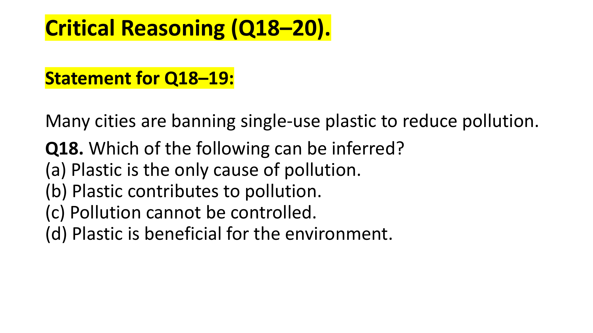
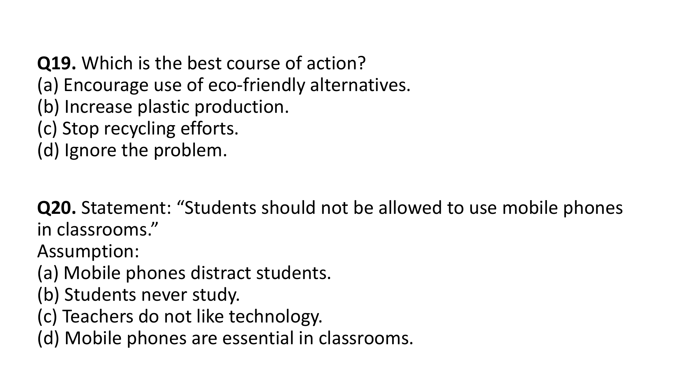
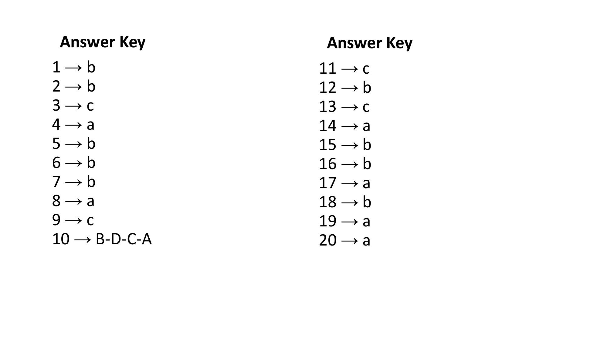
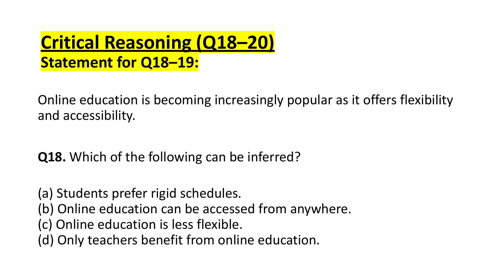
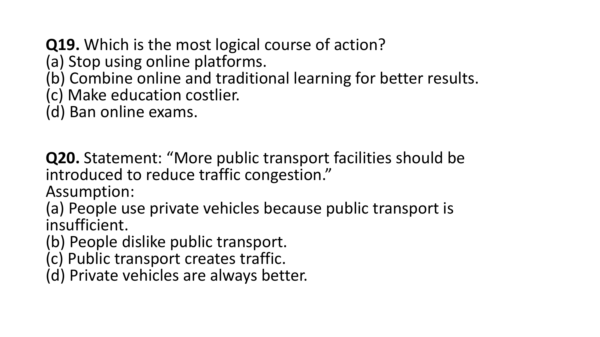
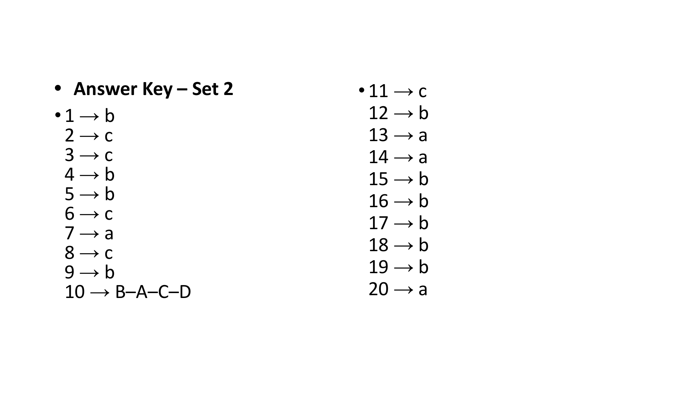
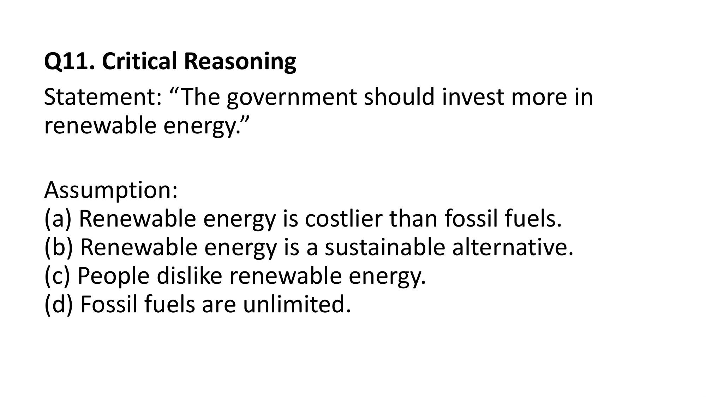

# 🧠 SUBJECT 6: Critical Reasoning & Deductive Verbal Logic (17 Questions)

This subject synthesizes all 17 authentic Critical Reasoning questions from PrepInsta and OnlineStudy4U.

## 6.1 The Analytical Triad: Premise, Assumption & Conclusion

$$\text{Premise } (P) + \text{Unstated Assumption } (A) \implies \text{Conclusion } (C)$$

- **Negation Test:** Negate the candidate assumption; if the conclusion collapses, the statement is a mandatory assumption.
- **Weaken / Strengthen:** Directly target the hidden assumption or alternate causes.

---

## 6.2 PrepInsta Verbatim Critical Reasoning Question Bank with Logical Proofs (10 Questions)

### Question 1 (PrepInsta Critical Reasoning Quiz-1 - Q1)
**Question Stem:**
"Some men are definitely intelligent, others are definitely not intelligent, but of intermediate men, we should say, 'intelligent'? Yes, I think, so or no, I shouldn't be inclined to call him intelligent."

Which of the following reflects the intention of the writer well?

**Options:**
- `(A) To call men intelligent who are not strikingly so must be to use the concept with undue imprecision`
- `(B) Every empirical concept has a degree of vagueness`
- `(C) Calling someone intelligent or not depends upon one's whim`
- `(D) There is no need to be as indecisive as the writer of the above`

**Correct Answer:** `(A) To call men intelligent who are not strikingly so must be to use the concept with undue imprecision`

**PrepInsta Detailed Explanation & Logical Derivation:**
```text
The writer hesitates to apply the label 'intelligent' to borderline or intermediate cases, asserting that applying the term to someone who is not strikingly intelligent introduces undue imprecision into the definition.
```

---

### Question 2 (PrepInsta Critical Reasoning Quiz-1 - Q2)
**Question Stem:**
A highly cohesive work group is a prerequisite for high team performance. Sociologists point out that the association between success and group cohesion owes to the support individual team members give to one another and their acceptance of the group's activities and goals.

Each of the following, if true, either supports or cannot weaken the sociologists' assumption about the relationship between success and cohesion EXCEPT:

**Options:**
- `(A) A group of Japanese researchers found that the successful work teams were led by dominant leaders`
- `(B) University researchers found that there was a significant correlation between team productivity and the extent to which team members understood and complied with the group's objectives`
- `(C) American researchers found that successful team members tended to rate their fellow members more favourably`
- `(D) Industrial Psychologists of UK found that work groups who tended to participate in after-hours social activities were more productive`

**Correct Answer:** `(A) A group of Japanese researchers found that the successful work teams were led by dominant leaders`

**PrepInsta Detailed Explanation & Logical Derivation:**
```text
If success is driven by a single dominant leader rather than lateral interpersonal cohesion and peer mutual support, this directly weakens the sociologists' claim that success owes fundamentally to group cohesion.
```

---

### Question 3 (PrepInsta Critical Reasoning Quiz-1 - Q3)
**Question Stem:**
Offshore oil-drilling operations involve an unavoidable risk of an oil spill, but importing oil on tankers presently involves an even greater such risk per barrel of oil. So, if we are to lessen the risk of an oil spill without reducing our oil usage, we must invest more in offshore operations and import less oil on tankers.

Which of the following, if true, seriously weakens the argument above?

**Options:**
- `(A) Importing oil on tankers is currently less expensive than drilling for it offshore.`
- `(B) Tankers can easily be redesigned so that their use entails less risk of an oil spill.`
- `(C) The impact of offshore operations on the environment can be reduced by careful management.`
- `(D) Oil spills caused by tankers have generally been more serious than those caused by offshore operations.`

**Correct Answer:** `(B) Tankers can easily be redesigned so that their use entails less risk of an oil spill.`

**PrepInsta Detailed Explanation & Logical Derivation:**
```text
The argument's recommendation to switch away from tankers assumes that the current risk disparity is fixed. If tankers can easily be redesigned to minimize spill risks, the need to switch to offshore drilling evaporates.
```

---

### Question 4 (PrepInsta Critical Reasoning Quiz-1 - Q4)
**Question Stem:**
Alan: In the last 15 years, most of the criminals who were convicted of theft or murder were from the lower income classes and had not completed high school. Therefore, the government has to spend more money on reducing poverty and increase funding to education. Because terrorism is the most severe of all crimes, such measures would bring down overall crime rate and reduce threat from terrorism.

Dylan: A study that was conducted in a country known to produce a number of terrorists showed that on average the terrorists were better educated than the overall population and that they did not necessarily come from lower income classes. This is probably because crimes such as theft are committed for personal gain while terrorism is for political or religious gain.

Which of the following best describes Dylan's response to Alan?

**Options:**
- `(A) Dylan changes the direction of the argument entirely by discussing the scenario in a different country`
- `(B) Dylan partially agrees with Alan's reasoning but refutes his recommendation to the government`
- `(C) Dylan converts a causal argument made by Alan into a generalization applicable universally`
- `(D) Dylan challenges Alan's reasoning by explaining why two situations that Alan perceives as similar are not`
- `(E) While Alan arrives at a conclusion by drawing an analogy, Dylan arrives at the same conclusion by refuting the analogy`

**Correct Answer:** `(D) Dylan challenges Alan's reasoning by explaining why two situations that Alan perceives as similar are not`

**PrepInsta Detailed Explanation & Logical Derivation:**
```text
Alan lumps theft/murder and terrorism into the same socioeconomic bucket. Dylan refutes this by demonstrating that terrorists have different demographic profiles, proving the two crimes cannot be treated with the same poverty-alleviation remedy.
```

---

### Question 5 (PrepInsta Critical Reasoning Quiz-1 - Q5)
**Question Stem:**
In contrast to the earlier predictions, demand for sugarcane has not risen in recent years, yet, even though production amounts and price have also been stable during the last 3 years. Last year, sugarcane growers increased their profits by more than 10 percent over the previous year’s level.

Any of the following statements, if true, about last year, helps explain the rise in profits EXCEPT:

**Options:**
- `(A) Many sugar factories that are large consumers of sugarcane increase their production of sugarcane-based ethanol, yet their overall consumption of sugarcane decreased.`
- `(B) Rainfall in sugarcane-growing regions was higher than it had been during previous year, allowing the growers to save money on expensive artificial irrigation.`
- `(C) Sugarcane growers have saved money on wages by switching from paying laborers a daily wage to paying them by the amount harvested.`
- `(D) Many small sugarcane growers joined together to form an association of sugarcane producers and began to buy supplies at low group rates.`

**Correct Answer:** `(A) Many sugar factories that are large consumers of sugarcane increase their production of sugarcane-based ethanol, yet their overall consumption of sugarcane decreased.`

**PrepInsta Detailed Explanation & Logical Derivation:**
```text
Profit = Revenue - Cost. Options B, C, and D all describe substantial production cost reductions (saving on irrigation, wages, supplies). Option A describes decreased consumption, which would depress grower revenue and cannot explain a profit surge.
```

---

### Question 6 (PrepInsta Critical Reasoning Quiz-1 - Q6)
**Question Stem:**
Ismat Chughtai’s celebrated masterpiece 'Lihaf' needs to be analyzed under the interwoven themes of marriage, subjugation of women and the oppression and neglect of female sexuality and desire... Which one of the following can be inferred from the given passage?

**Options:**
- `(A) Under the garb of a social norm and societal obligation, marriage as an institution, often tends to oppress the participants involved.`
- `(B) Marriage is a sacred institution across all communities which need not be questioned.`
- `(C) Begum Jan belonged to a financially poor family`
- `(D) None of the above`

**Correct Answer:** `(A) Under the garb of a social norm and societal obligation, marriage as an institution, often tends to oppress the participants involved.`

**PrepInsta Detailed Explanation & Logical Derivation:**
```text
The passage explicitly develops the thesis that marriage functioned as an unbreakable social obligation that commodified Begum Jan and entrapped both her and the Nawab into repressive, neglected roles.
```

---

### Question 7 (PrepInsta Critical Reasoning Quiz-1 - Q7)
**Question Stem:**
Regarding the passage on Chughtai's 'Lihaf', pick out the incorrect statement from the following:

**Options:**
- `(A) Chughtai critiques the mercenary aspect of marriage that dehumanizes women to fulfill societal obligations and dreams of upward mobility.`
- `(B) Begum Jan was just a social stamp of approval of Nawab, a heterosexual cover to escape ridicule.`
- `(C) The status accorded to marriage as an unbreakable social norm and an unquestionable obligation is discussed in the short story by Chughtai.`
- `(D) Begum Jan was very dear to the Nawab.`

**Correct Answer:** `(D) Begum Jan was very dear to the Nawab.`

**PrepInsta Detailed Explanation & Logical Derivation:**
```text
The text explicitly states that the Nawab 'installed her in the house along with furniture', displayed zero interest in her life, and 'totally forgot her presence'.
```

---

### Question 8 (PrepInsta Critical Reasoning Quiz-1 - Q8)
**Question Stem:**
Pick out the correct statement directly supported by the passage on 'Lihaf':

**Options:**
- `(A) Begum Jan was free to choose her partner in marriage.`
- `(B) The Nawab expressed interest in his wife’s life.`
- `(C) Chughtai critiques the mercenary aspect of marriage.`
- `(D) Chughtai raises important questions on the evils of dowry system and bride burning.`

**Correct Answer:** `(C) Chughtai critiques the mercenary aspect of marriage.`

**PrepInsta Detailed Explanation & Logical Derivation:**
```text
Directly verbatim in paragraph 2: 'Chughtai critiques the mercenary aspect of marriage that dehumanizes women to fulfill societal obligations'.
```

---

### Question 9 (PrepInsta Critical Reasoning Quiz-1 - Q9)
**Question Stem:**
Which one of the following is the synonym of the word 'desolation' as used in the context of the passage?

**Options:**
- `(A) Loneliness`
- `(B) Creation`
- `(C) Cheer`
- `(D) Pursuit`

**Correct Answer:** `(A) Loneliness`

**PrepInsta Detailed Explanation & Logical Derivation:**
```text
In the text, 'desolation' describes Begum Jan's emotional state of extreme neglect, depression, and social isolation. 'Loneliness' is the precise synonym.
```

---

### Question 10 (PrepInsta Critical Reasoning Quiz-1 - Q10)
**Question Stem:**
Which one of the following is the antonym of the word 'mercenary' as used in the context of the passage?

**Options:**
- `(A) Highlighted`
- `(B) Lucid`
- `(C) Altruistic`
- `(D) Refined`

**Correct Answer:** `(C) Altruistic`

**PrepInsta Detailed Explanation & Logical Derivation:**
```text
'Mercenary' means motivated purely by money, material gain, or transactional self-interest. The exact opposite is 'Altruistic' (unselfish concern for the welfare of others).
```

---


---

## 6.3 Master Critical Reasoning Deductive Problems (Questions 1 - 7)


---

## The Analytical Architecture of Critical Reasoning
Critical Reasoning in the Infosys examination probes higher-order cognitive agility. Each problem presents a short argumentative stimulus (30-80 words) and tests the candidate's capacity to dissect arguments using formal logical principles:

### Core Argument Anatomies
1. **Premise ($P$)**: Stated factual evidence or observations presumed to be unquestionably true.
2. **Assumption ($A$)**: Unstated, indispensable bridge connecting the premise to the conclusion. If negated, the argument collapses.
3. **Conclusion ($C$)**: The central claim or deduction asserted by the author based on the premises.

$$\text{Premise} + \text{Assumption} \implies \text{Conclusion}$$

### The 6 Master Question Paradigms
- **Paradigm 1: Assumption Identification (The Negation Test)**: To verify if an option is the necessary assumption, negate it. If the negation invalidates or destroys the conclusion, the option is the mandatory assumption.
- **Paradigm 2: Strengthen the Argument**: Introducing new information that reinforces the assumption, eliminates an alternative cause, or corroborates the causality.
- **Paradigm 3: Weaken / Undermine the Argument**: Introducing external data demonstrating an alternative explanation, reversing the causal arrow, or exposing an invalid generalization.
- **Paradigm 4: Resolve the Paradox / Discrepancy**: Providing a factual reconciling factor that explains how two apparently contradictory occurrences can coexist.
- **Paradigm 5: Logical Inference / Must Be True**: Extracting a conclusion that follows with 100% mathematical certainty strictly from the stated facts, without introducing unstated assumptions.
- **Paradigm 6: Flaw in the Reasoning**: Identifying classic logical fallacies (*ad hominem, post hoc ergo propter hoc, circular reasoning, false dichotomy, composition/division*).

Below is the verified compendium of all critical reasoning and deductive verbal logic questions extracted across all preparation repositories.

---


## Part 1: OnlineStudy4U Master Critical Reasoning Questions


## Question 1: Identifying Logical Inferences
**Question ID**: `INFY-SET1-18`  
- **Figure**:
    
Which of the following can be inferred?

#### Options
- **(a)** Plastic is the only cause of pollution.
- **(b)** Plastic contributes to pollution.
- **(c)** Pollution cannot be controlled.
- **(d)** Plastic is beneficial for the environment.

#### Logical Analysis
- If cities ban single-use plastic specifically *to reduce pollution*, it directly follows that plastic must be a contributing factor to pollution.
- Option (a) makes an unsubstantiated extreme claim (*only cause*).
- Option (c) contradicts the premise of action.
- Option (b) is a direct, necessary, and conservative deduction.

**Official Answer Key**: `18 → b`  
$$\mathbf{\text{Verified Answer: (b) Plastic contributes to pollution.}}$$

---

---

## Question 2: Logical Course of Action
**Question ID**: `INFY-SET1-19`  
- **Figure**:
    
Which is the best course of action?

#### Options
- **(a)** Encourage use of eco-friendly alternatives.
- **(b)** Increase plastic production.
- **(c)** Stop recycling efforts.
- **(d)** Ignore the problem.

#### Logical Analysis
- A valid course of action must be feasible, constructive, and directly address the problem outlined.
- Banning single-use plastic requires providing viable substitutes so daily commerce does not collapse.
- Encouraging eco-friendly alternatives directly complements the reduction of pollution.

**Official Answer Key**: `19 → a`  
$$\mathbf{\text{Verified Answer: (a) Encourage use of eco-friendly alternatives.}}$$

---

---

## Question 3: Identifying Implicit Assumptions
**Question ID**: `INFY-SET1-20`  
- **Figure**:
    
**Statement**: *“Students should not be allowed to use mobile phones in classrooms.”*  
**Assumption**:

#### Options
- **(a)** Mobile phones distract students.
- **(b)** Students never study.
- **(c)** Teachers do not like technology.
- **(d)** Mobile phones are essential in classrooms.

#### Logical Analysis
- An assumption is an unstated premise that the speaker takes for granted when making a policy statement.
- For someone to propose barring phones inside classrooms, they must believe that phone usage negatively impacts classroom learning (e.g., through distraction).
- If phones were not believed to cause distraction or harm in the learning environment, the restriction would lack rationale.

**Official Answer Key**: `20 → a`  
$$\mathbf{\text{Verified Answer: (a) Mobile phones distract students.}}$$

---


### Official Answer Key Slide Verification


## 📊 Summary Assessment Matrix (Topic 02 - Set 1)

| Question ID | Sub-domain | Tested Grammatical / Logical Rule | Official Key |
| :---: | :--- | :--- | :---: |
| `INFY-SET1-01` | Reading Comprehension | Drawback: Reduced face-to-face communication | **(b)** |
| `INFY-SET1-02` | Reading Comprehension | Tone: Objective & Balanced | **(b)** |
| `INFY-SET1-03` | Sentence Correction | `Each of + Plural Noun` $\to$ Singular Verb (`is`) | **(c)** |
| `INFY-SET1-04` | Sentence Correction | Auxiliary negation: `He doesn't like` | **(a)** |
| `INFY-SET1-05` | Sentence Correction | Parenthetical `along with` does not pluralize (`was`) | **(b)** |
| `INFY-SET1-06` | Sentence Selection | Definite past time `yesterday` mandates `went` | **(b)** |
| `INFY-SET1-07` | Sentence Selection | `Neither of the answers is correct` | **(b)** |
| `INFY-SET1-08` | Sentence Completion | Past conditional clause alignment | **(a)** |
| `INFY-SET1-09` | Sentence Completion | Preposition of purpose: `fought for their lives` | **(c)** |
| `INFY-SET1-10` | Para Jumbles | Chronological market sequence: `B – D – C – A` | **B-D-C-A** |
| `INFY-SET1-11` | One Word Substitution | Person speaking many languages: `Polyglot` | **(c)** |
| `INFY-SET1-12` | Spotting Error | Latin comparative: `senior to`, not `senior than` | **(b)** |
| `INFY-SET1-13` | Spotting Error | `Neither of the brothers has arrived` | **(c)** |
| `INFY-SET1-14` | Verbal Analogy | Instrument to Creator: `Brush : Artist` | **(a)** |
| `INFY-SET1-15` | Verbal Analogy | Profession to Workplace: `Teacher : School` | **(b)** |
| `INFY-SET1-16` | Fill in the Blanks | Fixed preposition: `prefer tea to coffee` | **(b)** |
| `INFY-SET1-17` | Fill in the Blanks | Nominalization: `reached a decision` | **(a)** |
| `INFY-SET1-18` | Critical Reasoning | Deduction: Plastic contributes to pollution | **(b)** |
| `INFY-SET1-19` | Critical Reasoning | Action: Encourage eco-friendly alternatives | **(a)** |
| `INFY-SET1-20` | Critical Reasoning | Assumption: Mobile phones distract students | **(a)** |

---

## Question 4: Identifying Deductive Inferences
**Question ID**: `INFY-SET2-18`  
- **Figure**:
    
Which of the following can be inferred?

#### Options
- **(a)** Students prefer rigid schedules.
- **(b)** Online education can be accessed from anywhere.
- **(c)** Online education is less flexible.
- **(d)** Only teachers benefit from online education.

#### Logical Analysis
- The statement predicates popularity directly on *flexibility and accessibility*.
- *Accessibility* in educational technology denotes the capability to access coursework regardless of geographical location.
- Therefore, inferring that *online education can be accessed from anywhere* is a direct semantic consequence of accessibility.

**Official Answer Key**: `18 → b`  
$$\mathbf{\text{Verified Answer: (b) Online education can be accessed from anywhere.}}$$

---

---

## Question 5: Pragmatic Course of Action
**Question ID**: `INFY-SET2-19`  
- **Figure**:
    
Which is the most logical course of action?

#### Options
- **(a)** Stop using online platforms.
- **(b)** Combine online and traditional learning for better results.
- **(c)** Make education costlier.
- **(d)** Ban online exams.

#### Logical Analysis
- A rational course of action leverages proven technological benefits while mitigating weaknesses.
- Integrating digital tools with classroom pedagogy (hybrid/blended learning) maximizes student outcomes.
- Banning or terminating effective systems is reactionary and counterproductive.

**Official Answer Key**: `19 → b`  
$$\mathbf{\text{Verified Answer: (b) Combine online and traditional learning for better results.}}$$

---

---

## Question 6: Implicit Urban Transit Assumptions
**Question ID**: `INFY-SET2-20`  
- **Figure**:
    
**Statement**: *“More public transport facilities should be introduced to reduce traffic congestion.”*  
**Assumption**:

#### Options
- **(a)** People use private vehicles because public transport is insufficient.
- **(b)** People dislike public transport.
- **(c)** Public transport creates traffic.
- **(d)** Private vehicles are always better.

#### Logical Analysis
- If someone advocates expanding public transit *to reduce traffic congestion*, they necessarily assume that the current reliance on congestion-causing private vehicles stems from inadequate public transit capacity.
- If public transit were already abundant and people simply refused to use it, adding more would not reduce congestion.
- Thus, Option (a) is the foundational assumption underlying the proposal.

**Official Answer Key**: `20 → a`  
$$\mathbf{\text{Verified Answer: (a) People use private vehicles because public transport is insufficient.}}$$

---


### Official Answer Key Slide Verification


## 📊 Summary Assessment Matrix (Topic 03 - Set 2)

| Question ID | Sub-domain | Tested Grammatical / Logical Rule | Official Key |
| :---: | :--- | :--- | :---: |
| `INFY-SET2-01` | Reading Comprehension | Central Thesis: Government + Individual Action | **(b)** |
| `INFY-SET2-02` | Reading Comprehension | Exclusion Search: Planting trees not in text | **(c)** |
| `INFY-SET2-03` | Sentence Correction | Parenthetical `as well as`: Singular verb `is` | **(c)** |
| `INFY-SET2-04` | Sentence Correction | Verb + Gerund: `enjoys playing` | **(b)** |
| `INFY-SET2-05` | Sentence Correction | Proximity Rule with *Neither/Nor*: `were` | **(b)** |
| `INFY-SET2-06` | Sentence Selection | Modal redundancy: `I am able to solve` | **(c)** |
| `INFY-SET2-07` | Sentence Selection | Latin Comparative: `junior to me` | **(a)** |
| `INFY-SET2-08` | Sentence Completion | Future Perfect: `will have left` | **(c)** |
| `INFY-SET2-09` | Sentence Completion | Collocation: `insisted on submitting` | **(b)** |
| `INFY-SET2-10` | Para Jumbles | Chronological market sequence: `B – A – C – D` | **B-A-C-D** |
| `INFY-SET2-11` | One Word Substitution | Speech without preparation: `Extempore` | **(c)** |
| `INFY-SET2-12` | Spotting Error | Preposition of proficiency: `good at dancing` | **(b)** |
| `INFY-SET2-13` | Spotting Error | Plural collective noun: `police have arrested` | **(a)** |
| `INFY-SET2-14` | Verbal Analogy | Garment to Anatomy: `Foot : Shoe` | **(a)** |
| `INFY-SET2-15` | Verbal Analogy | Creator to Form: `Novelist : Novel` | **(b)** |
| `INFY-SET2-16` | Fill in the Blanks | Administrative idiom: `come into effect` | **(b)** |
| `INFY-SET2-17` | Fill in the Blanks | Matrimonial preposition: `married to` | **(b)** |
| `INFY-SET2-18` | Critical Reasoning | Deduction: Accessible from anywhere | **(b)** |
| `INFY-SET2-19` | Critical Reasoning | Action: Blended / Hybrid learning model | **(b)** |
| `INFY-SET2-20` | Critical Reasoning | Assumption: Public transit insufficiency causes private vehicle use | **(a)** |

---

## Question 7: Critical Reasoning — Policy Assumptions
**Question ID**: `INFY-PRAC-11`  
- **Figure**:
    
**Statement**: *“The government should invest more in renewable energy.”*  
**Assumption**:

#### Options
- **(a)** Renewable energy is costlier than fossil fuels.
- **(b)** Renewable energy is a sustainable alternative.
- **(c)** People dislike renewable energy.
- **(d)** Fossil fuels are unlimited.

#### Logical Analysis
- An assumption is an unstated, necessary premise that makes the conclusion valid.
- For a government to allocate public capital toward renewable energy, the implicit premise must be that renewable energy offers a viable, beneficial, and sustainable alternative to finite, polluting energy sources.
- Options (a), (c), and (d) would actively discourage or invalidate government investment.

**Official Answer Key**: `11 → b`  
$$\mathbf{\text{Verified Answer: (b) Renewable energy is a sustainable alternative.}}$$

---

---


---

## Part 2: College ITM & External Examination Critical Reasoning Inferences

### CR Problem 01 (ID: `ITM-P02-Q37`)
- **Source**: College ITM Mock Test (Infosys System Engineer ITM Mock Paper 2)
- **Question Type**: MCQ

#### Stimulus & Prompt
P: They are, instead, thought experiments that isolate one variable at a time.
Q: Economic models are often criticised for their unrealistic assumptions.
R: This deliberate simplification is what makes them useful, not despite the unrealism but because of it.
S: Critics forget that the models were never meant to be literal descriptions of the economy.

#### Options
- A
- B
- C
- D

#### Correct Answer
**Answer**: `A`

#### Logical Deductive Analysis
Sentence sequence: Q→S→P→R.. Coherent narrative progression establishes logical flow from premise to supporting detail and conclusion.

---

### CR Problem 02 (ID: `ITM-P05-Q26`)
- **Source**: College ITM Mock Test (Infosys System Engineer ITM Mock Paper 5)
- **Question Type**: MCQ

#### Stimulus & Prompt
The passage's central argument is that rate limits should be understood primarily as:

#### Options
- A
- B
- C
- D

#### Correct Answer
**Answer**: `B`

#### Logical Deductive Analysis
According to the reading comprehension passage for Paper 5, option (B) is directly supported and established by the author's primary thesis and supporting textual arguments.

---

### CR Problem 03 (ID: `ITM-P07-Q30`)
- **Source**: College ITM Mock Test (Infosys System Engineer ITM Mock Paper 7)
- **Question Type**: MCQ

#### Stimulus & Prompt
Which inference is best supported by the last sentence?

#### Options
- A
- B
- C
- D

#### Correct Answer
**Answer**: `C`

#### Logical Deductive Analysis
According to the reading comprehension passage for Paper 7, option (C) is directly supported and established by the author's primary thesis and supporting textual arguments.

---

### CR Problem 04 (ID: `ITM-P07-Q31`)
- **Source**: College ITM Mock Test (Infosys System Engineer ITM Mock Paper 7)
- **Question Type**: MCQ

#### Stimulus & Prompt
After a website adopted a new CDN, its page-load time fell by 30%, and user retention rose over the 
same period. The team concludes that the CDN caused the rise in retention. Which of the following is an 
assumption on which this conclusion depends?

#### Options
- A
- B
- C
- D

#### Correct Answer
**Answer**: `B`

#### Logical Deductive Analysis
The conclusion that the CDN caused the retention rise only holds if nothing else that affects retention 
changed over the same period.

---

### CR Problem 05 (ID: `ITM-P07-Q32`)
- **Source**: College ITM Mock Test (Infosys System Engineer ITM Mock Paper 7)
- **Question Type**: MCQ

#### Stimulus & Prompt
Since a company made code reviews mandatory, production defects have fallen by 40%. The company 
concludes that code reviews reduce defects. Which of the following, if true, most weakens this conclusion?

#### Options
- A
- B
- C
- D

#### Correct Answer
**Answer**: `B`

#### Logical Deductive Analysis
Halving releases and cutting feature work gives an alternative explanation for fewer defects, so it 
weakens the claim that reviews were the cause.

---

### CR Problem 06 (ID: `ITM-P07-Q33`)
- **Source**: College ITM Mock Test (Infosys System Engineer ITM Mock Paper 7)
- **Question Type**: MCQ

#### Stimulus & Prompt
A start-up claims its new caching layer will cut its database costs. Which of the following, if true, most 
strengthens the claim?

#### Options
- A
- B
- C
- D

#### Correct Answer
**Answer**: `A`

#### Logical Deductive Analysis
A high cache-hit rate, with each hit avoiding a billable query, directly links the cache to lower 
database costs.

---

---
