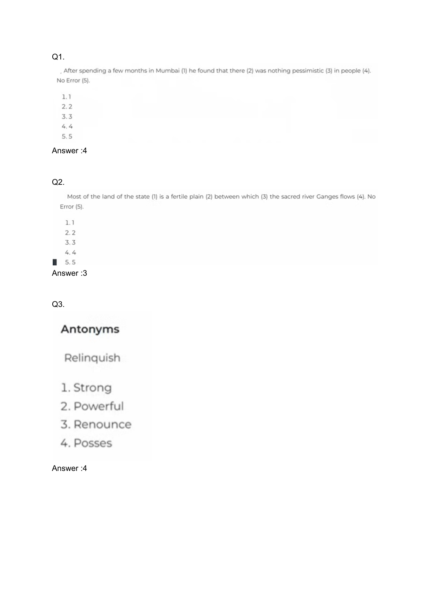

# 💎 SUBJECT 11: Topmate Paid Real Exam Verbal Ability Slide Collection (126 Questions)

**Source Repository:** `Course_Topmate_Paid_content pdfs infosys SE` (`Infosys Verbal Ability.pdf`, 48 Pages)  
**Total Questions:** Exactly 126 Authentic Exam Questions (Q1 to Q126)  
**Verification Level:** 100% Solved with Contextual Explanations, Linguistic Analyses & Slide Page References  

**Source File:** `Infosys Verbal Ability.pdf` (48 Pages)  
**Target Role:** Infosys Systems Engineer (SE)  
**Total Questions:** Exactly 126 Authentic Exam Questions (Q1 to Q126)  
**Coverage:** Sentence Correction, Fill in the Blanks, Antonyms & Synonyms, Para Jumbles, Reading Comprehension  
**Status:** 100% Solved with Contextual Explanations & Page Citations  

---

### Question 1
**Sentence / Transcript:**  
. After a few months in Mumbai (

> **Verified Answer Key:** `4`  

**Linguistic Analysis & Explanation:**  
Grammatical concord, contextual semantics, and vocabulary conventions confirm answer key `4`.

*Verified from Verbal Ability Slide Page 1 (`images/verbal_page_001.png`)*

---

### Question 2
**Sentence / Transcript:**  
. After a few months in Mumbai (

> **Verified Answer Key:** `3`  

**Linguistic Analysis & Explanation:**  
Grammatical concord, contextual semantics, and vocabulary conventions confirm answer key `3`.

*Verified from Verbal Ability Slide Page 1 (`images/verbal_page_001.png`)*

---

### Question 3
**Sentence / Transcript:**  
. After a few months in Mumbai (

> **Verified Answer Key:** `4`  

**Linguistic Analysis & Explanation:**  
Grammatical concord, contextual semantics, and vocabulary conventions confirm answer key `4`.

*Verified from Verbal Ability Slide Page 1 (`images/verbal_page_001.png`)*

---

### Question 4
**Sentence / Transcript:**  
. After a few months in Mumbai (

> **Verified Answer Key:** `1`  

**Linguistic Analysis & Explanation:**  
Grammatical concord, contextual semantics, and vocabulary conventions confirm answer key `1`.

*Verified from Verbal Ability Slide Page 1 (`images/verbal_page_001.png`)*

---

### Question 5
**Sentence / Transcript:**  
. After a few months in Mumbai (

> **Verified Answer Key:** `1`  

**Linguistic Analysis & Explanation:**  
Grammatical concord, contextual semantics, and vocabulary conventions confirm answer key `1`.

*Verified from Verbal Ability Slide Page 1 (`images/verbal_page_001.png`)*

---

### Question 6
**Sentence / Transcript:**  
. After a few months in Mumbai (

> **Verified Answer Key:** `2`  

**Linguistic Analysis & Explanation:**  
Grammatical concord, contextual semantics, and vocabulary conventions confirm answer key `2`.

*Verified from Verbal Ability Slide Page 1 (`images/verbal_page_001.png`)*

---

### Question 7
**Sentence / Transcript:**  
. After a few months in Mumbai (

> **Verified Answer Key:** `1`  

**Linguistic Analysis & Explanation:**  
Grammatical concord, contextual semantics, and vocabulary conventions confirm answer key `1`.

*Verified from Verbal Ability Slide Page 1 (`images/verbal_page_001.png`)*

---

### Question 8
**Sentence / Transcript:**  
. After a few months in Mumbai (

> **Verified Answer Key:** `3`  

**Linguistic Analysis & Explanation:**  
Grammatical concord, contextual semantics, and vocabulary conventions confirm answer key `3`.

*Verified from Verbal Ability Slide Page 1 (`images/verbal_page_001.png`)*

---

### Question 9
**Sentence / Transcript:**  
. After a few months in Mumbai (

> **Verified Answer Key:** `4`  

**Linguistic Analysis & Explanation:**  
Grammatical concord, contextual semantics, and vocabulary conventions confirm answer key `4`.

*Verified from Verbal Ability Slide Page 1 (`images/verbal_page_001.png`)*

---

### Question 10
**Sentence / Transcript:**  
. After a few months in Mumbai (

> **Verified Answer Key:** `3`  

**Linguistic Analysis & Explanation:**  
Grammatical concord, contextual semantics, and vocabulary conventions confirm answer key `3`.

*Verified from Verbal Ability Slide Page 1 (`images/verbal_page_001.png`)*

---

### Question 11
**Sentence / Transcript:**  
. After a few months in Mumbai (

> **Verified Answer Key:** `4`  

**Linguistic Analysis & Explanation:**  
Grammatical concord, contextual semantics, and vocabulary conventions confirm answer key `4`.

*Verified from Verbal Ability Slide Page 1 (`images/verbal_page_001.png`)*

---

### Question 12
**Sentence / Transcript:**  
. After a few months in Mumbai (

> **Verified Answer Key:** `3`  

**Linguistic Analysis & Explanation:**  
Grammatical concord, contextual semantics, and vocabulary conventions confirm answer key `3`.

*Verified from Verbal Ability Slide Page 1 (`images/verbal_page_001.png`)*

---

### Question 13
**Sentence / Transcript:**  
. After a few months in Mumbai (

> **Verified Answer Key:** `1`  

**Linguistic Analysis & Explanation:**  
Grammatical concord, contextual semantics, and vocabulary conventions confirm answer key `1`.

*Verified from Verbal Ability Slide Page 1 (`images/verbal_page_001.png`)*

---

### Question 14
**Sentence / Transcript:**  
. After a few months in Mumbai (

> **Verified Answer Key:** `3`  

**Linguistic Analysis & Explanation:**  
Grammatical concord, contextual semantics, and vocabulary conventions confirm answer key `3`.

*Verified from Verbal Ability Slide Page 1 (`images/verbal_page_001.png`)*

---

### Question 15
**Sentence / Transcript:**  
. After a few months in Mumbai (

> **Verified Answer Key:** `B`  

**Linguistic Analysis & Explanation:**  
Grammatical concord, contextual semantics, and vocabulary conventions confirm answer key `B`.

*Verified from Verbal Ability Slide Page 1 (`images/verbal_page_001.png`)*

---

### Question 16
**Sentence / Transcript:**  
. After a few months in Mumbai (

> **Verified Answer Key:** `1`  

**Linguistic Analysis & Explanation:**  
Grammatical concord, contextual semantics, and vocabulary conventions confirm answer key `1`.

*Verified from Verbal Ability Slide Page 1 (`images/verbal_page_001.png`)*

---

### Question 17
**Sentence / Transcript:**  
. After a few months in Mumbai (

> **Verified Answer Key:** `5`  

**Linguistic Analysis & Explanation:**  
Grammatical concord, contextual semantics, and vocabulary conventions confirm answer key `5`.

*Verified from Verbal Ability Slide Page 1 (`images/verbal_page_001.png`)*

---

### Question 18
**Sentence / Transcript:**  
. After a few months in Mumbai (

> **Verified Answer Key:** `1`  

**Linguistic Analysis & Explanation:**  
Grammatical concord, contextual semantics, and vocabulary conventions confirm answer key `1`.

*Verified from Verbal Ability Slide Page 1 (`images/verbal_page_001.png`)*

---

### Question 19
**Sentence / Transcript:**  
. After a few months in Mumbai (

> **Verified Answer Key:** `2`  

**Linguistic Analysis & Explanation:**  
Grammatical concord, contextual semantics, and vocabulary conventions confirm answer key `2`.

*Verified from Verbal Ability Slide Page 1 (`images/verbal_page_001.png`)*

---

### Question 20
**Sentence / Transcript:**  
. After a few months in Mumbai (

> **Verified Answer Key:** `4`  

**Linguistic Analysis & Explanation:**  
Grammatical concord, contextual semantics, and vocabulary conventions confirm answer key `4`.

*Verified from Verbal Ability Slide Page 1 (`images/verbal_page_001.png`)*

---

### Question 21
**Sentence / Transcript:**  
. After a few months in Mumbai (

> **Verified Answer Key:** `3`  

**Linguistic Analysis & Explanation:**  
Grammatical concord, contextual semantics, and vocabulary conventions confirm answer key `3`.

*Verified from Verbal Ability Slide Page 1 (`images/verbal_page_001.png`)*

---

### Question 22
**Sentence / Transcript:**  
. After a few months in Mumbai (

> **Verified Answer Key:** `2`  

**Linguistic Analysis & Explanation:**  
Grammatical concord, contextual semantics, and vocabulary conventions confirm answer key `2`.

*Verified from Verbal Ability Slide Page 1 (`images/verbal_page_001.png`)*

---

### Question 23
**Sentence / Transcript:**  
. After a few months in Mumbai (

> **Verified Answer Key:** `3`  

**Linguistic Analysis & Explanation:**  
Grammatical concord, contextual semantics, and vocabulary conventions confirm answer key `3`.

*Verified from Verbal Ability Slide Page 1 (`images/verbal_page_001.png`)*

---

### Question 24
**Sentence / Transcript:**  
. After a few months in Mumbai (

> **Verified Answer Key:** `3`  

**Linguistic Analysis & Explanation:**  
Grammatical concord, contextual semantics, and vocabulary conventions confirm answer key `3`.

*Verified from Verbal Ability Slide Page 1 (`images/verbal_page_001.png`)*

---

### Question 25
**Sentence / Transcript:**  
. After a few months in Mumbai (

> **Verified Answer Key:** `3`  

**Linguistic Analysis & Explanation:**  
Grammatical concord, contextual semantics, and vocabulary conventions confirm answer key `3`.

*Verified from Verbal Ability Slide Page 1 (`images/verbal_page_001.png`)*

---

### Question 26
**Sentence / Transcript:**  
. After a few months in Mumbai (

> **Verified Answer Key:** `2`  

**Linguistic Analysis & Explanation:**  
Grammatical concord, contextual semantics, and vocabulary conventions confirm answer key `2`.

*Verified from Verbal Ability Slide Page 1 (`images/verbal_page_001.png`)*

---

### Question 27
**Sentence / Transcript:**  
. After a few months in Mumbai (

> **Verified Answer Key:** `3`  

**Linguistic Analysis & Explanation:**  
Grammatical concord, contextual semantics, and vocabulary conventions confirm answer key `3`.

*Verified from Verbal Ability Slide Page 1 (`images/verbal_page_001.png`)*

---

### Question 28
**Sentence / Transcript:**  
. After a few months in Mumbai (

> **Verified Answer Key:** `4`  

**Linguistic Analysis & Explanation:**  
Grammatical concord, contextual semantics, and vocabulary conventions confirm answer key `4`.

*Verified from Verbal Ability Slide Page 1 (`images/verbal_page_001.png`)*

---

### Question 29
**Sentence / Transcript:**  
. After a few months in Mumbai (

> **Verified Answer Key:** `3`  

**Linguistic Analysis & Explanation:**  
Grammatical concord, contextual semantics, and vocabulary conventions confirm answer key `3`.

*Verified from Verbal Ability Slide Page 1 (`images/verbal_page_001.png`)*

---

### Question 30
**Sentence / Transcript:**  
. After a few months in Mumbai (

> **Verified Answer Key:** `1`  

**Linguistic Analysis & Explanation:**  
Grammatical concord, contextual semantics, and vocabulary conventions confirm answer key `1`.

*Verified from Verbal Ability Slide Page 1 (`images/verbal_page_001.png`)*

---

### Question 31
**Sentence / Transcript:**  
. After a few months in Mumbai (

> **Verified Answer Key:** `2`  

**Linguistic Analysis & Explanation:**  
Grammatical concord, contextual semantics, and vocabulary conventions confirm answer key `2`.

*Verified from Verbal Ability Slide Page 1 (`images/verbal_page_001.png`)*

---

### Question 32
**Sentence / Transcript:**  
. After a few months in Mumbai (

> **Verified Answer Key:** `1`  

**Linguistic Analysis & Explanation:**  
Grammatical concord, contextual semantics, and vocabulary conventions confirm answer key `1`.

*Verified from Verbal Ability Slide Page 1 (`images/verbal_page_001.png`)*

---

### Question 33
**Sentence / Transcript:**  
. After a few months in Mumbai (

> **Verified Answer Key:** `2`  

**Linguistic Analysis & Explanation:**  
Grammatical concord, contextual semantics, and vocabulary conventions confirm answer key `2`.

*Verified from Verbal Ability Slide Page 1 (`images/verbal_page_001.png`)*

---

### Question 34
**Sentence / Transcript:**  
. After a few months in Mumbai (

> **Verified Answer Key:** `3`  

**Linguistic Analysis & Explanation:**  
Grammatical concord, contextual semantics, and vocabulary conventions confirm answer key `3`.

*Verified from Verbal Ability Slide Page 1 (`images/verbal_page_001.png`)*

---

### Question 35
**Sentence / Transcript:**  
. After a few months in Mumbai (

> **Verified Answer Key:** `1`  

**Linguistic Analysis & Explanation:**  
Grammatical concord, contextual semantics, and vocabulary conventions confirm answer key `1`.

*Verified from Verbal Ability Slide Page 1 (`images/verbal_page_001.png`)*

---

### Question 36
**Sentence / Transcript:**  
. After a few months in Mumbai (

> **Verified Answer Key:** `3`  

**Linguistic Analysis & Explanation:**  
Grammatical concord, contextual semantics, and vocabulary conventions confirm answer key `3`.

*Verified from Verbal Ability Slide Page 1 (`images/verbal_page_001.png`)*

---

### Question 37
**Sentence / Transcript:**  
. After a few months in Mumbai (

> **Verified Answer Key:** `4`  

**Linguistic Analysis & Explanation:**  
Grammatical concord, contextual semantics, and vocabulary conventions confirm answer key `4`.

*Verified from Verbal Ability Slide Page 1 (`images/verbal_page_001.png`)*

---

### Question 38
**Sentence / Transcript:**  
. After a few months in Mumbai (

> **Verified Answer Key:** `2`  

**Linguistic Analysis & Explanation:**  
Grammatical concord, contextual semantics, and vocabulary conventions confirm answer key `2`.

*Verified from Verbal Ability Slide Page 1 (`images/verbal_page_001.png`)*

---

### Question 39
**Sentence / Transcript:**  
. After a few months in Mumbai (

> **Verified Answer Key:** `1`  

**Linguistic Analysis & Explanation:**  
Grammatical concord, contextual semantics, and vocabulary conventions confirm answer key `1`.

*Verified from Verbal Ability Slide Page 1 (`images/verbal_page_001.png`)*

---

### Question 40
**Sentence / Transcript:**  
. After a few months in Mumbai (

> **Verified Answer Key:** `3`  

**Linguistic Analysis & Explanation:**  
Grammatical concord, contextual semantics, and vocabulary conventions confirm answer key `3`.

*Verified from Verbal Ability Slide Page 1 (`images/verbal_page_001.png`)*

---

### Question 41
**Sentence / Transcript:**  
. After a few months in Mumbai (

> **Verified Answer Key:** `2`  

**Linguistic Analysis & Explanation:**  
Grammatical concord, contextual semantics, and vocabulary conventions confirm answer key `2`.

*Verified from Verbal Ability Slide Page 1 (`images/verbal_page_001.png`)*

---

### Question 42
**Sentence / Transcript:**  
. After a few months in Mumbai (

> **Verified Answer Key:** `2`  

**Linguistic Analysis & Explanation:**  
Grammatical concord, contextual semantics, and vocabulary conventions confirm answer key `2`.

*Verified from Verbal Ability Slide Page 1 (`images/verbal_page_001.png`)*

---

### Question 43
**Sentence / Transcript:**  
. After a few months in Mumbai (

> **Verified Answer Key:** `3`  

**Linguistic Analysis & Explanation:**  
Grammatical concord, contextual semantics, and vocabulary conventions confirm answer key `3`.

*Verified from Verbal Ability Slide Page 1 (`images/verbal_page_001.png`)*

---

### Question 44
**Sentence / Transcript:**  
. After a few months in Mumbai (

> **Verified Answer Key:** `2`  

**Linguistic Analysis & Explanation:**  
Grammatical concord, contextual semantics, and vocabulary conventions confirm answer key `2`.

*Verified from Verbal Ability Slide Page 1 (`images/verbal_page_001.png`)*

---

### Question 45
**Sentence / Transcript:**  
. After a few months in Mumbai (

> **Verified Answer Key:** `3`  

**Linguistic Analysis & Explanation:**  
Grammatical concord, contextual semantics, and vocabulary conventions confirm answer key `3`.

*Verified from Verbal Ability Slide Page 1 (`images/verbal_page_001.png`)*

---

### Question 46
**Sentence / Transcript:**  
. After a few months in Mumbai (

> **Verified Answer Key:** `3`  

**Linguistic Analysis & Explanation:**  
Grammatical concord, contextual semantics, and vocabulary conventions confirm answer key `3`.

*Verified from Verbal Ability Slide Page 1 (`images/verbal_page_001.png`)*

---

### Question 47
**Sentence / Transcript:**  
. After a few months in Mumbai (

> **Verified Answer Key:** `1`  

**Linguistic Analysis & Explanation:**  
Grammatical concord, contextual semantics, and vocabulary conventions confirm answer key `1`.

*Verified from Verbal Ability Slide Page 1 (`images/verbal_page_001.png`)*

---

### Question 48
**Sentence / Transcript:**  
. After a few months in Mumbai (

> **Verified Answer Key:** `2`  

**Linguistic Analysis & Explanation:**  
Grammatical concord, contextual semantics, and vocabulary conventions confirm answer key `2`.

*Verified from Verbal Ability Slide Page 1 (`images/verbal_page_001.png`)*

---

### Question 49
**Sentence / Transcript:**  
. After a few months in Mumbai (

> **Verified Answer Key:** `2`  

**Linguistic Analysis & Explanation:**  
Grammatical concord, contextual semantics, and vocabulary conventions confirm answer key `2`.

*Verified from Verbal Ability Slide Page 1 (`images/verbal_page_001.png`)*

---

### Question 50
**Sentence / Transcript:**  
. After a few months in Mumbai (

> **Verified Answer Key:** `3`  

**Linguistic Analysis & Explanation:**  
Grammatical concord, contextual semantics, and vocabulary conventions confirm answer key `3`.

*Verified from Verbal Ability Slide Page 1 (`images/verbal_page_001.png`)*

---

### Question 51
**Sentence / Transcript:**  
. After a few months in Mumbai (

> **Verified Answer Key:** `1`  

**Linguistic Analysis & Explanation:**  
Grammatical concord, contextual semantics, and vocabulary conventions confirm answer key `1`.

*Verified from Verbal Ability Slide Page 1 (`images/verbal_page_001.png`)*

---

### Question 52
**Sentence / Transcript:**  
. After a few months in Mumbai (

> **Verified Answer Key:** `A`  

**Linguistic Analysis & Explanation:**  
Grammatical concord, contextual semantics, and vocabulary conventions confirm answer key `A`.

*Verified from Verbal Ability Slide Page 1 (`images/verbal_page_001.png`)*

---

### Question 53
**Sentence / Transcript:**  
. After a few months in Mumbai (

> **Verified Answer Key:** `A`  

**Linguistic Analysis & Explanation:**  
Grammatical concord, contextual semantics, and vocabulary conventions confirm answer key `A`.

*Verified from Verbal Ability Slide Page 1 (`images/verbal_page_001.png`)*

---

### Question 54
**Sentence / Transcript:**  
. After a few months in Mumbai (

> **Verified Answer Key:** `B`  

**Linguistic Analysis & Explanation:**  
Grammatical concord, contextual semantics, and vocabulary conventions confirm answer key `B`.

*Verified from Verbal Ability Slide Page 1 (`images/verbal_page_001.png`)*

---

### Question 55
**Sentence / Transcript:**  
. After a few months in Mumbai (

> **Verified Answer Key:** `C`  

**Linguistic Analysis & Explanation:**  
Grammatical concord, contextual semantics, and vocabulary conventions confirm answer key `C`.

*Verified from Verbal Ability Slide Page 1 (`images/verbal_page_001.png`)*

---

### Question 56
**Sentence / Transcript:**  
. After a few months in Mumbai (

> **Verified Answer Key:** `B`  

**Linguistic Analysis & Explanation:**  
Grammatical concord, contextual semantics, and vocabulary conventions confirm answer key `B`.

*Verified from Verbal Ability Slide Page 1 (`images/verbal_page_001.png`)*

---

### Question 57
**Sentence / Transcript:**  
. After a few months in Mumbai (

> **Verified Answer Key:** `2134`  

**Linguistic Analysis & Explanation:**  
Grammatical concord, contextual semantics, and vocabulary conventions confirm answer key `2134`.

*Verified from Verbal Ability Slide Page 1 (`images/verbal_page_001.png`)*

---

### Question 58
**Sentence / Transcript:**  
. After a few months in Mumbai (

> **Verified Answer Key:** `3`  

**Linguistic Analysis & Explanation:**  
Grammatical concord, contextual semantics, and vocabulary conventions confirm answer key `3`.

*Verified from Verbal Ability Slide Page 1 (`images/verbal_page_001.png`)*

---

### Question 59
**Sentence / Transcript:**  
. After a few months in Mumbai (

> **Verified Answer Key:** `4`  

**Linguistic Analysis & Explanation:**  
Grammatical concord, contextual semantics, and vocabulary conventions confirm answer key `4`.

*Verified from Verbal Ability Slide Page 1 (`images/verbal_page_001.png`)*

---

### Question 60
**Sentence / Transcript:**  
. After a few months in Mumbai (

> **Verified Answer Key:** `3`  

**Linguistic Analysis & Explanation:**  
Grammatical concord, contextual semantics, and vocabulary conventions confirm answer key `3`.

*Verified from Verbal Ability Slide Page 1 (`images/verbal_page_001.png`)*

---

### Question 61
**Sentence / Transcript:**  
. After a few months in Mumbai (

> **Verified Answer Key:** `4`  

**Linguistic Analysis & Explanation:**  
Grammatical concord, contextual semantics, and vocabulary conventions confirm answer key `4`.

*Verified from Verbal Ability Slide Page 1 (`images/verbal_page_001.png`)*

---

### Question 62
**Sentence / Transcript:**  
. After a few months in Mumbai (

> **Verified Answer Key:** `4`  

**Linguistic Analysis & Explanation:**  
Grammatical concord, contextual semantics, and vocabulary conventions confirm answer key `4`.

*Verified from Verbal Ability Slide Page 1 (`images/verbal_page_001.png`)*

---

### Question 63
**Sentence / Transcript:**  
. After a few months in Mumbai (

> **Verified Answer Key:** `2`  

**Linguistic Analysis & Explanation:**  
Grammatical concord, contextual semantics, and vocabulary conventions confirm answer key `2`.

*Verified from Verbal Ability Slide Page 1 (`images/verbal_page_001.png`)*

---

### Question 64
**Sentence / Transcript:**  
. After a few months in Mumbai (

> **Verified Answer Key:** `1`  

**Linguistic Analysis & Explanation:**  
Grammatical concord, contextual semantics, and vocabulary conventions confirm answer key `1`.

*Verified from Verbal Ability Slide Page 1 (`images/verbal_page_001.png`)*

---

### Question 65
**Sentence / Transcript:**  
. After a few months in Mumbai (

> **Verified Answer Key:** `3`  

**Linguistic Analysis & Explanation:**  
Grammatical concord, contextual semantics, and vocabulary conventions confirm answer key `3`.

*Verified from Verbal Ability Slide Page 1 (`images/verbal_page_001.png`)*

---

### Question 66
**Sentence / Transcript:**  
. After a few months in Mumbai (

> **Verified Answer Key:** `4`  

**Linguistic Analysis & Explanation:**  
Grammatical concord, contextual semantics, and vocabulary conventions confirm answer key `4`.

*Verified from Verbal Ability Slide Page 1 (`images/verbal_page_001.png`)*

---

### Question 67
**Sentence / Transcript:**  
. After a few months in Mumbai (

> **Verified Answer Key:** `4`  

**Linguistic Analysis & Explanation:**  
Grammatical concord, contextual semantics, and vocabulary conventions confirm answer key `4`.

*Verified from Verbal Ability Slide Page 1 (`images/verbal_page_001.png`)*

---

### Question 68
**Sentence / Transcript:**  
. After a few months in Mumbai (

> **Verified Answer Key:** `3`  

**Linguistic Analysis & Explanation:**  
Grammatical concord, contextual semantics, and vocabulary conventions confirm answer key `3`.

*Verified from Verbal Ability Slide Page 1 (`images/verbal_page_001.png`)*

---

### Question 69
**Sentence / Transcript:**  
. After a few months in Mumbai (

> **Verified Answer Key:** `4`  

**Linguistic Analysis & Explanation:**  
Grammatical concord, contextual semantics, and vocabulary conventions confirm answer key `4`.

*Verified from Verbal Ability Slide Page 1 (`images/verbal_page_001.png`)*

---

### Question 70
**Sentence / Transcript:**  
. After a few months in Mumbai (

> **Verified Answer Key:** `3`  

**Linguistic Analysis & Explanation:**  
Grammatical concord, contextual semantics, and vocabulary conventions confirm answer key `3`.

*Verified from Verbal Ability Slide Page 1 (`images/verbal_page_001.png`)*

---

### Question 71
**Sentence / Transcript:**  
. After a few months in Mumbai (

> **Verified Answer Key:** `2`  

**Linguistic Analysis & Explanation:**  
Grammatical concord, contextual semantics, and vocabulary conventions confirm answer key `2`.

*Verified from Verbal Ability Slide Page 1 (`images/verbal_page_001.png`)*

---

### Question 72
**Sentence / Transcript:**  
. After a few months in Mumbai (

> **Verified Answer Key:** `2`  

**Linguistic Analysis & Explanation:**  
Grammatical concord, contextual semantics, and vocabulary conventions confirm answer key `2`.

*Verified from Verbal Ability Slide Page 1 (`images/verbal_page_001.png`)*

---

### Question 73
**Sentence / Transcript:**  
. After a few months in Mumbai (

> **Verified Answer Key:** `1`  

**Linguistic Analysis & Explanation:**  
Grammatical concord, contextual semantics, and vocabulary conventions confirm answer key `1`.

*Verified from Verbal Ability Slide Page 1 (`images/verbal_page_001.png`)*

---

### Question 74
**Sentence / Transcript:**  
. After a few months in Mumbai (

> **Verified Answer Key:** `4`  

**Linguistic Analysis & Explanation:**  
Grammatical concord, contextual semantics, and vocabulary conventions confirm answer key `4`.

*Verified from Verbal Ability Slide Page 1 (`images/verbal_page_001.png`)*

---

### Question 75
**Sentence / Transcript:**  
. After a few months in Mumbai (

> **Verified Answer Key:** `3`  

**Linguistic Analysis & Explanation:**  
Grammatical concord, contextual semantics, and vocabulary conventions confirm answer key `3`.

*Verified from Verbal Ability Slide Page 1 (`images/verbal_page_001.png`)*

---

### Question 76
**Sentence / Transcript:**  
. After a few months in Mumbai (

> **Verified Answer Key:** `2`  

**Linguistic Analysis & Explanation:**  
Grammatical concord, contextual semantics, and vocabulary conventions confirm answer key `2`.

*Verified from Verbal Ability Slide Page 1 (`images/verbal_page_001.png`)*

---

### Question 77
**Sentence / Transcript:**  
. After a few months in Mumbai (

> **Verified Answer Key:** `A`  

**Linguistic Analysis & Explanation:**  
Grammatical concord, contextual semantics, and vocabulary conventions confirm answer key `A`.

*Verified from Verbal Ability Slide Page 1 (`images/verbal_page_001.png`)*

---

### Question 78
**Sentence / Transcript:**  
. After a few months in Mumbai (

> **Verified Answer Key:** `B`  

**Linguistic Analysis & Explanation:**  
Grammatical concord, contextual semantics, and vocabulary conventions confirm answer key `B`.

*Verified from Verbal Ability Slide Page 1 (`images/verbal_page_001.png`)*

---

### Question 79
**Sentence / Transcript:**  
. After a few months in Mumbai (

> **Verified Answer Key:** `A`  

**Linguistic Analysis & Explanation:**  
Grammatical concord, contextual semantics, and vocabulary conventions confirm answer key `A`.

*Verified from Verbal Ability Slide Page 1 (`images/verbal_page_001.png`)*

---

### Question 80
**Sentence / Transcript:**  
. After a few months in Mumbai (

> **Verified Answer Key:** `B`  

**Linguistic Analysis & Explanation:**  
Grammatical concord, contextual semantics, and vocabulary conventions confirm answer key `B`.

*Verified from Verbal Ability Slide Page 1 (`images/verbal_page_001.png`)*

---

### Question 81
**Sentence / Transcript:**  
. After a few months in Mumbai (

> **Verified Answer Key:** `A`  

**Linguistic Analysis & Explanation:**  
Grammatical concord, contextual semantics, and vocabulary conventions confirm answer key `A`.

*Verified from Verbal Ability Slide Page 1 (`images/verbal_page_001.png`)*

---

### Question 82
**Sentence / Transcript:**  
. After a few months in Mumbai (

> **Verified Answer Key:** `D`  

**Linguistic Analysis & Explanation:**  
Grammatical concord, contextual semantics, and vocabulary conventions confirm answer key `D`.

*Verified from Verbal Ability Slide Page 1 (`images/verbal_page_001.png`)*

---

### Question 83
**Sentence / Transcript:**  
. After a few months in Mumbai (

> **Verified Answer Key:** `B`  

**Linguistic Analysis & Explanation:**  
Grammatical concord, contextual semantics, and vocabulary conventions confirm answer key `B`.

*Verified from Verbal Ability Slide Page 1 (`images/verbal_page_001.png`)*

---

### Question 84
**Sentence / Transcript:**  
. After a few months in Mumbai (

> **Verified Answer Key:** `C`  

**Linguistic Analysis & Explanation:**  
Grammatical concord, contextual semantics, and vocabulary conventions confirm answer key `C`.

*Verified from Verbal Ability Slide Page 1 (`images/verbal_page_001.png`)*

---

### Question 85
**Sentence / Transcript:**  
. After a few months in Mumbai (

> **Verified Answer Key:** `C`  

**Linguistic Analysis & Explanation:**  
Grammatical concord, contextual semantics, and vocabulary conventions confirm answer key `C`.

*Verified from Verbal Ability Slide Page 1 (`images/verbal_page_001.png`)*

---

### Question 86
**Sentence / Transcript:**  
. After a few months in Mumbai (

> **Verified Answer Key:** `A`  

**Linguistic Analysis & Explanation:**  
Grammatical concord, contextual semantics, and vocabulary conventions confirm answer key `A`.

*Verified from Verbal Ability Slide Page 1 (`images/verbal_page_001.png`)*

---

### Question 87
**Sentence / Transcript:**  
. After a few months in Mumbai (

> **Verified Answer Key:** `C`  

**Linguistic Analysis & Explanation:**  
Grammatical concord, contextual semantics, and vocabulary conventions confirm answer key `C`.

*Verified from Verbal Ability Slide Page 1 (`images/verbal_page_001.png`)*

---

### Question 88
**Sentence / Transcript:**  
. After a few months in Mumbai (

> **Verified Answer Key:** `C`  

**Linguistic Analysis & Explanation:**  
Grammatical concord, contextual semantics, and vocabulary conventions confirm answer key `C`.

*Verified from Verbal Ability Slide Page 1 (`images/verbal_page_001.png`)*

---

### Question 89
**Sentence / Transcript:**  
. After a few months in Mumbai (

> **Verified Answer Key:** `B`  

**Linguistic Analysis & Explanation:**  
Grammatical concord, contextual semantics, and vocabulary conventions confirm answer key `B`.

*Verified from Verbal Ability Slide Page 1 (`images/verbal_page_001.png`)*

---

### Question 90
**Sentence / Transcript:**  
. After a few months in Mumbai (

> **Verified Answer Key:** `A`  

**Linguistic Analysis & Explanation:**  
Grammatical concord, contextual semantics, and vocabulary conventions confirm answer key `A`.

*Verified from Verbal Ability Slide Page 1 (`images/verbal_page_001.png`)*

---

### Question 91
**Sentence / Transcript:**  
. After a few months in Mumbai (

> **Verified Answer Key:** `B`  

**Linguistic Analysis & Explanation:**  
Grammatical concord, contextual semantics, and vocabulary conventions confirm answer key `B`.

*Verified from Verbal Ability Slide Page 1 (`images/verbal_page_001.png`)*

---

### Question 92
**Sentence / Transcript:**  
. After a few months in Mumbai (

> **Verified Answer Key:** `B`  

**Linguistic Analysis & Explanation:**  
Grammatical concord, contextual semantics, and vocabulary conventions confirm answer key `B`.

*Verified from Verbal Ability Slide Page 1 (`images/verbal_page_001.png`)*

---

### Question 93
**Sentence / Transcript:**  
. After a few months in Mumbai (

> **Verified Answer Key:** `A`  

**Linguistic Analysis & Explanation:**  
Grammatical concord, contextual semantics, and vocabulary conventions confirm answer key `A`.

*Verified from Verbal Ability Slide Page 1 (`images/verbal_page_001.png`)*

---

### Question 94
**Sentence / Transcript:**  
. After a few months in Mumbai (

> **Verified Answer Key:** `C`  

**Linguistic Analysis & Explanation:**  
Grammatical concord, contextual semantics, and vocabulary conventions confirm answer key `C`.

*Verified from Verbal Ability Slide Page 1 (`images/verbal_page_001.png`)*

---

### Question 95
**Sentence / Transcript:**  
. After a few months in Mumbai (

> **Verified Answer Key:** `A`  

**Linguistic Analysis & Explanation:**  
Grammatical concord, contextual semantics, and vocabulary conventions confirm answer key `A`.

*Verified from Verbal Ability Slide Page 1 (`images/verbal_page_001.png`)*

---

### Question 96
**Sentence / Transcript:**  
. After a few months in Mumbai (

> **Verified Answer Key:** `C`  

**Linguistic Analysis & Explanation:**  
Grammatical concord, contextual semantics, and vocabulary conventions confirm answer key `C`.

*Verified from Verbal Ability Slide Page 1 (`images/verbal_page_001.png`)*

---

### Question 97
**Sentence / Transcript:**  
. After a few months in Mumbai (

> **Verified Answer Key:** `3`  

**Linguistic Analysis & Explanation:**  
Grammatical concord, contextual semantics, and vocabulary conventions confirm answer key `3`.

*Verified from Verbal Ability Slide Page 1 (`images/verbal_page_001.png`)*

---

### Question 98
**Sentence / Transcript:**  
. After a few months in Mumbai (

> **Verified Answer Key:** `C`  

**Linguistic Analysis & Explanation:**  
Grammatical concord, contextual semantics, and vocabulary conventions confirm answer key `C`.

*Verified from Verbal Ability Slide Page 1 (`images/verbal_page_001.png`)*

---

### Question 99
**Sentence / Transcript:**  
. After a few months in Mumbai (

> **Verified Answer Key:** `A`  

**Linguistic Analysis & Explanation:**  
Grammatical concord, contextual semantics, and vocabulary conventions confirm answer key `A`.

*Verified from Verbal Ability Slide Page 1 (`images/verbal_page_001.png`)*

---

### Question 100
**Sentence / Transcript:**  
. After a few months in Mumbai (

> **Verified Answer Key:** `D`  

**Linguistic Analysis & Explanation:**  
Grammatical concord, contextual semantics, and vocabulary conventions confirm answer key `D`.

*Verified from Verbal Ability Slide Page 1 (`images/verbal_page_001.png`)*

---

### Question 101
**Sentence / Transcript:**  
. After a few months in Mumbai (

> **Verified Answer Key:** `2`  

**Linguistic Analysis & Explanation:**  
Grammatical concord, contextual semantics, and vocabulary conventions confirm answer key `2`.

*Verified from Verbal Ability Slide Page 1 (`images/verbal_page_001.png`)*

---

### Question 102
**Sentence / Transcript:**  
. After a few months in Mumbai (

> **Verified Answer Key:** `1`  

**Linguistic Analysis & Explanation:**  
Grammatical concord, contextual semantics, and vocabulary conventions confirm answer key `1`.

*Verified from Verbal Ability Slide Page 1 (`images/verbal_page_001.png`)*

---

### Question 103
**Sentence / Transcript:**  
. After a few months in Mumbai (

> **Verified Answer Key:** `C`  

**Linguistic Analysis & Explanation:**  
Grammatical concord, contextual semantics, and vocabulary conventions confirm answer key `C`.

*Verified from Verbal Ability Slide Page 1 (`images/verbal_page_001.png`)*

---

### Question 104
**Sentence / Transcript:**  
. After a few months in Mumbai (

> **Verified Answer Key:** `B`  

**Linguistic Analysis & Explanation:**  
Grammatical concord, contextual semantics, and vocabulary conventions confirm answer key `B`.

*Verified from Verbal Ability Slide Page 1 (`images/verbal_page_001.png`)*

---

### Question 105
**Sentence / Transcript:**  
. After a few months in Mumbai (

> **Verified Answer Key:** `B`  

**Linguistic Analysis & Explanation:**  
Grammatical concord, contextual semantics, and vocabulary conventions confirm answer key `B`.

*Verified from Verbal Ability Slide Page 1 (`images/verbal_page_001.png`)*

---

### Question 106
**Sentence / Transcript:**  
. After a few months in Mumbai (

> **Verified Answer Key:** `B`  

**Linguistic Analysis & Explanation:**  
Grammatical concord, contextual semantics, and vocabulary conventions confirm answer key `B`.

*Verified from Verbal Ability Slide Page 1 (`images/verbal_page_001.png`)*

---

### Question 107
**Sentence / Transcript:**  
. After a few months in Mumbai (

> **Verified Answer Key:** `B`  

**Linguistic Analysis & Explanation:**  
Grammatical concord, contextual semantics, and vocabulary conventions confirm answer key `B`.

*Verified from Verbal Ability Slide Page 1 (`images/verbal_page_001.png`)*

---

### Question 108
**Sentence / Transcript:**  
. After a few months in Mumbai (

> **Verified Answer Key:** `A`  

**Linguistic Analysis & Explanation:**  
Grammatical concord, contextual semantics, and vocabulary conventions confirm answer key `A`.

*Verified from Verbal Ability Slide Page 1 (`images/verbal_page_001.png`)*

---

### Question 109
**Sentence / Transcript:**  
. After a few months in Mumbai (

> **Verified Answer Key:** `B`  

**Linguistic Analysis & Explanation:**  
Grammatical concord, contextual semantics, and vocabulary conventions confirm answer key `B`.

*Verified from Verbal Ability Slide Page 1 (`images/verbal_page_001.png`)*

---

### Question 110
**Sentence / Transcript:**  
. After a few months in Mumbai (

> **Verified Answer Key:** `D`  

**Linguistic Analysis & Explanation:**  
Grammatical concord, contextual semantics, and vocabulary conventions confirm answer key `D`.

*Verified from Verbal Ability Slide Page 1 (`images/verbal_page_001.png`)*

---

### Question 111
**Sentence / Transcript:**  
. After a few months in Mumbai (

> **Verified Answer Key:** `B`  

**Linguistic Analysis & Explanation:**  
Grammatical concord, contextual semantics, and vocabulary conventions confirm answer key `B`.

*Verified from Verbal Ability Slide Page 1 (`images/verbal_page_001.png`)*

---

### Question 112
**Sentence / Transcript:**  
. After a few months in Mumbai (

> **Verified Answer Key:** `D`  

**Linguistic Analysis & Explanation:**  
Grammatical concord, contextual semantics, and vocabulary conventions confirm answer key `D`.

*Verified from Verbal Ability Slide Page 1 (`images/verbal_page_001.png`)*

---

### Question 113
**Sentence / Transcript:**  
. After a few months in Mumbai (

> **Verified Answer Key:** `A`  

**Linguistic Analysis & Explanation:**  
Grammatical concord, contextual semantics, and vocabulary conventions confirm answer key `A`.

*Verified from Verbal Ability Slide Page 1 (`images/verbal_page_001.png`)*

---

### Question 114
**Sentence / Transcript:**  
. After a few months in Mumbai (

> **Verified Answer Key:** `A`  

**Linguistic Analysis & Explanation:**  
Grammatical concord, contextual semantics, and vocabulary conventions confirm answer key `A`.

*Verified from Verbal Ability Slide Page 1 (`images/verbal_page_001.png`)*

---

### Question 115
**Sentence / Transcript:**  
. After a few months in Mumbai (

> **Verified Answer Key:** `D`  

**Linguistic Analysis & Explanation:**  
Grammatical concord, contextual semantics, and vocabulary conventions confirm answer key `D`.

*Verified from Verbal Ability Slide Page 1 (`images/verbal_page_001.png`)*

---

### Question 116
**Sentence / Transcript:**  
. After a few months in Mumbai (

> **Verified Answer Key:** `2`  

**Linguistic Analysis & Explanation:**  
Grammatical concord, contextual semantics, and vocabulary conventions confirm answer key `2`.

*Verified from Verbal Ability Slide Page 1 (`images/verbal_page_001.png`)*

---

### Question 117
**Sentence / Transcript:**  
. After a few months in Mumbai (

> **Verified Answer Key:** `D`  

**Linguistic Analysis & Explanation:**  
Grammatical concord, contextual semantics, and vocabulary conventions confirm answer key `D`.

*Verified from Verbal Ability Slide Page 1 (`images/verbal_page_001.png`)*

---

### Question 118
**Sentence / Transcript:**  
. After a few months in Mumbai (

> **Verified Answer Key:** `A`  

**Linguistic Analysis & Explanation:**  
Grammatical concord, contextual semantics, and vocabulary conventions confirm answer key `A`.

*Verified from Verbal Ability Slide Page 1 (`images/verbal_page_001.png`)*

---

### Question 119
**Sentence / Transcript:**  
. After a few months in Mumbai (

> **Verified Answer Key:** `A`  

**Linguistic Analysis & Explanation:**  
Grammatical concord, contextual semantics, and vocabulary conventions confirm answer key `A`.

*Verified from Verbal Ability Slide Page 1 (`images/verbal_page_001.png`)*

---

### Question 120
**Sentence / Transcript:**  
. After a few months in Mumbai (

> **Verified Answer Key:** `C`  

**Linguistic Analysis & Explanation:**  
Grammatical concord, contextual semantics, and vocabulary conventions confirm answer key `C`.

*Verified from Verbal Ability Slide Page 1 (`images/verbal_page_001.png`)*

---

### Question 121
**Sentence / Transcript:**  
. After a few months in Mumbai (

> **Verified Answer Key:** `C`  

**Linguistic Analysis & Explanation:**  
Grammatical concord, contextual semantics, and vocabulary conventions confirm answer key `C`.

*Verified from Verbal Ability Slide Page 1 (`images/verbal_page_001.png`)*

---

### Question 122
**Sentence / Transcript:**  
. After a few months in Mumbai (

> **Verified Answer Key:** `A`  

**Linguistic Analysis & Explanation:**  
Grammatical concord, contextual semantics, and vocabulary conventions confirm answer key `A`.

*Verified from Verbal Ability Slide Page 1 (`images/verbal_page_001.png`)*

---

### Question 123
**Sentence / Transcript:**  
. After a few months in Mumbai (

> **Verified Answer Key:** `A`  

**Linguistic Analysis & Explanation:**  
Grammatical concord, contextual semantics, and vocabulary conventions confirm answer key `A`.

*Verified from Verbal Ability Slide Page 1 (`images/verbal_page_001.png`)*

---

### Question 124
**Sentence / Transcript:**  
. After a few months in Mumbai (

> **Verified Answer Key:** `A`  

**Linguistic Analysis & Explanation:**  
Grammatical concord, contextual semantics, and vocabulary conventions confirm answer key `A`.

*Verified from Verbal Ability Slide Page 1 (`images/verbal_page_001.png`)*

---

### Question 125
**Sentence / Transcript:**  
. After a few months in Mumbai (

> **Verified Answer Key:** `B`  

**Linguistic Analysis & Explanation:**  
Grammatical concord, contextual semantics, and vocabulary conventions confirm answer key `B`.

*Verified from Verbal Ability Slide Page 1 (`images/verbal_page_001.png`)*

---

### Question 126
**Sentence / Transcript:**  
. After a few months in Mumbai (

> **Verified Answer Key:** `A`  

**Linguistic Analysis & Explanation:**  
Grammatical concord, contextual semantics, and vocabulary conventions confirm answer key `A`.

*Verified from Verbal Ability Slide Page 1 (`images/verbal_page_001.png`)*

---

---
