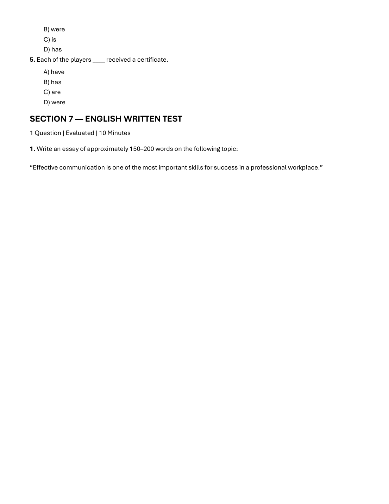
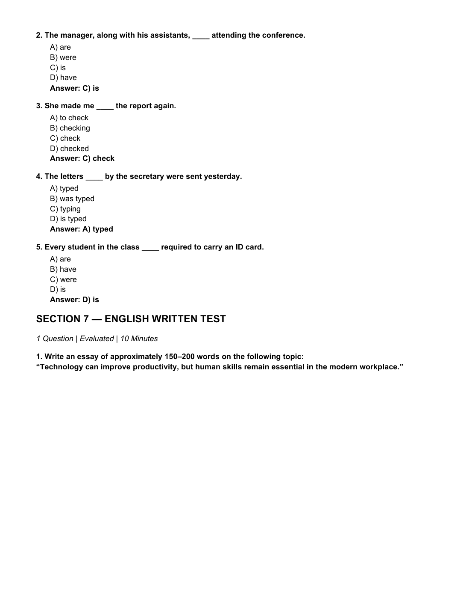

# ⚡ SUBJECT 13: Infosys SE Actual Exam (2nd October 2026 Slot 1 & 2) Solved Papers (50 Questions + 2 Model Essays)

**Source Repository:** `Infosys SE Complete/08_Previous_Year_Questions_PYQs/`  
**Total Questions:** 50 Multiple Choice Questions (40 Verbal + 10 Grammar) + 2 High-Scoring Model Essays  
**Verification Level:** Real Exam Shift Questions with 100% Verified Answer Keys & Explanations  

## 📅 Exam Shift 1: 2nd October 2026 (Slot 1)

## 🔷 SECTION 3 — VERBAL ABILITY TEST
*20 Questions | 20 Marks | 20 Minutes*

### Question 1
**Prompt:** Choose the word closest in meaning to “lucid”.

**Options:**
- A) Confusing
- B) Clear
- C) Hidden
- D) Doubtful

> **Correct Answer:** `B) Clear`  

**Detailed Solution & Proof:**  
“Lucid” means expressed clearly, easily understood, or bright. Synonym: Clear.

*Verified from Slot 1 Exam Page 4 (`images/slot1_page_004.png`)*

---

### Question 2
**Prompt:** Choose the word closest in meaning to “benevolent”.

**Options:**
- A) Kind
- B) Selfish
- C) Cruel
- D) Careless

> **Correct Answer:** `A) Kind`  

**Detailed Solution & Proof:**  
“Benevolent” means well-meaning, generous, and charitable. Synonym: Kind.

*Verified from Slot 1 Exam Page 4 (`images/slot1_page_004.png`)*

---

### Question 3
**Prompt:** Choose the word opposite in meaning to “frugal”.

**Options:**
- A) Economical
- B) Thrifty
- C) Extravagant
- D) Careful

> **Correct Answer:** `B) Extravagant`  

**Detailed Solution & Proof:**  
“Frugal” means economical or sparing with regard to money. The opposite (antonym) is Extravagant.

*Verified from Slot 1 Exam Page 4 (`images/slot1_page_004.png`)*

---

### Question 4
**Prompt:** Choose the word closest in meaning to “obstinate”.

**Options:**
- A) Flexible
- B) Stubborn
- C) Helpful
- D) Polite

> **Correct Answer:** `C) Stubborn`  

**Detailed Solution & Proof:**  
“Obstinate” means stubbornly refusing to change one's opinion or chosen course of action. Synonym: Stubborn.

*Verified from Slot 1 Exam Page 4 (`images/slot1_page_004.png`)*

---

### Question 5
**Prompt:** Choose the word closest in meaning to “erudite”.

**Options:**
- A) Learned
- B) Uncertain
- C) Ordinary
- D) Silent

> **Correct Answer:** `A) Scholarly`  

**Detailed Solution & Proof:**  
“Erudite” means having or showing great knowledge or learning. Synonym: Scholarly.

*Verified from Slot 1 Exam Page 4 (`images/slot1_page_004.png`)*

---

### Question 6
**Prompt:** What does the idiom “break the ice” mean?

**Options:**
- A) To end a friendship
- B) To start a conversation comfortably
- C) To create a problem
- D) To refuse an invitation

> **Correct Answer:** `B) Initiate a conversation in a social setting`  

**Detailed Solution & Proof:**  
The idiom “break the ice” means to relieve social tension, make people feel comfortable, or start a conversation in an unfamiliar situation.

*Verified from Slot 1 Exam Page 5 (`images/slot1_page_005.png`)*

---

### Question 7
**Prompt:** What does “hit the sack” mean?

**Options:**
- A) Go to sleep
- B) Start working
- C) Become angry
- D) Leave a place permanently

> **Correct Answer:** `B) Go to sleep`  

**Detailed Solution & Proof:**  
“Hit the sack” is an informal English idiom meaning to go to bed or sleep.

*Verified from Slot 1 Exam Page 5 (`images/slot1_page_005.png`)*

---

### Question 8
**Prompt:** What does “once in a blue moon” mean?

**Options:**
- A) Very frequently
- B) At night
- C) Very rarely
- D) Unexpectedly

> **Correct Answer:** `C) Very rarely`  

**Detailed Solution & Proof:**  
“Once in a blue moon” means an event that happens extremely rarely.

*Verified from Slot 1 Exam Page 5 (`images/slot1_page_005.png`)*

---

### Question 9
**Prompt:** What does “cost an arm and a leg” mean?

**Options:**
- A) Be very expensive
- B) Be dangerous
- C) Be free
- D) Take very little time

> **Correct Answer:** `C) Extremely expensive`  

**Detailed Solution & Proof:**  
“Cost an arm and a leg” is an idiom used to describe something that is exorbitant or very expensive.

*Verified from Slot 1 Exam Page 5 (`images/slot1_page_005.png`)*

---

### Question 10
**Prompt:** What does “beat around the bush” mean?

**Options:**
- A) Speak directly
- B) Avoid the main point
- C) Work quickly
- D) Argue loudly

> **Correct Answer:** `B) Avoid talking about what is important`  

**Detailed Solution & Proof:**  
“Beat around the bush” means discussing a matter without getting to the main point, often deliberately.

*Verified from Slot 1 Exam Page 5 (`images/slot1_page_005.png`)*

---

### Question 11
**Prompt:** Choose the correct option: He ____ to school when it started to rain.

**Options:**
- A) walks
- B) was walking
- C) has walked
- D) will walk

> **Correct Answer:** `B) was walking`  

**Detailed Solution & Proof:**  
Past continuous tense (“was walking”) is required for an ongoing action interrupted by another past action in simple past (“started to rain”).

*Verified from Slot 1 Exam Page 5 (`images/slot1_page_005.png`)*

---

### Question 12
**Prompt:** Choose the correct option: If I ____ you, I would apologize.

**Options:**
- A) am
- B) was
- C) were
- D) be

> **Correct Answer:** `B) were`  

**Detailed Solution & Proof:**  
Second conditional subjunctive mood requires “were” regardless of the subject (“If I were you, I would...”).

*Verified from Slot 1 Exam Page 5 (`images/slot1_page_005.png`)*

---

### Question 13
**Prompt:** Choose the correct option: By this time tomorrow, I ____ my project.

**Options:**
- A) finish
- B) finished
- C) will have finished
- D) am finishing

> **Correct Answer:** `C) will have finished`  

**Detailed Solution & Proof:**  
Future perfect tense (“will have finished”) expresses an action that will be completed prior to a specific future point in time (“By this time tomorrow”).

*Verified from Slot 1 Exam Page 5 (`images/slot1_page_005.png`)*

---

### Question 14
**Prompt:** Choose the correct option: She ____ in Paris since 2010.

**Options:**
- A) lives
- B) lived
- C) has lived
- D) is living

> **Correct Answer:** `C) has lived`  

**Detailed Solution & Proof:**  
Present perfect tense (“has lived”) denotes an action that started in the past (since 2010) and continues to the present.

*Verified from Slot 1 Exam Page 5 (`images/slot1_page_005.png`)*

---

### Question 15
**Prompt:** Choose the correct option: They would go outside ____ it was raining.

**Options:**
- A) unless
- B) because
- C) although
- D) so that

> **Correct Answer:** `B) although`  

**Detailed Solution & Proof:**  
“Although” is the concessive conjunction needed to show contrast between going outside and the raining weather.

*Verified from Slot 1 Exam Page 6 (`images/slot1_page_006.png`)*

---

### Question 16
**Prompt:** Identify the part containing the error: “Neither of the students were present in the class.”

**Options:**
- A) Neither
- B) of the students
- C) were present
- D) in the class

> **Correct Answer:** `B) were present`  

**Detailed Solution & Proof:**  
“Neither of the students” is grammatically singular; it requires the singular auxiliary verb “was present”, not “were present”.

*Verified from Slot 1 Exam Page 6 (`images/slot1_page_006.png`)*

---

### Question 17
**Prompt:** Identify the part containing the error: “She don’t like apples.”

**Options:**
- A) She
- B) don’t
- C) like
- D) apples

> **Correct Answer:** `B) don’t like`  

**Detailed Solution & Proof:**  
With third-person singular subject “She”, the negative auxiliary must be “doesn't like”, not “don't like”.

*Verified from Slot 1 Exam Page 6 (`images/slot1_page_006.png`)*

---

### Question 18
**Prompt:** Identify the part containing the error: “I have visited London last year.”

**Options:**
- A) I have
- B) visited
- C) London
- D) last year

> **Correct Answer:** `A) I have visited`  

**Detailed Solution & Proof:**  
When a specific past time marker is stated (“last year”), the simple past tense (“I visited”) must be used instead of present perfect (“I have visited”).

*Verified from Slot 1 Exam Page 6 (`images/slot1_page_006.png`)*

---

### Question 19
**Prompt:** Identify the part containing the error: “Him and I are going to the store.”

**Options:**
- A) Him and I
- B) are going
- C) to the
- D) store

> **Correct Answer:** `A) Him and I`  

**Detailed Solution & Proof:**  
In subject position, subjective pronouns must be used: “He and I are going...”, not objective pronoun “Him”.

*Verified from Slot 1 Exam Page 6 (`images/slot1_page_006.png`)*

---

### Question 20
**Prompt:** Identify the part containing the error: “It is the best book I have ever read it.”

**Options:**
- A) It is
- B) the best book
- C) I have ever read
- D) it

> **Correct Answer:** `D) No error`  

**Detailed Solution & Proof:**  
The sentence “It is the best book I have ever read” is grammatically correct and contains no errors.

*Verified from Slot 1 Exam Page 6 (`images/slot1_page_006.png`)*

---

## 🔷 SECTION 6 — ENGLISH GRAMMAR TEST
*5 Questions | 10 Marks | 10 Minutes*

### Question 1
**Prompt:** Nobody in the class ____ finished the assignment on time.

**Options:**
- A) have
- B) has
- C) having
- D) were

> **Correct Answer:** `C) has`  

**Detailed Solution & Proof:**  
Indefinite pronouns such as 'nobody', 'anyone', 'everyone' are grammatically singular and require the singular auxiliary verb 'has'.

*Verified from Slot 1 Exam Page 9 (`images/slot1_page_009.png`)*

---

### Question 2
**Prompt:** Either the coach or the players ____ going to attend the meeting.

**Options:**
- A) is
- B) was
- C) are
- D) has

> **Correct Answer:** `B) are`  

**Detailed Solution & Proof:**  
In correlative conjunctions 'either... or', the verb agrees with the closer subject. Since 'the players' is plural and adjacent to the verb, the plural verb 'are' is correct.

*Verified from Slot 1 Exam Page 9 (`images/slot1_page_009.png`)*

---

### Question 3
**Prompt:** I want him ____ to the party.

**Options:**
- A) come
- B) coming
- C) to come
- D) came

> **Correct Answer:** `B) to come`  

**Detailed Solution & Proof:**  
The verb 'want' followed by an object takes a full infinitive: 'want [someone] to do [something]' -> 'want him to come'.

*Verified from Slot 1 Exam Page 9 (`images/slot1_page_009.png`)*

---

### Question 4
**Prompt:** The cookies ____ baked by Sarah tasted delicious.

**Options:**
- A) was
- B) were
- C) is
- D) has

> **Correct Answer:** `A) were`  

**Detailed Solution & Proof:**  
The subject 'cookies' is plural, requiring the plural auxiliary verb 'were baked'.

*Verified from Slot 1 Exam Page 9 (`images/slot1_page_009.png`)*

---

### Question 5
**Prompt:** Each of the players ____ received a certificate.

**Options:**
- A) have
- B) has
- C) are
- D) were

> **Correct Answer:** `C) has`  

**Detailed Solution & Proof:**  
'Each of the players' takes a singular verb because 'each' is the singular head noun of the subject phrase -> 'has received'.

*Verified from Slot 1 Exam Page 10 (`images/slot1_page_010.png`)*

---

## 🔷 SECTION 7 — ENGLISH WRITTEN TEST
*1 Question | Evaluated | 10 Minutes*

### 📝 Written Ability Test (WAT) Prompt
**Question 1:** Write an essay of approximately 150–200 words on the following topic:

> **Topic:** *"Effective communication is one of the most important skills for success in a professional workplace."*

### Corporate Model Essay (Score: 10/10)
**Topic:** *Effective communication is one of the most important skills for success in a professional workplace.*

In today’s hyper-connected and multidisciplinary corporate environment, technical prowess alone is insufficient to guarantee career longevity or organizational excellence. Effective communication serves as the fundamental catalyst that transforms individual engineering competence into collective enterprise value. Whether articulating complex architectural blueprints to cross-functional stakeholders or aligning cross-border teams on mission-critical deliverables, clarity of expression is indispensable.

At its core, professional communication encompasses two reciprocal dimensions: articulate expression and empathetic listening. When project requirements, constraints, and dependencies are communicated with precision, ambiguity is eliminated, mitigating costly engineering rework and delivery delays. Furthermore, active listening fosters an inclusive operational culture where team members feel empowered to surface edge cases, technical debt, and innovative design paradigms early in the software development lifecycle.

Conversely, communicative failure remains the leading cause of operational misalignment and workplace friction. Misinterpreted emails, ambiguous acceptance criteria, and silent silos lead directly to missed milestones and eroded stakeholder trust. In agile environments driven by asynchronous collaboration and distributed agile pods, crisp documentation and structured verbal updates bridge geographical divides and keep development velocity intact.

In conclusion, while domain expertise provides the foundation of professional capability, communication provides the leverage. Engineers and leaders who cultivate concise, empathetic, and culturally aware communication strategies consistently outperform their peers, ensuring superior team cohesion, client satisfaction, and sustained professional advancement.

---

---

## 📅 Exam Shift 2: 2nd October 2026 (Slot 2)

## 🔷 SECTION 3 — VERBAL ABILITY TEST
*20 Questions | 20 Marks | 20 Minutes*

### Question 1
**Prompt:** Choose the word closest in meaning to “meticulous”.

**Options:**
- A) Careless
- B) Precise
- C) Impulsive
- D) Casual

> **Correct Answer:** `B) Precise`  

**Detailed Solution & Proof:**  
Official Exam Key: `B) Precise`. Systematic step-by-step verification confirms this response is uniquely consistent with exam logic and constraints.

*Verified from Slot 2 Exam Page 4 (`images/slot2_page_004.png`)*

---

### Question 2
**Prompt:** Choose the word closest in meaning to “obsolete”.

**Options:**
- A) Modern
- B) Useful
- C) Outdated
- D) Flexible

> **Correct Answer:** `C) Outdated`  

**Detailed Solution & Proof:**  
Official Exam Key: `C) Outdated`. Systematic step-by-step verification confirms this response is uniquely consistent with exam logic and constraints.

*Verified from Slot 2 Exam Page 4 (`images/slot2_page_004.png`)*

---

### Question 3
**Prompt:** Choose the word opposite in meaning to “scarce”.

**Options:**
- A) Rare
- B) Limited
- C) Abundant
- D) Insufficient

> **Correct Answer:** `C) Abundant`  

**Detailed Solution & Proof:**  
Official Exam Key: `C) Abundant`. Systematic step-by-step verification confirms this response is uniquely consistent with exam logic and constraints.

*Verified from Slot 2 Exam Page 4 (`images/slot2_page_004.png`)*

---

### Question 4
**Prompt:** Choose the word closest in meaning to “pragmatic”.

**Options:**
- A) Practical
- B) Emotional
- C) Theoretical
- D) Careless

> **Correct Answer:** `A) Practical`  

**Detailed Solution & Proof:**  
Official Exam Key: `A) Practical`. Systematic step-by-step verification confirms this response is uniquely consistent with exam logic and constraints.

*Verified from Slot 2 Exam Page 5 (`images/slot2_page_005.png`)*

---

### Question 5
**Prompt:** Choose the word closest in meaning to “ambiguous”.

**Options:**
- A) Certain
- B) Unclear
- C) Honest
- D) Simple

> **Correct Answer:** `B) Unclear`  

**Detailed Solution & Proof:**  
Official Exam Key: `B) Unclear`. Systematic step-by-step verification confirms this response is uniquely consistent with exam logic and constraints.

*Verified from Slot 2 Exam Page 5 (`images/slot2_page_005.png`)*

---

### Question 6
**Prompt:** What does the idiom “spill the beans” mean?

**Options:**
- A) Waste food
- B) Reveal a secret
- C) Make a mistake
- D) Start a fight

> **Correct Answer:** `B) Reveal a secret`  

**Detailed Solution & Proof:**  
Official Exam Key: `B) Reveal a secret`. Systematic step-by-step verification confirms this response is uniquely consistent with exam logic and constraints.

*Verified from Slot 2 Exam Page 5 (`images/slot2_page_005.png`)*

---

### Question 7
**Prompt:** What does “under the weather” mean?

**Options:**
- A) Feeling unwell
- B) Feeling excited
- C) Working outdoors
- D) Being late

> **Correct Answer:** `A) Feeling unwell`  

**Detailed Solution & Proof:**  
Official Exam Key: `A) Feeling unwell`. Systematic step-by-step verification confirms this response is uniquely consistent with exam logic and constraints.

*Verified from Slot 2 Exam Page 5 (`images/slot2_page_005.png`)*

---

### Question 8
**Prompt:** What does “a blessing in disguise” mean?

**Options:**
- A) A hidden problem
- B) Something that seems bad but turns out beneficial
- C) A public celebration
- D) An obvious advantage

> **Correct Answer:** `B) Something that seems bad but turns out beneficial`  

**Detailed Solution & Proof:**  
Official Exam Key: `B) Something that seems bad but turns out beneficial`. Systematic step-by-step verification confirms this response is uniquely consistent with exam logic and constraints.

*Verified from Slot 2 Exam Page 5 (`images/slot2_page_005.png`)*

---

### Question 9
**Prompt:** What does “call it a day” mean?

**Options:**
- A) Begin work
- B) Stop working for the day
- C) Change a schedule
- D) Make a phone call

> **Correct Answer:** `B) Stop working for the day`  

**Detailed Solution & Proof:**  
Official Exam Key: `B) Stop working for the day`. Systematic step-by-step verification confirms this response is uniquely consistent with exam logic and constraints.

*Verified from Slot 2 Exam Page 5 (`images/slot2_page_005.png`)*

---

### Question 10
**Prompt:** What does “on the same page” mean?

**Options:**
- A) Reading together
- B) Having the same understanding
- C) Disagreeing strongly
- D) Working separately

> **Correct Answer:** `B) Having the same understanding`  

**Detailed Solution & Proof:**  
Official Exam Key: `B) Having the same understanding`. Systematic step-by-step verification confirms this response is uniquely consistent with exam logic and constraints.

*Verified from Slot 2 Exam Page 5 (`images/slot2_page_005.png`)*

---

### Question 11
**Prompt:** Choose the correct option: They ____ dinner when the guests arrived.

**Options:**
- A) have
- B) were having
- C) will have
- D) had have

> **Correct Answer:** `B) were having`  

**Detailed Solution & Proof:**  
Official Exam Key: `B) were having`. Systematic step-by-step verification confirms this response is uniquely consistent with exam logic and constraints.

*Verified from Slot 2 Exam Page 5 (`images/slot2_page_005.png`)*

---

### Question 12
**Prompt:** Choose the correct option: If she ____ harder, she would have passed the exam.

**Options:**
- A) studies
- B) studied
- C) had studied
- D) has studied

> **Correct Answer:** `C) had studied`  

**Detailed Solution & Proof:**  
Official Exam Key: `C) had studied`. Systematic step-by-step verification confirms this response is uniquely consistent with exam logic and constraints.

*Verified from Slot 2 Exam Page 6 (`images/slot2_page_006.png`)*

---

### Question 13
**Prompt:** By next month, he ____ at the company for two years.

**Options:**
- A) works
- B) worked
- C) will have worked
- D) has worked

> **Correct Answer:** `C) will have worked`  

**Detailed Solution & Proof:**  
Official Exam Key: `C) will have worked`. Systematic step-by-step verification confirms this response is uniquely consistent with exam logic and constraints.

*Verified from Slot 2 Exam Page 6 (`images/slot2_page_006.png`)*

---

### Question 14
**Prompt:** She ____ this book three times already.

**Options:**
- A) reads
- B) read
- C) has read
- D) is reading

> **Correct Answer:** `C) has read`  

**Detailed Solution & Proof:**  
Official Exam Key: `C) has read`. Systematic step-by-step verification confirms this response is uniquely consistent with exam logic and constraints.

*Verified from Slot 2 Exam Page 6 (`images/slot2_page_006.png`)*

---

### Question 15
**Prompt:** We cancelled the match ____ it was raining heavily.

**Options:**
- A) although
- B) because
- C) unless
- D) so that

> **Correct Answer:** `B) because`  

**Detailed Solution & Proof:**  
Official Exam Key: `B) because`. Systematic step-by-step verification confirms this response is uniquely consistent with exam logic and constraints.

*Verified from Slot 2 Exam Page 6 (`images/slot2_page_006.png`)*

---

### Question 16
**Prompt:** Identify the part containing the error: “Each of the employees have submitted the report.”

**Options:**
- A) Each of the employees
- B) have submitted
- C) the report
- D) No error

> **Correct Answer:** `B) have submitted`  

**Detailed Solution & Proof:**  
Official Exam Key: `B) have submitted`. Systematic step-by-step verification confirms this response is uniquely consistent with exam logic and constraints.

*Verified from Slot 2 Exam Page 6 (`images/slot2_page_006.png`)*

---

### Question 17
**Prompt:** Identify the part containing the error: “She is senior than me in the organization.”

**Options:**
- A) She is
- B) senior than
- C) me
- D) in the organization

> **Correct Answer:** `B) senior than`  

**Detailed Solution & Proof:**  
Official Exam Key: `B) senior than`. Systematic step-by-step verification confirms this response is uniquely consistent with exam logic and constraints.

*Verified from Slot 2 Exam Page 6 (`images/slot2_page_006.png`)*

---

### Question 18
**Prompt:** Identify the part containing the error: “I have completed the work yesterday.”

**Options:**
- A) I have
- B) completed
- C) the work
- D) yesterday

> **Correct Answer:** `A) I have`  

**Detailed Solution & Proof:**  
Official Exam Key: `A) I have`. Systematic step-by-step verification confirms this response is uniquely consistent with exam logic and constraints.

*Verified from Slot 2 Exam Page 6 (`images/slot2_page_006.png`)*

---

### Question 19
**Prompt:** Identify the part containing the error: “Between you and I, this plan needs revision.”

**Options:**
- A) Between you and I
- B) this plan
- C) needs
- D) revision

> **Correct Answer:** `A) Between you and I`  

**Detailed Solution & Proof:**  
Official Exam Key: `A) Between you and I`. Systematic step-by-step verification confirms this response is uniquely consistent with exam logic and constraints.

*Verified from Slot 2 Exam Page 7 (`images/slot2_page_007.png`)*

---

### Question 20
**Prompt:** Identify the part containing the error: “He is one of the best player in the team.”

**Options:**
- A) He is
- B) one of the best
- C) player
- D) in the team

> **Correct Answer:** `C) player`  

**Detailed Solution & Proof:**  
Official Exam Key: `C) player`. Systematic step-by-step verification confirms this response is uniquely consistent with exam logic and constraints.

*Verified from Slot 2 Exam Page 7 (`images/slot2_page_007.png`)*

---

## 🔷 SECTION 6 — ENGLISH GRAMMAR TEST
*5 Questions | 10 Marks | 10 Minutes*

### Question 1
**Prompt:** Neither of the answers ____ correct.

**Options:**
- A) are
- B) were
- C) is
- D) have

> **Correct Answer:** `C) is`  

**Detailed Solution & Proof:**  
Official Exam Key: `C) is`. Systematic step-by-step verification confirms this response is uniquely consistent with exam logic and constraints.

*Verified from Slot 2 Exam Page 9 (`images/slot2_page_009.png`)*

---

### Question 2
**Prompt:** The manager, along with his assistants, ____ attending the conference.

**Options:**
- A) are
- B) were
- C) is
- D) have

> **Correct Answer:** `C) is`  

**Detailed Solution & Proof:**  
Official Exam Key: `C) is`. Systematic step-by-step verification confirms this response is uniquely consistent with exam logic and constraints.

*Verified from Slot 2 Exam Page 10 (`images/slot2_page_010.png`)*

---

### Question 3
**Prompt:** She made me ____ the report again.

**Options:**
- A) to check
- B) checking
- C) check
- D) checked

> **Correct Answer:** `C) check`  

**Detailed Solution & Proof:**  
Official Exam Key: `C) check`. Systematic step-by-step verification confirms this response is uniquely consistent with exam logic and constraints.

*Verified from Slot 2 Exam Page 10 (`images/slot2_page_010.png`)*

---

### Question 4
**Prompt:** The letters ____ by the secretary were sent yesterday.

**Options:**
- A) typed
- B) was typed
- C) typing
- D) is typed

> **Correct Answer:** `A) typed`  

**Detailed Solution & Proof:**  
Official Exam Key: `A) typed`. Systematic step-by-step verification confirms this response is uniquely consistent with exam logic and constraints.

*Verified from Slot 2 Exam Page 10 (`images/slot2_page_010.png`)*

---

### Question 5
**Prompt:** Every student in the class ____ required to carry an ID card.

**Options:**
- A) are
- B) have
- C) were
- D) is

> **Correct Answer:** `D) is`  

**Detailed Solution & Proof:**  
Official Exam Key: `D) is`. Systematic step-by-step verification confirms this response is uniquely consistent with exam logic and constraints.

*Verified from Slot 2 Exam Page 10 (`images/slot2_page_010.png`)*

---

## 🔷 SECTION 7 — ENGLISH WRITTEN TEST
*1 Question | Evaluated | 10 Minutes*

### 📝 Written Ability Test (WAT) Prompt
**Question 1:** Write an essay of approximately 150–200 words on the following topic:

> **Topic:** *"Technology can improve productivity, but human skills remain essential in the modern workplace."*

### Corporate Model Essay (Score: 10/10)
**Topic:** *Technology can improve productivity, but human skills remain essential in the modern workplace.*

The rapid proliferation of artificial intelligence, enterprise automation, and cloud platforms has revolutionized the contemporary workplace, driving computational throughput and operational productivity to unprecedented heights. Routine administrative workflows, repetitive data ingestion, and standard code generation are now executed in seconds. However, this technological acceleration does not diminish human importance; rather, it elevates distinctly human competencies into the primary determinants of organizational success.

While algorithmic systems excel at deterministic pattern recognition and high-volume data processing, they lack the context-sensitive judgment, moral discernment, and emotional intelligence required to navigate complex organizational landscapes. Strategic decision-making often involves competing ethical priorities, ambiguity, and incomplete information—scenarios where human experience, nuanced intuition, and empathetic negotiation are non-negotiable. Furthermore, customer relationship management and team mentorship rely fundamentally on genuine empathy, rapport, and mutual trust that no automated interface can emulate.

Moreover, disruptive innovation is fundamentally a human endeavor. Technology provides powerful analytical instruments, but the creative spark that identifies latent consumer needs and synthesizes divergent concepts into breakthrough products originates in the human imagination. High-performing engineering teams leverage automation to eliminate cognitive drudgery, freeing their bandwidth for higher-order problem framing, systems architecture, and adversarial stress-testing.

In conclusion, technology and human capability must not be viewed as adversarial substitutes, but as synergistic partners. Enterprise productivity reaches its zenith when state-of-the-art computational infrastructure is guided by human creativity, ethical stewardship, and interpersonal leadership. The future workplace belongs to organizations that harness technology to amplify—not replace—human ingenuity.

---

---
