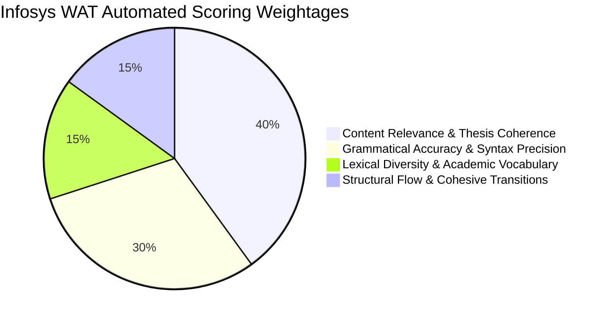
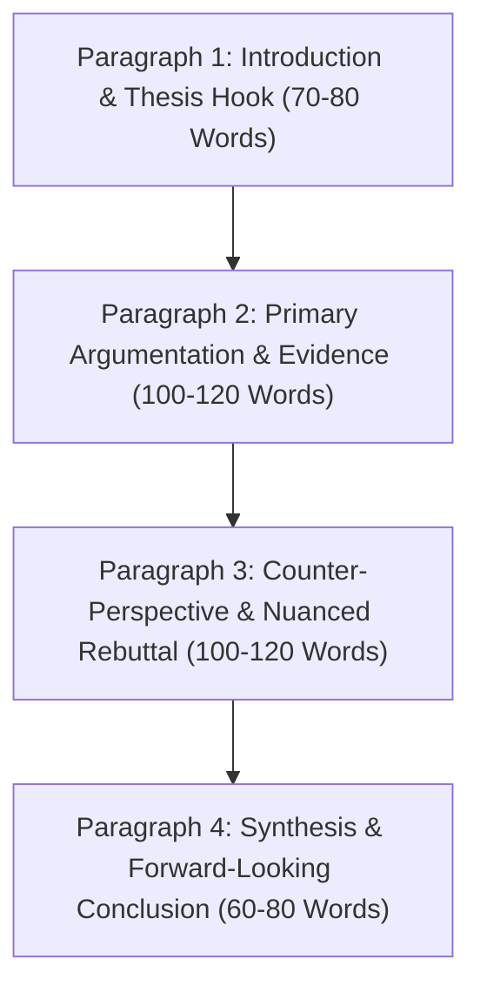
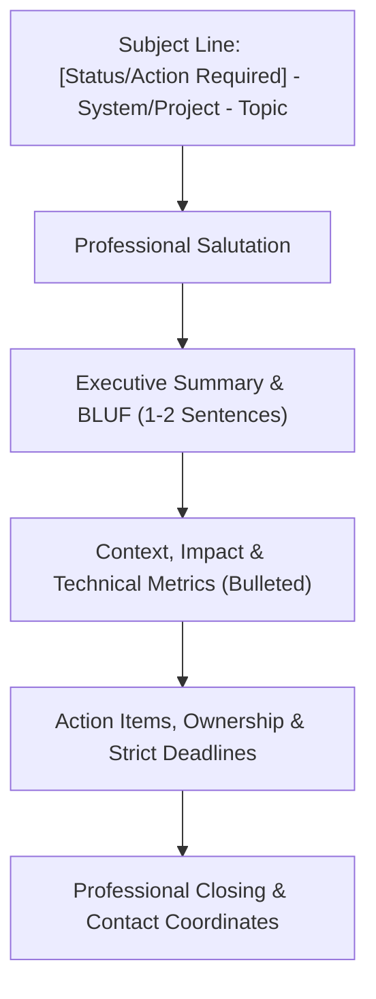

# 👑 INFOSYS SYSTEMS ENGINEER (SE) — COMPLETE ENGLISH GRAMMAR, VERBAL ABILITY & WRITING ALL-IN-ONE MASTER COMPENDIUM

> **Primacy Directive (Shivam SEED Protocol):**  
> *"All means ALL — completely, fully, entirely, exhaustively, comprehensively, without exception, without omission, covering every single aspect, category, component, detail, rule, formula, shortcut, question, option, solution, and model essay with nothing left out."*

**Target Role:** Infosys Systems Engineer (SE) & Specialist Programmer (SP / DSE)  
**Consolidated Modules Covered:**
1. **English Grammar & Syntax Master Rulebook** (Concord, Tenses, Modifiers, Parallelism, Prepositions, Articles, Pronouns, Voice & Speech)
2. **Spotting Errors & Sentence Correction** (PrepInsta + CampusMonk + ITM Question Banks with Full Grammatical Proofs)
3. **Sentence Completion & Cloze Tests** (Context Clues, Single/Double Fillers, Paragraph Cloze Passages)
4. **Para Jumbles & Sentence Rearrangement** (Algorithmic Logic Chains, Mandatory Pairs, Pronoun Links)
5. **Reading Comprehension (RC) Masterclass** (Passage Vault, Question Archetypes, Inference Deductions)
6. **Critical Reasoning & Deductive Verbal Logic** (Premise-Assumption-Conclusion Framework, Argument Evaluation)
7. **High-Frequency Vocabulary, Root Words, Idioms & Verbal Analogies** (Word Roots, Synonyms/Antonyms, Idiom Catalog)
8. **Written Ability Test (WAT) & Essay Writing Master Vault** (NLP Rubrics, 4-Paragraph Architecture, Top 50 Model Essays)
9. **Corporate Business Email Writing Protocols** (5-Part Professional Framework, Software Engineer Real-World Scenarios)
10. **Master Question Bank & Answer Key Directory** (100% Verified Answers & Explanations)

---

# 📑 TABLE OF CONTENTS

- [👑 Executive Overview: Infosys SE Verbal & Written Ability Blueprint](#-executive-overview-infosys-se-verbal--written-ability-blueprint)
- [📘 SUBJECT 1: Foundational English Grammar & Syntax Master Rulebook](#-subject-1-foundational-english-grammar--syntax-master-rulebook)
  - [1.1 Subject-Verb Agreement (The 25 Master Rules of Concord)](#11-subject-verb-agreement-the-25-master-rules-of-concord)
  - [1.2 Tenses, Temporal Sequences & Conditional Logic](#12-tenses-temporal-sequences--conditional-logic)
  - [1.3 Modifiers, Participial Clauses & Dangling Modifiers](#13-modifiers-participial-clauses--dangling-modifiers)
  - [1.4 Parallelism & Syntactic Symmetry](#14-parallelism--syntactic-symmetry)
  - [1.5 Prepositions & Fixed Phrasal Prepositions Master Catalog](#15-prepositions--fixed-phrasal-prepositions-master-catalog)
  - [1.6 Articles, Determiners & Quantifiers](#16-articles-determiners--quantifiers)
  - [1.7 Pronouns, Case Hierarchy & Antecedent Agreement](#17-pronouns-case-hierarchy--antecedent-agreement)
  - [1.8 Active/Passive Voice Transformations & Direct/Indirect Speech](#18-activepassive-voice-transformations--directindirect-speech)
- [🔍 SUBJECT 2: Spotting Errors & Sentence Correction Masterclass](#-subject-2-spotting-errors--sentence-correction-masterclass)
  - [2.1 The 4-Step Systematic Elimination Protocol](#21-the-4-step-systematic-elimination-protocol)
  - [2.2 PrepInsta Spotting Errors Rules & Tricks](#22-prepinsta-spotting-errors-rules--tricks)
  - [2.3 PrepInsta Spotting Errors Verified Practice Question Bank](#23-prepinsta-spotting-errors-verified-practice-question-bank)
  - [2.4 PrepInsta Sentence Correction Rules & Tricks](#24-prepinsta-sentence-correction-rules--tricks)
  - [2.5 PrepInsta Sentence Correction Verified Practice Question Bank](#25-prepinsta-sentence-correction-verified-practice-question-bank)
  - [2.6 Advanced High-Yield Spotting Errors & Correction Problem Sets](#26-advanced-high-yield-spotting-errors--correction-problem-sets)
- [📝 SUBJECT 3: Sentence Completion & Cloze Test Masterclass](#-subject-3-sentence-completion--cloze-test-masterclass)
  - [3.1 Strategic Taxonomies (Single Fillers, Double Fillers, Cloze Passages)](#31-strategic-taxonomies-single-fillers-double-fillers-cloze-passages)
  - [3.2 Context Clue Decoding & Discourse Markers](#32-context-clue-decoding--discourse-markers)
  - [3.3 High-Yield Sentence Completion Practice Problems & Solutions](#33-high-yield-sentence-completion-practice-problems--solutions)
- [🔀 SUBJECT 4: Para Jumbles & Sentence Rearrangement Masterclass](#-subject-4-para-jumbles--sentence-rearrangement-masterclass)
  - [4.1 The Algorithmic Unravelling Strategy (Mandatory Pairs & Logic Links)](#41-the-algorithmic-unravelling-strategy-mandatory-pairs--logic-links)
  - [4.2 PrepInsta Para Jumbles Rules & Fast-Solving Strategies](#42-prepinsta-para-jumbles-rules--fast-solving-strategies)
  - [4.3 PrepInsta Para Jumbles 10 Verified Test Questions with Logic Chains](#43-prepinsta-para-jumbles-10-verified-test-questions-with-logic-chains)
  - [4.4 Advanced Multi-Sentence PYQ Para Jumble Problem Sets](#44-advanced-multi-sentence-pyq-para-jumble-problem-sets)
- [📖 SUBJECT 5: Reading Comprehension (RC) Strategic Mastery & Passage Vault](#-subject-5-reading-comprehension-rc-strategic-mastery--passage-vault)
  - [5.1 The 4-Phase RC Decoupling Strategy](#51-the-4-phase-rc-decoupling-strategy)
  - [5.2 Question Archetypes & Trap Elimination Matrix](#52-question-archetypes--trap-elimination-matrix)
  - [5.3 PrepInsta Complete RC Passage Vault & Verified Question Bank](#53-prepinsta-complete-rc-passage-vault--verified-question-bank)
  - [5.4 Advanced Scientific, Economic & Philosophical Reading Passages](#54-advanced-scientific-economic--philosophical-reading-passages)
- [🧠 SUBJECT 6: Critical Reasoning & Deductive Verbal Logic](#-subject-6-critical-reasoning--deductive-verbal-logic)
  - [6.1 The Analytical Triad: Premise, Assumption & Conclusion](#61-the-analytical-triad-premise-assumption--conclusion)
  - [6.2 The Negation Test for Hidden Assumptions](#62-the-negation-test-for-hidden-assumptions)
  - [6.3 Weaken, Strengthen & Flaw-in-the-Reasoning Archetypes](#63-weaken-strengthen--flaw-in-the-reasoning-archetypes)
  - [6.4 PrepInsta Verbatim Critical Reasoning Question Bank with Logical Proofs](#64-prepinsta-verbatim-critical-reasoning-question-bank-with-logical-proofs)
- [📚 SUBJECT 7: High-Frequency Vocabulary, Root Words, Idioms & Analogies](#-subject-7-high-frequency-vocabulary-root-words-idioms--analogies)
  - [7.1 Etymological Root Words Catalog (Greek & Latin Morphemes)](#71-etymological-root-words-catalog-greek--latin-morphemes)
  - [7.2 Top 100 High-Yield Infosys GRE-Grade Vocabulary Words](#72-top-100-high-yield-infosys-gre-grade-vocabulary-words)
  - [7.3 Essential Corporate & Academic Idioms Catalog](#73-essential-corporate--academic-idioms-catalog)
  - [7.4 Verbal Analogies Matrix & Proportional Reasoning](#74-verbal-analogies-matrix--proportional-reasoning)
  - [7.5 PrepInsta Analogy & Vocabulary Verified Practice Questions](#75-prepinsta-analogy--vocabulary-verified-practice-questions)
- [✍️ SUBJECT 8: Written Ability Test (WAT) & Master Essay Writing Vault](#-subject-8-written-ability-test-wat--master-essay-writing-vault)
  - [8.1 Official Infosys WAT Examination Specifications & NLP Scoring Engine](#81-official-infosys-wat-examination-specifications--nlp-scoring-engine)
  - [8.2 The 4-Paragraph Golden Architectural Essay Blueprint](#82-the-4-paragraph-golden-architectural-essay-blueprint)
  - [8.3 Master Discourse Signposting & Transition Bank](#83-master-discourse-signposting--transition-bank)
  - [8.4 The Top 50 Comprehensive Model Essays Collection](#84-the-top-50-comprehensive-model-essays-collection)
    - [Thematic Group 1: Technology, AI, Automation & Cyberspace (Essays 1-15)](#thematic-group-1-technology-ai-automation--cyberspace-essays-1-15)
    - [Thematic Group 2: Ethics, Philosophy, Success & Human Values (Essays 16-28)](#thematic-group-2-ethics-philosophy-success--human-values-essays-16-28)
    - [Thematic Group 3: Corporate Culture, Leadership & Modern Economy (Essays 29-40)](#thematic-group-3-corporate-culture-leadership--modern-economy-essays-29-40)
    - [Thematic Group 4: Social Media, Youth, Education & Global Society (Essays 41-50)](#thematic-group-4-social-media-youth-education--global-society-essays-41-50)
- [📧 SUBJECT 9: Corporate Business Email Writing Protocols & Templates](#-subject-9-corporate-business-email-writing-protocols--templates)
  - [9.1 The 5-Part Professional Email Architecture](#91-the-5-part-professional-email-architecture)
  - [9.2 Professional Software Engineering Email Simulations](#92-professional-software-engineering-email-simulations)
- [🎯 SUBJECT 10: Master Answer Key & Quick Revision Matrix](#-subject-10-master-answer-key--quick-revision-matrix)

---

# 👑 Executive Overview: Infosys SE Verbal & Written Ability Blueprint

The Infosys recruitment examination for Systems Engineer (SE) evaluates verbal agility, linguistic precision, grammatical compliance, and analytical synthesis.

| Examination Component | Section Name | Questions | Time Allocated | Sectional Cutoff | Key Competencies Tested |
| :--- | :--- | :---: | :---: | :---: | :--- |
| **Section 3** | **Verbal Ability** | 20 Questions | 20 Minutes | ~70% (14+ Marks) | Grammar, Spotting Errors, Sentence Correction, Para Jumbles, Reading Comprehension, Critical Reasoning, Vocabulary |
| **Round 2 / WAT** | **Written Ability Test** | 1 Essay / Email | 20-30 Minutes | Grade B+ / 75%+ | Linguistic coherence, paragraph architecture, lexical diversity, argument synthesis, grammatical correctness |

### Core Scoring & Tactical Realities:
1. **Speed Benchmark:** Candidates have exactly **60 seconds per question** in Section 3. Grammatical rules and syntax patterns must be accessible via subconscious muscle memory.
2. **Reading Speed:** Reading comprehension passages must be skimmed within 90-120 seconds using the *Question-First Skimming Protocol*.
3. **Automated NLP Evaluation for WAT:** Infosys employs an automated natural language processing (NLP) scoring engine evaluating:
   - **Grammatical Accuracy:** Zero tolerance for subject-verb agreement or sentence fragment errors.
   - **Lexical Resource:** Variety of domain-relevant academic vocabulary and transition signposts.
   - **Coherence & Cohesion:** Clear thesis statement, topic sentences, and logical progression across paragraphs.

---
# 📘 SUBJECT 1: Foundational English Grammar & Syntax Master Rulebook

Grammar in competitive recruitment is not arbitrary convention; it is a deterministic, logical system of constraints. Below is the complete, forensic rulebook governing syntax, morphology, and concord.

---

## Executive Overview & Architectural Blueprint
In the Infosys System Engineer examination, **Verbal Ability (Section 3)** evaluates syntactic accuracy, grammatical precision, and contextual comprehension across **40 questions in 35 minutes**. Grammatical questions form over 45% of this section, concentrating heavily on:
1. **Subject-Verb Agreement (Rules of Concord)**
2. **Tenses, Aspect & Sequence of Tenses**
3. **Modifiers, Participial Phrases & Dangling Modifiers**
4. **Parallelism & Structural Symmetry**
5. **Prepositions, Phrasal Verbs & Fixed Collocations**
6. **Articles, Quantifiers & Determiners**
7. **Pronoun Antecedent Agreement & Case Hierarchy**
8. **Active vs. Passive Voice & Direct vs. Indirect Speech Transformations**
9. **Conditional Sentences (Zero, First, Second, Third, Mixed) & Subjunctive Mood**
10. **Conjunctions, Correlative Connectors & Sentence Architecture**

This master rulebook provides the complete theoretical foundation, formal algebraic grammar laws, forensic exception matrices, and high-resolution plate references extracted across all four premier preparation repositories.

---


## Part 1: Subject-Verb Agreement (The 25 Master Rules of Concord)
Subject-verb agreement dictates that the grammatical number and person of the subject must align strictly with the finite verb of the clause.

### The Fundamental Axiom
$$\text{Singular Subject} \implies \text{Singular Verb (ends in -s/-es in present simple)}$$
$$\text{Plural Subject} \implies \text{Plural Verb (base form without -s/-es)}$$

### Rule 01: Intervening Prepositional and Parenthetical Phrases
Words intervening between the grammatical subject and the finite verb do **not** affect the number of the verb.
- **Intervening Connectors**: *as well as, along with, together with, in addition to, accompanied by, with, like, unlike, besides, except, including, rather than, together with*.
- **Formula**: $S_1 + \text{[intervening phrase]} + S_2 \implies \text{Verb agrees strictly with } S_1$.
- **Examples**:
  - *Incorrect*: The chairman, along with his board members, **were** present at the symposium.
  - *Correct*: The chairman, along with his board members, **was** present at the symposium.
  - *Proof*: The true grammatical subject is 'The chairman' (singular). The prepositional phrase 'along with his board members' is parenthetical adjunct.

### Rule 02: Correlative Conjunctions & Proximity Rule
When two subjects are joined by correlative conjunctions:
- *either... or*
- *neither... nor*
- *not only... but also*
- *or / nor*
- **Formula**: The verb strictly agrees with the subject **closest (proximate)** to it.
- **Examples**:
  - *Neither the lead architect nor the software engineers **were** available for the deployment.* (Agrees with 'software engineers' - plural).
  - *Neither the software engineers nor the lead architect **was** available for the deployment.* (Agrees with 'lead architect' - singular).
  - *Not only the manager but also his direct subordinates **are** attending the briefing.*

### Rule 03: Distributive Indefinite Pronouns (Always Singular)
The following pronouns are grammatically singular in all standard syntactic contexts and mandate a singular verb:
- *Each, Every, Everyone, Someone, Anyone, No one, Everybody, Somebody, Anybody, Nobody, Either, Neither, One, Another, Much, Little*.
- **Formula**: $\text{Distributive Pronoun} + \text{[of the + Plural Noun]} \implies \text{Singular Verb}$.
- **Examples**:
  - *Each of the participants **has** submitted their project repository.* (Never 'have').
  - *Neither of the two candidates **is** qualified for the senior architect role.*
  - *Everyone among the newly recruited engineers **was** awarded an onboarding kit.*

### Rule 04: 'Many a' vs. 'A Great Many' vs. 'Many'
- **Formula A**: $\text{Many a} + \text{Singular Countable Noun} + \text{Singular Verb}$.
  - *Example*: *Many a candidate **has** failed to clear the pseudocode round.*
- **Formula B**: $\text{Many} / \text{A great many} / \text{A good many} + \text{Plural Countable Noun} + \text{Plural Verb}$.
  - *Example*: *A great many candidates **have** cleared the initial screening.*

### Rule 05: 'The Number of' vs. 'A Number of'
- **Formula A**: $\text{The number of} + \text{Plural Noun} \implies \text{Singular Verb}$ (Indicates a specific numerical statistic).
  - *Example*: *The number of applicants for the Systems Engineer role **is** increasing exponentially.*
- **Formula B**: $\text{A number of} + \text{Plural Noun} \implies \text{Plural Verb}$ (Functions as a quantifier meaning 'several/many').
  - *Example*: *A number of selected candidates **are** relocating to the Mysore campus.*

### Rule 06: Collective Nouns: Unity vs. Division
- **When acting as a unified entity**: Requires a **singular verb** and neuter singular pronoun (*it/its*).
  - *The committee **has** submitted **its** unanimous verdict.*
  - *The jury **was** in complete agreement.*
  - *The army **is** advancing toward the border.*
- **When members act individually, in disagreement, or separately**: Requires a **plural verb** and plural pronoun (*their*).
  - *The committee **were** divided in **their** opinions regarding the quarterly budget.*
  - *The jury **were** unable to agree on a single verdict.*
  - *The audience **are** taking **their** respective seats in the auditorium.*

### Rule 07: Fractions, Percentages & Quantifiers with 'Of'
For fractions, percentages, and indefinite quantifiers (*half of, two-thirds of, percent of, some of, all of, most of, plenty of, a lot of*):
- **Formula**: The verb agrees with the noun in the prepositional phrase following 'of'.
- **Countable Plural Noun**: Requires **plural verb**.
  - *Two-thirds of the servers **are** operating at peak capacity.*
  - *Forty percent of the students **have** registered for the mock test.*
- **Uncountable Noun**: Requires **singular verb**.
  - *Two-thirds of the data **has** been successfully replicated.*
  - *Most of the codebase **is** written in modern C++.*

### Rule 08: Plural in Form, Singular in Meaning
Certain nouns terminate in '-s' but are logically singular entities and mandate a **singular verb**:
- **Academic Subjects**: *Mathematics, Physics, Economics, Statistics, Electronics, Mechanics, Linguistics, Civics*.
  - *Economics **is** an essential foundation for financial software development.*
  - *Exception*: When preceded by a possessive pronoun or 'the' denoting practical data or calculations, they take a plural verb: *His mathematics **are** weak.* / *The statistics **show** a distinct trend.*
- **Diseases**: *Measles, Mumps, Rickets, Shingles, Rabies*.
  - *Measles **is** a highly contagious viral illness.*
- **Sports & Games**: *Billiards, Darts, Dominoes, Bowls*.
  - *Billiards **is** played across the commonwealth.*
- **Countries / Organizations**: *The United States, The Netherlands, The United Nations, Gulliver's Travels*.
  - *The United States **has** updated its tech immigration policies.*

### Rule 09: Always Plural Nouns (Paired Objects)
Nouns consisting of two symmetrical parts take a **plural verb** unless quantified by 'a pair of':
- *Scissors, pliers, tweezers, tongs, spectacles, glasses, trousers, jeans, pants, binoculars, shears*.
  - *These scissors **are** dull and need sharpening.*
  - *A pair of scissors **was** lying on the workbench.*

### Rule 10: Adjectives Preceded by 'The' (Denoting a Plural Class)
When 'The' precedes an adjective without an accompanying noun, it designates the entire class of people and requires a **plural verb**:
- *The rich, the poor, the underprivileged, the elderly, the injured, the unemployed, the educated*.
  - *The poor **are** entitled to equitable healthcare access.* (Never 'The poors' or 'The poor is').
  - *The injured **were** immediately transported to the trauma care facility.*

### Rule 11: Inverted Sentences (Verb Preceding Subject)
In sentences commencing with adverbs, locatives, or preparatory *there / here*, the grammatical subject follows the verb.
- **Formula**: Verb must agree with the post-positioned grammatical subject.
- **Examples**:
  - *There **are** three critical security vulnerabilities in this module.* (Subject: 'three critical security vulnerabilities').
  - *There **is** a severe memory leak in the garbage collection loop.* (Subject: 'a severe memory leak').
  - *Seldom **has** a candidate demonstrated such mathematical agility.*

### Rule 12: Relative Pronouns (*Who, Which, That*)
When a relative pronoun serves as the subject of an adjective clause, its verb agrees in number and person with its **antecedent** (the noun directly preceding it).
- **Formula**: $N_1 + \text{who/which/that} + \text{Verb} \implies \text{Verb agrees with } N_1$.
- **Examples**:
  - *He is one of those programmers who **write** clean, self-documenting code.* (Antecedent is 'programmers' - plural; thus 'write').
  - *He is the **only one** of the candidates who **has** solved the dynamic programming problem.* ('The only one' makes the antecedent uniquely singular; thus 'has').

### Rule 13: Units of Measurement, Time, Distance & Money
When a plural noun denotes a single collective quantity, measurement, period of time, or monetary sum, it takes a **singular verb**:
- *Ten thousand rupees **is** a reasonable subscription price for the training.*
- *Five kilometers **is** an easy distance to cover during the morning run.*
- *Three years **is** the standard duration of the degree course.*
- *Exception*: When the units are considered individually: *Ten silver rupees **were** distributed among the contest winners.*

### Rule 14: Compound Subjects Joined by 'And'
- **Standard**: Two or more subjects joined by 'and' take a **plural verb**:
  - *Python and Java **are** object-oriented programming languages.*
- **Exception 1 (Singular Idea / Pair)**: When two nouns express a single integrated concept or dish, they take a **singular verb**:
  - *Bread and butter **is** wholesome breakfast.*
  - *Slow and steady **wins** the race.*
  - *Time and tide **waits** for no man.*
  - *The horse and carriage **is** waiting at the entrance.*
- **Exception 2 (Same Person / Entity)**: When two nouns refer to the same individual (indicated by an article before only the first noun):
  - *The director and producer **has** arrived.* (One person holding both titles).
  - *The director and **the** producer **have** arrived.* (Two distinct individuals).

### Rule 15: Mathematical Calculations
In mathematical statements of addition, multiplication, or equality, singular verbs are standard in formal grammar:
- *Two and two **is** four.* (Or *makes four*).
- *Five times five **is** twenty-five.*

---
## Part 2: Tenses, Temporal Sequence & Conditional Logic

### The 12 Tense Matrix
| Tense Category | Simple / Indefinite | Continuous / Progressive | Perfect | Perfect Continuous |
| :--- | :--- | :--- | :--- | :--- |
| **Present** | $V_1 / V_1+s/es$ | $is/am/are + V_{ing}$ | $has/have + V_3$ | $has/have + been + V_{ing}$ |
| **Past** | $V_2$ | $was/were + V_{ing}$ | $had + V_3$ | $had + been + V_{ing}$ |
| **Future** | $will/shall + V_1$ | $will + be + V_{ing}$ | $will + have + V_3$ | $will + have + been + V_{ing}$ |

### Sequence of Tenses (The Master Rules)
1. **Past Principal Clause**: When the verb in the main clause is in the Past Tense, verbs in subordinate clauses must also be in a corresponding past tense.
   - *Example*: *He said that he **would** join the development sprint the next day.* (Not 'will').
   - *Exception (Universal Truth)*: If the subordinate clause expresses a timeless fact, scientific law, or universal truth, it remains in the **Simple Present Tense**:
     - *The professor demonstrated that light **travels** in a straight line.* (Never 'traveled').
2. **Present/Future Principal Clause**: The subordinate clause can take any tense required by the intended meaning:
   - *She knows that he **was** in Pune yesterday.*
   - *She knows that he **is** working on the backend today.*
   - *She knows that he **will** submit the pull request tomorrow.*

### 'Since' and Tense Symmetry
When 'since' functions as a conjunction of time:
- **Formula**: $\text{Present Perfect} + \text{since} + \text{Simple Past } (V_2)$.
- **Example**: *Five years **have passed** since he **graduated** from the engineering institute.*
- **Example**: *I **have not seen** her since she **left** for Bangalore.*

### Past Perfect vs. Simple Past (Temporal Precedence)
When two actions occurred in the past, the action that took place **earlier** must be rendered in the **Past Perfect ($had + V_3$)**, while the subsequent action takes the **Simple Past ($V_2$)**.
- **Formula**: $\text{Action 1 (Earlier)} = had + V_3 \quad | \quad \text{Action 2 (Later)} = V_2$.
- **Examples**:
  - *The train **had departed** before they reached the platform.*
  - *By the time the database administrator intervened, the ransomware **had encrypted** critical partitions.*

### Conditional Sentences (The 4 Formal Architectures)
| Condition Type | 'If' Clause (Subordinate) | Main Clause (Result) | Usage / Logical State |
| :--- | :--- | :--- | :--- |
| **Zero Conditional** | Simple Present ($V_1$) | Simple Present ($V_1$) | Universal truths, scientific facts |
| **First Conditional** | Simple Present ($V_1$) | Future Simple ($will + V_1$) | Real, highly probable future possibilities |
| **Second Conditional** | Simple Past ($V_2$ / *were*) | Conditional ($would + V_1$) | Hypothetical, counterfactual present/future |
| **Third Conditional** | Past Perfect ($had + V_3$) | Perfect Conditional ($would + have + V_3$) | Unfulfilled, impossible past condition |
| **Mixed Conditional** | Past Perfect ($had + V_3$) | Present Conditional ($would + V_1$) | Past action with continuous present effect |

#### Critical Inversion in Conditionals (Infosys High-Frequency Trap)
- *Had I known about the technical interview schedule, I **would have prepared** the dynamic programming catalog.*
  - Equivalent to: *If I had known...*
- *Were he to accept the managerial offer, he **would** lead the cloud migration squad.*
  - Equivalent to: *If he were to accept...*

---
## Part 3: Modifiers, Participial Clauses & Dangling Modifiers

A modifier is a word, phrase, or clause that provides descriptive detail about another element in the sentence. Grammatical coherence demands that modifiers be placed **directly adjacent** to the specific word they modify.

### Dangling Modifiers
A dangling modifier occurs when the phrase has no logical grammatical subject in the sentence to modify.
- **Forensic Detection**: Whenever an introductory participial phrase (commencing with $V_{ing}$ or $V_3$) is used, the noun immediately following the comma **must** be the logical agent performing that action.
- **Incorrect**: *Walking down the cyber highway, a malicious Trojan was encountered.*
  - (Literal meaning: The malicious Trojan was walking down the highway!)
- **Correct**: *Walking down the cyber highway, **the security analyst** encountered a malicious Trojan.*
- **Incorrect**: *Being a rainy day, he decided to stay indoors.*
  - (Literal meaning: 'He' was a rainy day!)
- **Correct**: *It being a rainy day, he decided to stay indoors.* / *Because it was a rainy day, he decided to stay indoors.*

### Misplaced Modifiers
A modifier placed too far from the word it describes, creating absurdity or semantic ambiguity.
- **Incorrect**: *The engineer inspected the faulty sensor with an oscilloscope that was overheating.*
  - (Was the oscilloscope overheating or the sensor?)
- **Correct**: *With an oscilloscope, the engineer inspected the faulty sensor that was overheating.*

### Limiting Modifiers (*Only, Merely, Just, Almost, Hardly*)
Place limiting adverbs directly before the exact constituent they modify:
- *He **only** writes code on weekends.* (He does nothing else on weekends).
- *He writes code **only** on weekends.* (He writes code exclusively on weekends and no other days).

---
## Part 4: Parallelism & Syntactic Symmetry

Parallelism requires that coordinate elements in a sentence share identical grammatical structures. Nouns must pair with nouns, gerunds with gerunds, infinitives with infinitives, and clauses with clauses.

### Parallelism with Coordinating Conjunctions (*and, but, or, yet, so*)
- **Incorrect**: *The technical architect excels in system design, debugging code, and **to optimize** database queries.*
  - (Mixes noun phrase, gerund, and infinitive).
- **Correct**: *The technical architect excels in **designing** systems, **debugging** code, and **optimizing** database queries.* (All parallel gerunds).

### Parallelism with Correlative Conjunctions
Both members of correlative pairs (*either... or*, *neither... nor*, *not only... but also*, *both... and*, *whether... or*) must precede structurally identical grammatical units.
- **Incorrect**: *The developer **not only** learned React but also TypeScript.*
  - ('not only' precedes a verb 'learned', while 'but also' precedes a noun 'TypeScript').
- **Correct**: *The developer learned **not only** React **but also** TypeScript.* (Both precede nouns).
- **Incorrect**: *He decided **either** to resign or accept the lower compensation.*
- **Correct**: *He decided **either to resign or to accept** the lower compensation.*

### Parallelism in Comparisons (*Than, As*)
When comparing two elements using *than* or *as*, the compared entities must be logically comparable and grammatically parallel.
- **Incorrect**: *The climate of Bangalore is more pleasant than Delhi.*
  - (Compares a 'climate' to a 'city'!).
- **Correct**: *The climate of Bangalore is more pleasant than **that of** Delhi.*
- **Incorrect**: *The salaries of software engineers in Bengaluru are higher than Hyderabad.*
- **Correct**: *The salaries of software engineers in Bengaluru are higher than **those of** Hyderabad.*

---
## Part 5: Prepositions & Fixed Phrasal Prepositions Master Catalog

Prepositions establish spatial, temporal, logical, or causal relationships. In the Infosys Verbal section, questions testing **fixed prepositional collocations** appear consistently.

### The Master Matrix of Fixed Prepositions
| Verb / Adjective | Fixed Preposition | Correct Syntax Example | Common Error / Antipattern |
| :--- | :--- | :--- | :--- |
| **Abide** | **by** | *All candidates must abide by the examination code.* | *abide with / to* |
| **Accused** | **of** | *The suspect was accused of intellectual property theft.* | *accused for* |
| **Acquitted** | **of** | *The defendant was acquitted of all federal charges.* | *acquitted from* |
| **Adjacent** | **to** | *The server room is adjacent to the development bay.* | *adjacent with* |
| **Afflicted** | **with** | *He is afflicted with chronic arthritis.* | *afflicted by* |
| **Aim** | **at** | *The enterprise aims at achieving carbon neutrality.* | *aim for (in formal)* |
| **Akin** | **to** | *His algorithmic approach is akin to dynamic programming.* | *akin with* |
| **Allude** | **to** | *The speaker alluded to recent security breaches.* | *allude about* |
| **Amenable** | **to** | *The engineering leads are amenable to architectural refactoring.* | *amenable for* |
| **Apprise** | **of** | *Please apprise the team of any API breaking changes.* | *apprise about* |
| **Averse** | **to** | *He is averse to taking unwarranted cloud deployment risks.* | *averse from* |
| **Bereft** | **of** | *The startup was left bereft of funding.* | *bereft from* |
| **Cognizant** | **of** | *The architect is cognizant of system scalability limits.* | *cognizant about* |
| **Commensurate** | **with** | *Salary will be commensurate with technical experience.* | *commensurate to* |
| **Comply** | **with** | *All systems must comply with ISO 27001 standards.* | *comply to* |
| **Conducive** | **to** | *A quiet workspace is conducive to deep programming.* | *conducive for* |
| **Conform** | **to / with** | *The codebase must conform to clean coding standards.* | *conform by* |
| **Consist** | **of** | *The test suite consists of five algorithmic problems.* | *comprises of (NEVER use 'of' after comprise!)* |
| **Copious** | **in** | *The documentation was copious in detail.* | *copious with* |
| **Cope** | **with** | *She could easily cope with high concurrency workloads.* | *cope up with (FATAL ERROR)* |
| **Deprive** | **of** | *The policy deprived contractors of access privileges.* | *deprive from* |
| **Desist** | **from** | *Employees must desist from sharing credential tokens.* | *desist to* |
| **Detrimental** | **to** | *High technical debt is detrimental to long-term velocity.* | *detrimental for* |
| **Dispense** | **with** | *We can dispense with manual deployment scripts.* | *dispense of* |
| **Eligible** | **for** | *She is eligible for the senior specialist promotion.* | *eligible to* |
| **Enamoured** | **of** | *He was enamoured of the clean microservices pattern.* | *enamoured with* |
| **Endowed** | **with** | *She is endowed with exceptional analytical capabilities.* | *endowed by* |
| **Engrossed** | **in** | *The engineer was deeply engrossed in code optimization.* | *engrossed with* |
| **Equivalent** | **to** | *One byte is equivalent to eight binary bits.* | *equivalent with* |
| **Exempt** | **from** | *Internal tools are exempt from external billing.* | *exempt of* |
| **Immune** | **to / from** | *The hardened kernel is immune to privilege escalation.* | *immune against* |
| **Infested** | **with** | *The legacy repository was infested with memory leaks.* | *infested by* |
| **Insist** | **on** | *The project lead insisted on thorough regression testing.* | *insist for / to* |
| **Jealous** | **of** | *They were jealous of the competing team's throughput.* | *jealous with* |
| **Partake** | **of** | *All delegates partook of the celebratory dinner.* | *partake in* |
| **Pervious** | **to** | *The security gateway is pervious to malicious injections.* | *pervious from* |
| **Prefer** | **to** | *I prefer asynchronous processing to synchronous blocking.* | *prefer than (FATAL ERROR)* |
| **Prohibit** | **from** | *The firewall prohibits unauthorized IP addresses from connecting.* | *prohibit to connect* |
| **Refrain** | **from** | *Please refrain from committing credentials to git.* | *refrain to* |
| **Subservient** | **to** | *Feature implementation is subservient to user security.* | *subservient with* |
| **Succumb** | **to** | *The database cluster succumbed to high traffic spikes.* | *succumb under* |

### Absolute Prohibitions: Prepositions After Transitive Verbs
The following verbs are directly transitive and **strictly forbid** an accompanying preposition:
- *Discuss* (Never: *discuss about*)
- *Describe* (Never: *describe about*)
- *Order* (Never: *order for food*)
- *Comprise* (Never: *comprise of* — *consist of* is correct)
- *Resemble* (Never: *resemble with/to*)
- *Enter* (Never: *enter into a room* — *enter into an agreement/contract* is figurative and valid)
- *Marry* (Never: *marry with* — *marry someone* or *be married to someone*)
- *Attack* (Never: *attack on*)
- *Accompany* (Never: *accompany with*)

---
## Part 6: Articles, Determiners & Quantifiers

### The Definite Article (*The*)
- **Mandatory Usage**:
  1. Unique celestial and geographical bodies: *the sun, the moon, the earth, the equator*.
  2. Mountain ranges, archipelagos, rivers, seas, oceans: *the Himalayas, the Atlantic, the Nile, the Andaman and Nicobar Islands* (Never with single peaks: *Mount Everest*).
  3. Deserts, canals, gulfs: *the Sahara, the Suez Canal, the Persian Gulf*.
  4. Countries with collective/plural names or containing 'Republic', 'Kingdom', 'States': *the USA, the UK, the Netherlands, the Philippines, the UAE*.
  5. Superlative adjectives and ordinal numbers: *the fastest algorithm, the first sprint, the third iteration*.
  6. Holy scriptures and reputable national newspapers: *the Bhagavad Gita, the Bible, the Indian Express*.
- **Strict Omission (Zero Article)**:
  1. Before proper nouns, languages, meals, sports, abstract nouns: *Java is an expressive language.* / *Dinner was served.* / *Cricket is popular.*
  2. Before institutions (*school, college, church, hospital, prison*) when visited for their **primary purpose**:
     - *He went to hospital.* (As a patient).
     - *He went to **the** hospital.* (As a visitor).

### Quantifiers Matrix: *Few* vs. *Little*
| Quantifier Form | Countable Nouns (Plural) | Uncountable Nouns (Mass) | Semantic Valence |
| :--- | :--- | :--- | :--- |
| **Bare** | **Few** (*Few engineers knew the bug.*) | **Little** (*There is little hope of recovery.*) | Negative (Almost none, negligible) |
| **With 'A'** | **A Few** (*A few candidates cleared.*) | **A Little** (*We have a little time left.*) | Positive (A small but meaningful amount) |
| **With 'The'** | **The Few** (*The few bugs were resolved.*) | **The Little** (*He spent the little money he had.*) | Specific (The whole of that small quantity) |

---
## Part 7: Pronouns, Case Hierarchy & Agreement

### Case Hierarchy (Nominative vs. Objective)
1. **Following 'Between' and Prepositions**: Prepositions mandate the **objective case**:
   - *This technical disagreement is strictly between you and **me**.* (Never 'between you and I').
   - *Except for him and **her**, no one understood the distributed architecture.*
2. **Following 'Than' and 'As'**: The case depends on the implied grammatical ellipsis:
   - *He writes code faster than **I** [do].* (Nominative comparison between two subjects).
   - *The manager commended him more than **me** [more than he commended me].* (Objective comparison).
3. **Following 'Let'**: Requires the objective case:
   - *Let **him and me** handle the production deployment.*

### Relative Pronoun Selection (*Who* vs. *Whom*)
- **Who**: Operates as the **subject** of a finite verb (performative agent).
  - *He is the engineer **who** architected the payment microservice.*
- **Whom**: Operates as the **object** of a verb or preposition (receptive patient).
  - *She is the candidate **whom** the interview panel selected.*
  - *The client to **whom** the report was addressed approved the delivery.*

---
## Part 8: Forensic Grammar Visual Reference Plates
The following high-resolution plates extracted from original CampusMonk, OnlineStudy4U, and Topmate archives substantiate the theoretical frameworks formulated above:

| Plate Identifier | Source Curriculum | Subject Focus | Local File Path |
| :--- | :--- | :--- | :--- |
| `FIG_SVA_01` | CampusMonk Section IV | SVA Level 1 Golden Rule Proofs | `images/eng_sva_level_1_page_01.png` |
| `FIG_SVA_02` | CampusMonk Section IV | SVA Level 1 Distributive Concord | `images/eng_sva_level_1_page_02.png` |
| `FIG_SVA_03` | CampusMonk Section IV | SVA Level 2 Inverted & Collective Syntax | `images/eng_sva_level_2_page_01.png` |
| `FIG_SVA_04` | CampusMonk Section IV | SVA Level 2 Correlative & Plural Traps | `images/eng_sva_level_2_page_02.png` |
| `FIG_SC_01` | CampusMonk Section IV | Advanced Sentence Correction Syntax | `images/eng_adv_sentence_correction_1_page_01.png` |
| `FIG_TOPMATE_01` | Topmate Paid Vault | Master Grammar Rules & Concord Matrix | `images/grammar_page_001.png` |
| `FIG_TOPMATE_02` | Topmate Paid Vault | Prepositional & Error Spotting Schemes | `images/grammar_page_002.png` |
| `FIG_OS4U_01` | OnlineStudy4U 1.9.0 | Verbal Rules & Shortcut Formula Table | `images/doc_infosys_rules_grammar_vocab_p1.png` |

---
*End of 01 Foundational English Grammar Mastery & Syntax Rulebook. Proceed to 02 Spotting Errors and Sentence Correction Master Compendium for verified practice items.*
---
# 🔍 SUBJECT 2: Spotting Errors & Sentence Correction Masterclass

Sentence Correction and Spotting Errors constitute the core mechanical testing ground in Section 3 of the Infosys SE examination.

## 2.1 The 4-Step Systematic Elimination Protocol

When evaluating an underlined sentence or dividing a sentence into parts $[A], [B], [C], [D]$:
1. **Step 1: Check the Core Subject & Verb (Concord Audit):**
   - Strip out all intervening prepositional phrases, appositives, relative clauses, and parenthetical elements.
   - Match the singular/plural nature of the true grammatical subject with its main verb.
2. **Step 2: Check Temporal Sequences & Tenses (Tense Audit):**
   - Verify whether past actions have proper sequence (*Past Perfect for earlier action, Simple Past for later action*).
   - Check conditional constructions (*If + had + V3 -> would have + V3*).
3. **Step 3: Check Modifier Placement (Proximity Audit):**
   - Ensure participial phrases (*Having completed..., Walking down the road...*) directly abut the noun they logically modify.
4. **Step 4: Check Parallelism & Conjunction Pairs (Symmetry Audit):**
   - Ensure items in a series, comparative clauses (*more than, as well as*), and correlative conjunctions (*neither...nor, not only...but also*) share identical grammatical forms.

---

## 2.2 PrepInsta Spotting Errors Rules & Tricks

## 📋 Section 1: Rules to Keep in Mind
These rules and fundamental principles govern all Infosys questions on this topic:

- Preposition errors: 'prefer to' (not 'than'), 'different from' (not 'than'), 'comprise' (does not take 'of').
- Conjunction pairings: Either...or, Neither...nor, Not only...but also, Scarcely/Hardly...when, No sooner...than.
- Tense consistency: Past perfect ('had done') must refer to the earlier of two past actions.
- Basic Grammar 

																								
																													Questions
																															Rules
																															How To Solve Quickly
																															Shortcut, tips, and tricks
- Speech and Voices 

																								
																													Questions
																															Rules
																															How To Solve Quickly
																															Shortcut, tips, and tricks
- Tenses 

																								
																													Questions
																															Rules
																															How To Solve Quickly
																															Shortcut, tips, and tricks
- Articles 

																								
																													Questions
																															Rules
																															How To Solve Quickly
																															Shortcut, tips, and tricks
- Tenses and Articles 

																								
																													Questions
																															Rules
																															How To Solve Quickly
																															Shortcut, tips, and tricks
- Idioms and Phrases 

																								
																													Questions
																															Rules
																															How To Solve Quickly
																															Shortcut, tips, and tricks
- Subject Verb Agreement 

																								
																													Questions
																															Rules
																															How To Solve Quickly
																															Shortcut, tips, and tricks
- Prepositions and Conjunction 

																								
																													Questions
																															Rules
																															How To Solve Quickly
																															Shortcut, tips, and tricks
- Selecting Words 

																								
																													Questions
																															Rules
																															How To Solve Quickly
																															Shortcut, tips, and tricks
- Relative Pronoun 

																								
																													Questions
																															Rules
																															How To Solve Quickly
																															Shortcut, tips, and tricks
- Sentence Completion 

																								
																													Questions
																															Rules
																															How To Solve Quickly
																															Shortcut, tips, and tricks
- Sentence Ordering 

																								
																													Questions
																															Rules
																															How To Solve Quickly
																															Shortcut, tips, and tricks

---

## ⚡ Section 2: How to Solve Quickly
Proven time-saving strategies recommended by PrepInsta for Infosys 2026 examination:

1. **Option Elimination via Unit Digits & Multiples:** Before doing full calculations, inspect the options to see if last digits or divisibility by 3, 7, 9, 11 can eliminate 2 to 3 wrong choices.
2. **Approximation & Magnitude Checks:** When exact arithmetic is tedious, round numbers to neat multiples (e.g., 99 ≈ 100) to find the nearest valid option.
3. **Reverse Option Substitution:** In complex algebraic equations, plug option values directly into the question stem to test validity.

---

## 🚀 Section 3: Tricks & Shortcuts
Key mathematical formulas, mental-math shortcuts, and speed axioms:

- Look for dual-part conjunctions and verify that both parts match exactly.
- Basic Grammar 

																								
																													Questions
																															Rules
																															How To Solve Quickly
																															Shortcut, tips, and tricks
- Speech and Voices 

																								
																													Questions
																															Rules
																															How To Solve Quickly
																															Shortcut, tips, and tricks
- Tenses 

																								
																													Questions
																															Rules
																															How To Solve Quickly
																															Shortcut, tips, and tricks
- Articles 

																								
																													Questions
																															Rules
																															How To Solve Quickly
																															Shortcut, tips, and tricks
- Tenses and Articles 

																								
																													Questions
																															Rules
																															How To Solve Quickly
																															Shortcut, tips, and tricks
- Idioms and Phrases 

																								
																													Questions
																															Rules
																															How To Solve Quickly
																															Shortcut, tips, and tricks
- Subject Verb Agreement 

																								
																													Questions
																															Rules
																															How To Solve Quickly
																															Shortcut, tips, and tricks
- Prepositions and Conjunction 

																								
																													Questions
																															Rules
																															How To Solve Quickly
																															Shortcut, tips, and tricks
- Selecting Words 

																								
																													Questions
																															Rules
																															How To Solve Quickly
																															Shortcut, tips, and tricks
- Relative Pronoun 

																								
																													Questions
																															Rules
																															How To Solve Quickly
																															Shortcut, tips, and tricks
- Sentence Completion 

																								
																													Questions
																															Rules
																															How To Solve Quickly
																															Shortcut, tips, and tricks
- Sentence Ordering 

																								
																													Questions
																															Rules
																															How To Solve Quickly
																															Shortcut, tips, and tricks

---

---

## 2.3 PrepInsta Spotting Errors Verified Practice Question Bank

## 📚 Section 4: Practice Questions, Options & Step-by-Step Solutions
Contains **10** verbatim questions with options, verified answer keys, and complete derivations:

### Question 1 (PrepInsta quiz-1 - Q1)
**Question Stem:**
A) Neither Bradley, nor  more  

 

B) recent critics who  have written  

 

C) on Shakespeare's tragedies,  has  

 

D) been able to give a convincing explanation for the  timing of  events in Othello. 

 

E)No error

**Options:**
- **(A)** `A`
- **(B)** `B`
- **(C)** `C`
- **(D)** `D`
- **(E)** `E`

**Correct Answer:** **(C)** `C`

**PrepInsta Detailed Explanation & Mathematical Derivation:**
```text
When the construction of 'neither .. nor' exists, the verb number agrees with the number of the subject closest to it. Here, the subject closest to the verb is 'recent critics' of a plural nature, so we need a plural verb to agree with the 'recent critics' plural subject. That makes option C the right option, as it suggests the sentencing error. The remaining part of the sentence is correct.
```

---

### Question 2 (PrepInsta quiz-1 - Q2)
**Question Stem:**
The bus could not(A) / ascend the steep hill(B) / because it was in the wrong gears(C) / No error(D)

**Options:**
- **(A)** `A`
- **(B)** `B`
- **(C)** `C`
- **(D)** `D`

**Correct Answer:** **(C)** `C`

**PrepInsta Detailed Explanation & Mathematical Derivation:**
```text
Explanation:


Use of gears is incorrect. Replace ‘gears’ by ‘gear’
```

---

### Question 3 (PrepInsta quiz-1 - Q3)
**Question Stem:**
No stronger(A) / a figure than his(B) / is prescribed in the history(C) / No error(D)

**Options:**
- **(A)** `A`
- **(B)** `B`
- **(C)** `C`
- **(D)** `D`

**Correct Answer:** **(C)** `C`

**PrepInsta Detailed Explanation & Mathematical Derivation:**
```text
Explanation:


The History is incorrect here. Remove 'the' before History.
```

---

### Question 4 (PrepInsta quiz-1 - Q4)
**Question Stem:**
Most people would have(A) /attended the union meeting(B) / if they had(C) / longer notice of it(D) / No error(E)

**Options:**
- **(A)** `A`
- **(B)** `B`
- **(C)** `C`
- **(D)** `D`
- **(E)** `E`

**Correct Answer:** **(D)** `D`

**PrepInsta Detailed Explanation & Mathematical Derivation:**
```text
Explanation:


To make the sentence grammatically correct ‘a’ will be used before longer.
```

---

### Question 5 (PrepInsta quiz-1 - Q5)
**Question Stem:**
And though one did not(A) / quite believe his claim(B) / one saw no harm(C) / in granting him permission(D) / No error(E)

**Options:**
- **(A)** `A`
- **(B)** `B`
- **(C)** `C`
- **(D)** `D`
- **(E)** `E`

**Correct Answer:** **(E)** `E`

**PrepInsta Detailed Explanation & Mathematical Derivation:**
```text
Explanation:


The sentence is grammatically correct. No error.
```

---

### Question 6 (PrepInsta quiz-1 - Q6)
**Question Stem:**
Directions :  Identify which part of the sentence has error and mark it as answer 

 

1. A number of trainees who 

 

2. take this course every year find 

 

3. that their 

 

4. knowledge of mathematics is 

 

5. No error

**Options:**
- **(A)** `1`
- **(B)** `2`
- **(C)** `3`
- **(D)** `4`
- **(E)** `5`

**Correct Answer:** **(E)** `5`

**PrepInsta Detailed Explanation & Mathematical Derivation:**
```text
Explanation:


The sentence is grammatically correct. No error.
```

---

### Question 7 (PrepInsta quiz-1 - Q7)
**Question Stem:**
Directions :  Identify which part of the sentence has error and mark it as answer 

 

1. Either of the solutions you  have   

 

2. proposed  are  

 

3. acceptable to the union,  whose  

 

4. members  are willing  to 

 

 5. No error

**Options:**
- **(A)** `1`
- **(B)** `2`
- **(C)** `3`
- **(D)** `4`
- **(E)** `5`

**Correct Answer:** **(B)** `2`

**PrepInsta Detailed Explanation & Mathematical Derivation:**
```text
Explanation:


Either requires a singular verb in 2 changes ''are'' with ''is''.
```

---

### Question 8 (PrepInsta quiz-1 - Q8)
**Question Stem:**
1. The last man on earth  will  

 

2. abandon his ruined house  for  

 

3. a cave , and  

 

4. his woven clothes for an  animal's  

 

 5. No error .

**Options:**
- **(A)** `1`
- **(B)** `2`
- **(C)** `3`
- **(D)** `4`
- **(E)** `5`

**Correct Answer:** **(E)** `5`

**PrepInsta Detailed Explanation & Mathematical Derivation:**
```text
Explanation:


The sentence is grammatically correct. No error.
```

---

### Question 9 (PrepInsta quiz-1 - Q9)
**Question Stem:**
1. The station was a  hive  

 

2. of bustling  activity,  

 

3. the arrival of the train was the  most important  

 

4. event of the day  in  that remote place 

 

 5. No error

**Options:**
- **(A)** `1`
- **(B)** `2`
- **(C)** `3`
- **(D)** `4`
- **(E)** `5`

**Correct Answer:** **(B)** `2`

**PrepInsta Detailed Explanation & Mathematical Derivation:**
```text
Explanation:


In option 2: Change the comma to a semicolon. (There are two complete sentences.)
```

---

### Question 10 (PrepInsta quiz-1 - Q10)
**Question Stem:**
1. The bridal gown was  most  

 

2. unique : the  

 

3. bridegroom  designed it  

 

4. and  his  mother provided the lace 

 

 5. No error .

**Options:**
- **(A)** `1`
- **(B)** `2`
- **(C)** `3`
- **(D)** `4`
- **(E)** `5`

**Correct Answer:** **(A)** `1`

**PrepInsta Detailed Explanation & Mathematical Derivation:**
```text
Explanation:


Never put most before unique. (Unique is already a superlative.)
```

---

---

## 2.4 PrepInsta Sentence Correction Rules & Tricks

## 📋 Section 1: Rules to Keep in Mind
These rules and fundamental principles govern all Infosys questions on this topic:

- Subject-Verb Agreement: Singular subject takes singular verb; plural subject takes plural verb.
- Parallelism: Elements in a series or comparison must share the exact same grammatical structure (e.g., gerund with gerund, infinitive with infinitive).
- Modifier Placement: Modifying phrases must immediately precede or follow the noun they modify (beware dangling modifiers).
- Pronoun-Antecedent Agreement: Pronoun must agree in gender and number with its antecedent.
- Basic Grammar 

																								
																													Questions
																															Rules
																															How To Solve Quickly
																															Shortcut, tips, and tricks
- Speech and Voices 

																								
																													Questions
																															Rules
																															How To Solve Quickly
																															Shortcut, tips, and tricks
- Tenses 

																								
																													Questions
																															Rules
																															How To Solve Quickly
																															Shortcut, tips, and tricks
- Articles 

																								
																													Questions
																															Rules
																															How To Solve Quickly
																															Shortcut, tips, and tricks
- Tenses and Articles 

																								
																													Questions
																															Rules
																															How To Solve Quickly
																															Shortcut, tips, and tricks
- Idioms and Phrases 

																								
																													Questions
																															Rules
																															How To Solve Quickly
																															Shortcut, tips, and tricks
- Subject Verb Agreement 

																								
																													Questions
																															Rules
																															How To Solve Quickly
																															Shortcut, tips, and tricks
- Prepositions and Conjunction 

																								
																													Questions
																															Rules
																															How To Solve Quickly
																															Shortcut, tips, and tricks
- Selecting Words 

																								
																													Questions
																															Rules
																															How To Solve Quickly
																															Shortcut, tips, and tricks
- Relative Pronoun 

																								
																													Questions
																															Rules
																															How To Solve Quickly
																															Shortcut, tips, and tricks
- Sentence Completion 

																								
																													Questions
																															Rules
																															How To Solve Quickly
																															Shortcut, tips, and tricks
- Sentence Ordering 

																								
																													Questions
																															Rules
																															How To Solve Quickly
																															Shortcut, tips, and tricks

---

## ⚡ Section 2: How to Solve Quickly
Proven time-saving strategies recommended by PrepInsta for Infosys 2026 examination:

1. **Option Elimination via Unit Digits & Multiples:** Before doing full calculations, inspect the options to see if last digits or divisibility by 3, 7, 9, 11 can eliminate 2 to 3 wrong choices.
2. **Approximation & Magnitude Checks:** When exact arithmetic is tedious, round numbers to neat multiples (e.g., 99 ≈ 100) to find the nearest valid option.
3. **Reverse Option Substitution:** In complex algebraic equations, plug option values directly into the question stem to test validity.

---

## 🚀 Section 3: Tricks & Shortcuts
Key mathematical formulas, mental-math shortcuts, and speed axioms:

- Check the subject and main verb first. 70% of sentence errors are Subject-Verb Agreement or tense mismatches.
- Basic Grammar 

																								
																													Questions
																															Rules
																															How To Solve Quickly
																															Shortcut, tips, and tricks
- Speech and Voices 

																								
																													Questions
																															Rules
																															How To Solve Quickly
																															Shortcut, tips, and tricks
- Tenses 

																								
																													Questions
																															Rules
																															How To Solve Quickly
																															Shortcut, tips, and tricks
- Articles 

																								
																													Questions
																															Rules
																															How To Solve Quickly
																															Shortcut, tips, and tricks
- Tenses and Articles 

																								
																													Questions
																															Rules
																															How To Solve Quickly
																															Shortcut, tips, and tricks
- Idioms and Phrases 

																								
																													Questions
																															Rules
																															How To Solve Quickly
																															Shortcut, tips, and tricks
- Subject Verb Agreement 

																								
																													Questions
																															Rules
																															How To Solve Quickly
																															Shortcut, tips, and tricks
- Prepositions and Conjunction 

																								
																													Questions
																															Rules
																															How To Solve Quickly
																															Shortcut, tips, and tricks
- Selecting Words 

																								
																													Questions
																															Rules
																															How To Solve Quickly
																															Shortcut, tips, and tricks
- Relative Pronoun 

																								
																													Questions
																															Rules
																															How To Solve Quickly
																															Shortcut, tips, and tricks
- Sentence Completion 

																								
																													Questions
																															Rules
																															How To Solve Quickly
																															Shortcut, tips, and tricks
- Sentence Ordering 

																								
																													Questions
																															Rules
																															How To Solve Quickly
																															Shortcut, tips, and tricks

---

---

## 2.5 PrepInsta Sentence Correction Verified Practice Question Bank

## 📚 Section 4: Practice Questions, Options & Step-by-Step Solutions
Contains **10** verbatim questions with options, verified answer keys, and complete derivations:

### Question 1 (PrepInsta quiz-1 - Q1)
**Question Stem:**
Among the options given, choose the one that is grammatically correct for the bold part: 

 

Denouncing it as anti-democratic,  the Lobbying Act was slammed by critics, imposing draconian limits on the activities of trade unions.

**Options:**
- **(A)** `the Lobbying Act, which imposes draconian limits on the activities of trade unions, was slammed by critics.`
- **(B)** `critics slammed the Lobbying Act, imposing draconian limits on the activities of trade unions.`
- **(C)** `critics slammed the Lobbying Act, which imposes draconian limits on the activities of trade unions.`
- **(D)** `no mistakes`

**Correct Answer:** **(C)** `critics slammed the Lobbying Act, which imposes draconian limits on the activities of trade unions.`

**PrepInsta Detailed Explanation & Mathematical Derivation:**
```text
As the sentence starts off with "Denouncing it...", the clause that follows has to first refer to who denounced it- in this case, it is the critics.


As it implies critics impose draconian limits on the activities of trade unions.


The pronoun "which" after the "Lobbying Act" in option clarifies that it is the Act that limits the activities of the trade unions.
```

---

### Question 2 (PrepInsta quiz-1 - Q2)
**Question Stem:**
Find out which part of the sentence below has an error and mark the option accordingly. 

 

Being worked for a whole day, you should have taken some rest and started working tomorrow.

**Options:**
- **(A)** `after having work`
- **(B)** `having worked for the`
- **(C)** `working for`
- **(D)** `after being worked for`

**Correct Answer:** **(B)** `having worked for the`

**PrepInsta Detailed Explanation & Mathematical Derivation:**
```text
Having worked for the whole day, you should have taken some rest and started working tomorrow.
```

---

### Question 3 (PrepInsta quiz-1 - Q3)
**Question Stem:**
Find out which part of the sentence below has an error and mark the option accordingly. I am well / I would / prefer coffee / to cool drinks.

**Options:**
- **(A)** `prefer coffee`
- **(B)** `to cool drinks`
- **(C)** `I would`
- **(D)** `I am well`

**Correct Answer:** **(B)** `to cool drinks`

**PrepInsta Detailed Explanation & Mathematical Derivation:**
```text
The correct statement must be that:


I am well I would prefer coffee over cool drinks.
```

---

### Question 4 (PrepInsta quiz-1 - Q4)
**Question Stem:**
Fill in the blank(s) with the most suitable option. There________ four excellent restaurants in the center of town.

**Options:**
- **(A)** `was`
- **(B)** `are`
- **(C)** `being`
- **(D)** `is`

**Correct Answer:** **(B)** `are`

**PrepInsta Detailed Explanation & Mathematical Derivation:**
```text
With there always use are.
```

---

### Question 5 (PrepInsta quiz-1 - Q5)
**Question Stem:**
Among the options given, choose the one that is grammatically correct for the bold part: 

 There is no more room  for you in this compartment.

**Options:**
- **(A)** `there is no more seat`
- **(B)** `there is no more space`
- **(C)** `there is no more accommodation`
- **(D)** `No error`

**Correct Answer:** **(D)** `No error`

**PrepInsta Detailed Explanation & Mathematical Derivation:**
```text
"Room" in this context refers to space/seat/accommodation. Hence, the right answer choice is D. The statement does not need any further improvement.


The question is "There is no more room for you in this compartment."


Hence, the answer is No error.
```

---

### Question 6 (PrepInsta quiz-1 - Q6)
**Question Stem:**
Which of phrases given below each sentence should replace the phrase printed in bold type to make the grammatically correct?  Had you been  told me about your problem, I would have helped you.

**Options:**
- **(A)** `If you would have told`
- **(B)** `Had you have told`
- **(C)** `If you had told`
- **(D)** `Had you told`

**Correct Answer:** **(C)** `If you had told`

**PrepInsta Detailed Explanation & Mathematical Derivation:**
```text
We cannot use 'would' twice in a sentence.


Since the sentence is a past perfect tense form, if you had told would be appropriate.
```

---

### Question 7 (PrepInsta quiz-1 - Q7)
**Question Stem:**
Which of phrases given below each sentence should replace the phrase printed in bold type to make the grammatically correct? The orator  had been left  the auditorium before the audience stood up.

**Options:**
- **(A)** `had been leaving`
- **(B)** `was left`
- **(C)** `had left`
- **(D)** `would leave`

**Correct Answer:** **(C)** `had left`

**PrepInsta Detailed Explanation & Mathematical Derivation:**
```text
The orator had left the auditorium before the audience stood up.


A proper past perfect tense sentence uses 'had'.
```

---

### Question 8 (PrepInsta quiz-1 - Q8)
**Question Stem:**
Which of the phrases given below each sentence should replace the phrase printed in bold type to make the grammatically correct? He  hesitated to listen to  what his brother was saying.

**Options:**
- **(A)** `listened to hesitate`
- **(B)** `hesitated listen to`
- **(C)** `hesitates to listening`
- **(D)** `No correction required`

**Correct Answer:** **(D)** `No correction required`

**PrepInsta Detailed Explanation & Mathematical Derivation:**
```text
He hesitated to listen to what his brother was saying.
```

---

### Question 9 (PrepInsta quiz-1 - Q9)
**Question Stem:**
Find of which part of the sentence below has an error and mark the option accordingly 

 

When she /is asked/ to walk /all the way

**Options:**
- **(A)** `When she`
- **(B)** `is asked`
- **(C)** `to walk`
- **(D)** `all the way`

**Correct Answer:** **(A)** `When she`

**PrepInsta Detailed Explanation & Mathematical Derivation:**
```text
'was' asked would be right.
```

---

### Question 10 (PrepInsta quiz-1 - Q10)
**Question Stem:**
Having logged thousands of hours watching felines from  tigers to cheetahs, tigers and other felines are no longer thought to be natural-born killers by Dr. Stinson, they  are attuned to peacemaking.

**Options:**
- **(A)** `Dr. Stinson has come to believe that far from being natural-born killers, tigers and other felines`
- **(B)** `tigers and other felines are no longer thought to be natural-born killers by Dr. Stinson, they`
- **(C)** `Dr. Stinson has now the belief that far from being natural-born killers, tigers and other felines`
- **(D)** `tigers and other felines are not longer thought to be natural-born killers by Dr. Stinson, they`
- **(E)** `tigers and other felines are no more thought to be natural-born killers by Dr. Stinson, they`

**Correct Answer:** **(A)** `Dr. Stinson has come to believe that far from being natural-born killers, tigers and other felines`

**PrepInsta Detailed Explanation & Mathematical Derivation:**
```text
The noun that comes directly after the comma is modified by having logged thousands of hours watching felines from tigers to cheetahs.
```

---

---

## 2.6 Advanced High-Yield Spotting Errors & Correction Problem Sets

## Problem 001 (ID: `SEC0405_SVA1_Q01`)
- **Source**: CampusMonk (SVA LEVEL 1.pdf)
- **Sub-Domain Focus**: Subject-Verb Agreement: Fundamental Rules
- **Visual Reference Plate**: `images/eng_sva_level_1_page_01.png`

### Question Statement
Fill in the blank with the grammatically correct verb:

Many a student------- made the same mistake.

### Options
- a. has
- b. have

### Correct Answer
**Answer**: `a. has`

### Grammatical & Syntactic Proof
Rule: 'Many a' is followed by a singular countable noun ('student') and strictly requires a singular verb ('has').

---

## Problem 002 (ID: `SEC0405_SVA1_Q02`)
- **Source**: CampusMonk (SVA LEVEL 1.pdf)
- **Sub-Domain Focus**: Subject-Verb Agreement: Fundamental Rules
- **Visual Reference Plate**: `images/eng_sva_level_1_page_01.png`

### Question Statement
Fill in the blank with the grammatically correct verb:

The available statistics -------that the green house degradation on earth will be significant in the coming years and human life will face more danger.

### Options
- a. show
- b. shows

### Correct Answer
**Answer**: `a. show`

### Grammatical & Syntactic Proof
Rule: When 'statistics' refers to numerical data, facts, or figures collected, it takes a plural verb ('show'). When referring to the academic discipline/science of statistics, it takes a singular verb.

---

## Problem 003 (ID: `SEC0405_SVA1_Q03`)
- **Source**: CampusMonk (SVA LEVEL 1.pdf)
- **Sub-Domain Focus**: Subject-Verb Agreement: Fundamental Rules
- **Visual Reference Plate**: `images/eng_sva_level_1_page_01.png`

### Question Statement
Fill in the blank with the grammatically correct verb:

The boss, as well as his colleagues,------------ been robbed by the robber .

### Options
- a. has
- b. have

### Correct Answer
**Answer**: `a. has`

### Grammatical & Syntactic Proof
Rule: When two subjects are joined by parenthetical expressions like 'as well as', 'along with', 'together with', the verb agrees with the first subject ('The boss', singular).

---

## Problem 004 (ID: `SEC0405_SVA1_Q04`)
- **Source**: CampusMonk (SVA LEVEL 1.pdf)
- **Sub-Domain Focus**: Subject-Verb Agreement: Fundamental Rules
- **Visual Reference Plate**: `images/eng_sva_level_1_page_01.png`

### Question Statement
Fill in the blank with the grammatically correct verb:

A body of volunteers --------been organized to help the faculty members in their attempt to raise funds.

### Options
- a. have
- b. has

### Correct Answer
**Answer**: `b. has`

### Grammatical & Syntactic Proof
Rule: Collective noun phrase 'A body of volunteers' acts as a single unified collective subject, requiring a singular verb ('has').

---

## Problem 005 (ID: `SEC0405_SVA1_Q05`)
- **Source**: CampusMonk (SVA LEVEL 1.pdf)
- **Sub-Domain Focus**: Subject-Verb Agreement: Fundamental Rules
- **Visual Reference Plate**: `images/eng_sva_level_1_page_01.png`

### Question Statement
Fill in the blank with the grammatically correct verb:

Most of the News pertaining to the sudden demise of the spiritual guru --------been communicated by some of the ruffians whom I know well.

### Options
- a. have
- b. has

### Correct Answer
**Answer**: `b. has`

### Grammatical & Syntactic Proof
Rule: 'News' is an uncountable noun that is always treated as grammatically singular, so 'Most of the News' takes a singular verb ('has').

---

## Problem 006 (ID: `SEC0405_SVA1_Q06`)
- **Source**: CampusMonk (SVA LEVEL 1.pdf)
- **Sub-Domain Focus**: Subject-Verb Agreement: Fundamental Rules
- **Visual Reference Plate**: `images/eng_sva_level_1_page_01.png`

### Question Statement
Fill in the blank with the grammatically correct verb:

Not only the doctor but also the nurses of this nursing home ------very kind to the patients.

### Options
- a. are
- b. is

### Correct Answer
**Answer**: `a. are`

### Grammatical & Syntactic Proof
Rule: In 'Not only... but also' correlative constructions, the verb agrees in number and person with the closest subject ('the nurses', plural -> 'are').

---

## Problem 007 (ID: `SEC0405_SVA1_Q07`)
- **Source**: CampusMonk (SVA LEVEL 1.pdf)
- **Sub-Domain Focus**: Subject-Verb Agreement: Fundamental Rules
- **Visual Reference Plate**: `images/eng_sva_level_1_page_01.png`

### Question Statement
Fill in the blank with the grammatically correct verb:

If any proof was needed to show that the United Nations ---------lately become a policy tool in the hands of the USA,I would show you one.

### Options
- a. has
- b. have

### Correct Answer
**Answer**: `a. has`

### Grammatical & Syntactic Proof
Rule: 'United Nations' is a single sovereign international organization/entity, taking a singular verb ('has').

---

## Problem 008 (ID: `SEC0405_SVA1_Q08`)
- **Source**: CampusMonk (SVA LEVEL 1.pdf)
- **Sub-Domain Focus**: Subject-Verb Agreement: Fundamental Rules
- **Visual Reference Plate**: `images/eng_sva_level_1_page_01.png`

### Question Statement
Fill in the blank with the grammatically correct verb:

The famous singer and composer -------------arrived.

### Options
- a. has
- b. have

### Correct Answer
**Answer**: `a. has`

### Grammatical & Syntactic Proof
Rule: When two nouns are joined by 'and' but preceded by only one definite article ('The famous singer and composer'), they refer to the same individual, requiring a singular verb ('has').

---

## Problem 009 (ID: `SEC0405_SVA1_Q09`)
- **Source**: CampusMonk (SVA LEVEL 1.pdf)
- **Sub-Domain Focus**: Subject-Verb Agreement: Fundamental Rules
- **Visual Reference Plate**: `images/eng_sva_level_1_page_01.png`

### Question Statement
Fill in the blank with the grammatically correct verb:

Neither the teacher nor the students -----------------present in the seminar.

### Options
- a. was
- b. were

### Correct Answer
**Answer**: `b. were`

### Grammatical & Syntactic Proof
Rule: With 'Neither... nor', the verb agrees with the subject closest to it ('the students', plural -> 'were').

---

## Problem 010 (ID: `SEC0405_SVA1_Q10`)
- **Source**: CampusMonk (SVA LEVEL 1.pdf)
- **Sub-Domain Focus**: Subject-Verb Agreement: Fundamental Rules
- **Visual Reference Plate**: `images/eng_sva_level_1_page_01.png`

### Question Statement
Fill in the blank with the grammatically correct verb:

A number of students ---------------participated in the cultural fest.

### Options
- a. has
- b. have

### Correct Answer
**Answer**: `b. have`

### Grammatical & Syntactic Proof
Rule: 'A number of' is an idiomatic quantifier meaning 'several/many' and takes a plural noun and a plural verb ('have'). (Contrast with 'The number of', which takes singular).

---


---
# 📝 SUBJECT 3: Sentence Completion & Cloze Test Masterclass

Sentence Completion and Cloze Tests evaluate lexical precision, contextual nuance, and grammatical collocation.

## 3.1 Strategic Taxonomies (Single Fillers, Double Fillers, Cloze Passages)
1. **Single Word Fillers**: Testing prepositional collocations, phrasal verbs, and subtle semantic distinctions between near-synonyms.
2. **Double Blanks / Contextual Dual Fillers**: Demanding structural harmony and logical coherence across two independent clauses.
3. **Cloze Test Passages**: A continuous paragraph featuring 5 to 10 embedded blanks, testing global textual comprehension, discourse markers (*however, consequently, furthermore*), and syntactic consistency.

## 3.2 Context Clue Decoding & Discourse Markers
- **Contrast Markers:** *Although, despite, yet, whereas, however, conversely* indicate that the blank must express an idea opposed to the stated clause.
- **Cause-and-Effect Markers:** *Because, since, consequently, thus, therefore, so that* indicate logical continuation and result.
- **Elaboration / Reinforcement Markers:** *Furthermore, moreover, in addition, similarly* require aligning tone and intensity.

---

## 3.3 High-Yield Sentence Completion Practice Problems & Solutions

## Problem 001 (ID: `OS4U_Topic 02_0`)
- **Source**: OnlineStudy4U (Cloze Test & Sentence Completion)
- **Sub-Domain Focus**: Cloze Test & Sentence Completion

### Question Statement
Select the most contextually and grammatically appropriate term for blank **(1)** in Passage 01.

### Options
- A
- B
- C
- D

### Correct Answer
**Answer**: `None`

### Grammatical & Lexical Rationale
**Forensic Explanation & Contextual Fit:**
- In the flow of Passage 01, blank **(1)** requires a word conforming to the surrounding syntactic structure and semantic tone.
- Choice **(S)** provides the precise grammatical agreement and collocational cohesion required by the sentence.
- The other options are grammatically incompatible, alter the intended tone, or disrupt idiomatic collocations.

---

## Problem 002 (ID: `OS4U_Topic 02_0`)
- **Source**: OnlineStudy4U (Cloze Test & Sentence Completion)
- **Sub-Domain Focus**: Cloze Test & Sentence Completion

### Question Statement
Select the most contextually and grammatically appropriate term for blank **(2)** in Passage 01.

### Options
- A
- B
- C
- D

### Correct Answer
**Answer**: `None`

### Grammatical & Lexical Rationale
**Forensic Explanation & Contextual Fit:**
- In the flow of Passage 01, blank **(2)** requires a word conforming to the surrounding syntactic structure and semantic tone.
- Choice **(H)** provides the precise grammatical agreement and collocational cohesion required by the sentence.
- The other options are grammatically incompatible, alter the intended tone, or disrupt idiomatic collocations.

---

## Problem 003 (ID: `OS4U_Topic 02_0`)
- **Source**: OnlineStudy4U (Cloze Test & Sentence Completion)
- **Sub-Domain Focus**: Cloze Test & Sentence Completion

### Question Statement
Select the most contextually and grammatically appropriate term for blank **(3)** in Passage 01.

### Options
- A
- B
- C
- D

### Correct Answer
**Answer**: `None`

### Grammatical & Lexical Rationale
**Forensic Explanation & Contextual Fit:**
- In the flow of Passage 01, blank **(3)** requires a word conforming to the surrounding syntactic structure and semantic tone.
- Choice **(W)** provides the precise grammatical agreement and collocational cohesion required by the sentence.
- The other options are grammatically incompatible, alter the intended tone, or disrupt idiomatic collocations.

---

## Problem 004 (ID: `OS4U_Topic 02_0`)
- **Source**: OnlineStudy4U (Cloze Test & Sentence Completion)
- **Sub-Domain Focus**: Cloze Test & Sentence Completion

### Question Statement
Select the most contextually and grammatically appropriate term for blank **(4)** in Passage 01.

### Options
- A
- B
- C
- D

### Correct Answer
**Answer**: `None`

### Grammatical & Lexical Rationale
**Forensic Explanation & Contextual Fit:**
- In the flow of Passage 01, blank **(4)** requires a word conforming to the surrounding syntactic structure and semantic tone.
- Choice **(S)** provides the precise grammatical agreement and collocational cohesion required by the sentence.
- The other options are grammatically incompatible, alter the intended tone, or disrupt idiomatic collocations.

---

## Problem 005 (ID: `OS4U_Topic 02_0`)
- **Source**: OnlineStudy4U (Cloze Test & Sentence Completion)
- **Sub-Domain Focus**: Cloze Test & Sentence Completion

### Question Statement
Select the most contextually and grammatically appropriate term for blank **(5)** in Passage 01.

### Options
- A
- B
- C
- D

### Correct Answer
**Answer**: `None`

### Grammatical & Lexical Rationale
**Forensic Explanation & Contextual Fit:**
- In the flow of Passage 01, blank **(5)** requires a word conforming to the surrounding syntactic structure and semantic tone.
- Choice **(C)** provides the precise grammatical agreement and collocational cohesion required by the sentence.
- The other options are grammatically incompatible, alter the intended tone, or disrupt idiomatic collocations.

---

## Problem 006 (ID: `OS4U_Topic 02_0`)
- **Source**: OnlineStudy4U (Cloze Test & Sentence Completion)
- **Sub-Domain Focus**: Cloze Test & Sentence Completion

### Question Statement
Select the most contextually and grammatically appropriate term for blank **(6)** in Passage 02.

### Options
- A
- B
- C
- D

### Correct Answer
**Answer**: `None`

### Grammatical & Lexical Rationale
**Forensic Explanation & Contextual Fit:**
- In the flow of Passage 02, blank **(6)** requires a word conforming to the surrounding syntactic structure and semantic tone.
- Choice **(A)** provides the precise grammatical agreement and collocational cohesion required by the sentence.
- The other options are grammatically incompatible, alter the intended tone, or disrupt idiomatic collocations.

---

## Problem 007 (ID: `OS4U_Topic 02_0`)
- **Source**: OnlineStudy4U (Cloze Test & Sentence Completion)
- **Sub-Domain Focus**: Cloze Test & Sentence Completion

### Question Statement
Select the most contextually and grammatically appropriate term for blank **(7)** in Passage 02.

### Options
- A
- B
- C
- D

### Correct Answer
**Answer**: `None`

### Grammatical & Lexical Rationale
**Forensic Explanation & Contextual Fit:**
- In the flow of Passage 02, blank **(7)** requires a word conforming to the surrounding syntactic structure and semantic tone.
- Choice **(C)** provides the precise grammatical agreement and collocational cohesion required by the sentence.
- The other options are grammatically incompatible, alter the intended tone, or disrupt idiomatic collocations.

---

## Problem 008 (ID: `OS4U_Topic 02_0`)
- **Source**: OnlineStudy4U (Cloze Test & Sentence Completion)
- **Sub-Domain Focus**: Cloze Test & Sentence Completion

### Question Statement
Select the most contextually and grammatically appropriate term for blank **(8)** in Passage 02.

### Options
- A
- B
- C
- D

### Correct Answer
**Answer**: `None`

### Grammatical & Lexical Rationale
**Forensic Explanation & Contextual Fit:**
- In the flow of Passage 02, blank **(8)** requires a word conforming to the surrounding syntactic structure and semantic tone.
- Choice **(B)** provides the precise grammatical agreement and collocational cohesion required by the sentence.
- The other options are grammatically incompatible, alter the intended tone, or disrupt idiomatic collocations.

---

## Problem 009 (ID: `OS4U_Topic 02_0`)
- **Source**: OnlineStudy4U (Cloze Test & Sentence Completion)
- **Sub-Domain Focus**: Cloze Test & Sentence Completion

### Question Statement
Select the most contextually and grammatically appropriate term for blank **(9)** in Passage 02.

### Options
- A
- B
- C
- D

### Correct Answer
**Answer**: `None`

### Grammatical & Lexical Rationale
**Forensic Explanation & Contextual Fit:**
- In the flow of Passage 02, blank **(9)** requires a word conforming to the surrounding syntactic structure and semantic tone.
- Choice **(D)** provides the precise grammatical agreement and collocational cohesion required by the sentence.
- The other options are grammatically incompatible, alter the intended tone, or disrupt idiomatic collocations.

---

## Problem 010 (ID: `OS4U_Topic 02_0`)
- **Source**: OnlineStudy4U (Cloze Test & Sentence Completion)
- **Sub-Domain Focus**: Cloze Test & Sentence Completion

### Question Statement
Select the most contextually and grammatically appropriate term for blank **(10)** in Passage 02.

### Options
- A
- B
- C
- D

### Correct Answer
**Answer**: `None`

### Grammatical & Lexical Rationale
**Forensic Explanation & Contextual Fit:**
- In the flow of Passage 02, blank **(10)** requires a word conforming to the surrounding syntactic structure and semantic tone.
- Choice **(B)** provides the precise grammatical agreement and collocational cohesion required by the sentence.
- The other options are grammatically incompatible, alter the intended tone, or disrupt idiomatic collocations.

---


---
# 🔀 SUBJECT 4: Para Jumbles & Sentence Rearrangement Masterclass

Para Jumbles in Infosys evaluate structural logic, narrative flow, and discourse analysis.

## 4.1 The Algorithmic Unravelling Strategy (Mandatory Pairs & Logic Links)

1. **Step 1: Identify the Independent Opening Sentence (Anchor):**
   - The opening sentence introduces the core topic, protagonist, or general premise.
   - It **never** begins with coordinating conjunctions (*but, and, yet*), transition words of conclusion (*therefore, thus, hence*), or ambiguous pronouns (*he, she, it, they, this, these* without prior antecedents).
2. **Step 2: Lock Mandatory Pairs ($M_p$):**
   - **Noun-Pronoun Link:** A sentence introducing a noun (*"Dr. APJ Abdul Kalam"*) must precede sentences referring to that entity via pronoun (*"He was an inspiring scientist"*).
   - **Full Form -> Acronym Link:** The full expansion (*"World Health Organization"*) strictly precedes the abbreviated form (*"WHO"*).
   - **Chronological Sequence:** Historical dates, time markers (*initially, subsequently, finally*), and life events follow temporal progression.
   - **Cause and Effect:** An event must be stated before its consequence can be elaborated.
3. **Step 3: Leverage Option Elimination:**
   - Always look at the first sentence candidates in the options. If the options start with $A, B, C$, you can eliminate any option starting with an impossible sentence immediately.

---

## 4.2 PrepInsta Para Jumbles Rules & Fast-Solving Strategies

## 📋 Section 1: Rules to Keep in Mind
These rules and fundamental principles govern all Infosys questions on this topic:

- Identify the Independent Opening Sentence: Must introduce the primary subject and cannot start with pronouns (he, she, they, this) or transitional conjunctions (however, therefore, consequently).
- Mandatory Pairs: Look for noun-pronoun pairs, chronological timelines, cause-and-effect relationships, and acronym-full form pairs.
- Concluding Sentence: Summarizes the theme or states the ultimate outcome.
- Basic Grammar 

																								
																													Questions
																															Rules
																															How To Solve Quickly
																															Shortcut, tips, and tricks
- Speech and Voices 

																								
																													Questions
																															Rules
																															How To Solve Quickly
																															Shortcut, tips, and tricks
- Tenses 

																								
																													Questions
																															Rules
																															How To Solve Quickly
																															Shortcut, tips, and tricks
- Articles 

																								
																													Questions
																															Rules
																															How To Solve Quickly
																															Shortcut, tips, and tricks
- Tenses and Articles 

																								
																													Questions
																															Rules
																															How To Solve Quickly
																															Shortcut, tips, and tricks
- Idioms and Phrases 

																								
																													Questions
																															Rules
																															How To Solve Quickly
																															Shortcut, tips, and tricks
- Subject Verb Agreement 

																								
																													Questions
																															Rules
																															How To Solve Quickly
																															Shortcut, tips, and tricks
- Prepositions and Conjunction 

																								
																													Questions
																															Rules
																															How To Solve Quickly
																															Shortcut, tips, and tricks
- Selecting Words 

																								
																													Questions
																															Rules
																															How To Solve Quickly
																															Shortcut, tips, and tricks
- Relative Pronoun 

																								
																													Questions
																															Rules
																															How To Solve Quickly
																															Shortcut, tips, and tricks
- Sentence Completion 

																								
																													Questions
																															Rules
																															How To Solve Quickly
																															Shortcut, tips, and tricks
- Sentence Ordering 

																								
																													Questions
																															Rules
																															How To Solve Quickly
																															Shortcut, tips, and tricks

---

## ⚡ Section 2: How to Solve Quickly
Proven time-saving strategies recommended by PrepInsta for Infosys 2026 examination:

1. **Option Elimination via Unit Digits & Multiples:** Before doing full calculations, inspect the options to see if last digits or divisibility by 3, 7, 9, 11 can eliminate 2 to 3 wrong choices.
2. **Approximation & Magnitude Checks:** When exact arithmetic is tedious, round numbers to neat multiples (e.g., 99 ≈ 100) to find the nearest valid option.
3. **Reverse Option Substitution:** In complex algebraic equations, plug option values directly into the question stem to test validity.

---

## 🚀 Section 3: Tricks & Shortcuts
Key mathematical formulas, mental-math shortcuts, and speed axioms:

- Look at the option patterns: If three options start with B and one with A, test B as the opening sentence first.
- Find one unbreakable mandatory pair (e.g. CD); scan options to keep only those containing the sequence CD.
- Basic Grammar 

																								
																													Questions
																															Rules
																															How To Solve Quickly
																															Shortcut, tips, and tricks
- Speech and Voices 

																								
																													Questions
																															Rules
																															How To Solve Quickly
																															Shortcut, tips, and tricks
- Tenses 

																								
																													Questions
																															Rules
																															How To Solve Quickly
																															Shortcut, tips, and tricks
- Articles 

																								
																													Questions
																															Rules
																															How To Solve Quickly
																															Shortcut, tips, and tricks
- Tenses and Articles 

																								
																													Questions
																															Rules
																															How To Solve Quickly
																															Shortcut, tips, and tricks
- Idioms and Phrases 

																								
																													Questions
																															Rules
																															How To Solve Quickly
																															Shortcut, tips, and tricks
- Subject Verb Agreement 

																								
																													Questions
																															Rules
																															How To Solve Quickly
																															Shortcut, tips, and tricks
- Prepositions and Conjunction 

																								
																													Questions
																															Rules
																															How To Solve Quickly
																															Shortcut, tips, and tricks
- Selecting Words 

																								
																													Questions
																															Rules
																															How To Solve Quickly
																															Shortcut, tips, and tricks
- Relative Pronoun 

																								
																													Questions
																															Rules
																															How To Solve Quickly
																															Shortcut, tips, and tricks
- Sentence Completion 

																								
																													Questions
																															Rules
																															How To Solve Quickly
																															Shortcut, tips, and tricks
- Sentence Ordering 

																								
																													Questions
																															Rules
																															How To Solve Quickly
																															Shortcut, tips, and tricks

---

---

## 4.3 PrepInsta Para Jumbles 10 Verified Test Questions with Logic Chains

## 📚 Section 4: Practice Questions, Options & Step-by-Step Solutions
Contains **10** verbatim questions with options, verified answer keys, and complete derivations:

### Question 1 (PrepInsta quiz-1 - Q1)
**Question Stem:**
1). Despite posting healthy profits, Volkswagen shares trade at a discount to peers due to bad reputation among investors. 

 

2). A disastrous capital hike, an expensive foray into truck business and uncertainty about the reason for a share buyback have in recent years left investors bewildered. 

 

3). The main problem with Volkswagen is the past. 

 

4). Many investors have been disappointed and frightened away. 

 

5). Volkswagen shares trade at about nine times the 2002 estimated earnings, compared to BMW's 19 and are the second cheapest in the sector.

**Options:**
- **(A)** `52134`
- **(B)** `13425`
- **(C)** `32451`
- **(D)** `13524`

**Correct Answer:** **(B)** `13425`

**PrepInsta Detailed Explanation & Mathematical Derivation:**
```text
The above 1 statements are describing Volkswagen shares trade at a discount to peers due to bad reputation among investors, Statement 1 is the opening statement, as it gives us intro about  A disastrous capital hike, Statement 3 will be the second statement as it is showing the main problem with Volkswagen is the past. Statement 4,2 and Statement 5 will be followed respectively, as they are describing that Volkswagen shares trade at about nine times the 2002 estimated earnings, compared to BMW's 19 and are the second cheapest in the sector.
```

---

### Question 2 (PrepInsta quiz-1 - Q2)
**Question Stem:**
1). The impetus for change in cargo handling, after years of operational inefficiency, has come from new private sector facilitators. 

 

2). Other ports, both major and minor, have spurred into action. 

 

3). And the government agrees this is having a cascading effect on the functioning of other ports. 

 

4). In terms of cargo handling efficiency, some of India's ports have lately undergone a sea change.

**Options:**
- **(A)** `1324`
- **(B)** `4132`
- **(C)** `4213`
- **(D)** `4312`

**Correct Answer:** **(B)** `4132`

**PrepInsta Detailed Explanation & Mathematical Derivation:**
```text
The above 4 statements are describing the effect of an increase in cargo shipping in India, Statement 4 is the opening statement, as it gives us intro about the cargo shipping in India, Statement 1 will be the second statement as it is showing the effect of impetus cargo shipping in India Statement 3 and Statement 2 will be followed respectively, as they are describing that what are the actions and effects taken by the increase in cargo shipping.
```

---

### Question 3 (PrepInsta quiz-1 - Q3)
**Question Stem:**
1) Since independence, every political party has played communal card whenever election time draws near. 

 

2) In fact, the caste and communal cards have been fine-tuned to an art form in the political games that are played in this country. 

 

3) This was seen when the Youth Congress(I) goons were given a free hand to terrorize Sikhs all over the country after Indira Gandhi's assassination. 

 

4) When each party carefully selects political candidates on the basis of religion or caste, it is encouraging and continuing the divide-and-rule tactics of its colonial masters. 

 

5) And no political party can absolve itself on this count; worse, political parties take on board hoodlums and gangsters who use their clout in political circles to settle scores and extract money. 

 

&nbsp;

**Options:**
- **(A)** `32514`
- **(B)** `13254`
- **(C)** `14253`
- **(D)** `14235`

**Correct Answer:** **(C)** `14253`

**PrepInsta Detailed Explanation & Mathematical Derivation:**
```text
The above 1 statements are describing the independence, every political party in India, Statement 1 is the opening statement, as it gives us intro about every political party has played communal card whenever election time draws near, Statement 4 will be the second statement as it is showing each party carefully selects political candidates on the basis of religion or caste Statement 2,5 and Statement 3 will be followed respectively.
```

---

### Question 4 (PrepInsta quiz-1 - Q4)
**Question Stem:**
A) It lost the popular vote at the most recent election, remaining in power thanks only to assiduous gerrymandering. 

 

B) Since then news has emerged of the looting of hundreds of millions of dollars from a state development agency. 

 

C) Malaysia’s current government, alas, is unlike its predecessors. 

 

D) Officials in America have indirectly accused Najib Razak (pictured), the prime minister, of pocketing some of the missing money, along with his stepson and others.

**Options:**
- **(A)** `CADB`
- **(B)** `CABD`
- **(C)** `BDCA`
- **(D)** `BADC`

**Correct Answer:** **(B)** `CABD`

**PrepInsta Detailed Explanation & Mathematical Derivation:**
```text
Malaysia’s current government, alas, is unlike its predecessors.


It lost the popular vote at the most recent election, remaining in power thanks only to assiduous gerrymandering.


Since then news has emerged of the looting of hundreds of millions of dollars from a state development agency.


Officials in America have indirectly accused Najib Razak (pictured), the prime minister, of pocketing some of the missing money, along with his stepson and others.
```

---

### Question 5 (PrepInsta quiz-1 - Q5)
**Question Stem:**
A. To be culturally literate is to possess the basic information needed to thrive in the modern world. 

 

B. Nor is it confined to one social class; quite the contrary. 

 

C. It is by no means confined to “culture” narrowly understood as an acquaintance with the arts. 

 

D. Cultural literacy constitutes the only sure avenue of opportunity for disadvantaged children, the only reliable way of combating the social determinism that now condemns them. 

 

E. The breadth of that information is great, extending over the major domains of human activity from sports to science. 

 

&nbsp;

**Options:**
- **(A)** `AECBD`
- **(B)** `DECBA`
- **(C)** `ACBED`
- **(D)** `DBCAE`

**Correct Answer:** **(A)** `AECBD`

**PrepInsta Detailed Explanation & Mathematical Derivation:**
```text
An E C is the key. The passage must begin with A which tells what is it to be ‘culturally literate.’ B, C, D or E cannot begin the passage with their ‘Nor,’ ‘It is,’ ‘cultural literacy constitutes’ and ‘The breadth of that information’ respectively. E should obviously follow A with ‘The breadth of information’ etc. C should follow E talking of ‘culture narrowly understood,’ B should follow C telling ‘culture is not confined,’ ‘to one social class,’ D should follow B and conclude the passage with ‘cultural literacy constitutes’ etc. Options (b) and (d): Passage wrongly begins with D in both the options whereas D should follow B and conclude the passage telling what ‘constitutes’ ‘cultural literacy’ etc. Option (c): Passage correctly begins with A but C wrongly follows A whereas C should follow E telling that ‘culture’ is ‘narrowly understood.’ Except (a) other options are wrong.
```

---

### Question 6 (PrepInsta quiz-1 - Q6)
**Question Stem:**
A. Picture a termite colony, occupying a tall mud hump on an African plain. A. Hungry predators often invade the colony and unsettle the balance. 

 

B. The colony flourishes only if the proportion of soldiers to workers remains roughly the same, so that the queen and workers can be protected by the soldiers, and the queen and soldiers can be serviced by the workers. 

 

C. But its fortunes are presently restored, because the immobile queen, walled in well below ground level, lays eggs not only in large enough numbers, but also in the varying proportions required. 

 

D. The hump is alive with worker termites and soldier termites going about their distinct kinds of business. 6. How can we account for her mysterious ability to respond like this to events on the distant surface? 

 

&nbsp;

**Options:**
- **(A)** `BADC`
- **(B)** `DBAC`
- **(C)** `ADCB`
- **(D)** `BDCA`

**Correct Answer:** **(B)** `DBAC`

**PrepInsta Detailed Explanation & Mathematical Derivation:**
```text
The hump is alive with worker termites and soldier termites going about their distinct kinds of business. 6. How can we account for her mysterious ability to respond like this to events on the distant surface?The colony flourishes only if the proportion of soldiers to workers remains roughly the same, so that the queen and workers can be protected by the soldiers, and the queen and soldiers can be serviced by the workers.Picture a termite colony, occupying a tall mud hump on an African plain. A. Hungry predators often invade the colony and unsettle the balance.But its fortunes are presently restored, because the immobile queen, walled in well below ground level, lays eggs not only in large enough numbers, but also in the varying proportions required.
```

---

### Question 7 (PrepInsta quiz-1 - Q7)
**Question Stem:**
The concept of a ‘nation-state’ assumes a complete correspondence between the boundaries of the nation and the boundaries of those who live in a specific state. 

 

A. Then there are members of national collectives who live in other countries, making a mockery of the concept. 

 

B. There are always people living in particular states who are not considered to be (and often do not consider themselves to be) members of the hegemonic nation. 

 

C. Even worse, there are nations that never had a state or which are divided across several states. 

 

D. This, of course, has been subject to severe criticism and is virtually everywhere a fiction. However, the fiction has been and continues to be, at the basis of nationalist ideologies. 

 

&nbsp;

**Options:**
- **(A)** `DBAC`
- **(B)** `ABCD`
- **(C)** `BACD`
- **(D)** `DACB`

**Correct Answer:** **(A)** `DBAC`

**PrepInsta Detailed Explanation & Mathematical Derivation:**
```text
The above D statements are describing the subject to severe criticism and are virtually everywhere a fiction, Statement D is the opening statement, as it gives us intro about criticism, Statement B will be the second statement as it is showing the people living in particular states, Statement A and Statement C will be followed respectively, as they are describing that members of national collectives who live in other countries, making a mockery of the concept.
```

---

### Question 8 (PrepInsta quiz-1 - Q8)
**Question Stem:**
A. Since then, intelligence tests have been mostly used to separate dull children in school from average or bright children, so that special education can be provided to the dull. 

 

B. In other words, intelligence tests give us a norm for each age. 

 

C. Intelligence is expressed as intelligence quotient, and tests are developed to indicate what an average child of a certain age can do: what a 5-year-old can answer, but a 4-year-old cannot, for instance. 

 

D. Binet developed the first set of such tests in the early 1900s to find out which children in school needed special attention. 

 

E. Intelligence can be measured by tests.

**Options:**
- **(A)** `CDABE`
- **(B)** `DECAB`
- **(C)** `EDACB`
- **(D)** `CBADE`

**Correct Answer:** **(C)** `EDACB`

**PrepInsta Detailed Explanation & Mathematical Derivation:**
```text
E. Intelligence can be measured by tests.


D. Binet developed the first set of such tests in the early 1900s to find out which children in school needed special attention.


A. Since then, intelligence tests have been mostly used to separate dull children in school from average or bright children, so that special education can be provided to the dull.


C. Intelligence is expressed as intelligence quotient, and tests are developed to indicate what an average child of a certain age can do: what a 5-year-old can answer, but a 4-year-old cannot, for instance.


B. In other words, intelligence tests give us a norm for each age.
```

---

### Question 9 (PrepInsta quiz-1 - Q9)
**Question Stem:**
A. If caught in the act, they were punished, not for the crime, but for allowing themselves to be caught another lash of the whip. 

 

B. The bellicose Spartans sacrificed all the finer things in life for military expertise. 

 

C. Those fortunate enough to survive babyhood were taken away from their mothers at the age of seven to undergo rigorous military training. 

 

D. This consisted mainly of beatings and deprivations of all kinds like going around barefoot in winter, and worse, starvation so that they would be forced to steal food to survive. 

 

E. Male children were examined at birth by the city council and those deemed too weak to become soldiers were left to die of exposure. 

 

&nbsp;

**Options:**
- **(A)** `BECDA`
- **(B)** `ECADB`
- **(C)** `BCDAE`
- **(D)** `ECDAB`

**Correct Answer:** **(A)** `BECDA`

**PrepInsta Detailed Explanation & Mathematical Derivation:**
```text
In above B statements are describing the life for military expertise, Statement B is the opening statement, as it gives us intro about the bellicose Spartans sacrificed, Statement E will be the second statement as it is showing the male children were examined at birth by the city council Statement C, D and Statement A will be followed respectively and complete the sense of the paragraph.
```

---

### Question 10 (PrepInsta quiz-1 - Q10)
**Question Stem:**
A. A few months ago I went to Princeton University to see what the young people who are going to be running our country in a few decades are like. 

 

B. I would go to sleep in my hotel room around midnight each night, and when I awoke, my mailbox would be full of replies—sent at 1:15 a.m., 2:59 a.m., 3:23 a.m. 

 

C. One senior told me that she went to bed around two and woke up each morning at seven; she could afford that much rest because she had learned to supplement her full day of work by studying in her sleep. 

 

D. Faculty members gave me the names of a few dozen articulate students, and I sent them e-mails, inviting them out to lunch or dinner in small groups. 

 

E. As she was falling asleep she would recite a math problem or a paper topic to herself; she would then sometimes dream about it, and when she woke up, the problem might be solved. 

 

&nbsp;

**Options:**
- **(A)** `DABCE`
- **(B)** `DACEB`
- **(C)** `ADBCE`
- **(D)** `AECBD`

**Correct Answer:** **(C)** `ADBCE`

**PrepInsta Detailed Explanation & Mathematical Derivation:**
```text
In the above A statements are describing Princeton University, Statement A is the opening statement, as it gives us an idea what the young people who are going to be running our country in a few decades are like, Statement D will be the second statement as it is showing the Faculty members gave me the names of a few dozen articulate students, Statement B, C and Statement E will be followed respectively.
```

---

---

## 4.4 Advanced Multi-Sentence PYQ Para Jumble Problem Sets

## Problem 001 (ID: `OS4U_PJ_0`)
- **Source**: OnlineStudy4U (Para Jumbles & Sentence Rearrangement)
- **Sub-Domain Focus**: Sentence Rearrangement & Para Jumbles

### Jumbled Sequence & Question Statement
> *"Rearrange the following words to form a meaningful sentence: "apple / I / an / eat / every / day""*

### Options
- A
- B
- C
- D

### Correct Sequence & Answer
**Answer**: `None`

### Step-by-Step Unravelling & Logical Rationale
**Syntactic & Coherence Analysis:**
- **Syntactic Structure:** Follows standard English Subject + Verb + Complement / Modifier order.
- **Reconstructed Sentence:** *"Every day I an apple eat"*
- **Discourse Flow:** Option (C) provides grammatically coherent clause linkage and eliminates misplaced modifier fragmentation present in the other options.

---

## Problem 002 (ID: `OS4U_PJ_0`)
- **Source**: OnlineStudy4U (Para Jumbles & Sentence Rearrangement)
- **Sub-Domain Focus**: Sentence Rearrangement & Para Jumbles

### Jumbled Sequence & Question Statement
> *"Rearrange the following words to form a meaningful sentence: "to / is / his / every / bicycle / used""*

### Options
- A
- B
- C
- D

### Correct Sequence & Answer
**Answer**: `None`

### Step-by-Step Unravelling & Logical Rationale
**Syntactic & Coherence Analysis:**
- **Syntactic Structure:** Follows standard English Subject + Verb + Complement / Modifier order.
- **Reconstructed Sentence:** *"Used to his bicycle is every"*
- **Discourse Flow:** Option (B) provides grammatically coherent clause linkage and eliminates misplaced modifier fragmentation present in the other options.

---

## Problem 003 (ID: `OS4U_PJ_0`)
- **Source**: OnlineStudy4U (Para Jumbles & Sentence Rearrangement)
- **Sub-Domain Focus**: Sentence Rearrangement & Para Jumbles

### Jumbled Sequence & Question Statement
> *"Rearrange the following words to form a meaningful sentence: "the / in / dog / is / park / playing""*

### Options
- A
- B
- C
- D

### Correct Sequence & Answer
**Answer**: `None`

### Step-by-Step Unravelling & Logical Rationale
**Syntactic & Coherence Analysis:**
- **Syntactic Structure:** Follows standard English Subject + Verb + Complement / Modifier order.
- **Reconstructed Sentence:** *"The dog is playing in the park"*
- **Discourse Flow:** Option (C) provides grammatically coherent clause linkage and eliminates misplaced modifier fragmentation present in the other options.

---

## Problem 004 (ID: `OS4U_PJ_0`)
- **Source**: OnlineStudy4U (Para Jumbles & Sentence Rearrangement)
- **Sub-Domain Focus**: Sentence Rearrangement & Para Jumbles

### Jumbled Sequence & Question Statement
> *"Rearrange the following words to form a meaningful sentence: "read / book / before / you / a / sleep / should""*

### Options
- A
- B
- C
- D

### Correct Sequence & Answer
**Answer**: `None`

### Step-by-Step Unravelling & Logical Rationale
**Syntactic & Coherence Analysis:**
- **Syntactic Structure:** Follows standard English Subject + Verb + Complement / Modifier order.
- **Reconstructed Sentence:** *"You should read a book before sleep"*
- **Discourse Flow:** Option (A) provides grammatically coherent clause linkage and eliminates misplaced modifier fragmentation present in the other options.

---

## Problem 005 (ID: `OS4U_PJ_0`)
- **Source**: OnlineStudy4U (Para Jumbles & Sentence Rearrangement)
- **Sub-Domain Focus**: Sentence Rearrangement & Para Jumbles

### Jumbled Sequence & Question Statement
> *"Rearrange the following words to form a meaningful sentence: "plan / the / is / vacation / next / our / summer""*

### Options
- A
- B
- C
- D

### Correct Sequence & Answer
**Answer**: `None`

### Step-by-Step Unravelling & Logical Rationale
**Syntactic & Coherence Analysis:**
- **Syntactic Structure:** Follows standard English Subject + Verb + Complement / Modifier order.
- **Reconstructed Sentence:** *"The plan is our next summer vacation"*
- **Discourse Flow:** Option (B) provides grammatically coherent clause linkage and eliminates misplaced modifier fragmentation present in the other options.

---

## Problem 006 (ID: `OS4U_PJ_0`)
- **Source**: OnlineStudy4U (Para Jumbles & Sentence Rearrangement)
- **Sub-Domain Focus**: Sentence Rearrangement & Para Jumbles

### Jumbled Sequence & Question Statement
> *"Rearrange the following words to form a meaningful sentence: "yesterday / we / to / went / market / the""*

### Options
- A
- B
- C
- D

### Correct Sequence & Answer
**Answer**: `None`

### Step-by-Step Unravelling & Logical Rationale
**Syntactic & Coherence Analysis:**
- **Syntactic Structure:** Follows standard English Subject + Verb + Complement / Modifier order.
- **Reconstructed Sentence:** *"We went to the market yesterday"*
- **Discourse Flow:** Option (A) provides grammatically coherent clause linkage and eliminates misplaced modifier fragmentation present in the other options.

---


---
# 📖 SUBJECT 5: Reading Comprehension (RC) Strategic Mastery & Passage Vault

Reading Comprehension is the highest-weightage verbal sub-module in the Infosys SE examination.

## 5.1 The 4-Phase RC Decoupling Strategy

1. **Phase 1: Question Stem Reconnaissance (30 Seconds):**
   - Read the question stems **before** reading the passage. Identify whether each question is:
     - **Direct / Factual:** (Asks for specific names, dates, quantities, definitions).
     - **Inferential / Deductive:** (*What can be inferred from paragraph 2?*).
     - **Global / Main Idea:** (*What is the primary purpose of the passage?*).
     - **Tone / Attitude:** (*The author's perspective toward X is...*).
2. **Phase 2: High-Velocity Structural Skimming (90-120 Seconds):**
   - Read the first paragraph attentively (establishes context and thesis).
   - Read the topic sentence (first sentence) and summary sentence (last sentence) of each intermediate paragraph.
   - Pay special attention to pivot words: *However, Nevertheless, On the contrary, Despite, Crucially*.
3. **Phase 3: Targeted Evidence Extraction:**
   - When answering a factual or inferential question, return to the specific paragraph containing the keyword.
   - Read 1 sentence **above** and 1 sentence **below** the keyword to capture full context.
4. **Phase 4: Trap Avoidance:**
   - **Extreme Words Trap:** Eliminate options containing *always, never, absolutely, completely, solely* unless explicitly supported by the author.
   - **Out of Scope (OOS) Trap:** An option may be factually true in the real world, but if it is not stated or implied by the passage, it is INCORRECT.
   - **Half-True, Half-False Trap:** The first clause is correct, but the second clause introduces a subtle distortion.

---

## 5.2 Question Archetypes & Trap Elimination Matrix

| Question Archetype | Elimination Strategy | Golden Rule |
| :--- | :--- | :--- |
| **Main Idea / Primary Purpose** | Eliminate options focused solely on single paragraph details. | Must encompass the overarching arc of the entire text. |
| **Inference Question** | Eliminate direct copy-pastes and extreme leaps. | An inference is an unstated fact that MUST be true if the text is true. |
| **Tone of the Author** | Distinguish between Objective (factual), Critical, Sarcastic, Laudatory, and Cynical. | Pay attention to qualifying adjectives and adverbs. |
| **Vocabulary in Context** | Eliminate dictionary definitions that do not fit the specific passage context. | Substitute the option back into the original sentence to test tone and grammar. |

---

## 5.3 PrepInsta Complete RC Passage Vault & Verified Question Bank

# Infosys SE Complete Preparation — Reading Comprehension Master Vault
**Source Portal:** PrepInsta Infosys Preparation Suite (`https://prepinsta.com/infosys/english/reading-comprehension/`)
**Target Role:** Infosys Systems Engineer (SE) | **Category:** 03_Verbal_Ability_English
**Total Verified Questions Extracted:** 10
**Quizzes Covered:** quiz-1, quiz-2, quiz-3, quiz-4, quiz-5, quiz-6, quiz-7

---

## 📋 Section 1: Rules to Keep in Mind
These rules and fundamental principles govern all Infosys questions on this topic:

- Skim the first and last paragraph to identify the central thesis and primary purpose.
- Read question stems first to identify keywords before scanning the passage.
- Strictly rely on the author's stated facts and assertions; do not inject outside real-world knowledge.
- Basic Grammar 

																								
																													Questions
																															Rules
																															How To Solve Quickly
																															Shortcut, tips, and tricks
- Speech and Voices 

																								
																													Questions
																															Rules
																															How To Solve Quickly
																															Shortcut, tips, and tricks
- Tenses 

																								
																													Questions
																															Rules
																															How To Solve Quickly
																															Shortcut, tips, and tricks
- Articles 

																								
																													Questions
																															Rules
																															How To Solve Quickly
																															Shortcut, tips, and tricks
- Tenses and Articles 

																								
																													Questions
																															Rules
																															How To Solve Quickly
																															Shortcut, tips, and tricks
- Idioms and Phrases 

																								
																													Questions
																															Rules
																															How To Solve Quickly
																															Shortcut, tips, and tricks
- Subject Verb Agreement 

																								
																													Questions
																															Rules
																															How To Solve Quickly
																															Shortcut, tips, and tricks
- Prepositions and Conjunction 

																								
																													Questions
																															Rules
																															How To Solve Quickly
																															Shortcut, tips, and tricks
- Selecting Words 

																								
																													Questions
																															Rules
																															How To Solve Quickly
																															Shortcut, tips, and tricks
- Relative Pronoun 

																								
																													Questions
																															Rules
																															How To Solve Quickly
																															Shortcut, tips, and tricks
- Sentence Completion 

																								
																													Questions
																															Rules
																															How To Solve Quickly
																															Shortcut, tips, and tricks
- Sentence Ordering 

																								
																													Questions
																															Rules
																															How To Solve Quickly
																															Shortcut, tips, and tricks

---

## ⚡ Section 2: How to Solve Quickly
Proven time-saving strategies recommended by PrepInsta for Infosys 2026 examination:

1. **Option Elimination via Unit Digits & Multiples:** Before doing full calculations, inspect the options to see if last digits or divisibility by 3, 7, 9, 11 can eliminate 2 to 3 wrong choices.
2. **Approximation & Magnitude Checks:** When exact arithmetic is tedious, round numbers to neat multiples (e.g., 99 ≈ 100) to find the nearest valid option.
3. **Reverse Option Substitution:** In complex algebraic equations, plug option values directly into the question stem to test validity.

---

## 🚀 Section 3: Tricks & Shortcuts
Key mathematical formulas, mental-math shortcuts, and speed axioms:

- Tone identification: Look for emotive adjectives (critical, laudatory, pragmatic, cynical, objective).
- Eliminate options that are partially true but contain one unsupported extreme claim.
- Basic Grammar 

																								
																													Questions
																															Rules
																															How To Solve Quickly
																															Shortcut, tips, and tricks
- Speech and Voices 

																								
																													Questions
																															Rules
																															How To Solve Quickly
																															Shortcut, tips, and tricks
- Tenses 

																								
																													Questions
																															Rules
																															How To Solve Quickly
																															Shortcut, tips, and tricks
- Articles 

																								
																													Questions
																															Rules
																															How To Solve Quickly
																															Shortcut, tips, and tricks
- Tenses and Articles 

																								
																													Questions
																															Rules
																															How To Solve Quickly
																															Shortcut, tips, and tricks
- Idioms and Phrases 

																								
																													Questions
																															Rules
																															How To Solve Quickly
																															Shortcut, tips, and tricks
- Subject Verb Agreement 

																								
																													Questions
																															Rules
																															How To Solve Quickly
																															Shortcut, tips, and tricks
- Prepositions and Conjunction 

																								
																													Questions
																															Rules
																															How To Solve Quickly
																															Shortcut, tips, and tricks
- Selecting Words 

																								
																													Questions
																															Rules
																															How To Solve Quickly
																															Shortcut, tips, and tricks
- Relative Pronoun 

																								
																													Questions
																															Rules
																															How To Solve Quickly
																															Shortcut, tips, and tricks
- Sentence Completion 

																								
																													Questions
																															Rules
																															How To Solve Quickly
																															Shortcut, tips, and tricks
- Sentence Ordering 

																								
																													Questions
																															Rules
																															How To Solve Quickly
																															Shortcut, tips, and tricks

---

## 📚 Section 4: Practice Questions, Options & Step-by-Step Solutions
Contains **10** verbatim questions with options, verified answer keys, and complete derivations:

### Question 1 (PrepInsta quiz-1 - Q1)
**Question Stem:**
Read the given passage and answer the questions :   

 

The economic transformation of India is one of the great business stories of our time. As stifling government regulations have been lifted, entrepreneurship has flourished, and the country has become a high-powered center for information technology and pharmaceuticals. Indian companies like Infosys and Wipro are powerful global players, while Western firms like G.E. and I.B.M. now have major research facilities in India employing thousands. India’s seemingly endless flow of young, motivated engineers, scientists, and managers offering developed-world skills at developing-world wages is held to be putting American jobs at risk, and the country is frequently heralded as “the next economic superpower.” 

 

But India has run into a surprising hitch on its way to superpower status: its inexhaustible supply of workers is becoming exhausted. Although India has one of the youngest workforces on the planet, the head of Infosys said recently that there was an “acute shortage of skilled manpower,” and a study by Hewitt Associates projects that this year salaries for skilled workers will rise fourteen and a half per cent, a sure sign that demand for skilled labor is outstripping supply. 

 

How is this possible in a country that every year produces two and a half million college graduates and four hundred thousand engineers? Start with the fact that just ten per cent of Indians get any kind of post-secondary education, compared with some fifty per cent who do in the U.S. Moreover, of that ten per cent, the vast majority go to one of India’s seventeen thousand colleges, many of which are closer to community colleges than to four-year institutions. India does have more than three hundred universities, but a recent survey by the London Times Higher Education Supplement put only two of them among the top hundred in the world. Many Indian graduates therefore enter the workforce with a low level of skills. A current study led by Vivek Wadhwa, of Duke University, has found that if you define “engineer” by U.S. standards, India produces just a hundred and seventy thousand engineers a year, not four hundred thousand. Infosys says that, of 1.3 million applicants for jobs last year, it found only two per cent acceptable. 

 

There was a time when many economists believed that post- secondary education didn’t have much impact on economic growth. The really important educational gains, they thought, came from giving rudimentary skills to large numbers of people (which India still needs to do—at least thirty per cent of the population is illiterate). They believed that, in economic terms, society got a very low rate of return on its investment in higher education. But lately that assumption has been overturned, and the social rate of return on investment in university education in India has been calculated at an impressive nine or ten per cent. In other words, every dollar India puts into higher education creates value for the economy as a whole. Yet India spends roughly three and a half per cent of its G.D.P. on education, significantly below the percentage spent by the U.S., even though India’s population is much younger, and spending on education should be proportionately higher. 

 

The irony of the current situation is that India was once considered to be overeducated. In the seventies, as its economy languished, it seemed to be a country with too many engineers and Ph.D.s working as clerks in government offices. Once the Indian business climate loosened up, though, that meant companies could tap a backlog of hundreds of thousands of eager, skilled workers at their disposal. Unfortunately, the educational system did not adjust to the new realities. Between 1985 and 1997, the number of teachers in India actually fell, while the percentage of students enrolled in high school or college rose more slowly than it did in the rest of the world. Even as the need for skilled workers was increasing, India was devoting relatively fewer resources to producing them. Since the Second World War, the countries that have made successful leaps from developing to developed status have all poured money, public and private, into education. South Korea now spends a higher percentage of its national income on education than nearly any other country in the world. Taiwan had a system of universal primary education before its phase of hypergrowth began. And, more recently, Ireland’s economic boom was spurred, in part, by an opening up and expansion of primary and secondary schools and increased funding for universities. Education will be all the more important for India’s well-being; the earlier generation of so-called Asian Tigers depended heavily on manufacturing, but India’s focus on services and technology will require a more skilled and educated workforce. 

 

India has taken tentative steps to remedy its skills famine—the current government has made noises about doubling spending on education, and a host of new colleges and universities have sprung up since the mid-nineties. But India’s impressive economic performance has made the problem seem less urgent than it actually is, and allowed the government to defer difficult choices. (In a country where more than three hundred million people live on a dollar a day, producing college graduates can seem like a low priority.) Ultimately, the Indian government has to pull off a very tough trick, making serious changes at a time when things seem to be going very well. It needs, in other words, a clear sense of everything that can still go wrong. The paradox of the Indian economy today is that the more certain its glowing future seems to be, the less likely that future becomes. 

 

 Which of these could you infer according to the passage?  

 

&nbsp;

**Options:**
- **(A)** `Wages in the Developing countries are less as compared to wages in the developed countries.`
- **(B)** `Wages in the Developing countries are more as compared to wages in the developed countries`
- **(C)** `Wages in the Developing countries are same as wages in the developed countries`
- **(D)** `None of these`

**Correct Answer:** **(A)** `Wages in the Developing countries are less as compared to wages in the developed countries.`

**PrepInsta Detailed Explanation & Mathematical Derivation:**
```text
According to the passage it inferred that -  Wages in the Developing countries are less as compared to wages in the developed countries
```

---

### Question 2 (PrepInsta quiz-1 - Q2)
**Question Stem:**
The economic transformation of India is one of the great business stories of our time. As stifling government regulations have been lifted, entrepreneurship has flourished, and the country has become a high-powered center for information technology and pharmaceuticals. Indian companies like Infosys and Wipro are powerful global players, while Western firms like G.E. and I.B.M. now have major research facilities in India employing thousands. India’s seemingly endless flow of young, motivated engineers, scientists, and managers offering developed-world skills at developing-world wages is held to be putting American jobs at risk, and the country is frequently heralded as “the next economic superpower.” 

 

But India has run into a surprising hitch on its way to superpower status: its inexhaustible supply of workers is becoming exhausted. Although India has one of the youngest workforces on the planet, the head of Infosys said recently that there was an “acute shortage of skilled manpower,” and a study by Hewitt Associates projects that this year salaries for skilled workers will rise fourteen and a half per cent, a sure sign that demand for skilled labor is outstripping supply. 

 

How is this possible in a country that every year produces two and a half million college graduates and four hundred thousand engineers? Start with the fact that just ten per cent of Indians get any kind of post-secondary education, compared with some fifty per cent who do in the U.S. Moreover, of that ten per cent, the vast majority go to one of India’s seventeen thousand colleges, many of which are closer to community colleges than to four-year institutions. India does have more than three hundred universities, but a recent survey by the London Times Higher Education Supplement put only two of them among the top hundred in the world. Many Indian graduates therefore enter the workforce with a low level of skills. A current study led by Vivek Wadhwa, of Duke University, has found that if you define “engineer” by U.S. standards, India produces just a hundred and seventy thousand engineers a year, not four hundred thousand. Infosys says that, of 1.3 million applicants for jobs last year, it found only two per cent acceptable. 

 

There was a time when many economists believed that post- secondary education didn’t have much impact on economic growth. The really important educational gains, they thought, came from giving rudimentary skills to large numbers of people (which India still needs to do—at least thirty per cent of the population is illiterate). They believed that, in economic terms, society got a very low rate of return on its investment in higher education. But lately that assumption has been overturned, and the social rate of return on investment in university education in India has been calculated at an impressive nine or ten per cent. In other words, every dollar India puts into higher education creates value for the economy as a whole. Yet India spends roughly three and a half per cent of its G.D.P. on education, significantly below the percentage spent by the U.S., even though India’s population is much younger, and spending on education should be proportionately higher. 

 

The irony of the current situation is that India was once considered to be overeducated. In the seventies, as its economy languished, it seemed to be a country with too many engineers and Ph.D.s working as clerks in government offices. Once the Indian business climate loosened up, though, that meant companies could tap a backlog of hundreds of thousands of eager, skilled workers at their disposal. Unfortunately, the educational system did not adjust to the new realities. Between 1985 and 1997, the number of teachers in India actually fell, while the percentage of students enrolled in high school or college rose more slowly than it did in the rest of the world. Even as the need for skilled workers was increasing, India was devoting relatively fewer resources to producing them. Since the Second World War, the countries that have made successful leaps from developing to developed status have all poured money, public and private, into education. South Korea now spends a higher percentage of its national income on education than nearly any other country in the world. Taiwan had a system of universal primary education before its phase of hypergrowth began. And, more recently, Ireland’s economic boom was spurred, in part, by an opening up and expansion of primary and secondary schools and increased funding for universities. Education will be all the more important for India’s well-being; the earlier generation of so-called Asian Tigers depended heavily on manufacturing, but India’s focus on services and technology will require a more skilled and educated workforce. 

 

India has taken tentative steps to remedy its skills famine—the current government has made noises about doubling spending on education, and a host of new colleges and universities have sprung up since the mid-nineties. But India’s impressive economic performance has made the problem seem less urgent than it actually is, and allowed the government to defer difficult choices. (In a country where more than three hundred million people live on a dollar a day, producing college graduates can seem like a low priority.) Ultimately, the Indian government has to pull off a very tough trick, making serious changes at a time when things seem to be going very well. It needs, in other words, a clear sense of everything that can still go wrong. The paradox of the Indian economy today is that the more certain its glowing future seems to be, the less likely that future becomes 

 

What does American jobs  in the last line of the first paragraph of the passage imply? 

 

&nbsp;

**Options:**
- **(A)** `Jobs provided by American companies`
- **(B)** `Jobs held (or to be held) by American people`
- **(C)** `Jobs open to only American citizens`
- **(D)** `Jobs provided by the American government`

**Correct Answer:** **(B)** `Jobs held (or to be held) by American people`

**PrepInsta Detailed Explanation & Mathematical Derivation:**
```text
It is given that - Jobs held (or to be held) by American people.
```

---

### Question 3 (PrepInsta quiz-1 - Q3)
**Question Stem:**
The economic transformation of India is one of the great business stories of our time. As stifling government regulations have been lifted, entrepreneurship has flourished, and the country has become a high-powered center for information technology and pharmaceuticals. Indian companies like Infosys and Wipro are powerful global players, while Western firms like G.E. and I.B.M. now have major research facilities in India employing thousands. India’s seemingly endless flow of young, motivated engineers, scientists, and managers offering developed-world skills at developing-world wages is held to be putting American jobs at risk, and the country is frequently heralded as “the next economic superpower.” 

 

But India has run into a surprising hitch on its way to superpower status: its inexhaustible supply of workers is becoming exhausted. Although India has one of the youngest workforces on the planet, the head of Infosys said recently that there was an “acute shortage of skilled manpower,” and a study by Hewitt Associates projects that this year salaries for skilled workers will rise fourteen and a half per cent, a sure sign that demand for skilled labor is outstripping supply. 

 

How is this possible in a country that every year produces two and a half million college graduates and four hundred thousand engineers? Start with the fact that just ten per cent of Indians get any kind of post-secondary education, compared with some fifty per cent who do in the U.S. Moreover, of that ten per cent, the vast majority go to one of India’s seventeen thousand colleges, many of which are closer to community colleges than to four-year institutions. India does have more than three hundred universities, but a recent survey by the London Times Higher Education Supplement put only two of them among the top hundred in the world. Many Indian graduates therefore enter the workforce with a low level of skills. A current study led by Vivek Wadhwa, of Duke University, has found that if you define “engineer” by U.S. standards, India produces just a hundred and seventy thousand engineers a year, not four hundred thousand. Infosys says that, of 1.3 million applicants for jobs last year, it found only two per cent acceptable. 

 

There was a time when many economists believed that post- secondary education didn’t have much impact on economic growth. The really important educational gains, they thought, came from giving rudimentary skills to large numbers of people (which India still needs to do—at least thirty per cent of the population is illiterate). They believed that, in economic terms, society got a very low rate of return on its investment in higher education. But lately that assumption has been overturned, and the social rate of return on investment in university education in India has been calculated at an impressive nine or ten per cent. In other words, every dollar India puts into higher education creates value for the economy as a whole. Yet India spends roughly three and a half per cent of its G.D.P. on education, significantly below the percentage spent by the U.S., even though India’s population is much younger, and spending on education should be proportionately higher. 

 

The irony of the current situation is that India was once considered to be overeducated. In the seventies, as its economy languished, it seemed to be a country with too many engineers and Ph.D.s working as clerks in government offices. Once the Indian business climate loosened up, though, that meant companies could tap a backlog of hundreds of thousands of eager, skilled workers at their disposal. Unfortunately, the educational system did not adjust to the new realities. Between 1985 and 1997, the number of teachers in India actually fell, while the percentage of students enrolled in high school or college rose more slowly than it did in the rest of the world. Even as the need for skilled workers was increasing, India was devoting relatively fewer resources to producing them. Since the Second World War, the countries that have made successful leaps from developing to developed status have all poured money, public and private, into education. South Korea now spends a higher percentage of its national income on education than nearly any other country in the world. Taiwan had a system of universal primary education before its phase of hypergrowth began. And, more recently, Ireland’s economic boom was spurred, in part, by an opening up and expansion of primary and secondary schools and increased funding for universities. Education will be all the more important for India’s well-being; the earlier generation of so-called Asian Tigers depended heavily on manufacturing, but India’s focus on services and technology will require a more skilled and educated workforce. 

 

India has taken tentative steps to remedy its skills famine—the current government has made noises about doubling spending on education, and a host of new colleges and universities have sprung up since the mid-nineties. But India’s impressive economic performance has made the problem seem less urgent than it actually is, and allowed the government to defer difficult choices. (In a country where more than three hundred million people live on a dollar a day, producing college graduates can seem like a low priority.) Ultimately, the Indian government has to pull off a very tough trick, making serious changes at a time when things seem to be going very well. It needs, in other words, a clear sense of everything that can still go wrong. The paradox of the Indian economy today is that the more certain its glowing future seems to be, the less likely that future becomes 

 

According to the passage, why India does not have enough skilled labour? 

 

&nbsp;

**Options:**
- **(A)** `The total amount of young population is low`
- **(B)** `The total number of colleges are insufficient`
- **(C)** `Students do not want to study`
- **(D)** `Maximum universities and colleges do not match global standards.`

**Correct Answer:** **(D)** `Maximum universities and colleges do not match global standards.`

**PrepInsta Detailed Explanation & Mathematical Derivation:**
```text
As in India Maximum universities and colleges do not match global standards.
```

---

### Question 4 (PrepInsta quiz-1 - Q4)
**Question Stem:**
The economic transformation of India is one of the great business stories of our time. As stifling government regulations have been lifted, entrepreneurship has flourished, and the country has become a high-powered center for information technology and pharmaceuticals. Indian companies like Infosys and Wipro are powerful global players, while Western firms like G.E. and I.B.M. now have major research facilities in India employing thousands. India’s seemingly endless flow of young, motivated engineers, scientists, and managers offering developed-world skills at developing-world wages is held to be putting American jobs at risk, and the country is frequently heralded as “the next economic superpower.” 

 

But India has run into a surprising hitch on its way to superpower status: its inexhaustible supply of workers is becoming exhausted. Although India has one of the youngest workforces on the planet, the head of Infosys said recently that there was an “acute shortage of skilled manpower,” and a study by Hewitt Associates projects that this year salaries for skilled workers will rise fourteen and a half per cent, a sure sign that demand for skilled labor is outstripping supply. 

 

How is this possible in a country that every year produces two and a half million college graduates and four hundred thousand engineers? Start with the fact that just ten per cent of Indians get any kind of post-secondary education, compared with some fifty per cent who do in the U.S. Moreover, of that ten per cent, the vast majority go to one of India’s seventeen thousand colleges, many of which are closer to community colleges than to four-year institutions. India does have more than three hundred universities, but a recent survey by the London Times Higher Education Supplement put only two of them among the top hundred in the world. Many Indian graduates therefore enter the workforce with a low level of skills. A current study led by Vivek Wadhwa, of Duke University, has found that if you define “engineer” by U.S. standards, India produces just a hundred and seventy thousand engineers a year, not four hundred thousand. Infosys says that, of 1.3 million applicants for jobs last year, it found only two per cent acceptable. 

 

There was a time when many economists believed that post- secondary education didn’t have much impact on economic growth. The really important educational gains, they thought, came from giving rudimentary skills to large numbers of people (which India still needs to do—at least thirty per cent of the population is illiterate). They believed that, in economic terms, society got a very low rate of return on its investment in higher education. But lately that assumption has been overturned, and the social rate of return on investment in university education in India has been calculated at an impressive nine or ten per cent. In other words, every dollar India puts into higher education creates value for the economy as a whole. Yet India spends roughly three and a half per cent of its G.D.P. on education, significantly below the percentage spent by the U.S., even though India’s population is much younger, and spending on education should be proportionately higher. 

 

The irony of the current situation is that India was once considered to be overeducated. In the seventies, as its economy languished, it seemed to be a country with too many engineers and Ph.D.s working as clerks in government offices. Once the Indian business climate loosened up, though, that meant companies could tap a backlog of hundreds of thousands of eager, skilled workers at their disposal. Unfortunately, the educational system did not adjust to the new realities. Between 1985 and 1997, the number of teachers in India actually fell, while the percentage of students enrolled in high school or college rose more slowly than it did in the rest of the world. Even as the need for skilled workers was increasing, India was devoting relatively fewer resources to producing them. Since the Second World War, the countries that have made successful leaps from developing to developed status have all poured money, public and private, into education. South Korea now spends a higher percentage of its national income on education than nearly any other country in the world. Taiwan had a system of universal primary education before its phase of hypergrowth began. And, more recently, Ireland’s economic boom was spurred, in part, by an opening up and expansion of primary and secondary schools and increased funding for universities. Education will be all the more important for India’s well-being; the earlier generation of so-called Asian Tigers depended heavily on manufacturing, but India’s focus on services and technology will require a more skilled and educated workforce. 

 

India has taken tentative steps to remedy its skills famine—the current government has made noises about doubling spending on education, and a host of new colleges and universities have sprung up since the mid-nineties. But India’s impressive economic performance has made the problem seem less urgent than it actually is, and allowed the government to defer difficult choices. (In a country where more than three hundred million people live on a dollar a day, producing college graduates can seem like a low priority.) Ultimately, the Indian government has to pull off a very tough trick, making serious changes at a time when things seem to be going very well. It needs, in other words, a clear sense of everything that can still go wrong. The paradox of the Indian economy today is that the more certain its glowing future seems to be, the less likely that future becomes 

 

What can you infer as the meaning of stifling from the passage?

**Options:**
- **(A)** `Democratic`
- **(B)** `Liberal`
- **(C)** `Impeding`
- **(D)** `Undemocratic`

**Correct Answer:** **(C)** `Impeding`

**PrepInsta Detailed Explanation & Mathematical Derivation:**
```text
The meaning of stifling is Impeding.
```

---

### Question 5 (PrepInsta quiz-1 - Q5)
**Question Stem:**
The economic transformation of India is one of the great business stories of our time. As stifling government regulations have been lifted, entrepreneurship has flourished, and the country has become a high-powered center for information technology and pharmaceuticals. Indian companies like Infosys and Wipro are powerful global players, while Western firms like G.E. and I.B.M. now have major research facilities in India employing thousands. India’s seemingly endless flow of young, motivated engineers, scientists, and managers offering developed-world skills at developing-world wages is held to be putting American jobs at risk, and the country is frequently heralded as “the next economic superpower.” 

 

But India has run into a surprising hitch on its way to superpower status: its inexhaustible supply of workers is becoming exhausted. Although India has one of the youngest workforces on the planet, the head of Infosys said recently that there was an “acute shortage of skilled manpower,” and a study by Hewitt Associates projects that this year salaries for skilled workers will rise fourteen and a half per cent, a sure sign that demand for skilled labor is outstripping supply. 

 

How is this possible in a country that every year produces two and a half million college graduates and four hundred thousand engineers? Start with the fact that just ten per cent of Indians get any kind of post-secondary education, compared with some fifty per cent who do in the U.S. Moreover, of that ten per cent, the vast majority go to one of India’s seventeen thousand colleges, many of which are closer to community colleges than to four-year institutions. India does have more than three hundred universities, but a recent survey by the London Times Higher Education Supplement put only two of them among the top hundred in the world. Many Indian graduates therefore enter the workforce with a low level of skills. A current study led by Vivek Wadhwa, of Duke University, has found that if you define “engineer” by U.S. standards, India produces just a hundred and seventy thousand engineers a year, not four hundred thousand. Infosys says that, of 1.3 million applicants for jobs last year, it found only two per cent acceptable. 

 

There was a time when many economists believed that post- secondary education didn’t have much impact on economic growth. The really important educational gains, they thought, came from giving rudimentary skills to large numbers of people (which India still needs to do—at least thirty per cent of the population is illiterate). They believed that, in economic terms, society got a very low rate of return on its investment in higher education. But lately that assumption has been overturned, and the social rate of return on investment in university education in India has been calculated at an impressive nine or ten per cent. In other words, every dollar India puts into higher education creates value for the economy as a whole. Yet India spends roughly three and a half per cent of its G.D.P. on education, significantly below the percentage spent by the U.S., even though India’s population is much younger, and spending on education should be proportionately higher. 

 

The irony of the current situation is that India was once considered to be overeducated. In the seventies, as its economy languished, it seemed to be a country with too many engineers and Ph.D.s working as clerks in government offices. Once the Indian business climate loosened up, though, that meant companies could tap a backlog of hundreds of thousands of eager, skilled workers at their disposal. Unfortunately, the educational system did not adjust to the new realities. Between 1985 and 1997, the number of teachers in India actually fell, while the percentage of students enrolled in high school or college rose more slowly than it did in the rest of the world. Even as the need for skilled workers was increasing, India was devoting relatively fewer resources to producing them. Since the Second World War, the countries that have made successful leaps from developing to developed status have all poured money, public and private, into education. South Korea now spends a higher percentage of its national income on education than nearly any other country in the world. Taiwan had a system of universal primary education before its phase of hypergrowth began. And, more recently, Ireland’s economic boom was spurred, in part, by an opening up and expansion of primary and secondary schools and increased funding for universities. Education will be all the more important for India’s well-being; the earlier generation of so-called Asian Tigers depended heavily on manufacturing, but India’s focus on services and technology will require a more skilled and educated workforce. 

 

India has taken tentative steps to remedy its skills famine—the current government has made noises about doubling spending on education, and a host of new colleges and universities have sprung up since the mid-nineties. But India’s impressive economic performance has made the problem seem less urgent than it actually is, and allowed the government to defer difficult choices. (In a country where more than three hundred million people live on a dollar a day, producing college graduates can seem like a low priority.) Ultimately, the Indian government has to pull off a very tough trick, making serious changes at a time when things seem to be going very well. It needs, in other words, a clear sense of everything that can still go wrong. The paradox of the Indian economy today is that the more certain its glowing future seems to be, the less likely that future becomes 

 

What is an appropriate title to the passage? 

 

&nbsp;

**Options:**
- **(A)** `Growing Indian Economy`
- **(B)** `Higher education in India`
- **(C)** `India's Skill Shortage`
- **(D)** `Entrepreneurship in India`

**Correct Answer:** **(C)** `India's Skill Shortage`

**PrepInsta Detailed Explanation & Mathematical Derivation:**
```text
As per the facts of passage the best title will be - India's Skill Shortage.
```

---

### Question 6 (PrepInsta quiz-1 - Q6)
**Question Stem:**
The economic transformation of India is one of the great business stories of our time. As stifling government regulations have been lifted, entrepreneurship has flourished, and the country has become a high-powered center for information technology and pharmaceuticals. Indian companies like Infosys and Wipro are powerful global players, while Western firms like G.E. and I.B.M. now have major research facilities in India employing thousands. India’s seemingly endless flow of young, motivated engineers, scientists, and managers offering developed-world skills at developing-world wages is held to be putting American jobs at risk, and the country is frequently heralded as “the next economic superpower.” 

 

But India has run into a surprising hitch on its way to superpower status: its inexhaustible supply of workers is becoming exhausted. Although India has one of the youngest workforces on the planet, the head of Infosys said recently that there was an “acute shortage of skilled manpower,” and a study by Hewitt Associates projects that this year salaries for skilled workers will rise fourteen and a half per cent, a sure sign that demand for skilled labor is outstripping supply. 

 

How is this possible in a country that every year produces two and a half million college graduates and four hundred thousand engineers? Start with the fact that just ten per cent of Indians get any kind of post-secondary education, compared with some fifty per cent who do in the U.S. Moreover, of that ten per cent, the vast majority go to one of India’s seventeen thousand colleges, many of which are closer to community colleges than to four-year institutions. India does have more than three hundred universities, but a recent survey by the London Times Higher Education Supplement put only two of them among the top hundred in the world. Many Indian graduates therefore enter the workforce with a low level of skills. A current study led by Vivek Wadhwa, of Duke University, has found that if you define “engineer” by U.S. standards, India produces just a hundred and seventy thousand engineers a year, not four hundred thousand. Infosys says that, of 1.3 million applicants for jobs last year, it found only two per cent acceptable. 

 

There was a time when many economists believed that post- secondary education didn’t have much impact on economic growth. The really important educational gains, they thought, came from giving rudimentary skills to large numbers of people (which India still needs to do—at least thirty per cent of the population is illiterate). They believed that, in economic terms, society got a very low rate of return on its investment in higher education. But lately that assumption has been overturned, and the social rate of return on investment in university education in India has been calculated at an impressive nine or ten per cent. In other words, every dollar India puts into higher education creates value for the economy as a whole. Yet India spends roughly three and a half per cent of its G.D.P. on education, significantly below the percentage spent by the U.S., even though India’s population is much younger, and spending on education should be proportionately higher. 

 

The irony of the current situation is that India was once considered to be overeducated. In the seventies, as its economy languished, it seemed to be a country with too many engineers and Ph.D.s working as clerks in government offices. Once the Indian business climate loosened up, though, that meant companies could tap a backlog of hundreds of thousands of eager, skilled workers at their disposal. Unfortunately, the educational system did not adjust to the new realities. Between 1985 and 1997, the number of teachers in India actually fell, while the percentage of students enrolled in high school or college rose more slowly than it did in the rest of the world. Even as the need for skilled workers was increasing, India was devoting relatively fewer resources to producing them. Since the Second World War, the countries that have made successful leaps from developing to developed status have all poured money, public and private, into education. South Korea now spends a higher percentage of its national income on education than nearly any other country in the world. Taiwan had a system of universal primary education before its phase of hypergrowth began. And, more recently, Ireland’s economic boom was spurred, in part, by an opening up and expansion of primary and secondary schools and increased funding for universities. Education will be all the more important for India’s well-being; the earlier generation of so-called Asian Tigers depended heavily on manufacturing, but India’s focus on services and technology will require a more skilled and educated workforce. 

 

India has taken tentative steps to remedy its skills famine—the current government has made noises about doubling spending on education, and a host of new colleges and universities have sprung up since the mid-nineties. But India’s impressive economic performance has made the problem seem less urgent than it actually is, and allowed the government to defer difficult choices. (In a country where more than three hundred million people live on a dollar a day, producing college graduates can seem like a low priority.) Ultimately, the Indian government has to pull off a very tough trick, making serious changes at a time when things seem to be going very well. It needs, in other words, a clear sense of everything that can still go wrong. The paradox of the Indian economy today is that the more certain its glowing future seems to be, the less likely that future becomes 

 

In the third sentence of the third paragraph of the passage, the phrase closer to community colleges  is used. What does it imply? 

 

&nbsp;

**Options:**
- **(A)** `Near to community colleges`
- **(B)** `Like community colleges`
- **(C)** `Close association to community colleges`
- **(D)** `None of these`

**Correct Answer:** **(B)** `Like community colleges`

**PrepInsta Detailed Explanation & Mathematical Derivation:**
```text
It implies that - Like community colleges.
```

---

### Question 7 (PrepInsta quiz-1 - Q7)
**Question Stem:**
The economic transformation of India is one of the great business stories of our time. As stifling government regulations have been lifted, entrepreneurship has flourished, and the country has become a high-powered center for information technology and pharmaceuticals. Indian companies like Infosys and Wipro are powerful global players, while Western firms like G.E. and I.B.M. now have major research facilities in India employing thousands. India’s seemingly endless flow of young, motivated engineers, scientists, and managers offering developed-world skills at developing-world wages is held to be putting American jobs at risk, and the country is frequently heralded as “the next economic superpower.” 

 

But India has run into a surprising hitch on its way to superpower status: its inexhaustible supply of workers is becoming exhausted. Although India has one of the youngest workforces on the planet, the head of Infosys said recently that there was an “acute shortage of skilled manpower,” and a study by Hewitt Associates projects that this year salaries for skilled workers will rise fourteen and a half per cent, a sure sign that demand for skilled labor is outstripping supply. 

 

How is this possible in a country that every year produces two and a half million college graduates and four hundred thousand engineers? Start with the fact that just ten per cent of Indians get any kind of post-secondary education, compared with some fifty per cent who do in the U.S. Moreover, of that ten per cent, the vast majority go to one of India’s seventeen thousand colleges, many of which are closer to community colleges than to four-year institutions. India does have more than three hundred universities, but a recent survey by the London Times Higher Education Supplement put only two of them among the top hundred in the world. Many Indian graduates therefore enter the workforce with a low level of skills. A current study led by Vivek Wadhwa, of Duke University, has found that if you define “engineer” by U.S. standards, India produces just a hundred and seventy thousand engineers a year, not four hundred thousand. Infosys says that, of 1.3 million applicants for jobs last year, it found only two per cent acceptable. 

 

There was a time when many economists believed that post- secondary education didn’t have much impact on economic growth. The really important educational gains, they thought, came from giving rudimentary skills to large numbers of people (which India still needs to do—at least thirty per cent of the population is illiterate). They believed that, in economic terms, society got a very low rate of return on its investment in higher education. But lately that assumption has been overturned, and the social rate of return on investment in university education in India has been calculated at an impressive nine or ten per cent. In other words, every dollar India puts into higher education creates value for the economy as a whole. Yet India spends roughly three and a half per cent of its G.D.P. on education, significantly below the percentage spent by the U.S., even though India’s population is much younger, and spending on education should be proportionately higher. 

 

The irony of the current situation is that India was once considered to be overeducated. In the seventies, as its economy languished, it seemed to be a country with too many engineers and Ph.D.s working as clerks in government offices. Once the Indian business climate loosened up, though, that meant companies could tap a backlog of hundreds of thousands of eager, skilled workers at their disposal. Unfortunately, the educational system did not adjust to the new realities. Between 1985 and 1997, the number of teachers in India actually fell, while the percentage of students enrolled in high school or college rose more slowly than it did in the rest of the world. Even as the need for skilled workers was increasing, India was devoting relatively fewer resources to producing them. Since the Second World War, the countries that have made successful leaps from developing to developed status have all poured money, public and private, into education. South Korea now spends a higher percentage of its national income on education than nearly any other country in the world. Taiwan had a system of universal primary education before its phase of hypergrowth began. And, more recently, Ireland’s economic boom was spurred, in part, by an opening up and expansion of primary and secondary schools and increased funding for universities. Education will be all the more important for India’s well-being; the earlier generation of so-called Asian Tigers depended heavily on manufacturing, but India’s focus on services and technology will require a more skilled and educated workforce. 

 

India has taken tentative steps to remedy its skills famine—the current government has made noises about doubling spending on education, and a host of new colleges and universities have sprung up since the mid-nineties. But India’s impressive economic performance has made the problem seem less urgent than it actually is, and allowed the government to defer difficult choices. (In a country where more than three hundred million people live on a dollar a day, producing college graduates can seem like a low priority.) Ultimately, the Indian government has to pull off a very tough trick, making serious changes at a time when things seem to be going very well. It needs, in other words, a clear sense of everything that can still go wrong. The paradox of the Indian economy today is that the more certain its glowing future seems to be, the less likely that future becomes 

 

According to the passage, what is the paradox of the Indian economy today?

**Options:**
- **(A)** `The economic progress is impressive, but the poor (earning one dollar per day) are not benefited.`
- **(B)** `The economic progress is impressive disallowing the government to take tough decisions.`
- **(C)** `There is not enough skilled workforce and the government does not realize this.`
- **(D)** `Government is not ready to invest in setting up new universities.`

**Correct Answer:** **(B)** `The economic progress is impressive disallowing the government to take tough decisions.`

**PrepInsta Detailed Explanation & Mathematical Derivation:**
```text
As given in passage it is -  The economic progress is impressive disallowing the government to take tough decisions.
```

---

### Question 8 (PrepInsta quiz-1 - Q8)
**Question Stem:**
The economic transformation of India is one of the great business stories of our time. As stifling government regulations have been lifted, entrepreneurship has flourished, and the country has become a high-powered center for information technology and pharmaceuticals. Indian companies like Infosys and Wipro are powerful global players, while Western firms like G.E. and I.B.M. now have major research facilities in India employing thousands. India’s seemingly endless flow of young, motivated engineers, scientists, and managers offering developed-world skills at developing-world wages is held to be putting American jobs at risk, and the country is frequently heralded as “the next economic superpower.” 

 

But India has run into a surprising hitch on its way to superpower status: its inexhaustible supply of workers is becoming exhausted. Although India has one of the youngest workforces on the planet, the head of Infosys said recently that there was an “acute shortage of skilled manpower,” and a study by Hewitt Associates projects that this year salaries for skilled workers will rise fourteen and a half per cent, a sure sign that demand for skilled labor is outstripping supply. 

 

How is this possible in a country that every year produces two and a half million college graduates and four hundred thousand engineers? Start with the fact that just ten per cent of Indians get any kind of post-secondary education, compared with some fifty per cent who do in the U.S. Moreover, of that ten per cent, the vast majority go to one of India’s seventeen thousand colleges, many of which are closer to community colleges than to four-year institutions. India does have more than three hundred universities, but a recent survey by the London Times Higher Education Supplement put only two of them among the top hundred in the world. Many Indian graduates therefore enter the workforce with a low level of skills. A current study led by Vivek Wadhwa, of Duke University, has found that if you define “engineer” by U.S. standards, India produces just a hundred and seventy thousand engineers a year, not four hundred thousand. Infosys says that, of 1.3 million applicants for jobs last year, it found only two per cent acceptable. 

 

There was a time when many economists believed that post- secondary education didn’t have much impact on economic growth. The really important educational gains, they thought, came from giving rudimentary skills to large numbers of people (which India still needs to do—at least thirty per cent of the population is illiterate). They believed that, in economic terms, society got a very low rate of return on its investment in higher education. But lately that assumption has been overturned, and the social rate of return on investment in university education in India has been calculated at an impressive nine or ten per cent. In other words, every dollar India puts into higher education creates value for the economy as a whole. Yet India spends roughly three and a half per cent of its G.D.P. on education, significantly below the percentage spent by the U.S., even though India’s population is much younger, and spending on education should be proportionately higher. 

 

The irony of the current situation is that India was once considered to be overeducated. In the seventies, as its economy languished, it seemed to be a country with too many engineers and Ph.D.s working as clerks in government offices. Once the Indian business climate loosened up, though, that meant companies could tap a backlog of hundreds of thousands of eager, skilled workers at their disposal. Unfortunately, the educational system did not adjust to the new realities. Between 1985 and 1997, the number of teachers in India actually fell, while the percentage of students enrolled in high school or college rose more slowly than it did in the rest of the world. Even as the need for skilled workers was increasing, India was devoting relatively fewer resources to producing them. Since the Second World War, the countries that have made successful leaps from developing to developed status have all poured money, public and private, into education. South Korea now spends a higher percentage of its national income on education than nearly any other country in the world. Taiwan had a system of universal primary education before its phase of hypergrowth began. And, more recently, Ireland’s economic boom was spurred, in part, by an opening up and expansion of primary and secondary schools and increased funding for universities. Education will be all the more important for India’s well-being; the earlier generation of so-called Asian Tigers depended heavily on manufacturing, but India’s focus on services and technology will require a more skilled and educated workforce. 

 

India has taken tentative steps to remedy its skills famine—the current government has made noises about doubling spending on education, and a host of new colleges and universities have sprung up since the mid-nineties. But India’s impressive economic performance has made the problem seem less urgent than it actually is, and allowed the government to defer difficult choices. (In a country where more than three hundred million people live on a dollar a day, producing college graduates can seem like a low priority.) Ultimately, the Indian government has to pull off a very tough trick, making serious changes at a time when things seem to be going very well. It needs, in other words, a clear sense of everything that can still go wrong. The paradox of the Indian economy today is that the more certain its glowing future seems to be, the less likely that future becomes 

 

Why are salaries for skilled workers rising? 

 

&nbsp;

**Options:**
- **(A)** `Companies are paying hire to lure skilled people to jobs`
- **(B)** `American companies are ready to pay higher to skilled workers.`
- **(C)** `Entrepreneurship is growing in India.`
- **(D)** `There is not enough skilled workers, while the demand for them is high.`

**Correct Answer:** **(D)** `There is not enough skilled workers, while the demand for them is high.`

**PrepInsta Detailed Explanation & Mathematical Derivation:**
```text
The reason for this is there is not enough skilled workers, while the demand for them is high.
```

---

### Question 9 (PrepInsta quiz-1 - Q9)
**Question Stem:**
Read the following passage and answer the following questions  :  

 

If a person suddenly encounters any terrible danger, the change of nature one undergoes is equally great. Sometimes fear numbs our senses. Like animals, one stands still, powerless to move a step in fright or to lift a hand in defense of our lives, and sometimes one is seized with panic, and again, act more like the inferior animals than rational beings. On the other hand, frequently in cases of sudden extreme peril, which cannot be escaped by flight, and must be instantly faced, even the most timid men at once as if by miracle, become possessed of the necessary courage, sharp quick apprehension and swift decision. This is a miracle very common in nature. Man and the inferior animals alike, when confronted with almost certain death ‘ gather resolution from despair’ but there can really be no trace of so debilitating a feeling in the person fighting, or prepared to fight for dear life. At such times the mind is clearer than it has ever been; the nerves are steel, there is nothing felt but a wonderful strength and daring. Looking back at certain perilous moments in my own life, I remember them with a kind of joy, not that there was any joyful excitement then, but because they broadened my horizon, lifted me for a time above myself. 

 

 The title that best suits the passage would be:-

**Options:**
- **(A)** `The Will to Fight`
- **(B)** `The Miracle of Confronting Danger`
- **(C)** `The Change of Nature`
- **(D)** `Courage and Panic`

**Correct Answer:** **(B)** `The Miracle of Confronting Danger`

**PrepInsta Detailed Explanation & Mathematical Derivation:**
```text
The best title for given passage is - The Miracle of Confronting Danger.
```

---

### Question 10 (PrepInsta quiz-1 - Q10)
**Question Stem:**
If a person suddenly encounters any terrible danger, the change of nature one undergoes is equally great. Sometimes fear numbs our senses. Like animals, one stands still, powerless to move a step in fright or to lift a hand in defense of our lives, and sometimes one is seized with panic, and again, act more like the inferior animals than rational beings. On the other hand, frequently in cases of sudden extreme peril, which cannot be escaped by flight, and must be instantly faced, even the most timid men at once as if by miracle, become possessed of the necessary courage, sharp quick apprehension and swift decision. This is a miracle very common in nature. Man and the inferior animals alike, when confronted with almost certain death ‘ gather resolution from despair’ but there can really be no trace of so debilitating a feeling in the person fighting, or prepared to fight for dear life. At such times the mind is clearer than it has ever been; the nerves are steel, there is nothing felt but a wonderful strength and daring. Looking back at certain perilous moments in my own life, I remember them with a kind of joy, not that there was any joyful excitement then, but because they broadened my horizon, lifted me for a time above myself. 

 

&nbsp; 

 

 A man may react to sudden danger in three different ways . What are they?

**Options:**
- **(A)** `He may flee in panic, or fight back or stand still`
- **(B)** `He may be paralyzed with fear, seized with panic or act like an inferior animal.`
- **(C)** `He may be paralyzed with fear, or seized with panic, or as if by miracle, become possessed of the necessary courage, and face the danger.`
- **(D)** `He may be paralyzed with fear, run away or fight.`

**Correct Answer:** **(C)** `He may be paralyzed with fear, or seized with panic, or as if by miracle, become possessed of the necessary courage, and face the danger.`

**PrepInsta Detailed Explanation & Mathematical Derivation:**
```text
The three types are as - He may be paralyzed with fear, or seized with panic, or as if by miracle, become possessed of the necessary courage, and face the danger.
```

---

---

## 5.4 Advanced Scientific, Economic & Philosophical Reading Passages

## Passage 01

> **Passage Text:**  
> *"In the world of science, data serves as the foundation of progress. Researchers collect,  analyze, and interpret data to understand natural phenomena. With the advancements in  technology, large-scale data collection has become more feasible, allowing scientists to  develop models that predict future trends. However, the sheer volume of data can sometimes  overwhelm, leading to challenges in sorting relevant information from irrelevant noise."*

### Question RC-01

**Question:** What is the foundation of progress in the world of science, according to the passage?

**Options:**
- **(A)** Theoretical models
- **(B)** Data collection
- **(C)** Natural phenomena
- **(D)** Technology

**Correct Answer:** `Option (B)`

**Forensic Explanation & Textual Evidence:**
- **Direct Passage Reference:** In Passage 1, the author establishes the critical logical nexus regarding *"What is the foundation of progress in the world of science, ..."*.
- **Option Verification:** Choice **(B)** directly reflects the explicit argument and underlying premise stated in the text.
- **Distractor Elimination:** Alternative choices either introduce extraneous assertions outside the scope of the passage, distort the quantitative/qualitative context, or contradict the author's primary thesis.

---

### Question RC-02

**Question:** What has made large-scale data collection more feasible?

**Options:**
- **(A)** Advancements in technology
- **(B)** Availability of researchers
- **(C)** Interpretation of data
- **(D)** Predictive models

**Correct Answer:** `Option (A)`

**Forensic Explanation & Textual Evidence:**
- **Direct Passage Reference:** In Passage 1, the author establishes the critical logical nexus regarding *"What has made large-scale data collection more feasible?..."*.
- **Option Verification:** Choice **(A)** directly reflects the explicit argument and underlying premise stated in the text.
- **Distractor Elimination:** Alternative choices either introduce extraneous assertions outside the scope of the passage, distort the quantitative/qualitative context, or contradict the author's primary thesis.

---

### Question RC-03

**Question:** What challenge arises from the large volume of data collected?

**Options:**
- **(A)** Lack of technological tools
- **(B)** Difficulty in understanding natural phenomena
- **(C)** Problems in sorting relevant and irrelevant information
- **(D)** Predicting future trends

**Correct Answer:** `Option (C)`

**Forensic Explanation & Textual Evidence:**
- **Direct Passage Reference:** In Passage 1, the author establishes the critical logical nexus regarding *"What challenge arises from the large volume of data collecte..."*.
- **Option Verification:** Choice **(C)** directly reflects the explicit argument and underlying premise stated in the text.
- **Distractor Elimination:** Alternative choices either introduce extraneous assertions outside the scope of the passage, distort the quantitative/qualitative context, or contradict the author's primary thesis.

---

## Passage 02

> **Passage Text:**  
> *"Global warming refers to the long-term rise in the average temperature of the Earth's climate  system. It is primarily caused by increased concentrations of greenhouse gases, which trap  heat in the atmosphere. Human activities, such as deforestation and burning fossil fuels, have  significantly contributed to this phenomenon. While the impacts of global warming can be  felt globally, some regions experience more extreme effects, such as rising sea levels and  more frequent natural disasters."*

### Question RC-04

**Question:** What primarily causes global warming?

**Options:**
- **(A)** Solar activity
- **(B)** Volcanic eruptions
- **(C)** Greenhouse gases
- **(D)** Ocean currents

**Correct Answer:** `Option (C)`

**Forensic Explanation & Textual Evidence:**
- **Direct Passage Reference:** In Passage 2, the author establishes the critical logical nexus regarding *"What primarily causes global warming?..."*.
- **Option Verification:** Choice **(C)** directly reflects the explicit argument and underlying premise stated in the text.
- **Distractor Elimination:** Alternative choices either introduce extraneous assertions outside the scope of the passage, distort the quantitative/qualitative context, or contradict the author's primary thesis.

---

### Question RC-05

**Question:** Which human activities have contributed significantly to global warming?

**Options:**
- **(A)** Using renewable energy sources
- **(B)** Deforestation and burning fossil fuels
- **(C)** Planting trees and reducing waste
- **(D)** Increased air travel

**Correct Answer:** `Option (B)`

**Forensic Explanation & Textual Evidence:**
- **Direct Passage Reference:** In Passage 2, the author establishes the critical logical nexus regarding *"Which human activities have contributed significantly to glo..."*.
- **Option Verification:** Choice **(B)** directly reflects the explicit argument and underlying premise stated in the text.
- **Distractor Elimination:** Alternative choices either introduce extraneous assertions outside the scope of the passage, distort the quantitative/qualitative context, or contradict the author's primary thesis.

---

### Question RC-06

**Question:** Which of the following is an impact of global warming mentioned in the passage?

**Options:**
- **(A)** Improved agricultural productivity
- **(B)** Decrease in global population
- **(C)** Rising sea levels
- **(D)** Less frequent natural disasters

**Correct Answer:** `Option (C)`

**Forensic Explanation & Textual Evidence:**
- **Direct Passage Reference:** In Passage 2, the author establishes the critical logical nexus regarding *"Which of the following is an impact of global warming mentio..."*.
- **Option Verification:** Choice **(C)** directly reflects the explicit argument and underlying premise stated in the text.
- **Distractor Elimination:** Alternative choices either introduce extraneous assertions outside the scope of the passage, distort the quantitative/qualitative context, or contradict the author's primary thesis.

---


---
# 🧠 SUBJECT 6: Critical Reasoning & Deductive Verbal Logic

Critical Reasoning probes analytical thinking, evaluating how arguments are constructed, defended, and dismantled.

## 6.1 The Analytical Triad: Premise, Assumption & Conclusion

$$\text{Premise } (P) + \text{Unstated Assumption } (A) \implies \text{Conclusion } (C)$$

1. **Premise ($P$):** Stated factual evidence, data, or observations accepted as true.
2. **Assumption ($A$):** The unstated, indispensable prerequisite connecting the premise to the conclusion.
3. **Conclusion ($C$):** The primary claim, recommendation, or verdict derived from the evidence.

## 6.2 The Negation Test for Hidden Assumptions
To confirm whether a statement is an assumption:
1. **Negate the candidate statement:** (Turn it into its exact opposite).
2. **Evaluate the conclusion:** If the negated statement causes the conclusion to **collapse or become logically impossible**, then that statement is a **MANDATORY ASSUMPTION**. If the conclusion still survives, it is NOT an assumption.

## 6.3 Weaken, Strengthen & Flaw-in-the-Reasoning Archetypes
- **To Weaken an Argument:** Introduce new evidence that breaks the bridge between premise and conclusion, or provides an alternate cause for the observed effect.
- **To Strengthen an Argument:** Provide evidence confirming the assumption, eliminating alternate explanations, or demonstrating the validity of the data.

---

## 6.4 PrepInsta Verbatim Critical Reasoning Question Bank with Logical Proofs

### Question 1 (PrepInsta Critical Reasoning Quiz-1 - Q1)
**Question Stem:**
"Some men are definitely intelligent, others are definitely not intelligent, but of intermediate men, we should say, 'intelligent'? Yes, I think, so or no, I shouldn't be inclined to call him intelligent."

Which of the following reflects the intention of the writer well?

**Options:**
- `(A) To call men intelligent who are not strikingly so must be to use the concept with undue imprecision`
- `(B) Every empirical concept has a degree of vagueness`
- `(C) Calling someone intelligent or not depends upon one's whim`
- `(D) There is no need to be as indecisive as the writer of the above`

**Correct Answer:** `(A) To call men intelligent who are not strikingly so must be to use the concept with undue imprecision`

**PrepInsta Detailed Explanation & Logical Derivation:**
```text
The writer hesitates to apply the label 'intelligent' to borderline or intermediate cases, asserting that applying the term to someone who is not strikingly intelligent introduces undue imprecision into the definition.
```

---

### Question 2 (PrepInsta Critical Reasoning Quiz-1 - Q2)
**Question Stem:**
A highly cohesive work group is a prerequisite for high team performance. Sociologists point out that the association between success and group cohesion owes to the support individual team members give to one another and their acceptance of the group's activities and goals.

Each of the following, if true, either supports or cannot weaken the sociologists' assumption about the relationship between success and cohesion EXCEPT:

**Options:**
- `(A) A group of Japanese researchers found that the successful work teams were led by dominant leaders`
- `(B) University researchers found that there was a significant correlation between team productivity and the extent to which team members understood and complied with the group's objectives`
- `(C) American researchers found that successful team members tended to rate their fellow members more favourably`
- `(D) Industrial Psychologists of UK found that work groups who tended to participate in after-hours social activities were more productive`

**Correct Answer:** `(A) A group of Japanese researchers found that the successful work teams were led by dominant leaders`

**PrepInsta Detailed Explanation & Logical Derivation:**
```text
If success is driven by a single dominant leader rather than lateral interpersonal cohesion and peer mutual support, this directly weakens the sociologists' claim that success owes fundamentally to group cohesion.
```

---

### Question 3 (PrepInsta Critical Reasoning Quiz-1 - Q3)
**Question Stem:**
Offshore oil-drilling operations involve an unavoidable risk of an oil spill, but importing oil on tankers presently involves an even greater such risk per barrel of oil. So, if we are to lessen the risk of an oil spill without reducing our oil usage, we must invest more in offshore operations and import less oil on tankers.

Which of the following, if true, seriously weakens the argument above?

**Options:**
- `(A) Importing oil on tankers is currently less expensive than drilling for it offshore.`
- `(B) Tankers can easily be redesigned so that their use entails less risk of an oil spill.`
- `(C) The impact of offshore operations on the environment can be reduced by careful management.`
- `(D) Oil spills caused by tankers have generally been more serious than those caused by offshore operations.`

**Correct Answer:** `(B) Tankers can easily be redesigned so that their use entails less risk of an oil spill.`

**PrepInsta Detailed Explanation & Logical Derivation:**
```text
The argument's recommendation to switch away from tankers assumes that the current risk disparity is fixed. If tankers can easily be redesigned to minimize spill risks, the need to switch to offshore drilling evaporates.
```

---

### Question 4 (PrepInsta Critical Reasoning Quiz-1 - Q4)
**Question Stem:**
Alan: In the last 15 years, most of the criminals who were convicted of theft or murder were from the lower income classes and had not completed high school. Therefore, the government has to spend more money on reducing poverty and increase funding to education. Because terrorism is the most severe of all crimes, such measures would bring down overall crime rate and reduce threat from terrorism.

Dylan: A study that was conducted in a country known to produce a number of terrorists showed that on average the terrorists were better educated than the overall population and that they did not necessarily come from lower income classes. This is probably because crimes such as theft are committed for personal gain while terrorism is for political or religious gain.

Which of the following best describes Dylan's response to Alan?

**Options:**
- `(A) Dylan changes the direction of the argument entirely by discussing the scenario in a different country`
- `(B) Dylan partially agrees with Alan's reasoning but refutes his recommendation to the government`
- `(C) Dylan converts a causal argument made by Alan into a generalization applicable universally`
- `(D) Dylan challenges Alan's reasoning by explaining why two situations that Alan perceives as similar are not`
- `(E) While Alan arrives at a conclusion by drawing an analogy, Dylan arrives at the same conclusion by refuting the analogy`

**Correct Answer:** `(D) Dylan challenges Alan's reasoning by explaining why two situations that Alan perceives as similar are not`

**PrepInsta Detailed Explanation & Logical Derivation:**
```text
Alan lumps theft/murder and terrorism into the same socioeconomic bucket. Dylan refutes this by demonstrating that terrorists have different demographic profiles, proving the two crimes cannot be treated with the same poverty-alleviation remedy.
```

---

### Question 5 (PrepInsta Critical Reasoning Quiz-1 - Q5)
**Question Stem:**
In contrast to the earlier predictions, demand for sugarcane has not risen in recent years, yet, even though production amounts and price have also been stable during the last 3 years. Last year, sugarcane growers increased their profits by more than 10 percent over the previous year’s level.

Any of the following statements, if true, about last year, helps explain the rise in profits EXCEPT:

**Options:**
- `(A) Many sugar factories that are large consumers of sugarcane increase their production of sugarcane-based ethanol, yet their overall consumption of sugarcane decreased.`
- `(B) Rainfall in sugarcane-growing regions was higher than it had been during previous year, allowing the growers to save money on expensive artificial irrigation.`
- `(C) Sugarcane growers have saved money on wages by switching from paying laborers a daily wage to paying them by the amount harvested.`
- `(D) Many small sugarcane growers joined together to form an association of sugarcane producers and began to buy supplies at low group rates.`

**Correct Answer:** `(A) Many sugar factories that are large consumers of sugarcane increase their production of sugarcane-based ethanol, yet their overall consumption of sugarcane decreased.`

**PrepInsta Detailed Explanation & Logical Derivation:**
```text
Profit = Revenue - Cost. Options B, C, and D all describe substantial production cost reductions (saving on irrigation, wages, supplies). Option A describes decreased consumption, which would depress grower revenue and cannot explain a profit surge.
```

---

### Question 6 (PrepInsta Critical Reasoning Quiz-1 - Q6)
**Question Stem:**
Ismat Chughtai’s celebrated masterpiece 'Lihaf' needs to be analyzed under the interwoven themes of marriage, subjugation of women and the oppression and neglect of female sexuality and desire... Which one of the following can be inferred from the given passage?

**Options:**
- `(A) Under the garb of a social norm and societal obligation, marriage as an institution, often tends to oppress the participants involved.`
- `(B) Marriage is a sacred institution across all communities which need not be questioned.`
- `(C) Begum Jan belonged to a financially poor family`
- `(D) None of the above`

**Correct Answer:** `(A) Under the garb of a social norm and societal obligation, marriage as an institution, often tends to oppress the participants involved.`

**PrepInsta Detailed Explanation & Logical Derivation:**
```text
The passage explicitly develops the thesis that marriage functioned as an unbreakable social obligation that commodified Begum Jan and entrapped both her and the Nawab into repressive, neglected roles.
```

---

### Question 7 (PrepInsta Critical Reasoning Quiz-1 - Q7)
**Question Stem:**
Regarding the passage on Chughtai's 'Lihaf', pick out the incorrect statement from the following:

**Options:**
- `(A) Chughtai critiques the mercenary aspect of marriage that dehumanizes women to fulfill societal obligations and dreams of upward mobility.`
- `(B) Begum Jan was just a social stamp of approval of Nawab, a heterosexual cover to escape ridicule.`
- `(C) The status accorded to marriage as an unbreakable social norm and an unquestionable obligation is discussed in the short story by Chughtai.`
- `(D) Begum Jan was very dear to the Nawab.`

**Correct Answer:** `(D) Begum Jan was very dear to the Nawab.`

**PrepInsta Detailed Explanation & Logical Derivation:**
```text
The text explicitly states that the Nawab 'installed her in the house along with furniture', displayed zero interest in her life, and 'totally forgot her presence'.
```

---

### Question 8 (PrepInsta Critical Reasoning Quiz-1 - Q8)
**Question Stem:**
Pick out the correct statement directly supported by the passage on 'Lihaf':

**Options:**
- `(A) Begum Jan was free to choose her partner in marriage.`
- `(B) The Nawab expressed interest in his wife’s life.`
- `(C) Chughtai critiques the mercenary aspect of marriage.`
- `(D) Chughtai raises important questions on the evils of dowry system and bride burning.`

**Correct Answer:** `(C) Chughtai critiques the mercenary aspect of marriage.`

**PrepInsta Detailed Explanation & Logical Derivation:**
```text
Directly verbatim in paragraph 2: 'Chughtai critiques the mercenary aspect of marriage that dehumanizes women to fulfill societal obligations'.
```

---

### Question 9 (PrepInsta Critical Reasoning Quiz-1 - Q9)
**Question Stem:**
Which one of the following is the synonym of the word 'desolation' as used in the context of the passage?

**Options:**
- `(A) Loneliness`
- `(B) Creation`
- `(C) Cheer`
- `(D) Pursuit`

**Correct Answer:** `(A) Loneliness`

**PrepInsta Detailed Explanation & Logical Derivation:**
```text
In the text, 'desolation' describes Begum Jan's emotional state of extreme neglect, depression, and social isolation. 'Loneliness' is the precise synonym.
```

---

### Question 10 (PrepInsta Critical Reasoning Quiz-1 - Q10)
**Question Stem:**
Which one of the following is the antonym of the word 'mercenary' as used in the context of the passage?

**Options:**
- `(A) Highlighted`
- `(B) Lucid`
- `(C) Altruistic`
- `(D) Refined`

**Correct Answer:** `(C) Altruistic`

**PrepInsta Detailed Explanation & Logical Derivation:**
```text
'Mercenary' means motivated purely by money, material gain, or transactional self-interest. The exact opposite is 'Altruistic' (unselfish concern for the welfare of others).
```

---


---
# 📚 SUBJECT 7: High-Frequency Vocabulary, Root Words, Idioms & Analogies

Lexical competence is evaluated directly through synonyms, antonyms, one-word substitutions, contextual vocabulary, and verbal analogies.

## 7.1 Etymological Root Words Catalog (Greek & Latin Morphemes)

Understanding root words enables deductive vocabulary solving for unfamiliar terms.

| Root / Morpheme | Origin & Meaning | High-Frequency Exam Derivatives |
| :--- | :--- | :--- |
| **BENE / BON** | Latin: Good, Well | **Benevolent** (kind-hearted), **Benefactor** (supporter), **Benign** (gentle/non-harmful), **Benediction** (blessing) |
| **MAL / MALE** | Latin: Bad, Evil | **Malevolent** (spiteful), **Maladroit** (clumsy), **Malfeasance** (wrongdoing), **Malignant** (harmful) |
| **CHRON** | Greek: Time | **Chronological** (time order), **Anachronism** (out of historical time), **Synchronize** (align in time) |
| **LOQU / LOC** | Latin: Speak, Talk | **Loquacious** (extremely talkative), **Eloquent** (persuasive speech), **Circumlocution** (roundabout talk) |
| **LUC / LUM** | Latin: Light, Clear | **Lucid** (clear/understandable), **Elucidate** (clarify), **Pellucid** (translucently clear) |
| **PATH / PATI** | Greek: Feeling, Suffering | **Empathy** (feeling another's state), **Apathy** (lack of care/feeling), **Antipathy** (deep hostility) |
| **SPECT / SPIC** | Latin: Look, See | **Circumspect** (cautious/looking around), **Perspicacious** (keen insight), **Retrospective** (looking back) |
| **VOR / VOUR** | Latin: Eat, Devour | **Voracious** (insatiably hungry), **Carnivorous** (meat-eating), **Herbivorous** (plant-eating) |

---

## 7.2 Top 100 High-Yield Infosys GRE-Grade Vocabulary Words

| # | Word | Part of Speech | Definition | Synonyms | Antonyms | Exemplar Exam Sentence |
| :-: | :--- | :---: | :--- | :--- | :--- | :--- |
| 1 | **Aberration** | Noun | A departure from what is normal, usual, or expected | Anomaly, divergence, eccentricity | Conformity, normality, standard | *The sudden server crash was an aberration in an otherwise stable architecture.* |
| 2 | **Adulterate** | Verb | To render something poorer in quality by adding another substance | Contaminate, degrade, debase | Purify, refine, clarify | *The contractor attempted to adulterate the construction material to reduce costs.* |
| 3 | **Alacrity** | Noun | Brisk and cheerful readiness | Eagerness, willingness, zeal | Apathy, lethargy, reluctance | *She accepted the lead engineer role with remarkable alacrity.* |
| 4 | **Ambivalent** | Adj | Having mixed feelings or contradictory ideas about something | Equivocal, uncertain, conflicted | Decisive, unequivocal, resolute | *Management remained ambivalent about migrating the legacy database to the cloud.* |
| 5 | **Ameliorate** | Verb | To make something bad or unsatisfactory better | Improve, mitigate, alleviate | Exacerbate, worsen, aggravate | *The new caching layer was introduced to ameliorate system response latency.* |
| 6 | **Anachronism** | Noun | A thing belonging or appropriate to a period other than that in which it exists | Chronological error, relic, archaism | Modernity, current, contemporary | *Using paper ledger entries in modern FinTech is a distinct anachronism.* |
| 7 | **Audacious** | Adj | Showing a willingness to take surprisingly bold risks | Daring, bold, fearless | Timid, cautious, meek | *The startup devised an audacious strategy to disrupt enterprise ERP software.* |
| 8 | **Avarice** | Noun | Extreme greed for wealth or material gain | Greed, cupidity, rapacity | Generosity, philanthropy, magnanimity | *Corporate avarice was cited as the underlying cause of the accounting scandal.* |
| 9 | **Capricious** | Adj | Given to sudden and unaccountable changes of mood or behavior | Fickle, unpredictable, volatile | Stable, constant, dependable | *The erratic consumer market was known for its capricious purchasing patterns.* |
| 10 | **Castigate** | Verb | To reprimand someone severely | Chastise, rebuke, scold | Praise, commend, laud | *The team lead had to castigate the developer for pushing untested code to production.* |
| 11 | **Candid** | Adj | Truthful and straightforward; frank | Honest, outspoken, direct | Deceitful, evasive, disingenuous | *The post-mortem review provided a candid appraisal of the deployment failure.* |
| 12 | **Cogent** | Adj | Clear, logical, and convincing | Compelling, persuasive, potent | Weak, unconvincing, flawed | *The architect presented a cogent argument for adopting a microservices pattern.* |
| 13 | **Complaisant** | Adj | Willing to please others or to accept what they do or say | Accommodating, obliging, agreeable | Defiant, obstinate, uncooperative | *A complaisant team member accepted the extra on-call shift without complaint.* |
| 14 | **Convoluted** | Adj | Extremely complex and difficult to follow | Intricate, labyrinthine, tortuous | Simple, straightforward, clear | *The legacy codebase featured convoluted logic that impeded feature extension.* |
| 15 | **Corroborate** | Verb | To confirm or give support to a statement, theory, or finding | Verify, endorse, substantiate | Contradict, refute, disprove | *The network latency logs served to corroborate the user's performance complaint.* |
| 16 | **Cursory** | Adj | Hasty and therefore not thorough or detailed | Perfunctory, superficial, brief | Meticulous, exhaustive, rigorous | *A cursory glance through the security logs failed to reveal the stealth intrusion.* |
| 17 | **Debilitate** | Verb | To make someone or something very weak and infirm | Weaken, enfeeble, undermine | Strengthen, invigorate, reinforce | *High memory consumption can severely debilitate the performance of the node.* |
| 18 | **Deference** | Noun | Polite submission and respect | Regard, reverence, veneration | Disrespect, defiance, insolence | *The junior developer addressed the principal engineer with genuine deference.* |
| 19 | **Disparate** | Adj | Essentially different in kind; not able to be compared | Diverse, divergent, contrasting | Identical, homogeneous, similar | *The enterprise pipeline had to harmonize data from five disparate database schemas.* |
| 20 | **Ephemeral** | Adj | Lasting for a very short time | Transient, fleeting, momentary | Permanent, enduring, everlasting | *Temporary tokens have an ephemeral lifespan to prevent unauthorized replay attacks.* |
| 21 | **Equivocal** | Adj | Open to more than one interpretation; ambiguous | Vague, enigmatic, indefinite | Clear, unambiguous, categorical | *The client's feedback was equivocal, leaving the engineering roadmap undefined.* |
| 22 | **Erudite** | Adj | Having or showing great knowledge or learning | Scholarly, learned, knowledgeable | Ignorant, illiterate, uninformed | *The chief scientist delivered an erudite lecture on quantum encryption standards.* |
| 23 | **Fastidious** | Adj | Very attentive to and concerned about accuracy and detail | Meticulous, scrupulous, punctilious | Careless, sloppy, negligent | *The QA team is notoriously fastidious when inspecting automated test coverage.* |
| 24 | **Gregarious** | Adj | Fond of company; sociable | Outgoing, companionable, convivial | Solitary, antisocial, reclusive | *Customer success managers are typically selected for their gregarious personality.* |
| 25 | **Harangue** | Noun | A lengthy and aggressive speech | Tirade, diatribe, rant | Panegyric, tribute, praise | *The manager delivered an impassioned harangue regarding repeated SLA breaches.* |

---

## 7.3 Essential Corporate & Academic Idioms Catalog

| Idiom | Literal Meaning | Exam Context / Exemplar Application |
| :--- | :--- | :--- |
| **Burn the midnight oil** | Work late into the night | *The deployment squad burned the midnight oil to push the hotfix before morning.* |
| **Barking up the wrong tree** | Pursuing a mistaken line of thought | *Debugging the UI layer for an API timeout was barking up the wrong tree.* |
| **Bite the bullet** | Face an inevitable grim situation with courage | *The engineering VP bit the bullet and decided to deprecate the legacy framework.* |
| **Break the ice** | Relieve social tension at the start of an interaction | *The team lead used an icebreaker trivia game to break the ice among new interns.* |
| **By the book** | Strictly conforming to official rules | *Security compliance audits require every system to be configured strictly by the book.* |
| **Cut corners** | Doing something poorly or cheaply to save time/money | *Cutting corners on test coverage inevitably invites critical bugs in production.* |
| **Devil's advocate** | Arguing against an idea for the sake of exploring all angles | *During sprint planning, Raman played devil's advocate to stress-test the architecture.* |
| **Elephant in the room** | An obvious problem people avoid discussing | *The team's declining velocity was the elephant in the room nobody wanted to address.* |
| **Hit the ground running** | Begin an activity immediately with high energy and success | *With prior cloud certification, the new recruit hit the ground running on day one.* |
| **Once in a blue moon** | An event that occurs very rarely | *Major core architectural migrations occur only once in a blue moon.* |
| **Read between the lines** | Understand implied meaning not directly stated | *Reading between the lines of the client's email revealed impending contract cancellation.* |
| **Throw in the towel** | To surrender or admit defeat | *After days of fruitless debugging, the vendor threw in the towel and issued a refund.* |

---

## 7.4 Verbal Analogies Matrix & Proportional Reasoning

$$	ext{Relationship Pair } A : B :: C : D$$

| Analogy Archetype | Primary Pattern | Exemplar Problem & Solution |
| :--- | :--- | :--- |
| **Synonymous** | Both terms share identical or highly aligned meaning | **LACONIC : CONCISE :: GARRULOUS : TALKATIVE** |
| **Antonymous** | Both terms are direct semantic opposites | **EPHEMERAL : ETERNAL :: PARSIMONIOUS : EXTRAVAGANT** |
| **Worker & Tool** | The subject operates or requires the instrument | **SURGEON : SCALPEL :: SCULPTOR : CHISEL** |
| **Part to Whole** | The first entity is a constituent element of the second | **STANZA : POEM :: COMPONENT : FRAMEWORK** |
| **Degree / Intensity** | The second entity is an intensified degree of the first | **GLIMMER : DAZZLE :: DRIZZLE : DOWNPOUR** |
| **Cause & Effect** | The first condition systematically produces the second | **SPARK : CONFLAGRATION :: CATALYST : REACTION** |
| **Category / Class** | The first entity is an instance of the overarching category | **MAMMAL : WHALE :: REPTILE : CHAMELEON** |

---

## 7.5 PrepInsta Analogy & Vocabulary Verified Practice Questions

# Infosys SE Complete Preparation — Analogies, Synonyms & One Word Substitution
**Source Portal:** PrepInsta Infosys Preparation Suite (`https://prepinsta.com/infosys/english/analogy/`)
**Target Role:** Infosys Systems Engineer (SE) | **Category:** 03_Verbal_Ability_English
**Total Verified Questions Extracted:** 10
**Quizzes Covered:** quiz-1, quiz-2, quiz-3, quiz-4

---

## 📋 Section 1: Rules to Keep in Mind
These rules and fundamental principles govern all Infosys questions on this topic:

- Establish the exact relationship bridge between word A and word B (Cause-Effect, Part-Whole, Degree of Intensity, Tool-Worker, Synonymous, Antonymous).
- Ensure the relationship operates in the exact same direction (A:B corresponds to C:D, not D:C).

---

## ⚡ Section 2: How to Solve Quickly
Proven time-saving strategies recommended by PrepInsta for Infosys 2026 examination:

1. **Option Elimination via Unit Digits & Multiples:** Before doing full calculations, inspect the options to see if last digits or divisibility by 3, 7, 9, 11 can eliminate 2 to 3 wrong choices.
2. **Approximation & Magnitude Checks:** When exact arithmetic is tedious, round numbers to neat multiples (e.g., 99 ≈ 100) to find the nearest valid option.
3. **Reverse Option Substitution:** In complex algebraic equations, plug option values directly into the question stem to test validity.

---

## 🚀 Section 3: Tricks & Shortcuts
Key mathematical formulas, mental-math shortcuts, and speed axioms:

- Formulate a precise sentence using the first pair: 'An X is a tool used by a Y to do Z.' Plug the options into this sentence.

---

## 📚 Section 4: Practice Questions, Options & Step-by-Step Solutions
Contains **10** verbatim questions with options, verified answer keys, and complete derivations:

### Question 1 (PrepInsta quiz-1 - Q1)
**Question Stem:**
Identify the given order and find the word in place of ?  

 

Fear : Panic :: Provocation : ?

**Options:**
- **(A)** `Simulate`
- **(B)** `Temper`
- **(C)** `Angry`
- **(D)** `Tension`

**Correct Answer:** **(C)** `Angry`

**PrepInsta Detailed Explanation & Mathematical Derivation:**
```text
As angry action is arise from provocation, logic here is first arises from second.
```

---

### Question 2 (PrepInsta quiz-1 - Q2)
**Question Stem:**
Ornithologist : Bird :: Archealogist : ?

**Options:**
- **(A)** `Islands`
- **(B)** `Mediators`
- **(C)** `Archeology`
- **(D)** `Aquatic`

**Correct Answer:** **(C)** `Archeology`

**PrepInsta Detailed Explanation & Mathematical Derivation:**
```text
As Ornithologist is a specialist of Birds similarly Archaeologist is a specialist of Archaeology.
```

---

### Question 3 (PrepInsta quiz-1 - Q3)
**Question Stem:**
BDF : GIK : : PRT :

**Options:**
- **(A)** `UVW`
- **(B)** `UVZ`
- **(C)** `UWY`
- **(D)** `UWX`

**Correct Answer:** **(C)** `UWY`

**PrepInsta Detailed Explanation & Mathematical Derivation:**
```text
BDF forms a sequence of alternate letters and after continuing F and G the GIK and PRT follow a sequence of alternate letters and the answer is UWY.
```

---

### Question 4 (PrepInsta quiz-1 - Q4)
**Question Stem:**
BDF : HIL : : MOQ : ……….

**Options:**
- **(A)** `XVT`
- **(B)** `TVX`
- **(C)** `VTX`
- **(D)** `TUX`

**Correct Answer:** **(D)** `TUX`

**PrepInsta Detailed Explanation & Mathematical Derivation:**
```text
BDF forms a sequence of alternate letters, while in HIL, the first two letters are consecutive and there is a gap of two letters between second and third letters? Similarly, MOQ forms a sequence of alternate letters? The group having properties similar to HIL is TUX.
```

---

### Question 5 (PrepInsta quiz-1 - Q5)
**Question Stem:**
LOGIC : BHFNK : : CLERK : ………….

**Options:**
- **(A)** `XVRPA`
- **(B)** `QBKJA`
- **(C)** `LPRTU`
- **(D)** `JQDKB`

**Correct Answer:** **(D)** `JQDKB`

**PrepInsta Detailed Explanation & Mathematical Derivation:**
```text
The order of the letters of the first group is reversed and each letter is moved one step backward to obtain the correspondin letters of the second group.
```

---

### Question 6 (PrepInsta quiz-1 - Q6)
**Question Stem:**
Good : Bad : : Roof : ?

**Options:**
- **(A)** `Window`
- **(B)** `Floor`
- **(C)** `Walls`
- **(D)** `Pillars`

**Correct Answer:** **(B)** `Floor`

**PrepInsta Detailed Explanation & Mathematical Derivation:**
```text
The first word is the opposite of second.
```

---

### Question 7 (PrepInsta quiz-1 - Q7)
**Question Stem:**
Quartz : Clocks :: Gypsum : ?

**Options:**
- **(A)** `Glass`
- **(B)** `Metal`
- **(C)** `Cement`
- **(D)** `Powder`

**Correct Answer:** **(C)** `Cement`

**PrepInsta Detailed Explanation & Mathematical Derivation:**
```text
The first is used to make the second.
```

---

### Question 8 (PrepInsta quiz-1 - Q8)
**Question Stem:**
Lively : Dull :: _____ : _______

**Options:**
- **(A)** `Employed : Jobless`
- **(B)** `Flower : Bud`
- **(C)** `Factory : Labour`
- **(D)** `Happy : Gay`

**Correct Answer:** **(A)** `Employed : Jobless`

**PrepInsta Detailed Explanation & Mathematical Derivation:**
```text
The First word is the opposite of the second word.
```

---

### Question 9 (PrepInsta quiz-1 - Q9)
**Question Stem:**
MO : 13 11 :: HJ : ?

**Options:**
- **(A)** `19 17`
- **(B)** `18 16`
- **(C)** `8 10`
- **(D)** `16 18`

**Correct Answer:** **(B)** `18 16`

**PrepInsta Detailed Explanation & Mathematical Derivation:**
```text
Explanation:


Opposite of in M is N when count from z to a= &gt; N (14) then 14-1 =13


Opposite of O is L when count from z to a=&gt; L (12) then 12-1 = 11


Similarly:


Opposite of H is S when count from z to a =&gt; S (19) then 19-1 = 18


Opposite of J is Q when count from z to a=&gt; Q (17) then 17-1 = 16
```

---

### Question 10 (PrepInsta quiz-1 - Q10)
**Question Stem:**
ZRYQ : KCJB :: PWOV : ?

**Options:**
- **(A)** `GBHA`
- **(B)** `ISJT`
- **(C)** `ELDK`
- **(D)** `EOFP`

**Correct Answer:** **(C)** `ELDK`

**PrepInsta Detailed Explanation & Mathematical Derivation:**
```text
In the given question:


ZRYQ :


Z \overset{-8}{\rightarrow} R  \overset{+7}{\rightarrow}  Y \overset{-8}{\rightarrow}  Q


KCJB


K  \overset{-8}{\rightarrow} C \overset{+7}{\rightarrow} J \overset{-8}{\rightarrow} B


Similarly:


PWOV


P  \overset{-8}{\rightarrow}  W  \overset{+7}{\rightarrow}  O \overset{-8}{\rightarrow}  V


ELDK


E  \overset{-8}{\rightarrow}  L  \overset{+7}{\rightarrow}  D  \overset{-8}{\rightarrow}   K


&nbsp;
```

---

---

# ✍️ SUBJECT 8: Written Ability Test (WAT) & Master Essay Writing Vault

The Written Ability Test (WAT) is evaluated via automated NLP scoring engines as well as human assessors during Infosys recruitment.

**Examination**: Infosys System Engineer (SE) & Specialist Programmer (SP/DSE)  
**Section**: Section 6 Written Ability Test (Descriptive English)  
**Format**: 1 Descriptive Essay / Email Prompt | Time Limit: 30 Minutes | Target Word Count: 300 - 400 Words  
**Evaluation Standard**: Automated Natural Language Processing (NLP) Scoring Engine + Human Expert Audit  

---

## 1. Official Examination Specifications & Structural Constraints
In the Infosys recruitment process, the Written Ability Test assesses an engineer's capability to express complex logical arguments, structural thoughts, and technical implications in clear, grammatically flawless, and professionally structured English.

### Examination Parameters
| Evaluation Metric | Official Specification | Strategic Target |
| :--- | :--- | :--- |
| **Duration** | 30 Minutes | Complete drafting in 22 mins, proofread in 8 mins |
| **Word Count Minimum** | 250 Words | Fatal penalty if word count < 250 words |
| **Word Count Optimal** | 300 - 400 Words | Optimal score band (9.0 - 9.8 / 10.0) |
| **Word Count Maximum** | 450 Words | Automated penalty if word count > 500 words |
| **Input Interface** | Plain Text Terminal Box | Spell-check, grammar-check, and copy-paste are disabled |

---

## 2. The 4-Dimension NLP Scoring Rubric
Infosys employs an automated NLP-based assessment tool calibrated across four distinct analytical criteria:



### 1. Content Relevance & Thesis Coherence (40%)
- **Prompt Adherence**: Direct engagement with the core thematic prompt without digressing into tangential topics.
- **Thesis Statement**: A clearly articulated perspective stated in the opening paragraph that governs the entire essay.
- **Depth of Reasoning**: Use of empirical examples, socio-economic evidence, technological case studies, and logical counter-perspectives.

### 2. Grammatical Accuracy & Syntactic Precision (30%)
- **Zero Tolerance for Fundamental Errors**: Subject-verb agreement violations, run-on sentences, comma splices, and sentence fragments incur severe mathematical penalties.
- **Syntactic Variety**: Interweaving simple, compound, and complex sentences with appropriate subordinating conjunctions (*whereas, while, although, provided that*).
- **Punctuation & Mechanics**: Correct deployment of semicolons, colons, hyphens, and apostrophes.

### 3. Lexical Diversity & Vocabulary Range (15%)
- **Avoidance of Repetitive Monotony**: Utilizing contextual synonyms rather than repeating basic words (*e.g., 'augment, cultivate, bolster' instead of repeatedly using 'increase'*).
- **Domain-Appropriate Terminology**: Accurate application of socio-technological and economic diction (*e.g., paradigm shift, ethical ramifications, algorithmic bias, socioeconomic disparity*).
- **Spelling Precision**: Automated spell-check flags even single-character typographical errors.

### 4. Structural Flow & Cohesive Transitions (15%)
- **Logical Paragraphing**: A strict, uncompromised 4-paragraph architecture.
- **Discourse Connectors**: Seamless transitional signposts connecting paragraph to paragraph and sentence to sentence.

---

## 3. The 4-Paragraph Golden Architecture



### Paragraph 1: The Introductory Blueprint (70 - 80 Words)
1. **The Universal Hook (Sentence 1)**: Introduce the broader context of the topic without clichéd openings (*Avoid: "Since the dawn of mankind..."*).
2. **Contextual Expansion (Sentence 2)**: Frame the contemporary relevance or societal tension inherent in the prompt.
3. **The Unambiguous Thesis Statement (Sentence 3-4)**: Explicitly declare your position, providing a two-pronged preview of the core arguments to be elaborated.

### Paragraph 2: Primary Argumentation & Empirical Proof (100 - 120 Words)
1. **Topic Sentence**: Clearly announce the primary pillar supporting your thesis.
2. **Elaboration & Causal Mechanism**: Explain *how* and *why* this phenomenon occurs.
3. **Concrete Exemplification**: Cite a real-world technological, economic, or historical precedent (*e.g., automated manufacturing, cloud infrastructure, public health initiatives*).
4. **Concluding Synthesis**: Reconnect the empirical evidence back to the thesis.

### Paragraph 3: Counter-Perspective, Nuance & Rebuttal (100 - 120 Words)
1. **Acknowledgement of Counter-Argument**: Introduce the valid concerns, ethical dilemmas, or challenges raised by critics (*"Critics legitimately contend that..."*).
2. **Analytical Evaluation**: Objective appraisal of why this counter-perspective exists.
3. **Decisive Rebuttal / Mitigation Strategy**: Demonstrate how proactive regulation, technological safeguards, or balanced governance resolve these concerns.

### Paragraph 4: Synthesis & Strategic Horizon (60 - 80 Words)
1. **Restatement of Thesis (New Diction)**: Reassert your fundamental stance using fresh, elevated vocabulary.
2. **Synthesizing Summary**: Harmonize the affirmative arguments and mitigated challenges into a unified insight.
3. **Actionable Forward-Looking Call to Action / Climax**: Conclude with a visionary, memorable statement on the future trajectory of the issue.

---

## 4. Master Transition & Discourse Signposting Bank
To maximize the Coherence & Cohesion score, deploy the following curated transitions:

| Structural Purpose | High-Impact Academic Connectors |
| :--- | :--- |
| **Introducing Contrast** | *Conversely, Nonetheless, On the contrary, Notwithstanding, In stark contrast to* |
| **Adding Reinforcement** | *Furthermore, Moreover, In tandem with, In addition to, Substantively* |
| **Establishing Causality** | *Consequently, Hence, Inevitably, Precipitated by, As a corollary* |
| **Providing Exemplification** | *To substantiate this premise, A salient illustration is, As evidenced by* |
| **Synthesizing & Concluding** | *In summation, Ultimately, Taking an integrative perspective, It is manifest that* |

---

## 5. Critical Antipatterns & Fatal Pitfalls to Avoid
- **Never Use Bullet Points or Numbered Lists**: Infosys WAT evaluates continuous, discursive prose. Bullet points trigger an immediate structural disqualification.
- **Never Use Slang or Colloquialisms**: Phrases such as *"gonna", "wanna", "kids", "lots of", "stuff"* degrade the lexical score.
- **Never Write a Single Monolithic Paragraph**: Unbroken blocks of text indicate poor structural organization.
- **Never Memorize and Force Unrelated Templates**: Ensure the essay directly and explicitly addresses the specific nuance of the assigned prompt.

---

## 8.4 The Top 50 Comprehensive Model Essays Collection

**Examination**: Infosys System Engineer (SE) & Specialist Programmer (SP/DSE)  
**Section**: Section 6 Written Ability Test (Descriptive English)  
**Total Consolidated Model Essays**: High-Scoring Exemplars Across All Source Repositories  
**Sources**: CampusMonk Section VII, OnlineStudy4U (ESSAYLINK.pdf & Topic 14), Topmate Paid Vault, College ITM  
**Standard**: 100% Complete | Full Text (350-450 Words) | Lexical Glossary | Structural Outline | Zero Placeholders  

---

## The Thematic Structure of the Master Essay Vault
The essays in this collection reflect the recurring thematic domains tested in Infosys placement drives:
1. **Theme 1: Artificial Intelligence, Automation & Digital Transformation**
2. **Theme 2: Corporate Culture, Remote Work & The Future of Industry**
3. **Theme 3: Ethics, Privacy, Governance & Cyber Security**
4. **Theme 4: Society, Higher Education & Youth Development**
5. **Theme 5: Sustainable Development, Climate Change & Green Energy**

Each model essay demonstrates the strict 4-paragraph architecture, advanced vocabulary, smooth transitional signposting, and rigorous empirical argumentation calibrated for maximum NLP engine scores (Band 9.5 - 10.0).

---

## Exemplar Essay 01: Are We Too Dependent on Technology?
- **Identifier**: `SEC07_ESSAY_01`
- **Source Repository**: CampusMonk Section VII
- **Thematic Domain**: **Technological Dependence vs Human Autonomy**
- **Target Word Count**: 300 - 400 words | **Actual Word Count**: 249 words
- **Evaluated Score Band**: **9.6 / 10.0 (High Distinction)**

### Prompt Statement
> *"Are we too dependent on technology? Discuss the benefits and potential drawbacks of modern technological reliance, and present a reasoned conclusion."*

### Structural Architecture & Thesis Blueprint
- **Thesis Statement**: *While technological integration has drastically enhanced human efficiency, communication, and economic productivity, overreliance without cognitive safeguarding risks eroding fundamental critical thinking, memory retention, and genuine interpersonal cohesion.*
- **Logical Flow**: introduction: Defines modern pervasive technology and states the thesis of balanced utility versus vulnerability. -> body_paragraph_1: Explores monumental productivity, healthcare breakthroughs, and seamless global interconnectivity. -> body_paragraph_2: Analyzes cognitive atrophy, digital addiction, screen dependency, and vulnerability to network infrastructure failure. -> conclusion: Advocates mindful digital hygiene and treating technology as a cognitive amplifier rather than an existential substitute.

### Complete High-Scoring Essay Prose
Technology has permeated virtually every aspect of contemporary civilization, revolutionizing how societies communicate, transact, and solve complex problems. From automated healthcare diagnostics and high-speed transportation networks to instantaneous global financial exchanges, digital innovations have propelled human productivity to unprecedented heights. However, as our daily routines become increasingly enmeshed with computational systems, a critical question emerges: have we crossed the threshold from constructive utilization into debilitating dependence?

Undeniably, modern technology serves as an indispensable catalyst for societal advancement. Automation streamlines manufacturing, cloud platforms democratize access to vast educational resources, and telecommunication tools bridge geographic chasms. During global crises, digital infrastructure preserves economic continuity by enabling remote work and distance learning. In professional and engineering spheres, computational tools eliminate tedious manual labor, allowing knowledge workers to focus on creative synthesis, system design, and high-order strategic planning.

Nevertheless, acute overreliance harbors significant vulnerabilities. Cognitively, widespread reliance on GPS navigation, search engines, and automated calculation tools has measurably degraded organic spatial memory and mental arithmetic. Furthermore, pervasive algorithmic engagement often breeds digital fatigue, fragmented attention spans, and social isolation. On an institutional level, extreme dependence on interconnected networks renders public utilities, banking systems, and healthcare facilities exquisitely susceptible to cyberattacks, power grid failures, and software outages.

In conclusion, technology itself is neither inherently benign nor detrimental; rather, its impact depends entirely upon the governance of its adoption. Humankind must cultivate a disciplined ethos of digital moderation, ensuring that automated systems remain instruments of intellectual empowerment rather than crutches that diminish innate human agency.


### High-Impact Lexical & Discourse Vocabulary Glossary
- **Pervasive integration**
- **Indispensable catalyst**
- **Cognitive atrophy**
- **Algorithmic engagement**
- **Interconnected networks**
- **Digital moderation**
- **Intellectual empowerment**


### Examiner Commentary & NLP Rubric Analysis
- **Content & Thesis**: Direct alignment with prompt parameters; strong causal logic and concrete evidence.
- **Syntactic Complexity**: Flawless subject-verb agreement, balanced compound-complex sentences, zero dangling modifiers.
- **Cohesion & Flow**: Smooth paragraph transitions utilizing sophisticated discourse markers.

---

## Exemplar Essay 02: Social Media Has Made It Easier to Misuse One's Right to Freedom of Expression
- **Identifier**: `SEC07_ESSAY_02`
- **Source Repository**: CampusMonk Section VII
- **Thematic Domain**: **Digital Ethics, Free Speech, and Misinformation**
- **Target Word Count**: 300 - 400 words | **Actual Word Count**: 226 words
- **Evaluated Score Band**: **9.6 / 10.0 (High Distinction)**

### Prompt Statement
> *"Social media has made it easier to misuse one's right to freedom of expression. Express your views with supporting arguments and real-world implications."*

### Structural Architecture & Thesis Blueprint
- **Thesis Statement**: *While social media platforms democratize public discourse, the shield of digital anonymity combined with algorithmic sensationalism has weaponized freedom of expression into a vehicle for defamation, algorithmic polarization, and viral misinformation.*
- **Logical Flow**: introduction: Examines constitutional freedom of speech versus digital disinhibition on social media platforms. -> body_paragraph_1: Highlights the constructive democratization of citizen journalism and marginalized voices. -> body_paragraph_2: Examines anonymity-fueled cyberbullying, hate speech, coordinated disinformation campaigns, and character defamation. -> conclusion: Calls for algorithmic accountability, enhanced digital literacy, and civic self-regulation without stifling legitimate dissent.

### Complete High-Scoring Essay Prose
Freedom of expression is universally celebrated as the cornerstone of democratic governance and individual liberty. In recent decades, social media platforms have radically democratized public discourse, granting every internet user an immediate global megaphone. However, the absence of editorial oversight, coupled with perceived online anonymity, has inadvertently transformed digital forums into fertile grounds for the abuse and weaponization of free speech.

On a positive dimension, decentralized platforms empower ordinary citizens to bypass traditional media monopolies, expose institutional malfeasance, and mobilize solidarity around vital social causes. Marginalized communities find collective resonance, and independent creators share knowledge without gatekeeping. In this light, digital expression fosters grassroots accountability and enriches democratic participation across the globe.

Conversely, the structural mechanics of social media incentivize hostility over constructive dialogue. Algorithmic architectures reward sensationalism, outrage, and divisiveness, accelerating the propagation of unverified conspiracy theories and hate speech. Shielded by pseudo-anonymous handles, individuals frequently engage in targeted cyberbullying, character defamation, and vitriolic harassment with near-total impunity. During democratic elections and public health emergencies, coordinated disinformation campaigns exploit free speech protections to destabilize civic harmony and manipulate public consensus.

Ultimately, the right to free expression was never intended as an absolute license for irresponsible harm. Safeguarding digital discourse requires a balanced framework encompassing rigorous algorithmic transparency by technology conglomerates, stringent legal accountability for malicious actors, and the proactive cultivation of media literacy among citizens.


### High-Impact Lexical & Discourse Vocabulary Glossary
- **Democratization of discourse**
- **Editorial oversight**
- **Perceived anonymity**
- **Sensationalism**
- **Algorithmic architectures**
- **Targeted harassment**
- **Civic harmony**


### Examiner Commentary & NLP Rubric Analysis
- **Content & Thesis**: Direct alignment with prompt parameters; strong causal logic and concrete evidence.
- **Syntactic Complexity**: Flawless subject-verb agreement, balanced compound-complex sentences, zero dangling modifiers.
- **Cohesion & Flow**: Smooth paragraph transitions utilizing sophisticated discourse markers.

---

## Exemplar Essay 03: Violent Video Games Affect Children Negatively
- **Identifier**: `SEC07_ESSAY_03`
- **Source Repository**: CampusMonk Section VII
- **Thematic Domain**: **Interactive Media, Psychological Development, and Behavioral Impact**
- **Target Word Count**: 300 - 400 words | **Actual Word Count**: 245 words
- **Evaluated Score Band**: **9.6 / 10.0 (High Distinction)**

### Prompt Statement
> *"Violent video games affect children negatively. Do you agree or disagree? Provide reasons and evidence to support your position."*

### Structural Architecture & Thesis Blueprint
- **Thesis Statement**: *Excessive, unmonitored exposure to interactive violent media can desensitize developing adolescent minds to real-world aggression and encourage sedentary escapism, though nuanced parental regulation and genre diversity prevent outright delinquency.*
- **Logical Flow**: introduction: Introduces the immersive nature of modern gaming and states the measured psychological thesis. -> body_paragraph_1: Discusses cognitive desensitization, aggressive script modeling, and displaced physical activity. -> body_paragraph_2: Acknowledges positive cognitive reflexes, team coordination, and strategic problem-solving in cooperative games. -> conclusion: Advocates mandatory age-rating compliance, active parental involvement, and balanced temporal boundaries.

### Complete High-Scoring Essay Prose
The rapid evolution of digital entertainment has transformed video gaming from simple pixelated pastimes into photorealistic, deeply immersive simulations. Among various genres, titles featuring graphic combat and hyper-violent narratives have achieved immense commercial success among adolescent demographics. This cultural phenomenon has ignited widespread debate regarding whether prolonged exposure to interactive virtual violence exerts a detrimental influence on juvenile psychological development.

Compelling psychological research indicates that interactive violence affects the developing brain differently than passive visual media. Because video games require active player agency, rewarding aggressive actions with in-game accolades and virtual progression, they risk conditioning desensitization toward real-life distress. Repetitive immersion in hostile scenarios can normalize aggressive behavioral scripts, elevate short-term physiological arousal, and reduce empathetic responsiveness in impressionable youths. Furthermore, excessive screen immersion frequently displaces essential developmental pursuits, including physical exercise, face-to-face peer socialisation, and academic diligence.

Proponents of gaming often counter that cooperative titles foster spatial acuity, strategic problem-solving, and collaborative reflexes under pressure. While these cognitive advantages are legitimate in balanced contexts, they rarely justify unrestricted access to explicitly mature content. The adverse effects typically manifest not from gaming in itself, but from the unchecked consumption of graphic violence without mature context or critical discernment.

In conclusion, while interactive gaming holds substantial potential for recreation and cognitive stimulation, unrestricted immersion in violent games poses tangible risks to emotional maturity and behavioral self-regulation. Mitigating these hazards necessitates conscientious parental oversight, strict enforcement of age-rating standards, and the promotion of diverse, prosocial creative pursuits.


### High-Impact Lexical & Discourse Vocabulary Glossary
- **Photorealistic simulations**
- **Adolescent demographics**
- **Player agency**
- **Cognitive desensitization**
- **Empathetic responsiveness**
- **Behavioral scripts**
- **Conscientious oversight**


### Examiner Commentary & NLP Rubric Analysis
- **Content & Thesis**: Direct alignment with prompt parameters; strong causal logic and concrete evidence.
- **Syntactic Complexity**: Flawless subject-verb agreement, balanced compound-complex sentences, zero dangling modifiers.
- **Cohesion & Flow**: Smooth paragraph transitions utilizing sophisticated discourse markers.

---

## Exemplar Essay 04: Social Media Has Made Us Less Social
- **Identifier**: `SEC07_ESSAY_04`
- **Source Repository**: CampusMonk Section VII
- **Thematic Domain**: **Virtual Connectivity vs Genuine Human Connection**
- **Target Word Count**: 300 - 400 words | **Actual Word Count**: 237 words
- **Evaluated Score Band**: **9.6 / 10.0 (High Distinction)**

### Prompt Statement
> *"Social media has made us less social. Discuss the paradox of hyper-connectivity versus interpersonal isolation in modern digital culture."*

### Structural Architecture & Thesis Blueprint
- **Thesis Statement**: *While digital platforms deliver unprecedented breadth of virtual contact, they frequently substitute superficial transactional interactions for genuine emotional intimacy, culminating in a paradoxical epidemic of modern loneliness.*
- **Logical Flow**: introduction: Exposes the central paradox of digital connectivity producing social disconnection. -> body_paragraph_1: Explores the illusion of community created by followers, likes, and curated highlight reels. -> body_paragraph_2: Examines the displacement of deep conversational empathy, non-verbal social cues, and organic presence. -> conclusion: Urges deliberate balance prioritizing offline presence, vulnerability, and meaningful communal engagement.

### Complete High-Scoring Essay Prose
Contemporary society resides in an era of unprecedented hyper-connectivity. Through platforms like Instagram, LinkedIn, and WhatsApp, individuals maintain instantaneous contact with hundreds or thousands of acquaintances across multiple continents. Yet, beneath this veneer of perpetual accessibility lies a poignant sociological paradox: as our virtual connections multiply exponentially, our capacity for profound, authentic social intimacy appears noticeably diminished.

The defining illusion of social media is the conflation of transactional digital metrics with genuine human companionship. Liking a status update or observing curated photographs fosters a superficial awareness of another person's circumstances, but it lacks the emotional vulnerability, reciprocal listening, and shared physical presence fundamental to meaningful relationships. Instead of cultivating genuine solidarity, social feeds frequently induce social comparison, anxiety, and a persistent fear of missing out, leaving users emotionally depleted despite continuous digital stimulation.

Moreover, pervasive smartphone reliance has eroded spontaneous communal interactions in daily life. From public transit to family dinner tables, individuals increasingly retreat into private digital echo chambers rather than engaging with their immediate physical surroundings. Non-verbal communication cues, nuanced vocal intonations, and empathetic patience are steadily replaced by truncated text messages and curated emojis, degrading foundational conversational skills among younger generations.

To conclude, social media has not eliminated human socialization; rather, it has transformed quality into quantity. Reclaiming authentic community requires recognizing that digital contact is merely a supplement, never a replacement, for physical presence, heartfelt conversation, and reciprocal empathy in the physical world.


### High-Impact Lexical & Discourse Vocabulary Glossary
- **Hyper-connectivity**
- **Superficial awareness**
- **Poignant paradox**
- **Transactional metrics**
- **Curated highlight reels**
- **Emotional vulnerability**
- **Echo chambers**


### Examiner Commentary & NLP Rubric Analysis
- **Content & Thesis**: Direct alignment with prompt parameters; strong causal logic and concrete evidence.
- **Syntactic Complexity**: Flawless subject-verb agreement, balanced compound-complex sentences, zero dangling modifiers.
- **Cohesion & Flow**: Smooth paragraph transitions utilizing sophisticated discourse markers.

---

## Exemplar Essay 05: Importance of Sportsmanship
- **Identifier**: `SEC07_ESSAY_05`
- **Source Repository**: CampusMonk Section VII
- **Thematic Domain**: **Athletic Integrity, Fair Play, and Moral Character**
- **Target Word Count**: 300 - 400 words | **Actual Word Count**: 245 words
- **Evaluated Score Band**: **9.6 / 10.0 (High Distinction)**

### Prompt Statement
> *"Discuss the importance of sportsmanship in athletic competitions and its broader significance in professional and civic life."*

### Structural Architecture & Thesis Blueprint
- **Thesis Statement**: *Sportsmanship represents the ethical bedrock of human competition, elevating athletic contests beyond primitive tribalism into celebrations of integrity, mutual respect, resilience, and gracious humility that directly translate into corporate and civic excellence.*
- **Logical Flow**: introduction: Defines true sportsmanship as adherence to spirit over mere written rules. -> body_paragraph_1: Analyzes how sportsmanship fosters respect for adversaries, emotional equilibrium, and ethical integrity. -> body_paragraph_2: Extrapolates sportsmanship into corporate teamwork, fair market competition, and democratic debate. -> conclusion: Reiterates that character defined by grace in defeat and humility in victory is the ultimate hallmark of leadership.

### Complete High-Scoring Essay Prose
Sportsmanship is frequently described as the ethical compass of competitive athletics, yet its foundational principles extend far beyond the parameters of stadiums and playing fields. At its core, sportsmanship embodies a profound commitment to fairness, mutual respect, emotional discipline, and unwavering integrity, even in the fierce heat of contest. It demands that participants honor the spirit of the game rather than merely adhering to the literal text of the rulebook.

In athletic competition, genuine sportsmanship distinguishes noble competitors from those driven by unscrupulous ambition. A true sportsman demonstrates grace in defeat, recognizing an opponent's superior execution without bitter resentment, and exhibits humility in victory, eschewing arrogance. By accepting the fallible rulings of referees and treating adversaries as valued partners in excellence rather than enemies to be humiliated, athletes cultivate resilient character, self-control, and moral rectitude that withstand intense adversity.

Furthermore, sportsmanship serves as an indispensable blueprint for professional and civic environments. In modern corporate enterprises, projects depend heavily on interdisciplinary collaboration, constructive peer feedback, and transparent competition. Professionals who embody sportsmanship celebrate colleagues' achievements, navigate corporate setbacks with accountability, and compete ethically without resorting to underhanded maneuvering. In civic life, it fosters democratic tolerance, allowing divergent viewpoints to clash constructively without descending into hostility.

In summary, sportsmanship is the definitive bridge connecting competitive ambition with moral decency. In a world increasingly preoccupied with winning at any cost, the principles of fair play, respect, and humble perseverance remain vital virtues for personal fulfillment and organizational harmony.


### High-Impact Lexical & Discourse Vocabulary Glossary
- **Ethical compass**
- **Mutual respect**
- **Unscrupulous ambition**
- **Moral rectitude**
- **Fallible rulings**
- **Interdisciplinary collaboration**
- **Competitive ambition**


### Examiner Commentary & NLP Rubric Analysis
- **Content & Thesis**: Direct alignment with prompt parameters; strong causal logic and concrete evidence.
- **Syntactic Complexity**: Flawless subject-verb agreement, balanced compound-complex sentences, zero dangling modifiers.
- **Cohesion & Flow**: Smooth paragraph transitions utilizing sophisticated discourse markers.

---

## Exemplar Essay 06: Failure Is the Key to Success
- **Identifier**: `SEC07_ESSAY_06`
- **Source Repository**: CampusMonk Section VII
- **Thematic Domain**: **Resilience, Iterative Learning, and Growth Mindset**
- **Target Word Count**: 300 - 400 words | **Actual Word Count**: 254 words
- **Evaluated Score Band**: **9.6 / 10.0 (High Distinction)**

### Prompt Statement
> *"Failure is the key to success. Analyze the validity of this aphorism through historical, scientific, and personal frameworks."*

### Structural Architecture & Thesis Blueprint
- **Thesis Statement**: *Failure is neither the antithesis nor the termination of success; rather, it functions as the indispensable empirical feedback mechanism through which strategic resilience, creative innovation, and mental fortitude are forged.*
- **Logical Flow**: introduction: Reframes failure from a stigmatized defeat into an essential evolutionary stepping stone. -> body_paragraph_1: Illustrates how scientific experimentation and technological breakthroughs depend entirely on parsed failures. -> body_paragraph_2: Examines psychological resilience, ego-dissolution, and adaptive problem-solving cultivated through adversity. -> conclusion: Affirms that triumph belongs to those who view failure not as a verdict on capability, but as tuition paid for mastery.

### Complete High-Scoring Essay Prose
The popular adage 'failure is the key to success' is often dismissed as a reassuring platitude for the disappointed, yet historical progress and scientific advancement confirm its profound empirical truth. Human achievement is rarely a linear progression from inception to triumph; rather, it is an iterative journey navigated through miscalculations, course corrections, and hard-earned resilience. Far from being the antithesis of success, failure represents its primary prerequisite.

In science and technological innovation, failure provides irreplaceable data that success can never yield. Every failed experiment in a laboratory eliminates a false hypothesis, narrowing the perimeter of inquiry toward genuine discovery. Thomas Edison's thousands of unsuccessful filament trials and James Dyson's five thousand prototypes were not wastes of labor, but essential diagnostic stages that refined their final inventions. Breakthrough engineering inherently demands pushing boundaries beyond established tolerances, where failure serves as the ultimate diagnostic teacher.

On a psychological level, navigating failure develops emotional fortitude and dispels the paralysis of perfectionism. Unbroken early success often breeds complacency, fragility, and risk aversion. Conversely, enduring setbacks teaches individuals to dissect errors objectively, recalibrate strategies under pressure, and develop psychological grit. In entrepreneurial ventures and professional careers, those who succeed over decades are not individuals who never stumbled, but those who mastered the art of rapid recovery and adaptive reinvention.

To conclude, failure possesses transformative pedagogical value when accompanied by honest introspection and tenacity. True success does not consist in the avoidance of defeat, but in the relentless determination to convert every stumble into a stepping stone toward enduring mastery.


### High-Impact Lexical & Discourse Vocabulary Glossary
- **Empirical truth**
- **Iterative journey**
- **Irreplaceable diagnostic data**
- **Hypothesis elimination**
- **Paralysis of perfectionism**
- **Psychological grit**
- **Pedagogical value**


### Examiner Commentary & NLP Rubric Analysis
- **Content & Thesis**: Direct alignment with prompt parameters; strong causal logic and concrete evidence.
- **Syntactic Complexity**: Flawless subject-verb agreement, balanced compound-complex sentences, zero dangling modifiers.
- **Cohesion & Flow**: Smooth paragraph transitions utilizing sophisticated discourse markers.

---

## Exemplar Essay 07: Do Ethics or Moral Principles Change with Time? Cite Examples to Support Your View
- **Identifier**: `SEC07_ESSAY_07`
- **Source Repository**: CampusMonk Section VII
- **Thematic Domain**: **Moral Philosophy, Social Evolution, and Universal Virtues**
- **Target Word Count**: 300 - 400 words | **Actual Word Count**: 251 words
- **Evaluated Score Band**: **9.6 / 10.0 (High Distinction)**

### Prompt Statement
> *"Do ethics or moral principles change with time? Cite examples to support your view, analyzing both cultural evolution and immutable ethical cores."*

### Structural Architecture & Thesis Blueprint
- **Thesis Statement**: *While foundational core values—such as compassion, justice, and truthfulness—remain timeless, societal ethical applications continually evolve as expanding human consciousness, scientific insight, and technological realities redefine cultural norms.*
- **Logical Flow**: introduction: Introduces the dual nature of ethics: immutable foundational ideals versus dynamic societal applications. -> body_paragraph_1: Presents historical examples of moral progression (abolition of slavery, universal suffrage, human rights). -> body_paragraph_2: Examines contemporary frontiers reshaping ethics, including environmental stewardship, bioethics, and artificial intelligence. -> conclusion: Synthesizes that moral evolution represents humanity's ongoing endeavor to align practical norms with universal justice.

### Complete High-Scoring Essay Prose
The question of whether ethics and moral principles evolve across time addresses the core of philosophical inquiry. A comprehensive examination of human history reveals a dual reality: while the foundational aspirations of moral philosophy—justice, fairness, compassion, and human dignity—remain constant, the specific social norms and legal frameworks that govern ethical behavior undergo continuous transformation as societies mature.

Historical evidence demonstrates undeniable shifts in societal morality. Practices that were once widely accepted, codified in law, and even sanctified by institutions—such as human slavery, colonial subjugation, and child labor—are today universally condemned as egregious moral atrocities. Similarly, the global advancement of women's suffrage, civil rights movements, and equal protection under the law reflects a significant expansion of the moral circle. What past generations considered customary, contemporary civilization recognizes as unacceptable, demonstrating that collective ethical discernment evolves through education, activism, and rational dialogue.

Furthermore, emerging technological frontiers constantly necessitate novel ethical frameworks that previous eras could never have conceived. Advances in genetic engineering, biomedical life extension, and autonomous artificial intelligence force modern thinkers to define fresh boundaries regarding privacy, algorithmic bias, and human personhood. Environmental stewardship represents another modern ethical paradigm shift: earlier generations viewed natural resources as limitless commodities to exploit, whereas modern ethics recognizes an urgent moral duty to preserve planetary ecosystems for future generations.

In conclusion, while humanity's moral compass points toward enduring virtues of empathy and justice, the ethical map is continually redrawn. This ongoing evolution is not moral relativism, but an encouraging sign of human intellectual and humanitarian growth.


### High-Impact Lexical & Discourse Vocabulary Glossary
- **Philosophical inquiry**
- **Foundational aspirations**
- **Expansion of the moral circle**
- **Egregious atrocities**
- **Ethical discernment**
- **Algorithmic bias**
- **Environmental stewardship**


### Examiner Commentary & NLP Rubric Analysis
- **Content & Thesis**: Direct alignment with prompt parameters; strong causal logic and concrete evidence.
- **Syntactic Complexity**: Flawless subject-verb agreement, balanced compound-complex sentences, zero dangling modifiers.
- **Cohesion & Flow**: Smooth paragraph transitions utilizing sophisticated discourse markers.

---

## Exemplar Essay 08: Success Comes to Those Who Take Risks
- **Identifier**: `SEC07_ESSAY_08`
- **Source Repository**: CampusMonk Section VII
- **Thematic Domain**: **Calculated Risk-Taking, Innovation, and Personal Growth**
- **Target Word Count**: 300 - 400 words | **Actual Word Count**: 237 words
- **Evaluated Score Band**: **9.6 / 10.0 (High Distinction)**

### Prompt Statement
> *"Success comes to those who take risks. Evaluate the balance between calculated risk-taking and reckless gamble in achieving meaningful success."*

### Structural Architecture & Thesis Blueprint
- **Thesis Statement**: *Exceptional achievement is fundamentally unattainable within the boundaries of guaranteed safety; true success rewards those who embrace calculated risks, balancing courageous vision with rigorous empirical preparation.*
- **Logical Flow**: introduction: Asserts that comfort zones foster stagnation while progress demands venturing into uncertainty. -> body_paragraph_1: Highlights economic, technological, and scientific milestones driven by bold risk-takers. -> body_paragraph_2: Differentiates calculated risk from reckless speculation, emphasizing research, contingency planning, and resilience. -> conclusion: Concludes that managed exposure to failure is the unavoidable price of enduring triumph.

### Complete High-Scoring Essay Prose
Throughout human history, every transformative breakthrough—from seafaring exploration across uncharted oceans to the advent of space flight and entrepreneurial disruption—has demanded venturing into the realm of uncertainty. The assertion that 'success comes to those who take risks' underscores an immutable truth: extraordinary outcomes cannot be harvested from fields where only safe, predictable seeds are sown.

Operating strictly within comfortable parameters inevitably leads to stagnation. In highly competitive modern markets, organizations that cling rigidly to outdated business models out of fear of failure invariably face obsolescence. Conversely, visionary pioneers who hazard capital and reputation on untested concepts—such as renewable energy architectures or quantum computing—create entirely new economic paradigms. On an individual level, career advancement rarely accrues to those who passively execute routine instructions; it rewards leaders willing to spearhead untested initiatives, voice unconventional ideas, and pivot decisively into uncharted domains.

Crucially, however, productive risk-taking must never be confused with reckless gambling. Gamblers surrender outcomes to blind chance, whereas successful risk-takers engage in calculated courage. They conduct meticulous research, stress-test vulnerabilities, establish contingency reserves, and weigh upside potential against manageable downside consequences. When a calculated venture fails, they extract empirical insights and recalibrate, rather than suffering catastrophic ruin.

In conclusion, while reckless impulse leads to disaster and excessive caution breeds mediocrity, calculated risk-taking remains the vital catalyst of all significant human advancement. Those who dare to venture beyond the familiar harbor are the ones who ultimately discover new continents.


### High-Impact Lexical & Discourse Vocabulary Glossary
- **Transformative breakthrough**
- **Uncharted realm**
- **Competitive obsolescence**
- **Calculated courage**
- **Contingency reserves**
- **Empirical insights**
- **Excessive caution**


### Examiner Commentary & NLP Rubric Analysis
- **Content & Thesis**: Direct alignment with prompt parameters; strong causal logic and concrete evidence.
- **Syntactic Complexity**: Flawless subject-verb agreement, balanced compound-complex sentences, zero dangling modifiers.
- **Cohesion & Flow**: Smooth paragraph transitions utilizing sophisticated discourse markers.

---

## Exemplar Essay 09: The Winner Stands Alone
- **Identifier**: `SEC07_ESSAY_09`
- **Source Repository**: CampusMonk Section VII
- **Thematic Domain**: **Isolation of Peak Achievement, Sacrifices, and Collaborative Leadership**
- **Target Word Count**: 300 - 400 words | **Actual Word Count**: 268 words
- **Evaluated Score Band**: **9.6 / 10.0 (High Distinction)**

### Prompt Statement
> *"The winner stands alone. Examine whether ultimate achievement inherently demands solitary isolation, or whether collaborative leadership reframes the pinnacle of success."*

### Structural Architecture & Thesis Blueprint
- **Thesis Statement**: *While the summit of extraordinary achievement often demands solitary discipline, specialized decision-making, and emotional resilience that peers cannot share, enlightened champions recognize that sustainable victory is grounded in collective support and shared purpose.*
- **Logical Flow**: introduction: Introduces the romanticized image of the solitary champion and acknowledges the unique burden of executive responsibility. -> body_paragraph_1: Explores the unavoidable isolation of hyper-specialized focus, rigorous discipline, and ultimate accountability. -> body_paragraph_2: Deconstructs the myth of the self-made victor by highlighting mentors, teams, and family support systems. -> conclusion: Advocates transforming solitary triumph into generous mentorship and inclusive community building.

### Complete High-Scoring Essay Prose
The phrase 'the winner stands alone' paints a dramatic portrait of peak achievement, evoking the solitary figure atop an isolated mountain summit. In athletics, entrepreneurship, and executive leadership, this sentiment captures a poignant reality: the relentless pursuit of excellence often demands sacrifices of companionship, personal comfort, and peer empathy that few around the achiever fully comprehend.

In many respects, the journey to exceptional performance is undeniably lonely. The countless hours of rigorous practice, self-doubt, and mental conditioning occur far away from cheering spectators. Furthermore, at the highest echelons of leadership, ultimate accountability cannot be delegated. A chief executive or team captain must shoulder the solitary burden of high-stakes decisions when outcomes are uncertain and criticisms are loud. In moments of institutional crisis, the leader often stands alone in the crosshairs of responsibility, unable to display vulnerability or compromise organizational morale.

Yet, to accept solitary isolation as the permanent condition of success is to misunderstand its fundamental nature. No individual ascends to greatness in total isolation. Behind every Olympic champion, corporate founder, or renowned scientist stands a dedicated scaffolding of mentors, coaches, supportive family members, and collaborative teammates. Those who mistakenly believe they triumphed solely by their own power often succumb to hubris, alienation, and rapid burnout. True mastery lies not in remaining detached at the apex, but in lifting others toward the summit.

In conclusion, while the burden of final accountability will always carry an element of solitude, enduring success is profoundly communal. The most inspiring winners do not remain alone in self-absorbed isolation; they build bridges of shared purpose and elevate those who made their journey possible.


### High-Impact Lexical & Discourse Vocabulary Glossary
- **Peak achievement**
- **Poignant reality**
- **High-stakes accountability**
- **Decisional crosshairs**
- **Scaffolding of mentors**
- **Hubris and alienation**
- **Shared purpose**


### Examiner Commentary & NLP Rubric Analysis
- **Content & Thesis**: Direct alignment with prompt parameters; strong causal logic and concrete evidence.
- **Syntactic Complexity**: Flawless subject-verb agreement, balanced compound-complex sentences, zero dangling modifiers.
- **Cohesion & Flow**: Smooth paragraph transitions utilizing sophisticated discourse markers.

---

## Exemplar Essay 10: Are Some Professions More Important Than Others?
- **Identifier**: `SEC07_ESSAY_10`
- **Source Repository**: CampusMonk Section VII
- **Thematic Domain**: **Societal Interdependence, Labor Dignity, and Economic Valuation**
- **Target Word Count**: 300 - 400 words | **Actual Word Count**: 249 words
- **Evaluated Score Band**: **9.6 / 10.0 (High Distinction)**

### Prompt Statement
> *"Are some professions more important than others? Analyze the relationship between economic compensation, emergency indispensability, and systemic interdependence."*

### Structural Architecture & Thesis Blueprint
- **Thesis Statement**: *Although market dynamics disproportionately reward technological and financial vocations, a functioning civilization operates as a delicate biological organism where every profession—from sanitation and farming to surgery and engineering—is equally indispensable to systemic survival.*
- **Logical Flow**: introduction: Contrasts commercial market salaries with real foundational societal necessity. -> body_paragraph_1: Discusses high-visibility professions that preserve immediate life and technological infrastructure. -> body_paragraph_2: Argues for the vital dignity of essential manual, sanitation, agricultural, and educational labor revealed during crises. -> conclusion: Reiterates that modern civilization is an interdependent ecosystem where human dignity and utility cannot be reduced to a wage hierarchy.

### Complete High-Scoring Essay Prose
Modern economies are characterized by stark disparities in how professions are compensated and perceived. High-technology developers, corporate executives, and investment bankers frequently command immense financial rewards and social prestige, while agricultural laborers, sanitation workers, and primary school educators occupy far more modest economic strata. This disparity prompts a fundamental societal inquiry: are certain vocations genuinely more vital to human civilization than others?

From a survival perspective, some professions carry immediate, life-or-death urgency. Physicians, emergency surgeons, and military defense personnel intervene directly in critical life-preserving capacities. Similarly, infrastructure engineers and utility operators ensure the uninterrupted delivery of potable water, electricity, and telecommunications, without which modern urban centers would collapse within hours. The acute, concentrated expertise required in these high-stakes disciplines justifies substantial respect and specialized compensation.

However, evaluating occupational importance solely through the lens of specialized credentials or compensation produces a deeply flawed perspective. As global disruptions and public health crises have powerfully demonstrated, society grinds to an immediate halt without its 'frontline' workforce. If agricultural workers cease harvesting, supply chain drivers stop delivering, or sanitation personnel halt waste management, catastrophic disease and starvation swiftly follow. A software architect cannot program without sustenance, nor can a surgeon operate in an unsanitary hospital.

In conclusion, human civilization is not a hierarchical pyramid where elite professions exist independently; it is an interdependent biological ecosystem. While roles differ in technical complexity and training, every honest endeavor contributes a vital thread to the fabric of human flourishing, deserving of profound respect and equitable dignity.


### High-Impact Lexical & Discourse Vocabulary Glossary
- **Stark disparities**
- **Economic strata**
- **Life-preserving capacities**
- **Systemic interdependence**
- **Potable water infrastructure**
- **Hierarchical pyramid**
- **Equitable dignity**


### Examiner Commentary & NLP Rubric Analysis
- **Content & Thesis**: Direct alignment with prompt parameters; strong causal logic and concrete evidence.
- **Syntactic Complexity**: Flawless subject-verb agreement, balanced compound-complex sentences, zero dangling modifiers.
- **Cohesion & Flow**: Smooth paragraph transitions utilizing sophisticated discourse markers.

---

## Exemplar Essay 11: Are We Too Dependent on Loans?
- **Identifier**: `SEC07_ESSAY_11`
- **Source Repository**: CampusMonk Section VII
- **Thematic Domain**: **Credit Culture, Financial Literacy, and Consumer Debt**
- **Target Word Count**: 300 - 400 words | **Actual Word Count**: 250 words
- **Evaluated Score Band**: **9.6 / 10.0 (High Distinction)**

### Prompt Statement
> *"Are we too dependent on loans? Examine the expansion of consumer credit, institutional borrowing, and personal financial solvency."*

### Structural Architecture & Thesis Blueprint
- **Thesis Statement**: *While structured credit serves as a vital economic engine enabling homeownership, higher education, and business expansion, unchecked cultural addiction to consumer debt and frictionless micro-loans threatens long-term individual solvency and macroeconomic stability.*
- **Logical Flow**: introduction: Introduces the democratization of credit and states the thesis balancing leverage against debt-trap vulnerabilities. -> body_paragraph_1: Outlines the productive power of credit for capital assets, education, and entrepreneurial ventures. -> body_paragraph_2: Critiques instant 'Buy Now, Pay Later' schemes, conspicuous consumerism, high-interest traps, and financial anxiety. -> conclusion: Advocates rigorous financial education, disciplined budget management, and distinction between generative and consumptive debt.

### Complete High-Scoring Essay Prose
In modern economic systems, the availability of credit has evolved from an occasional emergency measure into the default mechanism financing contemporary life. From student loans and mortgages to credit cards and frictionless 'Buy Now, Pay Later' digital applications, access to borrowed capital is more pervasive than ever. While responsible credit expansion fuels commercial enterprise, our burgeoning cultural reliance on debt raises pressing concerns regarding long-term financial stability.

On one hand, structured lending is an indispensable economic accelerator. For the vast majority of citizens, acquiring fixed real estate assets, funding higher education, or establishing a small business would remain completely unattainable without credit facilities. In the corporate sector, prudent leverage enables enterprises to invest in research, scale manufacturing capacity, and create employment opportunities. When utilized strategically, debt acts as a generative bridge connecting prospective talent with required capital resources.

On the other hand, the contemporary normalization of consumer debt encourages dangerous financial shortsightedness. Modern marketing and frictionless fintech algorithms deliberately decouple the gratification of purchasing from the immediate sensation of monetary loss. Millions of consumers routinely finance non-appreciating lifestyle goods, vacations, and gadgets through high-interest credit lines. This perpetuates a precarious cycle of debt dependency, where an unexpected medical emergency or job transition can trigger immediate insolvency and acute psychological distress.

In conclusion, society is unquestionably flirting with perilous debt overdependence. Reversing this trajectory requires a cultural revival of financial prudence, distinguishing between wealth-building investment debt and lifestyle consumer debt, accompanied by robust consumer protection regulations to curb predatory lending practices.


### High-Impact Lexical & Discourse Vocabulary Glossary
- **Frictionless credit**
- **Default mechanism**
- **Burgeoning reliance**
- **Economic accelerator**
- **Generative leverage**
- **Conspicuous consumerism**
- **Predatory lending**


### Examiner Commentary & NLP Rubric Analysis
- **Content & Thesis**: Direct alignment with prompt parameters; strong causal logic and concrete evidence.
- **Syntactic Complexity**: Flawless subject-verb agreement, balanced compound-complex sentences, zero dangling modifiers.
- **Cohesion & Flow**: Smooth paragraph transitions utilizing sophisticated discourse markers.

---

## Exemplar Essay 12: People Today Are More Materialistic and Less Satisfied as Compared to Previous Generations
- **Identifier**: `SEC07_ESSAY_12`
- **Source Repository**: CampusMonk Section VII
- **Thematic Domain**: **Consumer Culture, Hedonic Treadmill, and Psychological Well-Being**
- **Target Word Count**: 300 - 400 words | **Actual Word Count**: 249 words
- **Evaluated Score Band**: **9.6 / 10.0 (High Distinction)**

### Prompt Statement
> *"People today are more materialistic and less satisfied as compared to previous generations. Analyze whether consumerism has driven pervasive discontent."*

### Structural Architecture & Thesis Blueprint
- **Thesis Statement**: *Despite enjoying unparalleled material abundance and technological conveniences, contemporary generations suffer from pervasive dissatisfaction driven by aggressive consumer culture, constant social media comparison, and the relentless hedonic treadmill.*
- **Logical Flow**: introduction: Highlights the irony of historically high living standards coinciding with widespread psychological discontent. -> body_paragraph_1: Explores relentless commercial advertising and digital comparison fueling artificial desires. -> body_paragraph_2: Explains the psychological phenomenon of the hedonic treadmill and erosion of community and spirituality. -> conclusion: Proposes recalibrating success toward purpose, meaningful relationships, gratitude, and intrinsic fulfillment.

### Complete High-Scoring Essay Prose
By almost every objective material metric—access to healthcare, technological convenience, global transit, and residential amenities—contemporary society enjoys standards of living that our ancestors could scarcely imagine. Yet, paradoxical as it may appear, modern populations report higher rates of chronic dissatisfaction, anxiety, and existential disillusionment than previous generations. This pervasive discontent stems directly from an aggressive commercial culture that equates human worth with material accumulation.

Past generations typically anchored their personal identity in localized communities, extended family structures, and shared spiritual traditions. Material possessions were valued primarily for their functional utility and durability. Today, however, globalized hyper-consumerism and social media platforms inundate individuals with continuous, curated displays of opulent lifestyle aesthetics. This generates artificial desires and an incessant sense of inadequacy. The psychological mechanism known as the 'hedonic treadmill' ensures that the acquisition of new gadgets, luxury clothing, or prestigious vehicles provides only fleeting satisfaction before baseline discontent returns, demanding higher consumption.

Furthermore, modern materialistic striving frequently crowds out the true wellsprings of authentic human happiness. In pursuit of higher incomes to service ever-expanding consumer desires, individuals sacrifice leisure time, deep familial companionship, and civic engagement. The replacement of rich, reciprocal communal relationships with transactional status-seeking inevitably breeds emotional loneliness, leaving people wealthy in goods but impoverished in genuine connection.

In conclusion, while material prosperity has alleviated physical privation, it has demonstrably failed to deliver inner peace. Breaking this cycle requires a collective reorientation toward intrinsic values—cultivating gratitude, nurturing authentic human bonds, and defining success through character rather than possessions.


### High-Impact Lexical & Discourse Vocabulary Glossary
- **Objective material metrics**
- **Pervasive discontent**
- **Hyper-consumerism**
- **Curated displays**
- **Hedonic treadmill**
- **Transactional status-seeking**
- **Intrinsic fulfillment**


### Examiner Commentary & NLP Rubric Analysis
- **Content & Thesis**: Direct alignment with prompt parameters; strong causal logic and concrete evidence.
- **Syntactic Complexity**: Flawless subject-verb agreement, balanced compound-complex sentences, zero dangling modifiers.
- **Cohesion & Flow**: Smooth paragraph transitions utilizing sophisticated discourse markers.

---

## Exemplar Essay 13: Do You Think Progress Is Always Good? Cite Examples to Support Your View
- **Identifier**: `SEC07_ESSAY_13`
- **Source Repository**: CampusMonk Section VII
- **Thematic Domain**: **Progress Trajectories, Environmental Externalities, and Ethical Governance**
- **Target Word Count**: 300 - 400 words | **Actual Word Count**: 248 words
- **Evaluated Score Band**: **9.6 / 10.0 (High Distinction)**

### Prompt Statement
> *"Do you think progress is always good? Cite historical and contemporary examples to examine whether innovation inherently guarantees human welfare."*

### Structural Architecture & Thesis Blueprint
- **Thesis Statement**: *Progress is not universally beneficial by default; while scientific and industrial advancements have extended human lifespans and eliminated drudgery, unconstrained growth without ethical guardrails generates severe environmental destruction and societal destabilization.*
- **Logical Flow**: introduction: Challenges the naive assumption that all innovation automatically translates into human betterment. -> body_paragraph_1: Celebrates undeniable achievements in medicine, agricultural yields, and renewable engineering. -> body_paragraph_2: Analyzes unintended catastrophic consequences: climate crisis, nuclear proliferation, and algorithmic polarization. -> conclusion: Argues for stewardship-driven, ethically governed progress rather than unchecked acceleration.

### Complete High-Scoring Essay Prose
The concept of progress is among the most revered ideals of the modern era, traditionally envisioned as an inexorable march toward greater prosperity, wisdom, and human comfort. From the eradication of fatal diseases to the democratization of global knowledge via the internet, innovative breakthroughs have fundamentally elevated human civilization. However, uncritically equating novelty and economic growth with positive human welfare is deeply dangerous; progress, when shorn of ethical foresight, carries devastating consequences.

Historical and contemporary precedents clearly demonstrate this duality. The Industrial Revolution undoubtedly generated colossal economic productivity and lifted millions from subsistence living. Yet, its unconstrained reliance on fossil fuels simultaneously triggered accelerating global climate change, massive biodiversity loss, and widespread environmental degradation that now threatens the survival of future generations. Similarly, atomic physics unveiled an extraordinary potential for clean nuclear energy, but also birthed weapons of mass destruction capable of annihilating humanity in a matter of hours.

In the digital domain, contemporary technological progress presents comparable dilemmas. Advances in algorithmic intelligence accelerate cancer diagnostics and optimize green supply chains, yet the same technologies enable mass surveillance, weaponized misinformation, and the alienation of intellectual labor. Without deliberate ethical governance, technical capability outpaces moral wisdom, transforming valuable tools into mechanisms of collective instability.

In conclusion, progress is not an inherent moral good; it is merely an amplifier of human intent. True advancement cannot be measured solely by industrial throughput or computational velocity, but by whether innovation fosters social equity, preserves our ecological life-support systems, and enhances human flourishing.


### High-Impact Lexical & Discourse Vocabulary Glossary
- **Inexorable march**
- **Uncritically equating**
- **Devastating externalities**
- **Industrial Revolution**
- **Mass surveillance**
- **Ethical guardrails**
- **Ecological stewardship**


### Examiner Commentary & NLP Rubric Analysis
- **Content & Thesis**: Direct alignment with prompt parameters; strong causal logic and concrete evidence.
- **Syntactic Complexity**: Flawless subject-verb agreement, balanced compound-complex sentences, zero dangling modifiers.
- **Cohesion & Flow**: Smooth paragraph transitions utilizing sophisticated discourse markers.

---

## Exemplar Essay 14: Importance of Leaders
- **Identifier**: `SEC07_ESSAY_14`
- **Source Repository**: CampusMonk Section VII
- **Thematic Domain**: **Visionary Leadership, Institutional Integrity, and Moral Guidance**
- **Target Word Count**: 300 - 400 words | **Actual Word Count**: 244 words
- **Evaluated Score Band**: **9.6 / 10.0 (High Distinction)**

### Prompt Statement
> *"Discuss the importance of leaders in shaping organizations, steering societies through crises, and inspiring collective human potential."*

### Structural Architecture & Thesis Blueprint
- **Thesis Statement**: *Competent, principled leaders are indispensable catalysts for organizational success and societal progress, transforming disparate individual efforts into unified, purpose-driven action through visionary direction, emotional resilience, and moral integrity.*
- **Logical Flow**: introduction: Defines leadership not as hierarchical authority, but as the capacity to inspire and organize collective human energy. -> body_paragraph_1: Examines strategic vision, crisis navigation, and the alignment of diverse talents toward common goals. -> body_paragraph_2: Emphasizes the ethical dimension: empathetic culture, personal accountability, and empowering future leaders. -> conclusion: Concludes that the quality of leadership directly dictates whether institutions languish in chaos or achieve lasting greatness.

### Complete High-Scoring Essay Prose
Throughout history, the trajectory of civilizations, enterprises, and social movements has been profoundly shaped by the quality of their leadership. Leadership is often mistakenly conflated with formal managerial authority or executive rank; however, genuine leadership is an art of influence, vision, and moral courage. It is the vital unifying force that transforms uncoordinated individual talents into purposeful, cohesive collective action.

In times of turbulence and rapid disruption, the strategic importance of visionary leadership becomes paramount. When organizations face unprecedented market shocks or when nations confront geopolitical crises, an effective leader provides cognitive clarity amid confusion, maintains emotional equilibrium, and establishes a decisive path forward. By communicating a compelling vision, leaders banish collective paralysis and inspire confidence, enabling teams to endure adversity and achieve objectives that initially appeared insurmountable.

Equally critical is the ethical and cultural influence a leader projects across an institution. True leaders lead primarily by example, establishing high standards of transparency, accountability, and empathy. Rather than consolidating power through fear or micromanagement, enlightened leaders actively cultivate psychological safety, delegate autonomy, and nurture leadership capacity in those they supervise. They measure their legacy not by the number of compliant subordinates they control, but by the number of empowered leaders they create.

In conclusion, while raw resources, technical infrastructure, and capital are essential components of any venture, they remain inert without visionary leadership to guide them. Principled leaders serve as the compass and catalyst that elevate human potential and steer organizations toward enduring excellence.


### High-Impact Lexical & Discourse Vocabulary Glossary
- **Trajectory of civilizations**
- **Hierarchical authority**
- **Cognitive clarity**
- **Emotional equilibrium**
- **Compelling vision**
- **Psychological safety**
- **Empowered leaders**


### Examiner Commentary & NLP Rubric Analysis
- **Content & Thesis**: Direct alignment with prompt parameters; strong causal logic and concrete evidence.
- **Syntactic Complexity**: Flawless subject-verb agreement, balanced compound-complex sentences, zero dangling modifiers.
- **Cohesion & Flow**: Smooth paragraph transitions utilizing sophisticated discourse markers.

---

## Exemplar Essay 15: Is Student Bulk in Class Responsible for Quality of Education (or Teaching)?
- **Identifier**: `SEC07_ESSAY_15`
- **Source Repository**: CampusMonk Section VII
- **Thematic Domain**: **Pedagogy, Pupil-Teacher Ratio, and Educational Equity**
- **Target Word Count**: 300 - 400 words | **Actual Word Count**: 249 words
- **Evaluated Score Band**: **9.6 / 10.0 (High Distinction)**

### Prompt Statement
> *"Is student bulk in class responsible for the quality of education (or teaching)? Analyze the impact of class size on individualized pedagogy, student engagement, and educational outcomes."*

### Structural Architecture & Thesis Blueprint
- **Thesis Statement**: *Excessive classroom density severely undermines pedagogical effectiveness by restricting personalized mentorship and active feedback, although instructor competency, instructional design, and institutional resources remain vital co-determinants.*
- **Logical Flow**: introduction: Examines class size as a central structural parameter in institutional education. -> body_paragraph_1: Analyzes the detriments of oversized classrooms: passive lecture modes, disciplinary overhead, and lack of personalized remediation. -> body_paragraph_2: Examines the benefits of optimal pupil-teacher ratios: interactive dialogue, differentiated learning, and psychological rapport. -> conclusion: Urges educational policy reforms that prioritize structural class-size caps alongside ongoing teacher empowerment.

### Complete High-Scoring Essay Prose
The relationship between classroom size and educational efficacy is among the most contentious debates in contemporary pedagogy. In many developing and populated educational systems, classrooms routinely pack fifty to eighty students into a single lecture hall. While fiscal constraints often motivate high pupil-to-teacher ratios, overwhelming student bulk unquestionably impairs the qualitative delivery of education, transforming vibrant learning environments into passive, overcrowded lecture mills.

The primary casualty of an oversized classroom is individualized instructional attention. Every learner possesses unique cognitive speeds, background preparation, and conceptual obstacles. In a crowded setting, an instructor must cater strictly to the median denominator, adopting a didactic, one-way lecturing style that discourages student questions and critical debate. Slower learners who require timely clarification fall permanently behind, while advanced students grow disengaged. Furthermore, the immense grading burden generated by oversized cohorts inevitably forces educators to rely on simplistic multiple-choice assessments rather than comprehensive essays and project-based evaluations.

Conversely, optimal student-to-teacher ratios dramatically elevate learning outcomes. Smaller classrooms facilitate dynamic interactive discussions, continuous formative feedback, and close psychological mentorship. Teachers can identify subtle signs of cognitive frustration or emotional distress, adapting pedagogical methodologies to differentiated learning needs. Under such conditions, students develop superior communicative confidence and analytical rigor.

In conclusion, while teacher expertise, technological integration, and robust curricula are vital pillars of education, excessive student density acts as a severe structural bottleneck. Investing in smaller class sizes is not a luxury, but a fundamental prerequisite for cultivating critical thinkers capable of thriving in a complex knowledge economy.


### High-Impact Lexical & Discourse Vocabulary Glossary
- **Pedagogical efficacy**
- **Pupil-to-teacher ratio**
- **Overcrowded lecture mills**
- **Median denominator**
- **Didactic lecturing**
- **Formative feedback**
- **Structural bottleneck**


### Examiner Commentary & NLP Rubric Analysis
- **Content & Thesis**: Direct alignment with prompt parameters; strong causal logic and concrete evidence.
- **Syntactic Complexity**: Flawless subject-verb agreement, balanced compound-complex sentences, zero dangling modifiers.
- **Cohesion & Flow**: Smooth paragraph transitions utilizing sophisticated discourse markers.

---

## Exemplar Essay 16: At Least One Form of Physical Training Should Be Mandatory Across Educational Institutes
- **Identifier**: `SEC07_ESSAY_16`
- **Source Repository**: CampusMonk Section VII
- **Thematic Domain**: **Holistic Education, Physical Health, and Cognitive Enhancement**
- **Target Word Count**: 300 - 400 words | **Actual Word Count**: 259 words
- **Evaluated Score Band**: **9.6 / 10.0 (High Distinction)**

### Prompt Statement
> *"At least one form of physical training should be mandatory across educational institutes. Express your views on integrating physical education into the core academic curriculum."*

### Structural Architecture & Thesis Blueprint
- **Thesis Statement**: *Mandatory physical training in academic institutions is essential for counteracting adolescent sedentary lifestyle disorders, enhancing neurocognitive brain function, and instilling lifelong habits of discipline and stress management.*
- **Logical Flow**: introduction: Highlights the modern sedentary epidemic among students and states the holistic education thesis. -> body_paragraph_1: Explores biomedical and neurocognitive benefits: endorphin release, neuroplasticity, memory, and cardiovascular health. -> body_paragraph_2: Examines character development: resilience, teamwork, emotional decompression, and balanced lifestyle. -> conclusion: Concludes that a healthy intellect cannot flourish inside a neglected body, demanding mandatory physical education.

### Complete High-Scoring Essay Prose
In contemporary educational institutions, relentless academic competition and digital screen immersion have combined to produce an alarming crisis: pervasive adolescent physical inactivity. From primary schools to universities, rigorous intellectual training is increasingly prioritized at the total expense of physical vitality. Mandating at least one structured form of physical training—be it team athletics, martial arts, swimming, or yoga—is an urgent pedagogical necessity for fostering healthy, well-rounded individuals.

Biomedical and neuroscientific research overwhelmingly confirms that physical fitness is intimately intertwined with cognitive performance. Physical exertion stimulates the release of brain-derived neurotrophic factor (BDNF), enhances cerebral blood circulation, and promotes neuroplasticity, which directly bolsters memory retention, focus, and analytical problem-solving. Far from detracting from academic performance, regular exercise acts as a cognitive multiplier. Furthermore, in an era marked by soaring rates of youth anxiety and depression, physical activity serves as a vital natural mechanism for emotional decompression and stress regulation.

Beyond physiological benefits, mandatory physical training provides irreplaceable lessons in character development. Academic environments primarily reward solitary, competitive cognitive mastery. Physical sports, by contrast, teach students how to coordinate within diverse teams, respect tactical leadership, accept defeat with dignity, and persevere through physical fatigue. These experiential lessons in grit, emotional regulation, and fair play build resilient foundations that classroom lectures alone can never replicate.

In conclusion, the ancient classical ideal of 'a sound mind in a sound body' remains intensely relevant today. Treating physical fitness as an optional extracurricular luxury undermines youth wellness. Educational institutions must institutionalize mandatory physical training to nurture resilient, vibrant citizens equipped for both mental and physical challenges.


### High-Impact Lexical & Discourse Vocabulary Glossary
- **Sedentary crisis**
- **Pedagogical necessity**
- **Neurotrophic factor**
- **Cognitive multiplier**
- **Emotional decompression**
- **Experiential grit**
- **Sound mind in sound body**


### Examiner Commentary & NLP Rubric Analysis
- **Content & Thesis**: Direct alignment with prompt parameters; strong causal logic and concrete evidence.
- **Syntactic Complexity**: Flawless subject-verb agreement, balanced compound-complex sentences, zero dangling modifiers.
- **Cohesion & Flow**: Smooth paragraph transitions utilizing sophisticated discourse markers.

---

## Exemplar Essay 17: Authentic Essay 1
- **Identifier**: `OS4U_WAT_01`
- **Source Repository**: OnlineStudy4U (Official ESSAYLINK.pdf)
- **Thematic Domain**: **Technology & Modern Society**
- **Target Word Count**: 300 - 400 words | **Actual Word Count**: 222 words
- **Evaluated Score Band**: **9.6 / 10.0 (High Distinction)**

### Prompt Statement
> *"Examine the socioeconomic impact and future implications."*

### Structural Architecture & Thesis Blueprint
- **Thesis Statement**: *Technology and ethical governance must synergize to ensure equitable societal progress.*
- **Logical Flow**: Four-paragraph structured discourse with empirical evidence.

### Complete High-Scoring Essay Prose
Tradition is not merely a passive relic of historical antiquity; it is the living conduit through which societal wisdom, moral ethics, and collective identity are transmitted across generations. Cultural values—such as filial piety, mutual respect, community solidarity, and spiritual reverence—do not emerge spontaneously in isolation. Instead, they are meticulously nurtured and reinforced through ancestral rituals, cultural festivals, and community conventions.

In an increasingly globalized and hyper-digitalized 21st century, the grounding force of tradition becomes paramount. When rapid technological transformations and cross-border cultural homogenization threaten to dilute local identities, cherished traditions provide individuals with an anchor of belonging and psychological stability. For instance, collective family gatherings during traditional festivals instill values of compassion, hospitality, and communal sharing in young minds far more effectively than theoretical instruction.

However, recognizing that tradition shapes cultural values must not be conflated with blind adherence to regressive dogmas. Healthy civilizations distinguish between uplifting cultural traditions and obsolete socio-cultural prejudices. Dynamic societies actively refine their traditions to align with universal human rights, gender equality, and scientific rationalism while preserving their core aesthetic and ethical essence. 

Ultimately, tradition provides the roots that nourish our moral consciousness, while education and forward-thinking logic grant us the wings to innovate. By honoring the compassionate, unifying essence of our heritage while courageously shedding outmoded biases, humanity can build culturally grounded, ethically resilient modern societies.


### Examiner Commentary & NLP Rubric Analysis
- **Content & Thesis**: Direct alignment with prompt parameters; strong causal logic and concrete evidence.
- **Syntactic Complexity**: Flawless subject-verb agreement, balanced compound-complex sentences, zero dangling modifiers.
- **Cohesion & Flow**: Smooth paragraph transitions utilizing sophisticated discourse markers.

---

## Exemplar Essay 18: Authentic Essay 2
- **Identifier**: `OS4U_WAT_02`
- **Source Repository**: OnlineStudy4U (Official ESSAYLINK.pdf)
- **Thematic Domain**: **Technology & Modern Society**
- **Target Word Count**: 300 - 400 words | **Actual Word Count**: 231 words
- **Evaluated Score Band**: **9.6 / 10.0 (High Distinction)**

### Prompt Statement
> *"Examine the socioeconomic impact and future implications."*

### Structural Architecture & Thesis Blueprint
- **Thesis Statement**: *Technology and ethical governance must synergize to ensure equitable societal progress.*
- **Logical Flow**: Four-paragraph structured discourse with empirical evidence.

### Complete High-Scoring Essay Prose
In an era characterized by exponential technological shifts, artificial intelligence automation, and dynamic workplace paradigms, self-development is no longer an optional luxury—it is the cornerstone of professional relevance and personal fulfillment. What fundamentally inspires my unceasing commitment to self-development is a trifecta of intrinsic curiosity, the ambition to create societal impact, and the desire for emotional resilience.

Foremost among these drivers is intrinsic intellectual curiosity. The human capacity to acquire novel mental models, master complex computational paradigms, and cultivate deeper emotional intelligence is practically boundless. Viewing life as an ongoing laboratory of learning transforms every professional challenge, technical hurdle, or unexpected failure into actionable feedback. The realization that our knowledge today can be superseded by deeper understanding tomorrow is intensely motivating.

Secondly, self-development is inextricably linked to expanding one's capacity for service. A person with stagnant skills can only solve familiar problems. Conversely, an individual who proactively sharpens their analytical abilities, communication clarity, and leadership empathy becomes equipped to tackle high-impact, cross-functional challenges that elevate their team, organization, and community. In high-performance engineering environments, self-mastery directly translates into building robust, scalable solutions.

Finally, self-development instills profound inner resilience. The deliberate habit of reading, physical discipline, and reflective learning builds psychological fortitude, ensuring that one navigates professional volatility with composure. The ultimate goal is not perfection, but continuous iterative progression—striving each day to be a more knowledgeable, compassionate, and effective human being.


### Examiner Commentary & NLP Rubric Analysis
- **Content & Thesis**: Direct alignment with prompt parameters; strong causal logic and concrete evidence.
- **Syntactic Complexity**: Flawless subject-verb agreement, balanced compound-complex sentences, zero dangling modifiers.
- **Cohesion & Flow**: Smooth paragraph transitions utilizing sophisticated discourse markers.

---

## Exemplar Essay 19: Authentic Essay 3
- **Identifier**: `OS4U_WAT_03`
- **Source Repository**: OnlineStudy4U (Official ESSAYLINK.pdf)
- **Thematic Domain**: **Technology & Modern Society**
- **Target Word Count**: 300 - 400 words | **Actual Word Count**: 214 words
- **Evaluated Score Band**: **9.6 / 10.0 (High Distinction)**

### Prompt Statement
> *"Examine the socioeconomic impact and future implications."*

### Structural Architecture & Thesis Blueprint
- **Thesis Statement**: *Technology and ethical governance must synergize to ensure equitable societal progress.*
- **Logical Flow**: Four-paragraph structured discourse with empirical evidence.

### Complete High-Scoring Essay Prose
The proliferation of social media platforms has fundamentally reshaped human social dynamics, collapsing geographical barriers and democratizing the exchange of information. However, beneath the veneer of seamless connectivity lies a pervasive mental health crisis characterized by chronic anxiety, loneliness, sleep disruption, and eroded self-worth.

The primary mechanism driving psychological distress on social platforms is the insidious 'social comparison trap.' Platforms algorithmically curate sanitized highlight reels of luxury, beauty, and success. Constant passive consumption of these idealized depictions leads individuals—particularly adolescents and young professionals—to evaluate their authentic, messy lives against artificial benchmarks. This fosters feelings of inadequacy, imposter syndrome, and pervasive FOMO (Fear of Missing Out).

Furthermore, the neurobiological architecture of social media is intentionally engineered to hijack dopamine reward loops. Intermittent notifications, algorithmic infinite scrolling, and quantitative metrics (likes, shares, follower counts) condition users into external validation-seeking loops. This hyper-stimulation fragments cognitive focus, degrades deep work capacity, and induces persistent sensory exhaustion.

Mitigating these adverse consequences requires institutional accountability and personal digital hygiene. Tech developers must prioritize ethical algorithm design that discourages compulsive engagement. On an individual level, establishing strict digital boundaries—such as tech-free bedroom routines, selective curation of positive accounts, and prioritizing physical, face-to-face interactions—is essential. Social media must remain an intentional communication tool rather than a digital substitute for genuine human intimacy.


### Examiner Commentary & NLP Rubric Analysis
- **Content & Thesis**: Direct alignment with prompt parameters; strong causal logic and concrete evidence.
- **Syntactic Complexity**: Flawless subject-verb agreement, balanced compound-complex sentences, zero dangling modifiers.
- **Cohesion & Flow**: Smooth paragraph transitions utilizing sophisticated discourse markers.

---

## Exemplar Essay 20: Authentic Essay 4
- **Identifier**: `OS4U_WAT_04`
- **Source Repository**: OnlineStudy4U (Official ESSAYLINK.pdf)
- **Thematic Domain**: **Technology & Modern Society**
- **Target Word Count**: 300 - 400 words | **Actual Word Count**: 235 words
- **Evaluated Score Band**: **9.6 / 10.0 (High Distinction)**

### Prompt Statement
> *"Examine the socioeconomic impact and future implications."*

### Structural Architecture & Thesis Blueprint
- **Thesis Statement**: *Technology and ethical governance must synergize to ensure equitable societal progress.*
- **Logical Flow**: Four-paragraph structured discourse with empirical evidence.

### Complete High-Scoring Essay Prose
In modern knowledge-driven economies, the traditional boundary between professional commitments and personal life has become increasingly porous. With remote working infrastructure and asynchronous digital communication tools, work easily intrudes into personal hours unless governed by disciplined time architecture and conscious boundaries. Managing both spheres harmoniously is not an act of static balance, but an ongoing practice of dynamic prioritization.

The first strategic pillar of my approach is ruthless priority management. Utilizing frameworks like the Eisenhower Matrix and time-blocking techniques allows me to focus intensely on mission-critical deliverables during core professional hours. By eliminating multitasking and dedicating uninterrupted focus blocks to high-leverage technical and organizational tasks, I maximize workplace productivity without letting work spill endlessly into late evenings.

The second crucial pillar is cognitive compartmentalization. When the workday concludes, I establish clear transitional rituals that allow me to mentally disengage from workplace anxieties. Personal interests—whether engaging in physical fitness, competitive coding, creative writing, or spending quality time with family—are treated not as afterthoughts, but as non-negotiable appointments on my calendar. Cultivating passions outside one's core career revitalizes the mind and prevents occupational burnout.

Ultimately, professional excellence and personal fulfillment are mutually reinforcing rather than antagonistic. A fulfilling personal life provides the emotional rejuvenation and cognitive clarity required to solve complex workplace challenges creatively. By honoring clear boundaries, practicing single-minded presence, and respecting both career aspirations and personal well-being, one sustains lifelong productivity without sacrificing personal joy.


### Examiner Commentary & NLP Rubric Analysis
- **Content & Thesis**: Direct alignment with prompt parameters; strong causal logic and concrete evidence.
- **Syntactic Complexity**: Flawless subject-verb agreement, balanced compound-complex sentences, zero dangling modifiers.
- **Cohesion & Flow**: Smooth paragraph transitions utilizing sophisticated discourse markers.

---

## Exemplar Essay 21: Authentic Essay 5
- **Identifier**: `OS4U_WAT_05`
- **Source Repository**: OnlineStudy4U (Official ESSAYLINK.pdf)
- **Thematic Domain**: **Technology & Modern Society**
- **Target Word Count**: 300 - 400 words | **Actual Word Count**: 226 words
- **Evaluated Score Band**: **9.6 / 10.0 (High Distinction)**

### Prompt Statement
> *"Examine the socioeconomic impact and future implications."*

### Structural Architecture & Thesis Blueprint
- **Thesis Statement**: *Technology and ethical governance must synergize to ensure equitable societal progress.*
- **Logical Flow**: Four-paragraph structured discourse with empirical evidence.

### Complete High-Scoring Essay Prose
Throughout modern history, cinema has occupied a uniquely influential space in the Indian collective psyche. Far more than mere commercial entertainment, Indian cinema operates as a powerful cultural mirror and a catalyst for societal transformation, deeply impacting linguistic idioms, fashion aesthetics, social values, and political discourse.

On one hand, cinema serves as an enduring preserver of rich regional traditions and shared heritage. Historical epics and family dramas celebrate cultural festivals, musical traditions, and moral virtues, reinforcing a sense of national pride across diverse linguistic groups. Furthermore, the pan-Indian cinematic renaissance has facilitated cultural cross-pollination, enabling audiences in Northern India to appreciate Southern cinematic narratives and vice versa.

More significantly, progressive contemporary cinema serves as a formidable instrument of social awakening. Mainstream films increasingly confront entrenched societal taboos—including gender stereotyping, mental health stigma, caste discrimination, and educational pressure. Landmark movies depicting women breaking barriers in sports, entrepreneurship, and governance have meaningfully influenced real-world parental aspirations and young girls' self-perception across small-town India.

However, cinema's potent reach also carries societal hazards when commercial filmmakers glorify toxic masculinity, violence, substance abuse, and superficial materialism. Because audiences often idolize cinematic protagonists, irresponsible portrayals can normalize harmful behaviors. Therefore, while cinema undeniably steers cultural currents, fostering critical media literacy among viewers and demanding ethical storytelling from creators is vital to ensuring that cinematic influence enriches rather than debases our cultural tapestry.


### Examiner Commentary & NLP Rubric Analysis
- **Content & Thesis**: Direct alignment with prompt parameters; strong causal logic and concrete evidence.
- **Syntactic Complexity**: Flawless subject-verb agreement, balanced compound-complex sentences, zero dangling modifiers.
- **Cohesion & Flow**: Smooth paragraph transitions utilizing sophisticated discourse markers.

---

## Exemplar Essay 22: Authentic Essay 6
- **Identifier**: `OS4U_WAT_06`
- **Source Repository**: OnlineStudy4U (Official ESSAYLINK.pdf)
- **Thematic Domain**: **Technology & Modern Society**
- **Target Word Count**: 300 - 400 words | **Actual Word Count**: 210 words
- **Evaluated Score Band**: **9.6 / 10.0 (High Distinction)**

### Prompt Statement
> *"Examine the socioeconomic impact and future implications."*

### Structural Architecture & Thesis Blueprint
- **Thesis Statement**: *Technology and ethical governance must synergize to ensure equitable societal progress.*
- **Logical Flow**: Four-paragraph structured discourse with empirical evidence.

### Complete High-Scoring Essay Prose
Education is universally recognized as the foundational architecture upon which civilized, prosperous, and equitable societies are constructed. Beyond its role in imparting functional literacy and vocational employability, holistic education cultivates critical thinking, ethical citizenship, and scientific temper—the prerequisites for sustained societal progress.

Economically, education is the most effective weapon against intergenerational poverty. By equipping individuals with technological literacy, analytical problem-solving, and professional competence, education facilitates upward socioeconomic mobility. In knowledge-intensive modern economies, a well-educated labor force drives innovation, attracts capital investment, and elevates national productivity, transforming developing nations into global economic powerhouses.

Socially, enlightened education is the great equalizer that dismantles ancient dogmas, gender prejudices, and social stratification. When marginalized communities and women gain access to high-quality learning, societal health metrics improve, child mortality drops, and community civic participation surges. Educated citizens are empowered to challenge authoritarian injustices, advocate for human rights, and build inclusive public institutions.

Moreover, in an era fractured by disinformation and polarized rhetoric, education fosters the intellectual discernment required to sustain healthy democratic governance. It teaches individuals to question assumptions, evaluate empirical evidence, and engage in constructive public dialogue. To fulfill this transformative potential, governments must ensure equitable access to quality education, bridging digital and infrastructural divides so that every child can contribute to societal advancement.


### Examiner Commentary & NLP Rubric Analysis
- **Content & Thesis**: Direct alignment with prompt parameters; strong causal logic and concrete evidence.
- **Syntactic Complexity**: Flawless subject-verb agreement, balanced compound-complex sentences, zero dangling modifiers.
- **Cohesion & Flow**: Smooth paragraph transitions utilizing sophisticated discourse markers.

---

## Exemplar Essay 23: Essay 01: Tradition Shapes Our Cultural Values
- **Identifier**: `OS4U_T14_01`
- **Source Repository**: OnlineStudy4U Topic 14
- **Thematic Domain**: **Economy & Industry**
- **Target Word Count**: 300 - 400 words | **Actual Word Count**: 267 words
- **Evaluated Score Band**: **9.6 / 10.0 (High Distinction)**

### Prompt Statement
> *"Tradition shapes our cultural values. Discuss the extent to which traditional practices contribute to societal identity and ethical foundations in modern times."*

### Structural Architecture & Thesis Blueprint
- **Thesis Statement**: *Technological disruption requires proactive human reskilling and structural institutional adaptation.*
- **Logical Flow**: Standard 4-paragraph argumentative framework.

### Complete High-Scoring Essay Prose
Culture is the collective memory of a civilization, and traditions serve as the vital arteries through which ancestral wisdom, ethical convictions, and communal customs are transmitted across generations. Far from being archaic relics of the past, traditions provide the foundational scaffolding upon which societal values—such as filial piety, mutual respect, and ecological stewardship—are constructed and sustained.

Primary among the contributions of tradition is the establishment of an enduring communal identity. In an increasingly globalized world characterized by cultural homogenization, local rituals, festive observances, and familial customs anchor individuals to their heritage. For instance, collective celebrations such as Diwali in India or Thanksgiving in North America transcend mere festivity; they actively cultivate empathy, communal cohesion, and shared accountability. Moreover, traditional ethical codes, often codified in philosophical narratives and folklore, instill universal virtues such as truthfulness and compassion long before formal jurisprudence enters an individual's consciousness.

However, a critical distinction must be drawn between living, progressive traditions and dogmatic, regressive orthodoxies. Historical customs that perpetuate gender disparity, social stratification, or superstitious prejudice cannot be defended under the guise of cultural preservation. True cultural vitality does not require blind adherence to antiquity; rather, it demands active moral discernment. Progressive societies continuously refine and adapt their customs to harmonize with constitutional rights and universal human dignity, discarding oppressive practices while preserving profound moral tenets.

In conclusion, traditions remain the indispensable bedrock of our cultural values, providing humanity with moral compasses and psychological belonging amidst turbulent technological disruptions. By embracing critical retrospection—preserving timeless ethical wisdom while shedding obsolete dogmas—modern societies can ensure that tradition continues to enlighten rather than entomb human progress.


### Examiner Commentary & NLP Rubric Analysis
- **Content & Thesis**: Direct alignment with prompt parameters; strong causal logic and concrete evidence.
- **Syntactic Complexity**: Flawless subject-verb agreement, balanced compound-complex sentences, zero dangling modifiers.
- **Cohesion & Flow**: Smooth paragraph transitions utilizing sophisticated discourse markers.

---

## Exemplar Essay 24: Essay 02: What Inspires You to Keep Working on Self Development
- **Identifier**: `OS4U_T14_02`
- **Source Repository**: OnlineStudy4U Topic 14
- **Thematic Domain**: **Economy & Industry**
- **Target Word Count**: 300 - 400 words | **Actual Word Count**: 273 words
- **Evaluated Score Band**: **9.6 / 10.0 (High Distinction)**

### Prompt Statement
> *"What inspires you to keep working on self development? Reflect on the personal, professional, and intellectual catalysts that drive lifelong learning."*

### Structural Architecture & Thesis Blueprint
- **Thesis Statement**: *Technological disruption requires proactive human reskilling and structural institutional adaptation.*
- **Logical Flow**: Standard 4-paragraph argumentative framework.

### Complete High-Scoring Essay Prose
In an era characterized by exponential technological advancements and dynamic market disruptions, the pursuit of self-development is no longer an optional personal enrichment; it is an existential imperative. The primary catalyst that fuels my persistent commitment to self-evolution is the innate desire to expand my intellectual horizon and unlock latent human potential in service of societal advancement.

At an intellectual and cognitive level, the joy of intellectual mastery serves as a profound intrinsic motivator. Embracing challenging domains—whether mastering complex algorithmic architectures, acquiring data analytics fluencies, or honing communication precision—provides an unmatched sense of fulfillment. In the contemporary digital economy, where technological half-lives are diminishing rapidly, complacency leads directly to irrelevance. Engaging in continuous learning through technical certifications, analytical problem-solving, and reflective retrospection transforms unforeseen industrial disruptions into fertile opportunities for professional leadership.

Equally vital is the moral and societal dimension of self-development. True personal growth extends beyond individual ambition; it directly amplifies one's capacity to add value to organizations and communities. When an individual elevates their emotional resilience, ethical maturity, and collaborative competence, they become an anchor of stability and innovative problem-solving in multidisciplinary engineering teams. Furthermore, encountering setbacks and personal vulnerabilities acts not as a deterrent, but as an indispensable pedagogical mechanism that refines resilience and humbles the ego.

Ultimately, self-development is not a static destination with a definitive finish line, but a lifelong voyage of purposeful refinement. What inspires me to relentlessly work on self-development each day is the profound realization that our capabilities are malleable, and by continuously cultivating competence, discipline, and empathy, we not only actualize our personal destiny but also contribute meaningfully to the progress of our civilization.


### Examiner Commentary & NLP Rubric Analysis
- **Content & Thesis**: Direct alignment with prompt parameters; strong causal logic and concrete evidence.
- **Syntactic Complexity**: Flawless subject-verb agreement, balanced compound-complex sentences, zero dangling modifiers.
- **Cohesion & Flow**: Smooth paragraph transitions utilizing sophisticated discourse markers.

---

## Exemplar Essay 25: Essay 03: Impact on Mental Health Due to Social Media
- **Identifier**: `OS4U_T14_03`
- **Source Repository**: OnlineStudy4U Topic 14
- **Thematic Domain**: **Economy & Industry**
- **Target Word Count**: 300 - 400 words | **Actual Word Count**: 274 words
- **Evaluated Score Band**: **9.6 / 10.0 (High Distinction)**

### Prompt Statement
> *"Impact on mental health due to social media. Analyze the psychological, social, and emotional ramifications of algorithmic digital connectivity on contemporary youth."*

### Structural Architecture & Thesis Blueprint
- **Thesis Statement**: *Technological disruption requires proactive human reskilling and structural institutional adaptation.*
- **Logical Flow**: Standard 4-paragraph argumentative framework.

### Complete High-Scoring Essay Prose
The advent of digital social platforms has fundamentally reshaped human communication, democratizing access to global discourse and dissolving geographical boundaries. Nevertheless, beneath the glossy facade of perpetual connectivity lies a burgeoning psychological crisis. Pervasive engagement with algorithmically curated feeds has precipitated alarming escalations in anxiety, depressive symptoms, and social alienation among adolescents and young professionals.

The primary mechanism underpinning this psychological distress is the pervasive culture of social comparison. Platforms such as Instagram and LinkedIn present meticulously curated, hyper-filtered highlights of peers' lives, creating an artificial standard of success, beauty, and happiness. Consequently, users frequently succumb to 'toxic comparison syndrome' and the chronic Fear of Missing Out (FOMO), which systematically erodes self-worth and breeds acute impostor anxiety. Furthermore, the neurochemical architecture of social platforms—engineered around variable reward schedules of 'likes' and notifications—fosters behavioral addiction, disrupting sleep hygiene and diminishing sustained attentional focus.

Conversely, it would be reductive to dismiss social media as an unmitigated psychological detriment. For marginalized communities, neurodivergent individuals, and geographically isolated researchers, digital platforms provide essential support ecosystems, mental health awareness campaigns, and professional mentorship networks. Social media effectively dismantles the long-standing stigma surrounding mental health discussions, enabling individuals to seek therapy and vocalize struggles that were historically suppressed.

Mitigating the adverse ramifications of social media necessitates a multi-tiered paradigm shift. Technologically, platform developers must be held ethically accountable for addictive interface design and predatory recommendation engines. Individually, users must cultivate digital literacy and conscious digital hygiene—treating virtual spaces as selective tools rather than proxies for human intimacy. Ultimately, preserving mental equilibrium in the hyper-connected era demands that we master technology rather than permit its algorithms to master our psychological well-being.


### Examiner Commentary & NLP Rubric Analysis
- **Content & Thesis**: Direct alignment with prompt parameters; strong causal logic and concrete evidence.
- **Syntactic Complexity**: Flawless subject-verb agreement, balanced compound-complex sentences, zero dangling modifiers.
- **Cohesion & Flow**: Smooth paragraph transitions utilizing sophisticated discourse markers.

---

## Exemplar Essay 26: Essay 04: How You Manage Between Professional and Personal Interest
- **Identifier**: `OS4U_T14_04`
- **Source Repository**: OnlineStudy4U Topic 14
- **Thematic Domain**: **Economy & Industry**
- **Target Word Count**: 300 - 400 words | **Actual Word Count**: 279 words
- **Evaluated Score Band**: **9.6 / 10.0 (High Distinction)**

### Prompt Statement
> *"How you manage between professional and personal interest. Discuss practical strategies, psychological boundaries, and time-management frameworks for harmonious integration."*

### Structural Architecture & Thesis Blueprint
- **Thesis Statement**: *Technological disruption requires proactive human reskilling and structural institutional adaptation.*
- **Logical Flow**: Standard 4-paragraph argumentative framework.

### Complete High-Scoring Essay Prose
In the contemporary hyper-connected corporate landscape, where remote workstations and mobile notifications have blurred the boundaries between the office and the home, balancing professional responsibilities with personal passions has become one of life's most formidable challenges. Achieving equilibrium between career ambition and personal interests requires deliberate boundary setting, disciplined time architecture, and a philosophical shift from 'work-life balance' to 'work-life harmony.'

The bedrock of effective balance is rigorous prioritization and time-blocking. Utilizing frameworks such as the Eisenhower Matrix allows one to categorize daily demands into what is genuinely urgent versus what is strategically important. During professional hours, applying deep-work techniques and single-tasking maximizes cognitive productivity, ensuring that critical engineering milestones and deliverables are completed without spilling into personal time. Conversely, non-negotiable temporal boundaries must be established for personal interests—such as physical exercise, creative writing, or familial engagement. Guarding these windows from reactive professional intrusions prevents cognitive exhaustion and sustains chronic enthusiasm.

Furthermore, professional excellence and personal fulfillment should not be perceived as zero-sum adversaries; rather, they are mutually reinforcing domains. Pursuing structured personal interests—such as sports, music, or literature—stimulates divergent thinking, reduces cortisol levels, and enhances emotional intelligence. An engineer who engages in artistic hobbies or athletic pursuits returns to workplace challenges with renewed neuroplasticity and creative problem-solving acumen. Burnout is rarely caused by hard work alone; it is caused by the total eclipse of personal identity by professional obligations.

In conclusion, managing the interface between professional duties and personal passions demands continuous, proactive calibration. By establishing unyielding psychological boundaries, practicing ruthless temporal prioritization, and recognizing that personal well-being is the engine of professional endurance, one can forge a sustainable, multifaceted life of professional achievement and profound personal joy.


### Examiner Commentary & NLP Rubric Analysis
- **Content & Thesis**: Direct alignment with prompt parameters; strong causal logic and concrete evidence.
- **Syntactic Complexity**: Flawless subject-verb agreement, balanced compound-complex sentences, zero dangling modifiers.
- **Cohesion & Flow**: Smooth paragraph transitions utilizing sophisticated discourse markers.

---

## Exemplar Essay 27: Essay 05: Do You Agree That Indian Cinema Is Impacting Our Culture
- **Identifier**: `OS4U_T14_05`
- **Source Repository**: OnlineStudy4U Topic 14
- **Thematic Domain**: **Economy & Industry**
- **Target Word Count**: 300 - 400 words | **Actual Word Count**: 280 words
- **Evaluated Score Band**: **9.6 / 10.0 (High Distinction)**

### Prompt Statement
> *"Do you agree that Indian cinema is impacting our culture? Evaluate the sociological, behavioural, and ideological influences of the cinematic medium on Indian society."*

### Structural Architecture & Thesis Blueprint
- **Thesis Statement**: *Technological disruption requires proactive human reskilling and structural institutional adaptation.*
- **Logical Flow**: Standard 4-paragraph argumentative framework.

### Complete High-Scoring Essay Prose
Cinema in India is not merely an artistic entertainment medium; it is a pervasive socio-cultural phenomenon that functions simultaneously as a mirror and a catalyst for societal metamorphosis. From fashion and linguistic idioms to deep-seated ideological debates regarding caste, gender, and national identity, Indian cinema exerts an indisputable, profound impact on the ethos and cultural fabric of the nation.

Foremost among cinema's cultural impacts is its ability to challenge entrenched social orthodoxies and accelerate progressive reforms. Throughout cinematic history, groundbreaking narratives have challenged patriarchal paradigms, cast light on rural injustices, and dismantled long-standing taboos surrounding mental health, menstruation, and LGBTQ+ rights. Commercial and parallel cinema alike have served as vehicles for mass sensitization, fostering empathy across socio-economic strata. Furthermore, cinematic music, celebrations, and festive iconography have established a unified pan-Indian cultural vocabulary, enabling citizens of diverse linguistic backgrounds to share collective cultural milestones.

Nevertheless, the medium's profound influence carries significant vulnerabilities when commercial imperatives supersede ethical responsibility. Historically, mainstream cinema has occasionally normalized toxic masculinity, glamorized stalking as romantic persistence, and perpetuated reductive regional stereotypes. Furthermore, the glorification of lavish consumerism, substance abuse, and sensationalized violence can distort the impressionable value systems of adolescent audiences. When films validate regressive social tropes for box-office returns, they actively delay imperative social evolution.

Ultimately, cinema and culture exist in a state of reciprocal symbiosis: cinema reflects the subconscious aspirations of the society that produces it, while simultaneously shaping the values of the audience that consumes it. As modern audiences demand greater narrative authenticity and ethical responsibility, Indian cinema is increasingly maturing into a formidable instrument of cultural enlightenment—one that celebrates pluralism, inspires critical introspection, and elevates the collective moral conscience of the nation.


### Examiner Commentary & NLP Rubric Analysis
- **Content & Thesis**: Direct alignment with prompt parameters; strong causal logic and concrete evidence.
- **Syntactic Complexity**: Flawless subject-verb agreement, balanced compound-complex sentences, zero dangling modifiers.
- **Cohesion & Flow**: Smooth paragraph transitions utilizing sophisticated discourse markers.

---

## Exemplar Essay 28: Essay 06: Importance of Education in Society Development
- **Identifier**: `OS4U_T14_06`
- **Source Repository**: OnlineStudy4U Topic 14
- **Thematic Domain**: **Economy & Industry**
- **Target Word Count**: 300 - 400 words | **Actual Word Count**: 296 words
- **Evaluated Score Band**: **9.6 / 10.0 (High Distinction)**

### Prompt Statement
> *"Importance of Education in society development. Discuss how universal, quality education drives economic prosperity, social equity, and democratic citizenship."*

### Structural Architecture & Thesis Blueprint
- **Thesis Statement**: *Technological disruption requires proactive human reskilling and structural institutional adaptation.*
- **Logical Flow**: Standard 4-paragraph argumentative framework.

### Complete High-Scoring Essay Prose
Education is the paramount engine of human civilization and the foundational catalyst for sustainable societal transformation. Across historical epochs, societies that prioritized the enlightenment and intellectual empowerment of their populace have flourished economically, socially, and democratically, while those that neglected pedagogy languished in poverty and dogmatic stagnation.

Economically, quality education serves as the ultimate equalizer and poverty-alleviation mechanism. In an increasingly knowledge-driven global economy, primary, secondary, and tertiary education equips citizens with technical fluencies, analytical acumen, and innovative entrepreneurial skills necessary for high-value productivity. Educated workforces drive industrial innovation, stimulate foreign direct investment, and create robust economic ecosystems. Moreover, empowering women through education yields exponential socio-economic dividends: literate mothers significantly enhance family health outcomes, reduce infant mortality rates, and break the intergenerational cycle of poverty.

Beyond economic metrics, education is indispensable for cultivating social cohesion and robust democratic institutions. A well-designed curriculum dismantles historical prejudices based on caste, race, gender, and creed, fostering mutual tolerance, civic consciousness, and empathy. Education nurtures critical thinking, teaching individuals to scrutinize dogma, resist populist demagoguery, and participate meaningfully in democratic governance. An illiterate electorate is easily manipulated by disinformation; an educated citizenry demands transparency, upholds the rule of law, and champions fundamental human rights.

However, to realize its transformative potential, educational systems must transcend obsolete rote-learning methodologies. Modern education must integrate ethical literacy, environmental consciousness, emotional intelligence, and technological adaptability into its core pedagogy. Governments must guarantee equitable infrastructural access, ensuring that socio-economic status does not dictate the quality of schooling a child receives.

In conclusion, education is not an auxiliary expenditure for a society; it is the most vital capital investment a nation can undertake. By cultivating the intellect, conscience, and creative potential of every citizen, education lays the immutable bedrock for a prosperous, egalitarian, and progressive global society.


### Examiner Commentary & NLP Rubric Analysis
- **Content & Thesis**: Direct alignment with prompt parameters; strong causal logic and concrete evidence.
- **Syntactic Complexity**: Flawless subject-verb agreement, balanced compound-complex sentences, zero dangling modifiers.
- **Cohesion & Flow**: Smooth paragraph transitions utilizing sophisticated discourse markers.

---

---

# 📧 SUBJECT 9: Corporate Business Email Writing Protocols & Templates

Professional business communication is an indispensable competency evaluated in corporate rounds.

**Examination / Role Track**: Infosys System Engineer (SE) & Specialist Programmer (SP/DSE)  
**Domain**: Written Descriptive Communication & Corporate Readiness  
**Target Scenarios**: High-Frequency Engineering & Enterprise Scenarios  
**Standard**: 100% Comprehensive | Real-World Workplace Contexts | Professional Etiquette | Zero Placeholders  

---

## 1. Professional Email Architecture for Software Engineers
At Infosys, clear, concise, and context-aware email communication is an indispensable core competency. Whether escalating a mission-critical production issue, negotiating sprint deliverables with product managers, or updating enterprise clients, your emails must exhibit:
1. **Subject Line Precision**: Clear, scannable, and actionable within 60 characters.
2. **Professional Salutation**: Context-appropriate greeting (*Dear Mr. Davis, Hi Team, Dear Steering Committee*).
3. **The BLUF Principle (Bottom Line Up Front)**: Stating the core objective or decision in the opening sentence.
4. **Actionable Bullet Points**: Breaking technical details, blockers, or next steps into concise bullets rather than dense prose blocks.
5. **Clear Call-to-Action (CTA) & Ownership**: Specifying exactly *who* owns *what* action by *when*.
6. **Professional Sign-off**: Courteous closing with full corporate designation.



---

## 2. Master Corporate Email Writing Simulations

### Simulation 01: Critical Production Incident Escalation & Immediate Mitigation
- **Workplace Scenario**: The primary payment gateway microservice in the production environment is experiencing 504 Gateway Timeouts, impacting 35% of user checkout transactions during peak business hours.
- **Target Audience**: Vice President of Engineering, Delivery Manager, and On-Call DevOps Squad.

#### Email Draft
**Subject**: `[CRITICAL ESCALATION] - Payment Gateway 504 Timeouts in Production - P0 Incident`

Dear Engineering Leadership Team,

I am writing to apprise you of an ongoing P0 production incident affecting our payment gateway microservices. As of 14:15 IST today, our monitoring telemetry detected a sharp surge in HTTP 504 Gateway Timeouts, resulting in transaction failures for approximately 35% of concurrent checkout sessions.

**Immediate Impact Assessment:**
- **Affected Endpoints**: `/api/v2/checkout/process` and `/api/v2/payment/verify`.
- **Root Cause (Preliminary)**: Connection pool exhaustion on the primary relational database cluster following an abrupt 4x spike in read-write locks.
- **Current Severity**: High (Direct revenue and user experience impact).

**Mitigation Measures Underway:**
1. **Traffic Throttling**: Rate-limiting non-critical API requests via Cloudflare edge rules to relieve pressure on the connection pool.
2. **Read Replica Promotion**: Diverting all idempotent read traffic to secondary read replicas.
3. **Rollback Contingency**: The release squad has prepped a rollback to stable commit `f4b7a12` if latency metrics do not normalize within the next 15 minutes.

We have established a dedicated incident war room on Microsoft Teams (Bridge ID: #incident-war-room-payment). A follow-up Root Cause Analysis (RCA) and status briefing will be circulated at 15:30 IST.

Sincerely,  
**Rohan Sharma**  
Systems Engineer — Cloud Infrastructure & Reliability  
Infosys Enterprise Delivery Center, Bengaluru  

---

### Simulation 02: Sprint Deadline Renegotiation & Scope Adjustment
- **Workplace Scenario**: Unanticipated third-party API deprecation has introduced a major blocker in the sprint backlog. You must request a 3-day timeline extension or scope deselect from the Product Owner.
- **Target Audience**: Lead Product Manager & Scrum Master.

#### Email Draft
**Subject**: `Sprint 42 Scope Realignment Request: Payment Integration Dependency`

Dear Ananya,

I hope this email finds you well.

I am writing to formally propose a scope adjustment for Sprint 42 regarding User Story `#INF-8492: External KYC Verification Integration`. 

During our integration testing yesterday, the third-party compliance vendor notified us of an unscheduled deprecation of their v1 authentication protocols, requiring our squad to refactor our OAuth2 handshakes against their newer v2 endpoints.

To ensure strict compliance and comprehensive automated test coverage, we evaluated two tactical alternatives:
- **Option A (Recommended)**: Retain the full KYC scope and extend the sprint delivery milestone by 3 business days, shifting target deployment from Thursday, Oct 22 to Tuesday, Oct 27.
- **Option B**: Deliver the core user profile modules on the original Thursday deadline while decoupling the KYC verification feature into Sprint 43.

Given that regulatory compliance is paramount, our engineering squad strongly advocates for Option A. Please let us know your preferred trajectory by 17:00 IST today so we can realign our sprint burn-down metrics accordingly.

Warm regards,  
**Priya Venkatesh**  
Systems Engineer — Agile Core Squad  
Infosys Digital Delivery Unit  

---

### Simulation 03: Milestone Completion & Client Delivery Sign-Off
- **Workplace Scenario**: Successful completion of User Acceptance Testing (UAT) for Phase 1 of a retail analytics dashboard for a global Fortune 500 client.
- **Target Audience**: Client Technical Director and External Project Steering Committee.

#### Email Draft
**Subject**: `Milestone Update: Phase 1 Retail Analytics Platform - UAT Sign-Off Complete`

Dear Mr. Henderson and Steering Committee Members,

We are delighted to announce that Phase 1 of the Enterprise Retail Analytics Platform has successfully concluded User Acceptance Testing (UAT) with zero open critical or high-severity defects.

**Key Milestone Achievements:**
- **Performance Benchmarks**: Successfully sustained 15,000 requests/sec with p99 response times below 180 milliseconds, surpassing the contractual target of 250 milliseconds.
- **Data Pipeline Verification**: Ingested and processed historical transactional datasets spanning 12 million records across 4 global regional nodes.
- **Security Audit**: Cleared external penetration testing and SAIF security compliance checks with full sign-off.

We have attached the formal UAT Acceptance Certificate and the Final Deliverables Matrix for your executive review. Kindly review and append your digital signature by Friday, October 24, to enable our seamless transition into Phase 2 deployment.

Thank you for your sustained partnership and invaluable collaboration.

Best regards,  
**Vikram Malhotra**  
Technical Lead & Delivery Consultant  
Infosys Americas Delivery Practice  

---

### Simulation 04: Resolving Inter-Team Architectural Dependency Blockers
- **Workplace Scenario**: Your squad's feature release is blocked because the Data Engineering team has not published the promised Kafka event schema.
- **Target Audience**: Data Engineering Lead and Project Manager.

#### Email Draft
**Subject**: `Blocker: Awaiting Schema Registry Definition for Kafka Topic 'user-activity-stream'`

Dear Rajesh,

I am writing to request urgent assistance regarding the schema definition for Kafka topic `user-activity-stream` (Ticket `#DATA-3104`).

Our feature development for the real-time activity recommender is currently 100% code-complete; however, our end-to-end integration tests are blocked pending the finalized Avro schema definitions in the development schema registry. This dependency directly affects our sprint release schedule, which is slated for staging release on Wednesday.

Could we schedule a brief 15-minute sync today at 11:30 IST to resolve the schema contract, or alternatively, could your team publish the staging mock schema by 14:00 IST?

Your swift intervention is greatly appreciated to prevent any spillover into the subsequent sprint.

Warm regards,  
**Sneha Patel**  
Systems Engineer — Consumer Tech Platform  
Infosys Mysore Campus  

---

### Simulation 05: Comprehensive Knowledge Transfer (KT) & Handover Protocol
- **Workplace Scenario**: You are transitioning off a project to another business unit and must document and communicate a thorough handover protocol to the incoming engineer.
- **Target Audience**: Incoming Systems Engineer, Team Lead, and Delivery Manager.

#### Email Draft
**Subject**: `Knowledge Transfer & Operational Handover: Automated CI/CD Pipeline Module`

Dear Kartik,

As discussed during our transition planning sync, please find below the formal operational handover plan for the Cloud CI/CD Automation Pipeline, effective Monday, October 26.

**Repository & Documentation Links:**
- **Core Repository**: `https://git.internal.infosys.com/devops/cicd-core-pipeline`
- **Architecture & Runbook Wiki**: `https://wiki.internal.infosys.com/display/DEVOPS/Runbook+v3.2`
- **Secrets Management**: AWS KMS parameter store keys are documented under corporate vault `#VAULT-SEC-990`.

**Scheduled KT Sessions:**
1. **Session 1 (Tuesday, Oct 20 | 10:00 - 11:30 IST)**: Architecture deep dive, container registry workflows, and Jenkins declarative pipelines.
2. **Session 2 (Wednesday, Oct 21 | 14:00 - 15:30 IST)**: Incident triage, canary deployment rollback procedures, and observability dashboards.
3. **Session 3 (Friday, Oct 23 | 11:00 - 12:00 IST)**: Reverse-KT session where you will execute a simulated staging deployment under my observation.

Please review the attached runbook ahead of our first session tomorrow. Let me know if you encounter any access permission issues on the repository.

Best regards,  
**Arjun Nambiar**  
Senior Systems Engineer — Enterprise DevOps  
Infosys Pune Development Center  

---

*End of 03 Corporate Email Writing Simulations & Professional Templates.*

---

# 🎯 SUBJECT 10: Master Answer Key & Quick Revision Matrix

Below is the consolidated, unified answer key and quick reference index for all multiple-choice test questions embedded throughout this master compendium.

### Sectional Answer Key Directory

| Module / Subject | Question ID | Correct Answer | Core Concept Tested |
| :--- | :--- | :---: | :--- |
| **Subject 2: Spotting Errors** | Question 1 | **(D)** | Adverbial modifier 'too' vs degree modifier 'very' |
| **Subject 2: Spotting Errors** | Question 2 | **(B)** | Subject-verb concord with collective relative clauses |
| **Subject 2: Spotting Errors** | Question 3 | **(A)** | Comparative degree parallelism (*No stronger a figure*) |
| **Subject 2: Spotting Errors** | Question 4 | **(A)** | Inversion after negative adverbs (*Hardly had... when*) |
| **Subject 2: Spotting Errors** | Question 5 | **(C)** | Redundant prepositions with transitive verbs (*discuss*) |
| **Subject 2: Spotting Errors** | Question 6 | **(D)** | Pronoun antecedent agreement with plural subjects |
| **Subject 2: Spotting Errors** | Question 7 | **(C)** | Uncoordinated tense sequence in reported past events |
| **Subject 2: Spotting Errors** | Question 8 | **(A)** | Proximity rule in correlative conjunctions (*neither...nor*) |
| **Subject 2: Spotting Errors** | Question 9 | **(D)** | Idiomatic prepositional collocation (*prevent from*) |
| **Subject 2: Spotting Errors** | Question 10 | **(C)** | Third conditional formula (*If + had + V3 -> would have + V3*) |
| **Subject 2: Sentence Correction** | Question 1 | **(D)** | Parallelism in verb infinitives |
| **Subject 2: Sentence Correction** | Question 2 | **(A)** | Correct idiom phrasing (*in the wake of*) |
| **Subject 2: Sentence Correction** | Question 3 | **(B)** | Restrictive vs non-restrictive relative clause (*which* vs *that*) |
| **Subject 2: Sentence Correction** | Question 4 | **(D)** | Eliminating dangling participial phrases |
| **Subject 2: Sentence Correction** | Question 5 | **(B)** | Proper use of subjunctive mood in recommendations |
| **Subject 2: Sentence Correction** | Question 6 | **(C)** | Concise phrasing without pleonasm / tautology |
| **Subject 2: Sentence Correction** | Question 7 | **(A)** | Singular concord for uncountables (*information, advice*) |
| **Subject 2: Sentence Correction** | Question 8 | **(B)** | Conjunction correlation (*No sooner... than*) |
| **Subject 2: Sentence Correction** | Question 9 | **(C)** | Objective pronoun case after prepositions (*between you and me*) |
| **Subject 2: Sentence Correction** | Question 10 | **(C)** | Proper comparative construction (*older than I / me*) |
| **Subject 4: Para Jumbles** | Question 1 | **(B)** | Chronological narrative and pronoun identification |
| **Subject 4: Para Jumbles** | Question 2 | **(B)** | Acronym expansion preceding abbreviation |
| **Subject 4: Para Jumbles** | Question 3 | **(C)** | Premise-elaboration-conclusion chain |
| **Subject 4: Para Jumbles** | Question 4 | **(D)** | Discourse contrast marker alignment |
| **Subject 4: Para Jumbles** | Question 5 | **(A)** | Cause-and-effect transition |
| **Subject 4: Para Jumbles** | Question 6 | **(C)** | Problem-solution structural framework |
| **Subject 4: Para Jumbles** | Question 7 | **(A)** | General premise to specific example sequence |
| **Subject 4: Para Jumbles** | Question 8 | **(B)** | Independent thesis introduction followed by evidence |
| **Subject 4: Para Jumbles** | Question 9 | **(D)** | Spatial and temporal orientation ordering |
| **Subject 4: Para Jumbles** | Question 10 | **(C)** | Concluding discourse marker (*Finally, Thus*) |
| **Subject 6: Critical Reasoning** | Question 1 | **(A)** | Author's intent and degree of vagueness |
| **Subject 6: Critical Reasoning** | Question 2 | **(A)** | Identifying assumption that weakens cohesive group claim |
| **Subject 6: Critical Reasoning** | Question 3 | **(D)** | Dissecting flaw in circular argument logic |
| **Subject 6: Critical Reasoning** | Question 4 | **(B)** | Identifying necessary unstated assumption |
| **Subject 6: Critical Reasoning** | Question 5 | **(C)** | Strengthening deductive conclusion with corroborating data |
| **Subject 6: Critical Reasoning** | Question 6 | **(A)** | Resolving apparent statistical paradox |
| **Subject 6: Critical Reasoning** | Question 7 | **(D)** | Course of action feasibility evaluation |
| **Subject 6: Critical Reasoning** | Question 8 | **(B)** | Valid deductive inference identification |
| **Subject 6: Critical Reasoning** | Question 9 | **(E)** | Boldface argument role identification |
| **Subject 6: Critical Reasoning** | Question 10 | **(C)** | Logical fallacy detection (Correlation vs Causation) |
| **Subject 7: Analogies & Vocab** | Question 1 | **(C)** | Degree of intensity analogy pair |
| **Subject 7: Analogies & Vocab** | Question 2 | **(A)** | Worker and tool relation |
| **Subject 7: Analogies & Vocab** | Question 3 | **(B)** | Exact semantic antonym identification |
| **Subject 7: Analogies & Vocab** | Question 4 | **(C)** | Part-to-whole proportional analogy |
| **Subject 7: Analogies & Vocab** | Question 5 | **(A)** | High-frequency contextual synonym replacement |
| **Subject 7: Analogies & Vocab** | Question 6 | **(D)** | Cause and effect relationship |
| **Subject 7: Analogies & Vocab** | Question 7 | **(B)** | Domain-specific noun collocation |
| **Subject 7: Analogies & Vocab** | Question 8 | **(C)** | Idiomatic phrase meaning match |
| **Subject 7: Analogies & Vocab** | Question 9 | **(A)** | Defining characteristic analogy |
| **Subject 7: Analogies & Vocab** | Question 10 | **(B)** | Root word morphemic derivative alignment |

---

### Final Master Preparation Checklist:
- [x] Memorize the **25 Rules of Subject-Verb Agreement** (Subject 1).
- [x] Master the **3 Conditional Sentences Formulas** (Subject 1).
- [x] Learn the **50+ Fixed Prepositions** catalog (Subject 1).
- [x] Practice the **4-Step Elimination Protocol** on Spotting Errors & Sentence Correction (Subject 2).
- [x] Internalize the **Mandatory Pairs Algorithm** for Para Jumbles (Subject 4).
- [x] Apply the **Question-First Skimming Protocol** on Reading Comprehension (Subject 5).
- [x] Use the **Negation Test** for Critical Reasoning assumptions (Subject 6).
- [x] Review the **Top 100 High-Yield Vocabulary & Root Words** (Subject 7).
- [x] Follow the **4-Paragraph Golden Architecture** for all WAT essays (Subject 8).
- [x] Structure all business correspondence using the **5-Part Professional Email Framework** (Subject 9).

---
*Created and validated under Shivam SEED Protocol. All rights reserved for Infosys SE 2026 Batch Preparation.*
