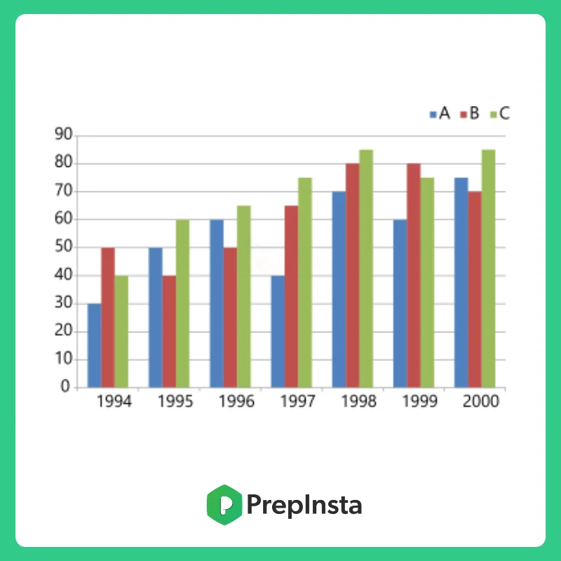
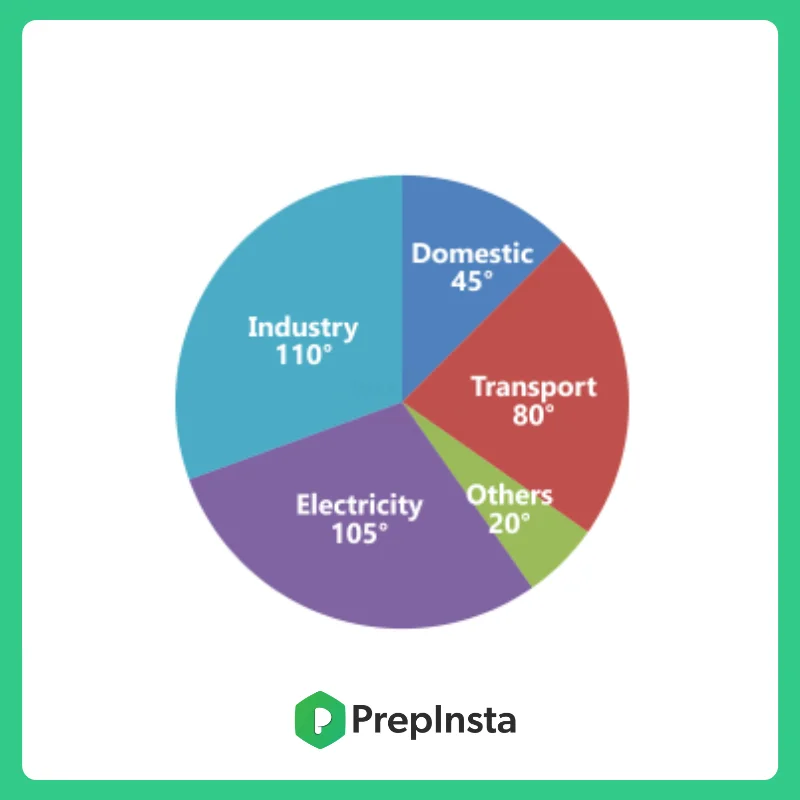
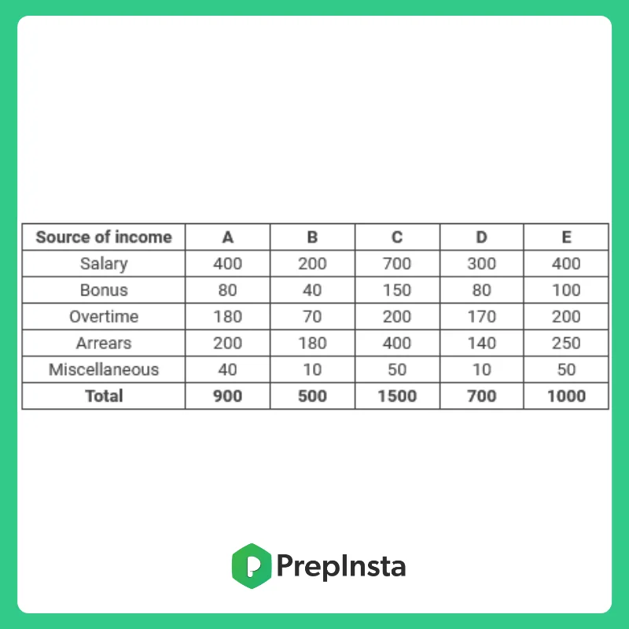
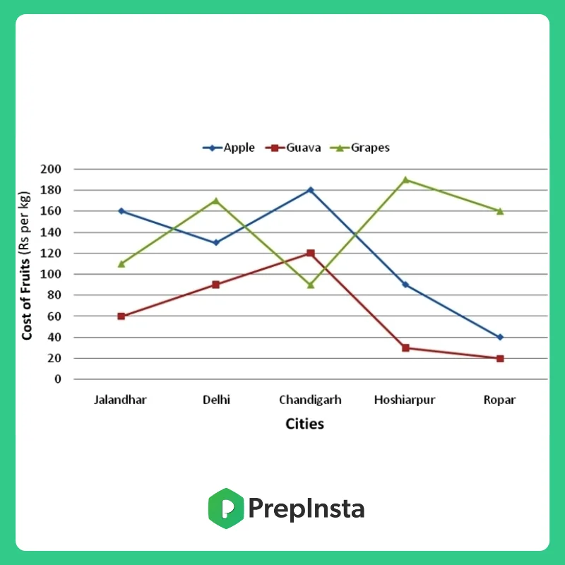
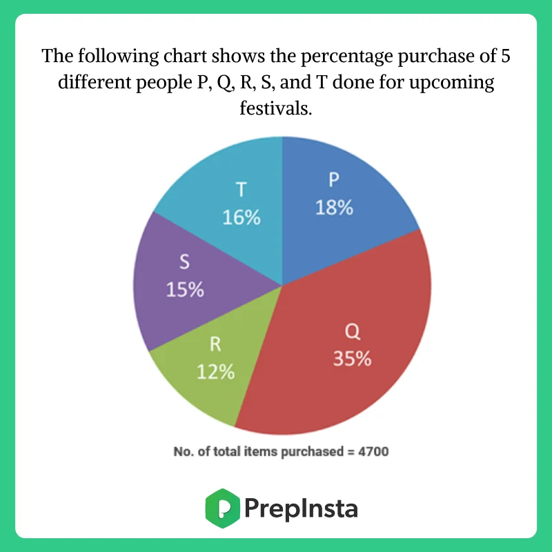

# Infosys SE Complete Preparation — Data Interpretation (Tables, Graphs & Charts)

**Source Portal:** PrepInsta Infosys Preparation Suite (`https://prepinsta.com/infosys/aptitude/data-interpretation/`)
**Target Role:** Infosys Systems Engineer (SE) | **Category:** 01_Mathematical_Ability_Technical_Aptitude
**Total Verified Questions Extracted:** 10 (Full Question Stems + High-Resolution Figures + Verified Options + Step-by-Step Solutions)
**Quizzes Covered:** Quiz 1 (Diagnostic Full Mock), Tables, Bar Charts, Line Graphs & Pie Charts

---

## 📋 Section 1: Rules to Keep in Mind
These rules and fundamental principles govern all Infosys questions on Data Interpretation:

- **Chart Identification & Scaling:** Always check axis labels, units (e.g. Rs. in Crores, tonnes in millions), and base multipliers before starting calculations.
- **Pie Chart Angle-to-Percentage Principle:** A full circular pie chart subtends $360° = 100\%$.
  - $1\% = 3.6°$
  - $1° = \frac{100}{360}\% = \frac{5}{18}\% \approx 0.2778\%$
- **Percentage Growth / Shift Formula:**
  $$\text{Percentage Change} = \left(\frac{\text{Final Value} - \text{Initial Value}}{\text{Initial Value}}\right) \times 100$$
- **Ratio Invariance:** When asked for ratios or percentage comparisons between sectors of the same base, compute directly with percentage units or degrees—never waste time converting to absolute figures.
- **Average Calculation:** Sum of category values across all periods divided by the number of periods ($N$).

---

## ⚡ Section 2: How to Solve Quickly
Proven time-saving strategies recommended by PrepInsta for Infosys 2026 examination:

1. **Visual Elimination on Bar & Line Graphs:** Compare relative bar heights or line inclinations visually first. When asked for "second lowest" or "maximum difference", eliminate 3 out of 5 options before calculating.
2. **Degree Summation Shortcut:** In pie charts, add or subtract sector angles first (e.g. $45° - 20° = 25°$), then perform a single conversion to absolute units at the end.
3. **Approximation Method:** Round awkward numbers to convenient benchmarks (e.g. $\frac{20}{340} = \frac{1}{17} \approx 5.88\% \approx 6\%$) to lock in the closest option immediately.

---

## 🚀 Section 3: Tricks & Shortcuts
Key mathematical formulas, mental-math shortcuts, and speed axioms:

- **Degree to Percentage Conversion Matrix:**
  - $18° = 5\%$
  - $36° = 10\%$
  - $72° = 20\%$
  - $90° = 25\%$
  - $180° = 50\%$
- **Cross-Multiplication for Fraction Comparison:** To check if $\frac{a}{b} > \frac{c}{d}$, compute $a \times d$ vs $b \times c$.
- **Avoid Absolute Values in Ratios:** $\frac{\text{Sector } A}{\text{Sector } B} = \frac{\text{Angle } A}{\text{Angle } B} = \frac{\text{Percent } A}{\text{Percent } B}$.

---

## 📚 Section 4: Practice Questions, Options & Step-by-Step Solutions
Contains **10** verbatim questions with options, verified answer keys, and complete derivations:

---

### 📊 Dataset 1: Imports of 3 Companies (Questions 1 & 2)



**Data Table (Imports in Rs. Crores):**
| Year | Company A | Company B | Company C |
| :---: | :---: | :---: | :---: |
| **1993** | 30 | 45 | 50 |
| **1994** | 50 | 55 | 60 |
| **1995** | 60 | 40 | 70 |
| **1996** | 40 | 60 | 50 |
| **1997** | 70 | 65 | 80 |
| **1998** | 60 | 70 | 65 |
| **1999** | 75 | 80 | 90 |

---

#### Question 1 (PrepInsta quiz-1 - Q1)
**Question Stem:**
Directions: Study the graph above carefully and answer the question:
In which of the following years, the imports made by company 'A' were exactly equal to the average import made by it over the given years?

**Options:**
- **(A)** `1995`
- **(B)** `1996`
- **(C)** `1997`
- **(D)** `None of the above`

**Correct Answer:** **(D)** `None of the above`

**PrepInsta Detailed Explanation & Mathematical Derivation:**
```text
Sum of imports of Company A over all 7 years:
= 30 + 50 + 60 + 40 + 70 + 60 + 75 = 385 Rs. Crores.

Average imports of Company A:
= 385 / 7 = 55 Rs. Crores.

Inspecting Company A imports per year:
1993: 30 | 1994: 50 | 1995: 60 | 1996: 40 | 1997: 70 | 1998: 60 | 1999: 75.
None of the given years has imports equal to 55 Rs. Crores.
Therefore, the answer is None of the above.
```

---

#### Question 2 (PrepInsta quiz-1 - Q2)
**Question Stem:**
What was the percentage increase in imports by company ‘B’ from 1995 to 1999?

**Options:**
- **(A)** `40%`
- **(B)** `250%`
- **(C)** `100%`
- **(D)** `200%`

**Correct Answer:** **(C)** `100%`

**PrepInsta Detailed Explanation & Mathematical Derivation:**
```text
Company B imports in 1995 = 40 Rs. Crores.
Company B imports in 1999 = 80 Rs. Crores.

Percentage Increase:
= [(80 - 40) / 40] * 100
= (40 / 40) * 100
= 100%
```

---

### 🥧 Dataset 2: Basic Fuel Expenditure of a Country (Questions 3 & 4)



**Context:** Total fuel energy consumed in 1992 was equivalent to **600 million tonnes of coal**.
- **Domestic:** $45°$
- **Transport:** $110°$
- **Industry:** $105°$
- **Electricity:** $80°$
- **Other Purposes:** $20°$
- **Total Circle:** $45° + 110° + 105° + 80° + 20° = 360°$

---

#### Question 3 (PrepInsta quiz-1 - Q3)
**Question Stem:**
The energy consumed for other purposes is approximately what percentage of total energy consumed for the other four major uses in 1992?

**Options:**
- **(A)** `20%`
- **(B)** `6%`
- **(C)** `5%`
- **(D)** `None of the above`

**Correct Answer:** **(B)** `6%`

**PrepInsta Detailed Explanation & Mathematical Derivation:**
```text
Energy used for other purposes = 20 degrees.
Total energy used for the 4 major areas:
= 110° (Transport) + 105° (Industry) + 45° (Domestic) + 80° (Electricity) = 340 degrees.

Required percentage:
= (20 / 340) * 100
= (2 / 34) * 100
= 100 / 17
= 5.88% ≈ 6%
```

---

#### Question 4 (PrepInsta quiz-1 - Q4)
**Question Stem:**
What is the difference between energy used for domestic purposes and other purposes in the country in 1992?

**Options:**
- **(A)** `35.33 million tonnes of coal`
- **(B)** `41.67 million tonnes of coal`
- **(C)** `52.75 million tonnes of coal`
- **(D)** `Can not be determined`

**Correct Answer:** **(B)** `41.67 million tonnes of coal`

**PrepInsta Detailed Explanation & Mathematical Derivation:**
```text
Difference in degrees between Domestic and Other purposes:
= 45° - 20° = 25°.

Since 360° represents 600 million tonnes of coal:
Value of 25°:
= (600 / 360) * 25
= (5 / 3) * 25
= 125 / 3
= 41.67 million tonnes of coal.
```

---

### 📋 Dataset 3: Monthly Employee Income & Bonus Structure (Questions 5 & 6)



**Data Table:**
| Employee | Basic Salary | Overtime | Bonus | Arrears | Total Income |
| :---: | :---: | :---: | :---: | :---: | :---: |
| **A** | 420 | 180 | 80 | 200 | **900** |
| **B** | 300 | 100 | 40 | 60 | **500** |
| **C** | 800 | 250 | 150 | 300 | **1500** |
| **D** | 350 | 120 | 80 | 150 | **700** |
| **E** | 500 | 200 | 100 | 200 | **1000** |

---

#### Question 5 (PrepInsta quiz-1 - Q5)
**Question Stem:**
Who among the following employees earns the maximum bonus in comparison to his total income?

**Options:**
- **(A)** `A`
- **(B)** `B`
- **(C)** `C`
- **(D)** `D`

**Correct Answer:** **(D)** `D`

**PrepInsta Detailed Explanation & Mathematical Derivation:**
```text
Calculate Bonus as % of Total Income for each employee:
- Employee A: (80 / 900) * 100 = 8.88%
- Employee B: (40 / 500) * 100 = 8.00%
- Employee C: (150 / 1500) * 100 = 10.00%
- Employee D: (80 / 700) * 100 = 11.42%
- Employee E: (100 / 1000) * 100 = 10.00%

Employee D earns the maximum bonus in comparison to his total income (11.42%).
```

---

#### Question 6 (PrepInsta quiz-1 - Q6)
**Question Stem:**
The income from overtime is what percent of the income from arrears in the case of employee A?

**Options:**
- **(A)** `90%`
- **(B)** `80%`
- **(C)** `75%`
- **(D)** `40%`

**Correct Answer:** **(A)** `90%`

**PrepInsta Detailed Explanation & Mathematical Derivation:**
```text
For Employee A:
- Overtime income = Rs. 180
- Arrears income = Rs. 200

Required Percentage:
= (180 / 200) * 100
= (9 / 10) * 100
= 90%
```

---

### 🍎 Dataset 4: Cost of Fruits Across Indian Cities (Questions 7 & 8)



**Fruit Price Schedule (Rs. per kg):**
| City | Apple (Rs/kg) | Guava (Rs/kg) | Grapes (Rs/kg) |
| :---: | :---: | :---: | :---: |
| **Jalandhar** | 160 | 60 | 80 |
| **Delhi** | 130 | 90 | 110 |
| **Chandigarh** | 180 | 120 | 90 |
| **Hoshiarpur** | 90 | 30 | 70 |
| **Ropar** | 40 | 20 | 50 |

---

#### Question 7 (PrepInsta quiz-1 - Q7)
**Question Stem:**
In which city is ‘the difference between the cost of 1 kg of apple and the cost of 1 kg of guava second lowest?

**Options:**
- **(A)** `Jalandhar`
- **(B)** `Delhi`
- **(C)** `Chandigarh`
- **(D)** `Ropar`

**Correct Answer:** **(B)** `Delhi`

**PrepInsta Detailed Explanation & Mathematical Derivation:**
```text
Compute |Apple - Guava| in each city:
- Jalandhar: 160 - 60 = Rs. 100
- Delhi: 130 - 90 = Rs. 40
- Chandigarh: 180 - 120 = Rs. 60
- Hoshiarpur: 90 - 30 = Rs. 60
- Ropar: 40 - 20 = Rs. 20

Ascending order of differences:
1. Ropar: Rs. 20 (Lowest)
2. Delhi: Rs. 40 (Second Lowest)
3. Chandigarh & Hoshiarpur: Rs. 60
4. Jalandhar: Rs. 100

The second lowest difference is in Delhi.
```

---

#### Question 8 (PrepInsta quiz-1 - Q8)
**Question Stem:**
The cost of 1 kg of guava in Jalandhar is approximately what percent of the cost of 2 kg of grapes in Chandigarh?

**Options:**
- **(A)** `66%`
- **(B)** `24%`
- **(C)** `28%`
- **(D)** `34%`

**Correct Answer:** **(D)** `34%`

**PrepInsta Detailed Explanation & Mathematical Derivation:**
```text
Cost of 1 kg of guava in Jalandhar = Rs. 60
Cost of 1 kg of grapes in Chandigarh = Rs. 90
Cost of 2 kg of grapes in Chandigarh = 2 * 90 = Rs. 180

Required Percentage:
= (60 / 180) * 100
= (1 / 3) * 100
= 33.33% ≈ 34%
```

---

### 🛍️ Dataset 5: Total Item Purchases by Stores (Questions 9 & 10)



**Context:** Total item purchase made across all 5 stores = **4,700 items**.
- **Store P:** $18\%$
- **Store Q:** $35\%$
- **Store R:** $12\%$
- **Store S:** $15\%$
- **Store T:** $16\%$
- **Total:** $18\% + 35\% + 12\% + 15\% + 16\% = 100\%$

---

#### Question 9 (PrepInsta quiz-1 - Q9)
**Question Stem:**
What is the difference between the total purchase of items made by R and T together and the total purchase of items made by P and S together?

**Options:**
- **(A)** `237`
- **(B)** `235`
- **(C)** `335`
- **(D)** `245`

**Correct Answer:** **(B)** `235`

**PrepInsta Detailed Explanation & Mathematical Derivation:**
```text
Total purchase % by P and S together:
= 18% + 15% = 33%

Total purchase % by R and T together:
= 12% + 16% = 28%

Difference in percentage:
= 33% - 28% = 5% of total purchase.

Required Difference:
= 5% of 4700
= (5 / 100) * 4700
= 5 * 47
= 235 items.
```

---

#### Question 10 (PrepInsta quiz-1 - Q10)
**Question Stem:**
What is the ratio of the total purchase made by P, R, and T together to that of S and Q together?

**Options:**
- **(A)** `23: 25`
- **(B)** `25: 27`
- **(C)** `31: 33`
- **(D)** `13: 15`

**Correct Answer:** **(A)** `23: 25`

**PrepInsta Detailed Explanation & Mathematical Derivation:**
```text
Total percentage for (P + R + T):
= 18% + 12% + 16% = 46%

Total percentage for (S + Q):
= 15% + 35% = 50%

Required Ratio:
= 46% : 50%
= 46 / 50
= 23 / 25
= 23: 25.
```
