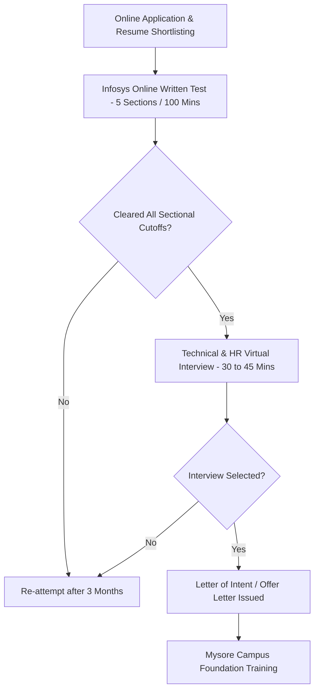

# Infosys Systems Engineer (SE) Recruitment Process & Eligibility Criteria
**Source Authority:** PrepInsta Placement Portal (`https://prepinsta.com/infosys/`)
**Target Designation:** Systems Engineer (SE) | **CTC Package:** 3.6 LPA – 4.0 LPA

---

## 📋 1. Eligibility Criteria for Systems Engineer (SE)

1. **Academic Qualification:** B.E. / B.Tech / M.E. / M.Tech / MCA / M.Sc (Computer Science / IT / Electronics / Electrical / all engineering streams allowed).
2. **Cutoff Percentage:** Minimum **60% or 6.0 CGPA** in Class 10, Class 12 / Diploma, and Graduation / Post Graduation.
3. **Active Backlogs:** **Zero active backlogs** permitted at the time of attending the selection process and joining.
4. **Academic Gap:** Maximum **2 years** of academic gap allowed, with valid justification.
5. **Re-attempt Cooling Period:** Candidates must not have appeared for any Infosys test/interview in the last **3 months**.

---

## 🔄 2. Complete Recruitment Workflow (Step-by-Step)

---

## 💼 3. Interview Round Architecture

For Systems Engineer, Infosys typically conducts a **Single Combined Technical + HR Interview** (30–45 Minutes):
- **Technical Focus (60%):** OOPs pillars (Inheritance, Polymorphism, Abstraction, Encapsulation), basic SQL queries (joins, group by, second highest salary), final year academic project deep-dive, basic DSA (arrays, strings, sorting).
- **HR & Behavioral Focus (40%):** Self-introduction, willingness to relocate anywhere across India, flexible shift readiness (24x7 rotation), 1-year service agreement (bond), scenario-based behavioral questions (conflict resolution, teamwork).