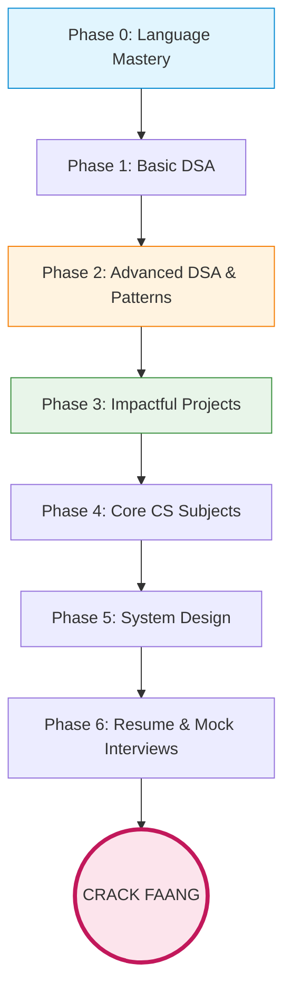

# The Ultimate FAANG Placement Roadmap 🚀
*From Absolute Beginner to Big Tech Engineer*

This is a comprehensive, step-by-step roadmap designed specifically for someone starting from scratch. FAANG companies (Facebook/Meta, Amazon, Apple, Netflix, Google) test you on **Problem Solving (DSA)**, **Core Fundamentals**, and **System Design**.

---

## 🗺️ Visual Timeline

---

## 🟢 Phase 0: Choose Your Weapon (Language Mastery)
> **Goal:** Master ONE programming language inside out. Don't jump between languages.

*   **Which Language?** **C++**, **Java**, or **Python**.
    *   *Python:* Fastest to write during interviews, very popular.
    *   *C++ / Java:* Excellent for learning memory management and OOPs (highly recommended for beginners).
*   **What to learn:** Variables, Loops, Functions, Arrays, Strings, and most importantly: **Object-Oriented Programming (OOP)** and the **Standard Template Library (STL/Collections)**.
*   **Resources:**
    *   C++: [LearnCpp.com](https://www.learncpp.com/) or CodeHelp (Love Babbar) on YouTube.
    *   Java: Kunal Kushwaha (YouTube).

> [!WARNING]
> Don't spend more than 3-4 weeks here. Language is just a tool; logic is the real game.

---

## 🟡 Phase 1: DSA Foundations (Data Structures & Algorithms)
> **Goal:** Understand how data is stored and manipulated efficiently.

*   **Topics to cover:**
    *   Time & Space Complexity (Big O Notation) - *Crucial!*
    *   Arrays & Strings (Two Pointers, Sliding Window basics)
    *   Searching (Binary Search & its variations)
    *   Sorting Algorithms (Merge Sort, Quick Sort)
    *   Linked Lists, Stacks, Queues, HashMaps.
*   **Resources:**
    *   **Striver’s A2Z DSA Course** (takeUforward) - *Gold standard for Indians.*
    *   **LeetCode:** Start solving easy problems related to the topic you just read.

---

## 🟠 Phase 2: Advanced DSA & Core Patterns (The FAANG Decider)
> **Goal:** Recognize patterns instead of memorizing solutions. FAANG rarely asks direct questions.

*   **Topics to cover:**
    *   Trees (Binary Trees, BST, AVL)
    *   Graphs (BFS, DFS, Dijkstra’s, Topological Sort)
    *   Recursion & Backtracking
    *   Dynamic Programming (1D, 2D, DP on Strings/Trees)
    *   Tries, Heaps (Priority Queues), Disjoint Sets.
*   **The "Pattern" Strategy:** Solve problems by patterns (e.g., "Fast & Slow Pointers", "Merge Intervals").
*   **Ultimate Resources:**
    *   **[NeetCode 150](https://neetcode.io/):** The absolute bible for FAANG prep. Do this list 2-3 times.
    *   **Blind 75:** (A subset of NeetCode 150).
    *   **AlgoMonster:** Great for learning *patterns*.

> [!IMPORTANT]
> **LeetCode Contest Strategy:** Start giving LeetCode Weekly Contests as early as Phase 2. FAANG interviews have a 45-minute ticking clock; contests build that pressure tolerance.

---

## 🟢 Phase 3: Development & Projects (Resume Builders)
> **Goal:** Build a resume that gets shortlisted by ATS (Applicant Tracking Systems).

FAANG companies want to see that you can build real-world software, not just solve puzzles.
*   **Tech Stack:** Pick one standard stack (e.g., **MERN** - MongoDB, Express, React, Node.js OR **Spring Boot + React**).
*   **Build 2 Unique Projects:** Stop building generic To-Do apps or simple clones.
    *   *Example 1:* A real-time chat application using WebSockets and Redis.
    *   *Example 2:* An e-commerce API with Stripe payment integration, JWT authentication, and Dockerized deployment.
*   **Best Practices:** Put your code on GitHub. Use a clean README.md. Host your frontend on Vercel/Netlify and backend on Render/AWS.

---

## 🔵 Phase 4: Core CS Fundamentals
> **Goal:** Pass the MCQs or the rapid-fire tech rounds.

*   **Operating Systems (OS):** Threads, Processes, Deadlocks, Mutex, Semaphores, Memory Management.
*   **Database Management Systems (DBMS):** SQL queries, ACID properties, Normalization, Indexing.
*   **Computer Networks (CN):** OSI Model, TCP vs UDP, HTTP/HTTPS, DNS.
*   **Resources:**
    *   Gate Smashers (YouTube)
    *   Neso Academy (YouTube)
    *   GeeksforGeeks short notes.

---

## 🟣 Phase 5: System Design (HLD & LLD)
> **Goal:** Design scalable architectures. *(Very crucial for SDE-2, but SDE-1s are also tested on basics).*

*   **Low-Level Design (LLD):** SOLID Principles, Design Patterns (Singleton, Factory, Observer), Object-Oriented Design (e.g., Design a Parking Lot, Design BookMyShow).
*   **High-Level Design (HLD):** Client-Server architecture, Load Balancing, Caching (Redis), Database Sharding, Microservices.
*   **Resources:**
    *   **ByteByteGo** by Alex Xu (Highly Recommended).
    *   **Gaurav Sen** System Design Playlist (YouTube).
    *   **Grokking the System Design Interview** (Educative.io).

---

## 🔴 Phase 6: The Endgame (Resume, Cold Emails & Mocks)
> **Goal:** Get the interview call and convert it.

*   **The Resume:** Keep it to 1 page. Use the single-column **Jake's Resume Template** (Overleaf). Use the XYZ format for bullets: *"Accomplished [X] as measured by [Y], by doing [Z]"*.
*   **Getting Referrals:** FAANG portals are black holes. Reach out to employees on LinkedIn. Ask for a referral by sending a brief, polite message attaching your strong resume.
*   **Mock Interviews:**
    *   [Pramp.com](https://www.pramp.com/) (Free peer-to-peer mocks)
    *   [Interviewing.io](https://interviewing.io/) (Mocks with actual FAANG engineers)
*   **The STAR Method:** Prepare behavioral questions using Situation, Task, Action, Result. ("Tell me about a time you failed").

> [!TIP]
> **Consistency > Intensity.** Coding 2 hours every day for 6 months is vastly superior to coding 12 hours a day for 1 month. Avoid burnout.
